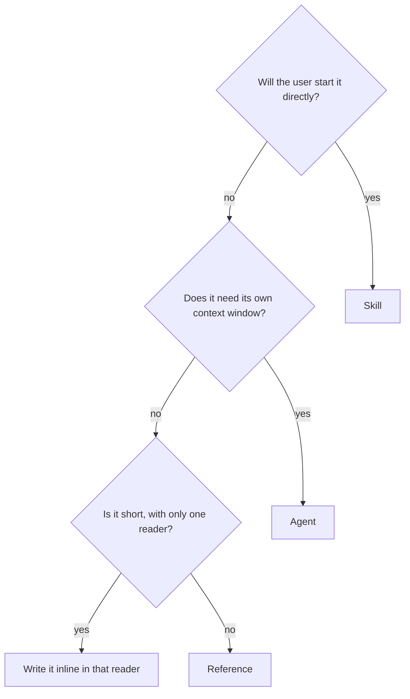
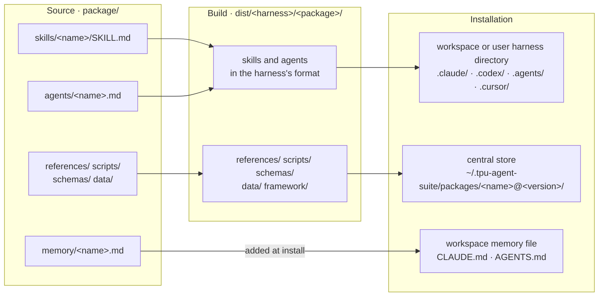

# Package Ontology

> **Design:** [Overview](README.md) · **Package** · [Framework](framework.md) · [Runtime](runtime.md) · [TPU agent suite](tpu-agent-suite.md)

At a high level, each package has two categories of elements. A skill, an
agent, a reference, and a memory block are each a markdown file of instructions
that a model reads; together we call them **prose units**. Everything else in a
package is a **resource**: the scripts that prose units run, the schemas that
describe what agents exchange, the data that scripts read. You write each of
them once, in a harness-neutral form. The framework finds them, checks that
they fit together, and builds them into the native format of every supported
harness.

## In one minute

- There are four types of **prose unit**: skills, agents, references and memory
  blocks. Each is a single markdown file. Skills, agents and references have
  YAML frontmatter.
- Everything else is a **resource**. **Scripts** are programs the prose units
  run, **schemas** describe the JSON that agents exchange, and **data** is what
  scripts read and write.
- **Memory blocks** are unique: no other prose unit uses them directly. The
  installer adds them to the workspace's memory file, and the harness loads
  that file into every session.
- The kind of a prose unit or resource is determined by the directory it lives
  in. There is no separate registry to keep in sync.
- `package.release.json` lists only the skills a release includes. The compiler finds
  every other prose unit, and the resources they need, by following the
  frontmatter of those skills.
- A prose unit's text never spells out a package path. It uses a token, such as
  `{{script:tpu-knowledge-base/index.py}}`, which the compiler replaces with the
  path the file will have once installed.

## The kinds

Prose units:

| Kind | Can a user start it? | Its own context window? | How it communicates | Location |
| --- | --- | --- | --- | --- |
| Skill | yes | no (it runs in the main session) | plain text | `skills/<name>/SKILL.md` |
| Agent | no | yes (isolated) | JSON, checked against its `accepts` and `produces` schemas | `agents/<name>.md` |
| Reference | no | no (it loads into its reader's context) | none | `references/<dir>/<name>.md` |
| Memory | no | no (it loads into its session's context) | none | `memory/<name>.md` |

- **Skill.** A user starts a skill, either by typing its name or by
  describing a task that the harness matches to the skill's description. A
  skill takes plain text and returns plain text. It can delegate to agents,
  load references and run scripts.
- **Agent.** Only a skill or another agent can start an agent. The harness
  gives it a fresh context window, so whatever it reads does not crowd the
  caller's context. It receives a JSON request and returns a JSON result, and
  the runtime checks both against the agent's schemas.
- **Reference.** A document that a skill or agent loads into its own context
  window when its instructions tell it to.
- **Memory.** A block of text that the installer adds to the harness's memory
  file (`CLAUDE.md` or `AGENTS.md`). Because the harness loads that file into
  every session, a memory block reaches every conversation, not only the ones
  that start a skill.

Resources:

| Kind | What it is | Location |
| --- | --- | --- |
| Script | a program that prose units run | `scripts/<dir>/<name>` |
| Schema | a JSON Schema for a request or a result | `schemas/<name>.json` |
| Data | files that scripts read or write | `data/<owner>/` |

- **Script.** A deterministic program, usually a Python script and occasionally
  a shell script. It takes command-line arguments and writes its output to
  stdout or to files. Tests for a script live beside it as `*_test.py` and are
  never shipped.
- **Schema.** A JSON schema describing the structure of data exchange between
  prose units and resources; typically, skill/agent -> agent.
- **Data.** Files that scripts read or write, such as a search index or cached
  web pages. Agents never load them directly into their context. Data ships
  only when it is listed under `copy` in `package.release.json`.

## Choosing a kind

When you add new instructions, ask these three questions in order.



- **A skill is an entry point for a user.** Do not turn an internal procedure
  into a skill just to give it a named entry point. A procedure that only other
  instructions read should be a reference.
- **An agent must justify its own context window.** A prose unit may need a
  separate window for many reasons e.g. it should not know what was done by the
  calling prose unit (to avoid undesirable influence or cheating), it reads a
  lot of content (e.g. analyzing a codebase) which can exhaust the caller, it
  generates a lot of content (e.g. running a loop to iterate on code) that the
  caller doesn't need to have in their context. An agent that only routes work
  to other agents does no work of its own, and belongs inside its caller
  (either directly, or as a reference).
- **A reference is the default** for instructions too long to inline. Create
  references when you want to reuse the same set of instructions from many
  other prose units, or you want to load the reference prose only under some
  conditions (to avoid bloating the caller's context window), or you simply
  want to keep each prose unit small and readable.
- **Inline** instructions that are short and have a single reader. A separate
  file whose entire content is one command is a sign something should have
  been inlined.

## Frontmatter

Frontmatter is the one place where a prose unit declares what it needs. The
compiler reads all of it, but only a little of it reaches the harness. The
build keeps what the harness needs to list and match a prose unit, such as its
`name` and `description`, and translates some fields into the harness's own
settings: an agent's `tools`, for example, become the harness's native tool
names. The rest is used up during the build. `delegates`, `accepts` and
`produces` become the execution contract appended to the prompt, `references`
and `scripts` decide which files ship, and a reference loses its frontmatter
entirely.

| Field | Skill | Agent | Reference | Meaning |
| --- | --- | --- | --- | --- |
| `name`, `description` | required | required | optional | The harness matches a user's request against the description. |
| `tools` | yes | yes | no | Portable tool names, such as `read` or `shell`. For an agent, the build grants only these tools, so the list is an upper bound on what it can call. A skill runs in the main session with that session's tools. |
| `delegates` | yes | yes | yes | The agents, or rarely skills, that this prose unit may start. |
| `references` | yes | yes | yes | Files or directories under `references/`. |
| `scripts` | yes | yes | yes | Files under `scripts/`. |
| `accepts`, `produces` | no | yes | no | The schemas for the agent's request and result. |
| `host_dependencies`, `tpu_dependencies` | yes | yes | yes | Python packages the prose unit needs on the user's machine and on the TPU host, by name only. Versions are pinned centrally. |

A reference's frontmatter is inherited: every prose unit that reads a reference
gains the scripts, references, delegates and dependencies the reference
declares, and this applies transitively. The compiler strips the frontmatter
before the reference ships.

## Tokens

A prose unit's text never spells out a path to a package file; it uses a token
instead. Tokens exist because (i) the real path is not known when the prompt is
written, since it depends on the harness, the install scope and the package
version, (ii) the compiler can check a token, so a misspelled, moved or
undeclared file fails the build rather than a user's session, and (iii) files
can move without anyone editing prose. The compiler replaces each token with
the installed path when it builds for a harness.

| Token | Replaced with |
| --- | --- |
| `{{agent:<name>}}`, `{{skill:<name>}}` | the prose unit to delegate to, in the form the target harness uses to name it |
| `{{reference:<path>}}` | the installed path of a file under `references/` |
| `{{script:<path>}}` | the installed path of a file under `scripts/` |
| `{{data:<path>}}` | the installed path of a file under `data/` that `package.release.json` copies |
| `{{schema:<path>}}` | the installed path of a file under `schemas/` |
| `{{runs}}` | the central runs directory |
| `{{runtime}}` | the command that runs the installed runtime |
| `{{package_tag}}` | this package's `<name>@<version>` |
| `{{harness}}`, `{{skills_dir}}` | the harness being built, and the directory it loads skills from |
| `{{built-in:<name>}}` | a tool the harness provides, such as the tool that asks the user a question |

The compiler also knows `{{package}}`, the package's install root, but you
should not build paths on it. `verify` rejects `{{package}}/scripts/foo.py`;
write `{{script:foo.py}}` instead, so the compiler can check that the file
exists.

`verify` enforces a few more rules:

- A `{{script:..}}` or `{{reference:..}}` token must name a file that the same
  document declares in its frontmatter. A `{{data:..}}` or `{{schema:..}}`
  token must name a file that `package.release.json` copies.
- A package path typed out in prose, such as `scripts/tpu-kernel-development/run.py`, is an
  error. The message names the token to use instead.
- Paths in the user's workspace are fine, but need a prefix such as `./` or
  `<work>/`, as in `./scripts/train.py`. Without one, `verify` cannot tell
  `scripts/train.py` apart from a package path that is missing its token.
- An unknown token kind, such as the typo `{{scripts:..}}`, fails and suggests
  the closest valid kind.

## What `package.release.json` holds

`package.release.json` describes a release. It does not describe the prose units in it.

- **Identity:** `name`, `version`, `display_name`, `description` and `author`.
- **What ships:** `skills`, a list of names, and `copy`, for files that no
  prose unit declares but that must ship anyway, such as `schemas` and
  `data/tpu-knowledge-base`.
- **Installation:** `environment` (the settings questions that compute
  setup and `config set` read, and a schema for
  environment.json), `workspace_memory`, `hooks` and `post_install`.
- **Targets:** `compatibility_targets`, one entry per harness, each with the
  range of harness versions it supports.

`package.release.json` does not list agents, references, schemas or dependencies. Older
versions of the manifest did, through seven fields: `entrypoint`, `agents`,
`include`, `schemas`, `host_dependencies`, `tpu_dependencies` and
`required_capabilities`. A manifest that still uses one of them fails `verify`,
with an error that says where that setting lives now.

## How the compiler finds prose units

The compiler starts from the skills that `package.release.json` releases and follows
their frontmatter:

- `delegates` lead to `agents/<name>.md`, or to another skill.
- `references` lead to files or directories under `references/`.
- Every prose unit that reads a reference inherits the reference's declarations.
- Every `schemas/*.json` file is registered, whether or not a prose unit names
  it.
- A file under `agents/`, `references/` or `scripts/` that no released skill
  reaches is left out of the build. `lint` lists such files so you notice them.

`compiler.py translate --skills a,b` builds the named skills instead of the
released ones. Each skill is built with its full delegation tree. You can build
fewer skills, but you cannot build part of a skill, because that would test
something different from what users install.

## Delegation rules

These are our rules as of this writing, mostly due to the limitations imposed by
one or more harnesses. We may relax these, if all the harnesses allow it.

- **Delegation happens in the foreground.** A caller starts an agent, waits for
  it to finish, and then reads what it wrote. Callers never poll for results.
  Background delegation is not supported yet, because we do not know how a
  caller should behave when a background agent dies or stalls.
- **At most three levels deep.** The compiler rejects a chain of delegation
  more than three levels below a released skill, rejects cycles, and rejects
  agents that nothing can reach.
- **Only a skill may ask the user a question.** A skill runs in the
  conversation the user sees. An agent runs out of view while its caller waits
  for its result, so it has no way to reach the user. When an agent needs an
  answer, it returns the status `needs_input` with its question, and the skill
  asks the user. `verify` rejects an agent that declares the ask tool.
- **A skill may delegate to another skill.** This is allowed but should be
  rare. `verify` and `lint` print a warning when it happens.

## Where everything lives

In the repository:

```
package/
├── package.release.json      the release: identity, released skills, install settings
├── default-prompt.md         the starter prompt a harness suggests to new users; used only at build time
├── skills/<name>/SKILL.md    one directory per skill, with no subdirectories
├── agents/<name>.md          one file per agent
├── references/<dir>/         documents that prose units load; subdirectories are allowed
├── scripts/<dir>/            programs that prose units run; *_test.py files beside them never ship
├── schemas/                  JSON schemas; every *.json is registered and shared by the package
├── environment/              the settings questions and their defaults
├── data/<owner>/             files that scripts read or write; ships only through `copy`
├── memory/<name>.md          memory blocks added to CLAUDE.md or AGENTS.md at install; never shipped as files
└── tests/                    package tests; tests/<unit>/ holds one prose unit's checkers and fixtures
```

From source to installation:



- Skills and agents are installed where the harness looks for them.
- Everything a prose unit reads or runs is installed once per version, in the
  central store, and shared by every workspace.
- Things that do not depend on the package version live beside the central
  store in `~/.tpu-agent-suite/`: `runs/` and `studies/`.
- Each workspace keeps its own compute settings and install record directly
  in `.tpu-agent-suite/`, as `environment.json` and `ownership.json`; it holds one
  package at a time.

## Dependencies

- A prose unit lists the Python packages it needs in its frontmatter, by name
  and without versions.
- Two catalogs at the package root pin every version:
  `requirements-client.txt` for the user's machine and `requirements-tpu.txt`
  for the TPU host.
- A build ships both catalogs trimmed to the packages its prose units declare,
  plus the few packages the shipped runtime itself imports.
- `verify` fails if a catalog entry has no version pin. `lint` warns about a
  catalog entry that no prose unit declares, since that entry will never ship.
