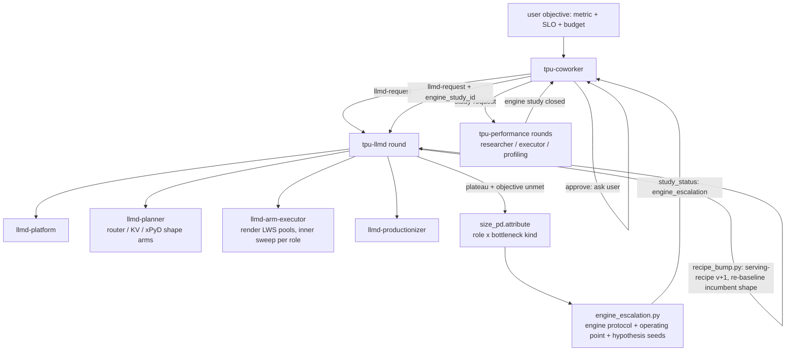

# tpu-llmd M5 — xPyD search, multi-host pools, and the fleet ↔ engine loop

Addendum to [tpu-llmd.md](tpu-llmd.md). Status 2026-10-16: implemented,
one commit per milestone; validated on a local kind cluster with the
simulated fleet (§11). TPU-live behaviour remains unverified.

## 1. Executive summary

M0–M4 produce the best **router + KV** configuration around a fixed engine
recipe and can stand up **one** prefill/decode split. They cannot find the
best P/D *shape*, they cannot render a replica that spans more than one
host, and when the fleet search plateaus they stop with a recommendation.
M5 closes those three gaps so that a fully engine-tuned model (the target
case is Qwen3.5-397B on tpu7x) runs through one system that keeps finding
improvements until the user's objective is met or the budget is spent:

1. **Multi-host pools.** A replica may be a LeaderWorkerSet group of
   `hosts` pods; chip accounting, readiness, drills, metrics and the EPP's
   endpoint discovery all become leader-aware.
2. **Per-role engine configuration.** Prefill and decode pools carry their
   own engine overlays; the inner sweep tunes them separately, in place.
3. **xPyD as a search, not an arm.** A ratio model sizes the opening
   `xP:yD` point from measured per-role token rates; the planner then walks
   the shape lattice (`P±1`, `D±1`, per-role TP/slice) by coordinate ascent
   on goodput per chip, with per-role attribution telling it which axis to
   move.
4. **Fleet ↔ engine escalation.** When the fleet search plateaus with the
   objective unmet, `tpu-llmd` attributes the bound to a role and a
   bottleneck kind, writes an **engine escalation** (protocol, operating
   point, hypothesis seeds, the recipe), and returns
   `study_status: engine_escalation`. `tpu-coworker` asks the user
   (`approve` mode) or proceeds (`auto`), runs `tpu-performance` rounds on
   that engine study, and when it closes feeds the **bumped recipe** back;
   `tpu-llmd` re-baselines the incumbent shape on the new recipe and the
   fleet search resumes. The loop ends on the objective, `max_escalations`,
   or `max_chip_hours`.
5. **Load-generator scale-out**, so the client never bounds a 397B-class
   fleet.
6. **A simulated fleet** (`engine_flavor: sim`, llm-d-inference-sim on CPU
   nodes) that runs the whole orchestration — LWS groups, xPyD arms,
   the escalation hand-off — in the user's namespace without a TPU, which
   is how M5 is validated here. TPU-live P/D stays UNVERIFIED until chips
   the study owns are available, and every artifact says so.

## 2. Architecture

Two studies, one objective. The llm-d study owns the fleet shape and the
objective; each engine study owns one role's single-replica throughput at
the operating point the fleet measured. The hand-off in both directions is
a file with a schema, never prose.

## 3. Multi-host pools (M5a)

**Config.** `topology.<role>` gains `hosts` (default 1). `chips_per_replica`
= `hosts × chips_per_host`, where `chips_per_host` is the recipe's
`accelerator.chips_per_host` (what one node exposes as `google.com/tpu`)
and `tpu_topology` is the slice the group forms. The recipe is the source
of truth for host size; the renderer refuses `hosts > 1` without
`chips_per_host`.

**Render.** `hosts > 1` renders a `LeaderWorkerSet` per pool
(`leaderworkerset.x-k8s.io/v1`; `replicas` = pool replicas,
`leaderWorkerTemplate.size` = `hosts`, `restartPolicy:
RecreateGroupOnPodRestart`), with the recipe's `args`/`env` on the leader
and worker templates, the GKE multi-host selectors
(`cloud.google.com/gke-tpu-topology`, `-accelerator`) and a
`subdomain` for the group. The leader serves vLLM; workers run the
recipe's `worker_command` (the distributed backend the recipe names — the
renderer does not invent a launcher; a recipe without one cannot render
multi-host). `hosts == 1` keeps today's Deployment.

**Discovery.** The EPP must see one endpoint per group: the model-server
selector adds the leader label
(`leaderworkerset.sigs.k8s.io/worker-index: "0"`) when any pool is
multi-host; the Service and PodMonitoring do the same.

**Lifecycle.** `wait` reads LWS `status.readyReplicas`; `drill` gains
`decode-leader-kill` (group restart) alongside `epp-pod-kill`;
`preflight` checks the LWS CRD and `--fix` installs the pinned release.
`teardown` deletes the LWS.

## 4. Per-role engine configuration (M5b)

`engine` stays the fleet default. `topology.prefill.engine` and
`topology.decode.engine` are overlays with the same whitelist;
`vllm_args(role)` merges default ← overlay. `reconfigure` classifies
`topology.<role>.engine.*` as **warm** and rolls that pool only. The
inner-sweep knob lists for the P/D kinds name per-role paths
(`topology.prefill.engine.max_num_batched_tokens`,
`topology.decode.engine.max_num_seqs`, …). The adopted-fleet refusal is
unchanged: overlays are engine changes.

## 5. xPyD search (M5c)

**Per-role attribution.** The PodMonitoring carries the pod's
`llm-d.ai/role` label into samples; `collect` adds `roles.prefill.*` /
`roles.decode.*` (running, waiting, KV util, prompt/generation tok/s,
server TTFT/ITL p90, preemptions) beside the fleet totals.

**Ratio model** (`size_pd.py`). Demand from the workload profile and the
measured prefix hit rate: prefill tok/s = `target_qps × ISL_mean ×
(1 − hit_rate)`, decode tok/s = `target_qps × OSL_mean`. Capacity per
slice from the recipe's `measured` block (`peak_prefill_throughput`,
`decode_tokens_per_s_at_knee`) or, when absent, from the aggregated
baseline's per-role rates at its knee. Opening point: `P = ceil(prefill
demand / prefill capacity / 0.8)`, `D = ceil(decode demand / decode
capacity / 0.8)`, bounded by `max_chips`; provenance `modeled`.

**Shape arms.** New arm kind `topology.pd_shape` (sets
`topology.prefill.replicas`, `topology.decode.replicas`, optionally
per-role `tp`/`slice`/`hosts`). The planner proposes the opening point,
then neighbours chosen by attribution: prefill-bound → `P+1` and
`D−1`; decode-bound → `D+1` and `P−1`; neither → `P−1`, `D−1` (leaner
shapes win on goodput/chip). Each shape arm's inner sweep covers the
decider (`nonCachedTokens`), per-role batched tokens / max seqs, and the
token-load weight. Coordinate ascent stops when every neighbour of the
incumbent has lost or tied (`plateau_rounds`), which is also the
escalation trigger below.

## 6. The fleet ↔ engine loop (M5d)

**Trigger.** At the end of a round, when all of: the protocol's objective
is unmet (`target` on the primary metric, or any SLO gate failing at
`target_qps`); the search is at a plateau (no open arm with
`headroom > 0`, or `plateau_rounds` without a win); and the loop is
enabled (`llmd-study.engine_loop.enabled`, `max_escalations` not reached).

**Attribution** (`size_pd.attribute()`, shared with the shape sizer) reads the incumbent's bench report
and per-role metrics and names one `role` and one bottleneck `kind` from
`study.BOTTLENECK_KINDS`:

| evidence | role | kind |
| :--- | :--- | :--- |
| TTFT gate fails first; prefill pool queue/KV high; server TTFT p90 ≈ client | prefill | `scheduler-batching` or `kernel-block` (needs profile) |
| TPOT gate fails; decode running ≈ `max_num_seqs`; gen tok/s per chip flat across shapes | decode | `scheduler-batching` / `kernel-block` |
| `kv_util_max ≥ 0.9` or preemptions > 0 | the role showing it | `memory-capacity` |
| client TTFT − server TTFT large; EPP latency high | router | *(fleet-side; no escalation)* |
| `client_limited` | loadgen | *(scale out; no escalation)* |

**Escalation artifact** (`engine_escalation.py`, schema
`engine-escalation.json`): `study_id`, `role`, `kind`, the recipe path and
digest, the **operating point** (ISL/OSL distribution, prefix hit rate,
concurrency = measured `requests_running` for that role, batched tokens),
the **engine objective** (prefill: maximize `prompt_tokens_per_s` on one
replica subject to TTFT p99 ≤ SLO at that concurrency; decode: maximize
`generation_tokens_per_s` subject to TPOT p99 ≤ SLO), the microbenchmark
workload (an inference-perf config for that role: long-ISL/OSL=1 for
prefill, short-ISL/long-OSL with warm prefix for decode), a
`study-protocol` for the engine study (cell = one replica of that role's
slice; replicates and noise floor inherited), and **hypothesis seeds** in
`hypothesis_bank.py`'s shape (`id`, `kind`, `claim`, `evidence`,
`target_parameters`) — the fleet-side knobs already exhausted are listed
as `excluded` so the researcher does not re-propose them.

`tpu-llmd` opens the engine study (`study start` with that protocol,
`attach-run`), writes the artifact, records a journal row on the llm-d
study, and returns `study_status: engine_escalation` with
`engine_escalation.{study_id, role, kind, request_path}`.

**Hand-off.** `tpu-coworker` (the only level that may ask) asks in
`approve` mode, then delegates `study-request`s to `tpu-performance` for
the engine study (it seeds via the researcher with the escalation's
hypotheses and `profile_summary_path`) until that study closes. It then
delegates back to `tpu-llmd` with `engine_study_id` set.

**Re-entry** (`recipe_bump.py`). `tpu-llmd` reads the engine study's
incumbent (its winning arm's `config` deltas: args/env/image, recorded by
the executor in the arm result's artifacts), writes
`serving-recipe.v<N+1>.json` (deltas applied, `measured` refreshed from
the engine study's final E2E, `source.engine_study_id`) and an amendment
naming the **successor fleet study** `<study_id>-v<N+1>` with the
baseline fingerprint (`commit_sha` = recipe digest) its first measurement
carries. The runtime refuses to replace a baseline that arms were
measured against (*"amend the protocol and start a new study"*), so the
old fleet study is closed with the bump as its outcome — its ledger stays
as history, no longer the incumbent's comparison — the successor opens on
the same protocol with `predecessor_study_id` and the escalation count
carried forward, the incumbent shape is re-measured on the new recipe as
the successor's baseline, and the search resumes. A role whose engine
study found nothing is recorded `engine_exhausted` and is not escalated
again. (The first design had `set-protocol` carry the fingerprint; the
protocol schema has no such field and the kind run surfaced it.)

**Stopping.** The objective met; `max_escalations` (default 3);
`max_chip_hours`; or both the fleet and every escalated role exhausted —
reported as such, with the ledger.

## 7. Load-generator scale-out (M5e)

The in-flight ceiling (`num_workers × worker_max_concurrency`) and CPU
per pod cap one Job; `bench` renders `shards = ceil(required / per-pod
ceiling)` Jobs per tenant, each with `rate / shards`, and the harvester
pools them: rates and counts sum; latency percentiles come from the
per-request records when the pinned inference-perf writes them, otherwise
the per-shard worst p99 is reported with `pooled: false`. The
`client_limited` gate stays as the check that scale-out worked.

## 8. The simulated fleet (M5f) — how M5 is validated here

`recipe.engine_flavor: sim` renders `ghcr.io/llm-d/llm-d-inference-sim`
in place of vLLM: no `google.com/tpu` request, CPU node selector, the
sim's latency flags from the recipe, `--kv-transfer-config`/TPU env
omitted, and a `sim` capability set from the probe. Everything above the
engine is real: the router chart, InferencePool, LWS groups (leader
serves, workers idle), xPyD pools, bench Jobs, collect, drills, and the
escalation artifacts. The validation run is a study on a 2P:2D sim fleet on a local kind cluster
that: measures a baseline, judges router arms, walks the shape lattice, hits
the plateau rule, and emits an engine escalation whose artifacts validate
against their schemas; `recipe_bump` is exercised against a synthetic
engine-study state. What this does not prove — connector behaviour on TPU,
real P/D transfer cost, real multi-host startup — is listed in the result's
`unverified`.

## 9. Milestones

| milestone | contents | exit | status |
| :--- | :--- | :--- | :--- |
| **M5a** multi-host pools | LWS rendering, `hosts`, leader-aware selectors/wait/drill/collect, preflight LWS CRD, tests | a `hosts: 2` recipe renders and applies as an LWS on the sim fleet | **done** |
| **M5b** per-role engine | overlays, `vllm_args(role)`, warm reconfigure per pool, per-role sweep knobs, tests | a decode-only `max_num_seqs` change rolls only the decode pool | **done** |
| **M5c** xPyD search | role-labelled collect, `size_pd.py`, `topology.pd_shape` arms, planner neighbour rule, evaluator per-role attribution, tests | sim study walks ≥ 3 shapes and converges by the plateau rule | **done** |
| **M5d** escalation loop | `size_pd.attribute()`, `engine_escalation.py`, `recipe_bump.py`, schemas, `engine_escalation` status, coworker hand-off, tpu-llmd re-entry phase, tests | sim study emits a schema-valid escalation; a synthetic engine study bumps the recipe and the llm-d study re-baselines | **done** |
| **M5e** loadgen scale-out | sharded bench Jobs + pooled harvest, tests | sharded stage runs without `client_limited` | **done** |
| **M5f** sim fleet + validation | `engine_flavor: sim` rendering, probe, docs; kind validation | recorded in §11 | **done** |

## 10. Risks and unknowns

- **Multi-host launch on TPU is recipe-defined.** The renderer places the
  recipe's leader/worker commands; it does not know how a given image
  starts a multi-host vLLM. `tpu-onboarding` must emit `worker_command`
  and `chips_per_host`, or the first multi-host arm is `blocked`.
- **Engine-study wins must be reproducible as recipe deltas.** The
  executor records code/config changes in its artifacts; `recipe_bump`
  reads only args/env/image deltas. A kernel-level win that ships as a
  new image is carried by `image`; anything else is reported, not bumped.
- **Latency pooling across loadgen shards** is exact only with per-request
  records; otherwise conservative.
- The sim's P/D and KV-event fidelity bounds what the sim run proves;
  the report names each gap.

## 11. Validation on kind

Validated on a local kind cluster with `llm-d-inference-sim` v1.0.0 as the
engine:

- **Platform:** `preflight --fix --sim` installs GAIE CRDs v1.5.0, the
  `llm-d-router` CRDs v0.11.0, and LeaderWorkerSet v0.11.1; the probe
  short-circuits to `mode: sim`.
- **Multi-host (M5a):** A `hosts: 2` decode pool renders as an LWS, `wait`
  verifies LWS readiness, the Service and the EPP select leaders only, and the
  `decode-pod-kill` drill verifies group recreation by pod UID.
- **End-to-end loop (M5c–M5f):** The sizer and escalation rule name the load
  generator on a `client_limited` report rather than attributing it to a pool;
  every bench report carries a `harness_digest` checked against the baseline;
  and `recipe_bump.py` opens a successor study (`<study_id>-v<N+1>`) when
  re-entering after an engine study win.
