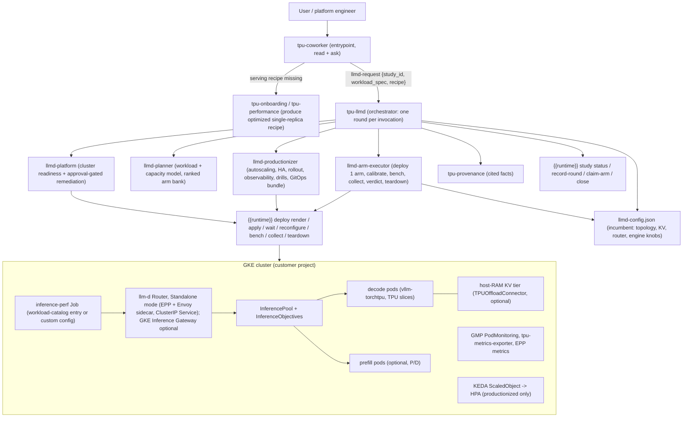

# Design: `tpu-llmd` — Production llm-d Deployment Optimization for TorchTPU Model Servers

| | |
| :--- | :--- |
| **Status** | Implemented (M0–M6) |
| **Scope** | `tpu-llmd` domain in `package/` plus `framework/deploy/` runtime extensions |
| **Targets** | llm-d v0.10.0 (latest, 2026-09-29), GKE Inference Gateway, Cloud TPU v6e / TPU7x on GKE |

---

## 1. Executive summary

The TorchTPU agent suite today ends at a **single, optimized vLLM-torchtpu replica**: `tpu-onboarding` gets a model serving on one TPU slice, `tpu-kernel` / `tpu-sharding` / `tpu-performance` make that replica fast, and `tpu-profiling` tells us where time goes. What a customer actually ships is a **fleet**: N replicas behind a router, possibly split into prefill and decode pools, with KV caches tiered into host RAM, prefix-aware and load-aware request scheduling, priority-based admission, autoscaling, HA, dashboards and a rollout story. That fleet-level layer is exactly what [llm-d](https://github.com/llm-d/llm-d) provides, and on GKE it is now the native product: *"GKE Inference Gateway is the llm-d Router operating in Gateway Mode"* ([GKE docs](https://cloud.google.com/kubernetes-engine/docs/concepts/about-gke-inference-gateway)). llm-d ships **first-class TPU overlays** (v6e and TPU7x) for its optimized-baseline, precise-prefix-cache-routing, tiered-prefix-cache, P/D-disaggregation, predicted-latency, multimodal and agentic-serving guides, with nightly GKE-TPU CI ([accelerators.md](https://github.com/llm-d/llm-d/blob/main/docs/getting-started/accelerators.md), [guides](https://github.com/llm-d/llm-d/tree/main/guides)).

This document proposes **`tpu-llmd`**, a new domain that takes an optimized serving recipe and a description of the customer's workload and SLOs, and produces a *measured, SLO-gated, production-ready* llm-d deployment on GKE — the topology, router configuration, KV-cache tiering, autoscaling policy, observability and rollout bundle — by running a bounded, cross-session optimization **study** in which each candidate fleet configuration is deployed, benchmarked against the customer's traffic shape, and judged against pre-registered gates.

**Decomposition decision (the question this doc was asked to answer).** We recommend **one user-facing domain, five role-based agents, and zero component-based agents**:

| Agent | Role | Analogue in today's suite |
| :--- | :--- | :--- |
| `tpu-llmd` | Orchestrator. Advances one round of the study per invocation; owns the protocol; never deploys or benchmarks itself. | `tpu-performance` |
| `llmd-platform` | Cluster readiness and (approval-gated) remediation: GKE version, Gateway API/GAIE CRDs, TPU node pools and capacity, KEDA, LWS, Kueue, GMP, weight-loading path. Runs once per study, re-run on demand. | the `gke_job` preflight, grown up |
| `llmd-planner` | Workload and capacity modelling; turns workload spec + recipe + baseline profile into a ranked, evidence-tagged bank of candidate arms. | `tpu-performance-researcher` |
| `llmd-arm-executor` | Deploys exactly one candidate fleet, calibrates, benchmarks, collects, tears down, returns a verdict. | `tpu-performance-executor` |
| `llmd-productionizer` | Hardens and hands off the winner: autoscaling from measured saturation, EPP HA, PDBs, canary rollout, dashboards/alerts, soak and failure drills, GitOps bundle, runbook. | the serving-mode hand-off in `tpu-onboarding`, grown up |

A **"router agent"** and a **"KV-offload agent"** are deliberately *not* agents. Router plugin configuration and KV connector/offload configuration are tightly coupled to the topology arm being tested (P/D needs `disagg-profile-handler`; tiered offload needs a second prefix-cache producer; precise prefix routing needs `--kv-events-config` and `--block-size=64` on the engine). The unit of measurement is the whole fleet, so splitting the configuration across agents would push the coupling into the orchestrator and multiply context cost without creating an independently measurable unit. Instead, router and KV knowledge is packaged as **reference documents, knowledge-base pages, and deterministic render scripts** (`render_epp_config.py`, `render_overlay.py`) that the planner and executor call. A **"GKE agent"** exists only in the narrow form of `llmd-platform`: it checks and remediates what llm-d needs on an existing cluster; it does not create clusters (that stays with Cluster Toolkit / `xpk` / the customer's platform team).

**Where the hill-climb happens.** The search for the optimal llm-d configuration is a two-level loop over one canonical document, `llmd-config.json` (topology, KV tiering, router plugins and weights, engine fleet knobs, autoscaling). The **outer loop** is the study: `tpu-llmd` + `llmd-planner` do greedy coordinate ascent over the *expensive* dimensions (topology, P/D split, connectors), each arm being a delta against the current incumbent. The **inner loop** runs inside `llmd-arm-executor`: within one deployment it sweeps the *cheap* dimensions (EPP scorer weights, affinity thresholds, prefix-cache block parameters, offload chunk counts) using EPP-only reconfiguration and rolling restarts, so a single arm returns its best-tuned variant rather than a single point. The acceptance rule, revisit rule and stopping rule are spelled out in §7.6.

**Defaults chosen to keep the first version simple.** The router runs in **Standalone mode** (EPP pod with an Envoy sidecar, reached via its ClusterIP Service; `GATEWAY_CLASS=epponly`); GKE Inference Gateway mode is an opt-in for customers who need the managed L7 load balancer. The workload is described by choosing an entry from the **inference-perf workload catalog** (`interactive-chat`, `code-generation`, `deep-research`, `reasoning`, `batch-summarization-rag`, `batch-synthetic-data-generation`, `agentic-trace-replay`) or by supplying an inference-perf config; the spec adds only what the catalog does not know — SLOs, tenancy, budget, cluster constraints.

**What is new in the framework.** llm-d releases are multi-resource (router Helm release, `InferencePool`, EPP Deployment, decode/prefill Deployments or `LeaderWorkerSet`s, `PodMonitoring`, KEDA `ScaledObject`), not single Jobs, so the existing `compute` verbs cannot express them. We add a **`{{runtime}} deploy`** family (`render`, `apply`, `wait`, `reconfigure`, `status`, `bench`, `collect`, `teardown`) tracked like jobs so the session-end reaper tears down experiments but never a release marked `--production`. The `study` runtime is reused as-is with an llm-d arm taxonomy.

**The hard dependency to validate first.** Every advanced llm-d path on TPU uses connectors that live in `vllm-project/tpu-inference` (`TPUConnector`/`TPUConnectorHMA` for P/D, `TPUOffloadConnector` for host-RAM tiering). The suite's model server is `vllm-torchtpu`. Whether that image exposes equivalent connectors decides whether P/D and tiered-KV arms are available at all. The design makes this an explicit, deterministic **engine capability probe** that prunes the arm space and reports `blocked_on_engine_capability` rather than guessing. See §15.

---

## 2. Goals and non-goals

**Goals**

1. Given an optimized single-replica serving recipe and a workload/SLO specification, produce a production llm-d deployment on GKE that meets the SLOs at the target load with the fewest TPU chips (equivalently: highest goodput-at-SLO per chip).
2. Make every architectural choice — aggregated vs. P/D, replica counts and P:D ratio, TP and slice topology, KV tiering, router plugins and weights, priority classes, autoscaling thresholds — a *measured* decision recorded with its evidence, not a guessed one.
3. Hand off something a platform team can run: GitOps-ready manifests, autoscaling and alerting derived from measurements, a runbook, and an acceptance report that states what was and was not verified.
4. Fit the suite's existing conventions: entrypoint routing, typed contracts, `{{runtime}}` for everything stateful, bounded rounds, provenance-cited facts, reaper-safe compute.
5. Be evaluable without TPUs where possible (router/EPP logic against `llm-d-inference-sim`), and nightly on real GKE-TPU for the deployment path.

**Non-goals (v1)**

- Creating GKE clusters, VPCs, or reservations. `llmd-platform` validates and remediates *inside* an existing cluster (node pools included, with approval); cluster creation is out of scope.
- Optimizing engine internals (kernels, sharding, model code). That is `tpu-kernel` / `tpu-sharding` / `tpu-performance`. `tpu-llmd` may tune a whitelist of engine flags that are fleet-coupled (§7.5) and otherwise refers back.
- Multi-cluster / multi-region fleets, wide-EP on TPU, P2P KV sharing, fast-model-actuation and pod-snapshot paths. llm-d does not ship TPU overlays for these today ([guides](https://github.com/llm-d/llm-d/tree/main/guides)); they are listed as future arms.
- Non-vLLM engines (SGLang, TRT-LLM) and non-GKE providers.

---

## 3. Background

### 3.1 What the suite produces today

The `tpu-coworker` entrypoint routes to `tpu-onboarding` (preflight → CUDA unwiring → deploy via `compute submit --serve` → parity → verification), `tpu-kernel`, `tpu-performance` (a round-based study with a pre-registered protocol, baseline, arms, admissibility gates and provenance labels), `tpu-profiling`, `tpu-hello-world`, `tpu-provenance`. Compute is reached through `{{runtime}} compute {inspect,preflight,run,submit,port-forward,job …}` on one of five backends; on GKE this is `gke_job` (**one single-host TPU Job**) or `gke_xpk`. The result of a full pass is a single-replica serving recipe (`serving-recipe.json`) and saturation curve — precisely the input a fleet design needs.

### 3.2 What llm-d is today (v0.10.0)

- **Architecture.** *llm-d Router* = L7 proxy (Envoy ext-proc, `FULL_DUPLEX_STREAMED`) + **Endpoint Picker (EPP)**; `InferencePool` (`inference.networking.k8s.io/v1`) groups model-server pods, with pod-label *variants* such as `llm-d.ai/role: prefill|decode`; `InferenceObjective` (`llm-d.ai/v1alpha2`) carries `priority`; `InferenceModel` no longer exists. The scheduler repo was renamed `llm-d-router` and absorbed the EPP code from GAIE and the KV indexer from `llm-d-kv-cache` ([architecture](https://github.com/llm-d/llm-d/blob/main/docs/architecture/README.md), [llm-d-router README](https://github.com/llm-d/llm-d-router/blob/main/README.md)).
- **Router modes.** *Standalone* (bundled Envoy sidecar on the EPP pod; default since v0.7; reached at the `<release>-epp` ClusterIP Service; `GATEWAY_CLASS=epponly`) or *Gateway* (an `HTTPRoute` whose `backendRef` is an `InferencePool`; Istio, agentgateway, **GKE Gateway**). On GKE the Gateway mode *is* GKE Inference Gateway. **This design defaults to Standalone mode.** It needs only the GAIE CRDs (`v1-manifests.yaml`, for `InferencePool`) and no `GatewayClass`, no GKE Gateway controller, no `HealthCheckPolicy`, and no GKE-version gate for built-in CRDs — which removes the largest source of cluster-specific setup failures from round 0. Gateway mode remains available (`gateway_mode: gke`) for customers who want the managed regional L7 LB, Model Armor, body-based routing or multi-cluster, and the productionizer documents the migration ([optimized-baseline guide](https://github.com/llm-d/llm-d/blob/main/guides/optimized-baseline/README.md), [gke.md](https://github.com/llm-d/llm-d/blob/main/docs/infrastructure/gateway/gke.md), [GKE deploy doc](https://cloud.google.com/kubernetes-engine/docs/how-to/deploy-gke-inference-gateway)).
- **EPP scheduling.** A YAML `EndpointPickerConfig` (`apiVersion: llm-d.ai/v1`, a file, not a CRD) declares `plugins`, `schedulingProfiles` (Filter → Score → Pick; weighted sum of [0,1] scores), `featureGates`, `dataLayer`. Default production blend since v0.9 is "sticky-until-saturated": `prefix-cache-affinity-filter` (with a calibrated `peakPrefillThroughput`) + `token-load-scorer`. P/D uses `disagg-profile-handler` with deciders and puts the prefiller in header `x-prefiller-host-port`; the decode pod carries a sidecar that performs `max_tokens=1` remote prefill then local decode ([scheduling.md](https://github.com/llm-d/llm-d/blob/main/docs/architecture/core/router/epp/scheduling.md), [disaggregation.md](https://github.com/llm-d/llm-d-router/blob/main/docs/disaggregation.md)).
- **Metrics the EPP needs from the engine.** `vllm:num_requests_waiting`, `vllm:num_requests_running`, `vllm:kv_cache_usage_perc`, `vllm:cache_config_info` (for `autoTune`), optionally `vllm:lora_requests_info` ([factories.go](https://github.com/llm-d/llm-d-router/blob/main/pkg/epp/framework/plugins/datalayer/extractor/metrics/factories.go)).
- **Deployment mechanics.** Since v0.7, model servers are **Kustomize overlays** under `guides/<guide>/modelserver/<accel>/<engine>/<infra>`; the router is a Helm chart (`llm-d-router-standalone` / `llm-d-router-gateway`) installed with `guides/recipes/router/base.values.yaml` + a per-guide values file; chart versions live in `guides/env.sh` ([v0.7 blog](https://llm-d.ai/blog/llm-d-v0.7-from-feature-introduction-to-production-hardening)).
- **Autoscaling.** The Workload Variant Autoscaler is **deprecated** (frozen at v0.9 under `legacy/` in `llm-d-autoscaling`); the recommended path is **KEDA** `ScaledObject`s on EPP metrics: `llm_d_epp_flow_control_queue_size` / `pool_saturation`, token-aware (`llm_d_epp_inflight_tokens ÷ peakPrefillThroughput`), or SLO-aware recording rules ([workload-autoscaling](https://github.com/llm-d/llm-d/blob/main/guides/workload-autoscaling/README.md), [llm-d-autoscaling](https://github.com/llm-d/llm-d-autoscaling/blob/main/README.md)).
- **Benchmarking.** `llm-d-benchmark` (`llmdbenchmark` CLI) drives inference-perf / guidellm / `vllm bench` and emits a report schema v0.2.1 with TTFT, TPOT, ITL, E2E, token rates ([benchmark-report](https://github.com/llm-d/llm-d-benchmark/blob/main/benchmark-report/README.md)). Google's Inference Quickstart profiles are also generated with inference-perf ([Inference Quickstart](https://cloud.google.com/kubernetes-engine/docs/how-to/machine-learning/inference-quickstart)).

### 3.3 TPU status inside llm-d (what we can build on, and what is missing)

| Path | TPU overlays | Mechanism | Source |
| :--- | :--- | :--- | :--- |
| optimized-baseline | `tpu/v6/vllm` (Qwen3-32B TP=8, `tpu-v6e-slice`, `2x4`), `tpu/v7/vllm`, `tpu/v7/vllm-dynamic-slice/{2x2x1,2x2x2}` | plain `vllm serve`; EPP sticky-until-saturated | [overlay](https://github.com/llm-d/llm-d/blob/main/guides/optimized-baseline/modelserver/tpu/v6/vllm/patch-vllm.yaml) |
| precise-prefix-cache-routing | `tpu/{base,v6,v7}` | `--kv-events-config` ZMQ; EPP `precise-prefix-cache-producer`; `--block-size=64` | [guide](https://github.com/llm-d/llm-d/blob/main/guides/precise-prefix-cache-routing/README.md) |
| tiered-prefix-cache | `tpu/{v6,v7}/vllm/native/cpu/{single-host,multi-host}` | `TPUOffloadConnector` (`tpu_inference.offload.tpu_offload_connector`), host RAM only; `TPU_OFFLOAD_NUM_CPU_CHUNKS`, `TPU_OFFLOAD_NUM_STAGING_BLOCKS` | [guide](https://github.com/llm-d/llm-d/blob/main/guides/tiered-prefix-cache/README.md) |
| pd-disaggregation | `tpu/{base,v6,v7,v7/vllm-dynamic-slice}` | v6e `TPUConnector`, v7 `TPUConnectorHMA` over DCN/TCP; `TPU_SIDE_CHANNEL_PORT=9600`, `TPU_KV_TRANSFER_PORT=9100`; decode sidecar `--kv-connector=nixlv2` protocol; TPU7x pinned to `vllm/vllm-tpu:v0.26.0` until tpu-inference#3566 ships | [guide](https://github.com/llm-d/llm-d/blob/main/guides/pd-disaggregation/README.md) |
| predicted-latency-routing | `tpu/vllm` | latency-predictor sidecars; SLO headers `x-llm-d-slo-ttft-ms`, `x-llm-d-slo-tpot-ms`; TPU7x Qwen3-Coder-480B ≈2.3× input tok/s at concurrency 40 | [guide](https://github.com/llm-d/llm-d/tree/main/guides/predicted-latency-routing) |
| agentic / multimodal serving | `tpu/vllm`, `tpu/vllm-disaggregated`, `tpu/v7/vllm/{gemma4,qwen3-vl}` | long-context + offload; privileged init container raising `vm.max_map_count` and VFIO `dma_entry_limit` | [guides](https://github.com/llm-d/llm-d/tree/main/guides) |
| TPU7x dynamic sub-slicing | docs + recipes, not in nightly e2e | Kueue TAS + GKE slice controller; `cloud.google.com/gke-tpu-slice-topology`; one LWS group per slice | [dynamic-slicing](https://github.com/llm-d/llm-d/blob/main/docs/infrastructure/providers/gke/dynamic-slicing/README.md) |
| observability | `guides/recipes/observability/tpu/` | scrapes `kube-system/tpu-metrics-exporter` (:2112): `tensorcore_utilization`, `memory_bandwidth_utilization`, `duty_cycle`, `memory_used/total` | [tpu.md](https://github.com/llm-d/llm-d/blob/main/docs/operations/observability/tpu.md) |
| **absent on TPU** | wide-EP, P2P KV sharing, FMA, pod-snapshot, flow-control and autoscaling guides have no TPU variant; no RDMA/ICI KV transfer; multi-host vLLM-TPU is marked ❓ in tpu-inference's matrix and "not supported" in the GKE vLLM-TPU tutorial, though an LWS+Ray codelab exists | | [tpu-inference](https://github.com/vllm-project/tpu-inference), [GKE tutorial](https://cloud.google.com/kubernetes-engine/docs/tutorials/serve-vllm-tpu) |

Two consequences shape the design. First, we should **reuse llm-d's TPU overlays at a pinned release tag** rather than author manifests: they are maintained by Google TPU maintainers, CI-tested nightly, and encode non-obvious details (sidecar init-container semantics, port conventions, sysctl init containers). Second, the connectors are **tpu-inference** modules; the probe in §8.3 exists because `vllm-torchtpu` is a different plugin.

---

## 4. High-level architecture



**Request flow for one study.** `tpu-coworker` resolves the three things a delegation needs — a `study_id`, a workload spec (it asks the user to pick an inference-perf workload-catalog entry and the SLO/tenancy/budget fields through its `ask` tool, or accepts a custom inference-perf config), and a serving recipe (from a prior run's artifacts or by first routing to `tpu-onboarding`) — then delegates `llmd-request`. `tpu-llmd` reads the study state through the runtime and does exactly one of: platform readiness (round 0), baseline (round 1), advance one arm (rounds 2..N), or productionize (terminal round). Each specialist returns a short typed result and leaves its real output under `{{runs}}/<run_id>/artifacts/tpu-llmd/<study_id>/`; the current best configuration is always the single file `llmd-config.json` there. The user comes back the next day, says "continue the `acme-chat-v7x` study", and the next round costs what the previous one did.

---

## 5. The decomposition decision

### 5.1 Options considered

| Option | Shape | Pros | Cons | Verdict |
| :--- | :--- | :--- | :--- | :--- |
| **A. One monolithic `llm-d` agent** | A single agent does readiness, planning, deploy, bench, hardening | Fewest contracts; simplest routing | Context blows up (Helm values, kustomize trees, `kubectl` output, benchmark CSVs); a deploy+warm+bench cycle is 30–90 min so one session rarely finishes; no clean place for human approval before spending chips; no resumability; violates the suite's "round 60 costs what round 2 cost" principle | Rejected |
| **B. Component agents** (`gke-agent`, `llm-d-router-agent`, `kv-offload-agent`, `autoscaling-agent`) | One agent per llm-d subsystem | Mirrors llm-d's repo layout; each is "expert" in its component | The components are not independently measurable: a router config is only right *for a topology*, an offload config only right *for a workload and a topology*. Every component agent would need the whole fleet context anyway. The orchestrator becomes the integrator of N partial configs and the real coupling logic moves into prose. Also multiplies cost per round | Rejected as agents; kept as **modules** (§5.3) |
| **C. Role-based agents around a study loop** (recommended) | Orchestrator + readiness + planner + per-arm executor + productionizer | Matches the proven `tpu-performance` shape; the executor is the one isolated, measurable unit; human approval has a natural seam (claim-arm in `approve` mode); readiness and hardening are separated because they have different permissions and run once | Five agent files to maintain; needs a new runtime verb family | **Recommended** |
| **D. Extend `tpu-performance` with llm-d arm kinds instead of a new domain** | Reuse the study orchestrator wholesale | Zero new orchestrator | `tpu-performance` is explicitly "never read a profile, only dispatch profiling"; llm-d needs cluster readiness, workload modelling and a productionization phase that have no analogue there; its baseline *requires an XProf profile*, which a fleet benchmark does not produce; routing by name ("a study") would also become ambiguous | Rejected, but the **study runtime** is reused unchanged |

### 5.2 Why role-based beats component-based here

1. **The measurable unit is the fleet.** The study protocol needs a verdict per arm with co-located metric and gates from the *same execution*. Only a complete deployment can be benchmarked, so the executor must own router + KV + topology + engine flags for its arm.
2. **Configs are generated, not reasoned.** Given an arm (`topology=pd, prefill=2xTP8, decode=4xTP8, kv=precise+tiered`), the EPP config, the connector JSON and the kustomize overlay are *derivable* from llm-d's own guide values files. That is a script, not an agent. Scripts are testable in CI without a model; agents are not.
3. **Approval and permissions differ by role, not by component.** Creating a node pool (platform), spending 32 chips for 90 minutes (executor), or touching a production `HTTPRoute` (productionizer) each need a different consent story. Role boundaries make the hooks enforceable (§12).
4. **Cost per round.** Each extra agent in a round is a fresh context loaded with llm-d background. The study loop keeps one dispatch per round; component agents would make it three or four.

### 5.3 What "router agent" and "KV agent" become

| Would-be agent | Becomes | Where |
| :--- | :--- | :--- |
| Router / EPP tuning | `render_epp_config.py` (topology + workload → `EndpointPickerConfig` + `InferenceObjective`s), `calibrate_prefill.py` (wraps llm-d's `calibrate.sh` to measure `peakPrefillThroughput` per variant), reference `references/ROUTER.md`, KB page `concepts/llm-d-router.md`; arm kinds `router.profile`, `router.flow_control`, `router.predicted_latency` | planner proposes; executor renders and measures |
| KV offload / tiering | `render_kv_config.py` (→ `--kv-transfer-config` / `--kv-events-config` / `TPU_OFFLOAD_*` env), reference `references/KV_CACHE.md`, KB page `concepts/llm-d-kv-tiering.md`; arm kinds `kv.precise_routing`, `kv.tiered_host`, `kv.block_size` | same |
| GKE / cluster | `llmd-platform` agent (narrow) + `{{runtime}} deploy preflight` (deterministic checks) + reference `references/PLATFORM.md` | round 0, and on demand |
| Autoscaling | `render_autoscaling.py` (measured saturation → KEDA `ScaledObject` thresholds) inside `llmd-productionizer`; arm kind `autoscaling.policy` is *verified* in soak, not searched | productionizer |

---

## 6. Agent specifications

All agents follow the package conventions: frontmatter manifest, `{{agent:…}}` tokens, `accepts`/`produces` schemas under `schemas/`, writes only under `<work> = {{runs}}/<run_id>/artifacts/tpu-llmd/<study_id>/`, `invalid_input` when `run_id`/`study_id` missing, `needs_input` when a question must reach the user, public facts via `{{agent:tpu-provenance}}`.

### 6.1 `tpu-llmd` (orchestrator)

- **tools:** read, write, edit, shell (shell only for `{{runtime}} study …` and `{{runtime}} deploy status`; a lint rule forbids `kubectl`/`helm` here).
- **accepts:** `schemas/llmd-request.json` — `{prompt, run_id, study_id, workload_spec_path, recipe_path, mode?: approve|auto, chip_budget?, production_namespace?}`.
- **produces:** `schemas/llmd-result.json` — `{status: round_recorded|study_closed|blocked|needs_input|invalid_input|failed, round, phase, arms_table[], incumbent{arm_id, config_path, score}, artifacts{…}, summary}`.
- **delegates:** `llmd-platform`, `llmd-planner`, `llmd-arm-executor`, `llmd-productionizer`, `tpu-provenance`.
- **Round algorithm (mechanical):**
  1. `study status`. If none: `study start` with the protocol derived from the workload spec (§7.2) — this is the only place the protocol is written, and in `approve` mode the user confirms it first (`needs_input` carrying the rendered protocol).
  2. Check the stopping rule (max rounds, plateau, target met, chip-hours cap).
  3. Harvest in-flight arms (`arm-result` landed?). A verified win replaces the incumbent `llmd-config.json` (§7.6).
  4. Branch on `phase` recorded in the study state: `platform` → dispatch `llmd-platform`; `baseline` → dispatch executor with the baseline arm; `search` → if open arms < threshold dispatch `llmd-planner`, then `claim-arm` the top-ranked open arm and dispatch the executor; `productionize` → dispatch `llmd-productionizer` with the incumbent `llmd-config.json`.
  5. `record-round` (whole state), `append-journal` on overflow, exit.
- **Phase transitions** are recorded as protocol facts, never inferred: `platform → baseline` when readiness is `ok`; `baseline → search` when a baseline with `measured` provenance and ≥ replicate_count exists; `search → productionize` when stopping rule met **and** a win exists, or the user asks to promote the current best; a search that ends with no win still productionizes the baseline if it meets the SLO, otherwise closes `blocked` with a capacity finding.

### 6.2 `llmd-platform`

- **tools:** read, write, shell. **accepts/produces:** `llmd-platform-request/-result.json`.
- **Does:** runs `{{runtime}} deploy preflight --json`, which checks (read-only), in Standalone mode by default — GAIE CRDs (`InferencePool` from `v1-manifests.yaml`, `GAIE_VERSION=v1.5.0`) and the `llm-d.ai` CRDs (`InferenceObjective`) present or installable; Helm reachability of the pinned `llm-d-router-standalone` chart; Managed Prometheus enabled; KEDA, LWS ≥ 0.11.0, Kueue (only if dynamic slicing or queued provisioning) installed; `tpu-metrics-exporter` present; TPU node pools matching the recipe's `tpu_accelerator`/`tpu_topology` with enough schedulable capacity for the chip budget (or a reservation / flex-start path); `llm-d-hf-token` secret; weight-loading path (GCS FUSE with parallel downloads, Hyperdisk ML, or hostPath cache as llm-d's TPU overlays do); Artifact Registry access to the recipe image; namespace RBAC; host RAM per TPU node (for `kv.tiered_host` arms). **Only when `gateway_mode: gke`** it additionally checks GKE ≥ 1.34.0-gke.1626000 for the built-in `InferencePool` v1, Gateway API CRDs, a `GatewayClass` (`gke-l7-regional-external-managed` / `gke-l7-rilb`) and that `provider.name=gke` will render a `HealthCheckPolicy` ([GKE deploy doc](https://cloud.google.com/kubernetes-engine/docs/how-to/deploy-gke-inference-gateway), [optimized-baseline guide](https://github.com/llm-d/llm-d/blob/main/guides/optimized-baseline/README.md)).
- **Remediation:** produces a numbered remediation plan with the exact `gcloud`/`kubectl`/`helm` commands and a cost note; applies only items the request whitelists (`auto_remediate: [gaie_crds, llmd_crds, keda, lws, podmonitoring, hf_secret]` by default; **never node pools, reservations or Gateways without `approve`**). Returns `ok | ok_with_warnings | blocked` with the blocking item.
- **Why a separate agent and not just the script:** remediation needs judgement (which weight path for a 475 GB checkpoint, whether to request dynamic slicing, whether a capacity shortfall should become a flex-start request) and the suite's rule is that judgement calls get their own bounded context. The Standalone default is what keeps this agent small: it no longer has to reason about Gateway controllers.

### 6.3 `llmd-planner`

- **tools:** read, write. No shell: it models, it does not deploy. **accepts/produces:** `llmd-plan-request/-result.json` (a bank of `llmd-arm` candidates).
- **Inputs:** the resolved workload (the catalog entry's harness-agnostic `config.json` — input/output length distributions, turns, time between turns, system-prompt length, `shared_prefix_ratio`, `cacheable_tokens_per_call` — and its `metadata` classification such as prefill-heavy / decode-heavy / shared-prefix / long-context, which the catalog explicitly maps to optimizations like P/D, prefix-aware routing and KV offload ([workload-catalog](https://github.com/kubernetes-sigs/inference-perf/tree/main/workload-catalog)), or the equivalent statistics derived from a custom inference-perf config), the SLO/tenancy/budget part of the spec, the recipe (single-replica saturation curve, HBM/KV capacity, TP, topology), the **incumbent `llmd-config.json`** and its measured fleet profile (EPP + vLLM + TPU exporter metrics), the capability probe, and decided arms so far (dedup via journal tail like `hypothesis_bank.py`). The planner is the outer loop's proposer in §7.6: every arm it emits is a delta against the incumbent, never against the original baseline.
- **Model it applies (deterministic first, judgement second):**
  - *Capacity floor:* replicas ≥ ceil(peak QPS × mean tokens / per-replica goodput at SLO from the recipe curve) — the knee the suite already measures.
  - *P:D ratio and whether P/D is worth it:* the KB's `size-serving-topology` playbook step 10, `P / T_prefill = B·G / (T_step · median_decode_len)` (`knowledgebase/wiki/playbooks/size-serving-topology.md`), plus llm-d's rule of thumb that P/D pays when the workload is prefill-heavy and ITL-sensitive and costs TTFT (16×H200 GKE: ITL 4.9 ms vs 25 ms, TTFT +117% — [pd-disaggregation](https://github.com/llm-d/llm-d/blob/main/guides/pd-disaggregation/README.md)); on TPU the transfer is DCN/TCP, so the KV-bytes-per-request × QPS must fit the host NIC — a modelled gate before deploying.
  - *Prefix sharing ratio → precise prefix routing / tiered offload:* high shared-prefix (system prompts, agentic tool loops, multi-turn) → `kv.precise_routing` and `kv.tiered_host`; llm-d reports 57× TTFT in its KV-cache-wins benchmark and 13.9× at 250 users with a tiered backend ([v0.3](https://llm-d.ai/blog), [tiered-prefix-cache](https://github.com/llm-d/llm-d/blob/main/guides/tiered-prefix-cache/README.md)); low sharing → skip, they only add overhead.
  - *Tenancy / priorities → flow control:* multiple traffic classes with different SLOs → `router.flow_control` arm with `InferenceObjective` priorities (priority < 0 shed first with 429 — [GKE concept doc](https://cloud.google.com/kubernetes-engine/docs/concepts/about-gke-inference-gateway)).
  - *Heterogeneous request lengths → predicted-latency routing* (production-ready since v0.7; TPU overlay exists).
  - *Slice shape:* TPU7x `2x2x1` vs `2x2x2` per replica; more, smaller replicas for routing headroom vs fewer, larger for long context; dynamic sub-slicing when the pool is a `4x4x4` block.
- **Output:** ranked arms each with `kind`, `claim`, `modeled_headroom` (labelled `modeled`), `prerequisites` (capabilities, chips), `config_delta` (the inputs to the render scripts), and `evidence` (URLs via provenance or KB pages).

### 6.4 `llmd-arm-executor`

**Is this where the hill-climb happens?** Partly, and deliberately so. The search has two levels (§7.6). The *outer* level — which topology, which connectors, how many replicas — is the study loop driven by `tpu-llmd` and proposed by `llmd-planner`, because each step there costs a fresh deployment. The *inner* level — scorer weights, affinity thresholds, prefix-cache block parameters, offload chunk counts, the engine's fleet knobs — happens **here, inside one deployment**, because those can be changed in seconds (EPP config reload) or minutes (rolling restart) without re-allocating TPUs. An arm therefore returns not a single measurement but *the best-tuned variant of its configuration*, with the sweep ledger attached. That is what makes the outer comparison fair: "P/D vs aggregated" is compared with each side at its own best router settings, not at the defaults.

- **tools:** read, write, edit, shell. **accepts/produces:** `llmd-arm-request.json` / `arm-result.json` (reusing the study's envelope with an llm-d `metric` block, a `config` block holding the arm's final `llmd-config.json`, and a `sweep_ledger`).
- **Protocol for one arm (strict order):**
  1. Read protocol (primary metric, gates, replicate count, noise floor, chip budget, `inner_sweep_budget`) and the incumbent `llmd-config.json`.
  2. **Render**: `{{runtime}} deploy render --config candidate.json --recipe recipe.json --out <work>/<arm>/release/` → kustomize overlay (from the pinned llm-d guide base for the arm's path and accelerator), `llm-d-router-standalone` values + `EndpointPickerConfig`, connector env/flags, `PodMonitoring`, inference-perf Job spec from the resolved workload. Rendering is deterministic and diffable; the executor may *not* hand-edit rendered manifests except through documented `--set` overrides that are recorded in the config.
  3. **Chip check**: refuse if `chips(arm) > chip_budget − chips(production)`; record `blocked`.
  4. **Apply + wait**: `deploy apply --name <study>-<arm>`; `deploy wait --until ready` (all variants Ready, EPP healthy, `/v1/models` answering at the `<release>-epp` ClusterIP Service). Model load on TPU for a large checkpoint can take many minutes; the wait is bounded by the protocol's `startup_timeout`.
  5. **Calibrate**: for sticky-until-saturated routing, measure `peakPrefillThroughput` per variant with the calibration flow and re-render the EPP config if it differs from the planner's estimate by more than 10% (llm-d publishes 26,290 tok/s for Qwen3-32B TP=8 on v6e and 27,336 on v7x as reference points — [sticky-until-saturated blog](https://llm-d.ai/blog/sticky-until-saturated-token-aware-routing)).
  6. **Warm-up** with the workload profile at low rate until TTFT stabilises (prefix caches populated, XLA caches compiled).
  7. **Benchmark the arm's starting point** (`deploy bench`): inference-perf in-cluster Job against the router Service with the resolved workload — a multi-stage sweep to locate the knee, then `replicate_count` runs at the SLO-target rate. Outputs in llm-d-benchmark report schema v0.2 for interoperability.
  8. **Inner sweep** (the local hill-climb), bounded by `inner_sweep_budget` benchmark runs: for each *hot* dimension the arm's kind opens (§7.6 table) — e.g. `prefix-cache-affinity-filter.threshold`, `token-load-scorer` vs `active-request-scorer` weights, `approx-prefix-cache-producer.blockSizeTokens`, `prefix-based-pd-decider.nonCachedTokens`, `TPU_OFFLOAD_NUM_CPU_CHUNKS`, `max-num-seqs`/`max-num-batched-tokens` — apply the change with `deploy reconfigure` (EPP-only restart for router knobs; rolling restart of the affected variant for engine/connector knobs), re-warm, re-bench at the SLO-target rate, and keep the change only if it clears the noise floor with gates intact. Numeric knobs use a bounded golden-section search over the range the reference document declares; categorical knobs enumerate at most four values. Every step is a row in `sweep_ledger` with its own `execution_id`. The sweep stops at budget exhaustion or when no dimension improves.
  9. **Confirm**: re-run `replicate_count` at the SLO-target rate on the final tuned configuration — the number that goes into the verdict is this one, never the best single sweep row.
  10. **Collect** (`deploy collect`): PromQL over the confirmation window from GMP — EPP (`llm_d_epp_*`, `inference_pool_average_kv_cache_utilization`, `inference_pool_average_queue_size`), vLLM (`vllm:num_requests_waiting`, `vllm:kv_cache_usage_perc`, prefix hit rates, preemptions), TPU exporter (`tensorcore_utilization`, `duty_cycle`, `memory_used`), connector transfer metrics where exposed, 429/5xx counts. This is the fleet "profile" the planner ranks on next round.
  11. **Output-equivalence gate**: a fixed probe set at temperature 0 through the router, compared token-wise against the baseline arm's captures; P/D and offload paths move KV bytes and *can* change numerics, so this is a gate, not an assumption.
  12. **Evaluate** with `evaluate_arm.py`: verdict `win | tie | loss | invalid | blocked` against the **incumbent**, every gate reported, one `execution_id` (the release name + confirmation benchmark Job UID) shared by metric and gates; the arm's final `llmd-config.json` travels in the result so a `win` can become the new incumbent without re-deriving anything.
  13. **Teardown** unless the arm is flagged `keep_for_promotion` by the protocol; experiments are never left holding chips. A `--production` release is never touched by the executor.

### 6.5 `llmd-productionizer`

- **tools:** read, write, edit, shell. **accepts/produces:** `llmd-promote-request/-result.json`.
- **Does, in order:** (1) re-render the **incumbent `llmd-config.json`** with production settings — EPP replicas ≥ 2 (active-active when the tuned plugin set only uses model-server-pulled state such as precise prefix, queue and KV-util; leader-election otherwise), PDBs, resource requests, `restartPolicy`, graceful drain (`--drain-timeout`), hostPath/GCS weight cache; (2) **exposure** via `deploy expose`: an internal passthrough LB Service in front of the Standalone router by default, or `--via gke-gateway` when `gateway_mode: gke` (Gateway + `HTTPRoute`, `HealthCheckPolicy`, GKE EPP HA via `provider.gke.preferredBackends`); (3) **autoscaling** via `render_autoscaling.py`: KEDA `ScaledObject` per variant with thresholds derived from the measured saturation (token-aware: `llm_d_epp_inflight_tokens / peakPrefillThroughput` against the TTFT SLO; decode on KV occupancy), min replicas = capacity floor at p50 load, max = chip budget; cooldown/stabilisation windows from the measured startup time; (4) **observability bundle**: `PodMonitoring`s, llm-d's TPU and router dashboards, alert rules (SLO burn, 429 rate, KV transfer failures, pod restarts) migrated with `gcloud monitoring policies migrate`; access logging via `GCPBackendPolicy` in Gateway mode; (5) **rollout**: canary from the existing production release if one exists — a weighted split at the exposure layer (`HTTPRoute` weights in Gateway mode; a second router release behind the LB with endpoint weights in Standalone mode) — with the acceptance benchmark run at each step; (6) **soak + drills**: hold the target load for the protocol's soak duration; kill one decode pod; kill one prefill pod (expect decode-only fallback); kill an EPP replica; scale 0→N on a cold node; each drill is a pass/fail row; (7) **GitOps bundle** (§9) including `llmd-config.json`, the search ledger, kustomization, values, `ScaledObject`s, monitors, alerts, a runbook (how to scale, roll back, rotate images, re-calibrate, migrate to Gateway mode) and the acceptance report listing every gate, its measured value, and every drill. Marks the release `--production` so no reaper or executor touches it.

### 6.6 Routing line added to `tpu-coworker`

> For taking an already-optimized TPU serving recipe to a production llm-d deployment on GKE — a fleet with routing, prefill/decode split, KV tiering, autoscaling and SLOs — delegate to `{{agent:tpu-llmd}}`. It takes an `llmd-request` with a `study_id` (user's slug, confirmed, never minted silently), a `workload_spec_path` and a `recipe_path`. If no recipe exists, run `{{agent:tpu-onboarding}}` (serving mode, `engine: vllm`) first and pass its artifacts. If the workload spec is missing, build it before delegating, because the specialist cannot ask: offer the user the inference-perf workload-catalog entries (`interactive-chat`, `code-generation`, `deep-research`, `reasoning`, `batch-summarization-rag`, `batch-synthetic-data-generation`, `agentic-trace-replay`) as a single choice, or accept a path to their own inference-perf config; then ask only for target and peak rate, the per-tenant SLOs and priorities, the chip budget and accelerator, and the namespace. Do not choose it for "make my model faster" (that is profiling) or for a single-replica deploy (that is onboarding).

---

## 7. The optimization protocol

### 7.1 Inputs

**Workload specification** (`schemas/llmd-workload-spec.json`). The traffic shape is *not* re-described here; it is taken from the [inference-perf workload catalog](https://github.com/kubernetes-sigs/inference-perf/tree/main/workload-catalog), whose entries each ship a harness-agnostic `config.json` (input/output length distributions, turns, time between turns, system-prompt length, shared-prefix statistics, and a `metadata` block that classifies the workload and maps it to optimizations), a ready-to-run `inference-perf.yaml`, and a README. The user picks one entry — most customers' workloads are one of the seven — or supplies their own inference-perf config (which may be a trace-replay config built from their request logs). The spec then adds only what the catalog cannot know: load level, SLOs, tenancy, budget, and cluster constraints.

```jsonc
{
  "name": "acme-chat",
  "workload": {
    // exactly one of the three:
    "catalog_entry": "interactive-chat",            // from inference-perf/workload-catalog/<entry>/
    "inference_perf_config": null,                  // path to a user-supplied inference-perf YAML (incl. trace replay)
    "trace": null,                                  // path to request log -> rendered into an inference-perf trace config
    "overrides": {                                  // optional, applied on top of the entry's inference-perf.yaml
      "rate": {"target_qps": 120, "peak_qps": 300, "sweep": [20, 40, 80, 120, 160, 240, 300]},
      "max_model_len": 32768,
      "streaming": true
    }
  },
  "tenancy": [
    {"name": "interactive", "share": 0.7, "priority": 10, "slo": {"ttft_p90_ms": 500, "tpot_p90_ms": 30}},
    {"name": "batch",       "share": 0.3, "priority": -5, "slo": {"ttft_p90_ms": 5000, "tpot_p90_ms": 80}}
  ],
  "availability": {"error_rate_max": 0.001, "zonal_failure_tolerated": true},
  "budget": {"max_chips": 64, "accelerator": "tpu7x", "capacity": "reservation | flex-start | spot", "cost_target_usd_per_1m_tokens": null},
  "constraints": {"region": "us-central1", "namespace": "serving", "gateway_mode": "standalone", "max_model_len": 32768}
}
```

`render_workload.py` resolves this to (a) the inference-perf config the benchmark Job runs — the catalog entry's `inference-perf.yaml` with `overrides` applied, or the user's file verbatim; multi-tenant specs render one `inference-perf` stage per tenant with the matching priority header — and (b) a `workload_profile.json` for the planner: the catalog entry's `config.json` plus `metadata`, or, for custom configs, the same statistics derived from the config (or from the trace) so the planner's decision rules see one shape regardless of source. A one-line summary of the chosen entry (e.g. *"code-generation: parallel tree-of-thought paths over a shared codebase context — shared-prefix heavy, prefill heavy"*) is echoed back to the user before the study opens, so the choice is a visible decision. The catalog is vendored at a pinned inference-perf commit alongside the pinned llm-d tag so a study's workload cannot drift mid-run.

**Serving recipe** (`schemas/serving-recipe.json`) — what the earlier agents produced: image digest, `vllm serve` args, env (`MOE_REQUANTIZE_BLOCK_SIZE`, `TORCH_TPU_*`), `tpu_accelerator`, `tpu_topology`, TP/EP, measured single-replica saturation curve (rate → TTFT/TPOT/throughput), HBM and KV block capacity, model length, parity verdict. `tpu-onboarding` already writes most of this across `deployments.json`, `verification.json` and benchmark reports; the small change is to emit it as one file.

### 7.2 Protocol (pre-registered at `study start`)

| Field | Default | Rationale |
| :--- | :--- | :--- |
| `primary_metric` | `goodput_at_slo_per_chip` (requests/s that meet *every* tenant SLO at `target_qps`, divided by TPU chips) — maximize | Directly encodes "meets the SLO with the fewest chips"; convertible to `$ / 1M tokens` when the budget names a price |
| `secondary_metrics` | `peak_goodput`, `ttft_p50/p90/p99`, `tpot_p50/p90/p99`, `e2e_p90`, `prefix_hit_rate`, `kv_util_mean`, `tensorcore_util_mean`, `429_rate`, `5xx_rate`, `startup_s` | For the planner and the report |
| `admissibility_gates` | per-tenant `ttft_p90 ≤ slo`, `tpot_p90 ≤ slo`, `error_rate ≤ max`, `no 429 for priority ≥ 0 at target_qps`, `output_equivalence ≥ 0.98 token agreement on probe set`, `chips ≤ max_chips` — all `same_execution: true` | A faster fleet that sheds interactive traffic or changes outputs is inadmissible, not a smaller win |
| `replicate_count` | 3 | Fleet benchmarks are noisy (gateway, DCN, autoscaler jitter) |
| `noise_floor_pct` | 5 | Below this it is a tie |
| `stopping_rule` | `max_rounds: 12`, `plateau_rounds: 3`, `target_improvement_pct: null`, `max_chip_hours` | Chip-hours is the new bound; a round is hours |
| `mode` | `approve` | Each arm deploys real capacity; `auto` only when the user says so and a `max_chip_hours` is set |
| `startup_timeout_s`, `soak_duration_s`, `benchmark_duration_s` | 1800 / 3600 / 600 per replicate | Bounded waits, never sleeps |
| `inner_sweep_budget` | 8 benchmark runs per arm | Caps the executor's local hill-climb (§7.6) so an arm's cost is bounded like a round's |

### 7.3 Baseline (round 1)

The baseline is llm-d's **optimized-baseline** path on TPU: N aggregated replicas of the recipe (N = capacity floor), Standalone router, sticky-until-saturated routing with a calibrated `peakPrefillThroughput`, no P/D, no offload. It is what a competent engineer would deploy from the guide today, which is the right thing to beat. The baseline arm runs the same inner sweep as any other arm, so the incumbent starts already tuned. The study's baseline carries the fleet profile described in §6.4 step 10 in place of the XProf profile `tpu-performance` requires.

### 7.4 Arm taxonomy (`study.BOTTLENECK_KINDS` extension)

| Kind | What changes | Needs capability | Ceiling formula the planner uses |
| :--- | :--- | :--- | :--- |
| `topology.replicas` | N, slice shape per replica (`2x2x1`↔`2x2x2`), TP | — | linear capacity model from recipe curve |
| `topology.pd` | prefill pool (count, TP) + decode pool (count, TP), decider (`always` / `prefix-based`) | `pd_connector` | playbook step 10 ratio; DCN KV bytes/s bound |
| `topology.multihost` | LWS group per replica for models that do not fit one host | `multihost` | out of scope v1 unless probe says ✅ |
| `kv.precise_routing` | `--kv-events-config`, `--block-size=64`, `precise-prefix-cache-producer` | `kv_events`, `render_endpoint` | prefix hit rate × prefill share |
| `kv.tiered_host` | `TPUOffloadConnector`, `TPU_OFFLOAD_NUM_CPU_CHUNKS`, CPU producer in EPP | `offload_connector`, host RAM | multi-turn / long-context reuse beyond HBM |
| `router.profile` | scorer set and weights, `prefix-cache-affinity-filter` threshold, `token-load-scorer`, `no-hit-lru-scorer`, session affinity | — | routing-efficiency headroom from KV-util variance across pods |
| `router.flow_control` | `featureGates: [flowControl]`, `InferenceObjective` priorities, queue sizes, TTLs | — | goodput recovered for priority ≥ 0 under burst |
| `router.predicted_latency` | latency-predictor sidecars, SLO headers, headroom scorer | — | tail-latency reduction on heterogeneous lengths |
| `engine.fleet_knob` | whitelist: `max-num-seqs`, `max-num-batched-tokens`, `gpu-memory-utilization`, `kv-cache-dtype`, `max-model-len`, `block-size`, `async-scheduling` | — | the single-replica knee (as in the DeepSeek example) |
| `platform.capacity` | dynamic sub-slicing, reservation vs flex-start, zone spread | `kueue_tas` | not a performance arm; a cost/availability arm |

### 7.5 Boundary with the engine-optimization domains

`engine.fleet_knob` is intentionally a whitelist of flags that llm-d's own guides tune and that change the per-replica saturation curve. Anything below that — attention backend, kernels, sharding, model patches — is a finding to hand back: the result's `summary` names the hot spot and recommends `tpu-performance` with the fleet's measured operating point (batch, sequence length mix) as the study target, because a replica tuned at the wrong operating point is tuned for the wrong fleet.

### 7.6 The search: how the hill-climb produces one optimal configuration

The deliverable of the search is a single document, **`llmd-config.json`** — the incumbent — that fully determines a deployment:

```jsonc
{
  "topology": {"mode": "aggregated | pd", "decode": {"replicas": 5, "tp": 8, "slice": "2x2x1"}, "prefill": null},
  "kv": {"precise_routing": false, "block_size": 16, "tiered_host": null, "pd_connector": null},
  "router": {"profile": "sticky-until-saturated", "plugins": {"prefix-cache-affinity-filter": {"threshold": 0.8, "peakPrefillThroughput": 27336}, "token-load-scorer": {"weight": 1.0}}, "flow_control": null, "predicted_latency": false},
  "engine": {"max_num_seqs": 256, "max_num_batched_tokens": 2048, "gpu_memory_utilization": 0.9, "kv_cache_dtype": "auto", "async_scheduling": false},
  "provenance": {"arm": "baseline", "execution_id": "...", "metric": {"name": "goodput_at_slo_per_chip", "value": 0.71, "provenance": "measured"}}
}
```

Every dimension of that document is classified by **what it costs to change**, and that classification decides which loop owns it:

| Class | Cost to change | Examples | Owned by |
| :--- | :--- | :--- | :--- |
| **hot** | seconds — EPP config reload, no model-pod restart | scorer set and weights, `prefix-cache-affinity-filter.threshold`, `approx-prefix-cache-producer.{blockSizeTokens,lruCapacityPerServer}`, `prefix-based-pd-decider.nonCachedTokens`, flow-control queue sizes/TTLs, `InferenceObjective` priorities | inner loop (executor) |
| **warm** | minutes — rolling restart of one variant, same nodes | `max-num-seqs`, `max-num-batched-tokens`, `gpu-memory-utilization`, `block-size`, `async-scheduling`, `TPU_OFFLOAD_NUM_CPU_CHUNKS` / `_STAGING_BLOCKS`, `kv-cache-dtype` | inner loop (executor), budgeted more conservatively |
| **cold** | tens of minutes — new pods on new TPU nodes, model reload | replica count, slice shape, TP, aggregated↔P/D, P:D ratio, connector on/off, precise-routing on/off, predicted-latency on/off | outer loop (orchestrator + planner) |

**Outer loop — greedy coordinate ascent over cold dimensions, in a staged order.** The planner proposes arms in the order that minimises wasted deployments: changes that reshape everything downstream go first.

1. **Capacity** (`topology.replicas`, `engine.fleet_knob` on the knee flags): find the per-replica operating point and the replica count that meets the SLO at target QPS. Everything after this is measured at a realistic saturation.
2. **KV reuse** (`kv.precise_routing`, `kv.tiered_host`): opened only when the workload profile's shared-prefix / multi-turn statistics say reuse exists.
3. **Disaggregation** (`topology.pd` with a modelled P:D ratio, then ±1 prefill replica): opened only when the profile is prefill-heavy and TPOT-sensitive and the DCN bound holds.
4. **Routing policy** (`router.flow_control`, `router.predicted_latency`): opened when tenancy or length heterogeneity calls for them.
5. **Re-fit capacity**: after any cold win, revisit replica count downward — a P/D or KV win usually means fewer chips can meet the SLO, which is where the primary metric actually moves.

Each arm is a *delta against the incumbent*. Its verdict compares the arm's **tuned** confirmation measurement against the incumbent's confirmation measurement. A `win` replaces the incumbent (`llmd-config.json` is overwritten whole, with provenance). A `tie` keeps whichever configuration is **simpler** — fewer components, fewer chips — because at equal goodput the simpler fleet is cheaper to operate; the arm is recorded as a tie, never silently adopted. A `loss` or `invalid` leaves the incumbent untouched. Because every step is measured against the current best under identical gates, the sequence is monotone in the primary metric: the incumbent never gets worse, and nothing is ever carried forward on a modelled number.

**Inner loop — local hill-climb over hot and warm dimensions inside one deployment** (§6.4 step 8). The arm's kind opens a declared set of dimensions with declared ranges (from the reference docs, which cite llm-d's defaults and calibration values). The executor sweeps them one at a time, hot before warm, keeping a change only when it clears the noise floor with all gates intact, under `inner_sweep_budget`. Numeric knobs use golden-section search over the declared range; categorical ones enumerate. The result is the best-tuned point of that arm, confirmed with `replicate_count` fresh runs. The inner ledger is kept with the arm so a human can see that, say, the P/D arm lost *even after* its decider threshold and prefill scorer were tuned — which is a far stronger conclusion than "P/D at defaults lost".

**Revisit rule.** Hot dimensions interact with cold ones: the best affinity threshold for 5 replicas is not the best for 3, and the right scorer blend changes when a prefill pool appears. So every cold `win` re-opens the hot set for the new incumbent on its next deployment (the "re-fit" arm in step 5 above carries this out), and no hot setting is ever inherited across a topology change without re-measurement.

**Stopping rules.** The outer loop stops on the protocol's `max_rounds`, `plateau_rounds` (consecutive rounds with no win — the pattern `tpu-sharding` already uses with its `consecutive_non_improving` counters), `target_improvement_pct`, or `max_chip_hours`. The inner loop stops on `inner_sweep_budget` or when a full pass over its open dimensions yields no kept change.

**Final confirmation.** Before `productionize`, the incumbent is redeployed from its `llmd-config.json` alone (not from the arm's leftover release) and re-measured at `replicate_count`. If it no longer clears the baseline by the noise floor, the study reports that honestly and falls back to the last configuration that does; a reproducibility failure at this step is a finding about the harness, and it is the one the acceptance report leads with.

**Why this is the right amount of search.** The config space is large but low-dimensional once separated by cost: a handful of cold choices, each with a cheap local tune. Greedy coordinate ascent with a monotone incumbent, staged so the big structural decisions are made at realistic load first, is what an expert does by hand — the design simply makes every step measured, gated, and recorded, and makes "optimal" mean "best measured configuration under the pre-registered gates for *this* workload on *this* cluster", which is the only definition a customer can verify.

---

## 8. Deployment mechanics

### 8.1 Why a new runtime family

`compute submit` creates one Job (or one xpk workload). An llm-d arm is a *release*: a Helm install (`llm-d-router-standalone`), a kustomize apply (model servers), CRs (`InferencePool`, `InferenceObjective`, `PodMonitoring`, optionally `LeaderWorkerSet`, `ScaledObject`, and `HTTPRoute` only in Gateway mode), and a benchmark Job. It has a lifecycle (render → apply → ready → reconfigured N times → benched → torn down) and must be reaper-aware. Encoding that in agent prose would be exactly the "re-implemented instead of delegated" failure the framework README warns about.

### 8.2 `{{runtime}} deploy` verbs

| Verb | Does | Notes |
| :--- | :--- | :--- |
| `deploy preflight [--json]` | the read-only checks in §6.2 (Standalone set by default; Gateway set when `gateway_mode: gke`) | reuses `gke_job`'s credential and cluster diagnostics |
| `deploy probe --image <digest> [--json]` | engine capability probe (§8.3) | runs a short `gke_job` with the image |
| `deploy render --config llmd-config.json --recipe recipe.json --workload spec.json --llmd-ref v0.10.0 --out DIR` | clones/caches llm-d at the pinned tag (checksum recorded), selects the guide base for the config's path and accelerator, patches image/args/env/topology/nodeSelector from the recipe, renders EPP config + `llm-d-router-standalone` values + CRs; resolves the workload (catalog entry + overrides, or custom config) into the benchmark Job; emits `release.json` (digest of everything) | pure function of (config, recipe, workload); unit-tested with golden files |
| `deploy apply --name N --release DIR [--production]` | applies in dependency order (CRDs → router → pools → model servers → monitors); records a tracked release in the run's job store | non-production releases are reaped at session end exactly like jobs |
| `deploy wait --name N --until ready\|"metric:<promql><op><v>"` | bounded waits with exit code 3 on timeout, same contract as `compute job wait`; `ready` = all variants Ready, EPP healthy, `/v1/models` answers at the `<N>-epp` Service | replaces any agent-side polling |
| `deploy reconfigure --name N --set <path>=<value> [...]` | the inner loop's verb: applies a hot change (re-renders the `EndpointPickerConfig` ConfigMap and restarts only the EPP) or a warm change (patches the affected variant's args/env and performs a rolling restart), then `wait --until ready`; records the delta in the release's history | never touches TPU node allocation; refuses cold-dimension paths |
| `deploy bench --name N --stage sweep\|slo --replicates K --out DIR` | runs the inference-perf Job rendered for this release against the router Service; downloads reports; converts to llm-d-benchmark v0.2 schema and computes per-tenant SLO attainment | one `execution_id` per invocation |
| `deploy collect --name N --window <from,to> --out metrics.json` | PromQL through the GMP query API for the fixed metric list | the fleet profile |
| `deploy status / logs / events --name N` | aggregated across the release's resources, bounded output | |
| `deploy teardown --name N [--include-production]` | reverse order; verifies chips released | `--include-production` requires the production guard's approval |
| `deploy calibrate --name N --variant decode` | wraps llm-d's calibration flow; returns `peakPrefillThroughput` | |
| `deploy expose --name N --via internal-lb\|gke-gateway` | productionizer only: fronts the Standalone router Service with an internal passthrough LB, or migrates the release to Gateway mode | the only verb that creates a Gateway |

Implementation lives in `nexus/framework/deploy/` next to `compute/`, sharing the GKE credential code; a `gke_release` record type is added to the job store so the reaper and `job list` see releases.

### 8.3 Engine capability probe

A short Job runs the recipe image and reports, as JSON: vLLM version and plugin (`vllm_torchtpu` / `tpu_inference`), whether `--kv-events-config` is accepted, whether modules `tpu_inference.distributed.tpu_connector`, `tpu_inference.distributed.tpu_connector_hma`, `tpu_inference.offload.tpu_offload_connector` (or `vllm_torchtpu` equivalents) import, whether `/v1/*/render` endpoints exist (needed by `token-producer`), whether `vllm:kv_cache_usage_perc` and `vllm:cache_config_info` are emitted, supported `--block-size` values, multi-host support flags, and `async-scheduling`. The planner reads this; arms whose `prerequisites` are unmet are recorded as `blocked_on_engine_capability` with the missing module named — never silently skipped, because the user needs to know that P/D is unavailable *because of the image*, not because it did not help.

### 8.4 Reusing llm-d assets

- **Pinned tag** (`v0.10.0` at design time), recorded in `release.json` with the tree hash. Upgrading llm-d is a reviewed change to a single constant plus re-running the golden-file tests.
- **Base overlays**: `guides/<path>/modelserver/tpu/<gen>/vllm/…` and the router values under `guides/recipes/router/` and `guides/<path>/router/`. We override image, args, env, resources, `nodeSelector` (`cloud.google.com/gke-tpu-accelerator`, `cloud.google.com/gke-tpu-topology`), `google.com/tpu`, and labels (`llm-d.ai/role`, `llm-d.ai/engine-type: vllm`, `llm-d.ai/inference-serving: "true"`).
- **Chart refs** are read from `guides/env.sh`, never spelled in instructions (the repo's lint rule against literal installed paths extends naturally to literal OCI refs).
- **Benchmark harness and workloads**: inference-perf directly (already used by the suite and by GKE Inference Quickstart), with the **inference-perf workload catalog vendored at a pinned commit** as the source of traffic shapes (§7.1), emitting llm-d-benchmark's v0.2 report schema so results can be loaded into `llm-d-prism` or compared with llm-d's published numbers. `llmdbenchmark` itself is a later option.
- **GPU-free testing**: `llm-d-inference-sim` emits vLLM metrics and KV events, so `render_epp_config.py` output and the router arms can be exercised in CI on a kind cluster.

---

## 9. Productionization and handoff

The deliverable is not "the best arm" but a running, observable, scalable service and the bundle to recreate it. `llmd-productionizer` produces, under `<work>/production/`:

```
production/
├── llmd-config.json              # THE result: the final incumbent, with provenance (§7.6)
├── search-ledger.md              # every arm, its inner sweep, verdict, and why the incumbent moved (or did not)
├── kustomization.yaml            # model servers (decode[, prefill]) from pinned llm-d base + patches
├── router.values.yaml            # llm-d-router-standalone values, EPP HA on (gateway variant if opted in)
├── epp-config.yaml               # EndpointPickerConfig, calibrated peakPrefillThroughput, tuned weights
├── inference-objectives.yaml     # one per tenant with priority
├── exposure.yaml                 # internal LB Service for the router (or Gateway + HTTPRoute when gateway_mode: gke)
├── workload/                     # the resolved inference-perf config + catalog entry used for acceptance
├── autoscaling/                  # KEDA ScaledObjects per variant, thresholds from measurements
├── observability/                # PodMonitorings, dashboards (router + TPU), alert policies
├── acceptance-report.md          # every gate, every drill, provenance labels, what was not verified
├── RUNBOOK.md                    # scale, roll back, rotate image, re-calibrate, re-run study, migrate to Gateway mode
└── release.json                  # digests: llm-d tag, inference-perf commit, image, rendered manifests
```

Acceptance is the protocol's gates plus the drills in §6.5. Anything unverified (for example zonal failure tolerance when the cluster is single-zone) is printed as `UNVERIFIED`, never as a pass — the same rule `tpu-onboarding` applies to parity.

---

## 10. Data contracts (new schemas)

| Schema | Producer → consumer | Key fields |
| :--- | :--- | :--- |
| `llmd-request.json` | tpu-coworker → tpu-llmd | `prompt, run_id, study_id, workload_spec_path, recipe_path, mode, chip_budget` |
| `llmd-result.json` | tpu-llmd → tpu-coworker | `status, round, phase, arms_table[], incumbent_config_path, production{release, endpoint, bundle_path}, summary` |
| `llmd-workload-spec.json` | user / tpu-coworker | `workload{catalog_entry \| inference_perf_config \| trace, overrides}`, `tenancy[]`, `availability`, `budget`, `constraints` (§7.1) |
| `llmd-config.json` | executor → orchestrator → productionizer | the incumbent (§7.6): `topology, kv, router, engine, provenance` |
| `serving-recipe.json` | tpu-onboarding (new emit) / user → tpu-llmd | image digest, args, env, accelerator, topology, saturation curve, parity verdict |
| `llmd-platform-request/-result.json` | tpu-llmd ↔ llmd-platform | `checks[], remediations[{cmd, cost_note, applied}], status` |
| `llmd-plan-request/-result.json` | tpu-llmd ↔ llmd-planner | `arms[{id, kind, claim, modeled_headroom, prerequisites, config_delta, opens_dimensions[], evidence[]}]` |
| `llmd-arm-request.json` | tpu-llmd → llmd-arm-executor | `study_id, run_id, arm, incumbent_config_path, recipe_path, workload_spec_path, protocol_digest` |
| `arm-result.json` (existing, extended) | llmd-arm-executor → tpu-llmd | `verdict, execution_id, metric{name, value, unit, provenance}, gates[], config (final llmd-config), sweep_ledger[{dimension, value, metric, kept, execution_id}], artifacts{release, bench_reports, metrics, probe_captures}` |
| `llmd-promote-request/-result.json` | tpu-llmd ↔ llmd-productionizer | `incumbent_config_path, production_namespace, exposure, canary_steps, soak_s, drills[]` |
| `llmd-bench-report.json` | deploy bench | llm-d-benchmark report schema v0.2.1 + `slo_attainment` block per tenant |
| `engine-capabilities.json` | deploy probe | §8.3 |

All listed in `package.json` `schemas` so the delegate hooks validate them.

---

## 11. Knowledge base and provenance additions

- **KB pages** (`wiki/concepts/`): `llm-d-architecture.md`, `llm-d-router-plugins.md` (plugin table with parameters and the metrics each reads), `llm-d-kv-tiering.md` (approximate vs. precise indexing, offload connectors, TPU specifics), `llm-d-pd-disaggregation.md` (decider logic, sidecar flow, TPU DCN caveats), `gke-inference-gateway.md`, `llm-d-autoscaling.md` (KEDA patterns, WVA deprecation). `wiki/playbooks/`: `design-llmd-fleet.md` — the planner's decision rules as a playbook that cites the concept pages and the scaling-book playbook. `wiki/sources/`: ingests of the llm-d docs and GKE pages used, with `log.md` entries per `SCHEMA.md`.
- **Provenance index**: add the llm-d and GKE URLs above to the `tpu-provenance` index so claims in agent output ("P/D on TPU7x pins `vllm-tpu:v0.26.0`") carry URLs, consistent with the repo rule that runtime/performance claims are not answered from memory.

---

## 12. Environment, hooks, permissions and safety

- **`environment.json`**: a new optional `llmd` section — `cluster_context`, `namespace`, `production_namespace`, `gateway_mode` (`standalone` **default** | `gke`), `gateway_class` (only read when `gateway_mode: gke`), `artifact_registry`, `weights_path` (`gcsfuse://bucket/prefix | hostpath | hyperdisk-ml`), `kueue_queue`, `llmd_ref` (default `v0.10.0`), `inference_perf_ref` (pinned commit of the workload catalog), `max_chips_default`, `prometheus_project`. The installer asks these only when the backend is `gke_job`/`gke_xpk`; `deploy preflight` validates them.
- **Hooks**:
  - `llmd-production-guard` (PreToolUse, shell): denies `kubectl delete|scale|apply` and `helm uninstall|upgrade` against the production namespace or any resource labelled `tpu-coworker.llmd/production=true` unless the invoking agent is `llmd-productionizer` in a round whose study mode is `approve` and the user confirmed; denies `deploy teardown --include-production` outside that.
  - `llmd-chip-budget-guard` (PreToolUse, delegate): rejects an `llmd-arm-request` whose rendered `release.json` requests more chips than `chip_budget − production_chips`.
  - `reap-jobs` (existing SessionEnd) extended to tear down non-production releases.
- **Approval seams**: protocol confirmation (round 0), node-pool/reservation remediation, each arm claim in `approve` mode, promotion to production, canary steps. All surface as `needs_input` to the entrypoint, which alone has `ask`.
- **Secrets**: HF token and any registry secrets are referenced by Kubernetes Secret name, never written to artifacts; rendered manifests are scanned for token-shaped strings before being saved.

---

## 13. Evaluation strategy

| Layer | How | Needs TPU? |
| :--- | :--- | :--- |
| Render scripts | golden-file tests: arm + recipe → manifests, EPP config, connector env | no |
| Planner | fixed workload specs → expected arm rankings and blocked arms (capability probe fixtures) | no |
| Router arms end-to-end | kind cluster + `llm-d-inference-sim` pods (emit vLLM metrics and KV events) + llm-d router Standalone; verify sticky routing, P/D header injection, flow-control 429s | no |
| `deploy` verbs | against kind for apply/wait/teardown; against a GKE CPU node pool for GMP collect | no (GKE, no TPU) |
| Harbor tasks (`nexus/eval/tpu-llmd/`) | `baseline-on-v6e`, `pd-on-v7x`, `blocked-capability` (image without connectors must yield `blocked_on_engine_capability`), `resume-study` | yes, nightly |
| Control arm | the same prompt with no package mounted, as `tpu-hello-world` does | yes |

---

## 14. Implementation plan

| Milestone | Deliverables | Exit criterion | Status |
| :--- | :--- | :--- | :--- |
| **M0 — Spike (1–2 wks)** | `deploy probe` against the current `vllm-torchtpu` image; deploy llm-d v0.10.0 optimized-baseline `tpu/v7` with that image; benchmark with inference-perf | We know which arm kinds the torchtpu image can support today (§15, R1) and have one measured fleet baseline | **Done.** Findings documented in [tpu-llmd-m0-spike.md](tpu-llmd-m0-spike.md) |
| **M1 — Runtime + schemas** | `framework/deploy/` (`preflight, render, apply, wait, bench, collect, teardown, status`), release tracking in the job store, reaper extension, schemas in §10, `serving-recipe.json` emitted by `tpu-onboarding`, golden-file tests | `make verify && make test` green; a release can be applied, benched and torn down from the CLI with no agent | **Done.** Plus `probe`, `workload`, `reconfigure`, `drill`, `events`, `logs`; adopted-fleet mode ([tpu-llmd-m0-spike.md §1](tpu-llmd-m0-spike.md)) |
| **M2 — Baseline path agents** | `tpu-llmd` (phases platform/baseline), `llmd-platform`, `llmd-arm-executor` for `topology.replicas` and `router.profile` arms; KB pages; coworker routing line; Harbor task `baseline-on-v6e` | A study opens, passes readiness, records a measured baseline, advances a replicas arm and closes, across two sessions | **Done.** |
| **M3 — Advanced arms + planner** | `llmd-planner`; arms `kv.precise_routing`, `kv.tiered_host`, `topology.pd`, `router.flow_control`, `router.predicted_latency`, `engine.fleet_knob`; capability-gated blocking; inference-sim CI | Study evaluates router and topology arms against the baseline | **Done.** |
| **M4 — Productionizer** | `llmd-productionizer`, KEDA rendering, HA, canary, drills, GitOps bundle, runbook, acceptance report; hooks in §12 | A customer-style workload spec ends in a production release that survives the drills, with autoscaling verified in soak | **Done.** |
| **M5 — xPyD search, multi-host, fleet ↔ engine loop** | multi-host pools (LWS), per-role engine overlays, `size_pd.py` + `topology.pd_shape` neighbour walk, `engine_escalation.py` / `recipe_bump.py` + `engine-escalation` schema and the `tpu-coworker` loop, load-generator sharding, `engine_flavor: sim`, `decode-pod-kill` drill; design in [tpu-llmd-m5.md](tpu-llmd-m5.md) | the whole loop runs end to end on a fleet the study owns; TPU-live behaviour recorded as verified or `unverified` | **Done.** Validated on a local kind cluster with `llm-d-inference-sim` ([tpu-llmd-m5.md §11](tpu-llmd-m5.md#11-validation-on-kind)) |
| **M6 — InferenceX AgentX hill-climb** | recipe `launch`/`pod`/`source`/`router_images` (role-script engines, InferenceX EPP profiles), `workload.agentx` + the aiperf bench Job with the InferenceX reducer, `workload.concurrency` as the operating-point knob, `agentx_search.py` (sessions-per-engine sizing, concurrency climb, cliff attribution from pod-proxy role samples, shape move at the failed rung), `agentx_leaderboard.py` + `svgchart.py` (total tok/s/chip and tokens/$ vs P90 interactivity against the leaderboard, dashboard prices per TCO basis); design in [tpu-llmd-agentx.md](tpu-llmd-agentx.md) | a Qwen3.5-397B recipe renders the submission's pods; an AgentX study seeds, climbs, attributes, moves the shape and draws itself against the leaderboard | **Done.** Validated on kind with `llm-d-inference-sim` ([tpu-llmd-agentx.md §6](tpu-llmd-agentx.md#6-key-implementation-details-validated-on-kind)) |
| **Later** | dynamic sub-slicing arm, `llmdbenchmark` integration, cost-per-token metric with pricing, multi-cluster | — | — |

Package layout: `nexus/package/tpu-llmd/{agents.json, instructions/{tpu-llmd,llmd-platform,llmd-planner,llmd-arm-executor,llmd-productionizer}.md, references/{PROTOCOL,PLATFORM,ROUTER,KV_CACHE,PD,AUTOSCALING,HANDOFF}.md, scripts/{render_overlay.py, render_epp_config.py, render_kv_config.py, render_workload.py, render_autoscaling.py, calibrate_prefill.py, evaluate_arm.py, probe_engine.py}}`, registered in `package.json` `include`.

---

## 15. Risks and open questions

| # | Risk / question | Impact | Mitigation / decision needed |
| :--- | :--- | :--- | :--- |
| **R1** | **`vllm-torchtpu` vs `tpu-inference` connectors.** llm-d's TPU P/D and tiering use `tpu_inference.*` modules; vLLM upstream states `OffloadingConnector` is CUDA/ROCm/XPU only and NIXL is CUDA only ([kv_offloading_usage](https://github.com/vllm-project/vllm/blob/main/docs/features/kv_offloading_usage.md), [nixl_connector_usage](https://github.com/vllm-project/vllm/blob/main/docs/features/nixl_connector_usage.md)). If the torchtpu image lacks equivalents, only aggregated + routing arms are available | Decides whether the most valuable arms exist | **Decided (2026-10-01):** assume `vllm-torchtpu` carries the P/D (`tpu_connector`, `tpu_connector_hma`) and offload (`tpu_offload_connector`) connectors exactly as the llm-d TPU guides configure them. `deploy probe` stays as a cheap sanity check and the executor still records `blocked_on_engine_capability` if a module is missing at runtime, but no arm is pruned up front. |
| R2 | TPU7x P/D is pinned to `vllm-tpu:v0.26.0` until tpu-inference#3566 ships in a release; our image's vLLM version may differ | P/D arm on v7x may crash at startup | Probe detects; executor records `blocked` with the known issue URL |
| R3 | Multi-host vLLM on TPU is ❓ in tpu-inference and "not supported" in the GKE tutorial; models that do not fit one host (e.g. 475 GB checkpoints at bf16) need it | Limits model coverage | v1 scoped to single-host replicas. **M5 (2026-10-16)** renders a replica as a LeaderWorkerSet group when the recipe carries `multihost.worker_command` and `accelerator.chips_per_host` (`topology.<role>.hosts`); the LWS lifecycle, leader-only InferencePool selection and the group-restart drill are validated on kind with the simulator, but how a given TPU image starts multi-host vLLM is recipe-defined and **unverified on TPU** |
| R4 | Each arm consumes real TPU capacity for 30–90 min; a 12-round study is a day of a 32–64-chip pool | Cost | `approve` default, `max_chip_hours`, planner prunes by modelled headroom, teardown is mandatory, reaper covers crashes |
| R5 | Fleet benchmarks are noisier than kernel microbenchmarks (gateway, DCN, pod placement) | False wins | `replicate_count=3`, `noise_floor=5%`, "large win is a harness fault until repeated" rule inherited from `tpu-performance` |
| R6 | GKE Inference Gateway docs are written against llm-d v0.7.0 while llm-d is at v0.10.0 (chart renames, `llm-d-router` split) | Drift affects only the opt-in `gateway_mode: gke` path | Standalone is the default and carries none of this dependency; Gateway mode pins `llmd_ref`, preflight checks CRD versions and the GKE version gate, and the platform agent reports `gateway_mode_unsupported` rather than guessing |
| R7 | Output equivalence across P/D and offload is not guaranteed bit-for-bit | A faster fleet that changes answers | The equivalence gate (§6.4 step 11) with a threshold the user can tighten |
| R8 | Workload spec fidelity: a catalog entry's synthetic distributions may not reproduce the customer's prefix structure | Optimizing the wrong thing | Prefer `workload.trace` (request-log replay via inference-perf trace mode) or the `agentic-trace-replay` catalog entry; otherwise a custom `inference_perf_config` with the customer's measured shared-prefix ratio; the acceptance report states which workload mode the study used |
| R9 | Delegation depth: entrypoint → `tpu-llmd` → specialist → `tpu-provenance` is 3 levels, the maximum | Blocks future nesting | Specialists must not delegate further; `tpu-profiling` is reached only from the orchestrator if ever needed |
| R10 | Standalone router HA: active-active EPP replicas are safe only when every stateful plugin pulls its state from the model servers (prefix-cache-affinity does; the KV indexer rebuilds from events); otherwise EPP must run active-passive. Exposure is an extra step (internal LB or Gateway) rather than part of the chart | Availability of the routing tier; one more object to own | Productionizer defaults to 2 EPP replicas with leader election when a stateful plugin is enabled, 2 active-active otherwise; `deploy expose --via internal-lb` renders the Service/Ingress and the drill verifies failover |
| **Q1** | Should `tpu-llmd` be able to *invoke* `tpu-performance` to re-tune the replica at the fleet's operating point, or only *recommend* it? | Cross-domain loop | **Decided: recommend only** (2026-10-01), **revised by M5** (2026-10-16): `tpu-llmd` still never delegates to `tpu-performance`; instead, when the fleet search plateaus with the objective unmet it returns `study_status: engine_escalation` with an `engine-escalation.json` (role, bottleneck kind, operating point, engine protocol, hypothesis seeds). `tpu-coworker` owns the hand-off — asks in `approve` mode, proceeds in `auto` — runs `tpu-performance` on the engine study, then `recipe_bump.py` feeds the winning serving delta back as `serving-recipe.v<N+1>.json` and the llm-d study re-baselines. See [tpu-llmd-m5.md §6](tpu-llmd-m5.md). |
| **Q2** | Primary metric: `goodput_at_slo_per_chip` vs `cost_per_1M_tokens_at_slo` | Reporting | **Decided: user chooses.** `workload_spec.objective.primary_metric` is an enum `{goodput_at_slo_per_chip, cost_per_1M_tokens_at_slo}`; the coworker asks at intake (default `goodput_at_slo_per_chip`); `cost_per_1M_tokens_at_slo` requires `budget.chip_hour_cost`. Both are always computed and reported; only the chosen one drives verdicts. |
| **Q3** | Should production promotion be a separate user request (safer) or the terminal round of the study (more autonomous)? | UX / safety | **Decided: promotion always requires explicit user approval.** In both `approve` and `auto` modes the study closes with `status: ready_to_promote` and the incumbent `llmd-config.json`; `llmd-productionizer` is dispatched only on a subsequent request that names the study and carries `promotion_approved: true` from the user. The `llmd-production-guard` hook rejects any `--production` write without that flag. |

---

## 16. Appendix

### A. Worked example: DeepSeek-V4.1-Flash on TPU7x → llm-d

Inputs: the recipe from the repo's benchmark doc (image with the V4.1 patches, `--tensor-parallel-size 8 --enable-expert-parallel --max-model-len 4096`, `2x2x1` tpu7x, knee at ≈45 req/s with `max_num_seqs=256` and KV at 9.2%), and a workload spec of `catalog_entry: code-generation` with overrides `rate.target_qps: 200`, one tenant at priority 0 with `ttft_p90_ms: 600`, `tpot_p90_ms: 25`, `budget.max_chips: 48`, `gateway_mode: standalone`.

| Round | Phase / arm (outer loop) | Inner sweep (within the deployment) | Expected outcome |
| :--- | :--- | :--- | :--- |
| 0 | platform | — | GAIE `InferencePool` CRDs, KEDA, GMP ok; 12 × `2x2x1` schedulable; tpu-metrics-exporter present; `deploy probe` reports which `tpu_inference.*` connectors the image carries |
| 1 | baseline: 5 aggregated replicas, Standalone router, sticky-until-saturated | `prefix-cache-affinity-filter.threshold` {0.6…0.9}, `token-load-scorer` weight | calibrated `peakPrefillThroughput`; measured goodput-at-SLO per chip; first `llmd-config.json` |
| 2 | `engine.fleet_knob` (the knee finding) | `max-num-seqs` {256, 384, 512}, `max-num-batched-tokens` {2048, 4096}, `async-scheduling` on/off | per-replica capacity up → 4 replicas meet target; incumbent replaced |
| 3 | `kv.precise_routing` (code-generation metadata: high shared-prefix) | `approx-prefix-cache-producer.blockSizeTokens` {16, 64, 256}, scorer weight | TTFT p90 down; prefix hit rate up; win if beyond noise floor |
| 4 | `kv.tiered_host` (multi-turn) | `TPU_OFFLOAD_NUM_CPU_CHUNKS`, `TPU_OFFLOAD_STAGING_BLOCKS` | depends on R1; else `blocked_on_engine_capability` |
| 5 | `topology.pd` 2P:4D with `prefix-based-pd-decider` | `nonCachedTokens` threshold, P:D ratio ±1 (1P:5D, 3P:3D) | TPOT down, TTFT up; modelled first, verdict from the gates; a cold win reopens the hot set (round 6) |
| 6 | re-fit: `router.policy` on the new topology; `router.flow_control` if a second tenant exists | scorer weights, decode-side `kv-cache-utilization-scorer`, priority bands | burst goodput for priority ≥ 0; plateau check |
| terminal | productionize the incumbent `llmd-config.json` | — | confirmation redeploy; KEDA on `llm_d_epp_inflight_tokens`; EPP ×2 (R10); `deploy expose --via internal-lb`; canary; drills; bundle with `search-ledger.md` |

### B. Sources consulted

llm-d: [README](https://github.com/llm-d/llm-d/blob/main/README.md) · [guides](https://github.com/llm-d/llm-d/tree/main/guides) · [architecture](https://github.com/llm-d/llm-d/blob/main/docs/architecture/README.md) · [EPP scheduling](https://github.com/llm-d/llm-d/blob/main/docs/architecture/core/router/epp/scheduling.md) · [EPP configuration](https://github.com/llm-d/llm-d/blob/main/docs/architecture/core/router/epp/configuration.md) · [prefix-cache-aware routing](https://github.com/llm-d/llm-d/blob/main/docs/architecture/advanced/kv-management/prefix-cache-aware-routing.md) · [disaggregation](https://github.com/llm-d/llm-d/blob/main/docs/architecture/advanced/disaggregation/README.md) · [autoscaling](https://github.com/llm-d/llm-d/blob/main/docs/architecture/advanced/autoscaling/README.md) · [accelerators](https://github.com/llm-d/llm-d/blob/main/docs/getting-started/accelerators.md) · [GKE provider](https://github.com/llm-d/llm-d/blob/main/docs/infrastructure/providers/gke/README.md) · [GKE gateway](https://github.com/llm-d/llm-d/blob/main/docs/infrastructure/gateway/gke.md) · [dynamic slicing](https://github.com/llm-d/llm-d/blob/main/docs/infrastructure/providers/gke/dynamic-slicing/README.md) · [TPU observability](https://github.com/llm-d/llm-d/blob/main/docs/operations/observability/tpu.md) · [releases](https://github.com/llm-d/llm-d/releases) · [v0.2 blog](https://llm-d.ai/blog/llm-d-v0.2-our-first-well-lit-paths) · [v0.7 blog](https://llm-d.ai/blog/llm-d-v0.7-from-feature-introduction-to-production-hardening) · [sticky-until-saturated](https://llm-d.ai/blog/sticky-until-saturated-token-aware-routing) · [predicted-latency](https://llm-d.ai/blog/predicted-latency-based-scheduling-for-llms).
Sub-projects: [llm-d-router](https://github.com/llm-d/llm-d-router) ([architecture](https://github.com/llm-d/llm-d-router/blob/main/docs/architecture.md), [disaggregation](https://github.com/llm-d/llm-d-router/blob/main/docs/disaggregation.md), [charts](https://github.com/llm-d/llm-d-router/blob/main/config/charts/README.md), [metrics factories](https://github.com/llm-d/llm-d-router/blob/main/pkg/epp/framework/plugins/datalayer/extractor/metrics/factories.go)) · [llm-d-kv-cache](https://github.com/llm-d/llm-d-kv-cache) ([architecture](https://github.com/llm-d/llm-d-kv-cache/blob/main/docs/architecture.md), [configuration](https://github.com/llm-d/llm-d-kv-cache/blob/main/docs/configuration.md)) · [llm-d-routing-sidecar](https://github.com/llm-d/llm-d-routing-sidecar) (archived) · [llm-d-benchmark](https://github.com/llm-d/llm-d-benchmark) ([report schema](https://github.com/llm-d/llm-d-benchmark/blob/main/benchmark-report/README.md)) · [llm-d-autoscaling](https://github.com/llm-d/llm-d-autoscaling) · [llm-d-inference-sim](https://github.com/llm-d/llm-d-inference-sim).
vLLM / TPU: [tpu-inference](https://github.com/vllm-project/tpu-inference) · [tpu_connector.py](https://github.com/vllm-project/tpu-inference/blob/main/tpu_inference/distributed/tpu_connector.py) · [tpu_offload_connector.py](https://github.com/vllm-project/tpu-inference/blob/main/tpu_inference/offload/tpu_offload_connector.py) · [disagg_prefill](https://github.com/vllm-project/vllm/blob/main/docs/features/disagg_prefill.md) · [kv_offloading_usage](https://github.com/vllm-project/vllm/blob/main/docs/features/kv_offloading_usage.md) · [nixl_connector_usage](https://github.com/vllm-project/vllm/blob/main/docs/features/nixl_connector_usage.md) · [kv_events config](https://github.com/vllm-project/vllm/blob/main/vllm/config/kv_events.py) · [tpu-recipes](https://github.com/AI-Hypercomputer/tpu-recipes/tree/main/inference/trillium/vLLM).
Google Cloud: [About GKE Inference Gateway](https://cloud.google.com/kubernetes-engine/docs/concepts/about-gke-inference-gateway) · [Deploy GKE Inference Gateway](https://cloud.google.com/kubernetes-engine/docs/how-to/deploy-gke-inference-gateway) · [Customize configurations / metrics](https://cloud.google.com/kubernetes-engine/docs/how-to/customize-gke-inference-gateway-configurations) · [Inference Quickstart](https://cloud.google.com/kubernetes-engine/docs/how-to/machine-learning/inference-quickstart) · [Serve vLLM on TPU](https://cloud.google.com/kubernetes-engine/docs/tutorials/serve-vllm-tpu) · [TPUs in GKE](https://cloud.google.com/kubernetes-engine/docs/concepts/tpus) · [DWS](https://cloud.google.com/kubernetes-engine/docs/concepts/dws) · [Autoscaling TPU inference best practices](https://cloud.google.com/kubernetes-engine/docs/best-practices/machine-learning/inference/autoscaling-tpu) · [Data loading for inference on GKE](https://cloud.google.com/blog/products/containers-kubernetes/improve-data-loading-times-for-ml-inference-apps-on-gke) · [inference-perf](https://github.com/kubernetes-sigs/inference-perf).
In-repo: `package/agents/tpu-coworker.md` · `package/agents/tpu-performance.md` · `package/references/tpu-performance/STUDY_STATE.md` · `package/skills/tpu-onboarding/torch_tpu_inference/torch-tpu-inference.md` · `framework/compute/README.md` · `docs/developing.md` · `knowledgebase/wiki/playbooks/size-serving-topology.md`.
