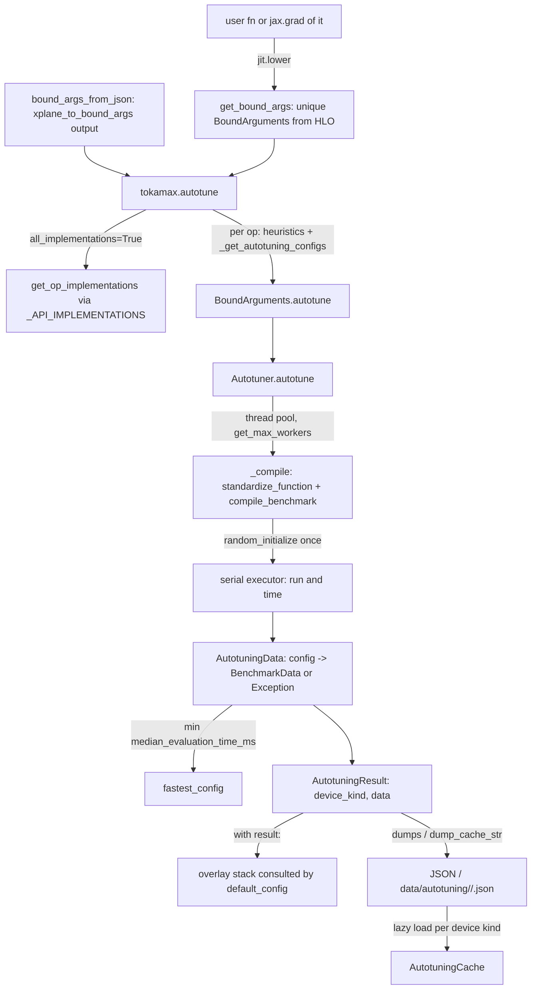

# Autotuning: tokamax.autotune, AutotuningResult and the autotuning cache

## Overview
docs/autotuning.md: "Kernel performance may be significantly impacted by implementation-specific
hyperparameters (e.g., tile sizes, layouts, etc.), known as Op Configs in Tokamax. The optimal values
for these configs must be empirically determined for every input of interest, via *autotuning*."
The subsystem has three layers. The **search** layer is the `Autotuner` (its
[`autotune`](https://github.com/openxla/tokamax/blob/3a0a3a34a5ccb8a6ac71f343d9cc44649d73db68/tokamax/_src/autotuning/autotuner.py#L126 "tokamax/_src/autotuning/autotuner#Autotuner.autotune")
method): given an op factory and a set of configs, it compiles every candidate, times each one and returns an
[`AutotuningData`](https://github.com/openxla/tokamax/blob/3a0a3a34a5ccb8a6ac71f343d9cc44649d73db68/tokamax/_src/autotuning/autotuner.py#L38 "tokamax/_src/autotuning/autotuner#AutotuningData")
map from config to timing or exception. The **program** layer is the public
[`autotune`](https://github.com/openxla/tokamax/blob/3a0a3a34a5ccb8a6ac71f343d9cc44649d73db68/tokamax/_src/autotuning/api.py#L309 "tokamax/_src/autotuning/api#autotune")
(`tokamax.autotune`): it finds every tokamax op inside a JAX function by reading the op specs that
each call stamped into the lowered HLO, and tunes each one. The **storage** layer is an
[`AutotuningResult`](https://github.com/openxla/tokamax/blob/3a0a3a34a5ccb8a6ac71f343d9cc44649d73db68/tokamax/_src/autotuning/api.py#L96 "tokamax/_src/autotuning/api#AutotuningResult")
(usable as a context manager, mergeable, JSON-serializable) plus the shipped
[`AutotuningCache`](https://github.com/openxla/tokamax/blob/3a0a3a34a5ccb8a6ac71f343d9cc44649d73db68/tokamax/_src/autotuning/cache.py#L53 "tokamax/_src/autotuning/cache#AutotuningCache")
of JSON files per device kind. Everything is keyed by an op's `BoundArguments.autotuning_cache_key`, the
canonical abstract arguments described in [op-framework](op-framework.md), so a tuned config is
found again at trace time whenever the same op meets the same shapes and dtypes on the same device kind.

## Diagram

Legend:
- `F` - (concept) the user's JAX function containing tokamax ops
- `GBA` - [`get_bound_args`](https://github.com/openxla/tokamax/blob/3a0a3a34a5ccb8a6ac71f343d9cc44649d73db68/tokamax/_src/autotuning/api.py#L215 "tokamax/_src/autotuning/api#get_bound_args")
- `JSON` - [`bound_args_from_json`](https://github.com/openxla/tokamax/blob/3a0a3a34a5ccb8a6ac71f343d9cc44649d73db68/tokamax/_src/autotuning/api.py#L248 "tokamax/_src/autotuning/api#bound_args_from_json")
- `TOP` - [`autotune`](https://github.com/openxla/tokamax/blob/3a0a3a34a5ccb8a6ac71f343d9cc44649d73db68/tokamax/_src/autotuning/api.py#L309 "tokamax/_src/autotuning/api#autotune")
- `IMPLS` - [`get_op_implementations`](https://github.com/openxla/tokamax/blob/3a0a3a34a5ccb8a6ac71f343d9cc44649d73db68/tokamax/_src/autotuning/api.py#L287 "tokamax/_src/autotuning/api#get_op_implementations"), [`_API_IMPLEMENTATIONS`](https://github.com/openxla/tokamax/blob/3a0a3a34a5ccb8a6ac71f343d9cc44649d73db68/tokamax/_src/autotuning/api.py#L260 "tokamax/_src/autotuning/api#_API_IMPLEMENTATIONS._API_IMPLEMENTATIONS")
- `BAT` - [`autotune`](https://github.com/openxla/tokamax/blob/3a0a3a34a5ccb8a6ac71f343d9cc44649d73db68/tokamax/_src/ops/op.py#L593 "tokamax/_src/ops/op#BoundArguments.autotune")
- `AT` - [`autotune`](https://github.com/openxla/tokamax/blob/3a0a3a34a5ccb8a6ac71f343d9cc44649d73db68/tokamax/_src/autotuning/autotuner.py#L126 "tokamax/_src/autotuning/autotuner#Autotuner.autotune")
- `COMP` - [`_compile`](https://github.com/openxla/tokamax/blob/3a0a3a34a5ccb8a6ac71f343d9cc44649d73db68/tokamax/_src/autotuning/autotuner.py#L94 "tokamax/_src/autotuning/autotuner#_compile"), [`standardize_function`](https://github.com/openxla/tokamax/blob/3a0a3a34a5ccb8a6ac71f343d9cc44649d73db68/tokamax/_src/benchmarking.py#L379 "tokamax/_src/benchmarking#standardize_function"), [`get_max_workers`](https://github.com/openxla/tokamax/blob/3a0a3a34a5ccb8a6ac71f343d9cc44649d73db68/tokamax/_src/autotuning/autotuner.py#L221 "tokamax/_src/autotuning/autotuner#get_max_workers")
- `RUN` - [`executor_fn`](https://github.com/openxla/tokamax/blob/3a0a3a34a5ccb8a6ac71f343d9cc44649d73db68/tokamax/_src/autotuning/autotuner.py#L124 "tokamax/_src/autotuning/autotuner#Autotuner.executor_fn"), [`random_initialize`](https://github.com/openxla/tokamax/blob/3a0a3a34a5ccb8a6ac71f343d9cc44649d73db68/tokamax/_src/numerics.py#L178 "tokamax/_src/numerics#random_initialize")
- `DATA` - [`AutotuningData`](https://github.com/openxla/tokamax/blob/3a0a3a34a5ccb8a6ac71f343d9cc44649d73db68/tokamax/_src/autotuning/autotuner.py#L38 "tokamax/_src/autotuning/autotuner#AutotuningData")
- `FAST` - [`fastest_config`](https://github.com/openxla/tokamax/blob/3a0a3a34a5ccb8a6ac71f343d9cc44649d73db68/tokamax/_src/autotuning/autotuner.py#L49 "tokamax/_src/autotuning/autotuner#AutotuningData.fastest_config")
- `RES` - [`AutotuningResult`](https://github.com/openxla/tokamax/blob/3a0a3a34a5ccb8a6ac71f343d9cc44649d73db68/tokamax/_src/autotuning/api.py#L96 "tokamax/_src/autotuning/api#AutotuningResult")
- `OVL` - [`__enter__`](https://github.com/openxla/tokamax/blob/3a0a3a34a5ccb8a6ac71f343d9cc44649d73db68/tokamax/_src/autotuning/api.py#L161 "tokamax/_src/autotuning/api#AutotuningResult.__enter__")
- `DISK` - [`dumps`](https://github.com/openxla/tokamax/blob/3a0a3a34a5ccb8a6ac71f343d9cc44649d73db68/tokamax/_src/autotuning/api.py#L124 "tokamax/_src/autotuning/api#AutotuningResult.dumps"), [`dump_cache_str`](https://github.com/openxla/tokamax/blob/3a0a3a34a5ccb8a6ac71f343d9cc44649d73db68/tokamax/_src/autotuning/api.py#L135 "tokamax/_src/autotuning/api#AutotuningResult.dump_cache_str")
- `CACHE` - [`AutotuningCache`](https://github.com/openxla/tokamax/blob/3a0a3a34a5ccb8a6ac71f343d9cc44649d73db68/tokamax/_src/autotuning/cache.py#L53 "tokamax/_src/autotuning/cache#AutotuningCache")

## Design rationale
- **Discover ops from the HLO, not from Python.** Because every tokamax call serializes its op and
  abstract arguments into XLA metadata, `tokamax.autotune(f, *args)` only has to lower `f` and parse
  the payloads back. That makes tuning work on any program shape, including the backward pass:
  "Since the VJP ops do not have a direct API that can be called for autotuning, you can take your
  forward function and call `jax.grad` to obtain the pullback function with Tokamax VJP ops, and then
  pass the pullback function into the autotuner." It also makes profiles usable as input: the
  `xplane_to_bound_args.py` tool turns an XProf trace into a JSON list that
  [`bound_args_from_json`](https://github.com/openxla/tokamax/blob/3a0a3a34a5ccb8a6ac71f343d9cc44649d73db68/tokamax/_src/autotuning/api.py#L248 "tokamax/_src/autotuning/api#bound_args_from_json") reads.
- **Compile in parallel, measure serially.** Compiling Mosaic TPU kernels is slow (the flash
  attention search space prunes tiles of 4096+ because they push compile time past 15 minutes per
  config), so the default `Autotuner` compiles on a thread pool sized by
  [`get_max_workers`](https://github.com/openxla/tokamax/blob/3a0a3a34a5ccb8a6ac71f343d9cc44649d73db68/tokamax/_src/autotuning/autotuner.py#L221 "tokamax/_src/autotuning/autotuner#get_max_workers")
  (the process CPU count), then runs the compiled executables through a synchronous executor so
  timings are not contaminated by concurrent kernels on the device.
- **Failures are data.** A config that fails to compile, times out, or crashes is recorded as an
  `Exception` value in `AutotuningData` rather than aborting; `fastest_config` simply ignores them and
  raises an `ExceptionGroup("All configs failed")` only if nothing succeeded. Large Cartesian search
  spaces (GMM v1 sweeps tile_m x tile_k x tile_n x buffer count) can then include configs that do not
  fit VMEM without special-casing them.
- **Determinism through reuse.** The README warns that "autotuning is fundamentally
  non-deterministic: measuring kernel execution times is noisy. As different configs chosen during
  autotuning can lead to different numerics, this is a potential source of numerical
  non-determinism. Serializing and reusing fixed autotuning results is a way to ensure the same
  numerics across sessions." Hence `dumps` / `loads`, the merge operator, and the shipped cache.
- **Heuristics are always a candidate.** `BoundArguments.autotuning_configs` is
  `{heuristics_config} | _get_autotuning_configs(...)`, so tuning can never pick something slower
  than the untuned default it measured.

## Entry points
- [`autotune`](https://github.com/openxla/tokamax/blob/3a0a3a34a5ccb8a6ac71f343d9cc44649d73db68/tokamax/_src/autotuning/api.py#L309 "tokamax/_src/autotuning/api#autotune")
  (`tokamax.autotune`) - accepts a callable plus positional args, a lowered function, or a sequence of
  `BoundArguments`; options `ignore_cache` (default `False`: skip ops already in the cache),
  `all_implementations`, `progress_bar`, `timeout` (600 s per phase) and `max_workers`.
- [`autotune`](https://github.com/openxla/tokamax/blob/3a0a3a34a5ccb8a6ac71f343d9cc44649d73db68/tokamax/_src/ops/op.py#L593 "tokamax/_src/ops/op#BoundArguments.autotune")
  on a single `BoundArguments` - tunes one op call; it is also what `default_config` invokes inline
  when `tokamax_autotuning_cache_miss_fallback=autotune`, in which case the result is written to the
  in-process cache.
- [`AutotuningResult`](https://github.com/openxla/tokamax/blob/3a0a3a34a5ccb8a6ac71f343d9cc44649d73db68/tokamax/_src/autotuning/api.py#L96 "tokamax/_src/autotuning/api#AutotuningResult")
  `with result:` - applies tuned configs to every op traced in the block; plus
  [`loads`](https://github.com/openxla/tokamax/blob/3a0a3a34a5ccb8a6ac71f343d9cc44649d73db68/tokamax/_src/autotuning/api.py#L158 "tokamax/_src/autotuning/api#AutotuningResult.loads")
  / `load` to restore a saved result.
- [`bound_args_to_json`](https://github.com/openxla/tokamax/blob/3a0a3a34a5ccb8a6ac71f343d9cc44649d73db68/tokamax/_src/autotuning/api.py#L234 "tokamax/_src/autotuning/api#bound_args_to_json"),
  [`bound_args_from_json_file`](https://github.com/openxla/tokamax/blob/3a0a3a34a5ccb8a6ac71f343d9cc44649d73db68/tokamax/_src/autotuning/api.py#L254 "tokamax/_src/autotuning/api#bound_args_from_json_file") -
  ship a model's op specs to another machine (or a TPU host) and tune them there.
- [`ArgSpec`](https://github.com/openxla/tokamax/blob/3a0a3a34a5ccb8a6ac71f343d9cc44649d73db68/tokamax/_src/autotuning/arg_spec.py#L32 "tokamax/_src/autotuning/arg_spec#ArgSpec") -
  the per-op catalogs of representative workloads (`arg_specs.py` in each op directory) used by tests,
  benchmarks and tuning.

## Mechanism (step-by-step)
1. **Collect op calls.** For a callable, [`get_bound_args`](https://github.com/openxla/tokamax/blob/3a0a3a34a5ccb8a6ac71f343d9cc44649d73db68/tokamax/_src/autotuning/api.py#L215 "tokamax/_src/autotuning/api#get_bound_args")
   (re-exported from `hlo_utils`) wraps it in `jax.jit`, lowers it with the given args, parses every
   `tokamax:` payload into a `BoundArguments`, strips the config that was baked in at trace time, and
   de-duplicates by (op class name, cache key). Unless `ignore_cache=True`, calls that already have
   `cached_autotuning_data` are dropped. The device kind is inferred from the specs (or the default
   device); mixed device kinds are an error.
2. **Optionally widen to all backends.** With `all_implementations=True`, each call is re-bound to
   every implementation that
   [`get_op_implementations`](https://github.com/openxla/tokamax/blob/3a0a3a34a5ccb8a6ac71f343d9cc44649d73db68/tokamax/_src/autotuning/api.py#L287 "tokamax/_src/autotuning/api#get_op_implementations")
   returns for the default device. It finds the op's family by walking the class MRO to the class just
   below `Op`, looks it up in
   [`_API_IMPLEMENTATIONS`](https://github.com/openxla/tokamax/blob/3a0a3a34a5ccb8a6ac71f343d9cc44649d73db68/tokamax/_src/autotuning/api.py#L260 "tokamax/_src/autotuning/api#_API_IMPLEMENTATIONS._API_IMPLEMENTATIONS")
   (the same `IMPLEMENTATIONS` dicts the public dispatchers use) and filters by `supported_on`, so on a
   TPU only the Mosaic TPU and XLA backends are tuned. The shipped cache also has files for the
   family base classes (e.g. `tpu7x/ragged_dot.json`), whose entries hold one timing under the empty
   NullConfig key `{}`: a measurement of the XLA reference for that shape.
3. **Build the search space per call.** For each `BoundArguments`,
   [`autotune`](https://github.com/openxla/tokamax/blob/3a0a3a34a5ccb8a6ac71f343d9cc44649d73db68/tokamax/_src/ops/op.py#L593 "tokamax/_src/ops/op#BoundArguments.autotune")
   takes `autotuning_configs` (heuristics plus the backend's `_get_autotuning_configs`) and hands
   `lambda config: op.replace(config=config)` to the `Autotuner`. A failure for one op is logged and
   skipped; the rest still tune. A progress bar reports the total number of microbenchmarks.
4. **Compile every config.** [`autotune`](https://github.com/openxla/tokamax/blob/3a0a3a34a5ccb8a6ac71f343d9cc44649d73db68/tokamax/_src/autotuning/autotuner.py#L126 "tokamax/_src/autotuning/autotuner#Autotuner.autotune")
   submits [`_compile`](https://github.com/openxla/tokamax/blob/3a0a3a34a5ccb8a6ac71f343d9cc44649d73db68/tokamax/_src/autotuning/autotuner.py#L94 "tokamax/_src/autotuning/autotuner#_compile")
   for each config to the
   [`compile_executor_fn`](https://github.com/openxla/tokamax/blob/3a0a3a34a5ccb8a6ac71f343d9cc44649d73db68/tokamax/_src/autotuning/autotuner.py#L121 "tokamax/_src/autotuning/autotuner#Autotuner.compile_executor_fn")
   pool. `_compile` calls [`standardize_function`](https://github.com/openxla/tokamax/blob/3a0a3a34a5ccb8a6ac71f343d9cc44649d73db68/tokamax/_src/benchmarking.py#L379 "tokamax/_src/benchmarking#standardize_function")
   with `seed=None`, so the arguments stay abstract and nothing is allocated while compiling, then
   `compile_benchmark` lowers and compiles (recording lower time, compile time and peak memory). Configs
   still compiling when `timeout` expires are recorded as `TimeoutError`.
5. **Initialize inputs once and time serially.** The first successful compile's abstract inputs are
   filled by [`random_initialize`](https://github.com/openxla/tokamax/blob/3a0a3a34a5ccb8a6ac71f343d9cc44649d73db68/tokamax/_src/numerics.py#L178 "tokamax/_src/numerics#random_initialize")
   and shared by all configs ("All configs share the same arguments"). Each compiled runner is then
   submitted to [`executor_fn`](https://github.com/openxla/tokamax/blob/3a0a3a34a5ccb8a6ac71f343d9cc44649d73db68/tokamax/_src/autotuning/autotuner.py#L124 "tokamax/_src/autotuning/autotuner#Autotuner.executor_fn"),
   by default a synchronous executor, and returns a `BenchmarkData` (five timed iterations after a
   warm-up by default). If `compile_executor_fn` is `None`, compile and run happen together per
   config through [`_benchmark`](https://github.com/openxla/tokamax/blob/3a0a3a34a5ccb8a6ac71f343d9cc44649d73db68/tokamax/_src/autotuning/autotuner.py#L100 "tokamax/_src/autotuning/autotuner#_benchmark")
   (needed with a `ProcessPoolExecutor`, which may not be combined with a compile pool).
6. **Pick the winner.** The results become `AutotuningData`;
   [`fastest_config`](https://github.com/openxla/tokamax/blob/3a0a3a34a5ccb8a6ac71f343d9cc44649d73db68/tokamax/_src/autotuning/autotuner.py#L49 "tokamax/_src/autotuning/autotuner#AutotuningData.fastest_config")
   is the config with the lowest
   [`median_evaluation_time_ms`](https://github.com/openxla/tokamax/blob/3a0a3a34a5ccb8a6ac71f343d9cc44649d73db68/tokamax/_src/benchmarking.py#L88 "tokamax/_src/benchmarking#BenchmarkData.median_evaluation_time_ms")
   among successful benchmarks. `tokamax.autotune` returns
   `AutotuningResult(device_kind, ((ba, data), ...))` without touching any cache
   (`cache_results=False`).
7. **Apply the result.** [`__enter__`](https://github.com/openxla/tokamax/blob/3a0a3a34a5ccb8a6ac71f343d9cc44649d73db68/tokamax/_src/autotuning/api.py#L161 "tokamax/_src/autotuning/api#AutotuningResult.__enter__")
   builds an overlay `{op: {device_kind: {cache_key: data}}}`, pushes it onto the overlay stack
   that `BoundArguments.cached_autotuning_data` consults (innermost first, then the on-disk cache), and
   also appends its id to a JAX user context. [`test_autotuning_result_context_retraced`](https://github.com/openxla/tokamax/blob/3a0a3a34a5ccb8a6ac71f343d9cc44649d73db68/tokamax/_src/autotuning/api_test.py#L354 "tokamax/_src/autotuning/api_test#AutotuningTest.test_autotuning_result_context_retraced")
   pins down the effect: a `jax.jit` function called before, inside, nested inside, and after two
   contexts is traced three times (heuristics, config0, config1) and on exit reuses the earlier
   traces, so a context change always takes effect even for already-jitted functions.

## Key data structures
- [`AutotuningData`](https://github.com/openxla/tokamax/blob/3a0a3a34a5ccb8a6ac71f343d9cc44649d73db68/tokamax/_src/autotuning/autotuner.py#L38 "tokamax/_src/autotuning/autotuner#AutotuningData") -
  an immutable dict `config -> BenchmarkData | Exception`. [`prune`](https://github.com/openxla/tokamax/blob/3a0a3a34a5ccb8a6ac71f343d9cc44649d73db68/tokamax/_src/autotuning/autotuner.py#L62 "tokamax/_src/autotuning/autotuner#AutotuningData.prune")
  keeps only the fastest entry, [`prune_errors`](https://github.com/openxla/tokamax/blob/3a0a3a34a5ccb8a6ac71f343d9cc44649d73db68/tokamax/_src/autotuning/autotuner.py#L72 "tokamax/_src/autotuning/autotuner#AutotuningData.prune_errors")
  drops the exceptions, and [`__or__`](https://github.com/openxla/tokamax/blob/3a0a3a34a5ccb8a6ac71f343d9cc44649d73db68/tokamax/_src/autotuning/autotuner.py#L90 "tokamax/_src/autotuning/autotuner#AutotuningData.__or__")
  merges two runs. Its pydantic schema serializes configs as JSON-string keys and `BenchmarkData`
  values (`compile_time_ms`, `lower_time_ms`, `evaluation_times_ms`, `metadata`, `peak_memory_mb`).
- [`AutotuningResult`](https://github.com/openxla/tokamax/blob/3a0a3a34a5ccb8a6ac71f343d9cc44649d73db68/tokamax/_src/autotuning/api.py#L96 "tokamax/_src/autotuning/api#AutotuningResult") -
  a frozen dataclass of [`device_kind`](https://github.com/openxla/tokamax/blob/3a0a3a34a5ccb8a6ac71f343d9cc44649d73db68/tokamax/_src/autotuning/api.py#L107 "tokamax/_src/autotuning/api#AutotuningResult.device_kind"),
  [`data`](https://github.com/openxla/tokamax/blob/3a0a3a34a5ccb8a6ac71f343d9cc44649d73db68/tokamax/_src/autotuning/api.py#L108 "tokamax/_src/autotuning/api#AutotuningResult.data")
  (a tuple of `(BoundArguments, AutotuningData)` pairs) and `tokamax_version` (so an importer can check
  which version produced it). [`_serialize_bound_args_autotuning_data`](https://github.com/openxla/tokamax/blob/3a0a3a34a5ccb8a6ac71f343d9cc44649d73db68/tokamax/_src/autotuning/api.py#L68 "tokamax/_src/autotuning/api#_serialize_bound_args_autotuning_data")
  drops the op's `config` and `vjp` before writing and types the data by the op's `config_cls`;
  [`_validate_bound_args_autotuning_data`](https://github.com/openxla/tokamax/blob/3a0a3a34a5ccb8a6ac71f343d9cc44649d73db68/tokamax/_src/autotuning/api.py#L82 "tokamax/_src/autotuning/api#_validate_bound_args_autotuning_data")
  reverses it. [`__or__`](https://github.com/openxla/tokamax/blob/3a0a3a34a5ccb8a6ac71f343d9cc44649d73db68/tokamax/_src/autotuning/api.py#L179 "tokamax/_src/autotuning/api#AutotuningResult.__or__")
  merges per cache key with the right-hand side winning, and refuses different device kinds.
- [`AutotuningCache`](https://github.com/openxla/tokamax/blob/3a0a3a34a5ccb8a6ac71f343d9cc44649d73db68/tokamax/_src/autotuning/cache.py#L53 "tokamax/_src/autotuning/cache#AutotuningCache") -
  a `dict[device_kind, {cache_key: AutotuningData}]` for one [`op`](https://github.com/openxla/tokamax/blob/3a0a3a34a5ccb8a6ac71f343d9cc44649d73db68/tokamax/_src/autotuning/cache.py#L69 "tokamax/_src/autotuning/cache#AutotuningCache.op"),
  filled lazily by [`__missing__`](https://github.com/openxla/tokamax/blob/3a0a3a34a5ccb8a6ac71f343d9cc44649d73db68/tokamax/_src/autotuning/cache.py#L72 "tokamax/_src/autotuning/cache#AutotuningCache.__missing__").
  [`_load_cache`](https://github.com/openxla/tokamax/blob/3a0a3a34a5ccb8a6ac71f343d9cc44649d73db68/tokamax/_src/autotuning/cache.py#L76 "tokamax/_src/autotuning/cache#AutotuningCache._load_cache")
  reads `tokamax/data/autotuning/<device_kind lowercased, spaces to _>/<op class in snake_case>.json`
  (e.g. `tpu7x/pallas_mosaic_tpu_ragged_dot.json`), parses it with the per-op
  [`_get_cache_adapter`](https://github.com/openxla/tokamax/blob/3a0a3a34a5ccb8a6ac71f343d9cc44649d73db68/tokamax/_src/autotuning/cache.py#L38 "tokamax/_src/autotuning/cache#_get_cache_adapter")
  (JSON-string arg-spec keys -> `AutotuningData[config_cls]`), and re-keys every entry through
  `op.bind(**args).autotuning_cache_key`, so stored keys are re-canonicalized by the current `bind`.
  The pinned checkout ships TPU caches for `tpu7x`, `tpu_v5`, `tpu_v5_lite` and `tpu_v6_lite` (plus
  A100, H100 and B200 GPUs).
- [`ArgSpec`](https://github.com/openxla/tokamax/blob/3a0a3a34a5ccb8a6ac71f343d9cc44649d73db68/tokamax/_src/autotuning/arg_spec.py#L32 "tokamax/_src/autotuning/arg_spec#ArgSpec") -
  "Argument specification for an op with metadata": [`args`](https://github.com/openxla/tokamax/blob/3a0a3a34a5ccb8a6ac71f343d9cc44649d73db68/tokamax/_src/autotuning/arg_spec.py#L44 "tokamax/_src/autotuning/arg_spec#ArgSpec.args")
  (abstract `ShapeDtypeStruct`s, `GroupSizes`, quantized arrays),
  [`project`](https://github.com/openxla/tokamax/blob/3a0a3a34a5ccb8a6ac71f343d9cc44649d73db68/tokamax/_src/autotuning/arg_spec.py#L45 "tokamax/_src/autotuning/arg_spec#ArgSpec.project"),
  [`name`](https://github.com/openxla/tokamax/blob/3a0a3a34a5ccb8a6ac71f343d9cc44649d73db68/tokamax/_src/autotuning/arg_spec.py#L46 "tokamax/_src/autotuning/arg_spec#ArgSpec.name")
  (joined by [`full_name`](https://github.com/openxla/tokamax/blob/3a0a3a34a5ccb8a6ac71f343d9cc44649d73db68/tokamax/_src/autotuning/arg_spec.py#L51 "tokamax/_src/autotuning/arg_spec#ArgSpec.full_name")),
  [`tags`](https://github.com/openxla/tokamax/blob/3a0a3a34a5ccb8a6ac71f343d9cc44649d73db68/tokamax/_src/autotuning/arg_spec.py#L47 "tokamax/_src/autotuning/arg_spec#ArgSpec.tags")
  (`primary` for key users and nightly benchmarking, `ci_tests` as a subset, `forward_only` for models
  that need no VJP tuning, `json`) and `excluded_platforms`. Specs model real workloads, e.g.
  [`_make_maxtext_spec`](https://github.com/openxla/tokamax/blob/3a0a3a34a5ccb8a6ac71f343d9cc44649d73db68/tokamax/_src/ops/ragged_dot/arg_specs.py#L94 "tokamax/_src/ops/ragged_dot/arg_specs#_make_maxtext_spec")
  and [`_make_ullm_gmm_v2_spec`](https://github.com/openxla/tokamax/blob/3a0a3a34a5ccb8a6ac71f343d9cc44649d73db68/tokamax/_src/ops/ragged_dot/arg_specs.py#L156 "tokamax/_src/ops/ragged_dot/arg_specs#_make_ullm_gmm_v2_spec")
  for MoE GMM, [`_kimi_linear_48b_a3b_spec`](https://github.com/openxla/tokamax/blob/3a0a3a34a5ccb8a6ac71f343d9cc44649d73db68/tokamax/_src/ops/experimental/kda/arg_specs.py#L51 "tokamax/_src/ops/experimental/kda/arg_specs#_kimi_linear_48b_a3b_spec")
  for KDA, [`_make_rpa_spec`](https://github.com/openxla/tokamax/blob/3a0a3a34a5ccb8a6ac71f343d9cc44649d73db68/tokamax/_src/ops/experimental/batched_rpa/arg_specs.py#L39 "tokamax/_src/ops/experimental/batched_rpa/arg_specs#_make_rpa_spec")
  for batched RPA, and the attention [`ARG_SPECS`](https://github.com/openxla/tokamax/blob/3a0a3a34a5ccb8a6ac71f343d9cc44649d73db68/tokamax/_src/ops/attention/arg_specs.py#L127 "tokamax/_src/ops/attention/arg_specs#ARG_SPECS.ARG_SPECS") table.

## Dynamics (design intent)
- Tuning happens in the user's process on the target device: compile threads run concurrently, but
  only one candidate executes at a time. The `timeout` applies separately to the compile phase and to
  the run phase.
- At trace time a config is resolved in this order: an explicit `op.config`, then `AutotuningResult`
  overlays (innermost wins), then the shipped cache for the inferred device kind, then (depending on
  `tokamax_autotuning_cache_miss_fallback`) inline autotuning, heuristics (default) or an error. A
  cache miss logs a warning with the JSON key, which is the string to add to a cache file.
  [`test_autotuning_result_context`](https://github.com/openxla/tokamax/blob/3a0a3a34a5ccb8a6ac71f343d9cc44649d73db68/tokamax/_src/autotuning/api_test.py#L294 "tokamax/_src/autotuning/api_test#AutotuningTest.test_autotuning_result_context")
  checks the overlay order: nested results override outer ones, both override the on-disk cache, and
  exiting restores the previous answer.
- A shipped cache entry whose data is empty (`{}`) is treated as a miss by `get_config`, which only
  uses cached data when it has items; the `tpu7x/batched_rpa.json` file contains such entries.

## Edge cases
- **Device kind is part of the key.** A result tuned on one TPU generation does nothing on another
  (`tpu_v6_lite` vs `tpu7x`); `AutotuningResult.__or__` refuses to merge across device kinds.
- **The VJP is tuned only if it is in the lowered program.** Autotune `jax.grad(f)` (or the
  pullback) to get the backward kernels; tuning `f` alone tunes forwards only.
- **`ignore_cache=False` skips already-cached ops**, so re-tuning a shipped shape needs
  `ignore_cache=True`; the `tokamax_ignore_autotuning_cache` flag also disables the shipped files.
- **`tokamax.autotune` does not persist anything.** Write `result.dumps()` yourself, or use
  [`dump_cache_str`](https://github.com/openxla/tokamax/blob/3a0a3a34a5ccb8a6ac71f343d9cc44649d73db68/tokamax/_src/autotuning/api.py#L135 "tokamax/_src/autotuning/api#AutotuningResult.dump_cache_str")
  to emit per-op JSON in the shipped-cache format (errors pruned).
- **Group sizes are representative, not real.** For ragged dot the key holds `num_groups` and
  `total_size` (or an explicit distribution), so a config tuned on uniform groups is reused for
  skewed runtime routing.
- **Configs from a JSON list are re-tuned from scratch.**
  [`dump_bound_args_to_json`](https://github.com/openxla/tokamax/blob/3a0a3a34a5ccb8a6ac71f343d9cc44649d73db68/tokamax/_src/autotuning/api.py#L218 "tokamax/_src/autotuning/api#dump_bound_args_to_json")
  strips `vjp` and `config` via [`_strip_vjp_and_config`](https://github.com/openxla/tokamax/blob/3a0a3a34a5ccb8a6ac71f343d9cc44649d73db68/tokamax/_src/autotuning/api.py#L221 "tokamax/_src/autotuning/api#dump_bound_args_to_json._strip_vjp_and_config").

## Open questions
- The tool that generates the shipped `tokamax/data/autotuning` files is not in the pinned
  checkout; `dump_cache_str` produces the right format, but the pipeline (which ArgSpecs, which tags,
  how often) is not visible.
- `experimental/utils/tuning/tpu` tunes ragged dot and splash attention with the external tune-jax
  package instead of `tokamax.autotune`; how its results feed back into the cache is not documented.
- `test_autotuning_result_context_retraced` is skipped on TPU ("TODO: Figure out why this test fails
  on TPU"), so the retrace guarantee is only tested on GPU.

## See also
- [op-framework](op-framework.md): `BoundArguments`, cache keys, `default_config` and the HLO payload this subsystem reads.
- [benchmarking-and-serialization](benchmarking-and-serialization.md): `standardize_function`, `compile_benchmark`, timers and HLO extraction.
- [kernel-catalog](kernel-catalog.md): which implementations `all_implementations=True` will consider.
- [ragged-dot-gmm](ragged-dot-gmm.md), [dot-product-attention](dot-product-attention.md), [splash-attention](splash-attention.md): search spaces of the main TPU kernels.
