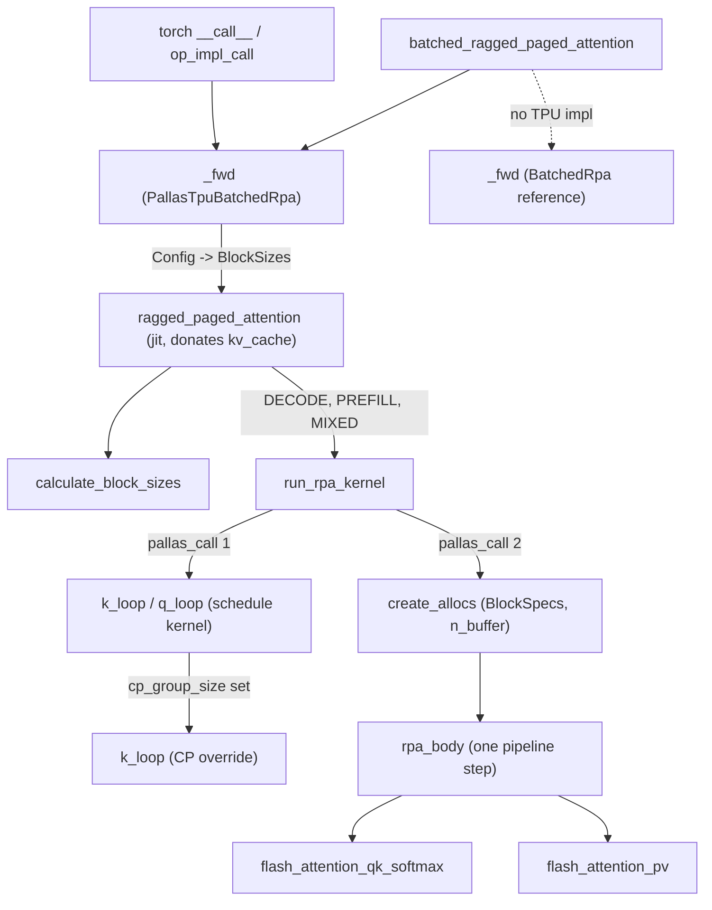
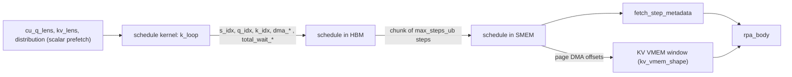

# Batched Ragged Paged Attention (bRPA) on TPU

## Overview
bRPA is the serving-time attention op: one call takes the new query/key/value tokens of every
running sequence (packed back to back, "ragged"), appends the new K/V into a paged KV cache, and
attends each query token to its sequence's cached plus new tokens. The base operator
[`BatchedRpa`](https://github.com/openxla/tokamax/blob/3a0a3a34a5ccb8a6ac71f343d9cc44649d73db68/tokamax/_src/ops/experimental/batched_rpa/base.py#L38 "tokamax/_src/ops/experimental/batched_rpa/base#BatchedRpa") states the contract - "batched multi-head and grouped-query
attention for mixed prefill and decode workloads with ragged sequence lengths and paged KV
cache". The single key idea of the TPU kernel is to **move all ragged bookkeeping out of the
attention kernel**: a separate Pallas kernel first walks sequences -> query blocks -> KV blocks
and writes a flat, step-indexed table of DMA offsets and flags into SMEM/HBM; the attention
kernel is then a plain 1-D `emit_pipeline` over "steps", where each step processes
`batch_size` consecutive (sequence, q-block, kv-block) tasks. The QK and PV matmuls are
batched over these slots, but the online-softmax state (m, l, acc) is a single chain carried
from slot to slot in order and reset after a task's last KV block. The module docstring
of the wrapper names the three differences from the RPA3 kernel it derives from: batching
multiple sequences to replace per-request flash-attention loops, triple buffering via
`emit_pipeline`, and precomputing page locations and bounds "once and amortized across
different layers". The op is reached from JAX via
[`batched_ragged_paged_attention`](https://github.com/openxla/tokamax/blob/3a0a3a34a5ccb8a6ac71f343d9cc44649d73db68/tokamax/_src/ops/experimental/batched_rpa/api.py#L43 "tokamax/_src/ops/experimental/batched_rpa/api#batched_ragged_paged_attention") and from PyTorch through
the torch_tpu bridge (see [torch-tpu-bridge](./torch-tpu-bridge.md)).

## Diagram

Legend:
- `API` - [`batched_ragged_paged_attention`](https://github.com/openxla/tokamax/blob/3a0a3a34a5ccb8a6ac71f343d9cc44649d73db68/tokamax/_src/ops/experimental/batched_rpa/api.py#L43 "tokamax/_src/ops/experimental/batched_rpa/api#batched_ragged_paged_attention")
- `PFWD` - [`_fwd`](https://github.com/openxla/tokamax/blob/3a0a3a34a5ccb8a6ac71f343d9cc44649d73db68/tokamax/_src/ops/experimental/batched_rpa/pallas_mosaic_tpu.py#L62 "tokamax/_src/ops/experimental/batched_rpa/pallas_mosaic_tpu#PallasTpuBatchedRpa._fwd")
- `TORCH` - [`__call__`](https://github.com/openxla/tokamax/blob/3a0a3a34a5ccb8a6ac71f343d9cc44649d73db68/tokamax/experimental/torch_tpu/ops/batched_rpa/torch_pallas_mosaic_tpu.py#L105 "tokamax/experimental/torch_tpu/ops/batched_rpa/torch_pallas_mosaic_tpu#_PallasMosaicTpuBatchedRpa.__call__"), [`op_impl_call`](https://github.com/openxla/tokamax/blob/3a0a3a34a5ccb8a6ac71f343d9cc44649d73db68/tokamax/experimental/torch_tpu/ops/batched_rpa/torch_pallas_mosaic_tpu.py#L41 "tokamax/experimental/torch_tpu/ops/batched_rpa/torch_pallas_mosaic_tpu#_PallasMosaicTpuBatchedRpa.op_impl_call")
- `RFWD` - [`_fwd`](https://github.com/openxla/tokamax/blob/3a0a3a34a5ccb8a6ac71f343d9cc44649d73db68/tokamax/_src/ops/experimental/batched_rpa/base.py#L127 "tokamax/_src/ops/experimental/batched_rpa/base#BatchedRpa._fwd")
- `WRAP` - [`ragged_paged_attention`](https://github.com/openxla/tokamax/blob/3a0a3a34a5ccb8a6ac71f343d9cc44649d73db68/tokamax/_src/ops/experimental/batched_rpa/kernel/wrapper.py#L511 "tokamax/_src/ops/experimental/batched_rpa/kernel/wrapper#ragged_paged_attention")
- `CBS` - [`calculate_block_sizes`](https://github.com/openxla/tokamax/blob/3a0a3a34a5ccb8a6ac71f343d9cc44649d73db68/tokamax/_src/ops/experimental/batched_rpa/kernel/wrapper.py#L227 "tokamax/_src/ops/experimental/batched_rpa/kernel/wrapper#calculate_block_sizes")
- `RUN` - [`run_rpa_kernel`](https://github.com/openxla/tokamax/blob/3a0a3a34a5ccb8a6ac71f343d9cc44649d73db68/tokamax/_src/ops/experimental/batched_rpa/kernel/wrapper.py#L754 "tokamax/_src/ops/experimental/batched_rpa/kernel/wrapper#ragged_paged_attention.run_rpa_kernel")
- `SCHED` - [`k_loop`](https://github.com/openxla/tokamax/blob/3a0a3a34a5ccb8a6ac71f343d9cc44649d73db68/tokamax/_src/ops/experimental/batched_rpa/kernel/schedule.py#L556 "tokamax/_src/ops/experimental/batched_rpa/kernel/schedule#BaseMetadataComputer.k_loop"), [`q_loop`](https://github.com/openxla/tokamax/blob/3a0a3a34a5ccb8a6ac71f343d9cc44649d73db68/tokamax/_src/ops/experimental/batched_rpa/kernel/schedule.py#L719 "tokamax/_src/ops/experimental/batched_rpa/kernel/schedule#BaseMetadataComputer.q_loop")
- `SCP` - [`k_loop`](https://github.com/openxla/tokamax/blob/3a0a3a34a5ccb8a6ac71f343d9cc44649d73db68/tokamax/_src/ops/experimental/batched_rpa/kernel/schedule_cp.py#L102 "tokamax/_src/ops/experimental/batched_rpa/kernel/schedule_cp#CPMetadataComputer.k_loop")
- `ALLOC` - [`create_allocs`](https://github.com/openxla/tokamax/blob/3a0a3a34a5ccb8a6ac71f343d9cc44649d73db68/tokamax/_src/ops/experimental/batched_rpa/kernel/kernel.py#L551 "tokamax/_src/ops/experimental/batched_rpa/kernel/kernel#create_allocs")
- `BODY` - [`rpa_body`](https://github.com/openxla/tokamax/blob/3a0a3a34a5ccb8a6ac71f343d9cc44649d73db68/tokamax/_src/ops/experimental/batched_rpa/kernel/kernel.py#L321 "tokamax/_src/ops/experimental/batched_rpa/kernel/kernel#rpa_body")
- `QK` - [`flash_attention_qk_softmax`](https://github.com/openxla/tokamax/blob/3a0a3a34a5ccb8a6ac71f343d9cc44649d73db68/tokamax/_src/ops/experimental/batched_rpa/kernel/flash_attention.py#L22 "tokamax/_src/ops/experimental/batched_rpa/kernel/flash_attention#flash_attention_qk_softmax")
- `PV` - [`flash_attention_pv`](https://github.com/openxla/tokamax/blob/3a0a3a34a5ccb8a6ac71f343d9cc44649d73db68/tokamax/_src/ops/experimental/batched_rpa/kernel/flash_attention.py#L112 "tokamax/_src/ops/experimental/batched_rpa/kernel/flash_attention#flash_attention_pv")

Legend:
- `CU` - (concept) the ragged batch description passed by the serving engine
- `MS` - [`k_loop`](https://github.com/openxla/tokamax/blob/3a0a3a34a5ccb8a6ac71f343d9cc44649d73db68/tokamax/_src/ops/experimental/batched_rpa/kernel/schedule.py#L556 "tokamax/_src/ops/experimental/batched_rpa/kernel/schedule#BaseMetadataComputer.k_loop")
- `HBM` - (concept) schedule tensor written by the first pallas_call
- `SMEM` - [`body`](https://github.com/openxla/tokamax/blob/3a0a3a34a5ccb8a6ac71f343d9cc44649d73db68/tokamax/_src/ops/experimental/batched_rpa/kernel/schedule.py#L405 "tokamax/_src/ops/experimental/batched_rpa/kernel/schedule#_compute_waits.body") (computes the aggregate DMA wait counts stored alongside the schedule)
- `FSM` - [`fetch_step_metadata`](https://github.com/openxla/tokamax/blob/3a0a3a34a5ccb8a6ac71f343d9cc44649d73db68/tokamax/_src/ops/experimental/batched_rpa/kernel/kernel.py#L223 "tokamax/_src/ops/experimental/batched_rpa/kernel/kernel#fetch_step_metadata")
- `KVB` - [`kv_vmem_shape`](https://github.com/openxla/tokamax/blob/3a0a3a34a5ccb8a6ac71f343d9cc44649d73db68/tokamax/_src/ops/experimental/batched_rpa/kernel/configs.py#L402 "tokamax/_src/ops/experimental/batched_rpa/kernel/configs#RpaConfigs.kv_vmem_shape")
- `BODY2` - [`rpa_body`](https://github.com/openxla/tokamax/blob/3a0a3a34a5ccb8a6ac71f343d9cc44649d73db68/tokamax/_src/ops/experimental/batched_rpa/kernel/kernel.py#L321 "tokamax/_src/ops/experimental/batched_rpa/kernel/kernel#rpa_body")

## Design rationale (why it's built this way)
- **Schedule once, attend many times.** A ragged batch makes every index computation
  data-dependent. Doing it inside the attention kernel would put scalar work and branches on
  the critical path of every layer. Instead the schedule kernel encodes per step and per batch
  slot the sequence id, q-block id, k-block id, an `is_last_k` flag, a `do_writeback` flag,
  the Q DMA (source, size), one DMA triple per cached page and one record per new-token page
  (see [`k_loop`](https://github.com/openxla/tokamax/blob/3a0a3a34a5ccb8a6ac71f343d9cc44649d73db68/tokamax/_src/ops/experimental/batched_rpa/kernel/schedule.py#L556 "tokamax/_src/ops/experimental/batched_rpa/kernel/schedule#BaseMetadataComputer.k_loop")). The wrapper docstring says this metadata "is calculated
  once and amortized across different layers".
- **Batching tasks, not sequences.** A step holds `batch_size` tasks, assigned round-robin
  by a running task counter (`step, target_lane = divmod(count, batch_size)` in
  [`k_loop`](https://github.com/openxla/tokamax/blob/3a0a3a34a5ccb8a6ac71f343d9cc44649d73db68/tokamax/_src/ops/experimental/batched_rpa/kernel/schedule.py#L556 "tokamax/_src/ops/experimental/batched_rpa/kernel/schedule#BaseMetadataComputer.k_loop")). So a long prefill sequence is spread over many consecutive
  steps, and many short decode sequences fill one step. That is what replaces RPA3's
  per-request loop. Decode and prefill use separate [`BlockSizes`](https://github.com/openxla/tokamax/blob/3a0a3a34a5ccb8a6ac71f343d9cc44649d73db68/tokamax/_src/ops/experimental/batched_rpa/kernel/configs.py#L27 "tokamax/_src/ops/experimental/batched_rpa/kernel/configs#BlockSizes"): decode
  uses `bq_sz = decode_query_size` (1, or more for speculative decoding) with a large
  `batch_size` (8 by default), and prefill uses a 128-token q block with `batch_size` 2.
- **Three launches per call.** [`run_rpa_kernel`](https://github.com/openxla/tokamax/blob/3a0a3a34a5ccb8a6ac71f343d9cc44649d73db68/tokamax/_src/ops/experimental/batched_rpa/kernel/wrapper.py#L754 "tokamax/_src/ops/experimental/batched_rpa/kernel/wrapper#ragged_paged_attention.run_rpa_kernel") runs three times, for
  DECODE, PREFILL and MIXED. The `distribution` array (cumulative counts of decode, prefill
  and mixed sequences) slices the sequence range for each one. Every launch compiles a kernel
  specialized to its case: block sizes, the fused accumulation used only in decode, and
  `bkv_p_new`. The output and the KV cache are threaded from one launch to the next through
  input/output aliasing.
- **Two KV cache layouts.** [`KVLayout`](https://github.com/openxla/tokamax/blob/3a0a3a34a5ccb8a6ac71f343d9cc44649d73db68/tokamax/_src/ops/experimental/batched_rpa/kernel/configs.py#L85 "tokamax/_src/ops/experimental/batched_rpa/kernel/configs#KVLayout") chooses how a page is laid out in
  vregs. [`HEAD_ALONG_SUBLANE`](https://github.com/openxla/tokamax/blob/3a0a3a34a5ccb8a6ac71f343d9cc44649d73db68/tokamax/_src/ops/experimental/batched_rpa/kernel/configs.py#L92 "tokamax/_src/ops/experimental/batched_rpa/kernel/configs#KVLayout.HEAD_ALONG_SUBLANE") (the default) stores
  `[page_size, (2*num_kv_heads)/packing, packing, head_dim]`. K and V heads are interleaved on
  sublanes and head_dim is lane-aligned, so new tokens can be copied in at token granularity,
  and K/V are split with a strided load instead of a transpose. [`SEQ_ALONG_LANE`](https://github.com/openxla/tokamax/blob/3a0a3a34a5ccb8a6ac71f343d9cc44649d73db68/tokamax/_src/ops/experimental/batched_rpa/kernel/configs.py#L93 "tokamax/_src/ops/experimental/batched_rpa/kernel/configs#KVLayout.SEQ_ALONG_LANE")
  stores `[2*num_kv_heads, head_dim/packing, packing, page_size]`. Tokens run along lanes, so
  head_dim only needs sublane x packing alignment (good for small or fp4 heads). Per-token
  scale channels can ride along as extra head_dim rows. The cost is that new tokens must be
  "stitched" into lanes, which needs extra VMEM: 2 x `page_size` lanes per KV buffer, see
  [`kv_vmem_shape`](https://github.com/openxla/tokamax/blob/3a0a3a34a5ccb8a6ac71f343d9cc44649d73db68/tokamax/_src/ops/experimental/batched_rpa/kernel/configs.py#L402 "tokamax/_src/ops/experimental/batched_rpa/kernel/configs#RpaConfigs.kv_vmem_shape").
- **VMEM safety over peak speed.** [`calculate_block_sizes`](https://github.com/openxla/tokamax/blob/3a0a3a34a5ccb8a6ac71f343d9cc44649d73db68/tokamax/_src/ops/experimental/batched_rpa/kernel/wrapper.py#L227 "tokamax/_src/ops/experimental/batched_rpa/kernel/wrapper#calculate_block_sizes")
  models the VMEM footprint (n-buffered Q/KV tiles, double-buffered output, the live
  q/k/v/qk working set, x `batch_size`) and caps it at 80% of the limit, because "we want to
  avoid OOM at all costs". It first shrinks `batch_size`, then `n_buffer`, then grows
  `bkv_sz` in MXU-column steps with `bq_sz` tied to it. Tying them matters because under
  causal masking a mismatched tile can be fully masked. Finally it splits `bq_sz` into
  compute chunks `bq_c_sz` until a per-chunk MXU-work threshold is met. The threshold
  depends on the generation and is scaled by the fp8/bf16 throughput ratio for 8-bit
  queries.

> [!inferred]
> Software-pipelining the q-chunks inside [`rpa_body`](https://github.com/openxla/tokamax/blob/3a0a3a34a5ccb8a6ac71f343d9cc44649d73db68/tokamax/_src/ops/experimental/batched_rpa/kernel/kernel.py#L321 "tokamax/_src/ops/experimental/batched_rpa/kernel/kernel#rpa_body") (QK+softmax of chunk i is
> issued before PV of chunk i-1) is there to give the scheduler independent MXU and VPU/EUP
> work to overlap. This is why prefill benefits from `bq_c_sz < bq_sz`, while decode
> (`bq_c_sz = 1`) does not.

## Entry points
- [`batched_ragged_paged_attention`](https://github.com/openxla/tokamax/blob/3a0a3a34a5ccb8a6ac71f343d9cc44649d73db68/tokamax/_src/ops/experimental/batched_rpa/api.py#L43 "tokamax/_src/ops/experimental/batched_rpa/api#batched_ragged_paged_attention") - the public
  functional API (also exported as `ragged_paged_attention`). With no `implementation` it
  picks `mosaic_tpu` if that module imported, else the pure-JAX reference op.
- [`BatchedRpa`](https://github.com/openxla/tokamax/blob/3a0a3a34a5ccb8a6ac71f343d9cc44649d73db68/tokamax/_src/ops/experimental/batched_rpa/base.py#L38 "tokamax/_src/ops/experimental/batched_rpa/base#BatchedRpa") - the tokamax [`Op`](https://github.com/openxla/tokamax/blob/3a0a3a34a5ccb8a6ac71f343d9cc44649d73db68/tokamax/_src/ops/op.py#L121 "tokamax/_src/ops/op#Op") subclass. Its `bind` checks
  shapes (q heads divisible by kv heads, `len(cu_q_lens) == len(kv_lens) + 1`). Its
  [`_fwd`](https://github.com/openxla/tokamax/blob/3a0a3a34a5ccb8a6ac71f343d9cc44649d73db68/tokamax/_src/ops/experimental/batched_rpa/base.py#L127 "tokamax/_src/ops/experimental/batched_rpa/base#BatchedRpa._fwd") runs the reference implementation, which serves as the test
  oracle (base_test, pallas_mosaic_tpu_test).
- [`_fwd`](https://github.com/openxla/tokamax/blob/3a0a3a34a5ccb8a6ac71f343d9cc44649d73db68/tokamax/_src/ops/experimental/batched_rpa/pallas_mosaic_tpu.py#L62 "tokamax/_src/ops/experimental/batched_rpa/pallas_mosaic_tpu#PallasTpuBatchedRpa._fwd") of the Mosaic TPU op - turns string `kv_layout` /
  `attention_scope` into enums, builds decode and prefill [`BlockSizes`](https://github.com/openxla/tokamax/blob/3a0a3a34a5ccb8a6ac71f343d9cc44649d73db68/tokamax/_src/ops/experimental/batched_rpa/kernel/configs.py#L27 "tokamax/_src/ops/experimental/batched_rpa/kernel/configs#BlockSizes")
  from the autotuning config unless the caller passed explicit ones, and calls the kernel
  wrapper. The op reports `supported_on` only for TPU generation >= 5.
- [`ragged_paged_attention`](https://github.com/openxla/tokamax/blob/3a0a3a34a5ccb8a6ac71f343d9cc44649d73db68/tokamax/_src/ops/experimental/batched_rpa/kernel/wrapper.py#L511 "tokamax/_src/ops/experimental/batched_rpa/kernel/wrapper#ragged_paged_attention") (kernel wrapper) - the jitted
  kernel entry. It holds the full argument surface, including per-token quantization
  (`use_per_token_scale`, `dynamic_k_scale`/`dynamic_v_scale`) that the Op API does not
  expose. It donates `kv_cache` ("the intended long-lived mutable state").
- [`__call__`](https://github.com/openxla/tokamax/blob/3a0a3a34a5ccb8a6ac71f343d9cc44649d73db68/tokamax/experimental/torch_tpu/ops/batched_rpa/torch_pallas_mosaic_tpu.py#L105 "tokamax/experimental/torch_tpu/ops/batched_rpa/torch_pallas_mosaic_tpu#_PallasMosaicTpuBatchedRpa.__call__") / [`op_impl_call`](https://github.com/openxla/tokamax/blob/3a0a3a34a5ccb8a6ac71f343d9cc44649d73db68/tokamax/experimental/torch_tpu/ops/batched_rpa/torch_pallas_mosaic_tpu.py#L41 "tokamax/experimental/torch_tpu/ops/batched_rpa/torch_pallas_mosaic_tpu#_PallasMosaicTpuBatchedRpa.op_impl_call") - the torch_tpu bridge.
  It stores the non-tensor arguments on the op object, sends the tensors through the
  registered torch op, and calls the JAX `_fwd` with `config=self.configs[0]`. It returns only
  `(out, kv_cache)`, so the LSE output is not available from PyTorch.

## Mechanism (step-by-step)
1. **Normalize inputs and derive per-sequence lengths.**
   [`ragged_paged_attention`](https://github.com/openxla/tokamax/blob/3a0a3a34a5ccb8a6ac71f343d9cc44649d73db68/tokamax/_src/ops/experimental/batched_rpa/kernel/wrapper.py#L511 "tokamax/_src/ops/experimental/batched_rpa/kernel/wrapper#ragged_paged_attention") rejects the arguments it does not
   support (non-causal, `chunk_prefill_size`, `debug_mode`). It reads `page_size` from the
   cache shape (axis 1 for HEAD_ALONG_SUBLANE, axis 4 for SEQ_ALONG_LANE). It repacks Q to
   `[kv_heads, tokens, q_per_kv/packing, packing, head_dim]` and concatenates K|V into the
   cache's layout, inserting per-token scales as extra channels. Then it applies the
   [`AttentionScope`](https://github.com/openxla/tokamax/blob/3a0a3a34a5ccb8a6ac71f343d9cc44649d73db68/tokamax/_src/ops/experimental/batched_rpa/kernel/configs.py#L72 "tokamax/_src/ops/experimental/batched_rpa/kernel/configs#AttentionScope"). [`FULL`](https://github.com/openxla/tokamax/blob/3a0a3a34a5ccb8a6ac71f343d9cc44649d73db68/tokamax/_src/ops/experimental/batched_rpa/kernel/configs.py#L80 "tokamax/_src/ops/experimental/batched_rpa/kernel/configs#AttentionScope.FULL") attends cache + new tokens.
   CACHE_ONLY sets the new-KV length to 0 and, under context parallelism, shrinks the cache
   length to the tokens this rank owns. NEW_TOKENS_ONLY keeps the new tokens and masks the
   cache out.
2. **Pick block sizes.** [`calculate_block_sizes`](https://github.com/openxla/tokamax/blob/3a0a3a34a5ccb8a6ac71f343d9cc44649d73db68/tokamax/_src/ops/experimental/batched_rpa/kernel/wrapper.py#L227 "tokamax/_src/ops/experimental/batched_rpa/kernel/wrapper#calculate_block_sizes") always computes
   VMEM-safe defaults. When the op layer supplies explicit decode/prefill
   [`BlockSizes`](https://github.com/openxla/tokamax/blob/3a0a3a34a5ccb8a6ac71f343d9cc44649d73db68/tokamax/_src/ops/experimental/batched_rpa/kernel/configs.py#L27 "tokamax/_src/ops/experimental/batched_rpa/kernel/configs#BlockSizes"), those win inside
   [`run_rpa_kernel`](https://github.com/openxla/tokamax/blob/3a0a3a34a5ccb8a6ac71f343d9cc44649d73db68/tokamax/_src/ops/experimental/batched_rpa/kernel/wrapper.py#L754 "tokamax/_src/ops/experimental/batched_rpa/kernel/wrapper#ragged_paged_attention.run_rpa_kernel"). The fields are [`bq_sz`](https://github.com/openxla/tokamax/blob/3a0a3a34a5ccb8a6ac71f343d9cc44649d73db68/tokamax/_src/ops/experimental/batched_rpa/kernel/configs.py#L38 "tokamax/_src/ops/experimental/batched_rpa/kernel/configs#BlockSizes.bq_sz") (query block),
   `bq_c_sz` (query compute chunk), `bkv_sz` (KV block, converted to pages via
   [`bkv_p_new`](https://github.com/openxla/tokamax/blob/3a0a3a34a5ccb8a6ac71f343d9cc44649d73db68/tokamax/_src/ops/experimental/batched_rpa/kernel/configs.py#L279 "tokamax/_src/ops/experimental/batched_rpa/kernel/configs#RpaConfigs.bkv_p_new") and its cache counterpart), [`batch_size`](https://github.com/openxla/tokamax/blob/3a0a3a34a5ccb8a6ac71f343d9cc44649d73db68/tokamax/_src/ops/experimental/batched_rpa/kernel/configs.py#L41 "tokamax/_src/ops/experimental/batched_rpa/kernel/configs#BlockSizes.batch_size")
   (tasks per step) and `n_buffer` (pipeline depth).
3. **Build the per-launch config.** For each of DECODE/PREFILL/MIXED,
   [`run_rpa_kernel`](https://github.com/openxla/tokamax/blob/3a0a3a34a5ccb8a6ac71f343d9cc44649d73db68/tokamax/_src/ops/experimental/batched_rpa/kernel/wrapper.py#L754 "tokamax/_src/ops/experimental/batched_rpa/kernel/wrapper#ragged_paged_attention.run_rpa_kernel") assembles an [`RpaConfigs`](https://github.com/openxla/tokamax/blob/3a0a3a34a5ccb8a6ac71f343d9cc44649d73db68/tokamax/_src/ops/experimental/batched_rpa/kernel/configs.py#L200 "tokamax/_src/ops/experimental/batched_rpa/kernel/configs#RpaConfigs") from
   [`block`](https://github.com/openxla/tokamax/blob/3a0a3a34a5ccb8a6ac71f343d9cc44649d73db68/tokamax/_src/ops/experimental/batched_rpa/kernel/configs.py#L201 "tokamax/_src/ops/experimental/batched_rpa/kernel/configs#RpaConfigs.block"), [`model`](https://github.com/openxla/tokamax/blob/3a0a3a34a5ccb8a6ac71f343d9cc44649d73db68/tokamax/_src/ops/experimental/batched_rpa/kernel/configs.py#L202 "tokamax/_src/ops/experimental/batched_rpa/kernel/configs#RpaConfigs.model") (heads, scale, soft cap, window) and
   [`serve`](https://github.com/openxla/tokamax/blob/3a0a3a34a5ccb8a6ac71f343d9cc44649d73db68/tokamax/_src/ops/experimental/batched_rpa/kernel/configs.py#L203 "tokamax/_src/ops/experimental/batched_rpa/kernel/configs#RpaConfigs.serve") (sequence count, [`page_size`](https://github.com/openxla/tokamax/blob/3a0a3a34a5ccb8a6ac71f343d9cc44649d73db68/tokamax/_src/ops/experimental/batched_rpa/kernel/configs.py#L144 "tokamax/_src/ops/experimental/batched_rpa/kernel/configs#ServingConfigs.page_size"), dtypes,
   [`kv_layout`](https://github.com/openxla/tokamax/blob/3a0a3a34a5ccb8a6ac71f343d9cc44649d73db68/tokamax/_src/ops/experimental/batched_rpa/kernel/configs.py#L155 "tokamax/_src/ops/experimental/batched_rpa/kernel/configs#ServingConfigs.kv_layout"), CP group, scope). It then runs
   [`validate_inputs`](https://github.com/openxla/tokamax/blob/3a0a3a34a5ccb8a6ac71f343d9cc44649d73db68/tokamax/_src/ops/experimental/batched_rpa/kernel/configs.py#L465 "tokamax/_src/ops/experimental/batched_rpa/kernel/configs#RpaConfigs.validate_inputs"). Derived properties hold all the layout math:
   [`compute_kv_head_dim`](https://github.com/openxla/tokamax/blob/3a0a3a34a5ccb8a6ac71f343d9cc44649d73db68/tokamax/_src/ops/experimental/batched_rpa/kernel/configs.py#L301 "tokamax/_src/ops/experimental/batched_rpa/kernel/configs#RpaConfigs.compute_kv_head_dim") vs
   [`aligned_kv_head_dim`](https://github.com/openxla/tokamax/blob/3a0a3a34a5ccb8a6ac71f343d9cc44649d73db68/tokamax/_src/ops/experimental/batched_rpa/kernel/configs.py#L312 "tokamax/_src/ops/experimental/batched_rpa/kernel/configs#RpaConfigs.aligned_kv_head_dim") (the stored width, including scale
   channels), [`kv_hbm_stride`](https://github.com/openxla/tokamax/blob/3a0a3a34a5ccb8a6ac71f343d9cc44649d73db68/tokamax/_src/ops/experimental/batched_rpa/kernel/configs.py#L343 "tokamax/_src/ops/experimental/batched_rpa/kernel/configs#RpaConfigs.kv_hbm_stride"),
   [`kv_bytes_per_token`](https://github.com/openxla/tokamax/blob/3a0a3a34a5ccb8a6ac71f343d9cc44649d73db68/tokamax/_src/ops/experimental/batched_rpa/kernel/configs.py#L354 "tokamax/_src/ops/experimental/batched_rpa/kernel/configs#RpaConfigs.kv_bytes_per_token") and
   [`dma_kv_new_size`](https://github.com/openxla/tokamax/blob/3a0a3a34a5ccb8a6ac71f343d9cc44649d73db68/tokamax/_src/ops/experimental/batched_rpa/kernel/configs.py#L420 "tokamax/_src/ops/experimental/batched_rpa/kernel/configs#RpaConfigs.dma_kv_new_size") (4 or 5 int32 fields per new-KV DMA record),
   all aligned with [`align_to`](https://github.com/openxla/tokamax/blob/3a0a3a34a5ccb8a6ac71f343d9cc44649d73db68/tokamax/_src/ops/experimental/batched_rpa/kernel/utils.py#L23 "tokamax/_src/ops/experimental/batched_rpa/kernel/utils#align_to").
4. **Generate the schedule (pallas_call #1).** The metadata computer runs
   seq -> [`q_loop`](https://github.com/openxla/tokamax/blob/3a0a3a34a5ccb8a6ac71f343d9cc44649d73db68/tokamax/_src/ops/experimental/batched_rpa/kernel/schedule.py#L719 "tokamax/_src/ops/experimental/batched_rpa/kernel/schedule#BaseMetadataComputer.q_loop") -> [`k_loop`](https://github.com/openxla/tokamax/blob/3a0a3a34a5ccb8a6ac71f343d9cc44649d73db68/tokamax/_src/ops/experimental/batched_rpa/kernel/schedule.py#L556 "tokamax/_src/ops/experimental/batched_rpa/kernel/schedule#BaseMetadataComputer.k_loop") as scalar `fori_loop`s over SMEM.
   `q_loop` clips the KV range to the causal end and to the sliding-window start (KV blocks
   wholly outside the window are never fetched). For NEW_TOKENS_ONLY it starts at the KV block
   that holds the first new token (`kv_cache_len // bkv_sz`), skipping blocks that lie wholly
   in the cache; cache tokens left in that block are masked in the kernel. `k_loop` writes one task: page-table DMA triples for cached tokens, and
   `fill_dma_kv_new` records ([`fill_dma_kv_new`](https://github.com/openxla/tokamax/blob/3a0a3a34a5ccb8a6ac71f343d9cc44649d73db68/tokamax/_src/ops/experimental/batched_rpa/kernel/schedule.py#L622 "tokamax/_src/ops/experimental/batched_rpa/kernel/schedule#BaseMetadataComputer.fill_dma_kv_new")) that say where new
   tokens are fetched from in the packed new-KV buffer and where they are written back in the
   paged cache. Writeback is owned by "the first q block that attends to" a new KV block, so
   each new token is written exactly once. When the SMEM table fills (`max_steps_ub` steps,
   sized from a fraction of SMEM capacity) it is flushed to HBM. Unused slots are padded by
   [`_mask_out_steps`](https://github.com/openxla/tokamax/blob/3a0a3a34a5ccb8a6ac71f343d9cc44649d73db68/tokamax/_src/ops/experimental/batched_rpa/kernel/schedule.py#L314 "tokamax/_src/ops/experimental/batched_rpa/kernel/schedule#_mask_out_steps") (`s_idx = -1`). The per-step aggregate DMA wait
   sizes are precomputed by [`body`](https://github.com/openxla/tokamax/blob/3a0a3a34a5ccb8a6ac71f343d9cc44649d73db68/tokamax/_src/ops/experimental/batched_rpa/kernel/schedule.py#L405 "tokamax/_src/ops/experimental/batched_rpa/kernel/schedule#_compute_waits.body") in 512-byte units, so each buffer later does
   a single semaphore wait per step instead of one wait per page.
5. **Context-parallel variant.** With `cp_group_size` set, the CP computer's
   [`get_rpa_schedule`](https://github.com/openxla/tokamax/blob/3a0a3a34a5ccb8a6ac71f343d9cc44649d73db68/tokamax/_src/ops/experimental/batched_rpa/kernel/schedule_cp.py#L63 "tokamax/_src/ops/experimental/batched_rpa/kernel/schedule_cp#CPMetadataComputer.get_rpa_schedule") and [`k_loop`](https://github.com/openxla/tokamax/blob/3a0a3a34a5ccb8a6ac71f343d9cc44649d73db68/tokamax/_src/ops/experimental/batched_rpa/kernel/schedule_cp.py#L102 "tokamax/_src/ops/experimental/batched_rpa/kernel/schedule_cp#CPMetadataComputer.k_loop") override only
   the schema and the task body. Pages are interleaved across ranks at page granularity
   (page p lives on rank `p % cp_group_size` at local slot `p // cp_group_size`). The CP
   [`fill_dma_kv_new`](https://github.com/openxla/tokamax/blob/3a0a3a34a5ccb8a6ac71f343d9cc44649d73db68/tokamax/_src/ops/experimental/batched_rpa/kernel/schedule_cp.py#L177 "tokamax/_src/ops/experimental/batched_rpa/kernel/schedule_cp#CPMetadataComputer.fill_dma_kv_new") splits fetch and writeback flags, so every
   rank computes on the new tokens but only the owning rank writes them back.
6. **Attention (pallas_call #2).** The kernel scalar-prefetches the length arrays and page
   table, and gets the schedule, Q, new KV and cache as raw HBM refs. It DMAs schedule chunks
   into SMEM and runs `pltpu.emit_pipeline` with `grid=(num_steps,)`. Buffers come from
   [`create_allocs`](https://github.com/openxla/tokamax/blob/3a0a3a34a5ccb8a6ac71f343d9cc44649d73db68/tokamax/_src/ops/experimental/batched_rpa/kernel/kernel.py#L551 "tokamax/_src/ops/experimental/batched_rpa/kernel/kernel#create_allocs"): Q and KV BlockSpecs use
   `pl.Buffered(buffer_count=n_buffer, use_lookahead=True)`, and the output and LSE are
   double-buffered. The buffered-ref subclasses override copy_in/copy_out, so the "block"
   for a step is gathered by schedule-driven page DMAs (cache pages via the page table, plus
   one contiguous fetch of new tokens) and new tokens are scattered back into their pages.
   Before the loop, Q/KV windows and the l/acc scratch are zeroed and m is set to -inf.
   The comments explain why: stale NaNs in partially filled tiles would poison the running
   sums (`0 * NaN = NaN`).
7. **One pipeline step.** [`rpa_body`](https://github.com/openxla/tokamax/blob/3a0a3a34a5ccb8a6ac71f343d9cc44649d73db68/tokamax/_src/ops/experimental/batched_rpa/kernel/kernel.py#L321 "tokamax/_src/ops/experimental/batched_rpa/kernel/kernel#rpa_body") calls
   [`fetch_step_metadata`](https://github.com/openxla/tokamax/blob/3a0a3a34a5ccb8a6ac71f343d9cc44649d73db68/tokamax/_src/ops/experimental/batched_rpa/kernel/kernel.py#L223 "tokamax/_src/ops/experimental/batched_rpa/kernel/kernel#fetch_step_metadata") to turn the schedule row into scalar
   causal offsets and the cache/new split of the current KV block. For SEQ_ALONG_LANE it
   stitches the new tokens into lanes and stores them back to the window. It loads K/V with
   strided loads, then loops over q-chunks:
   [`flash_attention_qk_softmax`](https://github.com/openxla/tokamax/blob/3a0a3a34a5ccb8a6ac71f343d9cc44649d73db68/tokamax/_src/ops/experimental/batched_rpa/kernel/flash_attention.py#L22 "tokamax/_src/ops/experimental/batched_rpa/kernel/flash_attention#flash_attention_qk_softmax") does the QK matmul in f32,
   applies `sm_scale`, q/k scales and soft cap, masks, and updates the online-softmax m/l
   slot by slot. The m/l/acc scratch has no batch axis: slot b's running state is the input
   of slot b+1 (consecutive slots are usually successive KV blocks of the same q block), and
   m is reset to -inf after a slot whose task ends (`is_last_k`), so the next task starts
   fresh. [`flash_attention_pv`](https://github.com/openxla/tokamax/blob/3a0a3a34a5ccb8a6ac71f343d9cc44649d73db68/tokamax/_src/ops/experimental/batched_rpa/kernel/flash_attention.py#L112 "tokamax/_src/ops/experimental/batched_rpa/kernel/flash_attention#flash_attention_pv") rescales the
   accumulator by alpha and adds P x V. When a task finishes (`is_last_k`), the output is
   normalized by l and written. Optionally LSE (`m + log l`) is written too, which CP needs
   to merge partial results.

## Key data structures
- [`BlockSizes`](https://github.com/openxla/tokamax/blob/3a0a3a34a5ccb8a6ac71f343d9cc44649d73db68/tokamax/_src/ops/experimental/batched_rpa/kernel/configs.py#L27 "tokamax/_src/ops/experimental/batched_rpa/kernel/configs#BlockSizes") - the tuning knobs (`bq_sz`, `bq_c_sz`, `bkv_sz`,
  `batch_size`, `n_buffer`). The autotuning config of the Mosaic op is a coarser view of
  these: `prefill_bq_sz`, `prefill_bq_c_sz`, a shared `bkv_sz` (multiple of 128), `n_buffer`
  in 1..4, and decode/prefill batch sizes. Its autotuning search space is
  64/128/256 x 256..2048 x {1,2} x {4,8} x {2,3}. Decode always uses `bq_c_sz = 1`.
- [`RpaConfigs`](https://github.com/openxla/tokamax/blob/3a0a3a34a5ccb8a6ac71f343d9cc44649d73db68/tokamax/_src/ops/experimental/batched_rpa/kernel/configs.py#L200 "tokamax/_src/ops/experimental/batched_rpa/kernel/configs#RpaConfigs") - immutable, hashable, and the compile key of a launch.
  Its properties compute every VMEM shape (Q/KV windows, m/l/acc scratch) and the SMEM step
  bound `max_steps_ub`.
- [`KVLayout`](https://github.com/openxla/tokamax/blob/3a0a3a34a5ccb8a6ac71f343d9cc44649d73db68/tokamax/_src/ops/experimental/batched_rpa/kernel/configs.py#L85 "tokamax/_src/ops/experimental/batched_rpa/kernel/configs#KVLayout") and [`AttentionScope`](https://github.com/openxla/tokamax/blob/3a0a3a34a5ccb8a6ac71f343d9cc44649d73db68/tokamax/_src/ops/experimental/batched_rpa/kernel/configs.py#L72 "tokamax/_src/ops/experimental/batched_rpa/kernel/configs#AttentionScope") - `StrEnum`s,
  accepted by name or by value at the op layer. [`num_kv_heads`](https://github.com/openxla/tokamax/blob/3a0a3a34a5ccb8a6ac71f343d9cc44649d73db68/tokamax/_src/ops/experimental/batched_rpa/kernel/configs.py#L60 "tokamax/_src/ops/experimental/batched_rpa/kernel/configs#ModelConfigs.num_kv_heads") x 2
  (interleaved K/V) sets the HEAD_ALONG_SUBLANE stride. The default is bumped by one row
  when it would cause VMEM bank conflicts.
- The schedule: per-step x per-slot int32 arrays (`s_idx`, `q_idx`, `k_idx`, `is_last_k`,
  `do_writeback`, `dma_q`, `dma_kv_cache`), an array-of-structs of new-KV DMA records, five
  per-step total-wait counters and `actual_steps`. It is produced by
  [`k_loop`](https://github.com/openxla/tokamax/blob/3a0a3a34a5ccb8a6ac71f343d9cc44649d73db68/tokamax/_src/ops/experimental/batched_rpa/kernel/schedule.py#L556 "tokamax/_src/ops/experimental/batched_rpa/kernel/schedule#BaseMetadataComputer.k_loop") and consumed by [`fetch_step_metadata`](https://github.com/openxla/tokamax/blob/3a0a3a34a5ccb8a6ac71f343d9cc44649d73db68/tokamax/_src/ops/experimental/batched_rpa/kernel/kernel.py#L223 "tokamax/_src/ops/experimental/batched_rpa/kernel/kernel#fetch_step_metadata").

## Dynamics (design intent)
- The three launches run in a fixed order, DECODE -> PREFILL -> MIXED, on the same aliased
  output and cache buffers. They cannot overlap with each other, but inside a launch DMAs
  for step i+1..i+n_buffer-1 overlap compute of step i (`use_lookahead=True`).
- Accumulation: in decode ([`RpaConfigs`](https://github.com/openxla/tokamax/blob/3a0a3a34a5ccb8a6ac71f343d9cc44649d73db68/tokamax/_src/ops/experimental/batched_rpa/kernel/configs.py#L200 "tokamax/_src/ops/experimental/batched_rpa/kernel/configs#RpaConfigs") `fuse_accum`), the output is
  normalized and stored every step without a branch. In prefill and mixed it sits behind a
  `lax.cond` on `is_last_k`. The source comment explains that a conditional is a scheduling
  barrier, so this is a deliberate tradeoff that depends on block sizes.
- The schedule kernel processes the step table in chunks of `max_steps_ub`. The attention
  kernel loops over `cdiv(actual_steps, max_steps_ub)` chunks and re-DMAs each chunk into
  SMEM before running a pipeline over it.
- Tests pin the writeback semantics: new KV lands on the right page and lane, live tokens
  are preserved, only the new-token lane is touched, and an appended token is visible on the
  next step ([`test_new_kv_lands_on_the_right_page_and_lane`](https://github.com/openxla/tokamax/blob/3a0a3a34a5ccb8a6ac71f343d9cc44649d73db68/tokamax/_src/ops/experimental/batched_rpa/kernel/stacked_rpa_kv_writeback_test.py#L138 "tokamax/_src/ops/experimental/batched_rpa/kernel/stacked_rpa_kv_writeback_test#StackedRpaKvWritebackTest.test_new_kv_lands_on_the_right_page_and_lane"),
  [`test_live_tokens_are_preserved`](https://github.com/openxla/tokamax/blob/3a0a3a34a5ccb8a6ac71f343d9cc44649d73db68/tokamax/_src/ops/experimental/batched_rpa/kernel/stacked_rpa_kv_writeback_test.py#L171 "tokamax/_src/ops/experimental/batched_rpa/kernel/stacked_rpa_kv_writeback_test#StackedRpaKvWritebackTest.test_live_tokens_are_preserved")). A parity test
  checks SEQ_ALONG_LANE against HEAD_ALONG_SUBLANE.

## Edge cases
- Only causal attention. `chunk_prefill_size` and `debug_mode` raise in the kernel wrapper
  even though they are part of the Op signature.
- `return_lse` is computed by the kernel, but the PyTorch bridge drops it.
- Per-token quantization ([`_test_ragged_paged_attention`](https://github.com/openxla/tokamax/blob/3a0a3a34a5ccb8a6ac71f343d9cc44649d73db68/tokamax/_src/ops/experimental/batched_rpa/kernel/correctness_test_per_token_quantization.py#L429 "tokamax/_src/ops/experimental/batched_rpa/kernel/correctness_test_per_token_quantization#RaggedPagedAttentionKernelTest._test_ragged_paged_attention")
  covers int8, fp8, fp4 packed in uint8, and bf16/f32 scales) forces SEQ_ALONG_LANE in the
  tests. The scale is bitcast into extra head_dim channels of each token, and V scaling is
  applied to P before the PV matmul because per-token scales cannot be factored out of the
  sum. Per-tensor `k_scale`/`v_scale` and per-token `dynamic_*_scale` are mutually exclusive.
- `skip_kv_update` makes the schedule treat every KV token as cached
  (`kv_left_frm_cache = kv_left` in [`k_loop`](https://github.com/openxla/tokamax/blob/3a0a3a34a5ccb8a6ac71f343d9cc44649d73db68/tokamax/_src/ops/experimental/batched_rpa/kernel/schedule.py#L556 "tokamax/_src/ops/experimental/batched_rpa/kernel/schedule#BaseMetadataComputer.k_loop")), so no new-KV record is
  written back.
- Speculative decoding uses `decode_query_size > 1`. This widens the decode q block and lets
  a decode task's new tokens span more than one page (`max_decode_bkv_p_new`). The
  speculative-decode test checks that "widened RPAd buckets must respect runtime lengths and
  preserve paged KV".
- A 4-D HEAD_ALONG_SUBLANE cache (heads not split by packing) is reshaped to 5-D on entry
  and back on exit.
- If even `batch_size = 1, n_buffer = 1` overflows the VMEM budget,
  [`calculate_block_sizes`](https://github.com/openxla/tokamax/blob/3a0a3a34a5ccb8a6ac71f343d9cc44649d73db68/tokamax/_src/ops/experimental/batched_rpa/kernel/wrapper.py#L227 "tokamax/_src/ops/experimental/batched_rpa/kernel/wrapper#calculate_block_sizes") raises. It also caps `bkv_sz` at 4096
  (marked "TEMP PATCH").
- The kernel runs with `disable_bounds_checks=True`. Correctness of every DMA depends on
  the schedule's clipping (page index clamped to `num_page_indices - 1`).

## Open questions
- The schedule kernel docstring says tasks are assigned to lanes "based on current lane
  occupancy to ensure balanced execution". The code assigns them strictly round-robin by
  task count. Is load balancing planned, or is the docstring stale?
- The PyTorch bridge passes `config=self.configs[0]`. When the caller gives no config, this
  is `None`, which the Mosaic `_fwd` asserts against. Whether the torch op layer fills in a
  heuristic config first is not visible from these modules.
- No custom VJP exists. bRPA is forward-only (inference), which matches the bridge's
  `is_vjp = False`.
- The op's `_get_autotuning_configs` space does not vary `kv_layout`, although the config
  carries it.

## See also
- [kernel-catalog](./kernel-catalog.md) - where bRPA sits among tokamax kernels.
- [op-framework](./op-framework.md) - `Op`, `bind`, configs and implementation dispatch.
- [autotuning](./autotuning.md) - how the config search space is explored and cached.
- [multi-head-latent-attention](./multi-head-latent-attention.md) - the MLA ragged paged
  kernel, which reuses the same serving inputs.
- [splash-attention](./splash-attention.md), [dot-product-attention](./dot-product-attention.md) -
  training-time attention kernels.
- [mosaic-tpu-helpers](./mosaic-tpu-helpers.md) - shared Pallas TPU utilities.
- [torch-tpu-bridge](./torch-tpu-bridge.md) - calling the op from PyTorch.
