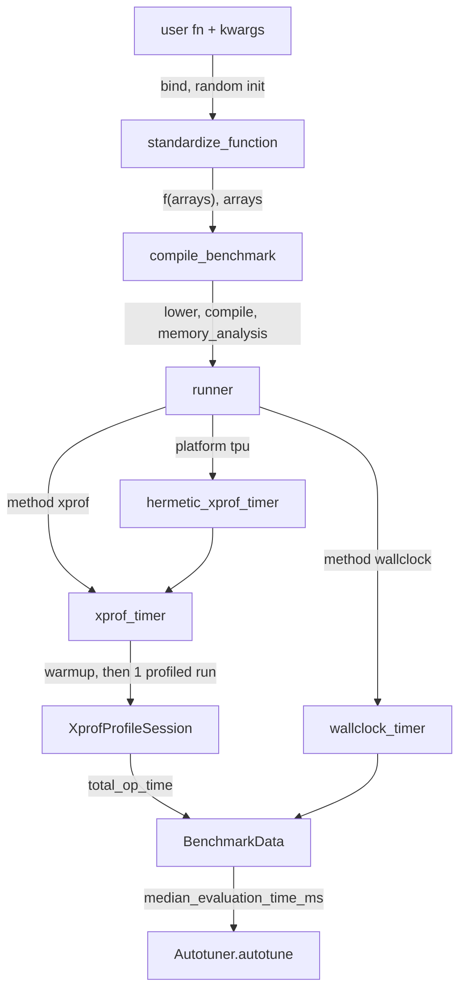
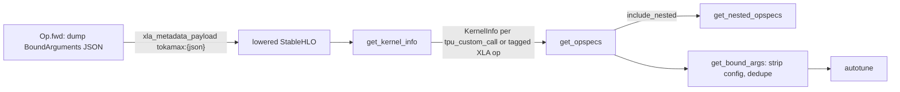

# Benchmarking (device-time measurement with XProf) and reading ops back from HLO

## Overview
The README states the problem plainly: "JAX Python overhead is often much larger than the actual
accelerator kernel execution time", so timing `jax.block_until_ready(f(x))` is useless for small
kernels. Tokamax answers with a two-stage pipeline. [`standardize_function`](https://github.com/openxla/tokamax/blob/3a0a3a34a5ccb8a6ac71f343d9cc44649d73db68/tokamax/_src/benchmarking.py#L379 "tokamax/_src/benchmarking#standardize_function")
rewrites any call (an op with static kwargs, `ShapeDtypeStruct` placeholders, a VJP) into a
single-argument function over concrete, randomly initialized arrays, and
[`compile_benchmark`](https://github.com/openxla/tokamax/blob/3a0a3a34a5ccb8a6ac71f343d9cc44649d73db68/tokamax/_src/benchmarking.py#L565 "tokamax/_src/benchmarking#compile_benchmark")
lowers and compiles it once and hands back a runner that times only the device. On TPU the
default timer is `hermetic_xprof`: a profiler session restricted to XLA ops whose result is the
union of hardware event intervals, not Python time. The second half of this page is the reverse
direction: every tokamax op call writes its own `BoundArguments` as JSON into the HLO, so a lowered
or exported program can be scanned to recover exactly which tokamax ops (and shapes) it contains,
which is what offline autotuning and the export story are built on.

## Diagram

Legend:
- `USER` - (concept) any JAX callable or tokamax op
- `STD` - [`standardize_function`](https://github.com/openxla/tokamax/blob/3a0a3a34a5ccb8a6ac71f343d9cc44649d73db68/tokamax/_src/benchmarking.py#L379 "tokamax/_src/benchmarking#standardize_function")
- `CB` - [`compile_benchmark`](https://github.com/openxla/tokamax/blob/3a0a3a34a5ccb8a6ac71f343d9cc44649d73db68/tokamax/_src/benchmarking.py#L565 "tokamax/_src/benchmarking#compile_benchmark")
- `RUN` - [`runner`](https://github.com/openxla/tokamax/blob/3a0a3a34a5ccb8a6ac71f343d9cc44649d73db68/tokamax/_src/benchmarking.py#L588 "tokamax/_src/benchmarking#compile_benchmark.runner")
- `HX` - [`hermetic_xprof_timer`](https://github.com/openxla/tokamax/blob/3a0a3a34a5ccb8a6ac71f343d9cc44649d73db68/tokamax/_src/benchmarking.py#L533 "tokamax/_src/benchmarking#hermetic_xprof_timer")
- `XT` - [`xprof_timer`](https://github.com/openxla/tokamax/blob/3a0a3a34a5ccb8a6ac71f343d9cc44649d73db68/tokamax/_src/benchmarking.py#L512 "tokamax/_src/benchmarking#xprof_timer")
- `WT` - [`wallclock_timer`](https://github.com/openxla/tokamax/blob/3a0a3a34a5ccb8a6ac71f343d9cc44649d73db68/tokamax/_src/benchmarking.py#L497 "tokamax/_src/benchmarking#wallclock_timer")
- `XPS` - [`XprofProfileSession`](https://github.com/openxla/tokamax/blob/3a0a3a34a5ccb8a6ac71f343d9cc44649d73db68/tokamax/_src/benchmarking.py#L108 "tokamax/_src/benchmarking#XprofProfileSession")
- `BD` - [`BenchmarkData`](https://github.com/openxla/tokamax/blob/3a0a3a34a5ccb8a6ac71f343d9cc44649d73db68/tokamax/_src/benchmarking.py#L77 "tokamax/_src/benchmarking#BenchmarkData")
- `AT` - [`autotune`](https://github.com/openxla/tokamax/blob/3a0a3a34a5ccb8a6ac71f343d9cc44649d73db68/tokamax/_src/autotuning/autotuner.py#L126 "tokamax/_src/autotuning/autotuner#Autotuner.autotune")

Legend:
- `FWD` - [`fwd`](https://github.com/openxla/tokamax/blob/3a0a3a34a5ccb8a6ac71f343d9cc44649d73db68/tokamax/_src/ops/op.py#L226 "tokamax/_src/ops/op#Op.fwd")
- `HLO` - (concept) `jax.stages.Lowered` or an `ir.Module`
- `GKI` - [`get_kernel_info`](https://github.com/openxla/tokamax/blob/3a0a3a34a5ccb8a6ac71f343d9cc44649d73db68/tokamax/_src/hlo_utils.py#L45 "tokamax/_src/hlo_utils#get_kernel_info")
- `GOS` - [`get_opspecs`](https://github.com/openxla/tokamax/blob/3a0a3a34a5ccb8a6ac71f343d9cc44649d73db68/tokamax/_src/hlo_utils.py#L63 "tokamax/_src/hlo_utils#get_opspecs")
- `GNO` - [`get_nested_opspecs`](https://github.com/openxla/tokamax/blob/3a0a3a34a5ccb8a6ac71f343d9cc44649d73db68/tokamax/_src/hlo_utils.py#L93 "tokamax/_src/hlo_utils#get_nested_opspecs")
- `GBA` - [`get_bound_args`](https://github.com/openxla/tokamax/blob/3a0a3a34a5ccb8a6ac71f343d9cc44649d73db68/tokamax/_src/hlo_utils.py#L103 "tokamax/_src/hlo_utils#get_bound_args")
- `AUTO` - [`autotune`](https://github.com/openxla/tokamax/blob/3a0a3a34a5ccb8a6ac71f343d9cc44649d73db68/tokamax/_src/autotuning/api.py#L309 "tokamax/_src/autotuning/api#autotune")

## Design rationale (why it's built this way)
- **Profile the device, not the host.** [`XprofProfileSession`](https://github.com/openxla/tokamax/blob/3a0a3a34a5ccb8a6ac71f343d9cc44649d73db68/tokamax/_src/benchmarking.py#L108 "tokamax/_src/benchmarking#XprofProfileSession")
  documents why XProf is the TPU choice: "On TPU, instrumentation is added at compile time and
  relies on HW support for near zero overhead", whereas on GPU XProf goes through CUPTI and "can
  increase the apparent runtime". `docs/benchmarking.md` adds that CUPTI-based methods "impose some
  variable overhead, typically up to 5%". So the per-platform default is CUPTI on GPU and
  `hermetic_xprof` on TPU, with wallclock only as the fallback for other backends.
- **Union of intervals, not a sum of kernels.** `total_op_time` is "the ground-truth device compute
  duration computed via Disjoint Interval Union", which merges overlapping hardware events so
  concurrently running ops are not double counted. The number is precomputed on `__exit__` because
  the trace files are deleted when the context closes.
- **Hermetic by default.** The `hermetic_xprof` path forces the `jax.profiler` route and never
  starts an XProf server; the non-hermetic `xprof` path exists to hand back an `xprof_url` (only
  on the last iteration, where metadata is requested), which is useful by hand but not in CI.
- **Standardize before timing.** Static, non-array arguments (strings, enums, configs) are split
  out and closed over, so the timed function is "cleanly jitted without worrying about static
  arguments" (docs). Inputs are randomly initialized because, per `docs/benchmarking.md`,
  "performance can vary significantly based on data distributions" through power and thermal
  effects; zero inputs would flatter the kernel.
- **Serialize the call into the HLO.** [`Op`](https://github.com/openxla/tokamax/blob/3a0a3a34a5ccb8a6ac71f343d9cc44649d73db68/tokamax/_src/ops/op.py#L121 "tokamax/_src/ops/op#Op")'s
  docstring: "The arguments, including `vmap` axes, are also recorded in the HLO, allowing for
  offline autotuning." The program itself becomes the manifest of which ops need tuning, so
  autotuning can run on a lowered or exported artifact without re-running model code.

## Entry points
- [`benchmark`](https://github.com/openxla/tokamax/blob/3a0a3a34a5ccb8a6ac71f343d9cc44649d73db68/tokamax/_src/benchmarking.py#L654 "tokamax/_src/benchmarking#benchmark") -
  `tokamax.benchmark(f_std, args, iterations=5, method=None, event_filter_regex=None)`. A one-shot
  `compile_benchmark(f, x)(x, ...)`; its docstring calls `'hermetic_xprof'` "the recommended
  timing method for TPU". The benchmark suites call it once with the default and once with
  `method='wallclock'` (for example [`test_attention`](https://github.com/openxla/tokamax/blob/3a0a3a34a5ccb8a6ac71f343d9cc44649d73db68/tokamax/benchmarks/attention.py#L85 "tokamax/benchmarks/attention#AttentionBenchmark.test_attention")),
  and TPU perf regressions pin `method="hermetic_xprof"` explicitly, as in
  [`test_tgmm_perf_regression_maxtext`](https://github.com/openxla/tokamax/blob/3a0a3a34a5ccb8a6ac71f343d9cc44649d73db68/tokamax/_src/ops/experimental/gmm_v2/gmm_v2_perf_test.py#L78 "tokamax/_src/ops/experimental/gmm_v2/gmm_v2_perf_test#GmmPerfTest.test_tgmm_perf_regression_maxtext").
- [`benchmark`](https://github.com/openxla/tokamax/blob/3a0a3a34a5ccb8a6ac71f343d9cc44649d73db68/tokamax/_src/ops/op.py#L577 "tokamax/_src/ops/op#BoundArguments.benchmark") -
  the op-level shortcut: a bound op call is standardized with `self.op, *self.args,
  kwargs=self.kwargs` and run through `compile_benchmark` with the default timer.
- [`register_benchmark`](https://github.com/openxla/tokamax/blob/3a0a3a34a5ccb8a6ac71f343d9cc44649d73db68/tokamax/_src/benchmarking.py#L696 "tokamax/_src/benchmarking#register_benchmark") -
  wraps the same pipeline as a Google Benchmark named `{name}_{mode}_{impl_name}`. It uses manual
  time set to the median, labels min, max and stddev/median, and turns `NotImplementedError` into
  a skip.
- [`get_bound_args`](https://github.com/openxla/tokamax/blob/3a0a3a34a5ccb8a6ac71f343d9cc44649d73db68/tokamax/_src/hlo_utils.py#L103 "tokamax/_src/hlo_utils#get_bound_args") -
  `tokamax.get_bound_args(f, *args, **kwargs)` lowers `f` (jitting it if needed) and returns the
  unique tokamax op calls inside it. The autotuning API re-exports it as
  [`get_bound_args`](https://github.com/openxla/tokamax/blob/3a0a3a34a5ccb8a6ac71f343d9cc44649d73db68/tokamax/_src/autotuning/api.py#L215 "tokamax/_src/autotuning/api#get_bound_args")
  and [`autotune`](https://github.com/openxla/tokamax/blob/3a0a3a34a5ccb8a6ac71f343d9cc44649d73db68/tokamax/_src/autotuning/api.py#L309 "tokamax/_src/autotuning/api#autotune")
  calls it whenever it is handed a callable or a `Lowered`.

## Mechanism (step-by-step)
1. **Standardize.** [`standardize_function`](https://github.com/openxla/tokamax/blob/3a0a3a34a5ccb8a6ac71f343d9cc44649d73db68/tokamax/_src/benchmarking.py#L379 "tokamax/_src/benchmarking#standardize_function")
   binds `args/kwargs` to `f`'s signature, flattens them, and splits array-like leaves
   (`jax.Array`, `ShapeDtypeStruct`, `np.ndarray`, array initializers) from everything else; the
   returned `forward(arrays)` merges the static leaves back in. If the arrays are
   `BatchedShapeDtype`s, one `jax.vmap` is stacked per vmap axis, so a benchmark reproduces the
   batched call the op saw (mixing batched and plain arrays is rejected). With `seed=0` (default)
   all arrays are randomly initialized; `seed=None` keeps them abstract. The `mode` then picks the
   function: `'forward'`; `'forward_res'` (the forward half of `jax.vjp`, so residuals are
   produced); `'forward_and_vjp'` (forward plus VJP applied to the output, with the forward output
   passed through an `optimization_barrier`); or `'vjp'`, which runs the forward pass at
   standardization time and times only the backward. The docstring warns that `'vjp'` "will bake
   in all intermediates into the HLO, which can cause OOM errors".
2. **Compile once, separately timed.** [`compile_benchmark`](https://github.com/openxla/tokamax/blob/3a0a3a34a5ccb8a6ac71f343d9cc44649d73db68/tokamax/_src/benchmarking.py#L565 "tokamax/_src/benchmarking#compile_benchmark")
   wraps `f` in `jax.jit`, times `lower()` and `compile()` with `perf_counter`, and reads
   `peak_memory_in_bytes` from the compiled executable's `memory_analysis()`. Every later
   measurement reuses this compiled executable, so autotuning can compare configs without
   recompiling.
3. **Pick the timer.** The [`runner`](https://github.com/openxla/tokamax/blob/3a0a3a34a5ccb8a6ac71f343d9cc44649d73db68/tokamax/_src/benchmarking.py#L588 "tokamax/_src/benchmarking#compile_benchmark.runner")
   finds the platform from the device of the first concrete input array, falling back to
   `jax.default_backend()`, and with `method=None` maps `tpu -> hermetic_xprof`,
   `gpu -> cupti`, anything else to `wallclock`. It rejects `cupti` off GPU and the XProf methods
   on anything other than GPU or TPU. It then calls the timer `iterations - 1` times without
   metadata and once more with metadata, so `evaluation_times_ms` always has `iterations` entries.
4. **One profiled execution per sample.** [`xprof_timer`](https://github.com/openxla/tokamax/blob/3a0a3a34a5ccb8a6ac71f343d9cc44649d73db68/tokamax/_src/benchmarking.py#L512 "tokamax/_src/benchmarking#xprof_timer")
   runs `f(args)` once as warm-up outside the profiler, then opens an
   [`XprofProfileSession`](https://github.com/openxla/tokamax/blob/3a0a3a34a5ccb8a6ac71f343d9cc44649d73db68/tokamax/_src/benchmarking.py#L108 "tokamax/_src/benchmarking#XprofProfileSession")
   around exactly one blocked execution and returns `total_op_time` in ms.
   [`hermetic_xprof_timer`](https://github.com/openxla/tokamax/blob/3a0a3a34a5ccb8a6ac71f343d9cc44649d73db68/tokamax/_src/benchmarking.py#L533 "tokamax/_src/benchmarking#hermetic_xprof_timer")
   is the same timer pinned to `use_jax_profiler=True` and hermetic mode.
   [`wallclock_timer`](https://github.com/openxla/tokamax/blob/3a0a3a34a5ccb8a6ac71f343d9cc44649d73db68/tokamax/_src/benchmarking.py#L497 "tokamax/_src/benchmarking#wallclock_timer")
   follows the same warm-up-then-measure pattern with `perf_counter` around
   `block_until_ready`, so it includes Python dispatch time.
5. **What the TPU profile records.** On TPU the [`XprofProfileSession`](https://github.com/openxla/tokamax/blob/3a0a3a34a5ccb8a6ac71f343d9cc44649d73db68/tokamax/_src/benchmarking.py#L108 "tokamax/_src/benchmarking#XprofProfileSession") `ProfileOptions` turn off the Python and
   host tracers and HLO protos and set `tpu_trace_mode: TRACE_ONLY_XLA` with `tpu_perf_counters`.
   In the open-source build the internal XProf modules are stubbed to `None`, so the session always
   takes the `jax.profiler.start_trace` path into a temp directory (under `WORKLOAD_ARTIFACTS_DIR`
   if set). If a stale trace is already running it is stopped and restarted. On exit the session
   requires exactly one `*.xplane.pb`, parses it, deletes the directory unless both
   `TOKAMAX_DUMP_XPROF` and `WORKLOAD_ARTIFACTS_DIR` are set, and runs the xprof CLI's
   `compute_kernel_stats(include_summary=True)`, with `event_filter_regex` passed as trace matchers.
6. **Validate and package.** `total_op_time` raises if no device time was recorded ("Check that JAX
   functions inside the context are blocked") and raises a `RuntimeError` if the parsed device
   time exceeds the profiler's own wallclock window. The runner returns a
   [`BenchmarkData`](https://github.com/openxla/tokamax/blob/3a0a3a34a5ccb8a6ac71f343d9cc44649d73db68/tokamax/_src/benchmarking.py#L77 "tokamax/_src/benchmarking#BenchmarkData")
   with lowering and compile times, the per-iteration device times, `peak_memory_mb` and metadata.
   The autotuner consumes the same type (re-exported as
   [`BenchmarkData`](https://github.com/openxla/tokamax/blob/3a0a3a34a5ccb8a6ac71f343d9cc44649d73db68/tokamax/_src/autotuning/autotuner.py#L35 "tokamax/_src/autotuning/autotuner#BenchmarkData")),
   and [`AutotuningData`](https://github.com/openxla/tokamax/blob/3a0a3a34a5ccb8a6ac71f343d9cc44649d73db68/tokamax/_src/autotuning/autotuner.py#L38 "tokamax/_src/autotuning/autotuner#AutotuningData")
   picks `fastest_config` as the minimum `median_evaluation_time_ms`.
7. **Every op call writes itself into the HLO.** Inside [`fwd`](https://github.com/openxla/tokamax/blob/3a0a3a34a5ccb8a6ac71f343d9cc44649d73db68/tokamax/_src/ops/op.py#L226 "tokamax/_src/ops/op#Op.fwd")
   the op resolves its config, builds a `BoundArguments` of itself (with `vjp=None` and the
   resolved config) over abstractified arguments, dumps it as JSON, and runs `_fwd` under a
   context that sets `xla_metadata_payload` to `tokamax:{json}`. Nested ops append
   `/tokamax:{json}` to the enclosing payload, outermost first. Every StableHLO op lowered inside
   carries that payload as a frontend attribute.
8. **Walk the HLO.** [`get_kernel_info`](https://github.com/openxla/tokamax/blob/3a0a3a34a5ccb8a6ac71f343d9cc44649d73db68/tokamax/_src/hlo_utils.py#L45 "tokamax/_src/hlo_utils#get_kernel_info")
   walks the module from `main`, following `func.call` into callees and accumulating a name call
   stack. A `stablehlo.custom_call` whose target is a known kernel key (`tpu_custom_call` for
   Mosaic TPU, plus Mosaic GPU and Triton keys) becomes a kernel record with input/output shapes,
   source location and payload. With `include_xla_kernels=True`, plain XLA ops also count when
   they carry a `tokamax:` payload or sit under a `tokamax` name scope, except for layout noise
   (reshape, transpose, convert and similar), which is kept once per payload and only when no
   real kernel carries the same payload.
9. **Parse and dedupe.** [`get_opspecs`](https://github.com/openxla/tokamax/blob/3a0a3a34a5ccb8a6ac71f343d9cc44649d73db68/tokamax/_src/hlo_utils.py#L63 "tokamax/_src/hlo_utils#get_opspecs")
   extracts the first brace-balanced JSON after `tokamax:` from each record's payload (or op name)
   and validates it back into a [`BoundArguments`](https://github.com/openxla/tokamax/blob/3a0a3a34a5ccb8a6ac71f343d9cc44649d73db68/tokamax/_src/ops/op.py#L437 "tokamax/_src/ops/op#BoundArguments").
   [`get_nested_opspecs`](https://github.com/openxla/tokamax/blob/3a0a3a34a5ccb8a6ac71f343d9cc44649d73db68/tokamax/_src/hlo_utils.py#L93 "tokamax/_src/hlo_utils#get_nested_opspecs")
   keeps every stacked payload instead. [`test_get_opspecs_stacked_payloads`](https://github.com/openxla/tokamax/blob/3a0a3a34a5ccb8a6ac71f343d9cc44649d73db68/tokamax/_src/hlo_utils_test.py#L547 "tokamax/_src/hlo_utils_test#HloUtilsHelpersTest.test_get_opspecs_stacked_payloads")
   pins this: a normalization wrapping a GLU yields one spec by default and two when nested.
   [`get_bound_args`](https://github.com/openxla/tokamax/blob/3a0a3a34a5ccb8a6ac71f343d9cc44649d73db68/tokamax/_src/hlo_utils.py#L103 "tokamax/_src/hlo_utils#get_bound_args")
   then sets each op's config to `None` ("The chosen config is serialized into the HLO - remove
   it here") and keeps one entry per `(op class, autotuning_cache_key)`, which is exactly the
   work list [`autotune`](https://github.com/openxla/tokamax/blob/3a0a3a34a5ccb8a6ac71f343d9cc44649d73db68/tokamax/_src/autotuning/api.py#L309 "tokamax/_src/autotuning/api#autotune")
   needs.

## Key data structures
- [`BenchmarkData`](https://github.com/openxla/tokamax/blob/3a0a3a34a5ccb8a6ac71f343d9cc44649d73db68/tokamax/_src/benchmarking.py#L77 "tokamax/_src/benchmarking#BenchmarkData") -
  frozen record: `compile_time_ms`, `lower_time_ms`, `evaluation_times_ms` (one device time per
  profiled execution), `metadata` (for example `xprof_url`), `peak_memory_mb` (bytes / 1e6, from
  the compiled executable). `median_evaluation_time_ms` is the number everything downstream ranks on.
- [`BoundArguments`](https://github.com/openxla/tokamax/blob/3a0a3a34a5ccb8a6ac71f343d9cc44649d73db68/tokamax/_src/ops/op.py#L437 "tokamax/_src/ops/op#BoundArguments") -
  an [`op`](https://github.com/openxla/tokamax/blob/3a0a3a34a5ccb8a6ac71f343d9cc44649d73db68/tokamax/_src/ops/op.py#L440 "tokamax/_src/ops/op#BoundArguments.op") plus its
  [`arguments`](https://github.com/openxla/tokamax/blob/3a0a3a34a5ccb8a6ac71f343d9cc44649d73db68/tokamax/_src/ops/op.py#L441 "tokamax/_src/ops/op#BoundArguments.arguments")
  dict (arrays abstracted to shape and dtype), exposing [`args`](https://github.com/openxla/tokamax/blob/3a0a3a34a5ccb8a6ac71f343d9cc44649d73db68/tokamax/_src/ops/op.py#L452 "tokamax/_src/ops/op#BoundArguments.args")
  and [`kwargs`](https://github.com/openxla/tokamax/blob/3a0a3a34a5ccb8a6ac71f343d9cc44649d73db68/tokamax/_src/ops/op.py#L456 "tokamax/_src/ops/op#BoundArguments.kwargs").
  This is the unit that is serialized into HLO, recovered from it, benchmarked and autotuned.
- `TimingMethod` - `'wallclock' | 'cupti' | 'xprof' | 'hermetic_xprof'`; `BenchmarkMode` -
  `'forward' | 'forward_res' | 'vjp' | 'forward_and_vjp'`.

## Dynamics (design intent)
- A sample is one execution. `iterations=5` means 5 warm-up runs plus 5 profiled runs in 5
  separate profiler sessions, and the median over those 5 is reported. `docs/benchmarking.md`
  warns that raising iterations in a short window can trigger thermal throttling on compute-heavy
  kernels and suggests several small, spaced-out runs instead.
- `event_filter_regex` narrows the summed device time to matching XLA event names, so a
  benchmark can time only the Pallas kernel and exclude surrounding XLA glue. The TPU tuning
  scripts use it this way (`"gmm"`, `"tgmm"`, `"splash_mha_fwd"`); see
  [torch-tpu-bridge](./torch-tpu-bridge.md).
- `XprofProfileSession` refuses to run on CPU (`'Profiling XLA:CPU is not currently supported.'`),
  so a CPU-only host benchmarking without an explicit method falls back to wallclock.

## Edge cases
- **Name mismatch in the docs.** `docs/benchmarking.md` recommends `method=xprof_hermetic`, but
  the registered key in [`compile_benchmark`](https://github.com/openxla/tokamax/blob/3a0a3a34a5ccb8a6ac71f343d9cc44649d73db68/tokamax/_src/benchmarking.py#L565 "tokamax/_src/benchmarking#compile_benchmark")
  is `'hermetic_xprof'`; the docs spelling falls through to the `_TIMERS` lookup and raises
  `KeyError`. Use `method=None` or `'hermetic_xprof'`.
- **Abstract inputs pick the default backend.** If `x` contains no concrete arrays (for example
  inside a trace), the platform is `jax.default_backend()`, not the device the arrays will land on.
- **`'vjp'` mode OOMs on big shapes**: forward residuals become HLO constants resident in HBM
  (docs: "with all intermediates baked into the HLO which remains resident in HBM memory").
- **Explicit configs collapse.** [`get_bound_args`](https://github.com/openxla/tokamax/blob/3a0a3a34a5ccb8a6ac71f343d9cc44649d73db68/tokamax/_src/hlo_utils.py#L103 "tokamax/_src/hlo_utils#get_bound_args")
  clears `config` but dedupes on the cache key, so two calls differing only in their explicit
  config collapse into one entry.
- **Export and device checks.** The README's "Serialization" section says kernels are JAX custom
  calls, banned by default in `jax.export`, so export must pass tokamax's disabled-checks tuple.
  An exported function "will run on the exact device it was serialized for" and loses StableHLO's
  device independence. The "Cross-Compilation and CPU Export" section says an explicit
  `implementation=` or `tokamax.config.cross_compile(True)` bypasses the host-device check, which
  is the [`supported_on`](https://github.com/openxla/tokamax/blob/3a0a3a34a5ccb8a6ac71f343d9cc44649d73db68/tokamax/_src/ops/op.py#L409 "tokamax/_src/ops/op#Op.supported_on")
  test the op otherwise applies to every inferred device before lowering.

## Open questions
- The export-checks tuple in `hlo_utils` disables only the two Triton custom-call targets.
  Statically, Mosaic TPU's `tpu_custom_call` is therefore assumed to be allowed by `jax.export`
  already; this page does not verify that against JAX.
- `register_benchmark` forwards `**bmark_kwargs` to the runner, but no caller in the pinned tree
  was checked for overriding `method` on TPU.
- `peak_memory_mb` comes from XLA's static `memory_analysis`, not a runtime HBM measurement. How
  closely it tracks real peak HBM for Mosaic kernels with large VMEM scratch is not settled by
  source.

## See also
- [autotuning](./autotuning.md) - consumes `BenchmarkData` and the `get_bound_args` work list.
- [op-framework](./op-framework.md) - `Op`, `bind`, configs and the HLO payload written in `Op.fwd`.
- [kernel-catalog](./kernel-catalog.md) - which ops exist and which backends dispatch picks.
- [torch-tpu-bridge](./torch-tpu-bridge.md) - the tune-jax TPU tuning scripts and PyTorch entry.
- [mosaic-tpu-helpers](./mosaic-tpu-helpers.md) - shared Mosaic TPU plumbing behind the kernels being timed.
