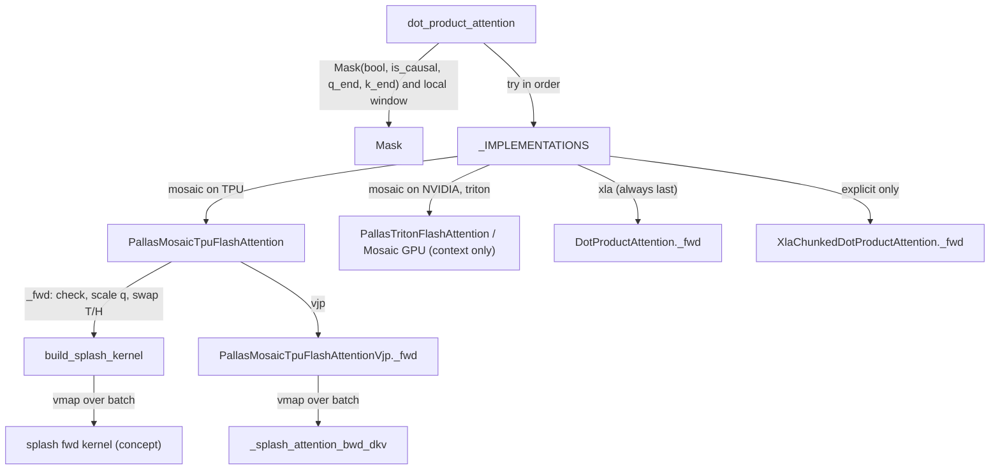

# dot_product_attention: implementation dispatch and the Mosaic TPU flash attention

## Overview
`tokamax.dot_product_attention` is the README's "FlashAttention" op and a superset of `jax.nn.dot_product_attention`. Its docstring adds "additional batch dimensions", "quantized `query`, `key`, and `value` arrays" and a "different output head dimension". The public function [`dot_product_attention`](https://github.com/openxla/tokamax/blob/3a0a3a34a5ccb8a6ac71f343d9cc44649d73db68/tokamax/_src/ops/attention/api.py#L81 "tokamax/_src/ops/attention/api#dot_product_attention") folds every masking option into one [`Mask`](https://github.com/openxla/tokamax/blob/3a0a3a34a5ccb8a6ac71f343d9cc44649d73db68/tokamax/_src/ops/attention/base.py#L60 "tokamax/_src/ops/attention/base#Mask"): a boolean array, `is_causal`, sequence lengths and a local window. It then tries implementations in order, and every implementation is a subclass of the [`DotProductAttention`](https://github.com/openxla/tokamax/blob/3a0a3a34a5ccb8a6ac71f343d9cc44649d73db68/tokamax/_src/ops/attention/base.py#L222 "tokamax/_src/ops/attention/base#DotProductAttention") op. The base class doubles as the `xla` reference implementation. Any implementation that cannot handle the arguments raises `NotImplementedError`, and dispatch moves on to the next one. **On TPU the important fact is that there is no separate flash attention kernel.** [`PallasMosaicTpuFlashAttention`](https://github.com/openxla/tokamax/blob/3a0a3a34a5ccb8a6ac71f343d9cc44649d73db68/tokamax/_src/ops/attention/pallas_mosaic_tpu.py#L63 "tokamax/_src/ops/attention/pallas_mosaic_tpu#PallasMosaicTpuFlashAttention") turns the `Mask` into a splash mask with [`build_splash_kernel`](https://github.com/openxla/tokamax/blob/3a0a3a34a5ccb8a6ac71f343d9cc44649d73db68/tokamax/_src/ops/attention/pallas_mosaic_tpu_common.py#L65 "tokamax/_src/ops/attention/pallas_mosaic_tpu_common#build_splash_kernel"), transposes to heads-major, and `jax.vmap`s the [splash attention](./splash-attention.md) forward kernel over the batch. The backward pass vmaps the splash fused dKV kernel the same way. The grid, BlockSpecs, VMEM scratch and megacore behaviour are therefore splash's, and this page covers the adapter layer and its limits.

## Diagram

Legend:
- `API` - [`dot_product_attention`](https://github.com/openxla/tokamax/blob/3a0a3a34a5ccb8a6ac71f343d9cc44649d73db68/tokamax/_src/ops/attention/api.py#L81 "tokamax/_src/ops/attention/api#dot_product_attention")
- `MASK` - [`Mask`](https://github.com/openxla/tokamax/blob/3a0a3a34a5ccb8a6ac71f343d9cc44649d73db68/tokamax/_src/ops/attention/base.py#L60 "tokamax/_src/ops/attention/base#Mask")
- `IMPLS` - [`_IMPLEMENTATIONS`](https://github.com/openxla/tokamax/blob/3a0a3a34a5ccb8a6ac71f343d9cc44649d73db68/tokamax/_src/ops/attention/api.py#L35 "tokamax/_src/ops/attention/api#_IMPLEMENTATIONS")
- `TPU` - [`PallasMosaicTpuFlashAttention`](https://github.com/openxla/tokamax/blob/3a0a3a34a5ccb8a6ac71f343d9cc44649d73db68/tokamax/_src/ops/attention/pallas_mosaic_tpu.py#L63 "tokamax/_src/ops/attention/pallas_mosaic_tpu#PallasMosaicTpuFlashAttention")
- `GPU` - [`PallasTritonFlashAttention`](https://github.com/openxla/tokamax/blob/3a0a3a34a5ccb8a6ac71f343d9cc44649d73db68/tokamax/_src/ops/attention/pallas_triton.py#L543 "tokamax/_src/ops/attention/pallas_triton#PallasTritonFlashAttention") (GPU backends, context only)
- `XLA` - [`_fwd`](https://github.com/openxla/tokamax/blob/3a0a3a34a5ccb8a6ac71f343d9cc44649d73db68/tokamax/_src/ops/attention/base.py#L568 "tokamax/_src/ops/attention/base#DotProductAttention._fwd")
- `CH` - [`_fwd`](https://github.com/openxla/tokamax/blob/3a0a3a34a5ccb8a6ac71f343d9cc44649d73db68/tokamax/_src/ops/attention/xla_chunked.py#L324 "tokamax/_src/ops/attention/xla_chunked#XlaChunkedDotProductAttention._fwd")
- `BSK` - [`build_splash_kernel`](https://github.com/openxla/tokamax/blob/3a0a3a34a5ccb8a6ac71f343d9cc44649d73db68/tokamax/_src/ops/attention/pallas_mosaic_tpu_common.py#L65 "tokamax/_src/ops/attention/pallas_mosaic_tpu_common#build_splash_kernel")
- `SPL` - (concept) the splash forward kernel, see [splash-attention](./splash-attention.md)
- `TVJP` - [`_fwd`](https://github.com/openxla/tokamax/blob/3a0a3a34a5ccb8a6ac71f343d9cc44649d73db68/tokamax/_src/ops/attention/pallas_mosaic_tpu_vjp.py#L73 "tokamax/_src/ops/attention/pallas_mosaic_tpu_vjp#PallasMosaicTpuFlashAttentionVjp._fwd")
- `DKV` - [`_splash_attention_bwd_dkv`](https://github.com/openxla/tokamax/blob/3a0a3a34a5ccb8a6ac71f343d9cc44649d73db68/tokamax/_src/ops/experimental/tpu/splash_attention/splash_attention_kernel.py#L1931 "tokamax/_src/ops/experimental/tpu/splash_attention/splash_attention_kernel#_splash_attention_bwd_dkv")

## Design rationale (why it's built this way)
- **One mask type, many backends.** `Mask` stores masking as structure (`bool_mask`, `q_start/q_end`, `k_start/k_end` ranges, static `is_causal`) instead of a dense array. Each backend can then use the cheap form it understands, and the XLA reference can always materialize it with [`as_array`](https://github.com/openxla/tokamax/blob/3a0a3a34a5ccb8a6ac71f343d9cc44649d73db68/tokamax/_src/ops/attention/base.py#L110 "tokamax/_src/ops/attention/base#Mask.as_array"). The docstring shows a local mask written as `Mask(k_start=..., is_causal=True)` and calls the same window spelled with explicit `k_start`/`k_end` ranges (no `is_causal`) "equivalent (but less efficiently)". [`__and__`](https://github.com/openxla/tokamax/blob/3a0a3a34a5ccb8a6ac71f343d9cc44649d73db68/tokamax/_src/ops/attention/base.py#L172 "tokamax/_src/ops/attention/base#Mask.__and__") intersects masks: it takes the max of starts, the min of ends, and ORs `is_causal`, so composition never densifies.
- **Fallback by exception.** The README promises that `implementation=None` "will also always be supported, as it can fall back to an XLA implementation". Kernels therefore do not need to support everything. They raise `NotImplementedError` (from `supported_on`, or from input checks such as `check_inputs_support`) and dispatch moves on.
- **Reuse splash on TPU.** The TPU flash attention takes its config fields from splash (`block_q`, `block_kv`, `block_kv_compute`, `q/k/v_layout` using splash's [`QKVLayout`](https://github.com/openxla/tokamax/blob/3a0a3a34a5ccb8a6ac71f343d9cc44649d73db68/tokamax/_src/ops/experimental/tpu/splash_attention/splash_attention_kernel.py#L103 "tokamax/_src/ops/experimental/tpu/splash_attention/splash_attention_kernel#QKVLayout"), `use_experimental_scheduler`, `use_base2_exp`). It copies them onto `SplashConfig.get_default()`. A TODO admits the cost of the adapter: "The SplashAttention kernel expects the sequence dimension to be after the num_heads dimension. This requires transposing the inputs, which introduces overhead."
- **Separate forward and backward ops, each autotuned.** The op attaches `PallasMosaicTpuFlashAttentionVjp` as its `vjp`. The forward [`_get_autotuning_configs`](https://github.com/openxla/tokamax/blob/3a0a3a34a5ccb8a6ac71f343d9cc44649d73db68/tokamax/_src/ops/attention/pallas_mosaic_tpu.py#L192 "tokamax/_src/ops/attention/pallas_mosaic_tpu#PallasMosaicTpuFlashAttention._get_autotuning_configs") and the VJP's own search space are tuned independently. The README says tokamax "is even allowed to choose different implementations for the forward pass and gradient".

## Entry points
- [`dot_product_attention`](https://github.com/openxla/tokamax/blob/3a0a3a34a5ccb8a6ac71f343d9cc44649d73db68/tokamax/_src/ops/attention/api.py#L81 "tokamax/_src/ops/attention/api#dot_product_attention") - exported as `tokamax.dot_product_attention`. It accepts `Implementation = "mosaic" | "triton" | "cudnn" | "xla" | "xla_chunked"` or a sequence of them. `"mosaic"` resolves to `mosaic_gpu` when the default device kind contains `"NVIDIA"` and to `mosaic_tpu` otherwise.
- [`_IMPLEMENTATIONS`](https://github.com/openxla/tokamax/blob/3a0a3a34a5ccb8a6ac71f343d9cc44649d73db68/tokamax/_src/ops/attention/api.py#L35 "tokamax/_src/ops/attention/api#_IMPLEMENTATIONS") - always holds `cudnn`, `xla` and `xla_chunked`. `triton`, `mosaic_gpu` and `mosaic_tpu` are added if their modules import. The default order is built up as `("mosaic", "triton", "xla")`, or a subset of it, so `xla_chunked` and `cudnn` are only used when requested explicitly. A TODO asks whether `xla_chunked` should replace `xla` "for very big sequences lengths. Eg. where xla OOMs." The table is also exported to the autotuning API ([`_API_IMPLEMENTATIONS`](https://github.com/openxla/tokamax/blob/3a0a3a34a5ccb8a6ac71f343d9cc44649d73db68/tokamax/_src/autotuning/api.py#L260 "tokamax/_src/autotuning/api#_API_IMPLEMENTATIONS._API_IMPLEMENTATIONS")).
- [`DotProductAttention`](https://github.com/openxla/tokamax/blob/3a0a3a34a5ccb8a6ac71f343d9cc44649d73db68/tokamax/_src/ops/attention/base.py#L222 "tokamax/_src/ops/attention/base#DotProductAttention") - "Dot product attention function", a subclass of [`Op`](https://github.com/openxla/tokamax/blob/3a0a3a34a5ccb8a6ac71f343d9cc44649d73db68/tokamax/_src/ops/op.py#L121 "tokamax/_src/ops/op#Op"). Callers that want the op object (with explicit config, autotuning or `return_residuals`) instantiate a subclass directly and call its [`__call__`](https://github.com/openxla/tokamax/blob/3a0a3a34a5ccb8a6ac71f343d9cc44649d73db68/tokamax/_src/ops/attention/base.py#L229 "tokamax/_src/ops/attention/base#DotProductAttention.__call__"), which is where `q_sharding` is handled.

## Mechanism (step-by-step)
1. **Mask assembly.** [`dot_product_attention`](https://github.com/openxla/tokamax/blob/3a0a3a34a5ccb8a6ac71f343d9cc44649d73db68/tokamax/_src/ops/attention/api.py#L81 "tokamax/_src/ops/attention/api#dot_product_attention") builds `Mask(mask, is_causal=..., q_end=query_seq_lengths, k_end=key_value_seq_lengths)`. If `local_window_size` is given, it ANDs in `Mask(k_start=k - pre, k_end=k + post + 1)`. On TPU this matters a great deal: sequence lengths and local windows become [`q_end`](https://github.com/openxla/tokamax/blob/3a0a3a34a5ccb8a6ac71f343d9cc44649d73db68/tokamax/_src/ops/attention/base.py#L105 "tokamax/_src/ops/attention/base#Mask.q_end"), [`k_start`](https://github.com/openxla/tokamax/blob/3a0a3a34a5ccb8a6ac71f343d9cc44649d73db68/tokamax/_src/ops/attention/base.py#L106 "tokamax/_src/ops/attention/base#Mask.k_start") and [`k_end`](https://github.com/openxla/tokamax/blob/3a0a3a34a5ccb8a6ac71f343d9cc44649d73db68/tokamax/_src/ops/attention/base.py#L107 "tokamax/_src/ops/attention/base#Mask.k_end") fields, and the Mosaic TPU path rejects all of those (step 4).
2. **Canonicalization in `bind`.** [`bind`](https://github.com/openxla/tokamax/blob/3a0a3a34a5ccb8a6ac71f343d9cc44649d73db68/tokamax/_src/ops/attention/base.py#L488 "tokamax/_src/ops/attention/base#DotProductAttention.bind") expands `precision` into a `(qk, pv)` pair of [`CanonicalPrecision`](https://github.com/openxla/tokamax/blob/3a0a3a34a5ccb8a6ac71f343d9cc44649d73db68/tokamax/_src/ops/attention/base.py#L44 "tokamax/_src/ops/attention/base#CanonicalPrecision"). It resolves an [`AUTO`](https://github.com/openxla/tokamax/blob/3a0a3a34a5ccb8a6ac71f343d9cc44649d73db68/tokamax/_src/ops/attention/base.py#L39 "tokamax/_src/ops/attention/base#AUTO") `logits_dtype` to the accumulation type of the QK dot algorithm (via [`to_dot_algorithm_preset`](https://github.com/openxla/tokamax/blob/3a0a3a34a5ccb8a6ac71f343d9cc44649d73db68/tokamax/_src/precision.py#L104 "tokamax/_src/precision#to_dot_algorithm_preset")), sets an `AUTO` `logits_scale` to `1/sqrt(head_dim)`, wraps a raw mask in `Mask`, and folds `is_causal` in with `mask &= CAUSAL_MASK`. The result is a [`BoundArguments`](https://github.com/openxla/tokamax/blob/3a0a3a34a5ccb8a6ac71f343d9cc44649d73db68/tokamax/_src/ops/op.py#L437 "tokamax/_src/ops/op#BoundArguments"), which serves as the autotuning key and is serialized into the HLO.
3. **Sharding wrapper.** With `q_sharding`, [`__call__`](https://github.com/openxla/tokamax/blob/3a0a3a34a5ccb8a6ac71f343d9cc44649d73db68/tokamax/_src/ops/attention/base.py#L229 "tokamax/_src/ops/attention/base#DotProductAttention.__call__") derives per-argument partition specs (batch, q-sequence and heads axes; KV-sequence and head-dim sharding are rejected) and runs the op under `shard_map`. When the q sequence is sharded and the mask is causal, it injects `q_indices = arange(T)` so the causal mask uses global positions.
4. **TPU forward.** The `_fwd` of [`PallasMosaicTpuFlashAttention`](https://github.com/openxla/tokamax/blob/3a0a3a34a5ccb8a6ac71f343d9cc44649d73db68/tokamax/_src/ops/attention/pallas_mosaic_tpu.py#L79 "tokamax/_src/ops/attention/pallas_mosaic_tpu#PallasMosaicTpuFlashAttention._fwd") first runs `check_inputs_support`. It accepts only bf16/f32 inputs, `logits_dtype == float32`, no bias, no dropout, no paging and no `q_start/q_end/k_start/k_end`. Anything else raises `NotImplementedError`, which sends dispatch to `xla`. It then dequantizes and pre-scales `q` by `logits_scale`, collapses leading batch dims to 4-D, swaps to `[B, H, T, D]`, and treats `num_kv_heads == 1` as MQA (squeezing K/V). It overlays its `Config` on `SplashConfig.get_default()` (keeping the default 128 backward blocks) and calls `build_splash_kernel`. Finally it runs `jax.vmap(splash_fn)` over batch, so each batch element is one splash call on a `[H, T, D]` slice. Residuals come back as `(max_logits, logsumexp)` reshaped to `[*B, H, T]`, and the output is swapped back and trimmed to `head_dim_out`.
5. **Mask translation.** [`build_splash_kernel`](https://github.com/openxla/tokamax/blob/3a0a3a34a5ccb8a6ac71f343d9cc44649d73db68/tokamax/_src/ops/attention/pallas_mosaic_tpu_common.py#L65 "tokamax/_src/ops/attention/pallas_mosaic_tpu_common#build_splash_kernel") maps the op's `Mask` onto splash in one of three ways. With a boolean mask, it materializes `as_array` and broadcasts it to 4-D. It requires one mask head ("Only num_mask_heads=1 is supported with a boolean mask"), allows one mask per batch element (vmapped with `in_axes=0`), and uses the **dynamic** splash makers. When [`is_causal`](https://github.com/openxla/tokamax/blob/3a0a3a34a5ccb8a6ac71f343d9cc44649d73db68/tokamax/_src/ops/attention/base.py#L108 "tokamax/_src/ops/attention/base#Mask.is_causal") is the only field set, it uses a lazy splash `CausalMask` with static, trace-time MaskInfo. With no mask at all, it uses `FullMask`. In every case it passes `mask_value = finfo(float32).min` and `downcast_smem_data=False`, with `shard_count = 1` ("TODO: support multiple shards").
6. **Config: heuristic or autotuned.** [`_get_heuristics_config`](https://github.com/openxla/tokamax/blob/3a0a3a34a5ccb8a6ac71f343d9cc44649d73db68/tokamax/_src/ops/attention/pallas_mosaic_tpu.py#L178 "tokamax/_src/ops/attention/pallas_mosaic_tpu#PallasMosaicTpuFlashAttention._get_heuristics_config") returns 128/128/128 with `HEAD_DIM_MINOR` layouts, the experimental scheduler on and base-2 exp ("TODO: Select better parameters based on a heuristic."). [`_get_autotuning_configs`](https://github.com/openxla/tokamax/blob/3a0a3a34a5ccb8a6ac71f343d9cc44649d73db68/tokamax/_src/ops/attention/pallas_mosaic_tpu.py#L192 "tokamax/_src/ops/attention/pallas_mosaic_tpu#PallasMosaicTpuFlashAttention._get_autotuning_configs") searches tiles {256, 512, 1024, 2048} x 2 layouts per operand x scheduler on/off. It keeps tiles >= 1024 for sequences >= 1024 and `bkv_compute <= 1024`. It excludes 4096 because "Tile size >=4096 makes compile time > 15mins per config, which pushes single arg spec autotuning time to more than 1 hour". The VJP searches tiles {512, 1024, 2048} (with 256 and 8192 left as a TODO).
7. **TPU backward.** Training goes through the `Op` custom VJP. The forward saves residuals, and the backward calls the `vjp` op [`_fwd`](https://github.com/openxla/tokamax/blob/3a0a3a34a5ccb8a6ac71f343d9cc44649d73db68/tokamax/_src/ops/attention/pallas_mosaic_tpu_vjp.py#L73 "tokamax/_src/ops/attention/pallas_mosaic_tpu_vjp#PallasMosaicTpuFlashAttentionVjp._fwd"). That function rejects `normalize_output=False`, re-applies `check_inputs_support`, pre-scales `q`, and rebuilds the splash kernel object with its own `block_*_dkv` config. It converts the natural-log `lse` residual to base 2 when `use_base2_exp` is set, then vmaps a closure over batch that calls splash's `_splash_attention_bwd` with the kernel's `dkv_mask_info`. Inside, that runs [`_splash_attention_bwd_dkv`](https://github.com/openxla/tokamax/blob/3a0a3a34a5ccb8a6ac71f343d9cc44649d73db68/tokamax/_src/ops/experimental/tpu/splash_attention/splash_attention_kernel.py#L1931 "tokamax/_src/ops/experimental/tpu/splash_attention/splash_attention_kernel#_splash_attention_bwd_dkv"). `dq` is multiplied by `logits_scale` again (chain rule for the pre-scaled `q`), and grads are swapped back to `[*B, T, H, D]`.
8. **XLA reference fallback.** The reference [`_fwd`](https://github.com/openxla/tokamax/blob/3a0a3a34a5ccb8a6ac71f343d9cc44649d73db68/tokamax/_src/ops/attention/base.py#L568 "tokamax/_src/ops/attention/base#DotProductAttention._fwd") repeats K/V for GQA and computes logits with the canonical dot algorithms. It applies scale, bias and soft cap, masks with `finfo.min`, not `-inf`: the comment warns that `-inf` "can lead to `NaN`s when a full softmax row is masked". It runs a custom-JVP softmax that also returns `(max, denom)` residuals, then applies dropout and the PV matmul. Its gradient op [`DotProductAttentionVjp`](https://github.com/openxla/tokamax/blob/3a0a3a34a5ccb8a6ac71f343d9cc44649d73db68/tokamax/_src/ops/attention/base.py#L813 "tokamax/_src/ops/attention/base#DotProductAttentionVjp") differentiates that reference in its [`_fwd`](https://github.com/openxla/tokamax/blob/3a0a3a34a5ccb8a6ac71f343d9cc44649d73db68/tokamax/_src/ops/attention/base.py#L820 "tokamax/_src/ops/attention/base#DotProductAttentionVjp._fwd").
9. **Chunked XLA.** [`XlaChunkedDotProductAttention._fwd`](https://github.com/openxla/tokamax/blob/3a0a3a34a5ccb8a6ac71f343d9cc44649d73db68/tokamax/_src/ops/attention/xla_chunked.py#L324 "tokamax/_src/ops/attention/xla_chunked#XlaChunkedDotProductAttention._fwd") implements arXiv 2112.05682 with `lax.scan` over Q and KV chunks (`(512, 1024)` from the API) and a rematerialized online softmax. Its docstring says this gives "memory linearly wrt the sequence length" and "more similar numerics to FlashAttention", at the cost of usually being slower than `xla`. It also supports paged KV.
10. **jax.nn / cuDNN.** [`JaxNnDotProductAttention._fwd`](https://github.com/openxla/tokamax/blob/3a0a3a34a5ccb8a6ac71f343d9cc44649d73db68/tokamax/_src/ops/attention/jax_nn.py#L46 "tokamax/_src/ops/attention/jax_nn#JaxNnDotProductAttention._fwd") forwards to `jax.nn.dot_product_attention` and is registered here only as `cudnn`.

## Key data structures
- [`Mask`](https://github.com/openxla/tokamax/blob/3a0a3a34a5ccb8a6ac71f343d9cc44649d73db68/tokamax/_src/ops/attention/base.py#L60 "tokamax/_src/ops/attention/base#Mask") - a pytree dataclass with `bool_mask`, range fields [`q_start`](https://github.com/openxla/tokamax/blob/3a0a3a34a5ccb8a6ac71f343d9cc44649d73db68/tokamax/_src/ops/attention/base.py#L104 "tokamax/_src/ops/attention/base#Mask.q_start")/`q_end`/`k_start`/`k_end` and a static `is_causal`. `as_array(q_len_or_indices, k_len_or_indices)` takes either lengths or explicit index arrays, which is how `q_indices` gives global positions under sequence sharding.
- The `PallasMosaicTpuFlashAttention` `Config` - a pydantic dataclass with `block_q`, `block_kv` and `block_kv_compute` (each a multiple of 128, and `block_kv % block_kv_compute == 0`), `q/k/v_layout` (`HEAD_DIM_MINOR` or `SEQ_MINOR`), `use_experimental_scheduler` and `use_base2_exp`. The VJP `Config` has `block_q_dkv`, `block_kv_dkv`, `block_kv_dkv_compute` and `use_base2_exp`. What each field means inside the kernel is explained on [splash-attention](./splash-attention.md).
- `Residuals` - `(max logits, softmax denominator or logsumexp)` with shape `[*B, H, T]`. The XLA reference returns `(max, denom)`. The TPU path returns `(max_logits, logsumexp)` in natural log.
- [`QArray`](https://github.com/openxla/tokamax/blob/3a0a3a34a5ccb8a6ac71f343d9cc44649d73db68/tokamax/_src/ops/attention/base.py#L45 "tokamax/_src/ops/attention/base#QArray") - qwix quantized arrays are accepted. The TPU forward dequantizes `q` with `quantization.as_array` before the kernel. [`PagingInfo`](https://github.com/openxla/tokamax/blob/3a0a3a34a5ccb8a6ac71f343d9cc44649d73db68/tokamax/_src/ops/attention/base.py#L195 "tokamax/_src/ops/attention/base#PagingInfo") describes a paged KV cache, which only `xla_chunked` handles here.

## Dynamics (design intent)
- `dot_product_attention` re-raises immediately when only one implementation is requested. With several, it collects the errors and raises `ExceptionGroup("all implementations failed", ...)`.
- `pallas_mosaic_tpu_test.py` skips off TPU ("Only supported on TPUs.") and covers dtype x kv-heads x masking x soft-cap, `test_autotune_configs` and `test_autotune_vjp`. The attention benchmark registry [`_IMPLS`](https://github.com/openxla/tokamax/blob/3a0a3a34a5ccb8a6ac71f343d9cc44649d73db68/tokamax/_src/ops/attention/bench.py#L33 "tokamax/_src/ops/attention/bench#_IMPLS._IMPLS") lists only `triton`, `mosaic` (GPU), `cudnn` and `xla`, so `bench.py` does not benchmark the TPU path.
- On GPU, `mosaic` resolves to the Mosaic GPU kernels (sm90/sm100) and `triton` to Pallas Triton. [`fold_q_sequence_heads`](https://github.com/openxla/tokamax/blob/3a0a3a34a5ccb8a6ac71f343d9cc44649d73db68/tokamax/_src/ops/attention/base.py#L692 "tokamax/_src/ops/attention/base#fold_q_sequence_heads") (folding GQA query heads into the sequence axis) is used only by the Mosaic GPU configs. These backends are out of scope for this TPU-focused page.

## Edge cases
- **Silent fallback to XLA on TPU.** Under default dispatch, the following all make `mosaic_tpu` raise and the call quietly runs the quadratic-memory `xla` path:
  - `query_seq_lengths`, `key_value_seq_lengths` or `local_window_size` (they become range fields),
  - a `bias`,
  - dropout,
  - a non-f32 `logits_dtype`,
  - any input whose dtype is not bf16 or f32,
  - TPU generations below 5 (`supported_on`).
  To force the kernel, pass `implementation="mosaic"`; it raises instead of falling back.
- **Masks.** A boolean mask that differs per head raises on TPU. A boolean mask that combines with causal is materialized densely and takes splash's dynamic path, where every tile is a candidate partial block.
- **`q_indices`/`k_indices` are not used by the TPU kernel** (the splash causal mask is built from local `arange`). Sequence-sharded causal attention through `q_sharding` therefore relies on positions that the TPU forward ignores.

> [!inferred]
> If that is right, causal attention with a sharded q sequence on the `mosaic_tpu` path would mask with shard-local positions. No test covering this was found in `api_sharding_test.py`.

- **GQA layout.** Query heads `[2g, 2g+1]` share KV head `g`, per the `__call__` docstring. `num_q_heads % num_kv_heads != 0` raises `ValueError`, not `NotImplementedError`, so it does not fall back.
- **Symbolic shapes** are unsupported (`supports_symbolic_shapes = False`).

## Open questions
- The mosaic GPU and Triton forward/VJP symbols in this page's index ([`PallasTritonFlashAttention`](https://github.com/openxla/tokamax/blob/3a0a3a34a5ccb8a6ac71f343d9cc44649d73db68/tokamax/_src/ops/attention/pallas_triton.py#L543 "tokamax/_src/ops/attention/pallas_triton#PallasTritonFlashAttention") and others) are intentionally not explained, per the TPU lens.
- `check_inputs_support`, the TPU `Config` classes and `PallasMosaicTpuFlashAttentionVjp` as a class are not in this page's symbol index, so they are named without links.
- No torch_tpu wrapper for `dot_product_attention` exists under `tokamax/experimental/torch_tpu/ops`. See [torch-tpu-bridge](./torch-tpu-bridge.md).
- The README uses `implementation="mosaic_tpu_v2"` as its cross-compilation example. It is a `ragged_dot` (and `ragged_gather`) implementation name, not an attention one.

## See also
- [splash-attention](./splash-attention.md) - the kernel this op runs on TPU (MaskInfo, grid, VMEM scratch, fused dKV backward).
- [op-framework](./op-framework.md) - `Op.__call__`, `bind`, `supported_on`, custom VJP plumbing.
- [autotuning](./autotuning.md) - how the config sets above are searched and cached.
- [benchmarking-and-serialization](./benchmarking-and-serialization.md) - `BoundArguments` serialization into HLO.
- [kernel-catalog](./kernel-catalog.md) - all tokamax ops and their backends.
- [batched-ragged-paged-attention](./batched-ragged-paged-attention.md) and [multi-head-latent-attention](./multi-head-latent-attention.md) - TPU attention kernels for serving.
