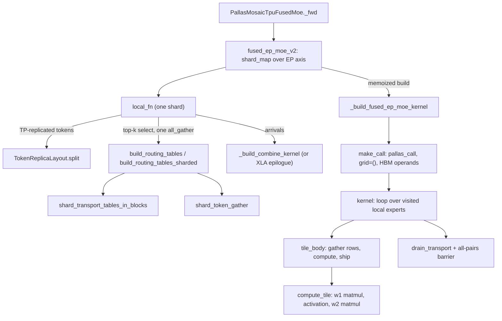
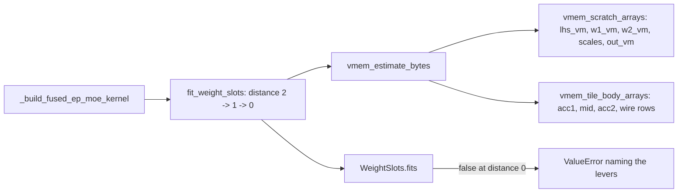

# Fused expert-parallel MoE (fused_ep_moe_v2) - router, routing plan and the one-kernel Pallas TPU MoE layer

## Overview
`tokamax/_src/ops/experimental/fused_moe` serves one MoE layer under expert parallelism (EP) as
a single op: [`FusedMoe`](https://github.com/openxla/tokamax/blob/3a0a3a34a5ccb8a6ac71f343d9cc44649d73db68/tokamax/_src/ops/experimental/fused_moe/base.py#L28 "tokamax/_src/ops/experimental/fused_moe/base#FusedMoe")
binds `x [T, H]`, `w1 [E, H, 2I]` (gate and up), `w2 [E, I, H]` (down) and router logits
`gating [T, E]`, and the TPU implementation hands them to
[`fused_ep_moe_v2`](https://github.com/openxla/tokamax/blob/3a0a3a34a5ccb8a6ac71f343d9cc44649d73db68/tokamax/_src/ops/experimental/fused_moe/layer.py#L236 "tokamax/_src/ops/experimental/fused_moe/layer#fused_ep_moe_v2"),
whose docstring summarizes the pipeline: "quantize, dispatch, kernel, combine". The key idea is in
the kernel module's docstring: "one Pallas TPU kernel computes the expert half of an MoE layer for
one expert-parallel shard and pushes each result row to the shard that owns its token, so the layer
needs no dense combine reduce-scatter." Each shard all-gathers the (fp8-quantized) token rows,
computes on the host side of the kernel a routing plan that assigns every routed (token, expert)
pair a row in its expert's slab, and the kernel then walks its local experts, streams their weights
through VMEM, runs the FFN tile by tile and ships each result row over ICI with remote DMAs.
Unlike [ragged-dot-gmm](./ragged-dot-gmm.md) / [gmm-v2](./gmm-v2.md) it is inference-only and
owns its own FFN body; it does not call the ragged_dot kernels.

## Diagram

Legend:
- `OP` - [`_fwd`](https://github.com/openxla/tokamax/blob/3a0a3a34a5ccb8a6ac71f343d9cc44649d73db68/tokamax/_src/ops/experimental/fused_moe/pallas_mosaic_tpu.py#L48 "tokamax/_src/ops/experimental/fused_moe/pallas_mosaic_tpu#PallasMosaicTpuFusedMoe._fwd")
- `L` - [`fused_ep_moe_v2`](https://github.com/openxla/tokamax/blob/3a0a3a34a5ccb8a6ac71f343d9cc44649d73db68/tokamax/_src/ops/experimental/fused_moe/layer.py#L236 "tokamax/_src/ops/experimental/fused_moe/layer#fused_ep_moe_v2")
- `LF` - [`local_fn`](https://github.com/openxla/tokamax/blob/3a0a3a34a5ccb8a6ac71f343d9cc44649d73db68/tokamax/_src/ops/experimental/fused_moe/layer.py#L425 "tokamax/_src/ops/experimental/fused_moe/layer#fused_ep_moe_v2.local_fn")
- `SP` - [`split`](https://github.com/openxla/tokamax/blob/3a0a3a34a5ccb8a6ac71f343d9cc44649d73db68/tokamax/_src/ops/experimental/fused_moe/token_parallel.py#L81 "tokamax/_src/ops/experimental/fused_moe/token_parallel#TokenReplicaLayout.split")
- `RT` - [`build_routing_tables`](https://github.com/openxla/tokamax/blob/3a0a3a34a5ccb8a6ac71f343d9cc44649d73db68/tokamax/_src/ops/experimental/fused_moe/host.py#L523 "tokamax/_src/ops/experimental/fused_moe/host#build_routing_tables") / [`build_routing_tables_sharded`](https://github.com/openxla/tokamax/blob/3a0a3a34a5ccb8a6ac71f343d9cc44649d73db68/tokamax/_src/ops/experimental/fused_moe/host.py#L821 "tokamax/_src/ops/experimental/fused_moe/host#build_routing_tables_sharded")
- `TT` - [`shard_transport_tables_in_blocks`](https://github.com/openxla/tokamax/blob/3a0a3a34a5ccb8a6ac71f343d9cc44649d73db68/tokamax/_src/ops/experimental/fused_moe/host.py#L1105 "tokamax/_src/ops/experimental/fused_moe/host#shard_transport_tables_in_blocks")
- `TG` - [`shard_token_gather`](https://github.com/openxla/tokamax/blob/3a0a3a34a5ccb8a6ac71f343d9cc44649d73db68/tokamax/_src/ops/experimental/fused_moe/host.py#L1006 "tokamax/_src/ops/experimental/fused_moe/host#shard_token_gather")
- `KB` - [`_build_fused_ep_moe_kernel`](https://github.com/openxla/tokamax/blob/3a0a3a34a5ccb8a6ac71f343d9cc44649d73db68/tokamax/_src/ops/experimental/fused_moe/kernel.py#L531 "tokamax/_src/ops/experimental/fused_moe/kernel#_build_fused_ep_moe_kernel")
- `MK` - [`make_call`](https://github.com/openxla/tokamax/blob/3a0a3a34a5ccb8a6ac71f343d9cc44649d73db68/tokamax/_src/ops/experimental/fused_moe/kernel.py#L1929 "tokamax/_src/ops/experimental/fused_moe/kernel#_build_fused_ep_moe_kernel.make_call")
- `K` - [`kernel`](https://github.com/openxla/tokamax/blob/3a0a3a34a5ccb8a6ac71f343d9cc44649d73db68/tokamax/_src/ops/experimental/fused_moe/kernel.py#L764 "tokamax/_src/ops/experimental/fused_moe/kernel#_build_fused_ep_moe_kernel.kernel")
- `TB` - [`tile_body`](https://github.com/openxla/tokamax/blob/3a0a3a34a5ccb8a6ac71f343d9cc44649d73db68/tokamax/_src/ops/experimental/fused_moe/kernel.py#L1445 "tokamax/_src/ops/experimental/fused_moe/kernel#_build_fused_ep_moe_kernel.kernel.expert_tiles.tile_body")
- `CT` - [`compute_tile`](https://github.com/openxla/tokamax/blob/3a0a3a34a5ccb8a6ac71f343d9cc44649d73db68/tokamax/_src/ops/experimental/fused_moe/kernel.py#L1518 "tokamax/_src/ops/experimental/fused_moe/kernel#_build_fused_ep_moe_kernel.kernel.expert_tiles.tile_body.compute_tile")
- `DT` - [`drain_transport`](https://github.com/openxla/tokamax/blob/3a0a3a34a5ccb8a6ac71f343d9cc44649d73db68/tokamax/_src/ops/experimental/fused_moe/kernel.py#L1818 "tokamax/_src/ops/experimental/fused_moe/kernel#_build_fused_ep_moe_kernel.kernel.drain_transport")
- `CB` - [`_build_combine_kernel`](https://github.com/openxla/tokamax/blob/3a0a3a34a5ccb8a6ac71f343d9cc44649d73db68/tokamax/_src/ops/experimental/fused_moe/kernel.py#L2189 "tokamax/_src/ops/experimental/fused_moe/kernel#_build_combine_kernel")

A second view - how one build is sized against VMEM before anything is traced:

Legend:
- `KB` - [`_build_fused_ep_moe_kernel`](https://github.com/openxla/tokamax/blob/3a0a3a34a5ccb8a6ac71f343d9cc44649d73db68/tokamax/_src/ops/experimental/fused_moe/kernel.py#L531 "tokamax/_src/ops/experimental/fused_moe/kernel#_build_fused_ep_moe_kernel")
- `FW` - [`fit_weight_slots`](https://github.com/openxla/tokamax/blob/3a0a3a34a5ccb8a6ac71f343d9cc44649d73db68/tokamax/_src/ops/experimental/fused_moe/host.py#L1580 "tokamax/_src/ops/experimental/fused_moe/host#fit_weight_slots")
- `VE` - [`vmem_estimate_bytes`](https://github.com/openxla/tokamax/blob/3a0a3a34a5ccb8a6ac71f343d9cc44649d73db68/tokamax/_src/ops/experimental/fused_moe/host.py#L1518 "tokamax/_src/ops/experimental/fused_moe/host#vmem_estimate_bytes")
- `VS` - [`vmem_scratch_arrays`](https://github.com/openxla/tokamax/blob/3a0a3a34a5ccb8a6ac71f343d9cc44649d73db68/tokamax/_src/ops/experimental/fused_moe/host.py#L1348 "tokamax/_src/ops/experimental/fused_moe/host#vmem_scratch_arrays")
- `VT` - [`vmem_tile_body_arrays`](https://github.com/openxla/tokamax/blob/3a0a3a34a5ccb8a6ac71f343d9cc44649d73db68/tokamax/_src/ops/experimental/fused_moe/host.py#L1452 "tokamax/_src/ops/experimental/fused_moe/host#vmem_tile_body_arrays")
- `FT` - [`fits`](https://github.com/openxla/tokamax/blob/3a0a3a34a5ccb8a6ac71f343d9cc44649d73db68/tokamax/_src/ops/experimental/fused_moe/host.py#L1575 "tokamax/_src/ops/experimental/fused_moe/host#WeightSlots.fits")
- `ERR` - (concept) the build-time refusal raised by `_build_fused_ep_moe_kernel`

## Design rationale (why it's built this way)
- **Push, don't reduce.** Under EP each token's top-k experts live on different shards. Instead of
  computing a dense `[T, H]` partial on every shard and reduce-scattering it, each shard computes
  only rows for its own experts and writes each result row straight into the owning shard's arrival
  buffer with `make_async_remote_copy`. The owner then sums its `topk` arrivals per token, weighted
  by router weights it kept locally ("The router weight stays local ... so the wire never carries
  it").
- **No token dropping.** "capacity" here is the kernel's tile height ("the tile height IS the
  capacity"), not an MoE capacity factor. The per-shard slab stride must reach the no-drop bound
  "every routed row landing on one shard", and
  [`fused_ep_moe_v2`](https://github.com/openxla/tokamax/blob/3a0a3a34a5ccb8a6ac71f343d9cc44649d73db68/tokamax/_src/ops/experimental/fused_moe/layer.py#L236 "tokamax/_src/ops/experimental/fused_moe/layer#fused_ep_moe_v2")
  refuses a smaller `ragged_stride` because "one shard's slab could bleed into the next".
- **One kernel invocation, manual DMAs.** [`make_call`](https://github.com/openxla/tokamax/blob/3a0a3a34a5ccb8a6ac71f343d9cc44649d73db68/tokamax/_src/ops/experimental/fused_moe/kernel.py#L1929 "tokamax/_src/ops/experimental/fused_moe/kernel#_build_fused_ep_moe_kernel.make_call")
  builds a `pallas_call` with `grid=()`, every input and output in HBM, routing tables as
  scalar-prefetch SMEM operands, a `collective_id`, and `disable_bounds_checks=True` ("Bounds checks
  cost time and change no computed value"). There is no BlockSpec pipeline: the ragged,
  data-dependent schedule (which experts, how many rows, which peer) is expressed as loops with
  explicit async copies and semaphores, which BlockSpec index maps cannot express.
- **Refuse, don't assert.** The builder converts every check on caller values into a named
  `ValueError` because "`python -O` and PYTHONOPTIMIZE are ordinary things to find in a container
  image, and under them an assert lets the illegal configuration build and be cached".
- **Everything static, everything cached.** Shapes, weight format, biases and activation are
  build-time constants; [`fused_ep_moe_v2`](https://github.com/openxla/tokamax/blob/3a0a3a34a5ccb8a6ac71f343d9cc44649d73db68/tokamax/_src/ops/experimental/fused_moe/layer.py#L236 "tokamax/_src/ops/experimental/fused_moe/layer#fused_ep_moe_v2")
  caches the `shard_map`ped callable per config ("a fresh shard_map body would re-trace the whole
  kernel for every hidden layer") and the builder memoizes programs in an unbounded cache whose
  growth law is "one Pallas program per compiled token bucket, times the weight formats ... times
  the four combinations of the two optional expert biases, times the fused activations".
- **torch_tpu compatibility shapes the API.** The shard index arrives as a `rank` operand, not
  `lax.axis_index`, because that "lowers to `partition-id`, which the SPMD partitioner rejects when
  torch_tpu recompiles this module through its jax.export bridge" (see
  [torch-tpu-bridge](./torch-tpu-bridge.md)).

> [!inferred]
> The op wrapper is a thin adapter: `FusedMoe` is not registered in the autotuning implementation
> table, its heuristics return the default Config and its autotuning set is that single Config, so
> today the only way to change `capacity`, `block` or `ragged_stride` is to pass a Config
> explicitly.

## Entry points
- [`bind`](https://github.com/openxla/tokamax/blob/3a0a3a34a5ccb8a6ac71f343d9cc44649d73db68/tokamax/_src/ops/experimental/fused_moe/base.py#L32 "tokamax/_src/ops/experimental/fused_moe/base#FusedMoe.bind") -
  the op signature (`topk=2`, `renormalize=True`, `act_fn="silu"` defaults, optional scales and
  biases). The base [`_fwd`](https://github.com/openxla/tokamax/blob/3a0a3a34a5ccb8a6ac71f343d9cc44649d73db68/tokamax/_src/ops/experimental/fused_moe/base.py#L64 "tokamax/_src/ops/experimental/fused_moe/base#FusedMoe._fwd")
  is a pure-JAX reference used for correctness checks.
- [`_fwd`](https://github.com/openxla/tokamax/blob/3a0a3a34a5ccb8a6ac71f343d9cc44649d73db68/tokamax/_src/ops/experimental/fused_moe/pallas_mosaic_tpu.py#L48 "tokamax/_src/ops/experimental/fused_moe/pallas_mosaic_tpu#PallasMosaicTpuFusedMoe._fwd") -
  the TPU path; it requires a `mesh` keyword (one EP axis), infers the
  [`WeightFormat`](https://github.com/openxla/tokamax/blob/3a0a3a34a5ccb8a6ac71f343d9cc44649d73db68/tokamax/_src/ops/experimental/fused_moe/host.py#L255 "tokamax/_src/ops/experimental/fused_moe/host#WeightFormat")
  from `w1.dtype` (defaulting to [`FP8`](https://github.com/openxla/tokamax/blob/3a0a3a34a5ccb8a6ac71f343d9cc44649d73db68/tokamax/_src/ops/experimental/fused_moe/host.py#L267 "tokamax/_src/ops/experimental/fused_moe/host#WeightFormat.FP8")),
  and forwards Config fields `capacity` (128), `block`, `ragged_stride`, `rhs_qb`, `sharded_plan`.
  [`_get_heuristics_config`](https://github.com/openxla/tokamax/blob/3a0a3a34a5ccb8a6ac71f343d9cc44649d73db68/tokamax/_src/ops/experimental/fused_moe/pallas_mosaic_tpu.py#L97 "tokamax/_src/ops/experimental/fused_moe/pallas_mosaic_tpu#PallasMosaicTpuFusedMoe._get_heuristics_config")
  and [`_get_autotuning_configs`](https://github.com/openxla/tokamax/blob/3a0a3a34a5ccb8a6ac71f343d9cc44649d73db68/tokamax/_src/ops/experimental/fused_moe/pallas_mosaic_tpu.py#L101 "tokamax/_src/ops/experimental/fused_moe/pallas_mosaic_tpu#PallasMosaicTpuFusedMoe._get_autotuning_configs")
  both yield the default Config (a TODO says tunables from `host.py` are still to be brought in).
- [`fused_ep_moe_v2`](https://github.com/openxla/tokamax/blob/3a0a3a34a5ccb8a6ac71f343d9cc44649d73db68/tokamax/_src/ops/experimental/fused_moe/layer.py#L236 "tokamax/_src/ops/experimental/fused_moe/layer#fused_ep_moe_v2") -
  the documented public entry (exported from the package `__init__`), with serving-only knobs the
  op does not expose: `scoring_fn` (softmax / sigmoid / sqrtsoftplus), `score_bias` (selection-only
  bias, replicated with `P()` because it "is indexed by GLOBAL expert id"), `routed_scaling_factor`,
  `mesh_ep_ranks` (EP-rank to mesh-order relabeling for vLLM-style numbering) and
  `token_replica_groups` (TP groups that see identical tokens).

## Mechanism (step-by-step)
1. **Validate and shard.** [`fused_ep_moe_v2`](https://github.com/openxla/tokamax/blob/3a0a3a34a5ccb8a6ac71f343d9cc44649d73db68/tokamax/_src/ops/experimental/fused_moe/layer.py#L236 "tokamax/_src/ops/experimental/fused_moe/layer#fused_ep_moe_v2")
   checks the weight dtype against the named format via
   [`weight_form`](https://github.com/openxla/tokamax/blob/3a0a3a34a5ccb8a6ac71f343d9cc44649d73db68/tokamax/_src/ops/experimental/fused_moe/host.py#L348 "tokamax/_src/ops/experimental/fused_moe/host#weight_form")
   (int8 and bf16 slabs have identical shapes, so a wrong name would be "a half-slab read with
   correct-looking shapes all the way down"), checks scale layouts, derives `g_local = E / ep`,
   `ragged_stride` (default: the no-drop bound) and `block` (default: the widest power of two up to
   256 dividing `t_local * topk`), builds the kernel, and runs `local_fn` under `jax.shard_map`
   with every operand sharded on the EP axis except the optional `score_bias`, which is replicated
   with `P()`.
2. **Tokens and router.** In [`local_fn`](https://github.com/openxla/tokamax/blob/3a0a3a34a5ccb8a6ac71f343d9cc44649d73db68/tokamax/_src/ops/experimental/fused_moe/layer.py#L425 "tokamax/_src/ops/experimental/fused_moe/layer#fused_ep_moe_v2.local_fn"),
   [`split`](https://github.com/openxla/tokamax/blob/3a0a3a34a5ccb8a6ac71f343d9cc44649d73db68/tokamax/_src/ops/experimental/fused_moe/token_parallel.py#L81 "tokamax/_src/ops/experimental/fused_moe/token_parallel#TokenReplicaLayout.split")
   gives each member of a token-replica group a disjoint slice (logits padded with `-inf`). Rows are
   row-quantized to fp8 where the format's activations are quantized
   ([`quantized_activations`](https://github.com/openxla/tokamax/blob/3a0a3a34a5ccb8a6ac71f343d9cc44649d73db68/tokamax/_src/ops/experimental/fused_moe/host.py#L311 "tokamax/_src/ops/experimental/fused_moe/host#WeightForm.quantized_activations")),
   then all-gathered as `[t_local * ep, H / 128, 128]` - every shard holds every token. Scores go
   through the scoring function and an in-VMEM top-k (`pallas_select`, "an in-VMEM max-and-mask
   pass replacing XLA's lax.top_k"); weights are renormalized, scaled, and rows with no finite score
   are explicitly zeroed rather than relying on a float32 overflow in the renormalization that
   used to drop them "by arithmetic accident".
3. **One routing exchange.** [`local_fn`](https://github.com/openxla/tokamax/blob/3a0a3a34a5ccb8a6ac71f343d9cc44649d73db68/tokamax/_src/ops/experimental/fused_moe/layer.py#L425 "tokamax/_src/ops/experimental/fused_moe/layer#fused_ep_moe_v2.local_fn") packs the local expert-id blocks, the row-scale bit patterns and per-expert
   pair counts into one int32 payload and all-gathers it once ("The plan's own count
   collective disappears into this one").
4. **Routing plan.** [`build_routing_tables`](https://github.com/openxla/tokamax/blob/3a0a3a34a5ccb8a6ac71f343d9cc44649d73db68/tokamax/_src/ops/experimental/fused_moe/host.py#L523 "tokamax/_src/ops/experimental/fused_moe/host#build_routing_tables")
   "Assign[s] every routed (token, expert) pair the slab row it computes on": a per-block histogram
   and in-block rank give each pair its rank within its expert; rows are ordered by expert, then by
   owning shard, each run padded to [`ROWBLK`](https://github.com/openxla/tokamax/blob/3a0a3a34a5ccb8a6ac71f343d9cc44649d73db68/tokamax/_src/ops/experimental/fused_moe/host.py#L90 "tokamax/_src/ops/experimental/fused_moe/host#ROWBLK")
   rows, and shard `s` owns slab rows `[s * stride, (s + 1) * stride)`. It also produces receive
   offsets at every destination and the scale-mirror position. Divisions by tile widths are written
   as shifts and masks, guarded by [`pow2_shift`](https://github.com/openxla/tokamax/blob/3a0a3a34a5ccb8a6ac71f343d9cc44649d73db68/tokamax/_src/ops/experimental/fused_moe/host.py#L134 "tokamax/_src/ops/experimental/fused_moe/host#pow2_shift"),
   which refuses a non-power-of-two width at import. With `sharded_plan=True`,
   [`build_routing_tables_sharded`](https://github.com/openxla/tokamax/blob/3a0a3a34a5ccb8a6ac71f343d9cc44649d73db68/tokamax/_src/ops/experimental/fused_moe/host.py#L821 "tokamax/_src/ops/experimental/fused_moe/host#build_routing_tables_sharded")
   computes only the two 1/ep slices this shard consumes instead of "four one-hot passes over
   `T * topk * e_total` on every rank"; it "changes routing-plan construction only, never the core
   kernel".
5. **Cut kernel operands.** [`shard_transport_tables_in_blocks`](https://github.com/openxla/tokamax/blob/3a0a3a34a5ccb8a6ac71f343d9cc44649d73db68/tokamax/_src/ops/experimental/fused_moe/host.py#L1105 "tokamax/_src/ops/experimental/fused_moe/host#shard_transport_tables_in_blocks")
   gives this shard's commit and push tables in block units;
   [`shard_token_gather`](https://github.com/openxla/tokamax/blob/3a0a3a34a5ccb8a6ac71f343d9cc44649d73db68/tokamax/_src/ops/experimental/fused_moe/host.py#L1006 "tokamax/_src/ops/experimental/fused_moe/host#shard_token_gather")
   gives the token number each local slab row computes, clipped on both sides because the kernel
   reads it "with bounds checks off", then padded by
   [`token_gather_window_rows`](https://github.com/openxla/tokamax/blob/3a0a3a34a5ccb8a6ac71f343d9cc44649d73db68/tokamax/_src/ops/experimental/fused_moe/host.py#L186 "tokamax/_src/ops/experimental/fused_moe/host#token_gather_window_rows")
   since the kernel always copies a full aligned window. Where activations are quantized, row scales
   are scattered into a dense `[rows / 128, 128]` slab sized by
   [`act_scale_slab_rows`](https://github.com/openxla/tokamax/blob/3a0a3a34a5ccb8a6ac71f343d9cc44649d73db68/tokamax/_src/ops/experimental/fused_moe/host.py#L229 "tokamax/_src/ops/experimental/fused_moe/host#act_scale_slab_rows")
   (one extra row because a tile's scale read can spill into the next sublane). Empty experts drop
   out of the visit list, so "an empty expert's weight slab never streams".
6. **Build-time sizing.** [`_build_fused_ep_moe_kernel`](https://github.com/openxla/tokamax/blob/3a0a3a34a5ccb8a6ac71f343d9cc44649d73db68/tokamax/_src/ops/experimental/fused_moe/kernel.py#L531 "tokamax/_src/ops/experimental/fused_moe/kernel#_build_fused_ep_moe_kernel")
   refuses shapes the transport geometry cannot address (`H` a multiple of
   [`HIDDEN_LANE_BLOCK`](https://github.com/openxla/tokamax/blob/3a0a3a34a5ccb8a6ac71f343d9cc44649d73db68/tokamax/_src/ops/experimental/fused_moe/host.py#L93 "tokamax/_src/ops/experimental/fused_moe/host#HIDDEN_LANE_BLOCK")
   between 1 and 64 blocks, `I >= 128`, capacity a multiple of `ROWBLK`; fp4 blocks dividing `H` and
   `I` and a multiple of `U32_SUBLANE_TILE x 8` packed rows; int8 shapes divisible by
   [`WIDEN_KCHUNK`](https://github.com/openxla/tokamax/blob/3a0a3a34a5ccb8a6ac71f343d9cc44649d73db68/tokamax/_src/ops/experimental/fused_moe/host.py#L48 "tokamax/_src/ops/experimental/fused_moe/host#WIDEN_KCHUNK")).
   It then asks [`fit_weight_slots`](https://github.com/openxla/tokamax/blob/3a0a3a34a5ccb8a6ac71f343d9cc44649d73db68/tokamax/_src/ops/experimental/fused_moe/host.py#L1580 "tokamax/_src/ops/experimental/fused_moe/host#fit_weight_slots")
   for "the deepest prefetch schedule this shape's VMEM leaves room for": weight slabs are `nbuf =
   distance + 1` copies of one expert, so it walks the prefetch distance down from 2 to 0 and keeps
   the first that fits 98% of VMEM capacity. Over budget even at distance 0 raises, naming "the tile
   height, the expert shape and the number of local experts" as the remaining levers. It also picks
   [`tile_height_rungs`](https://github.com/openxla/tokamax/blob/3a0a3a34a5ccb8a6ac71f343d9cc44649d73db68/tokamax/_src/ops/experimental/fused_moe/kernel.py#L158 "tokamax/_src/ops/experimental/fused_moe/kernel#tile_height_rungs")
   (4 equal heights up to `tile_m`, emitted only when a shard's experts are expected to fit in one
   tile, since each rung is another copy of the FFN body) and whether to ship tiles directly from
   `out_vm` or through an HBM contribution slab.
7. **Expert loop.** The [`kernel`](https://github.com/openxla/tokamax/blob/3a0a3a34a5ccb8a6ac71f343d9cc44649d73db68/tokamax/_src/ops/experimental/fused_moe/kernel.py#L764 "tokamax/_src/ops/experimental/fused_moe/kernel#_build_fused_ep_moe_kernel.kernel")
   closes the host's partial count reductions on the scalar core and `fori_loop`s over the visit
   list. For each visited expert it waits for that expert's weight slot (`visit_i mod nbuf`) and
   immediately starts the refill for the expert `distance` visits ahead - safe without a wait
   because "DISTANCE < nbuf keeps it off both live readers". For fp4 weights the slabs are streamed
   block by block; only when the build has no prefetch runway (distance 0) does the next expert's
   gate/up DMA start as soon as the current one's last gate/up block has been read.
8. **Tile body.** [`tile_body`](https://github.com/openxla/tokamax/blob/3a0a3a34a5ccb8a6ac71f343d9cc44649d73db68/tokamax/_src/ops/experimental/fused_moe/kernel.py#L1445 "tokamax/_src/ops/experimental/fused_moe/kernel#_build_fused_ep_moe_kernel.kernel.expert_tiles.tile_body")
   processes `tile_m = capacity` slab rows at a time with
   [`OUT_PARITIES`](https://github.com/openxla/tokamax/blob/3a0a3a34a5ccb8a6ac71f343d9cc44649d73db68/tokamax/_src/ops/experimental/fused_moe/host.py#L167 "tokamax/_src/ops/experimental/fused_moe/host#OUT_PARITIES")
   = 2 parities: it waits for the parity's previous commits or sends, waits for this tile's gathered
   token rows, issues tile `t + 1`'s gather into the other parity "so the fetch runs under the MXU
   window", and a tile early issues the next expert's token-index window into SMEM.
   [`compute_tile`](https://github.com/openxla/tokamax/blob/3a0a3a34a5ccb8a6ac71f343d9cc44649d73db68/tokamax/_src/ops/experimental/fused_moe/kernel.py#L1518 "tokamax/_src/ops/experimental/fused_moe/kernel#_build_fused_ep_moe_kernel.kernel.expert_tiles.tile_body.compute_tile")
   runs the FFN at the smallest rung covering the live rows: `x @ w1` with scales (and optional
   `w1_bias`) applied before the activation (`_apply_act` works on "POST-SCALE gate and up halves"
   because the clamped activations are defined on true values), requantization of the intermediate
   where the format quantizes activations, `@ w2`, optional `w2_bias`, and quantization into the
   wire dtype with a per-row scale.
9. **Transport and drain.** Each tile (or, with the contribution slab, each expert's region per
   destination) is pushed with remote DMAs at true row length, "predicated on its own length: a
   zero-length REMOTE DMA must never issue"; the shard's own rows hop locally.
   [`drain_transport`](https://github.com/openxla/tokamax/blob/3a0a3a34a5ccb8a6ac71f343d9cc44649d73db68/tokamax/_src/ops/experimental/fused_moe/kernel.py#L1818 "tokamax/_src/ops/experimental/fused_moe/kernel#_build_fused_ep_moe_kernel.kernel.drain_transport")
   waits on the send / receive semaphores for exactly the row and scale-mirror counts the plan
   predicted, then an all-pairs barrier ("transport peers are not only neighbours") closes the call.
10. **Combine.** Back in `local_fn`, each token sums its `topk` arrival rows times
    `row_scale x router_weight`, folded into one coefficient. When
    [`combine_step_tokens`](https://github.com/openxla/tokamax/blob/3a0a3a34a5ccb8a6ac71f343d9cc44649d73db68/tokamax/_src/ops/experimental/fused_moe/kernel.py#L2165 "tokamax/_src/ops/experimental/fused_moe/kernel#combine_step_tokens")
    returns a step size (at least 256 local tokens, with an even, parity-divisible step count) the
    sum runs in the Mosaic kernel from [`_build_combine_kernel`](https://github.com/openxla/tokamax/blob/3a0a3a34a5ccb8a6ac71f343d9cc44649d73db68/tokamax/_src/ops/experimental/fused_moe/kernel.py#L2189 "tokamax/_src/ops/experimental/fused_moe/kernel#_build_combine_kernel"),
    which DMAs each arrival row into VMEM and reduces it there; this avoids XLA turning
    `arrivals[pos]` into a SparseCore gather "whose output is in HBM at any size" (an 80 MiB temp
    written and read back at 2048 local tokens). Below that, a fused XLA epilogue is used. Finally
    `restore` all-gathers within token-replica groups to recover the input row order.

## Key data structures
- [`WEIGHT_FORMS`](https://github.com/openxla/tokamax/blob/3a0a3a34a5ccb8a6ac71f343d9cc44649d73db68/tokamax/_src/ops/experimental/fused_moe/host.py#L332 "tokamax/_src/ops/experimental/fused_moe/host#WEIGHT_FORMS") -
  "one place that says what a format implies":

  | Format | Weight dtype | Activations | Weight scales | Wire |
  |---|---|---|---|---|
  | `fp8` | float8_e4m3fn | fp8, per-row scale | per output channel | fp8 |
  | `fp4` | float4_e2m1fn packed 8 per uint32 | fp8, per-row scale | per contraction block (default [`QB4`](https://github.com/openxla/tokamax/blob/3a0a3a34a5ccb8a6ac71f343d9cc44649d73db68/tokamax/_src/ops/experimental/fused_moe/host.py#L34 "tokamax/_src/ops/experimental/fused_moe/host#QB4") = 512 rows) | fp8 |
  | `int8` | int8, widened to bf16 in 512-row chunks | bf16, no scale | per output channel | bf16 |
  | `bf16` | bf16 | bf16, no scale | none | bf16 |

  [`has_scales`](https://github.com/openxla/tokamax/blob/3a0a3a34a5ccb8a6ac71f343d9cc44649d73db68/tokamax/_src/ops/experimental/fused_moe/host.py#L306 "tokamax/_src/ops/experimental/fused_moe/host#WeightForm.has_scales")
  and `quantized_activations` are the two booleans every other layer reads; [`FP4`](https://github.com/openxla/tokamax/blob/3a0a3a34a5ccb8a6ac71f343d9cc44649d73db68/tokamax/_src/ops/experimental/fused_moe/host.py#L268 "tokamax/_src/ops/experimental/fused_moe/host#WeightFormat.FP4")
  is the only packed form, and the packed row tile is pinned by
  [`U32_SUBLANE_TILE`](https://github.com/openxla/tokamax/blob/3a0a3a34a5ccb8a6ac71f343d9cc44649d73db68/tokamax/_src/ops/experimental/fused_moe/host.py#L1319 "tokamax/_src/ops/experimental/fused_moe/host#U32_SUBLANE_TILE")
  = 8, checked against the device record at build time.
- **VMEM inventory.** [`vmem_scratch_arrays`](https://github.com/openxla/tokamax/blob/3a0a3a34a5ccb8a6ac71f343d9cc44649d73db68/tokamax/_src/ops/experimental/fused_moe/host.py#L1348 "tokamax/_src/ops/experimental/fused_moe/host#vmem_scratch_arrays")
  is the declared scratch, in the order the kernel unpacks it (double-buffered token rows `lhs_vm`,
  `nbuf` weight slabs `w1_vm` / `w2_vm`, scale and bias tables, the activation-scale window, `out_vm`
  and its scale mirror); [`vmem_tile_body_arrays`](https://github.com/openxla/tokamax/blob/3a0a3a34a5ccb8a6ac71f343d9cc44649d73db68/tokamax/_src/ops/experimental/fused_moe/host.py#L1452 "tokamax/_src/ops/experimental/fused_moe/host#vmem_tile_body_arrays")
  lists the compiler-placed tile values (`acc1 [tile_m, 2I]` f32, intermediates, `acc2 [tile_m, H]`
  f32, the bf16 down result, wire rows, and for fp4 / int8 a double-buffered widened weight block).
  [`vmem_estimate_bytes`](https://github.com/openxla/tokamax/blob/3a0a3a34a5ccb8a6ac71f343d9cc44649d73db68/tokamax/_src/ops/experimental/fused_moe/host.py#L1518 "tokamax/_src/ops/experimental/fused_moe/host#vmem_estimate_bytes")
  sums both with lane / sublane padding - "An upper bound, and deliberately so".
- **Routing tables.** Per pair: slab row, arrival row and mirror position; per (expert, shard):
  aligned run lengths and starts; per destination: receive bases. The kernel receives four of the
  seven transport tables and one push table and derives the duplicates, because "Every table shipped
  is another blocking HBM->SMEM DMA at the head of the kernel, and the prefetch also has to fit in
  1 MB of SMEM."

## Dynamics (design intent)
- **Overlap inventory.** Weight refills run `distance` experts ahead on their own DMA priority
  ("to stay off the in-order token-gather queue"); token rows for tile `t + 1` stream under tile
  `t`'s matmuls; `out_vm` parities let one tile compute while the previous one's push drains; the
  next expert's token-index window is issued a tile early, "the only arrival the kernel waits for
  with nothing issued behind it".
- **Measured scheduling choices are recorded in code.** For example, the activation all-gather is
  ordered ahead of the slab scatters only at `t_local >= 1024` ("+2.80% at t_local 2048 and -0.01 /
  -7.81 / -1.92 / -1.94% at 1024 / 256 / 64 / 32"), and the combine kernel's step shape constants
  carry similar notes.
- **Programs are named by their build.** The kernel name encodes format, activation, biases,
  `g_local`, capacity and `nbuf` (e.g. `fused_ep_moe_v2_fp4w_g8_c128_nb3`), so a profile identifies
  the build; a suffix appears "only when its feature is on" so existing fingerprints keep matching.

## Edge cases
- [`supported_on`](https://github.com/openxla/tokamax/blob/3a0a3a34a5ccb8a6ac71f343d9cc44649d73db68/tokamax/_src/ops/experimental/fused_moe/pallas_mosaic_tpu.py#L105 "tokamax/_src/ops/experimental/fused_moe/pallas_mosaic_tpu#PallasMosaicTpuFusedMoe.supported_on")
  accepts TPU generation 5+, but `host.py` records `MIN_GENERATION = 7` as "The oldest chip
  generation this kernel has been built and measured on"; on v5 / v6 it "compiles and runs and has
  never been correctness-checked or timed".
- `T` must divide evenly over EP and `gating` must be `[T, E]`; the mesh must have exactly one axis.
- `ragged_stride` must be a multiple of `capacity` and at least the no-drop bound; `block` must
  divide `t_local * topk`.
- Scales are taken in the kernel's own layout (`[E, N]` per channel, `[E, blocks, N]` per block);
  "a table carrying a loader's singleton axes is refused rather than reshaped".
- An all-NaN or all-`-inf` score row routes nowhere (weights zeroed), by an explicit mask.
- Under `python -O` nothing changes: caller-value checks are `ValueError`s, not asserts.
- There is no backward pass; the op is a serving kernel.

## Open questions
- `PallasMosaicTpuFusedMoe._fwd` takes `mesh` as a keyword that `FusedMoe.bind` does not declare;
  how the op framework threads it through `bind` / autotuning is not visible in this subsystem.
- The ragged-stride bound is part of the kernel cache key and grows with the token bucket; the
  source says rounding it to a coarser spacing "is a design change rather than a bound, and it is
  not made here".
- `fused_moe_rs` (the sibling experimental package) runs "gather -> GMM1 -> activation -> GMM2 ->
  ICI A2A" on top of gmm_v2 variants with a fused reduce-scatter; how it compares to this kernel on
  the same shapes is not documented in the source.

## See also
- [ragged-dot-gmm](./ragged-dot-gmm.md) - the unfused MoE building block (grouped matmul).
- [gmm-v2](./gmm-v2.md) - the grouped-matmul kernels `fused_moe_rs` builds on, with the same fused
  gate/up activations.
- [tpu-topk](./tpu-topk.md), [ragged-gather-reduce](./ragged-gather-reduce.md),
  [mosaic-tpu-helpers](./mosaic-tpu-helpers.md), [op-framework](./op-framework.md),
  [torch-tpu-bridge](./torch-tpu-bridge.md), [kernel-catalog](./kernel-catalog.md).
