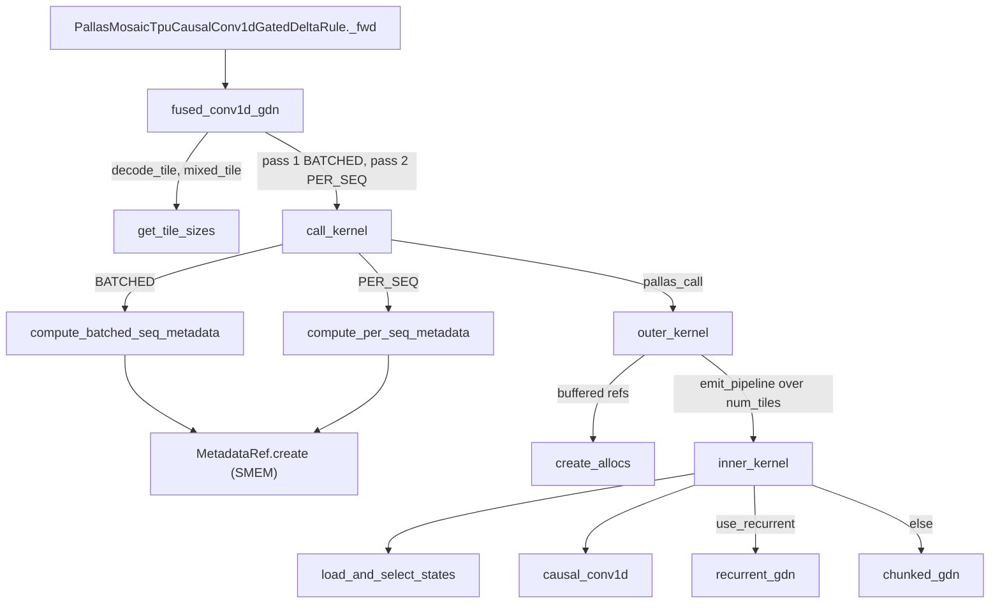

# Fused causal conv1d + gated delta rule (GDN) on TPU

## Overview

`CausalConv1dGatedDeltaRule` is the token-mixer of a Gated DeltaNet (GDN) linear-attention layer as
served by a continuous-batching inference engine: a causal depthwise conv1d over the packed
`qkv` projection, SiLU, then the gated delta rule that updates a per-sequence `[n_v, d_k, d_v]`
recurrent state. The benchmark specs target Qwen 3.5 (397B-A17B, 35B-A3B) and Qwen 3.8-Max shapes.
It is a forward-only, inference op: inputs are a ragged token batch (`query_start_loc`,
`seq_lens`) plus slot-indexed conv and recurrent **state caches** (slot 0 is a null block), and it
returns updated caches and the output. The key TPU design idea is that one Pallas kernel fuses
conv1d and GDN per tile, while a scalar **metadata** table in SMEM drives hand-written DMA through
custom `BufferedRef`s inside `pltpu.emit_pipeline`. The batch is processed in two passes - a
BATCHED pass that packs many 1-token decodes (or speculative verify windows) per tile, and a
PER_SEQ pass that chunks each prefill sequence into tiles and carries state between them. Tile
sizes come from a VMEM footprint model and are the op's autotuning space.

## Diagram

Legend:
- `OP` - [`_fwd`](https://github.com/openxla/tokamax/blob/3a0a3a34a5ccb8a6ac71f343d9cc44649d73db68/tokamax/_src/ops/causal_conv1d_gated_delta_rule/pallas_mosaic_tpu.py#L50 "tokamax/_src/ops/causal_conv1d_gated_delta_rule/pallas_mosaic_tpu#PallasMosaicTpuCausalConv1dGatedDeltaRule._fwd")
- `FUSED` - [`fused_conv1d_gdn`](https://github.com/openxla/tokamax/blob/3a0a3a34a5ccb8a6ac71f343d9cc44649d73db68/tokamax/_src/ops/causal_conv1d_gated_delta_rule/wrapper.py#L283 "tokamax/_src/ops/causal_conv1d_gated_delta_rule/wrapper#fused_conv1d_gdn")
- `TILES` - [`get_tile_sizes`](https://github.com/openxla/tokamax/blob/3a0a3a34a5ccb8a6ac71f343d9cc44649d73db68/tokamax/_src/ops/causal_conv1d_gated_delta_rule/tiling.py#L261 "tokamax/_src/ops/causal_conv1d_gated_delta_rule/tiling#get_tile_sizes")
- `CALL` - [`call_kernel`](https://github.com/openxla/tokamax/blob/3a0a3a34a5ccb8a6ac71f343d9cc44649d73db68/tokamax/_src/ops/causal_conv1d_gated_delta_rule/wrapper.py#L485 "tokamax/_src/ops/causal_conv1d_gated_delta_rule/wrapper#fused_conv1d_gdn.call_kernel")
- `MB` - [`compute_batched_seq_metadata`](https://github.com/openxla/tokamax/blob/3a0a3a34a5ccb8a6ac71f343d9cc44649d73db68/tokamax/_src/ops/causal_conv1d_gated_delta_rule/metadata.py#L23 "tokamax/_src/ops/causal_conv1d_gated_delta_rule/metadata#compute_batched_seq_metadata")
- `MP` - [`compute_per_seq_metadata`](https://github.com/openxla/tokamax/blob/3a0a3a34a5ccb8a6ac71f343d9cc44649d73db68/tokamax/_src/ops/causal_conv1d_gated_delta_rule/metadata.py#L67 "tokamax/_src/ops/causal_conv1d_gated_delta_rule/metadata#compute_per_seq_metadata")
- `META` - [`create`](https://github.com/openxla/tokamax/blob/3a0a3a34a5ccb8a6ac71f343d9cc44649d73db68/tokamax/_src/ops/causal_conv1d_gated_delta_rule/memory_ref.py#L172 "tokamax/_src/ops/causal_conv1d_gated_delta_rule/memory_ref#MetadataRef.create")
- `OUTER` - [`outer_kernel`](https://github.com/openxla/tokamax/blob/3a0a3a34a5ccb8a6ac71f343d9cc44649d73db68/tokamax/_src/ops/causal_conv1d_gated_delta_rule/wrapper.py#L184 "tokamax/_src/ops/causal_conv1d_gated_delta_rule/wrapper#outer_kernel")
- `ALLOC` - [`create_allocs`](https://github.com/openxla/tokamax/blob/3a0a3a34a5ccb8a6ac71f343d9cc44649d73db68/tokamax/_src/ops/causal_conv1d_gated_delta_rule/memory_ref.py#L465 "tokamax/_src/ops/causal_conv1d_gated_delta_rule/memory_ref#create_allocs")
- `INNER` - [`inner_kernel`](https://github.com/openxla/tokamax/blob/3a0a3a34a5ccb8a6ac71f343d9cc44649d73db68/tokamax/_src/ops/causal_conv1d_gated_delta_rule/wrapper.py#L31 "tokamax/_src/ops/causal_conv1d_gated_delta_rule/wrapper#inner_kernel")
- `LOAD` - [`load_and_select_states`](https://github.com/openxla/tokamax/blob/3a0a3a34a5ccb8a6ac71f343d9cc44649d73db68/tokamax/_src/ops/causal_conv1d_gated_delta_rule/vmem_ldst.py#L138 "tokamax/_src/ops/causal_conv1d_gated_delta_rule/vmem_ldst#load_and_select_states")
- `CONV` - [`causal_conv1d`](https://github.com/openxla/tokamax/blob/3a0a3a34a5ccb8a6ac71f343d9cc44649d73db68/tokamax/_src/ops/causal_conv1d_gated_delta_rule/compute_conv1d.py#L21 "tokamax/_src/ops/causal_conv1d_gated_delta_rule/compute_conv1d#causal_conv1d")
- `REC` - [`recurrent_gdn`](https://github.com/openxla/tokamax/blob/3a0a3a34a5ccb8a6ac71f343d9cc44649d73db68/tokamax/_src/ops/causal_conv1d_gated_delta_rule/compute_gdn.py#L408 "tokamax/_src/ops/causal_conv1d_gated_delta_rule/compute_gdn#recurrent_gdn")
- `CH` - [`chunked_gdn`](https://github.com/openxla/tokamax/blob/3a0a3a34a5ccb8a6ac71f343d9cc44649d73db68/tokamax/_src/ops/causal_conv1d_gated_delta_rule/compute_gdn.py#L254 "tokamax/_src/ops/causal_conv1d_gated_delta_rule/compute_gdn#chunked_gdn")

## Design rationale (why it's built this way)

- **Strict layering: DMA vs. compute.** [`inner_kernel`](https://github.com/openxla/tokamax/blob/3a0a3a34a5ccb8a6ac71f343d9cc44649d73db68/tokamax/_src/ops/causal_conv1d_gated_delta_rule/wrapper.py#L31 "tokamax/_src/ops/causal_conv1d_gated_delta_rule/wrapper#inner_kernel")
  "acts as a facade adhering to strict separation of concerns. It operates VMEM reference without
  knowledge on DMA logic"; data movement lives in `memory_ref` (buffered refs), VMEM reshuffling in
  `vmem_ldst`, math in `compute_conv1d` / `compute_gdn`. The cost of this separation shows in a
  source note that one branch "ideally" belongs in `compute_gdn` but would break the layering.
- **Ragged batches without ragged kernels.** Token rows of different sequences are not contiguous
  per tile, so standard BlockSpec index maps cannot express the fetch. Instead each program id
  looks up a packed record (`r_base`, `r_size`, `s_idx`, first/last-tile flags) and issues one
  `make_async_copy` per sequence row with a dynamic length. The grid is
  `(num_tiles,)` where `num_tiles` is itself read from SMEM at run time.
- **Two passes, two layouts.** Decode tokens dominate serving batches. In BATCHED mode
  (`seq_tile_size = tile_size`, `chunk_size = window_size`) many sequences share one tile, so
  a 1-token decode is not padded to a prefill chunk. In PER_SEQ mode (`seq_tile_size = 1`,
  `chunk_size = tile_size`) a long prefill is split into chunks with state carried in VMEM
  scratch between consecutive tiles ([`GDNMode`](https://github.com/openxla/tokamax/blob/3a0a3a34a5ccb8a6ac71f343d9cc44649d73db68/tokamax/_src/ops/causal_conv1d_gated_delta_rule/config.py#L29 "tokamax/_src/ops/causal_conv1d_gated_delta_rule/config#GDNMode")).
- **Compact layout for conv1d.** "If typical 2D layout was used, multiple rows are stored in a
  single register which necessitate costly shuffling for every sliding. Therefore, it is extremely
  important to leverage compact layout that ensures 1 register only stores data from 1 row"
  (`inner_kernel` comment). That is also why conv state is forced to fp32 ("Conv1D mandates fp32
  due to its usage of compact layout").
- **MXU-friendly chunked delta rule.**
  [`chunked_gdn_per_seq`](https://github.com/openxla/tokamax/blob/3a0a3a34a5ccb8a6ac71f343d9cc44649d73db68/tokamax/_src/ops/causal_conv1d_gated_delta_rule/compute_gdn.py#L106 "tokamax/_src/ops/causal_conv1d_gated_delta_rule/compute_gdn#chunked_gdn_per_seq") concatenates `v*beta` with
  `k*beta*gate` so one matmul against `T^-1` produces both `u` and `w` ("If v_head_dim < mxu size,
  concatenating them will help increase mxu utilization"), and concatenates `w` with the gated
  query to reuse the same state operand ("leverage weight stationary architecture"). GQA repeats
  are done after the `q k^T` matmul "to reduce required compute".
- **Recurrent vs chunked selection is semantic, not just perf.** `use_recurrent` is true when the
  chunk is 1 token or when more than one state checkpoint is needed (speculative decoding): "the
  chunked path only ever produces the final state".
- **In-place caches.** `fused_conv1d_gdn` donates `conv_state` and `recurrent_state`, and the
  `pallas_call` aliases them to outputs, so only touched slots are DMA'd and the rest of the cache
  is left in place.

## Entry points

- [`IMPLEMENTATIONS`](https://github.com/openxla/tokamax/blob/3a0a3a34a5ccb8a6ac71f343d9cc44649d73db68/tokamax/_src/ops/causal_conv1d_gated_delta_rule/api.py#L35 "tokamax/_src/ops/causal_conv1d_gated_delta_rule/api#IMPLEMENTATIONS.IMPLEMENTATIONS") - the immutable registry:
  `xla` (reference) always, plus `mosaic_tpu` when the Pallas module imports (built from
  [`_IMPLEMENTATIONS`](https://github.com/openxla/tokamax/blob/3a0a3a34a5ccb8a6ac71f343d9cc44649d73db68/tokamax/_src/ops/causal_conv1d_gated_delta_rule/api.py#L22 "tokamax/_src/ops/causal_conv1d_gated_delta_rule/api#_IMPLEMENTATIONS._IMPLEMENTATIONS")). There is no
  public wrapper function in `api.py`; callers instantiate an op or pick from this dict, and
  [`_API_IMPLEMENTATIONS`](https://github.com/openxla/tokamax/blob/3a0a3a34a5ccb8a6ac71f343d9cc44649d73db68/tokamax/_src/autotuning/api.py#L260 "tokamax/_src/autotuning/api#_API_IMPLEMENTATIONS._API_IMPLEMENTATIONS") maps
  `CausalConv1dGatedDeltaRule` to it for autotuning.
- [`CausalConv1dGatedDeltaRule`](https://github.com/openxla/tokamax/blob/3a0a3a34a5ccb8a6ac71f343d9cc44649d73db68/tokamax/_src/ops/causal_conv1d_gated_delta_rule/base.py#L27 "tokamax/_src/ops/causal_conv1d_gated_delta_rule/base#CausalConv1dGatedDeltaRule") - the [`Op`](https://github.com/openxla/tokamax/blob/3a0a3a34a5ccb8a6ac71f343d9cc44649d73db68/tokamax/_src/ops/op.py#L121 "tokamax/_src/ops/op#Op") subclass
  whose `_fwd` ([`_fwd`](https://github.com/openxla/tokamax/blob/3a0a3a34a5ccb8a6ac71f343d9cc44649d73db68/tokamax/_src/ops/causal_conv1d_gated_delta_rule/base.py#L38 "tokamax/_src/ops/causal_conv1d_gated_delta_rule/base#CausalConv1dGatedDeltaRule._fwd")) calls the
  pure-JAX [`run_jax_gdn_attention_local_ref`](https://github.com/openxla/tokamax/blob/3a0a3a34a5ccb8a6ac71f343d9cc44649d73db68/tokamax/_src/ops/causal_conv1d_gated_delta_rule/reference.py#L473 "tokamax/_src/ops/causal_conv1d_gated_delta_rule/reference#run_jax_gdn_attention_local_ref"); it ignores
  `read_state_indices`, `read_offsets` and `num_spec_tokens`, so the reference does not model
  speculative decoding or prefix-caching reads.
- [`PallasMosaicTpuCausalConv1dGatedDeltaRule`](https://github.com/openxla/tokamax/blob/3a0a3a34a5ccb8a6ac71f343d9cc44649d73db68/tokamax/_src/ops/causal_conv1d_gated_delta_rule/pallas_mosaic_tpu.py#L43 "tokamax/_src/ops/causal_conv1d_gated_delta_rule/pallas_mosaic_tpu#PallasMosaicTpuCausalConv1dGatedDeltaRule") -
  the TPU backend; [`supported_on`](https://github.com/openxla/tokamax/blob/3a0a3a34a5ccb8a6ac71f343d9cc44649d73db68/tokamax/_src/ops/causal_conv1d_gated_delta_rule/pallas_mosaic_tpu.py#L139 "tokamax/_src/ops/causal_conv1d_gated_delta_rule/pallas_mosaic_tpu#PallasMosaicTpuCausalConv1dGatedDeltaRule.supported_on")
  accepts TPU generation >= 6 only (and returns False on any probe error).
- [`fused_conv1d_gdn`](https://github.com/openxla/tokamax/blob/3a0a3a34a5ccb8a6ac71f343d9cc44649d73db68/tokamax/_src/ops/causal_conv1d_gated_delta_rule/wrapper.py#L283 "tokamax/_src/ops/causal_conv1d_gated_delta_rule/wrapper#fused_conv1d_gdn") - the jitted kernel entry that the
  TPU `_fwd` forwards to; usable directly (the GDN attention tests call it).

## Mechanism (step-by-step)

1. **Config precedence.**
   [`_fwd`](https://github.com/openxla/tokamax/blob/3a0a3a34a5ccb8a6ac71f343d9cc44649d73db68/tokamax/_src/ops/causal_conv1d_gated_delta_rule/pallas_mosaic_tpu.py#L50 "tokamax/_src/ops/causal_conv1d_gated_delta_rule/pallas_mosaic_tpu#PallasMosaicTpuCausalConv1dGatedDeltaRule._fwd")
   resolves tile sizes as "explicit kwarg > autotuned config > VMEM heuristic": a
   [`Config`](https://github.com/openxla/tokamax/blob/3a0a3a34a5ccb8a6ac71f343d9cc44649d73db68/tokamax/_src/ops/causal_conv1d_gated_delta_rule/pallas_mosaic_tpu.py#L35 "tokamax/_src/ops/causal_conv1d_gated_delta_rule/pallas_mosaic_tpu#Config") field only fills a kwarg that is
   `None`, and a `None` that survives is filled by the tiling heuristic.
2. **Input preparation.** [`fused_conv1d_gdn`](https://github.com/openxla/tokamax/blob/3a0a3a34a5ccb8a6ac71f343d9cc44649d73db68/tokamax/_src/ops/causal_conv1d_gated_delta_rule/wrapper.py#L283 "tokamax/_src/ops/causal_conv1d_gated_delta_rule/wrapper#fused_conv1d_gdn") casts
   `qkv`, `a`, `b` and the conv state to fp32 ("TODO: Support bf16" - the output keeps the input
   dtype), pads the token axis to a sublane-packing multiple and pads `a`/`b` to a lane-aligned
   head count (`aligned_num_v_heads`), defaults `read_state_indices` to `state_indices` and
   `read_offsets` to zero, and reshapes activations to `[tokens, 1, dim]` rows.
3. **Tile sizing.** [`get_tile_sizes`](https://github.com/openxla/tokamax/blob/3a0a3a34a5ccb8a6ac71f343d9cc44649d73db68/tokamax/_src/ops/causal_conv1d_gated_delta_rule/tiling.py#L261 "tokamax/_src/ops/causal_conv1d_gated_delta_rule/tiling#get_tile_sizes") picks
   `decode_tile_size` (sequences per BATCHED tile, from 32 down to 1) and `mixed_tile_size` (tokens
   per PER_SEQ chunk, from 128 down to 1, capped at 64 when `n_v >= 64`) as the largest candidate
   whose `get_vmem_estimate_bytes` fits in 80% of VMEM. The estimate counts double-buffered qkv /
   a / b / out tiles, double-buffered state DMA buffers plus working state, conv carry, weights,
   and `n_v * (5*C^2 + 3*C*(d_v + d_k)) * 4` bytes of intra-chunk intermediates. For speculative
   decoding the decode tile is further shrunk so the per-position state checkpoints fit in about
   half of the 90% windowed budget.
4. **Two kernel launches.**
   [`call_kernel`](https://github.com/openxla/tokamax/blob/3a0a3a34a5ccb8a6ac71f343d9cc44649d73db68/tokamax/_src/ops/causal_conv1d_gated_delta_rule/wrapper.py#L485 "tokamax/_src/ops/causal_conv1d_gated_delta_rule/wrapper#fused_conv1d_gdn.call_kernel") builds a
   [`GDNConfig`](https://github.com/openxla/tokamax/blob/3a0a3a34a5ccb8a6ac71f343d9cc44649d73db68/tokamax/_src/ops/causal_conv1d_gated_delta_rule/config.py#L64 "tokamax/_src/ops/causal_conv1d_gated_delta_rule/config#GDNConfig") per mode and launches one `pallas_call`
   each: pass 1 BATCHED over the leading decode (or verify-window) sequences
   `[0, distribution[0])`, pass 2 PER_SEQ over `[distribution[0], distribution[-1])`. Pass 2
   receives pass 1's output buffer and updated caches through `input_output_aliases`, so both
   passes write into the same arrays. All tensors stay in HBM (`memory_space=HBM` specs); the
   metadata pytree goes to SMEM and the weights to VMEM. The `pallas_call` sets
   `disable_bounds_checks=True`, `vmem_limit_bytes` from
   [`get_vmem_limit_bytes`](https://github.com/openxla/tokamax/blob/3a0a3a34a5ccb8a6ac71f343d9cc44649d73db68/tokamax/_src/ops/causal_conv1d_gated_delta_rule/config.py#L187 "tokamax/_src/ops/causal_conv1d_gated_delta_rule/config#GDNConfig.get_vmem_limit_bytes"), and a profile-friendly
   name from [`get_kernel_name`](https://github.com/openxla/tokamax/blob/3a0a3a34a5ccb8a6ac71f343d9cc44649d73db68/tokamax/_src/ops/causal_conv1d_gated_delta_rule/config.py#L155 "tokamax/_src/ops/causal_conv1d_gated_delta_rule/config#GDNConfig.get_kernel_name")
   (`fused_conv1d_gdn_<mode>_b<seq_tile>_c<chunk>[_w<window>]`).
5. **Metadata.** [`compute_batched_seq_metadata`](https://github.com/openxla/tokamax/blob/3a0a3a34a5ccb8a6ac71f343d9cc44649d73db68/tokamax/_src/ops/causal_conv1d_gated_delta_rule/metadata.py#L23 "tokamax/_src/ops/causal_conv1d_gated_delta_rule/metadata#compute_batched_seq_metadata") gives
   each sequence exactly one record (one tile holds `tile_size` sequences);
   [`compute_per_seq_metadata`](https://github.com/openxla/tokamax/blob/3a0a3a34a5ccb8a6ac71f343d9cc44649d73db68/tokamax/_src/ops/causal_conv1d_gated_delta_rule/metadata.py#L67 "tokamax/_src/ops/causal_conv1d_gated_delta_rule/metadata#compute_per_seq_metadata") rolls the arrays so the
   first prefill sequence is at index 0, computes `ceil(query_len / chunk)` tiles per sequence, and
   maps each program id to its sequence, tile index, row base, row count and first/last-tile flags
   with a jit-safe `jnp.repeat(..., total_repeat_length=max_tiles)`. Both set `has_initial_state =
   seq_len - query_len > 0` (chunked prefill or decode continuation).
   [`create`](https://github.com/openxla/tokamax/blob/3a0a3a34a5ccb8a6ac71f343d9cc44649d73db68/tokamax/_src/ops/causal_conv1d_gated_delta_rule/memory_ref.py#L172 "tokamax/_src/ops/causal_conv1d_gated_delta_rule/memory_ref#MetadataRef.create") packs each record into two
   int32 words - `r_base` and a bit-packed word (`is_first_tile` bit 0, `is_last_tile` bit 1,
   `r_size` bits 2-15, `s_idx` bits 16-31) - to save SMEM, and pads the record array so the last
   tile's over-reads hit zero records that issue no DMA.
6. **Pipelined DMA through custom buffered refs.**
   [`outer_kernel`](https://github.com/openxla/tokamax/blob/3a0a3a34a5ccb8a6ac71f343d9cc44649d73db68/tokamax/_src/ops/causal_conv1d_gated_delta_rule/wrapper.py#L184 "tokamax/_src/ops/causal_conv1d_gated_delta_rule/wrapper#outer_kernel") allocates double-buffered windows with
   [`create_allocs`](https://github.com/openxla/tokamax/blob/3a0a3a34a5ccb8a6ac71f343d9cc44649d73db68/tokamax/_src/ops/causal_conv1d_gated_delta_rule/memory_ref.py#L465 "tokamax/_src/ops/causal_conv1d_gated_delta_rule/memory_ref#create_allocs") (`pl.Buffered(buffer_count=2,
   use_lookahead=False)`) and runs `pltpu.emit_pipeline` over `grid=(num_tiles,)`, so the next
   tile's DMA overlaps the current tile's compute. Activation refs copy `r_size` rows per sequence
   from `r_base` (located with [`get_record`](https://github.com/openxla/tokamax/blob/3a0a3a34a5ccb8a6ac71f343d9cc44649d73db68/tokamax/_src/ops/causal_conv1d_gated_delta_rule/memory_ref.py#L164 "tokamax/_src/ops/causal_conv1d_gated_delta_rule/memory_ref#MetadataRef.get_record")).
   [`copy_in`](https://github.com/openxla/tokamax/blob/3a0a3a34a5ccb8a6ac71f343d9cc44649d73db68/tokamax/_src/ops/causal_conv1d_gated_delta_rule/memory_ref.py#L366 "tokamax/_src/ops/causal_conv1d_gated_delta_rule/memory_ref#StateBufferedRef.copy_in") reads a state slot only on
   a sequence's first tile and only if it has initial state, from
   `read_indices[s] + read_offset[s]` (the last accepted speculative token);
   [`copy_out`](https://github.com/openxla/tokamax/blob/3a0a3a34a5ccb8a6ac71f343d9cc44649d73db68/tokamax/_src/ops/causal_conv1d_gated_delta_rule/memory_ref.py#L415 "tokamax/_src/ops/causal_conv1d_gated_delta_rule/memory_ref#StateBufferedRef.copy_out") writes
   `min(r_size, window_size)` checkpoints to `state_indices[s] ..` only on the last tile. Waits
   reuse a self-copy descriptor sized to the bytes issued.
7. **State selection.** In each tile,
   [`load_and_select_states`](https://github.com/openxla/tokamax/blob/3a0a3a34a5ccb8a6ac71f343d9cc44649d73db68/tokamax/_src/ops/causal_conv1d_gated_delta_rule/vmem_ldst.py#L138 "tokamax/_src/ops/causal_conv1d_gated_delta_rule/vmem_ldst#load_and_select_states") picks, per sequence row, the
   HBM state (first tile), the VMEM carry from the previous tile (later PER_SEQ tiles, scratch from
   [`get_scratch_shape_dict`](https://github.com/openxla/tokamax/blob/3a0a3a34a5ccb8a6ac71f343d9cc44649d73db68/tokamax/_src/ops/causal_conv1d_gated_delta_rule/config.py#L196 "tokamax/_src/ops/causal_conv1d_gated_delta_rule/config#GDNConfig.get_scratch_shape_dict")), or zeros (no
   initial state).
8. **Conv1d.** `inner_kernel` first concatenates the selected previous `kernel_size - 1` conv rows
   in front of the fp32 `qkv` tile; [`causal_conv1d`](https://github.com/openxla/tokamax/blob/3a0a3a34a5ccb8a6ac71f343d9cc44649d73db68/tokamax/_src/ops/causal_conv1d_gated_delta_rule/compute_conv1d.py#L21 "tokamax/_src/ops/causal_conv1d_gated_delta_rule/compute_conv1d#causal_conv1d") then runs a statically unrolled
   sliding window over the chunk and returns one conv-state checkpoint per window position,
   clamped to the last real token. SiLU is applied in `inner_kernel` afterwards.
9. **Gated delta rule.** With `use_recurrent`, [`recurrent_gdn`](https://github.com/openxla/tokamax/blob/3a0a3a34a5ccb8a6ac71f343d9cc44649d73db68/tokamax/_src/ops/causal_conv1d_gated_delta_rule/compute_gdn.py#L408 "tokamax/_src/ops/causal_conv1d_gated_delta_rule/compute_gdn#recurrent_gdn")
   scans tokens in the compact layout and emits a state checkpoint per window position. Otherwise
   [`chunked_gdn`](https://github.com/openxla/tokamax/blob/3a0a3a34a5ccb8a6ac71f343d9cc44649d73db68/tokamax/_src/ops/causal_conv1d_gated_delta_rule/compute_gdn.py#L254 "tokamax/_src/ops/causal_conv1d_gated_delta_rule/compute_gdn#chunked_gdn") masks rows beyond `real_sizes`,
   L2-normalizes q and k (q scaled by `d_k ** -0.5`), computes `beta = sigmoid(b)` and the log
   decay `-exp(a_log) * softplus(a + dt_bias)` (masked rows get decay 1 so state passes through),
   and per sequence calls [`chunked_gdn_per_seq`](https://github.com/openxla/tokamax/blob/3a0a3a34a5ccb8a6ac71f343d9cc44649d73db68/tokamax/_src/ops/causal_conv1d_gated_delta_rule/compute_gdn.py#L106 "tokamax/_src/ops/causal_conv1d_gated_delta_rule/compute_gdn#chunked_gdn_per_seq"): build
   the gated `beta k k^T` lower-triangular `T`, invert it blockwise, form `u`/`w`, read history
   with `[w; q*gate] @ S`, update `S' = S * gate_last + (k * gate_backward)^T (u - w S)` and add the
   intra-chunk `q k^T` contribution. Output and new state are stored to the VMEM windows; the
   pipeline's copy-out writes them to HBM.

## Key data structures

- [`GDNConfig`](https://github.com/openxla/tokamax/blob/3a0a3a34a5ccb8a6ac71f343d9cc44649d73db68/tokamax/_src/ops/causal_conv1d_gated_delta_rule/config.py#L64 "tokamax/_src/ops/causal_conv1d_gated_delta_rule/config#GDNConfig") - the static, pytree-registered kernel
  config: [`mode`](https://github.com/openxla/tokamax/blob/3a0a3a34a5ccb8a6ac71f343d9cc44649d73db68/tokamax/_src/ops/causal_conv1d_gated_delta_rule/config.py#L65 "tokamax/_src/ops/causal_conv1d_gated_delta_rule/config#GDNConfig.mode"), [`dtypes`](https://github.com/openxla/tokamax/blob/3a0a3a34a5ccb8a6ac71f343d9cc44649d73db68/tokamax/_src/ops/causal_conv1d_gated_delta_rule/config.py#L66 "tokamax/_src/ops/causal_conv1d_gated_delta_rule/config#GDNConfig.dtypes")
  (`act_in/act_out/compute/recurrent_state/conv_state`; [`compute`](https://github.com/openxla/tokamax/blob/3a0a3a34a5ccb8a6ac71f343d9cc44649d73db68/tokamax/_src/ops/causal_conv1d_gated_delta_rule/config.py#L49 "tokamax/_src/ops/causal_conv1d_gated_delta_rule/config#Dtypes.compute")
  is the math dtype, fp32 by default), head counts and dims
  ([`num_kq_heads`](https://github.com/openxla/tokamax/blob/3a0a3a34a5ccb8a6ac71f343d9cc44649d73db68/tokamax/_src/ops/causal_conv1d_gated_delta_rule/config.py#L71 "tokamax/_src/ops/causal_conv1d_gated_delta_rule/config#GDNConfig.num_kq_heads"),
  [`num_v_heads`](https://github.com/openxla/tokamax/blob/3a0a3a34a5ccb8a6ac71f343d9cc44649d73db68/tokamax/_src/ops/causal_conv1d_gated_delta_rule/config.py#L72 "tokamax/_src/ops/causal_conv1d_gated_delta_rule/config#GDNConfig.num_v_heads"),
  [`kq_head_dim`](https://github.com/openxla/tokamax/blob/3a0a3a34a5ccb8a6ac71f343d9cc44649d73db68/tokamax/_src/ops/causal_conv1d_gated_delta_rule/config.py#L73 "tokamax/_src/ops/causal_conv1d_gated_delta_rule/config#GDNConfig.kq_head_dim"),
  [`v_head_dim`](https://github.com/openxla/tokamax/blob/3a0a3a34a5ccb8a6ac71f343d9cc44649d73db68/tokamax/_src/ops/causal_conv1d_gated_delta_rule/config.py#L74 "tokamax/_src/ops/causal_conv1d_gated_delta_rule/config#GDNConfig.v_head_dim")), `tile_size`, `num_buffers=2`,
  and [`window_size`](https://github.com/openxla/tokamax/blob/3a0a3a34a5ccb8a6ac71f343d9cc44649d73db68/tokamax/_src/ops/causal_conv1d_gated_delta_rule/config.py#L85 "tokamax/_src/ops/causal_conv1d_gated_delta_rule/config#GDNConfig.window_size") (max tokens per speculative
  verify window = checkpoints kept per sequence). Derived properties
  [`chunk_size`](https://github.com/openxla/tokamax/blob/3a0a3a34a5ccb8a6ac71f343d9cc44649d73db68/tokamax/_src/ops/causal_conv1d_gated_delta_rule/config.py#L88 "tokamax/_src/ops/causal_conv1d_gated_delta_rule/config#GDNConfig.chunk_size") and
  [`seq_tile_size`](https://github.com/openxla/tokamax/blob/3a0a3a34a5ccb8a6ac71f343d9cc44649d73db68/tokamax/_src/ops/causal_conv1d_gated_delta_rule/config.py#L96 "tokamax/_src/ops/causal_conv1d_gated_delta_rule/config#GDNConfig.seq_tile_size") encode the BATCHED/PER_SEQ
  duality; [`get_out_shape`](https://github.com/openxla/tokamax/blob/3a0a3a34a5ccb8a6ac71f343d9cc44649d73db68/tokamax/_src/ops/causal_conv1d_gated_delta_rule/config.py#L174 "tokamax/_src/ops/causal_conv1d_gated_delta_rule/config#GDNConfig.get_out_shape") is
  `[batch, n_v, d_v]`. `triangular_block_size` scales the inversion block with head groups.
- `MetadataRef` - SMEM pytree: `num_tiles`, the packed per-program `records`, and per-sequence
  `has_initial_state`, `state_indices`, `read_offset`, `read_indices` (prefix caching resumes from
  a different slot than it writes).
- Buffered refs - `InBufferedRef` / `OutBufferedRef` (activations) and `StateBufferedRef`
  (conv / recurrent state windows shaped `[seq_tile, window, ...]`) subclass `pltpu.BufferedRef`
  and override `copy_in/wait_in/copy_out/wait_out` with metadata-driven dynamic-length DMAs.
- [`Config`](https://github.com/openxla/tokamax/blob/3a0a3a34a5ccb8a6ac71f343d9cc44649d73db68/tokamax/_src/ops/causal_conv1d_gated_delta_rule/pallas_mosaic_tpu.py#L35 "tokamax/_src/ops/causal_conv1d_gated_delta_rule/pallas_mosaic_tpu#Config") - the autotuning config:
  `decode_tile_size`, `mixed_tile_size` (each `None` = heuristic).
- [`_make_gdn_spec`](https://github.com/openxla/tokamax/blob/3a0a3a34a5ccb8a6ac71f343d9cc44649d73db68/tokamax/_src/ops/causal_conv1d_gated_delta_rule/arg_specs.py#L155 "tokamax/_src/ops/causal_conv1d_gated_delta_rule/arg_specs#_make_gdn_spec") - builds benchmark `ArgSpec`s for
  Qwen 3.5 / 3.8 sharding layouts (TP8, ATTN_DP4+EP8, ATTN_DP8+EP8) and prefill / decode / mixed
  batches, including `distribution = [decode_end, prefill_end, mixed_end]`.

## Dynamics (design intent)

- **Autotuning space.**
  [`_get_autotuning_configs`](https://github.com/openxla/tokamax/blob/3a0a3a34a5ccb8a6ac71f343d9cc44649d73db68/tokamax/_src/ops/causal_conv1d_gated_delta_rule/pallas_mosaic_tpu.py#L126 "tokamax/_src/ops/causal_conv1d_gated_delta_rule/pallas_mosaic_tpu#PallasMosaicTpuCausalConv1dGatedDeltaRule._get_autotuning_configs")
  is the product of `DECODE_TILE_SIZES x MIXED_TILE_SIZES`, dropping tiles larger than the token
  count ("Tiles larger than the token count get clamped down to it, so skip them to avoid
  benchmarking duplicate kernels").
  [`_get_heuristics_config`](https://github.com/openxla/tokamax/blob/3a0a3a34a5ccb8a6ac71f343d9cc44649d73db68/tokamax/_src/ops/causal_conv1d_gated_delta_rule/pallas_mosaic_tpu.py#L121 "tokamax/_src/ops/causal_conv1d_gated_delta_rule/pallas_mosaic_tpu#PallasMosaicTpuCausalConv1dGatedDeltaRule._get_heuristics_config")
  returns an all-`None` `Config`, i.e. "use the VMEM heuristic", and
  [`test_autotuning_configs`](https://github.com/openxla/tokamax/blob/3a0a3a34a5ccb8a6ac71f343d9cc44649d73db68/tokamax/_src/ops/causal_conv1d_gated_delta_rule/pallas_mosaic_tpu_test.py#L99 "tokamax/_src/ops/causal_conv1d_gated_delta_rule/pallas_mosaic_tpu_test#GDNAutotuningTest.test_autotuning_configs")
  asserts that this heuristic config is always a candidate ("tuning can never lose to it"), that
  every candidate matches the reference within 2e-2, and that differing tiles lower to different
  kernels.
- **Overlap.** Within a pass, `emit_pipeline` with two buffers overlaps DMA of tile `i+1` with
  compute of tile `i`. The two passes run back to back; pass 2 depends on pass 1 only through the
  aliased output and cache buffers.
- **Ordering inside PER_SEQ.** Consecutive tiles of a sequence must run in order because the
  carry scratch holds the previous tile's final conv and recurrent state.

## Edge cases

- **BATCHED assumes `query_len <= window_size`** for decode sequences; the source notes this "must
  be guaranteed by the function caller" with error handling still a TODO.
- **Limits from bit packing**: at most 65536 sequences and `tile_size <= 16383`
  (`MetadataRef.create` asserts).
- **Speculative decoding** (`num_spec_tokens > 0`) requires `read_offsets`; without it,
  `window_size = 1` and the extra checkpoint axis folds away.
- **Slot 0 is a null block** for padded or invalid tokens; the state caches "may contain garbage"
  for a sequence's first invocation, which is why `has_initial_state` gates the read.
- **Shape contract**: the code asserts `conv_weight.shape == (dim, 1, kernel_size)`, while the
  `fused_conv1d_gdn` docstring describes `[kernel_size - 1, dim_size]`; trust the assert.
- **bf16 activations** are upcast to fp32 on entry; the kernel does not compute in bf16 at this pin.
- **No VJP**: the op returns `None` residuals and defines no backward - it is not a training op.

## Open questions

- `GDNConfig.is_kda` and the KDA branch of `triangular_block_size` read an `attention_mode`
  attribute that `GDNConfig` does not define at this pin, so the KDA path is unreachable here; it
  may be prepared for a future KDA mode of this kernel (compare
  [Kimi Delta Attention](./kimi-delta-attention.md), which is a separate op).
- `num_buffers` is fixed at 2 and `use_lookahead=False`; no deeper pipelining was found or tuned.
- No torch_tpu wrapper for this op was found under `tokamax/experimental/torch_tpu/ops/`.

## See also

- [Kimi Delta Attention](./kimi-delta-attention.md) - the training-side chunked delta-rule op with a
  custom VJP.
- [Op framework](./op-framework.md) - `Op`, configs, `supported_on`.
- [Autotuning](./autotuning.md) - how `_get_autotuning_configs` candidates are benchmarked.
- [Benchmarking and serialization](./benchmarking-and-serialization.md) - `ArgSpec` workloads.
- [Mosaic TPU helpers](./mosaic-tpu-helpers.md) - shared Pallas TPU utilities.
- [Batched ragged paged attention](./batched-ragged-paged-attention.md) - another serving kernel
  driven by ragged-batch metadata.
- [Kernel catalog](./kernel-catalog.md).
