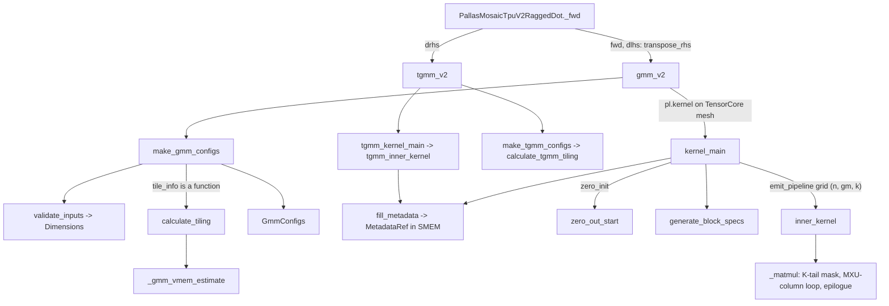

# GMM v2 - dynamic-DMA grouped matmul (gmm_v2, tgmm_v2) and its VMEM-aware tiling

## Overview
GMM v2 (`tokamax/_src/ops/experimental/gmm_v2`) is the second TPU implementation of grouped
matmul behind `ragged_dot`. [`gmm_v2`](https://github.com/openxla/tokamax/blob/3a0a3a34a5ccb8a6ac71f343d9cc44649d73db68/tokamax/_src/ops/experimental/gmm_v2/gmm_v2.py#L1537 "tokamax/_src/ops/experimental/gmm_v2/gmm_v2#gmm_v2")
computes `out[rows of group i] = lhs[rows of group i] @ rhs[i]` and
[`tgmm_v2`](https://github.com/openxla/tokamax/blob/3a0a3a34a5ccb8a6ac71f343d9cc44649d73db68/tokamax/_src/ops/experimental/gmm_v2/tgmm_v2.py#L688 "tokamax/_src/ops/experimental/gmm_v2/tgmm_v2#tgmm_v2")
computes the weight gradient `grad_rhs[i] = lhs[group i].T @ grad[group i]`. Its docstring states
the key idea: "Dynamically calculate offset lhs/out tiles to reduce redundant computations.
Additionally, it adjusts dma size based on number of valid rows and utilize triple buffering on
weights". Instead of padding every group to whole `tile_m` tiles (as v1 does), the kernel walks
group segments ("gm tiles") whose start and length it computes *inside the kernel* from
`group_sizes` in SMEM, DMAs only the sublane rows a segment covers, and picks a static matmul
height from a few "buckets". The tile sizes come from
[`calculate_tiling`](https://github.com/openxla/tokamax/blob/3a0a3a34a5ccb8a6ac71f343d9cc44649d73db68/tokamax/_src/ops/experimental/gmm_v2/gmm_v2.py#L1077 "tokamax/_src/ops/experimental/gmm_v2/gmm_v2#calculate_tiling")
/ [`calculate_tgmm_tiling`](https://github.com/openxla/tokamax/blob/3a0a3a34a5ccb8a6ac71f343d9cc44649d73db68/tokamax/_src/ops/experimental/gmm_v2/tgmm_v2.py#L82 "tokamax/_src/ops/experimental/gmm_v2/tgmm_v2#calculate_tgmm_tiling"),
which shrink N first and K second against a VMEM estimate, then grow M in buckets. The ragged_dot
v2 backend ([ragged-dot-gmm](./ragged-dot-gmm.md)) calls these kernels for forward, dlhs and drhs.

## Diagram

Legend:
- `OP` - [`_fwd`](https://github.com/openxla/tokamax/blob/3a0a3a34a5ccb8a6ac71f343d9cc44649d73db68/tokamax/_src/ops/ragged_dot/pallas_mosaic_tpu_v2.py#L152 "tokamax/_src/ops/ragged_dot/pallas_mosaic_tpu_v2#PallasMosaicTpuV2RaggedDot._fwd")
- `G` - [`gmm_v2`](https://github.com/openxla/tokamax/blob/3a0a3a34a5ccb8a6ac71f343d9cc44649d73db68/tokamax/_src/ops/experimental/gmm_v2/gmm_v2.py#L1537 "tokamax/_src/ops/experimental/gmm_v2/gmm_v2#gmm_v2")
- `T` - [`tgmm_v2`](https://github.com/openxla/tokamax/blob/3a0a3a34a5ccb8a6ac71f343d9cc44649d73db68/tokamax/_src/ops/experimental/gmm_v2/tgmm_v2.py#L688 "tokamax/_src/ops/experimental/gmm_v2/tgmm_v2#tgmm_v2")
- `MC` - [`make_gmm_configs`](https://github.com/openxla/tokamax/blob/3a0a3a34a5ccb8a6ac71f343d9cc44649d73db68/tokamax/_src/ops/experimental/gmm_v2/gmm_v2.py#L1383 "tokamax/_src/ops/experimental/gmm_v2/gmm_v2#make_gmm_configs")
- `VI` - [`validate_inputs`](https://github.com/openxla/tokamax/blob/3a0a3a34a5ccb8a6ac71f343d9cc44649d73db68/tokamax/_src/ops/experimental/gmm_v2/gmm_v2.py#L1242 "tokamax/_src/ops/experimental/gmm_v2/gmm_v2#validate_inputs") producing [`Dimensions`](https://github.com/openxla/tokamax/blob/3a0a3a34a5ccb8a6ac71f343d9cc44649d73db68/tokamax/_src/ops/experimental/gmm_v2/gmm_v2.py#L264 "tokamax/_src/ops/experimental/gmm_v2/gmm_v2#Dimensions")
- `CT` - [`calculate_tiling`](https://github.com/openxla/tokamax/blob/3a0a3a34a5ccb8a6ac71f343d9cc44649d73db68/tokamax/_src/ops/experimental/gmm_v2/gmm_v2.py#L1077 "tokamax/_src/ops/experimental/gmm_v2/gmm_v2#calculate_tiling")
- `VE` - [`_gmm_vmem_estimate`](https://github.com/openxla/tokamax/blob/3a0a3a34a5ccb8a6ac71f343d9cc44649d73db68/tokamax/_src/ops/experimental/gmm_v2/gmm_v2.py#L1132 "tokamax/_src/ops/experimental/gmm_v2/gmm_v2#calculate_tiling._gmm_vmem_estimate")
- `CFG` - [`GmmConfigs`](https://github.com/openxla/tokamax/blob/3a0a3a34a5ccb8a6ac71f343d9cc44649d73db68/tokamax/_src/ops/experimental/gmm_v2/gmm_v2.py#L328 "tokamax/_src/ops/experimental/gmm_v2/gmm_v2#GmmConfigs")
- `KM` - [`kernel_main`](https://github.com/openxla/tokamax/blob/3a0a3a34a5ccb8a6ac71f343d9cc44649d73db68/tokamax/_src/ops/experimental/gmm_v2/gmm_v2.py#L971 "tokamax/_src/ops/experimental/gmm_v2/gmm_v2#kernel_main")
- `FM` - [`fill_metadata`](https://github.com/openxla/tokamax/blob/3a0a3a34a5ccb8a6ac71f343d9cc44649d73db68/tokamax/_src/ops/experimental/gmm_v2/gmm_v2.py#L805 "tokamax/_src/ops/experimental/gmm_v2/gmm_v2#fill_metadata") writing [`MetadataRef`](https://github.com/openxla/tokamax/blob/3a0a3a34a5ccb8a6ac71f343d9cc44649d73db68/tokamax/_src/ops/experimental/gmm_v2/gmm_v2.py#L250 "tokamax/_src/ops/experimental/gmm_v2/gmm_v2#MetadataRef")
- `ZO` - [`zero_out_start`](https://github.com/openxla/tokamax/blob/3a0a3a34a5ccb8a6ac71f343d9cc44649d73db68/tokamax/_src/ops/experimental/gmm_v2/gmm_v2.py#L895 "tokamax/_src/ops/experimental/gmm_v2/gmm_v2#zero_out_start")
- `BS` - [`generate_block_specs`](https://github.com/openxla/tokamax/blob/3a0a3a34a5ccb8a6ac71f343d9cc44649d73db68/tokamax/_src/ops/experimental/gmm_v2/gmm_v2.py#L420 "tokamax/_src/ops/experimental/gmm_v2/gmm_v2#generate_block_specs")
- `IK` - [`inner_kernel`](https://github.com/openxla/tokamax/blob/3a0a3a34a5ccb8a6ac71f343d9cc44649d73db68/tokamax/_src/ops/experimental/gmm_v2/gmm_v2.py#L483 "tokamax/_src/ops/experimental/gmm_v2/gmm_v2#inner_kernel")
- `MM` - [`_matmul`](https://github.com/openxla/tokamax/blob/3a0a3a34a5ccb8a6ac71f343d9cc44649d73db68/tokamax/_src/ops/experimental/gmm_v2/gmm_v2.py#L526 "tokamax/_src/ops/experimental/gmm_v2/gmm_v2#inner_kernel._matmul")
- `TC` - [`make_tgmm_configs`](https://github.com/openxla/tokamax/blob/3a0a3a34a5ccb8a6ac71f343d9cc44649d73db68/tokamax/_src/ops/experimental/gmm_v2/tgmm_v2.py#L193 "tokamax/_src/ops/experimental/gmm_v2/tgmm_v2#make_tgmm_configs") calling [`calculate_tgmm_tiling`](https://github.com/openxla/tokamax/blob/3a0a3a34a5ccb8a6ac71f343d9cc44649d73db68/tokamax/_src/ops/experimental/gmm_v2/tgmm_v2.py#L82 "tokamax/_src/ops/experimental/gmm_v2/tgmm_v2#calculate_tgmm_tiling")
- `TK` - [`tgmm_kernel_main`](https://github.com/openxla/tokamax/blob/3a0a3a34a5ccb8a6ac71f343d9cc44649d73db68/tokamax/_src/ops/experimental/gmm_v2/tgmm_v2.py#L577 "tokamax/_src/ops/experimental/gmm_v2/tgmm_v2#tgmm_kernel_main") and [`tgmm_inner_kernel`](https://github.com/openxla/tokamax/blob/3a0a3a34a5ccb8a6ac71f343d9cc44649d73db68/tokamax/_src/ops/experimental/gmm_v2/tgmm_v2.py#L300 "tokamax/_src/ops/experimental/gmm_v2/tgmm_v2#tgmm_inner_kernel")

## Design rationale (why it's built this way)
- **Metadata in the kernel, not the host.** v1 builds its tile schedule in XLA and
  scalar-prefetches it; v2's [`fill_metadata`](https://github.com/openxla/tokamax/blob/3a0a3a34a5ccb8a6ac71f343d9cc44649d73db68/tokamax/_src/ops/experimental/gmm_v2/gmm_v2.py#L805 "tokamax/_src/ops/experimental/gmm_v2/gmm_v2#fill_metadata")
  runs two `fori_loop`s on the scalar core at kernel start and writes
  [`gm_id_to_group_id`](https://github.com/openxla/tokamax/blob/3a0a3a34a5ccb8a6ac71f343d9cc44649d73db68/tokamax/_src/ops/experimental/gmm_v2/gmm_v2.py#L251 "tokamax/_src/ops/experimental/gmm_v2/gmm_v2#MetadataRef.gm_id_to_group_id")
  and [`gm_id_to_m_offset`](https://github.com/openxla/tokamax/blob/3a0a3a34a5ccb8a6ac71f343d9cc44649d73db68/tokamax/_src/ops/experimental/gmm_v2/gmm_v2.py#L252 "tokamax/_src/ops/experimental/gmm_v2/gmm_v2#MetadataRef.gm_id_to_m_offset")
  into SMEM scratch. The returned count `num_gm` becomes the dynamic middle grid extent of
  `emit_pipeline`, so empty groups and groups before `group_offset` cost no grid steps at all.
- **DMA exactly the rows a segment owns.** The lhs and output BlockSpecs use a
  `pl.BoundedSlice(tile_m // size_lhs_sublane)` leading dimension with an index map returning
  `pl.ds(row_start, row_size)` in sublane units, so a 3-row group moves one sublane tile, not a
  whole `tile_m` block. Weights are not ragged and use plain blocks with `pl.Buffered(3)` -
  "triple buffering on weights".
- **Static shapes for dynamic heights.** A segment's valid height varies per step, but MXU code
  must be static. `tile_m` is a multiple of
  [`bucket_base`](https://github.com/openxla/tokamax/blob/3a0a3a34a5ccb8a6ac71f343d9cc44649d73db68/tokamax/_src/ops/experimental/gmm_v2/gmm_v2.py#L260 "tokamax/_src/ops/experimental/gmm_v2/gmm_v2#TileSizes.bucket_base")
  (at most 4 buckets) and [`inner_kernel`](https://github.com/openxla/tokamax/blob/3a0a3a34a5ccb8a6ac71f343d9cc44649d73db68/tokamax/_src/ops/experimental/gmm_v2/gmm_v2.py#L483 "tokamax/_src/ops/experimental/gmm_v2/gmm_v2#inner_kernel")
  `lax.switch`es on `m_end_local // bucket_base` into one of several compiled copies of the matmul,
  each processing `bucket_base * (idx + 1)` rows. The tiling comment says the bucket count "was
  choosen empiirically" with instruction-memory size as the eventual criterion.
- **Masks instead of padding.** Neither K nor the group boundaries are padded in HBM (only M is
  padded up to one sublane tile in [`gmm_v2`](https://github.com/openxla/tokamax/blob/3a0a3a34a5ccb8a6ac71f343d9cc44649d73db68/tokamax/_src/ops/experimental/gmm_v2/gmm_v2.py#L1537 "tokamax/_src/ops/experimental/gmm_v2/gmm_v2#gmm_v2"),
  "the extra rows sit past every group, so they add no work"). The kernels run with
  `disable_bounds_checks=True`, so any block that extends past an array edge holds undefined data
  and correctness rests on `jnp.where` masks - which is where the K-tail NaN bug lived (see
  Mechanism step 6).
- **Megacore by mesh, not by grid semantics alone.** Both kernels are launched with `pl.kernel`
  over a `TensorCoreMesh(axis_name="core")` and `emit_pipeline(core_axis_name="core")`; gmm marks
  only N `PARALLEL` (the gm and k axes carry the accumulator and the partial-row carry), while tgmm
  marks N and K `PARALLEL` because its output tile `[k, n]` is independent per (n, k).

> [!inferred]
> Shrinking N before K in the tiling is a latency choice: the code comment says "Multiple k tiles
> will introduce accumulation overhead", and K is the only axis whose split forces the f32
> accumulator to persist across grid steps.

## Entry points
- [`gmm_v2`](https://github.com/openxla/tokamax/blob/3a0a3a34a5ccb8a6ac71f343d9cc44649d73db68/tokamax/_src/ops/experimental/gmm_v2/gmm_v2.py#L1537 "tokamax/_src/ops/experimental/gmm_v2/gmm_v2#gmm_v2") -
  jitted entry, `lhs [m, k]`, `rhs [g, k, n]` (or `[g, n, k]` with `transpose_rhs`), optional
  `rhs_scale [g, blocks, 1, n]`, `rhs_bias [g, 1, n]`, `group_offset [1]`, per-tensor
  `lhs_scale [1, 1]`. `tile_info` is a [`TileSizes`](https://github.com/openxla/tokamax/blob/3a0a3a34a5ccb8a6ac71f343d9cc44649d73db68/tokamax/_src/ops/experimental/gmm_v2/gmm_v2.py#L256 "tokamax/_src/ops/experimental/gmm_v2/gmm_v2#TileSizes")
  or a tiling function (default `calculate_tiling`); `precision` is "Unused. Exists for
  compatibility reasons." Reached from ragged_dot's v2 forward and dlhs paths.
- [`tgmm_v2`](https://github.com/openxla/tokamax/blob/3a0a3a34a5ccb8a6ac71f343d9cc44649d73db68/tokamax/_src/ops/experimental/gmm_v2/tgmm_v2.py#L688 "tokamax/_src/ops/experimental/gmm_v2/tgmm_v2#tgmm_v2") -
  `lhs [m, k]`, `rhs [m, n]`, `num_actual_groups` (static, "weight.shape[0]"), optional per-N
  `rhs_scale [1, 1, n]`; returns `[num_actual_groups, k, n]`. Reached from ragged_dot's v2 drhs
  path, which is the only place `num_actual_groups` is known.
- [`calculate_tiling`](https://github.com/openxla/tokamax/blob/3a0a3a34a5ccb8a6ac71f343d9cc44649d73db68/tokamax/_src/ops/experimental/gmm_v2/gmm_v2.py#L1077 "tokamax/_src/ops/experimental/gmm_v2/gmm_v2#calculate_tiling") and
  [`calculate_tgmm_tiling`](https://github.com/openxla/tokamax/blob/3a0a3a34a5ccb8a6ac71f343d9cc44649d73db68/tokamax/_src/ops/experimental/gmm_v2/tgmm_v2.py#L82 "tokamax/_src/ops/experimental/gmm_v2/tgmm_v2#calculate_tgmm_tiling") -
  called at trace time whenever the ragged_dot v2 Config leaves any tile field `None` (the default).
  An explicit Config replaces them with a `TileSizes` whose `bucket_base` defaults to `tile_m`
  (one bucket), which [`test_tgmm_drhs_with_tile_info_pipes`](https://github.com/openxla/tokamax/blob/3a0a3a34a5ccb8a6ac71f343d9cc44649d73db68/tokamax/_src/ops/ragged_dot/pallas_mosaic_tpu_v2_test.py#L139 "tokamax/_src/ops/ragged_dot/pallas_mosaic_tpu_v2_test#PallasMosaicTpuV2OpParameterPipingTest.test_tgmm_drhs_with_tile_info_pipes")
  checks is piped through for drhs.

## Mechanism (step-by-step)
1. **Configure.** [`make_gmm_configs`](https://github.com/openxla/tokamax/blob/3a0a3a34a5ccb8a6ac71f343d9cc44649d73db68/tokamax/_src/ops/experimental/gmm_v2/gmm_v2.py#L1383 "tokamax/_src/ops/experimental/gmm_v2/gmm_v2#make_gmm_configs")
   computes the sub-byte [`get_packing_factor`](https://github.com/openxla/tokamax/blob/3a0a3a34a5ccb8a6ac71f343d9cc44649d73db68/tokamax/_src/ops/experimental/gmm_v2/gmm_v2.py#L136 "tokamax/_src/ops/experimental/gmm_v2/gmm_v2#get_packing_factor")
   (e.g. eight int4 values per 32-bit carrier word), runs
   [`validate_inputs`](https://github.com/openxla/tokamax/blob/3a0a3a34a5ccb8a6ac71f343d9cc44649d73db68/tokamax/_src/ops/experimental/gmm_v2/gmm_v2.py#L1242 "tokamax/_src/ops/experimental/gmm_v2/gmm_v2#validate_inputs")
   (shape asserts; `size_k % num_quant_blocks == 0`; `transpose_rhs` excludes scales, bias and
   `fuse_act`; `fuse_act` needs `size_n % (2 * num_lanes) == 0`), and derives
   `rhs quant_block_size = size_k // rhs_scale.shape[1]`. If rhs is block-quantized and the
   dequantization happens after the matmul, it picks an lhs quantization dtype from hardware
   support - fp8 e4m3 for float or 4-bit rhs when the chip has fp8 throughput, int8 for integer
   rhs when it has int8 throughput - with a fixed lhs block of 512 and a bf16 accumulator
   ("Using faster bf16 hardware during accumulation can help offset the pressure" on the VPU).
   Otherwise the accumulator is f32.
2. **Tile (forward).** [`calculate_tiling`](https://github.com/openxla/tokamax/blob/3a0a3a34a5ccb8a6ac71f343d9cc44649d73db68/tokamax/_src/ops/experimental/gmm_v2/gmm_v2.py#L1077 "tokamax/_src/ops/experimental/gmm_v2/gmm_v2#calculate_tiling"),
   with `L = num_lanes` (128) and the VMEM limit defaulting to 90% of capacity:
   - [`tile_m`](https://github.com/openxla/tokamax/blob/3a0a3a34a5ccb8a6ac71f343d9cc44649d73db68/tokamax/_src/ops/experimental/gmm_v2/gmm_v2.py#L257 "tokamax/_src/ops/experimental/gmm_v2/gmm_v2#TileSizes.tile_m") starts at 128 for a bf16 rhs (256 when the rhs is transposed, i.e. dlhs), halved for a rhs
     of 8 bits or fewer (`rhs_mod = min(cdiv(16, rhs_bits), 2)`), doubled again when the lhs is
     quantized in-kernel, capped at `size_m`.
   - Start with one tile per axis via [`align_to`](https://github.com/openxla/tokamax/blob/3a0a3a34a5ccb8a6ac71f343d9cc44649d73db68/tokamax/_src/ops/experimental/gmm_v2/gmm_v2.py#L125 "tokamax/_src/ops/experimental/gmm_v2/gmm_v2#align_to"): `tile_k = align_to(size_k, L)`, `tile_n = align_to(n_per_rhs, L)`
     (`n_per_rhs = size_n / 2` with `fuse_act`).
   - While [`_gmm_vmem_estimate`](https://github.com/openxla/tokamax/blob/3a0a3a34a5ccb8a6ac71f343d9cc44649d73db68/tokamax/_src/ops/experimental/gmm_v2/gmm_v2.py#L1132 "tokamax/_src/ops/experimental/gmm_v2/gmm_v2#calculate_tiling._gmm_vmem_estimate")
     exceeds the limit and `tile_n > 2 * mxu_column_size` (the floor that avoids "stalling MXU"),
     use one more N tile: `tile_n = align_to(n, num_n_tiles * L) / num_n_tiles`, i.e. split N
     evenly into lane-aligned pieces; step back one if that overshot the floor.
   - If still over, split K the same way, [`tile_k`](https://github.com/openxla/tokamax/blob/3a0a3a34a5ccb8a6ac71f343d9cc44649d73db68/tokamax/_src/ops/experimental/gmm_v2/gmm_v2.py#L258 "tokamax/_src/ops/experimental/gmm_v2/gmm_v2#TileSizes.tile_k") becomes `align_to(size_k, num_k_tiles * L) / num_k_tiles`,
     until it fits and `tile_k` is quant-block compatible (`tile_k % qbs == 0` or `qbs % tile_k == 0`),
     stopping at `tile_k = L`; if still incompatible, force `tile_k = quant_block_size`.
   - Finally set [`bucket_base`](https://github.com/openxla/tokamax/blob/3a0a3a34a5ccb8a6ac71f343d9cc44649d73db68/tokamax/_src/ops/experimental/gmm_v2/gmm_v2.py#L260 "tokamax/_src/ops/experimental/gmm_v2/gmm_v2#TileSizes.bucket_base") to the base `tile_m` and grow `tile_m` by `bucket_base` up to 4 buckets while it
     stays `<= size_m` and inside the limit.
   The estimate charges lhs `2 x tm x tk` (plus one quantized copy), rhs `3 x` weight tile `+ 2 x`
   scale `+ 2 x` bias (all doubled under `fuse_act`), the accumulator `tm x tn` (x2 with
   `fuse_act`; 2 bytes if lhs is quantized else 4), and a double-buffered output tile.
3. **Build metadata in-kernel.** [`kernel_main`](https://github.com/openxla/tokamax/blob/3a0a3a34a5ccb8a6ac71f343d9cc44649d73db68/tokamax/_src/ops/experimental/gmm_v2/gmm_v2.py#L971 "tokamax/_src/ops/experimental/gmm_v2/gmm_v2#kernel_main")
   bitcasts packed weights to their quant dtype and calls `fill_metadata`. For each group from 0 to
   `group_offset + size_group`, the number of gm tiles is `cdiv(group_size + start % sublane, tile_m)`
   (the `start % sublane` term covers a group that begins mid-sublane: "a naive
   cdiv(group_size, tile_m) will return 1" for a 3-row group straddling two sublanes), zero for
   empty groups or groups before the offset. Each gm tile spans
   `[cur, cur + min(tile_m - cur % sublane, end - cur))`. SMEM scratch is sized for the worst case
   `size_group + cdiv(size_m, tile_m) - 1` tiles.
4. **Pipeline.** [`generate_block_specs`](https://github.com/openxla/tokamax/blob/3a0a3a34a5ccb8a6ac71f343d9cc44649d73db68/tokamax/_src/ops/experimental/gmm_v2/gmm_v2.py#L420 "tokamax/_src/ops/experimental/gmm_v2/gmm_v2#generate_block_specs")
   builds lhs `(BoundedSlice, sublane, tile_k)`, rhs `(None, tile_k, tile_n)` (or
   `(None, tile_n, tile_k)`) with 3 buffers, optional scale `(None, blocks_per_tile_k, 1, tile_n)`
   indexed by [`rhs_scale_index_map`](https://github.com/openxla/tokamax/blob/3a0a3a34a5ccb8a6ac71f343d9cc44649d73db68/tokamax/_src/ops/experimental/gmm_v2/gmm_v2.py#L395 "tokamax/_src/ops/experimental/gmm_v2/gmm_v2#IndexMaps.rhs_scale_index_map")
   (which handles "a single quant block could be shared along multiple k tile"), and output
   `(BoundedSlice, sublane, tile_n)`. `emit_pipeline` runs `grid = (num_n, num_gm, num_k)` with
   `num_k = cdiv(size_k, tile_k)` and `num_n = cdiv(out_size_n, tile_n)`. Before the pipeline,
   when `zero_initialize` is on, [`zero_out_start`](https://github.com/openxla/tokamax/blob/3a0a3a34a5ccb8a6ac71f343d9cc44649d73db68/tokamax/_src/ops/experimental/gmm_v2/gmm_v2.py#L895 "tokamax/_src/ops/experimental/gmm_v2/gmm_v2#zero_out_start")
   launches low-priority async DMAs from a 2 MiB `[tile_zero_m, num_lanes]` zero buffer to the rows
   before the first and after the last computed row; they are waited after the pipeline.
5. **Matmul body.** [`_matmul`](https://github.com/openxla/tokamax/blob/3a0a3a34a5ccb8a6ac71f343d9cc44649d73db68/tokamax/_src/ops/experimental/gmm_v2/gmm_v2.py#L526 "tokamax/_src/ops/experimental/gmm_v2/gmm_v2#inner_kernel._matmul")
   is specialized four ways (first / middle / last / first-and-last k step) per bucket. It reshapes
   the lhs block to `[bucket_m, tile_k]`, transposes the rhs tile in-core for dlhs, optionally
   dequantizes the rhs before the matmul (when `quant_block_size < mxu_column_size`, which "limits
   MXU utilization"), applies the K-tail mask, then loops over `mxu_column_size`-wide column
   strips so "result of [tile_m, mxu_size] becomes available at the end of every k inner loop" and
   VPU work pipelines behind the MXU. With in-kernel lhs quantization each 512-wide block is
   quantized by its row absmax (zero scales mapped to zero to avoid NaN/Inf) or by the static
   per-tensor `lhs_scale`. On the last k step it adds bias, applies
   [`apply_act_fn`](https://github.com/openxla/tokamax/blob/3a0a3a34a5ccb8a6ac71f343d9cc44649d73db68/tokamax/_src/ops/experimental/gmm_v2/gmm_v2.py#L84 "tokamax/_src/ops/experimental/gmm_v2/gmm_v2#apply_act_fn")
   (gate and up halves arrive lane-interleaved; activations include silu, gelu, swigluoai and
   [`silu_and_mul_with_clamp`](https://github.com/openxla/tokamax/blob/3a0a3a34a5ccb8a6ac71f343d9cc44649d73db68/tokamax/_src/ops/experimental/gmm_v2/gmm_v2.py#L41 "tokamax/_src/ops/experimental/gmm_v2/gmm_v2#silu_and_mul_with_clamp")),
   zeroes rows outside `[m_start_local, m_end_local)`, writes the tile, and carries the last
   partially-filled sublane row into `partial_out_ref` so the next gm tile (whose first sublane
   overlaps it) adds it back - the out index map floors `row_end` for every tile except the last so
   that shared sublane is written once.
6. **K tail: exactly what happens to the remainder.** In
   [`_matmul`](https://github.com/openxla/tokamax/blob/3a0a3a34a5ccb8a6ac71f343d9cc44649d73db68/tokamax/_src/ops/experimental/gmm_v2/gmm_v2.py#L526 "tokamax/_src/ops/experimental/gmm_v2/gmm_v2#inner_kernel._matmul"),
   `valid_k = size_k % tile_k`. When `valid_k != 0`, on the last k step only, the kernel builds two
   iota masks and **zeroes with `jnp.where`** both the lhs columns `>= valid_k` and the rhs rows
   `>= valid_k` before any matmul; nothing is padded in HBM and the K extent of the last block is
   still `tile_k`, so the masked region is whatever the DMA left in VMEM. Selecting rather than
   multiplying is what makes it NaN-safe. The author comment reads "`lhs` needs to be masked over
   k-axis iff `lhs` contains `jnp.nan`s. Otherwise, only masking `rhs` to zeros is sufficient":
   with only the rhs masked, a NaN or Inf in the lhs tail still produces `NaN x 0 = NaN` in the
   accumulator. The lhs mask was added by commit `34069ea` ("properly masking the last `lhs` k tile
   especially when `k % tile_k != 0` and `jnp.nan` inputs useful for token paddings"). The mask is
   applied after the optional pre-matmul rhs dequantization, so dequantized garbage is also
   replaced. Worked example: `size_k = 1000` that does not fit as one tile gives
   `tile_k = align_to(1000, 256) / 2 = 512`, `num_k = 2`, `valid_k = 488`; when it fits,
   `tile_k = align_to(1000, 128) = 1024`, `num_k = 1`, and the single step is also the last, with
   `valid_k = 1000`.
7. **TGMM.** [`tgmm_inner_kernel`](https://github.com/openxla/tokamax/blob/3a0a3a34a5ccb8a6ac71f343d9cc44649d73db68/tokamax/_src/ops/experimental/gmm_v2/tgmm_v2.py#L300 "tokamax/_src/ops/experimental/gmm_v2/tgmm_v2#tgmm_inner_kernel")
   runs `grid = (num_n, num_k, num_gm)` with M (the ragged axis) as the contraction. Both lhs and
   rhs rows outside the segment are zeroed ("without masking both, we sometimes see the result
   contain NaNs so we decide to mask both to be safe"), the `[tile_k, tile_n]` accumulator is reset
   at a group's first gm tile and stored, with the optional per-N scale, at its last. Here **K is an
   output axis**, so its tail needs no mask: the output is allocated as
   `[g, align_to(size_k, tile_k), align_to(size_n, L)]` and sliced back, so garbage only lands in
   padding. [`tgmm_kernel_main`](https://github.com/openxla/tokamax/blob/3a0a3a34a5ccb8a6ac71f343d9cc44649d73db68/tokamax/_src/ops/experimental/gmm_v2/tgmm_v2.py#L577 "tokamax/_src/ops/experimental/gmm_v2/tgmm_v2#tgmm_kernel_main")
   also DMA-zeroes `out[i]` for every empty group, since no grid step would write it.
   [`calculate_tgmm_tiling`](https://github.com/openxla/tokamax/blob/3a0a3a34a5ccb8a6ac71f343d9cc44649d73db68/tokamax/_src/ops/experimental/gmm_v2/tgmm_v2.py#L82 "tokamax/_src/ops/experimental/gmm_v2/tgmm_v2#calculate_tgmm_tiling")
   fixes `tile_m = min(256, size_m)` (at least one sublane tile; "any size less than 256 will have
   the same perf as using 256"), shrinks N then K with the same lane-aligned split rule (with an
   explicit guard against the split getting stuck at 128 for awkward sizes like `size_n = 100`),
   budgets `(2 + 2)` lhs tiles, `(2 + 1)` rhs tiles, accumulator plus two output tiles, and the
   2 MiB zero buffer, then grows `tile_m` in up to 4 buckets.

## Key data structures
- [`TileSizes`](https://github.com/openxla/tokamax/blob/3a0a3a34a5ccb8a6ac71f343d9cc44649d73db68/tokamax/_src/ops/experimental/gmm_v2/gmm_v2.py#L256 "tokamax/_src/ops/experimental/gmm_v2/gmm_v2#TileSizes") -
  [`tile_m`](https://github.com/openxla/tokamax/blob/3a0a3a34a5ccb8a6ac71f343d9cc44649d73db68/tokamax/_src/ops/experimental/gmm_v2/gmm_v2.py#L257 "tokamax/_src/ops/experimental/gmm_v2/gmm_v2#TileSizes.tile_m")
  (max rows per gm tile, a multiple of `bucket_base`),
  [`tile_k`](https://github.com/openxla/tokamax/blob/3a0a3a34a5ccb8a6ac71f343d9cc44649d73db68/tokamax/_src/ops/experimental/gmm_v2/gmm_v2.py#L258 "tokamax/_src/ops/experimental/gmm_v2/gmm_v2#TileSizes.tile_k"),
  [`tile_n`](https://github.com/openxla/tokamax/blob/3a0a3a34a5ccb8a6ac71f343d9cc44649d73db68/tokamax/_src/ops/experimental/gmm_v2/gmm_v2.py#L259 "tokamax/_src/ops/experimental/gmm_v2/gmm_v2#TileSizes.tile_n")
  (per gate/up half under `fuse_act`) and `bucket_base`.
- [`Dimensions`](https://github.com/openxla/tokamax/blob/3a0a3a34a5ccb8a6ac71f343d9cc44649d73db68/tokamax/_src/ops/experimental/gmm_v2/gmm_v2.py#L264 "tokamax/_src/ops/experimental/gmm_v2/gmm_v2#Dimensions") -
  [`size_m`](https://github.com/openxla/tokamax/blob/3a0a3a34a5ccb8a6ac71f343d9cc44649d73db68/tokamax/_src/ops/experimental/gmm_v2/gmm_v2.py#L265 "tokamax/_src/ops/experimental/gmm_v2/gmm_v2#Dimensions.size_m"),
  [`size_k`](https://github.com/openxla/tokamax/blob/3a0a3a34a5ccb8a6ac71f343d9cc44649d73db68/tokamax/_src/ops/experimental/gmm_v2/gmm_v2.py#L266 "tokamax/_src/ops/experimental/gmm_v2/gmm_v2#Dimensions.size_k")
  (unpacked, i.e. carrier rows x packing factor),
  [`size_n`](https://github.com/openxla/tokamax/blob/3a0a3a34a5ccb8a6ac71f343d9cc44649d73db68/tokamax/_src/ops/experimental/gmm_v2/gmm_v2.py#L267 "tokamax/_src/ops/experimental/gmm_v2/gmm_v2#Dimensions.size_n"),
  [`size_group`](https://github.com/openxla/tokamax/blob/3a0a3a34a5ccb8a6ac71f343d9cc44649d73db68/tokamax/_src/ops/experimental/gmm_v2/gmm_v2.py#L268 "tokamax/_src/ops/experimental/gmm_v2/gmm_v2#Dimensions.size_group")
  (local weight groups, possibly fewer than `len(group_sizes)`), and
  [`size_lhs_sublane`](https://github.com/openxla/tokamax/blob/3a0a3a34a5ccb8a6ac71f343d9cc44649d73db68/tokamax/_src/ops/experimental/gmm_v2/gmm_v2.py#L270 "tokamax/_src/ops/experimental/gmm_v2/gmm_v2#Dimensions.size_lhs_sublane"),
  the dtype's sublane tiling (capped at `size_m`) that is the DMA and masking granularity of rows.
- [`InputConfigs`](https://github.com/openxla/tokamax/blob/3a0a3a34a5ccb8a6ac71f343d9cc44649d73db68/tokamax/_src/ops/experimental/gmm_v2/gmm_v2.py#L274 "tokamax/_src/ops/experimental/gmm_v2/gmm_v2#InputConfigs") -
  per operand: storage [`dtype`](https://github.com/openxla/tokamax/blob/3a0a3a34a5ccb8a6ac71f343d9cc44649d73db68/tokamax/_src/ops/experimental/gmm_v2/gmm_v2.py#L277 "tokamax/_src/ops/experimental/gmm_v2/gmm_v2#InputConfigs.dtype"),
  [`quant_dtype`](https://github.com/openxla/tokamax/blob/3a0a3a34a5ccb8a6ac71f343d9cc44649d73db68/tokamax/_src/ops/experimental/gmm_v2/gmm_v2.py#L275 "tokamax/_src/ops/experimental/gmm_v2/gmm_v2#InputConfigs.quant_dtype"),
  [`quant_block_size`](https://github.com/openxla/tokamax/blob/3a0a3a34a5ccb8a6ac71f343d9cc44649d73db68/tokamax/_src/ops/experimental/gmm_v2/gmm_v2.py#L276 "tokamax/_src/ops/experimental/gmm_v2/gmm_v2#InputConfigs.quant_block_size")
  and [`has_scale`](https://github.com/openxla/tokamax/blob/3a0a3a34a5ccb8a6ac71f343d9cc44649d73db68/tokamax/_src/ops/experimental/gmm_v2/gmm_v2.py#L283 "tokamax/_src/ops/experimental/gmm_v2/gmm_v2#InputConfigs.has_scale").
  Derived properties decide the code path: quantize online when `dtype != quant_dtype`, dequantize
  before vs after the matmul by comparing the block size to `mxu_column_size`, unpack when the
  packing factor exceeds 1.
- [`GmmConfigs`](https://github.com/openxla/tokamax/blob/3a0a3a34a5ccb8a6ac71f343d9cc44649d73db68/tokamax/_src/ops/experimental/gmm_v2/gmm_v2.py#L328 "tokamax/_src/ops/experimental/gmm_v2/gmm_v2#GmmConfigs") -
  the static bundle ([`tiles`](https://github.com/openxla/tokamax/blob/3a0a3a34a5ccb8a6ac71f343d9cc44649d73db68/tokamax/_src/ops/experimental/gmm_v2/gmm_v2.py#L329 "tokamax/_src/ops/experimental/gmm_v2/gmm_v2#GmmConfigs.tiles"),
  [`dims`](https://github.com/openxla/tokamax/blob/3a0a3a34a5ccb8a6ac71f343d9cc44649d73db68/tokamax/_src/ops/experimental/gmm_v2/gmm_v2.py#L330 "tokamax/_src/ops/experimental/gmm_v2/gmm_v2#GmmConfigs.dims"),
  [`lhs_cfgs`](https://github.com/openxla/tokamax/blob/3a0a3a34a5ccb8a6ac71f343d9cc44649d73db68/tokamax/_src/ops/experimental/gmm_v2/gmm_v2.py#L331 "tokamax/_src/ops/experimental/gmm_v2/gmm_v2#GmmConfigs.lhs_cfgs"),
  [`rhs_cfgs`](https://github.com/openxla/tokamax/blob/3a0a3a34a5ccb8a6ac71f343d9cc44649d73db68/tokamax/_src/ops/experimental/gmm_v2/gmm_v2.py#L332 "tokamax/_src/ops/experimental/gmm_v2/gmm_v2#GmmConfigs.rhs_cfgs"),
  [`out_dtype`](https://github.com/openxla/tokamax/blob/3a0a3a34a5ccb8a6ac71f343d9cc44649d73db68/tokamax/_src/ops/experimental/gmm_v2/gmm_v2.py#L333 "tokamax/_src/ops/experimental/gmm_v2/gmm_v2#GmmConfigs.out_dtype"),
  accumulator dtype, `zero_init`, `fuse_act`, `transpose_rhs`), with
  [`out_size_n`](https://github.com/openxla/tokamax/blob/3a0a3a34a5ccb8a6ac71f343d9cc44649d73db68/tokamax/_src/ops/experimental/gmm_v2/gmm_v2.py#L344 "tokamax/_src/ops/experimental/gmm_v2/gmm_v2#GmmConfigs.out_size_n")
  halving N under `fuse_act`. It is flattened into the kernel's profiler metadata, and
  [`get_scope_name`](https://github.com/openxla/tokamax/blob/3a0a3a34a5ccb8a6ac71f343d9cc44649d73db68/tokamax/_src/ops/experimental/gmm_v2/gmm_v2.py#L1374 "tokamax/_src/ops/experimental/gmm_v2/gmm_v2#get_scope_name")
  names the kernel `gmm_v2-g_..-m_..-k_..-n_..-tm_..-tk_..-tn_..` (tgmm has its own
  [`get_scope_name`](https://github.com/openxla/tokamax/blob/3a0a3a34a5ccb8a6ac71f343d9cc44649d73db68/tokamax/_src/ops/experimental/gmm_v2/tgmm_v2.py#L58 "tokamax/_src/ops/experimental/gmm_v2/tgmm_v2#get_scope_name")),
  so the chosen tiling is visible in an xprof trace.

## Dynamics (design intent)
- **Cost model for XLA scheduling.** [`get_cost_estimate`](https://github.com/openxla/tokamax/blob/3a0a3a34a5ccb8a6ac71f343d9cc44649d73db68/tokamax/_src/ops/experimental/gmm_v2/gmm_v2.py#L1339 "tokamax/_src/ops/experimental/gmm_v2/gmm_v2#get_cost_estimate")
  reports `2 m k n` flops and bytes for lhs, all `g` weight matrices (sub-byte aware) plus scales /
  bias, and the output; the tgmm [`get_cost_estimate`](https://github.com/openxla/tokamax/blob/3a0a3a34a5ccb8a6ac71f343d9cc44649d73db68/tokamax/_src/ops/experimental/gmm_v2/tgmm_v2.py#L67 "tokamax/_src/ops/experimental/gmm_v2/tgmm_v2#get_cost_estimate")
  charges the `[g, k, n]` output instead.
- **Tiling regressions are tested by shape.** [`test_calculate_tiling_edge_cases`](https://github.com/openxla/tokamax/blob/3a0a3a34a5ccb8a6ac71f343d9cc44649d73db68/tokamax/_src/ops/experimental/gmm_v2/gmm_v2_test.py#L1701 "tokamax/_src/ops/experimental/gmm_v2/gmm_v2_test#GmmV2CalculateTilingTest.test_calculate_tiling_edge_cases")
  mocks the TPU info and checks that `tile_n` stays at or above `2 x mxu_column_size` while K
  shrinks (the fix in commit `d24fabd`, "skipping tile_k shrink over VMEM limit");
  [`test_gmm_weight_quantized_block_larger_than_tile_k`](https://github.com/openxla/tokamax/blob/3a0a3a34a5ccb8a6ac71f343d9cc44649d73db68/tokamax/_src/ops/experimental/gmm_v2/gmm_v2_test.py#L948 "tokamax/_src/ops/experimental/gmm_v2/gmm_v2_test#GmmTest.test_gmm_weight_quantized_block_larger_than_tile_k")
  covers a 1024-row quant block with `tile_k` 128 / 256; compile time is measured by
  [`measure`](https://github.com/openxla/tokamax/blob/3a0a3a34a5ccb8a6ac71f343d9cc44649d73db68/tokamax/_src/ops/experimental/gmm_v2/gmm_v2_perf_test.py#L268 "tokamax/_src/ops/experimental/gmm_v2/gmm_v2_perf_test#GmmCompilePerfTest.measure"),
  and [`test_gmm_maxtext`](https://github.com/openxla/tokamax/blob/3a0a3a34a5ccb8a6ac71f343d9cc44649d73db68/tokamax/_src/ops/ragged_dot/pallas_mosaic_tpu_v2_test.py#L534 "tokamax/_src/ops/ragged_dot/pallas_mosaic_tpu_v2_test#PallasMosaicTpuV2OpParameterPipingTest.test_gmm_maxtext")
  checks the ragged_dot wrapper against the kernel on MaxText shapes.
- **Fused activation layout.** Under `fuse_act` the rhs is one `[g, k, 2 * n_out]` array whose
  halves are viewed as gate and up weights and lane-interleaved in VMEM, so one accumulator of
  width `2 * tile_n` yields both halves and the activation is applied in the epilogue - the fused
  MoE gate/up projection that [fused-moe](./fused-moe.md) also implements in its own kernel
  (whose `_apply_act` mirrors these activations).

## Edge cases
- **K tail with block-quantized rhs.** The K mask zeroes lhs and rhs, but the rhs *scale* tile is
  not masked; see Open questions.
- **Explicit TileSizes skip all checks the heuristic performs.** A caller-provided `tile_k` that is
  neither a multiple nor a divisor of the quant block, or a `tile_m` not a multiple of
  `bucket_base`, is not refused by `gmm_v2` (tgmm asserts the bucket divisibility).
- **Uninitialized rows.** With `zero_initialize=False` (the ragged_dot default) rows outside
  `[first group start, last group end)` - e.g. after `group_offset` or when
  `sum(group_sizes) < m` - are never written.
- **Mixed-precision combos.** fp8 lhs with int4, fp4 or bf16 rhs are allowed through explicit casts
  ([`is_manually_cast_matmul_dtype_combo`](https://github.com/openxla/tokamax/blob/3a0a3a34a5ccb8a6ac71f343d9cc44649d73db68/tokamax/_src/ops/experimental/gmm_v2/gmm_v2.py#L1226 "tokamax/_src/ops/experimental/gmm_v2/gmm_v2#is_manually_cast_matmul_dtype_combo"))
  even when the MXU does not support them natively.
- **Narrow N.** [`align_to`](https://github.com/openxla/tokamax/blob/3a0a3a34a5ccb8a6ac71f343d9cc44649d73db68/tokamax/_src/ops/experimental/gmm_v2/gmm_v2.py#L125 "tokamax/_src/ops/experimental/gmm_v2/gmm_v2#align_to")
  rounds N up to 128 lanes for the output allocation, which is sliced back to `out_size_n`; an N
  below 128 therefore still pays for a full lane tile.

## Open questions
- **Residual K-tail risk in the rhs-scale path.** When the rhs is block-quantized with
  dequantization after the matmul and `size_k % tile_k != 0` (possible, e.g. `size_k = 1280`,
  `qbs = 256`, `tile_k = 512`), the last k tile's scale block covers quant blocks past the end of
  `rhs_scale`. Those sub-blocks contribute `0` from the masked matmul, but are then multiplied by an
  unmasked out-of-range scale; if that VMEM slot holds NaN or Inf, `0 x NaN = NaN`. The code at
  this pin does not mask or clamp the scale, and no test in the subgraph covers that combination.
  This is a reading of the source, not an observed failure.
- Why the forward tiling halves `tile_m` for rhs of 8 bits or fewer ("we need to tweak tile_m to
  account for using faster hardware unit") is left as a TODO to "Account for different TPU hardware
  specs".
- The 2 MiB zero-buffer target and the 4-bucket cap are marked TODO heuristics in the source.

## See also
- [ragged-dot-gmm](./ragged-dot-gmm.md) - the op, dispatch and how v2 is selected
  (`implementation="mosaic_tpu_v2"`); v1's kernel masks its K tail the same way (both operands).
- [fused-moe](./fused-moe.md) - the expert-parallel MoE layer; the experimental `fused_moe_rs`
  kernels build on a gather/scatter variant of gmm_v2 with a fused reduce-scatter.
- [mosaic-tpu-helpers](./mosaic-tpu-helpers.md), [autotuning](./autotuning.md),
  [kernel-catalog](./kernel-catalog.md), [op-framework](./op-framework.md).
