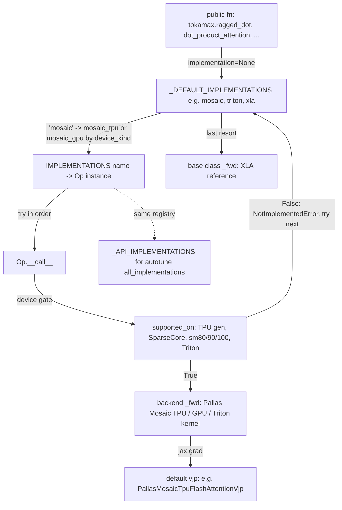

# Kernel catalog: every tokamax op and backend implementation

## Overview
Tokamax is "a library of custom accelerator kernels, supporting both NVIDIA GPUs and Google TPUs"
built on JAX and Pallas. Every kernel is packaged the same way: an op family has a base class that
subclasses [`Op`](https://github.com/openxla/tokamax/blob/3a0a3a34a5ccb8a6ac71f343d9cc44649d73db68/tokamax/_src/ops/op.py#L121 "tokamax/_src/ops/op#Op")
and carries the reference XLA math in `_fwd`, and each backend (Pallas Mosaic TPU, Pallas Mosaic
GPU, Pallas Triton, CuTe DSL, chunked XLA, `jax.nn`) is a subclass that overrides
[`_fwd`](https://github.com/openxla/tokamax/blob/3a0a3a34a5ccb8a6ac71f343d9cc44649d73db68/tokamax/_src/ops/op.py#L356 "tokamax/_src/ops/op#Op._fwd"),
declares where it runs through
[`supported_on`](https://github.com/openxla/tokamax/blob/3a0a3a34a5ccb8a6ac71f343d9cc44649d73db68/tokamax/_src/ops/op.py#L409 "tokamax/_src/ops/op#Op.supported_on"),
and usually installs a backward kernel as its default `vjp`. Each op's `api.py` builds an
`IMPLEMENTATIONS` name -> instance map (backends register only if their module imports) and a
`_DEFAULT_IMPLEMENTATIONS` tuple; with `implementation=None` the dispatcher walks that tuple and
takes the first implementation that does not raise `NotImplementedError`, so the XLA reference at
the end makes every op run everywhere. The catalog below is that registry, flattened. The
mechanism behind it is in [op-framework](op-framework.md).

## Diagram

Legend:
- `USER` - (concept) the public functional API in each op's `api.py`
- `DEF` - (concept) the per-op `_DEFAULT_IMPLEMENTATIONS` tuple
- `IMPL` - (concept) the per-op `IMPLEMENTATIONS` immutabledict
- `CALL` - [`Op`](https://github.com/openxla/tokamax/blob/3a0a3a34a5ccb8a6ac71f343d9cc44649d73db68/tokamax/_src/ops/op.py#L121 "tokamax/_src/ops/op#Op")
- `SUP` - [`supported_on`](https://github.com/openxla/tokamax/blob/3a0a3a34a5ccb8a6ac71f343d9cc44649d73db68/tokamax/_src/ops/op.py#L409 "tokamax/_src/ops/op#Op.supported_on")
- `FWD` - [`_fwd`](https://github.com/openxla/tokamax/blob/3a0a3a34a5ccb8a6ac71f343d9cc44649d73db68/tokamax/_src/ops/op.py#L356 "tokamax/_src/ops/op#Op._fwd")
- `VJP` - [`PallasMosaicTpuFlashAttentionVjp`](https://github.com/openxla/tokamax/blob/3a0a3a34a5ccb8a6ac71f343d9cc44649d73db68/tokamax/_src/ops/attention/pallas_mosaic_tpu_vjp.py#L63 "tokamax/_src/ops/attention/pallas_mosaic_tpu_vjp#PallasMosaicTpuFlashAttentionVjp")
- `REG` - [`_API_IMPLEMENTATIONS`](https://github.com/openxla/tokamax/blob/3a0a3a34a5ccb8a6ac71f343d9cc44649d73db68/tokamax/_src/autotuning/api.py#L260 "tokamax/_src/autotuning/api#_API_IMPLEMENTATIONS._API_IMPLEMENTATIONS")
- `XLA` - [`DotProductAttention`](https://github.com/openxla/tokamax/blob/3a0a3a34a5ccb8a6ac71f343d9cc44649d73db68/tokamax/_src/ops/attention/base.py#L222 "tokamax/_src/ops/attention/base#DotProductAttention") (the attention family's base class; each family has its own XLA base)

## The catalog
One row per op x backend implementation. "TPU vN+" is the `supported_on` gate
`device.platform == "tpu" and pltpu.get_tpu_info().generation >= N`; "SparseCore" additionally
requires `tpu_info.sparse_core`. GPU gates: Mosaic GPU needs compute capability 8.0+ (sm80 is
experimental and needs JAX 0.11+, otherwise 9.0+); Triton needs a GPU; CuTe DSL needs sm100. Role:
"fwd" is the forward op; "VJP" is a backward op that the forward installs as its default `vjp`;
"fwd+VJP" means the forward builds its backward from calls to itself or to a sibling kernel.

| Op (public entry) | Implementation | Backend | Hardware | Role | Purpose |
|---|---|---|---|---|---|
| `tokamax.dot_product_attention` (name `mosaic_tpu`, via `mosaic`) | [`PallasMosaicTpuFlashAttention`](https://github.com/openxla/tokamax/blob/3a0a3a34a5ccb8a6ac71f343d9cc44649d73db68/tokamax/_src/ops/attention/pallas_mosaic_tpu.py#L63 "tokamax/_src/ops/attention/pallas_mosaic_tpu#PallasMosaicTpuFlashAttention") | Mosaic TPU | TPU v5+ | fwd | "Flash attention with Mosaic TPU": tiled online-softmax attention, linear memory in sequence length. See [dot-product-attention](dot-product-attention.md). |
| `dot_product_attention` backward | [`PallasMosaicTpuFlashAttentionVjp`](https://github.com/openxla/tokamax/blob/3a0a3a34a5ccb8a6ac71f343d9cc44649d73db68/tokamax/_src/ops/attention/pallas_mosaic_tpu_vjp.py#L63 "tokamax/_src/ops/attention/pallas_mosaic_tpu_vjp#PallasMosaicTpuFlashAttentionVjp") | Mosaic TPU | TPU v5+ | VJP | "Pallas-Mosaic FlashAttention VJP implementation": dq/dk/dv kernels, its own autotunable config. |
| `dot_product_attention` (`mosaic_gpu`, via `mosaic`) | [`PallasMosaicGpuFlashAttention`](https://github.com/openxla/tokamax/blob/3a0a3a34a5ccb8a6ac71f343d9cc44649d73db68/tokamax/_src/ops/attention/pallas_mosaic_gpu.py#L57 "tokamax/_src/ops/attention/pallas_mosaic_gpu#PallasMosaicGpuFlashAttention") | Mosaic GPU sm90 / sm100 | Hopper, Blackwell | fwd | "Flash attention with Mosaic GPU"; picks an sm90 or sm100 kernel module, raises on other GPUs. |
| `dot_product_attention` backward | [`PallasMosaicGpuFlashAttentionVjp`](https://github.com/openxla/tokamax/blob/3a0a3a34a5ccb8a6ac71f343d9cc44649d73db68/tokamax/_src/ops/attention/pallas_mosaic_gpu_vjp.py#L49 "tokamax/_src/ops/attention/pallas_mosaic_gpu_vjp#PallasMosaicGpuFlashAttentionVjp") | Mosaic GPU sm90 / sm100 | Hopper, Blackwell | VJP | FlashAttention backward with per-generation kernels (the docstring says "Pallas-Triton", a copy-paste slip). |
| `dot_product_attention` (`triton`) | [`PallasTritonFlashAttention`](https://github.com/openxla/tokamax/blob/3a0a3a34a5ccb8a6ac71f343d9cc44649d73db68/tokamax/_src/ops/attention/pallas_triton.py#L543 "tokamax/_src/ops/attention/pallas_triton#PallasTritonFlashAttention") | Pallas Triton | NVIDIA GPU | fwd | "Pallas-Triton FlashAttention implementation" (block_d, split-k options). |
| `dot_product_attention` backward | [`PallasTritonFlashAttentionVjp`](https://github.com/openxla/tokamax/blob/3a0a3a34a5ccb8a6ac71f343d9cc44649d73db68/tokamax/_src/ops/attention/pallas_triton_vjp.py#L488 "tokamax/_src/ops/attention/pallas_triton_vjp#PallasTritonFlashAttentionVjp") | Pallas Triton | NVIDIA GPU | VJP | "Pallas-Triton FlashAttention VJP implementation". |
| `dot_product_attention` (`xla_chunked`) | [`XlaChunkedDotProductAttention`](https://github.com/openxla/tokamax/blob/3a0a3a34a5ccb8a6ac71f343d9cc44649d73db68/tokamax/_src/ops/attention/xla_chunked.py#L314 "tokamax/_src/ops/attention/xla_chunked#XlaChunkedDotProductAttention") | XLA chunked | any | fwd (XLA autodiff) | "XLA chunked dot product attention function": `lax.scan` over query/kv chunks (arXiv 2112.05682), registered with chunk size (512, 1024); linear memory, usually slower than `xla`. |
| `dot_product_attention` (`cudnn`) | [`JaxNnDotProductAttention`](https://github.com/openxla/tokamax/blob/3a0a3a34a5ccb8a6ac71f343d9cc44649d73db68/tokamax/_src/ops/attention/jax_nn.py#L39 "tokamax/_src/ops/attention/jax_nn#JaxNnDotProductAttention") | jax.nn (cuDNN or XLA) | GPU when `implementation="cudnn"` | fwd | "`jax.nn.dot_product_attention` implementation"; registered as `cudnn`, so it is GPU-only in the dispatcher. |
| `dot_product_attention` (`xla`) | [`DotProductAttention`](https://github.com/openxla/tokamax/blob/3a0a3a34a5ccb8a6ac71f343d9cc44649d73db68/tokamax/_src/ops/attention/base.py#L222 "tokamax/_src/ops/attention/base#DotProductAttention") | XLA reference | any | fwd (XLA autodiff) | "Dot product attention function": materializes logits, memory quadratic in sequence length. Masks are a [`Mask`](https://github.com/openxla/tokamax/blob/3a0a3a34a5ccb8a6ac71f343d9cc44649d73db68/tokamax/_src/ops/attention/base.py#L60 "tokamax/_src/ops/attention/base#Mask"). |
| FlexAttention adapter (not in the `dot_product_attention` registry) | [`WrappedFlexAttention`](https://github.com/openxla/tokamax/blob/3a0a3a34a5ccb8a6ac71f343d9cc44649d73db68/tokamax/_src/ops/flex_attention/wrapper.py#L38 "tokamax/_src/ops/flex_attention/wrapper#WrappedFlexAttention") | XLA (wraps a FlexAttention) | any | fwd | "`DotProductAttention` implementation wrapping a `FlexAttention`"; no paged attention. FlexAttention itself registers only `xla`. |
| splash attention (`mosaic_tpu`) | [`PallasMosaicTpuSplashAttention`](https://github.com/openxla/tokamax/blob/3a0a3a34a5ccb8a6ac71f343d9cc44649d73db68/tokamax/_src/ops/experimental/tpu/splash_attention/pallas_mosaic_tpu.py#L73 "tokamax/_src/ops/experimental/tpu/splash_attention/pallas_mosaic_tpu#PallasMosaicTpuSplashAttention") | Mosaic TPU | TPU v5+ | fwd | "Tokamax operator wrapper for Splash Attention Pallas TPU kernel": block-sparse attention for structured masks (causal, local, segment ids, sinks, MQA). See [splash-attention](splash-attention.md). |
| splash attention backward | [`PallasMosaicTpuSplashAttentionVjp`](https://github.com/openxla/tokamax/blob/3a0a3a34a5ccb8a6ac71f343d9cc44649d73db68/tokamax/_src/ops/experimental/tpu/splash_attention/pallas_mosaic_tpu_vjp.py#L57 "tokamax/_src/ops/experimental/tpu/splash_attention/pallas_mosaic_tpu_vjp#PallasMosaicTpuSplashAttentionVjp") | Mosaic TPU | TPU v5+ | VJP | "Pallas-Mosaic SplashAttention VJP implementation". |
| `tokamax.ragged_dot` / `ragged_dot_general` (`mosaic_tpu`, via `mosaic`) | [`PallasMosaicTpuRaggedDot`](https://github.com/openxla/tokamax/blob/3a0a3a34a5ccb8a6ac71f343d9cc44649d73db68/tokamax/_src/ops/ragged_dot/pallas_mosaic_tpu.py#L90 "tokamax/_src/ops/ragged_dot/pallas_mosaic_tpu#PallasMosaicTpuRaggedDot") | Mosaic TPU (GMM v1) | TPU v5+ | fwd+VJP | "Pallas-Mosaic-TPU ragged dot implementation": grouped matmul for MoE; backward reuses itself for dlhs and drhs. See [ragged-dot-gmm](ragged-dot-gmm.md). |
| `ragged_dot` (`mosaic_tpu_v2`, explicit only) | [`PallasMosaicTpuV2RaggedDot`](https://github.com/openxla/tokamax/blob/3a0a3a34a5ccb8a6ac71f343d9cc44649d73db68/tokamax/_src/ops/ragged_dot/pallas_mosaic_tpu_v2.py#L78 "tokamax/_src/ops/ragged_dot/pallas_mosaic_tpu_v2#PallasMosaicTpuV2RaggedDot") | Mosaic TPU (GMM v2) | TPU v5+ | fwd+VJP | "functionally equivalent to v1, but offers improved performance": dynamic DMA, heuristic tile search, fusions (`zero_initialize`, `fuse_gateup_activation`). Its [`_fwd`](https://github.com/openxla/tokamax/blob/3a0a3a34a5ccb8a6ac71f343d9cc44649d73db68/tokamax/_src/ops/ragged_dot/pallas_mosaic_tpu_v2.py#L152 "tokamax/_src/ops/ragged_dot/pallas_mosaic_tpu_v2#PallasMosaicTpuV2RaggedDot._fwd") calls the two kernels below. |
| (GMM v2 forward / dlhs kernel) | [`gmm_v2`](https://github.com/openxla/tokamax/blob/3a0a3a34a5ccb8a6ac71f343d9cc44649d73db68/tokamax/_src/ops/experimental/gmm_v2/gmm_v2.py#L1537 "tokamax/_src/ops/experimental/gmm_v2/gmm_v2#gmm_v2") | Mosaic TPU kernel function | TPU | kernel | "GMM kernel implemented with emit_pipeline", tiles from [`calculate_tiling`](https://github.com/openxla/tokamax/blob/3a0a3a34a5ccb8a6ac71f343d9cc44649d73db68/tokamax/_src/ops/experimental/gmm_v2/gmm_v2.py#L1077 "tokamax/_src/ops/experimental/gmm_v2/gmm_v2#calculate_tiling"). See [gmm-v2](gmm-v2.md). |
| (GMM v2 drhs kernel) | [`tgmm_v2`](https://github.com/openxla/tokamax/blob/3a0a3a34a5ccb8a6ac71f343d9cc44649d73db68/tokamax/_src/ops/experimental/gmm_v2/tgmm_v2.py#L688 "tokamax/_src/ops/experimental/gmm_v2/tgmm_v2#tgmm_v2") | Mosaic TPU kernel function | TPU | kernel (VJP path) | "Computes a transposed grouped matrix multiplication": the weight gradient, per local expert group. |
| `ragged_dot` (`mosaic_gpu`, via `mosaic`) | [`PallasMosaicGpuRaggedDot`](https://github.com/openxla/tokamax/blob/3a0a3a34a5ccb8a6ac71f343d9cc44649d73db68/tokamax/_src/ops/ragged_dot/pallas_mosaic_gpu.py#L85 "tokamax/_src/ops/ragged_dot/pallas_mosaic_gpu#PallasMosaicGpuRaggedDot") | Mosaic GPU sm80 / sm90 / sm100 | Ampere+ | fwd+VJP | "Pallas-Mosaic-GPU ragged dot implementation", with sm90/sm100 quantized (fp8, int8) kernel variants. |
| `ragged_dot` (`triton`) | [`TritonRaggedDot`](https://github.com/openxla/tokamax/blob/3a0a3a34a5ccb8a6ac71f343d9cc44649d73db68/tokamax/_src/ops/ragged_dot/triton.py#L508 "tokamax/_src/ops/ragged_dot/triton#TritonRaggedDot") | Triton | NVIDIA GPU | fwd+VJP | "Triton ragged dot implementation" (no fp8 e4m3 on sm80). |
| ragged gather (`mosaic_tpu`) | [`PallasTpuRaggedGather`](https://github.com/openxla/tokamax/blob/3a0a3a34a5ccb8a6ac71f343d9cc44649d73db68/tokamax/_src/ops/ragged_gather/pallas_mosaic_tpu.py#L27 "tokamax/_src/ops/ragged_gather/pallas_mosaic_tpu#PallasTpuRaggedGather") | Mosaic TPU | TPU v5+ | fwd | "Tokamax operator invoking the Pallas kernel for Ragged Gather": gathers rows `x[indices]` inside a `[start, end)` window (MoE token dispatch). A v2 kernel (`mosaic_tpu_v2`) sits ahead of it in the default order. |
| ragged gather reduce (`mosaic_tpu`) | [`PallasTpuRaggedGatherReduce`](https://github.com/openxla/tokamax/blob/3a0a3a34a5ccb8a6ac71f343d9cc44649d73db68/tokamax/_src/ops/ragged_gather_reduce/pallas_mosaic_tpu.py#L27 "tokamax/_src/ops/ragged_gather_reduce/pallas_mosaic_tpu#PallasTpuRaggedGatherReduce") | Mosaic TPU (SparseCore) | TPU v5+ with SparseCore | fwd | "Tokamax operator invoking the Pallas kernel for Ragged Gather Reduce": gather rows, weight by top-k weights, sum each `reduce_group_size` group (MoE combine). See [ragged-gather-reduce](ragged-gather-reduce.md). |
| ragged scatter (`mosaic_tpu`) | [`PallasTpuRaggedScatter`](https://github.com/openxla/tokamax/blob/3a0a3a34a5ccb8a6ac71f343d9cc44649d73db68/tokamax/_src/ops/ragged_scatter/pallas_mosaic_tpu.py#L30 "tokamax/_src/ops/ragged_scatter/pallas_mosaic_tpu#PallasTpuRaggedScatter") | Mosaic TPU (SparseCore) | TPU v5+ with SparseCore | fwd | "Pallas Sparse Core implementation of Ragged Scatter on TPU"; heuristic config from shapes. |
| `tokamax.linear_softmax_cross_entropy_loss` (`mosaic_tpu`) | [`PallasMosaicTpuLinearSoftmaxCrossEntropyLoss`](https://github.com/openxla/tokamax/blob/3a0a3a34a5ccb8a6ac71f343d9cc44649d73db68/tokamax/_src/ops/linear_softmax_cross_entropy_loss/pallas_mosaic_tpu.py#L37 "tokamax/_src/ops/linear_softmax_cross_entropy_loss/pallas_mosaic_tpu#PallasMosaicTpuLinearSoftmaxCrossEntropyLoss") | Mosaic TPU | TPU v5+ | fwd | Fused final projection + softmax cross-entropy that never materializes the full `[B, V]` logits (arXiv 2410.10989). See [linear-softmax-cross-entropy](linear-softmax-cross-entropy.md). |
| LSCE backward | [`PallasMosaicTpuLinearSoftmaxCrossEntropyLossVjp`](https://github.com/openxla/tokamax/blob/3a0a3a34a5ccb8a6ac71f343d9cc44649d73db68/tokamax/_src/ops/linear_softmax_cross_entropy_loss/pallas_mosaic_tpu.py#L144 "tokamax/_src/ops/linear_softmax_cross_entropy_loss/pallas_mosaic_tpu#PallasMosaicTpuLinearSoftmaxCrossEntropyLossVjp") | Mosaic TPU | TPU v5+ | VJP | "Pallas TPU implementation of Linear Softmax Cross-Entropy Loss VJP" (dx, dw). |
| LSCE from PyTorch | [`PallasMosaicTpuLinearSoftmaxCrossEntropyLoss`](https://github.com/openxla/tokamax/blob/3a0a3a34a5ccb8a6ac71f343d9cc44649d73db68/tokamax/experimental/torch_tpu/ops/linear_softmax_cross_entropy/torch_pallas_mosaic_tpu.py#L205 "tokamax/experimental/torch_tpu/ops/linear_softmax_cross_entropy/torch_pallas_mosaic_tpu#PallasMosaicTpuLinearSoftmaxCrossEntropyLoss") | Mosaic TPU via torch_tpu | TPU | fwd+VJP | Module-level singleton torch op wrapping the same kernels (forward and backward configs), usable under `torch.compile`. See [torch-tpu-bridge](torch-tpu-bridge.md). |
| LSCE (`chunked_xla`, explicit only) | [`ChunkedXlaLinearSoftmaxCrossEntropyLoss`](https://github.com/openxla/tokamax/blob/3a0a3a34a5ccb8a6ac71f343d9cc44649d73db68/tokamax/_src/ops/linear_softmax_cross_entropy_loss/chunked_xla.py#L306 "tokamax/_src/ops/linear_softmax_cross_entropy_loss/chunked_xla#ChunkedXlaLinearSoftmaxCrossEntropyLoss") | XLA chunked | any | fwd | "Linear Softmax Cross-Entropy Loss Op API using chunked XLA backward": B and V blocked, memory efficient without Pallas. |
| LSCE chunked backward | [`ChunkedXlaLinearSoftmaxCrossEntropyLossVjp`](https://github.com/openxla/tokamax/blob/3a0a3a34a5ccb8a6ac71f343d9cc44649d73db68/tokamax/_src/ops/linear_softmax_cross_entropy_loss/chunked_xla.py#L345 "tokamax/_src/ops/linear_softmax_cross_entropy_loss/chunked_xla#ChunkedXlaLinearSoftmaxCrossEntropyLossVjp") | XLA chunked | any | VJP | "Linear Softmax Cross-Entropy Loss chunked XLA VJP wrapper"; always installed (it overrides any `vjp` passed in). |
| causal conv1d + gated delta rule (`mosaic_tpu`) | [`PallasMosaicTpuCausalConv1dGatedDeltaRule`](https://github.com/openxla/tokamax/blob/3a0a3a34a5ccb8a6ac71f343d9cc44649d73db68/tokamax/_src/ops/causal_conv1d_gated_delta_rule/pallas_mosaic_tpu.py#L43 "tokamax/_src/ops/causal_conv1d_gated_delta_rule/pallas_mosaic_tpu#PallasMosaicTpuCausalConv1dGatedDeltaRule") | Mosaic TPU | TPU v6+ | fwd | Fused causal conv1d + gated delta net (GDN) linear-attention recurrence; tile sizes default to a VMEM heuristic. See [gated-delta-rule](gated-delta-rule.md). |
| batched ragged paged attention (`mosaic_tpu`) | [`PallasTpuBatchedRpa`](https://github.com/openxla/tokamax/blob/3a0a3a34a5ccb8a6ac71f343d9cc44649d73db68/tokamax/_src/ops/experimental/batched_rpa/pallas_mosaic_tpu.py#L55 "tokamax/_src/ops/experimental/batched_rpa/pallas_mosaic_tpu#PallasTpuBatchedRpa") | Mosaic TPU | TPU v5+ | fwd | "Batched Ragged Paged Attention on TPU": serving attention over a paged KV cache with mixed prefill/decode. See [batched-ragged-paged-attention](batched-ragged-paged-attention.md). |
| fused MoE (op class only) | [`PallasMosaicTpuFusedMoe`](https://github.com/openxla/tokamax/blob/3a0a3a34a5ccb8a6ac71f343d9cc44649d73db68/tokamax/_src/ops/experimental/fused_moe/pallas_mosaic_tpu.py#L41 "tokamax/_src/ops/experimental/fused_moe/pallas_mosaic_tpu#PallasMosaicTpuFusedMoe") | Mosaic TPU | TPU v5+ | fwd | "custom Pallas Mosaic TPU Fused MoE kernel": routing (top-k gating), both expert matmuls and combine in one op, expert-parallel over a mesh. See [fused-moe](fused-moe.md). |
| Kimi delta attention (`mosaic_tpu`, via `mosaic`) | [`PallasMosaicTpuKimiDeltaAttention`](https://github.com/openxla/tokamax/blob/3a0a3a34a5ccb8a6ac71f343d9cc44649d73db68/tokamax/_src/ops/experimental/kda/pallas_mosaic_tpu.py#L192 "tokamax/_src/ops/experimental/kda/pallas_mosaic_tpu#PallasMosaicTpuKimiDeltaAttention") | Mosaic TPU | TPU v6+ | fwd | "Pallas/Mosaic TPU KDA backend": chunked recurrent linear attention, head-first `[H, B, T, D]`, chunk size 64. See [kimi-delta-attention](kimi-delta-attention.md). |
| KDA backward | [`PallasMosaicTpuKimiDeltaAttentionVjp`](https://github.com/openxla/tokamax/blob/3a0a3a34a5ccb8a6ac71f343d9cc44649d73db68/tokamax/_src/ops/experimental/kda/pallas_mosaic_tpu.py#L468 "tokamax/_src/ops/experimental/kda/pallas_mosaic_tpu#PallasMosaicTpuKimiDeltaAttentionVjp") | Mosaic TPU | TPU v6+ | VJP | "Tokamax Op VJP wrapper for the Pallas/Mosaic TPU KDA backward path". |
| KDA (`xla_chunked`, explicit only) | [`XlaChunkedKimiDeltaAttention`](https://github.com/openxla/tokamax/blob/3a0a3a34a5ccb8a6ac71f343d9cc44649d73db68/tokamax/_src/ops/experimental/kda/xla_chunked.py#L92 "tokamax/_src/ops/experimental/kda/xla_chunked#XlaChunkedKimiDeltaAttention") | XLA chunked | any | fwd | "Pure-JAX chunked KDA backend lowered by XLA on the active device". |
| KDA chunked backward | [`XlaChunkedKimiDeltaAttentionVjp`](https://github.com/openxla/tokamax/blob/3a0a3a34a5ccb8a6ac71f343d9cc44649d73db68/tokamax/_src/ops/experimental/kda/xla_chunked.py#L174 "tokamax/_src/ops/experimental/kda/xla_chunked#XlaChunkedKimiDeltaAttentionVjp") | XLA chunked | any | VJP | "VJP adapter that lowers the pure-JAX chunked backward separately". |
| multi-head latent attention (`mosaic_tpu`) | [`PallasTpuMultiHeadLatentAttention`](https://github.com/openxla/tokamax/blob/3a0a3a34a5ccb8a6ac71f343d9cc44649d73db68/tokamax/_src/ops/experimental/mla/pallas_mosaic_tpu.py#L41 "tokamax/_src/ops/experimental/mla/pallas_mosaic_tpu#PallasTpuMultiHeadLatentAttention") | Mosaic TPU | TPU v7+ | fwd | "invokes the Pallas kernel for Multi-Head Latent Attention". See [multi-head-latent-attention](multi-head-latent-attention.md). |
| top-k (`mosaic_tpu`) | [`PallasTpuTopK`](https://github.com/openxla/tokamax/blob/3a0a3a34a5ccb8a6ac71f343d9cc44649d73db68/tokamax/_src/ops/experimental/tpu/topk/pallas_mosaic_tpu.py#L41 "tokamax/_src/ops/experimental/tpu/topk/pallas_mosaic_tpu#PallasTpuTopK") | Mosaic TPU | TPU v6+ | fwd | "Pallas Mosaic TPU TopK kernel", `jax.lax.top_k` API plus optional carried `values` and `is_stable`. See [tpu-topk](tpu-topk.md). |
| `tokamax.layer_norm` (`triton`) | [`PallasTritonNormalization`](https://github.com/openxla/tokamax/blob/3a0a3a34a5ccb8a6ac71f343d9cc44649d73db68/tokamax/_src/ops/normalization/pallas_triton.py#L83 "tokamax/_src/ops/normalization/pallas_triton#PallasTritonNormalization") | Pallas Triton | NVIDIA GPU | fwd | "Pallas-Triton normalization op": LayerNorm and RMSNorm (`subtract_mean=False`). |
| `layer_norm` backward | [`PallasTritonNormalizationVjp`](https://github.com/openxla/tokamax/blob/3a0a3a34a5ccb8a6ac71f343d9cc44649d73db68/tokamax/_src/ops/normalization/pallas_triton_vjp.py#L81 "tokamax/_src/ops/normalization/pallas_triton_vjp#PallasTritonNormalizationVjp") | Pallas Triton | NVIDIA GPU | VJP | "Pallas-Triton normalization VJP". |
| `tokamax.gated_linear_unit` (`mosaic`) | [`PallasMosaicGpuGatedLinearUnit`](https://github.com/openxla/tokamax/blob/3a0a3a34a5ccb8a6ac71f343d9cc44649d73db68/tokamax/_src/ops/gated_linear_unit/pallas_mosaic_gpu.py#L57 "tokamax/_src/ops/gated_linear_unit/pallas_mosaic_gpu#PallasMosaicGpuGatedLinearUnit") | Mosaic GPU sm80 / sm90 / sm100 | Ampere (JAX 0.11+), Hopper, Blackwell | fwd | "Pallas-Mosaic-GPU gated linear unit": fused `x @ W` with gating (SwiGLU etc). |
| `gated_linear_unit` (`triton`) | [`TritonGatedLinearUnit`](https://github.com/openxla/tokamax/blob/3a0a3a34a5ccb8a6ac71f343d9cc44649d73db68/tokamax/_src/ops/gated_linear_unit/triton.py#L148 "tokamax/_src/ops/gated_linear_unit/triton#TritonGatedLinearUnit") | Triton | NVIDIA GPU | fwd | "Triton gated linear unit". |
| `gated_linear_unit` (`cutedsl`, explicit only) | [`CuteDslGatedLinearUnit`](https://github.com/openxla/tokamax/blob/3a0a3a34a5ccb8a6ac71f343d9cc44649d73db68/tokamax/_src/ops/gated_linear_unit/cutedsl.py#L55 "tokamax/_src/ops/gated_linear_unit/cutedsl#CuteDslGatedLinearUnit") | CuTe DSL (cuDNN `gemm_swiglu`) | Blackwell sm100 | fwd | "CuTeDSL SM100 Gated Linear Unit". |
| `tokamax.triangle_multiplication` (`xla` only) | [`TriangleMultiplication`](https://github.com/openxla/tokamax/blob/3a0a3a34a5ccb8a6ac71f343d9cc44649d73db68/tokamax/_src/ops/triangle_multiplication/base.py#L35 "tokamax/_src/ops/triangle_multiplication/base#TriangleMultiplication") | XLA reference | any | fwd (XLA autodiff) | "Triangle multiplicative update" (AlphaFold Supplementary Algorithms 11 and 12), composed of two tokamax `layer_norm` calls, a sigmoid `gated_linear_unit` and einsums; the `implementation` argument is forwarded to those sub-ops. |

The three GLU kernels get a backward from the family base class, which installs an XLA-autodiff
VJP of the reference GLU on every non-base subclass; that VJP class is not in this page's
grounding index.

## Default dispatch order per op
What `implementation=None` tries, in order, when every backend module imports (the order is built
by prepending at import time, so the last `try` block to succeed ends up first):

| Public function | Registered names | Default order | On TPU, what actually runs |
|---|---|---|---|
| `dot_product_attention` | `mosaic_tpu`, `mosaic_gpu`, `triton`, `cudnn`, `xla`, `xla_chunked` | `mosaic`, `triton`, `xla` | `mosaic` resolves to `mosaic_tpu` (any device_kind without "NVIDIA"); on v5+ the Mosaic TPU flash kernel, else Triton raises and XLA runs |
| `ragged_dot`, `ragged_dot_general` | `mosaic_tpu`, `mosaic_tpu_v2`, `mosaic_gpu`, `triton`, `xla` | `mosaic`, `triton`, `xla` | `mosaic` -> GMM v1 (`mosaic_tpu`). GMM v2 runs only with `implementation="mosaic_tpu_v2"` |
| ragged gather | `mosaic_tpu`, `mosaic_tpu_v2`, `xla` | `mosaic_tpu_v2`, `mosaic_tpu`, `xla` | v2 kernel first; `mosaic` also means v2 when present |
| ragged gather reduce | `mosaic_tpu`, `xla` | `mosaic_tpu`, `xla` | SparseCore kernel when the chip has SparseCore, else XLA |
| ragged scatter | `mosaic_tpu`, `xla` | `mosaic_tpu`, `xla` | same SparseCore gate |
| `linear_softmax_cross_entropy_loss` | `mosaic_tpu`, `xla`, `chunked_xla` | `mosaic_tpu`, `xla` | Mosaic TPU kernel on v5+; an explicit name is a single string with no fallback |
| splash attention | `mosaic_tpu`, `base` | `mosaic_tpu`, `base` | Splash kernel on v5+ |
| top-k | `mosaic_tpu`, `xla` | `mosaic_tpu`, `xla` | Pallas top-k on v6+, else `jax.lax.top_k` path |
| Kimi delta attention | `mosaic_tpu`, `xla`, `xla_chunked` | `mosaic`, `xla` (only `xla` if the TPU module did not import) | Mosaic TPU on v6+; `xla` is the dense recurrence reference |
| batched ragged paged attention | `mosaic_tpu`, `reference` | `mosaic_tpu` if registered, else `reference` (no try-next loop) | Mosaic TPU |
| causal conv1d gated delta rule, MLA | `mosaic_tpu`, `xla` | no functional dispatcher; callers pick from `IMPLEMENTATIONS` or use the op class | Mosaic TPU (v6+ and v7+ respectively) |
| fused MoE | none (no `api.py`) | call the op class directly | Mosaic TPU |
| `layer_norm` | `triton`, `xla` | `triton`, `xla` | Triton is skipped with a recorded error, XLA runs |
| `gated_linear_unit` | `mosaic`, `triton`, `cutedsl`, `xla` | `mosaic`, `triton`, `xla` | Mosaic GPU and Triton fail `supported_on`, XLA runs |
| `triangle_multiplication` | `xla` | `xla` | always the XLA op; its inner `layer_norm` / GLU calls also resolve to XLA |

**Ops with no TPU kernel:** `layer_norm` (normalization), `gated_linear_unit`, and
`triangle_multiplication` - on TPU all three run the XLA reference in their base class. FlexAttention
is XLA-only everywhere. The README status lists attention, GLU and layer norm as GPU kernels,
`ragged_dot` as GPU and TPU, and `linear_softmax_cross_entropy_loss` as TPU; the experimental TPU
ops (splash, top-k, KDA, GDN, MLA, batched RPA, fused MoE, ragged gather/scatter) are not in that
list yet.

## Design rationale
- **Registration by import, selection by exception.** Every backend lives behind `try: import ...
  except ImportError: pass`, so a TPU-only install simply lacks the GPU entries and vice versa.
  Device fitness is not checked by the dispatcher; it is checked inside
  [`Op`](https://github.com/openxla/tokamax/blob/3a0a3a34a5ccb8a6ac71f343d9cc44649d73db68/tokamax/_src/ops/op.py#L121 "tokamax/_src/ops/op#Op")`.__call__`
  through [`supported_on`](https://github.com/openxla/tokamax/blob/3a0a3a34a5ccb8a6ac71f343d9cc44649d73db68/tokamax/_src/ops/op.py#L409 "tokamax/_src/ops/op#Op.supported_on"),
  which raises `NotImplementedError`, the same exception a kernel raises for an unsupported dtype or
  shape. One exception type covers "wrong chip" and "unsupported input", and the dispatcher's only
  job is to try the next name. The README's promise follows: `implementation=None` "will also always
  be supported, as it can fall back to an XLA implementation".
- **One `mosaic` name, two hardware families.** Users write `implementation="mosaic"` and the
  dispatcher maps it to `mosaic_gpu` when the default device kind contains "NVIDIA", otherwise
  `mosaic_tpu`, so the same model code picks the Pallas Mosaic backend on either platform.
- **The backward kernel is part of the implementation.** Mosaic TPU flash attention, splash, LSCE
  and KDA each set a dedicated VJP op in `__post_init__`; GMM v1 and v2 build their VJP from calls to
  themselves (v2 routes the weight gradient to
  [`tgmm_v2`](https://github.com/openxla/tokamax/blob/3a0a3a34a5ccb8a6ac71f343d9cc44649d73db68/tokamax/_src/ops/experimental/gmm_v2/tgmm_v2.py#L688 "tokamax/_src/ops/experimental/gmm_v2/tgmm_v2#tgmm_v2")).
  Choosing a forward therefore also chooses a backward, and the VJP being a separate `Op` means it is
  autotuned on its own.
- **Hardware gates encode real capability, not taste.** The SparseCore gate on gather-reduce and
  scatter, v6+ on top-k, GDN and KDA, and v7+ on MLA, reflect what each kernel's lowering assumes.
  Dispatch silently falls through on older chips; an explicit single implementation raises instead.

> [!inferred]
> GMM v2 is kept out of the `mosaic` alias even though its docstring calls it faster, presumably
> so the default stays on the longer-lived v1 path while v2 lives under `experimental/`; the README
> uses `implementation="mosaic_tpu_v2"` as its cross-compilation example, which fits v2 being opt-in.

## Entry points
- [`DotProductAttention`](https://github.com/openxla/tokamax/blob/3a0a3a34a5ccb8a6ac71f343d9cc44649d73db68/tokamax/_src/ops/attention/base.py#L222 "tokamax/_src/ops/attention/base#DotProductAttention")
  and its subclasses ([`PallasMosaicTpuFlashAttention`](https://github.com/openxla/tokamax/blob/3a0a3a34a5ccb8a6ac71f343d9cc44649d73db68/tokamax/_src/ops/attention/pallas_mosaic_tpu.py#L63 "tokamax/_src/ops/attention/pallas_mosaic_tpu#PallasMosaicTpuFlashAttention") and the rest): reached from `tokamax.dot_product_attention`, which builds a `Mask` from `is_causal`, sequence lengths and `local_window_size` and then walks the default order.
- [`PallasMosaicTpuRaggedDot`](https://github.com/openxla/tokamax/blob/3a0a3a34a5ccb8a6ac71f343d9cc44649d73db68/tokamax/_src/ops/ragged_dot/pallas_mosaic_tpu.py#L90 "tokamax/_src/ops/ragged_dot/pallas_mosaic_tpu#PallasMosaicTpuRaggedDot") /
  [`PallasMosaicTpuV2RaggedDot`](https://github.com/openxla/tokamax/blob/3a0a3a34a5ccb8a6ac71f343d9cc44649d73db68/tokamax/_src/ops/ragged_dot/pallas_mosaic_tpu_v2.py#L78 "tokamax/_src/ops/ragged_dot/pallas_mosaic_tpu_v2#PallasMosaicTpuV2RaggedDot"):
  reached from `tokamax.ragged_dot` / `ragged_dot_general`, which also decides whether to bypass the device check (explicit implementation = bypass, for CPU-host export).
- Any implementation instance can be called directly (it is an `Op`); this is how fused MoE, GDN and
  MLA are used, and how tests pin a backend, e.g. [`_call_attention`](https://github.com/openxla/tokamax/blob/3a0a3a34a5ccb8a6ac71f343d9cc44649d73db68/tokamax/_src/ops/experimental/kda/pallas_mosaic_tpu_kernel_test.py#L1005 "tokamax/_src/ops/experimental/kda/pallas_mosaic_tpu_kernel_test#_call_attention") for KDA.
- [`_API_IMPLEMENTATIONS`](https://github.com/openxla/tokamax/blob/3a0a3a34a5ccb8a6ac71f343d9cc44649d73db68/tokamax/_src/autotuning/api.py#L260 "tokamax/_src/autotuning/api#_API_IMPLEMENTATIONS._API_IMPLEMENTATIONS"):
  maps each op family base class to its `IMPLEMENTATIONS` dict, so `tokamax.autotune(...,
  all_implementations=True)` can tune every backend that passes `supported_on` on the current device
  (see [autotuning](autotuning.md)).

## Mechanism (step-by-step)
1. **Import builds the registry.** Each `api.py` starts with the XLA reference (the family base
   class, e.g. [`DotProductAttention`](https://github.com/openxla/tokamax/blob/3a0a3a34a5ccb8a6ac71f343d9cc44649d73db68/tokamax/_src/ops/attention/base.py#L222 "tokamax/_src/ops/attention/base#DotProductAttention")
   for `xla`), then attempts each backend import and prepends its name to the default tuple. For
   attention the Triton block runs before the Mosaic GPU and TPU blocks, so the final order is
   `mosaic, triton, xla`; the TPU block prepends `mosaic` only if the GPU block has not already.
2. **The public function normalizes `implementation`.** `None` becomes the default tuple, a string
   becomes a 1-tuple, an empty sequence is a `ValueError`. Strings are resolved through
   `IMPLEMENTATIONS` (an unknown name is a `ValueError`, not a fallback); callables and
   [`Op`](https://github.com/openxla/tokamax/blob/3a0a3a34a5ccb8a6ac71f343d9cc44649d73db68/tokamax/_src/ops/op.py#L121 "tokamax/_src/ops/op#Op")
   instances pass straight through.
3. **Each candidate is called as an `Op`.**
   [`bind`](https://github.com/openxla/tokamax/blob/3a0a3a34a5ccb8a6ac71f343d9cc44649d73db68/tokamax/_src/ops/op.py#L317 "tokamax/_src/ops/op#Op.bind")
   canonicalizes the arguments into
   [`BoundArguments`](https://github.com/openxla/tokamax/blob/3a0a3a34a5ccb8a6ac71f343d9cc44649d73db68/tokamax/_src/ops/op.py#L437 "tokamax/_src/ops/op#BoundArguments"),
   then `supported_on` is checked for every device the input arrays live on, then a config is
   chosen and the backend `_fwd` lowers the Pallas kernel. Any `NotImplementedError` along the way is
   collected; with a single requested implementation it propagates, with several the next is tried,
   and if all fail the caller gets an `ExceptionGroup("all implementations failed", ...)`.
4. **Gradients go to the paired VJP.** Under `jax.grad`, the forward's `vjp` (for example
   [`PallasMosaicTpuSplashAttentionVjp`](https://github.com/openxla/tokamax/blob/3a0a3a34a5ccb8a6ac71f343d9cc44649d73db68/tokamax/_src/ops/experimental/tpu/splash_attention/pallas_mosaic_tpu_vjp.py#L57 "tokamax/_src/ops/experimental/tpu/splash_attention/pallas_mosaic_tpu_vjp#PallasMosaicTpuSplashAttentionVjp"))
   receives the residuals, output, output gradient and original arguments. Inference-only ops
   (batched RPA, fused MoE, MLA, top-k, gather/scatter, GDN) set no VJP; differentiating them falls
   back to autodiff of `_fwd`, which for a Pallas kernel generally fails and reports "vjp not
   implemented" only when the gradient is actually requested.

## Key data structures
- `IMPLEMENTATIONS` (per op, an `immutabledict` name -> callable) and `_DEFAULT_IMPLEMENTATIONS`
  (per op, a tuple of names). They are the whole selection policy; there is no global registry
  other than [`_API_IMPLEMENTATIONS`](https://github.com/openxla/tokamax/blob/3a0a3a34a5ccb8a6ac71f343d9cc44649d73db68/tokamax/_src/autotuning/api.py#L260 "tokamax/_src/autotuning/api#_API_IMPLEMENTATIONS._API_IMPLEMENTATIONS"), which reuses them.
- Implementation instances are frozen dataclasses: the registered instance has `config=None` (pick
  per call), and fields such as `chunk_size` on
  [`XlaChunkedDotProductAttention`](https://github.com/openxla/tokamax/blob/3a0a3a34a5ccb8a6ac71f343d9cc44649d73db68/tokamax/_src/ops/attention/xla_chunked.py#L314 "tokamax/_src/ops/attention/xla_chunked#XlaChunkedDotProductAttention")
  or `qdtype` on the GMM ops are part of the op's identity (and of its autotuning cache key).
- GMM v2's static tiling state (`GmmConfigs` with [`tiles`](https://github.com/openxla/tokamax/blob/3a0a3a34a5ccb8a6ac71f343d9cc44649d73db68/tokamax/_src/ops/experimental/gmm_v2/gmm_v2.py#L329 "tokamax/_src/ops/experimental/gmm_v2/gmm_v2#GmmConfigs.tiles") and [`dims`](https://github.com/openxla/tokamax/blob/3a0a3a34a5ccb8a6ac71f343d9cc44649d73db68/tokamax/_src/ops/experimental/gmm_v2/gmm_v2.py#L330 "tokamax/_src/ops/experimental/gmm_v2/gmm_v2#GmmConfigs.dims"), filled by [`make_gmm_configs`](https://github.com/openxla/tokamax/blob/3a0a3a34a5ccb8a6ac71f343d9cc44649d73db68/tokamax/_src/ops/experimental/gmm_v2/gmm_v2.py#L1383 "tokamax/_src/ops/experimental/gmm_v2/gmm_v2#make_gmm_configs") / [`make_tgmm_configs`](https://github.com/openxla/tokamax/blob/3a0a3a34a5ccb8a6ac71f343d9cc44649d73db68/tokamax/_src/ops/experimental/gmm_v2/tgmm_v2.py#L193 "tokamax/_src/ops/experimental/gmm_v2/tgmm_v2#make_tgmm_configs"), BlockSpecs from [`generate_block_specs`](https://github.com/openxla/tokamax/blob/3a0a3a34a5ccb8a6ac71f343d9cc44649d73db68/tokamax/_src/ops/experimental/gmm_v2/gmm_v2.py#L420 "tokamax/_src/ops/experimental/gmm_v2/gmm_v2#generate_block_specs"), body in [`kernel_main`](https://github.com/openxla/tokamax/blob/3a0a3a34a5ccb8a6ac71f343d9cc44649d73db68/tokamax/_src/ops/experimental/gmm_v2/gmm_v2.py#L971 "tokamax/_src/ops/experimental/gmm_v2/gmm_v2#kernel_main")) is detailed in [gmm-v2](gmm-v2.md).

## Dynamics (design intent)
- Dispatch happens at trace time, once per traced call site; the chosen kernel is baked into the
  jaxpr. `jax.jit` retraces (and may re-dispatch) on new shapes.
- The README notes that with `implementation=None` tokamax "is even allowed to choose different
  implementations for the forward pass and gradient"; in this snapshot the pairing is fixed by each
  forward's `vjp`, but each VJP op picks its own config independently.
- Argument checks run in [`jaxtyped`](https://github.com/openxla/tokamax/blob/3a0a3a34a5ccb8a6ac71f343d9cc44649d73db68/tokamax/_src/jaxtyping.py#L35 "tokamax/_src/jaxtyping#jaxtyped")-decorated `_fwd`s, so a shape-annotation mismatch is a trace-time error, before any kernel lowers.

## Edge cases
- **TPU generation matters per op**: a v5e/v5p runs flash attention, splash, GMM, LSCE, batched RPA
  and fused MoE in Pallas but silently falls back to XLA for top-k and KDA (v6+), and has no
  kernel at all for GDN (v6+, no auto-dispatch) or MLA (v7+).
- **`mosaic` is decided by the default device**, not the input arrays' device: the string test
  is `"NVIDIA" in backend.get_default_device().device_kind`.
- **`ragged_dot` bypasses the device check for explicit choices.** If `implementation` is a string or
  a one-element sequence, `bypass_device_check` defaults to true so export from a CPU host works;
  the kernel then fails at lowering instead of falling back.
- **`triangle_multiplication` accepts `"triton"` and `"mosaic"` but has only an XLA op**: the name is
  forwarded to its inner `layer_norm` and `gated_linear_unit` calls, so `"triton"` uses the Triton
  sub-kernels on GPU (and fails on TPU), while `"mosaic"` raises `ValueError` up front because the
  triangle op itself does not register it.
- **`layer_norm` and `gated_linear_unit` never re-raise a single failure**: unlike the others, they
  always collect errors and raise `ExceptionGroup`, even when one implementation was requested.
- **LSCE `precision`** is not customizable: any non-`None` value raises `NotImplementedError`.
- **`cudnn` attention on TPU** fails `supported_on` (it is GPU-only unless cross-compiling).

## Open questions
- The second ragged-gather TPU kernel (registered as `mosaic_tpu_v2` and first in that op's default
  order) is not in this page's grounding index, so its design is not covered here.
- Whether GMM v2 is intended to replace v1 as the `mosaic` default is not stated in source or docs.
- `docs/supported_ops.md` lists only four ops (attention, GLU, layer norm, ragged_dot) and omits
  the TPU LSCE kernel that the README lists; the experimental TPU ops are documented in neither.

## See also
- [op-framework](op-framework.md): the `Op` / `BoundArguments` mechanism every row shares.
- [autotuning](autotuning.md) and [benchmarking-and-serialization](benchmarking-and-serialization.md): how configs are chosen and kernels timed.
- [mosaic-tpu-helpers](mosaic-tpu-helpers.md): shared Pallas Mosaic TPU utilities.
- TPU op pages: [dot-product-attention](dot-product-attention.md), [splash-attention](splash-attention.md),
  [ragged-dot-gmm](ragged-dot-gmm.md), [gmm-v2](gmm-v2.md), [fused-moe](fused-moe.md),
  [ragged-gather-reduce](ragged-gather-reduce.md), [batched-ragged-paged-attention](batched-ragged-paged-attention.md),
  [multi-head-latent-attention](multi-head-latent-attention.md), [kimi-delta-attention](kimi-delta-attention.md),
  [gated-delta-rule](gated-delta-rule.md), [linear-softmax-cross-entropy](linear-softmax-cross-entropy.md),
  [tpu-topk](tpu-topk.md).
- [torch-tpu-bridge](torch-tpu-bridge.md): calling the TPU kernels from PyTorch.
