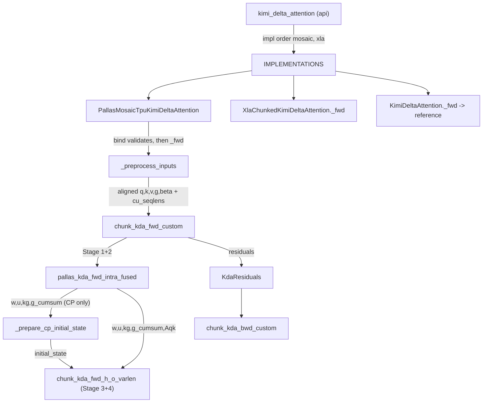
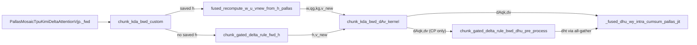

# Kimi Delta Attention (chunked KDA) on TPU

## Overview

Kimi Delta Attention (KDA) is the recurrent linear-attention mixer of Kimi Linear: instead of
token-token scores it keeps one fixed `K x V` state per (batch, head, segment), updated by a
gated delta rule with a per-key-channel decay. The public `kimi_delta_attention` docstring calls
it "a recurrent linear attention module" whose dense `"xla"` recurrence "serves as the reference
contract for chunk-wise implementations". The key design idea of the TPU backend is the chunked
form from the authors' design doc: split time into chunks of 64, turn the intra-chunk sequential
dependency into a unit lower-triangular solve done as batched matmuls on the MXU (the "WY
representation"), and carry only the `K x V` state across chunks inside a VMEM scratch. Three
backends share one `Op` contract - [`KimiDeltaAttention`](https://github.com/openxla/tokamax/blob/3a0a3a34a5ccb8a6ac71f343d9cc44649d73db68/tokamax/_src/ops/experimental/kda/base.py#L72 "tokamax/_src/ops/experimental/kda/base#KimiDeltaAttention") (dense reference),
`XlaChunkedKimiDeltaAttention` (pure-JAX chunked, lowered by XLA) and
[`PallasMosaicTpuKimiDeltaAttention`](https://github.com/openxla/tokamax/blob/3a0a3a34a5ccb8a6ac71f343d9cc44649d73db68/tokamax/_src/ops/experimental/kda/pallas_mosaic_tpu.py#L192 "tokamax/_src/ops/experimental/kda/pallas_mosaic_tpu#PallasMosaicTpuKimiDeltaAttention") (two fused Pallas forward
kernels plus a three-kernel custom VJP) - and the API walks the requested backends in order (by default `mosaic` then `xla`), falling back on
`NotImplementedError`.

## Diagram

Legend:
- `API` - [`kimi_delta_attention`](https://github.com/openxla/tokamax/blob/3a0a3a34a5ccb8a6ac71f343d9cc44649d73db68/tokamax/_src/ops/experimental/kda/api.py#L49 "tokamax/_src/ops/experimental/kda/api#kimi_delta_attention")
- `IMPLS` - [`IMPLEMENTATIONS`](https://github.com/openxla/tokamax/blob/3a0a3a34a5ccb8a6ac71f343d9cc44649d73db68/tokamax/_src/ops/experimental/kda/api.py#L29 "tokamax/_src/ops/experimental/kda/api#IMPLEMENTATIONS")
- `TPU` - [`PallasMosaicTpuKimiDeltaAttention`](https://github.com/openxla/tokamax/blob/3a0a3a34a5ccb8a6ac71f343d9cc44649d73db68/tokamax/_src/ops/experimental/kda/pallas_mosaic_tpu.py#L192 "tokamax/_src/ops/experimental/kda/pallas_mosaic_tpu#PallasMosaicTpuKimiDeltaAttention")
- `XC` - [`_fwd`](https://github.com/openxla/tokamax/blob/3a0a3a34a5ccb8a6ac71f343d9cc44649d73db68/tokamax/_src/ops/experimental/kda/xla_chunked.py#L113 "tokamax/_src/ops/experimental/kda/xla_chunked#XlaChunkedKimiDeltaAttention._fwd")
- `REF` - [`_fwd`](https://github.com/openxla/tokamax/blob/3a0a3a34a5ccb8a6ac71f343d9cc44649d73db68/tokamax/_src/ops/experimental/kda/base.py#L171 "tokamax/_src/ops/experimental/kda/base#KimiDeltaAttention._fwd")
- `PRE` - [`_preprocess_inputs`](https://github.com/openxla/tokamax/blob/3a0a3a34a5ccb8a6ac71f343d9cc44649d73db68/tokamax/_src/ops/experimental/kda/pallas_mosaic_tpu.py#L224 "tokamax/_src/ops/experimental/kda/pallas_mosaic_tpu#PallasMosaicTpuKimiDeltaAttention._preprocess_inputs")
- `FWD` - [`chunk_kda_fwd_custom`](https://github.com/openxla/tokamax/blob/3a0a3a34a5ccb8a6ac71f343d9cc44649d73db68/tokamax/_src/ops/experimental/kda/pallas_mosaic_tpu_fwd_kernel.py#L1425 "tokamax/_src/ops/experimental/kda/pallas_mosaic_tpu_fwd_kernel#chunk_kda_fwd_custom")
- `INTRA` - [`pallas_kda_fwd_intra_fused`](https://github.com/openxla/tokamax/blob/3a0a3a34a5ccb8a6ac71f343d9cc44649d73db68/tokamax/_src/ops/experimental/kda/pallas_mosaic_tpu_fwd_kernel.py#L808 "tokamax/_src/ops/experimental/kda/pallas_mosaic_tpu_fwd_kernel#pallas_kda_fwd_intra_fused")
- `CP` - [`_prepare_cp_initial_state`](https://github.com/openxla/tokamax/blob/3a0a3a34a5ccb8a6ac71f343d9cc44649d73db68/tokamax/_src/ops/experimental/kda/pallas_mosaic_tpu_fwd_kernel.py#L352 "tokamax/_src/ops/experimental/kda/pallas_mosaic_tpu_fwd_kernel#_prepare_cp_initial_state")
- `HO` - [`chunk_kda_fwd_h_o_varlen`](https://github.com/openxla/tokamax/blob/3a0a3a34a5ccb8a6ac71f343d9cc44649d73db68/tokamax/_src/ops/experimental/kda/pallas_mosaic_tpu_fwd_kernel.py#L1152 "tokamax/_src/ops/experimental/kda/pallas_mosaic_tpu_fwd_kernel#chunk_kda_fwd_h_o_varlen")
- `RES` - [`KdaResiduals`](https://github.com/openxla/tokamax/blob/3a0a3a34a5ccb8a6ac71f343d9cc44649d73db68/tokamax/_src/ops/experimental/kda/pallas_mosaic_tpu_types.py#L37 "tokamax/_src/ops/experimental/kda/pallas_mosaic_tpu_types#KdaResiduals")
- `BWD` - [`chunk_kda_bwd_custom`](https://github.com/openxla/tokamax/blob/3a0a3a34a5ccb8a6ac71f343d9cc44649d73db68/tokamax/_src/ops/experimental/kda/pallas_mosaic_tpu_bwd_kernel.py#L1481 "tokamax/_src/ops/experimental/kda/pallas_mosaic_tpu_bwd_kernel#chunk_kda_bwd_custom")

The backward, as three Pallas kernels around an optional CP exchange:

Legend:
- `VJP` - [`_fwd`](https://github.com/openxla/tokamax/blob/3a0a3a34a5ccb8a6ac71f343d9cc44649d73db68/tokamax/_src/ops/experimental/kda/pallas_mosaic_tpu.py#L487 "tokamax/_src/ops/experimental/kda/pallas_mosaic_tpu#PallasMosaicTpuKimiDeltaAttentionVjp._fwd")
- `BWD` - [`chunk_kda_bwd_custom`](https://github.com/openxla/tokamax/blob/3a0a3a34a5ccb8a6ac71f343d9cc44649d73db68/tokamax/_src/ops/experimental/kda/pallas_mosaic_tpu_bwd_kernel.py#L1481 "tokamax/_src/ops/experimental/kda/pallas_mosaic_tpu_bwd_kernel#chunk_kda_bwd_custom")
- `RECOMP` - [`fused_recompute_w_u_vnew_from_h_pallas`](https://github.com/openxla/tokamax/blob/3a0a3a34a5ccb8a6ac71f343d9cc44649d73db68/tokamax/_src/ops/experimental/kda/pallas_mosaic_tpu_bwd_kernel.py#L655 "tokamax/_src/ops/experimental/kda/pallas_mosaic_tpu_bwd_kernel#fused_recompute_w_u_vnew_from_h_pallas")
- `REMAT` - [`chunk_gated_delta_rule_fwd_h`](https://github.com/openxla/tokamax/blob/3a0a3a34a5ccb8a6ac71f343d9cc44649d73db68/tokamax/_src/ops/experimental/kda/common.py#L820 "tokamax/_src/ops/experimental/kda/common#chunk_gated_delta_rule_fwd_h")
- `DAV` - [`chunk_kda_bwd_dAv_kernel`](https://github.com/openxla/tokamax/blob/3a0a3a34a5ccb8a6ac71f343d9cc44649d73db68/tokamax/_src/ops/experimental/kda/pallas_mosaic_tpu_bwd_kernel.py#L1357 "tokamax/_src/ops/experimental/kda/pallas_mosaic_tpu_bwd_kernel#chunk_kda_bwd_dAv_kernel")
- `CPB` - [`chunk_gated_delta_rule_bwd_dhu_pre_process`](https://github.com/openxla/tokamax/blob/3a0a3a34a5ccb8a6ac71f343d9cc44649d73db68/tokamax/_src/ops/experimental/kda/pallas_mosaic_tpu_bwd_kernel.py#L260 "tokamax/_src/ops/experimental/kda/pallas_mosaic_tpu_bwd_kernel#chunk_gated_delta_rule_bwd_dhu_pre_process")
- `M4` - [`_fused_dhu_wy_intra_cumsum_pallas_jit`](https://github.com/openxla/tokamax/blob/3a0a3a34a5ccb8a6ac71f343d9cc44649d73db68/tokamax/_src/ops/experimental/kda/pallas_mosaic_tpu_bwd_kernel.py#L1080 "tokamax/_src/ops/experimental/kda/pallas_mosaic_tpu_bwd_kernel#_fused_dhu_wy_intra_cumsum_pallas_jit")

## Design rationale (why it's built this way)

- **Chunking trades a length-T serial chain for MXU work.** A token-by-token recurrence
  `S_0 -> S_1 -> ... -> S_T` "provides little parallelism along the time dimension" (fwd design
  doc, 1.2). Inside a 64-token chunk the delta-rule dependency is rewritten as a unit
  lower-triangular system; on the bf16 path the solve uses finite Neumann expansions so that
  "the dominant solve work" becomes batched matmuls on the MXU instead of row-wise forward
  substitution (fwd doc, 4.1.5). Only the `K x V` state crosses chunk boundaries.
- **Four semantic stages, two physical kernels.** The doc defines Stage 1 (gate cumsum), Stage 2
  (intra-chunk solve -> `w, u, kg, Aqk, Akk`), Stage 3 (state propagation) and Stage 4 (output),
  but these "are not four mandatory kernel dispatches": Stage 1+2 is fused in
  [`pallas_kda_fwd_intra_fused`](https://github.com/openxla/tokamax/blob/3a0a3a34a5ccb8a6ac71f343d9cc44649d73db68/tokamax/_src/ops/experimental/kda/pallas_mosaic_tpu_fwd_kernel.py#L808 "tokamax/_src/ops/experimental/kda/pallas_mosaic_tpu_fwd_kernel#pallas_kda_fwd_intra_fused") and Stage 3+4 in
  [`chunk_kda_fwd_h_o_varlen`](https://github.com/openxla/tokamax/blob/3a0a3a34a5ccb8a6ac71f343d9cc44649d73db68/tokamax/_src/ops/experimental/kda/pallas_mosaic_tpu_fwd_kernel.py#L1152 "tokamax/_src/ops/experimental/kda/pallas_mosaic_tpu_fwd_kernel#chunk_kda_fwd_h_o_varlen"). They stay separate
  because Stage 3+4 is an ordered chunk recurrence and because CP must insert a collective between
  Stage 2 and Stage 3. The remaining HBM boundary in forward is the transfer of
  `g_cumsum/w/u/kg/Aqk` between the two kernels.
- **The backward is fused for bandwidth, not FLOPs.** "Most stages of the KDA backward have low
  arithmetic intensity" and would be HBM-bound if split; the six mathematical backward stages are
  compressed into three Pallas kernels, and "the main benefit is not reducing the mathematical
  operations, but reducing the reads and writes at stage boundaries" (bwd doc, 4.1).
- **log2-space gates.** Cumulative gates are kept in log2 space (`cumsum_scale=RCP_LN2`) so decays
  are `2^g`, intra/inter-chunk decays combine by exponent addition, and the kernels use hardware
  `exp2` (bwd doc, 3.1).
- **Static shapes for varlen.** TPU kernels need static shapes, so variable-length input "does not
  trigger a separate ragged kernel": each segment is padded independently to a multiple of 64 by
  [`_align_seqs`](https://github.com/openxla/tokamax/blob/3a0a3a34a5ccb8a6ac71f343d9cc44649d73db68/tokamax/_src/ops/experimental/kda/utils.py#L161 "tokamax/_src/ops/experimental/kda/utils#_align_seqs"), a chunk->sequence table is scalar-prefetched, and the
  grid stays `(H // MB, B, NT)` (bwd doc, 3.8). Alignment happens exactly once, in
  [`_preprocess_inputs`](https://github.com/openxla/tokamax/blob/3a0a3a34a5ccb8a6ac71f343d9cc44649d73db68/tokamax/_src/ops/experimental/kda/pallas_mosaic_tpu.py#L224 "tokamax/_src/ops/experimental/kda/pallas_mosaic_tpu#PallasMosaicTpuKimiDeltaAttention._preprocess_inputs"),
  so forward output, residuals and backward all use the same token mapping ("single-alignment
  contract", fwd doc, 3.5).
- **Reject before tracing so fallback works.** The TPU `_fwd` runs its support checks "before
  preprocessing or tracing a Pallas kernel, so API dispatch can fall through to the next
  implementation" (source comment); every unsupported case raises `NotImplementedError`, which is
  exactly what [`kimi_delta_attention`](https://github.com/openxla/tokamax/blob/3a0a3a34a5ccb8a6ac71f343d9cc44649d73db68/tokamax/_src/ops/experimental/kda/api.py#L49 "tokamax/_src/ops/experimental/kda/api#kimi_delta_attention") catches.
- **Residual policy is a config knob, not an API flag.**
  [`Config`](https://github.com/openxla/tokamax/blob/3a0a3a34a5ccb8a6ac71f343d9cc44649d73db68/tokamax/_src/ops/experimental/kda/pallas_mosaic_tpu.py#L51 "tokamax/_src/ops/experimental/kda/pallas_mosaic_tpu#Config") `rematerialize_for_backward=True` "omits chunk
  hidden states from forward residuals and manually rebuilds them in the custom backward" - the
  usual activation-memory vs recompute trade.

## Entry points

- [`kimi_delta_attention`](https://github.com/openxla/tokamax/blob/3a0a3a34a5ccb8a6ac71f343d9cc44649d73db68/tokamax/_src/ops/experimental/kda/api.py#L49 "tokamax/_src/ops/experimental/kda/api#kimi_delta_attention") - the public function. With no `implementation`
  it tries `("mosaic", "xla")` when the Mosaic module imported, else `("xla",)`; `"mosaic"` is
  aliased to the `"mosaic_tpu"` key. A sequence falls through on `NotImplementedError` and raises
  an `ExceptionGroup` if all fail; a single named implementation re-raises. Note that
  `"xla_chunked"` is never in the default order - it must be requested.
- [`IMPLEMENTATIONS`](https://github.com/openxla/tokamax/blob/3a0a3a34a5ccb8a6ac71f343d9cc44649d73db68/tokamax/_src/ops/experimental/kda/api.py#L29 "tokamax/_src/ops/experimental/kda/api#IMPLEMENTATIONS") - the backend registry (`xla`, `xla_chunked`, and
  `mosaic_tpu` when the import succeeds). It is also what the autotuner enumerates: the global
  [`_API_IMPLEMENTATIONS`](https://github.com/openxla/tokamax/blob/3a0a3a34a5ccb8a6ac71f343d9cc44649d73db68/tokamax/_src/autotuning/api.py#L260 "tokamax/_src/autotuning/api#_API_IMPLEMENTATIONS._API_IMPLEMENTATIONS") maps
  `KimiDeltaAttention` to this dict.
- [`bind`](https://github.com/openxla/tokamax/blob/3a0a3a34a5ccb8a6ac71f343d9cc44649d73db68/tokamax/_src/ops/experimental/kda/base.py#L83 "tokamax/_src/ops/experimental/kda/base#KimiDeltaAttention.bind") - every backend inherits this
  [`jaxtyped`](https://github.com/openxla/tokamax/blob/3a0a3a34a5ccb8a6ac71f343d9cc44649d73db68/tokamax/_src/jaxtyping.py#L35 "tokamax/_src/jaxtyping#jaxtyped")-checked bind. It enforces the head-first contract
  (`[H, B, T, D]` inputs, `[B, N, H, K, V]` state), derives `max_num_segments` from the
  `initial_state` segment axis or demands it when `segment_ids` arrive without state, validates
  `a_log`/`delta_time_bias` shapes and `-5 <= lower_bound < 0` when `use_gate_in_kernel`, and
  canonicalizes `scale=None` to `K ** -0.5`. Accepts [`AbstractArray`](https://github.com/openxla/tokamax/blob/3a0a3a34a5ccb8a6ac71f343d9cc44649d73db68/tokamax/_src/ops/experimental/kda/base.py#L32 "tokamax/_src/ops/experimental/kda/base#AbstractArray") so
  bind also works on shape-only arguments (autotuning, arg specs).
- [`_fwd`](https://github.com/openxla/tokamax/blob/3a0a3a34a5ccb8a6ac71f343d9cc44649d73db68/tokamax/_src/ops/experimental/kda/pallas_mosaic_tpu.py#L372 "tokamax/_src/ops/experimental/kda/pallas_mosaic_tpu#PallasMosaicTpuKimiDeltaAttention._fwd") - reached through
  the `Op` call path once the TPU backend is selected; `supported_on` restricts it to TPU
  generation >= 6.
- [`_fwd`](https://github.com/openxla/tokamax/blob/3a0a3a34a5ccb8a6ac71f343d9cc44649d73db68/tokamax/_src/ops/experimental/kda/pallas_mosaic_tpu.py#L487 "tokamax/_src/ops/experimental/kda/pallas_mosaic_tpu#PallasMosaicTpuKimiDeltaAttentionVjp._fwd") - reached when
  JAX differentiates through the op; the TPU backend installs this VJP op in `__post_init__`.

## Mechanism (step-by-step)

1. **Dispatch and bind.** [`kimi_delta_attention`](https://github.com/openxla/tokamax/blob/3a0a3a34a5ccb8a6ac71f343d9cc44649d73db68/tokamax/_src/ops/experimental/kda/api.py#L49 "tokamax/_src/ops/experimental/kda/api#kimi_delta_attention") calls the selected
   backend from [`IMPLEMENTATIONS`](https://github.com/openxla/tokamax/blob/3a0a3a34a5ccb8a6ac71f343d9cc44649d73db68/tokamax/_src/ops/experimental/kda/api.py#L29 "tokamax/_src/ops/experimental/kda/api#IMPLEMENTATIONS"); the `Op` machinery
   ([`Op`](https://github.com/openxla/tokamax/blob/3a0a3a34a5ccb8a6ac71f343d9cc44649d73db68/tokamax/_src/ops/op.py#L121 "tokamax/_src/ops/op#Op")) runs [`bind`](https://github.com/openxla/tokamax/blob/3a0a3a34a5ccb8a6ac71f343d9cc44649d73db68/tokamax/_src/ops/experimental/kda/base.py#L83 "tokamax/_src/ops/experimental/kda/base#KimiDeltaAttention.bind") into a
   [`BoundArguments`](https://github.com/openxla/tokamax/blob/3a0a3a34a5ccb8a6ac71f343d9cc44649d73db68/tokamax/_src/ops/op.py#L437 "tokamax/_src/ops/op#BoundArguments"), picks a config, and calls the backend `_fwd`. The reference backend's
   [`_fwd`](https://github.com/openxla/tokamax/blob/3a0a3a34a5ccb8a6ac71f343d9cc44649d73db68/tokamax/_src/ops/experimental/kda/base.py#L171 "tokamax/_src/ops/experimental/kda/base#KimiDeltaAttention._fwd") "dispatches to the pure JAX KDA reference
   implementation" [`kimi_delta_attention`](https://github.com/openxla/tokamax/blob/3a0a3a34a5ccb8a6ac71f343d9cc44649d73db68/tokamax/_src/ops/experimental/kda/reference.py#L69 "tokamax/_src/ops/experimental/kda/reference#kimi_delta_attention") (dense recurrence, no
   residuals) after a `checkify` check that `beta` is in `[0, 1]`.
2. **Config resolution and gate policy.** The TPU `_fwd`
   [`_fwd`](https://github.com/openxla/tokamax/blob/3a0a3a34a5ccb8a6ac71f343d9cc44649d73db68/tokamax/_src/ops/experimental/kda/pallas_mosaic_tpu.py#L372 "tokamax/_src/ops/experimental/kda/pallas_mosaic_tpu#PallasMosaicTpuKimiDeltaAttention._fwd") reads
   [`chunk_size`](https://github.com/openxla/tokamax/blob/3a0a3a34a5ccb8a6ac71f343d9cc44649d73db68/tokamax/_src/ops/experimental/kda/pallas_mosaic_tpu.py#L62 "tokamax/_src/ops/experimental/kda/pallas_mosaic_tpu#Config.chunk_size") (only 64 is accepted) and resolves
   `safe_gate` with [`_resolve_safe_gate`](https://github.com/openxla/tokamax/blob/3a0a3a34a5ccb8a6ac71f343d9cc44649d73db68/tokamax/_src/ops/experimental/kda/pallas_mosaic_tpu.py#L67 "tokamax/_src/ops/experimental/kda/pallas_mosaic_tpu#_resolve_safe_gate"): an explicit
   config value wins; otherwise safe gating is on for pre-activated (log-space) gates and for the
   bounded sigmoid path (`lower_bound` set), and off for the unbounded softplus path. The fused
   activation path then requires both `lower_bound` and `safe_gate=True`, else
   `NotImplementedError`. Static input support (bf16/f32 only, `K <= 256`, `T % 64 == 0` for fixed
   length, `N == 1` state for fixed length, CP restrictions) is checked before any kernel is
   traced.
3. **One-time preprocessing.**
   [`_preprocess_inputs`](https://github.com/openxla/tokamax/blob/3a0a3a34a5ccb8a6ac71f343d9cc44649d73db68/tokamax/_src/ops/experimental/kda/pallas_mosaic_tpu.py#L224 "tokamax/_src/ops/experimental/kda/pallas_mosaic_tpu#PallasMosaicTpuKimiDeltaAttention._preprocess_inputs")
   derives CP metadata and `cu_seqlens` from `segment_ids`, pads each segment to a multiple of 64
   with [`_align_seqs`](https://github.com/openxla/tokamax/blob/3a0a3a34a5ccb8a6ac71f343d9cc44649d73db68/tokamax/_src/ops/experimental/kda/utils.py#L161 "tokamax/_src/ops/experimental/kda/utils#_align_seqs"), builds the chunk index table, replaces raw-gate
   padding with `-1e4` (so padded positions do not decay or write), pads `initial_state` to the
   aligned segment count, and applies optional q/k L2 normalization (keeping `q_rstd/k_rstd` for
   the backward).
4. **Stage 1+2: fused gate cumsum + intra-chunk solve.**
   [`chunk_kda_fwd_custom`](https://github.com/openxla/tokamax/blob/3a0a3a34a5ccb8a6ac71f343d9cc44649d73db68/tokamax/_src/ops/experimental/kda/pallas_mosaic_tpu_fwd_kernel.py#L1425 "tokamax/_src/ops/experimental/kda/pallas_mosaic_tpu_fwd_kernel#chunk_kda_fwd_custom") calls
   [`pallas_kda_fwd_intra_fused`](https://github.com/openxla/tokamax/blob/3a0a3a34a5ccb8a6ac71f343d9cc44649d73db68/tokamax/_src/ops/experimental/kda/pallas_mosaic_tpu_fwd_kernel.py#L808 "tokamax/_src/ops/experimental/kda/pallas_mosaic_tpu_fwd_kernel#pallas_kda_fwd_intra_fused"), a `pallas_call`
   on grid `(H // MB, B, NC)` with all three axes `"parallel"`. Each program point loads a
   `(MB, 1, 1, BT, D)` block of q/k/g/v/beta (plus per-head `a_log` and `delta_time_bias` blocks),
   activates and cumsums the gate in log2 space, builds `Aqk` and the strictly lower `L` in
   `BC=16` sub-blocks, solves `(I + L) x = [v*beta, k*2^g*beta]` - by finite Neumann expansion
   (matmuls) for bf16, by exact block forward substitution for f32 - and writes `w, u, kg, Aqk, Akk, g_cumsum` (and `qg` only when residuals are saved).
   `MB` - heads per program - is picked by `estimate_mini_batch` from a per-head VMEM estimate of
   `BT*K + BT*V + 2*BT*BT` elements, capped at 16 and reduced until it divides `H`; the budget is
   90% of `vmem_capacity_bytes` from [`get_tpu_limits`](https://github.com/openxla/tokamax/blob/3a0a3a34a5ccb8a6ac71f343d9cc44649d73db68/tokamax/_src/ops/experimental/kda/common.py#L54 "tokamax/_src/ops/experimental/kda/common#get_tpu_limits").
5. **CP bridge (only when context parallel is enabled).**
   [`_prepare_cp_initial_state`](https://github.com/openxla/tokamax/blob/3a0a3a34a5ccb8a6ac71f343d9cc44649d73db68/tokamax/_src/ops/experimental/kda/pallas_mosaic_tpu_fwd_kernel.py#L352 "tokamax/_src/ops/experimental/kda/pallas_mosaic_tpu_fwd_kernel#_prepare_cp_initial_state") has each rank
   summarize its last local segment as an affine state transform `(S_ext, M)` assuming zero input
   state, all-gathers both over [`axis_name`](https://github.com/openxla/tokamax/blob/3a0a3a34a5ccb8a6ac71f343d9cc44649d73db68/tokamax/_src/ops/experimental/kda/cp_utils.py#L106 "tokamax/_src/ops/experimental/kda/cp_utils#ContextParallelMetadata.axis_name"),
   and merges the upstream ranks that continue into this rank's first segment
   (`S^(j+1) = M_j S^(j) + S_ext,j`). Only that first segment gets a non-zero initial state; the
   payload is `O(K*V + K*K)` per batch/head/rank, independent of `T`.
6. **Stage 3+4: state propagation and output in one kernel.**
   [`chunk_kda_fwd_h_o_varlen`](https://github.com/openxla/tokamax/blob/3a0a3a34a5ccb8a6ac71f343d9cc44649d73db68/tokamax/_src/ops/experimental/kda/pallas_mosaic_tpu_fwd_kernel.py#L1152 "tokamax/_src/ops/experimental/kda/pallas_mosaic_tpu_fwd_kernel#chunk_kda_fwd_h_o_varlen") runs a
   `PrefetchScalarGridSpec` with two scalar-prefetch operands (`cu_seqlens`, `chunk_to_seq`), grid
   `(H // MB, B, NT)` and `dimension_semantics=("parallel", "parallel", "arbitrary")`. The running
   state lives in a `pltpu.VMEM((MB, K_PAD, V_ALIGNED), float32)` scratch: it is reset (or loaded
   from `h0`) when the chunk start equals the sequence start, updated per chunk, and written out as
   the final state at the sequence end. K and V are lane-padded with
   [`align_up`](https://github.com/openxla/tokamax/blob/3a0a3a34a5ccb8a6ac71f343d9cc44649d73db68/tokamax/_src/ops/experimental/kda/utils.py#L134 "tokamax/_src/ops/experimental/kda/utils#align_up") to `num_lanes`; inputs stay bf16 in HBM and are cast to f32
   per tile in VMEM. Output matmuls use `DEFAULT` precision for bf16 and `HIGHEST` for f32, while
   state-update matmuls always use `HIGHEST`. Fixed-length batches reuse the same kernel as one
   segment `[0, T]` per batch element.
7. **Unalign and package residuals.** For varlen the output is scattered back to original token
   positions with [`_unalign_output`](https://github.com/openxla/tokamax/blob/3a0a3a34a5ccb8a6ac71f343d9cc44649d73db68/tokamax/_src/ops/experimental/kda/utils.py#L272 "tokamax/_src/ops/experimental/kda/utils#_unalign_output"). When residuals are requested,
   [`KdaResiduals`](https://github.com/openxla/tokamax/blob/3a0a3a34a5ccb8a6ac71f343d9cc44649d73db68/tokamax/_src/ops/experimental/kda/pallas_mosaic_tpu_types.py#L37 "tokamax/_src/ops/experimental/kda/pallas_mosaic_tpu_types#KdaResiduals") captures the prepared (aligned,
   possibly L2-normalized) q/k/v/beta, the gate representation, `Aqk/Akk`, optional per-chunk
   state `h`, and all alignment and CP metadata.
8. **Backward Stage 0: recover intermediates.**
   [`_fwd`](https://github.com/openxla/tokamax/blob/3a0a3a34a5ccb8a6ac71f343d9cc44649d73db68/tokamax/_src/ops/experimental/kda/pallas_mosaic_tpu.py#L487 "tokamax/_src/ops/experimental/kda/pallas_mosaic_tpu#PallasMosaicTpuKimiDeltaAttentionVjp._fwd") deliberately
   ignores the replayed original inputs ("Reusing these arguments would skip that preprocessing")
   and passes the residuals to
   [`chunk_kda_bwd_custom`](https://github.com/openxla/tokamax/blob/3a0a3a34a5ccb8a6ac71f343d9cc44649d73db68/tokamax/_src/ops/experimental/kda/pallas_mosaic_tpu_bwd_kernel.py#L1481 "tokamax/_src/ops/experimental/kda/pallas_mosaic_tpu_bwd_kernel#chunk_kda_bwd_custom"). If `h` was saved,
   [`fused_recompute_w_u_vnew_from_h_pallas`](https://github.com/openxla/tokamax/blob/3a0a3a34a5ccb8a6ac71f343d9cc44649d73db68/tokamax/_src/ops/experimental/kda/pallas_mosaic_tpu_bwd_kernel.py#L655 "tokamax/_src/ops/experimental/kda/pallas_mosaic_tpu_bwd_kernel#fused_recompute_w_u_vnew_from_h_pallas")
   recomputes `w, qg, kg, v_new` per chunk independently (`u` never touches HBM); otherwise the
   low-memory path reruns the forward recurrence with
   [`chunk_gated_delta_rule_fwd_h`](https://github.com/openxla/tokamax/blob/3a0a3a34a5ccb8a6ac71f343d9cc44649d73db68/tokamax/_src/ops/experimental/kda/common.py#L820 "tokamax/_src/ops/experimental/kda/common#chunk_gated_delta_rule_fwd_h") (which, for varlen, launches
   [`_chunk_gated_delta_rule_fwd_varlen`](https://github.com/openxla/tokamax/blob/3a0a3a34a5ccb8a6ac71f343d9cc44649d73db68/tokamax/_src/ops/experimental/kda/common.py#L290 "tokamax/_src/ops/experimental/kda/common#_chunk_gated_delta_rule_fwd_varlen")), reintroducing the serial chunk
   dependency.
9. **Backward Stage 1: dAv.**
   [`chunk_kda_bwd_dAv_kernel`](https://github.com/openxla/tokamax/blob/3a0a3a34a5ccb8a6ac71f343d9cc44649d73db68/tokamax/_src/ops/experimental/kda/pallas_mosaic_tpu_bwd_kernel.py#L1357 "tokamax/_src/ops/experimental/kda/pallas_mosaic_tpu_bwd_kernel#chunk_kda_bwd_dAv_kernel") computes `dAqk` and
   the initial `dv` on a flattened-chunk grid with `("parallel",)` semantics, sizing `MB` with
   `estimate_mini_batch` (cap 32) and raising the compiler `vmem_limit_bytes` to the KDA budget.
10. **Optional CP backward exchange.**
    [`chunk_gated_delta_rule_bwd_dhu_pre_process`](https://github.com/openxla/tokamax/blob/3a0a3a34a5ccb8a6ac71f343d9cc44649d73db68/tokamax/_src/ops/experimental/kda/pallas_mosaic_tpu_bwd_kernel.py#L260 "tokamax/_src/ops/experimental/kda/pallas_mosaic_tpu_bwd_kernel#chunk_gated_delta_rule_bwd_dhu_pre_process")
    builds the rank-local backward summary `(dS_ext, dM)` with a single-program (`grid=()`)
    kernel that hand-pipelines double-buffered HBM->VMEM DMA through
    [`_async_copy`](https://github.com/openxla/tokamax/blob/3a0a3a34a5ccb8a6ac71f343d9cc44649d73db68/tokamax/_src/ops/experimental/kda/pallas_mosaic_tpu_bwd_kernel.py#L108 "tokamax/_src/ops/experimental/kda/pallas_mosaic_tpu_bwd_kernel#_chunk_gated_delta_rule_bwd_dhu_pre_process_kernel._async_copy")
    and reverse-scans chunks; `dS_ext` and `dM` are concatenated so a single all-gather covers
    both ("halving the CP collective cost"), then merged into the `dht` seed of each batch's last
    segment.
11. **Backward Stages 2-5: the mega-fusion.**
    [`_fused_dhu_wy_intra_cumsum_pallas_jit`](https://github.com/openxla/tokamax/blob/3a0a3a34a5ccb8a6ac71f343d9cc44649d73db68/tokamax/_src/ops/experimental/kda/pallas_mosaic_tpu_bwd_kernel.py#L1080 "tokamax/_src/ops/experimental/kda/pallas_mosaic_tpu_bwd_kernel#_fused_dhu_wy_intra_cumsum_pallas_jit") "fuses
    Dhu recurrence, WY backward, intra backward, and gate cumsum" on grid `(H // MB, B, NT)` with
    `("parallel", "parallel", "arbitrary")`; its index maps walk chunks in reverse
    (`NT - 1 - chunk`), and the state gradient `dh` lives in a `(MB, K, V)` f32 VMEM scratch. The
    only scalar-prefetch operand is the per-chunk segment id table, from which each program
    derives its sequence slot and whether it is a segment's last chunk (seed `dh` from `dht`) or
    first chunk (emit `dh0`). Gate backward (`dA`, `dbias`), L2-norm backward and varlen
    unalignment follow outside the kernels; gradients are cast back to input dtypes.

## Key data structures

- [`Config`](https://github.com/openxla/tokamax/blob/3a0a3a34a5ccb8a6ac71f343d9cc44649d73db68/tokamax/_src/ops/experimental/kda/pallas_mosaic_tpu.py#L51 "tokamax/_src/ops/experimental/kda/pallas_mosaic_tpu#Config") - `chunk_size` (default 64, the only value the
  TPU path accepts), `safe_gate` (None = auto), `rematerialize_for_backward` (False = save `h`).
  Its heuristic and its autotuning set
  ([`_get_heuristics_config`](https://github.com/openxla/tokamax/blob/3a0a3a34a5ccb8a6ac71f343d9cc44649d73db68/tokamax/_src/ops/experimental/kda/pallas_mosaic_tpu.py#L208 "tokamax/_src/ops/experimental/kda/pallas_mosaic_tpu#PallasMosaicTpuKimiDeltaAttention._get_heuristics_config"),
  [`_get_autotuning_configs`](https://github.com/openxla/tokamax/blob/3a0a3a34a5ccb8a6ac71f343d9cc44649d73db68/tokamax/_src/ops/experimental/kda/pallas_mosaic_tpu.py#L213 "tokamax/_src/ops/experimental/kda/pallas_mosaic_tpu#PallasMosaicTpuKimiDeltaAttention._get_autotuning_configs"),
  and the VJP's [`_get_autotuning_configs`](https://github.com/openxla/tokamax/blob/3a0a3a34a5ccb8a6ac71f343d9cc44649d73db68/tokamax/_src/ops/experimental/kda/pallas_mosaic_tpu.py#L481 "tokamax/_src/ops/experimental/kda/pallas_mosaic_tpu#PallasMosaicTpuKimiDeltaAttentionVjp._get_autotuning_configs"))
  are all the single config `Config(chunk_size=64)`, pinned by
  [`test_default_execution_config`](https://github.com/openxla/tokamax/blob/3a0a3a34a5ccb8a6ac71f343d9cc44649d73db68/tokamax/_src/ops/experimental/kda/pallas_mosaic_tpu_test.py#L83 "tokamax/_src/ops/experimental/kda/pallas_mosaic_tpu_test#PallasMosaicTpuKimiDeltaAttentionTest.test_default_execution_config").
- [`Config`](https://github.com/openxla/tokamax/blob/3a0a3a34a5ccb8a6ac71f343d9cc44649d73db68/tokamax/_src/ops/experimental/kda/xla_chunked.py#L38 "tokamax/_src/ops/experimental/kda/xla_chunked#Config") - `chunk_size` ([`chunk_size`](https://github.com/openxla/tokamax/blob/3a0a3a34a5ccb8a6ac71f343d9cc44649d73db68/tokamax/_src/ops/experimental/kda/xla_chunked.py#L41 "tokamax/_src/ops/experimental/kda/xla_chunked#Config.chunk_size"))
  and `safe_gate`; no rematerialization knob because the XLA backward is a `jax.vjp` of the
  chunked forward.
- [`KdaResiduals`](https://github.com/openxla/tokamax/blob/3a0a3a34a5ccb8a6ac71f343d9cc44649d73db68/tokamax/_src/ops/experimental/kda/pallas_mosaic_tpu_types.py#L37 "tokamax/_src/ops/experimental/kda/pallas_mosaic_tpu_types#KdaResiduals") - a frozen, pytree-registered
  dataclass: prepared `q, k, v, beta` at `T_ALIGNED`, `g_cumsum` or `g_org`, `aqk/akk`
  (`[H, B, T_ALIGNED, BT]`), optional `h` (`[H, B, NT, K, V]`), `q_rstd/k_rstd`, original and
  aligned `cu_seqlens`, `chunk_indices`, aligned and original `segment_ids`, a dtype marker for
  the gate gradient, and the derived CP rank-chain tuple.
- [`ContextParallelMetadata`](https://github.com/openxla/tokamax/blob/3a0a3a34a5ccb8a6ac71f343d9cc44649d73db68/tokamax/_src/ops/experimental/kda/cp_utils.py#L60 "tokamax/_src/ops/experimental/kda/cp_utils#ContextParallelMetadata") - user-supplied `mesh` and `axis_name`
  (default `"context"`); the chain fields (`is_first_rank`, `pre_num_ranks`, ...) are derived
  device-side from rank-local `segment_ids` and may be traced arrays. Hash/eq are identity-based so
  the object stays hashable as a non-differentiable argument.
  [`ContextParallelMetadataArg`](https://github.com/openxla/tokamax/blob/3a0a3a34a5ccb8a6ac71f343d9cc44649d73db68/tokamax/_src/ops/experimental/kda/cp_utils.py#L145 "tokamax/_src/ops/experimental/kda/cp_utils#ContextParallelMetadataArg.ContextParallelMetadataArg") is the
  annotated alias that serializes it to `None` in JSON so the runtime mesh never enters op
  metadata.
- [`Output`](https://github.com/openxla/tokamax/blob/3a0a3a34a5ccb8a6ac71f343d9cc44649d73db68/tokamax/_src/ops/experimental/kda/base.py#L36 "tokamax/_src/ops/experimental/kda/base#Output.Output") - `(output [H, B, T, V], final_state [B, N, H, K, V] | None)`.
- [`_kimi_linear_48b_a3b_spec`](https://github.com/openxla/tokamax/blob/3a0a3a34a5ccb8a6ac71f343d9cc44649d73db68/tokamax/_src/ops/experimental/kda/arg_specs.py#L51 "tokamax/_src/ops/experimental/kda/arg_specs#_kimi_linear_48b_a3b_spec") - the benchmark/autotune workloads,
  shaped after Kimi-Linear-48B-A3B: 32 heads, head dim 128, bf16, batch 1, fused gate with
  `lower_bound=-5.0`, q/k L2 norm, optionally packed segments.

## Dynamics (design intent)

- **Parallel vs ordered grid axes.** Head-group, batch and (in Stage 1+2) chunk axes are declared
  `"parallel"`; the chunk axis of Stage 3+4 and of the backward mega-fusion is `"arbitrary"`
  because the VMEM scratch carries state from one chunk iteration to the next (forward in time for
  the forward, reverse in time for the backward).
- **Mini-batching heads amortizes DMA.** Every launcher sizes `MB` from a VMEM budget: "too small
  leads to insufficient DMA granularity ... too large increases VMEM and register pressure" (bwd
  doc, 3.4). The forward kernels and the dAv kernel use the shared `estimate_mini_batch`; the
  saved-`h` recompute kernel, the mega-fusion and the CP pre-process carry local heuristics.
- **CP has no compute/communication overlap.** The forward doc states the implementation
  "focuses on reducing communication volume and does not explicitly overlap communication with
  computation"; the only explicit DMA overlap is inside the CP backward pre-process kernel.
- **Tests pin the contract.** `base_test.py` checks that `chunk_size` is not public, that Mosaic is
  registered, that varlen without state requires `max_num_segments`, and that CP metadata does not
  break op metadata; `pallas_mosaic_tpu_test.py` checks safe-gate selection and that CP shape
  violations are rejected before the kernel.

## Edge cases

- **`chunk_size != 64`** raises `NotImplementedError` in both the Mosaic and the xla_chunked
  backends; the autotuning space therefore has exactly one point.
- **Fixed length needs `T % 64 == 0`**; varlen (via `segment_ids`) does not, because each segment
  is padded independently.
- **K > 256** is rejected by the Mosaic path. With CP active, K and V must also be multiples of
  128, `initial_state` and `output_final_state=True` are forbidden, and rank-local `segment_ids`
  plus `max_num_segments` are mandatory.
- **xla_chunked is narrower than Mosaic**: [`_check_supported`](https://github.com/openxla/tokamax/blob/3a0a3a34a5ccb8a6ac71f343d9cc44649d73db68/tokamax/_src/ops/experimental/kda/xla_chunked.py#L56 "tokamax/_src/ops/experimental/kda/xla_chunked#_check_supported")
  requires `use_gate_in_kernel=True`, a `lower_bound` and `safe_gate=True`, and rejects CP. Its
  forward is [`chunk_kda_fwd`](https://github.com/openxla/tokamax/blob/3a0a3a34a5ccb8a6ac71f343d9cc44649d73db68/tokamax/_src/ops/experimental/kda/xla_chunked_fwd_kernel.py#L319 "tokamax/_src/ops/experimental/kda/xla_chunked_fwd_kernel#chunk_kda_fwd") and its VJP
  ([`_fwd`](https://github.com/openxla/tokamax/blob/3a0a3a34a5ccb8a6ac71f343d9cc44649d73db68/tokamax/_src/ops/experimental/kda/xla_chunked.py#L191 "tokamax/_src/ops/experimental/kda/xla_chunked#XlaChunkedKimiDeltaAttentionVjp._fwd")) re-derives gradients
  with `jax.vjp` over that same chunked forward.
- **Pre-activated gates are the caller's numerical responsibility**: for `use_gate_in_kernel=False`
  `lower_bound` does not constrain them (API docstring).
- **`segment_ids` are 1-indexed, 0 = padding**; padding chunks are inactive in the backward.
- **Hardware floor**: `supported_on` requires TPU generation >= 6 for the Mosaic backend.

## Open questions

- The forward design doc's support matrix says float32 uses a "separate gate cumsum" before
  forward substitution. At this pin the dtype routing happens inside the fused Stage 1+2 kernel
  (Neumann solve for bf16, exact block forward substitution for f32), and the cumsum is fused for
  both dtypes (`fuse_cumsum=True`). The "separate cumsum" wording may be stale.
- The `Op`-level wiring that turns the `vjp` attribute into a `jax.custom_vjp` lives in the op
  framework (see [op framework](./op-framework.md)); this page did not re-verify how the
  `_fwd` residuals reach the VJP op.
- Historical performance numbers in both design docs predate the current adapter and are marked by
  the authors as needing revalidation; none are quoted here.
- No torch_tpu wrapper for KDA was found under `tokamax/experimental/torch_tpu/ops/` at this pin.

## See also

- [Kernel catalog](./kernel-catalog.md) - where KDA sits among tokamax ops.
- [Op framework](./op-framework.md) - `Op`, `bind`, configs and the VJP op contract.
- [Autotuning](./autotuning.md) - how `_get_autotuning_configs` and `IMPLEMENTATIONS` are consumed.
- [Mosaic TPU helpers](./mosaic-tpu-helpers.md) - shared Pallas TPU utilities.
- [Gated delta rule (causal conv1d + GDN)](./gated-delta-rule.md) - the sibling delta-rule op.
- [Splash attention](./splash-attention.md) - the softmax-attention counterpart on TPU.
