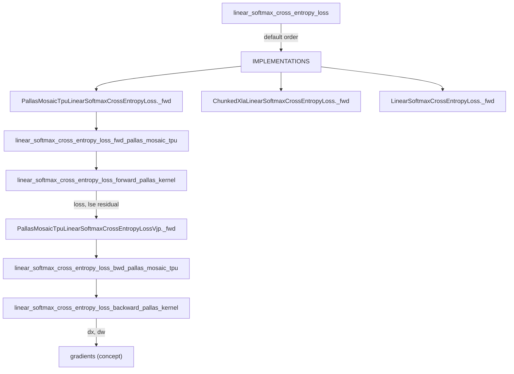
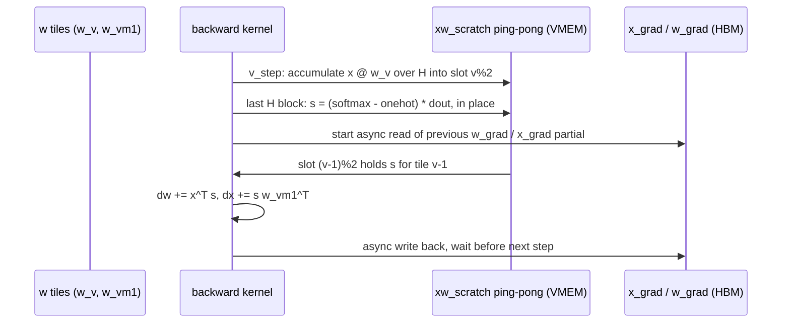

# Linear softmax cross-entropy loss (fused LM-head + CE) on TPU

## Overview

`linear_softmax_cross_entropy_loss(x, labels, weights)` computes
`loss = -reduction(labels * log(softmax(x @ w)))` for the last-layer activations `x [B, H]`, integer
labels `[B]` and the LM-head weight `weights` (`w [H, V]` in the kernels). The point of the op is memory: with vocabularies
around 150k (the arg specs use Qwen3-8B `H=4096, V=151936`, plus Gemma 3, Llama 3.1 and DeepSeek-V3
shapes) the `[B, V]` logits are the largest activation in training. The `"mosaic_tpu"` and
`"chunked_xla"` implementations "are memory efficient and have almost 0 additional buffer overhead
while the `"xla"` implementation needs to materialize the full logits" (API docstring). The key
idea is to tile B, H and V; accumulate `x @ w` over H in a VMEM scratch, combine V tiles with an
online log-sum-exp, and save only the per-row `lse [B]` as the residual. The backward recomputes
each logits tile from `x`, `w` and `lse`. The TPU backward is a single kernel that software-pipelines
logits recompute for V tile `v` against the gradient matmuls for tile `v-1`, and splits V across
TensorCores.

## Diagram

Legend:
- `API` - [`linear_softmax_cross_entropy_loss`](https://github.com/openxla/tokamax/blob/3a0a3a34a5ccb8a6ac71f343d9cc44649d73db68/tokamax/_src/ops/linear_softmax_cross_entropy_loss/api.py#L46 "tokamax/_src/ops/linear_softmax_cross_entropy_loss/api#linear_softmax_cross_entropy_loss")
- `IMPLS` - [`IMPLEMENTATIONS`](https://github.com/openxla/tokamax/blob/3a0a3a34a5ccb8a6ac71f343d9cc44649d73db68/tokamax/_src/ops/linear_softmax_cross_entropy_loss/api.py#L28 "tokamax/_src/ops/linear_softmax_cross_entropy_loss/api#IMPLEMENTATIONS")
- `OPT` - [`_fwd`](https://github.com/openxla/tokamax/blob/3a0a3a34a5ccb8a6ac71f343d9cc44649d73db68/tokamax/_src/ops/linear_softmax_cross_entropy_loss/pallas_mosaic_tpu.py#L51 "tokamax/_src/ops/linear_softmax_cross_entropy_loss/pallas_mosaic_tpu#PallasMosaicTpuLinearSoftmaxCrossEntropyLoss._fwd")
- `CX` - [`_fwd`](https://github.com/openxla/tokamax/blob/3a0a3a34a5ccb8a6ac71f343d9cc44649d73db68/tokamax/_src/ops/linear_softmax_cross_entropy_loss/chunked_xla.py#L320 "tokamax/_src/ops/linear_softmax_cross_entropy_loss/chunked_xla#ChunkedXlaLinearSoftmaxCrossEntropyLoss._fwd")
- `REF` - [`_fwd`](https://github.com/openxla/tokamax/blob/3a0a3a34a5ccb8a6ac71f343d9cc44649d73db68/tokamax/_src/ops/linear_softmax_cross_entropy_loss/base.py#L41 "tokamax/_src/ops/linear_softmax_cross_entropy_loss/base#LinearSoftmaxCrossEntropyLoss._fwd")
- `FWDJ` - [`linear_softmax_cross_entropy_loss_fwd_pallas_mosaic_tpu`](https://github.com/openxla/tokamax/blob/3a0a3a34a5ccb8a6ac71f343d9cc44649d73db68/tokamax/_src/ops/linear_softmax_cross_entropy_loss/pallas_mosaic_tpu_kernel.py#L870 "tokamax/_src/ops/linear_softmax_cross_entropy_loss/pallas_mosaic_tpu_kernel#linear_softmax_cross_entropy_loss_fwd_pallas_mosaic_tpu")
- `FK` - [`linear_softmax_cross_entropy_loss_forward_pallas_kernel`](https://github.com/openxla/tokamax/blob/3a0a3a34a5ccb8a6ac71f343d9cc44649d73db68/tokamax/_src/ops/linear_softmax_cross_entropy_loss/pallas_mosaic_tpu_kernel.py#L622 "tokamax/_src/ops/linear_softmax_cross_entropy_loss/pallas_mosaic_tpu_kernel#linear_softmax_cross_entropy_loss_forward_pallas_kernel")
- `VJP` - [`_fwd`](https://github.com/openxla/tokamax/blob/3a0a3a34a5ccb8a6ac71f343d9cc44649d73db68/tokamax/_src/ops/linear_softmax_cross_entropy_loss/pallas_mosaic_tpu.py#L151 "tokamax/_src/ops/linear_softmax_cross_entropy_loss/pallas_mosaic_tpu#PallasMosaicTpuLinearSoftmaxCrossEntropyLossVjp._fwd")
- `BWDJ` - [`linear_softmax_cross_entropy_loss_bwd_pallas_mosaic_tpu`](https://github.com/openxla/tokamax/blob/3a0a3a34a5ccb8a6ac71f343d9cc44649d73db68/tokamax/_src/ops/linear_softmax_cross_entropy_loss/pallas_mosaic_tpu_kernel.py#L1454 "tokamax/_src/ops/linear_softmax_cross_entropy_loss/pallas_mosaic_tpu_kernel#linear_softmax_cross_entropy_loss_bwd_pallas_mosaic_tpu")
- `BK` - [`linear_softmax_cross_entropy_loss_backward_pallas_kernel`](https://github.com/openxla/tokamax/blob/3a0a3a34a5ccb8a6ac71f343d9cc44649d73db68/tokamax/_src/ops/linear_softmax_cross_entropy_loss/pallas_mosaic_tpu_kernel.py#L945 "tokamax/_src/ops/linear_softmax_cross_entropy_loss/pallas_mosaic_tpu_kernel#linear_softmax_cross_entropy_loss_backward_pallas_kernel")
- `OUT` - (concept)

The backward kernel's software pipeline over the V axis (per core, per B block, per H block):

The participants are abstractions over buffers of
[`linear_softmax_cross_entropy_loss_backward_pallas_kernel`](https://github.com/openxla/tokamax/blob/3a0a3a34a5ccb8a6ac71f343d9cc44649d73db68/tokamax/_src/ops/linear_softmax_cross_entropy_loss/pallas_mosaic_tpu_kernel.py#L945 "tokamax/_src/ops/linear_softmax_cross_entropy_loss/pallas_mosaic_tpu_kernel#linear_softmax_cross_entropy_loss_backward_pallas_kernel").

## Design rationale (why it's built this way)

- **Never materialize logits.** The forward kernel docstring: it "will keep all the intermediate
  buffers in VMEM without logits HBM materialization", and "the x@w won't be returned to avoid
  additional buffer so backward pass will need to re-compute x@w". The residual is just `lse` -
  the base op notes "Residuals are X, Labels, W and LSE", the op inputs plus one `[B]` vector. This is
  rematerialization: backward pays the `2*B*H*V` matmul again to avoid a `B*V*4`-byte buffer.
- **B and H are linear, V needs an online softmax.** "The B and H dimensions can be accumulated
  linearly. The accumulation on V dimension is using the log linearity of log-sum-exp and
  log-softmax" (forward kernel docstring). Hence the forward grid order `(B, V, H)`: H innermost so
  a full logits tile is ready before its LSE update, V next so the running `lse` for a B block is
  combined with `logaddexp`, B outermost and parallel.
- **Loss decomposition avoids a log-softmax tile.** Per row, `loss = lse - logit[label]`. The kernel
  subtracts the label logit (one-hot over the current V tile, with labels shifted by the tile start;
  out-of-range labels give an all-zero one-hot) as each tile completes, then adds `lse` once at the
  very last `(V, H)` step.
- **Backward overlaps recompute with gradient matmuls.** The backward grid has
  `num_v_blocks_per_core + 1` V steps. Step `v` recomputes logits for tile `v` into one half of a
  `(2, B_blk, V_blk)` f32 ping-pong scratch, while the gradient matmuls consume tile `v-1` from the
  other half. Two BlockSpecs (`w_v` and `w_vm1`) read the same `w` at offset tiles to feed both.
- **Gradient accumulators live in HBM, moved by hand.** `dw [H, V]` and `dx [B, H]` are too big for
  VMEM. The kernel keeps one `(B_blk, H_blk)` and one `(H_blk, V_blk)` f32 tile and does an explicit
  read-modify-write with `make_async_copy` and DMA semaphores: it prefetches the previous partial
  before the matmul and waits on it only right before the add.
- **Multi-core by splitting V.** Backward splits V blocks across TensorCores
  (`num_cores = gcd(num_v_blocks, num_cores)`). Each core writes its own `x_grad` partial
  (`[num_cores, B, H]`, summed afterwards) and a disjoint slice of `w_grad`, so no cross-core
  reduction happens inside the kernel. The forward instead marks the B axis `PARALLEL` and lets
  `emit_pipeline(core_axis_name="core")` shard it over the TensorCore mesh.
  > [!inferred]
  > Splitting V (not B) in backward means each core owns whole `w_grad` columns. Splitting B would
  > make both cores accumulate into the same `w_grad` tiles in HBM.
- **The heuristic is a VMEM model, not a guess.** `_calculate_fwd_vmem_bytes` /
  `_calculate_bwd_vmem_bytes` count every buffer, including HLO stack temporaries (the forward
  assumes four simultaneous `(B, V)` f32 buffers: `xw_tiled`, the one-hot, `xw - max`, `exp(...)`).
  The heuristic picks the largest `v_block_size` that fits 90% of VMEM.

## Entry points

- [`linear_softmax_cross_entropy_loss`](https://github.com/openxla/tokamax/blob/3a0a3a34a5ccb8a6ac71f343d9cc44649d73db68/tokamax/_src/ops/linear_softmax_cross_entropy_loss/api.py#L46 "tokamax/_src/ops/linear_softmax_cross_entropy_loss/api#linear_softmax_cross_entropy_loss") - public API
  (re-exported at top level as `tokamax.linear_softmax_cross_entropy_loss`). With
  `implementation=None` it walks
  [`_DEFAULT_IMPLEMENTATION`](https://github.com/openxla/tokamax/blob/3a0a3a34a5ccb8a6ac71f343d9cc44649d73db68/tokamax/_src/ops/linear_softmax_cross_entropy_loss/api.py#L32 "tokamax/_src/ops/linear_softmax_cross_entropy_loss/api#_DEFAULT_IMPLEMENTATION"), which is
  `("mosaic_tpu", "xla")` when the Pallas module imports and `("xla",)` otherwise. It falls back on
  `NotImplementedError` and raises an `ExceptionGroup` if every implementation fails (with a
  single default implementation the `NotImplementedError` is re-raised as is). `"chunked_xla"`
  is never chosen by default. A non-`None` `precision` raises `NotImplementedError`.
- [`IMPLEMENTATIONS`](https://github.com/openxla/tokamax/blob/3a0a3a34a5ccb8a6ac71f343d9cc44649d73db68/tokamax/_src/ops/linear_softmax_cross_entropy_loss/api.py#L28 "tokamax/_src/ops/linear_softmax_cross_entropy_loss/api#IMPLEMENTATIONS") - registry of `xla`, `chunked_xla` and
  (optionally) `mosaic_tpu`. The autotuner reaches it through
  [`_API_IMPLEMENTATIONS`](https://github.com/openxla/tokamax/blob/3a0a3a34a5ccb8a6ac71f343d9cc44649d73db68/tokamax/_src/autotuning/api.py#L260 "tokamax/_src/autotuning/api#_API_IMPLEMENTATIONS._API_IMPLEMENTATIONS").
- [`PallasMosaicTpuLinearSoftmaxCrossEntropyLoss`](https://github.com/openxla/tokamax/blob/3a0a3a34a5ccb8a6ac71f343d9cc44649d73db68/tokamax/_src/ops/linear_softmax_cross_entropy_loss/pallas_mosaic_tpu.py#L37 "tokamax/_src/ops/linear_softmax_cross_entropy_loss/pallas_mosaic_tpu#PallasMosaicTpuLinearSoftmaxCrossEntropyLoss")
  - the TPU op. `supported_on` requires TPU generation >= 5, and `__post_init__` installs
  [`PallasMosaicTpuLinearSoftmaxCrossEntropyLossVjp`](https://github.com/openxla/tokamax/blob/3a0a3a34a5ccb8a6ac71f343d9cc44649d73db68/tokamax/_src/ops/linear_softmax_cross_entropy_loss/pallas_mosaic_tpu.py#L144 "tokamax/_src/ops/linear_softmax_cross_entropy_loss/pallas_mosaic_tpu#PallasMosaicTpuLinearSoftmaxCrossEntropyLossVjp")
  as its VJP, so `jax.grad` through the op runs the Pallas backward.
- PyTorch: the torch_tpu bridge wraps both the forward op and its VJP
  (`tokamax/experimental/torch_tpu/ops/linear_softmax_cross_entropy/`, JAX op names
  `pallas_mosaic_tpu_linear_softmax_cross_entropy_loss[_vjp]`), wired to
  [`_fwd`](https://github.com/openxla/tokamax/blob/3a0a3a34a5ccb8a6ac71f343d9cc44649d73db68/tokamax/_src/ops/linear_softmax_cross_entropy_loss/pallas_mosaic_tpu.py#L51 "tokamax/_src/ops/linear_softmax_cross_entropy_loss/pallas_mosaic_tpu#PallasMosaicTpuLinearSoftmaxCrossEntropyLoss._fwd")
  and the VJP `_fwd`. See [torch_tpu bridge](./torch-tpu-bridge.md). torchtitan's
  PallasCrossEntropyLoss is a downstream consumer of this path.

## Mechanism (step-by-step)

1. **Op setup and residual contract.** Every backend derives from
   [`LinearSoftmaxCrossEntropyLoss`](https://github.com/openxla/tokamax/blob/3a0a3a34a5ccb8a6ac71f343d9cc44649d73db68/tokamax/_src/ops/linear_softmax_cross_entropy_loss/base.py#L31 "tokamax/_src/ops/linear_softmax_cross_entropy_loss/base#LinearSoftmaxCrossEntropyLoss"). Its
   [`__post_init__`](https://github.com/openxla/tokamax/blob/3a0a3a34a5ccb8a6ac71f343d9cc44649d73db68/tokamax/_src/ops/linear_softmax_cross_entropy_loss/base.py#L36 "tokamax/_src/ops/linear_softmax_cross_entropy_loss/base#LinearSoftmaxCrossEntropyLoss.__post_init__")
   unconditionally sets the VJP op, and each subclass overrides it with its own VJP class. Each
   `_fwd` returns `(loss, (lse,))`. The VJP returns `(dx, zeros_like(labels), dw)`, since labels
   have no gradient.
2. **Config selection.** The `Op` machinery ([`Op`](https://github.com/openxla/tokamax/blob/3a0a3a34a5ccb8a6ac71f343d9cc44649d73db68/tokamax/_src/ops/op.py#L121 "tokamax/_src/ops/op#Op")) binds the arguments into
   [`BoundArguments`](https://github.com/openxla/tokamax/blob/3a0a3a34a5ccb8a6ac71f343d9cc44649d73db68/tokamax/_src/ops/op.py#L437 "tokamax/_src/ops/op#BoundArguments") and asks
   [`_get_heuristics_config`](https://github.com/openxla/tokamax/blob/3a0a3a34a5ccb8a6ac71f343d9cc44649d73db68/tokamax/_src/ops/linear_softmax_cross_entropy_loss/pallas_mosaic_tpu.py#L73 "tokamax/_src/ops/linear_softmax_cross_entropy_loss/pallas_mosaic_tpu#PallasMosaicTpuLinearSoftmaxCrossEntropyLoss._get_heuristics_config")
   for a [`Config`](https://github.com/openxla/tokamax/blob/3a0a3a34a5ccb8a6ac71f343d9cc44649d73db68/tokamax/_src/ops/linear_softmax_cross_entropy_loss/pallas_mosaic_tpu.py#L30 "tokamax/_src/ops/linear_softmax_cross_entropy_loss/pallas_mosaic_tpu#Config") (or uses an autotuned
   one). The forward heuristic calls
   [`get_heuristic_fwd_config`](https://github.com/openxla/tokamax/blob/3a0a3a34a5ccb8a6ac71f343d9cc44649d73db68/tokamax/_src/ops/linear_softmax_cross_entropy_loss/pallas_mosaic_tpu_kernel.py#L292 "tokamax/_src/ops/linear_softmax_cross_entropy_loss/pallas_mosaic_tpu_kernel#get_heuristic_fwd_config") and the
   VJP's [`_get_heuristics_config`](https://github.com/openxla/tokamax/blob/3a0a3a34a5ccb8a6ac71f343d9cc44649d73db68/tokamax/_src/ops/linear_softmax_cross_entropy_loss/pallas_mosaic_tpu.py#L184 "tokamax/_src/ops/linear_softmax_cross_entropy_loss/pallas_mosaic_tpu#PallasMosaicTpuLinearSoftmaxCrossEntropyLossVjp._get_heuristics_config")
   calls [`get_heuristic_bwd_config`](https://github.com/openxla/tokamax/blob/3a0a3a34a5ccb8a6ac71f343d9cc44649d73db68/tokamax/_src/ops/linear_softmax_cross_entropy_loss/pallas_mosaic_tpu_kernel.py#L310 "tokamax/_src/ops/linear_softmax_cross_entropy_loss/pallas_mosaic_tpu_kernel#get_heuristic_bwd_config").
   Forward and backward therefore get independently sized tiles. Both go through
   [`_get_heuristic_config`](https://github.com/openxla/tokamax/blob/3a0a3a34a5ccb8a6ac71f343d9cc44649d73db68/tokamax/_src/ops/linear_softmax_cross_entropy_loss/pallas_mosaic_tpu_kernel.py#L119 "tokamax/_src/ops/linear_softmax_cross_entropy_loss/pallas_mosaic_tpu_kernel#_get_heuristic_config"):
   `b_block_size` is the smallest multiple of 128 that is >= 1024 and divides B (else 1024).
   `h_block_size` prefers a power-of-two divisor of H closest to
   `mxu_column_size * num_mxus / num_cores`. `v_block_size` is the largest multiple of 128 that
   fits the VMEM model, preferring divisors of V and a block count that is multi-core compatible.
3. **Forward entry.**
   [`linear_softmax_cross_entropy_loss_fwd_pallas_mosaic_tpu`](https://github.com/openxla/tokamax/blob/3a0a3a34a5ccb8a6ac71f343d9cc44649d73db68/tokamax/_src/ops/linear_softmax_cross_entropy_loss/pallas_mosaic_tpu_kernel.py#L870 "tokamax/_src/ops/linear_softmax_cross_entropy_loss/pallas_mosaic_tpu_kernel#linear_softmax_cross_entropy_loss_fwd_pallas_mosaic_tpu")
   runs [`validate_inputs`](https://github.com/openxla/tokamax/blob/3a0a3a34a5ccb8a6ac71f343d9cc44649d73db68/tokamax/_src/ops/linear_softmax_cross_entropy_loss/pallas_mosaic_tpu_kernel.py#L328 "tokamax/_src/ops/linear_softmax_cross_entropy_loss/pallas_mosaic_tpu_kernel#validate_inputs") (batch and
   hidden dims match, H a multiple of 8) and upcasts fp16 to f32. It then pins `x`, `labels` and `w`
   to HBM with `with_memory_space_constraint` "to prevent OOB accesses that occur when the memory
   spaces is placed in VMEM".
4. **Forward kernel.**
   [`linear_softmax_cross_entropy_loss_forward_pallas_kernel`](https://github.com/openxla/tokamax/blob/3a0a3a34a5ccb8a6ac71f343d9cc44649d73db68/tokamax/_src/ops/linear_softmax_cross_entropy_loss/pallas_mosaic_tpu_kernel.py#L622 "tokamax/_src/ops/linear_softmax_cross_entropy_loss/pallas_mosaic_tpu_kernel#linear_softmax_cross_entropy_loss_forward_pallas_kernel")
   is a `pl.kernel` on a TensorCore mesh with one `(B_blk, V_blk)` f32 VMEM scratch `xw_tiled`.
   Inside, `emit_pipeline` iterates `grid=(num_b, num_v, num_h)` with
   `dimension_semantics=(PARALLEL, ARBITRARY, ARBITRARY)`. `BoundedSlice` BlockSpecs clip ragged
   edge blocks. At each step `calculate_xw_tiled` zero-masks out-of-range rows and columns of `x`
   and `w` and initializes (`h == 0`) or accumulates `xw_tiled += x @ w`. On the last H block the
   kernel subtracts the label logit, sets padded V columns to `-inf` ("forcing exp(-inf)=0, instead
   of 1"), and folds `logsumexp(xw_tiled)` into the running `lse` with `logaddexp`. At the final
   `(V, H)` step it adds `lse` to the loss. The kernel writes per-row loss and `lse` in f32, and
   the `sum`/`mean` reduction happens in plain JAX afterwards.
5. **Backward entry.**
   [`linear_softmax_cross_entropy_loss_bwd_pallas_mosaic_tpu`](https://github.com/openxla/tokamax/blob/3a0a3a34a5ccb8a6ac71f343d9cc44649d73db68/tokamax/_src/ops/linear_softmax_cross_entropy_loss/pallas_mosaic_tpu_kernel.py#L1454 "tokamax/_src/ops/linear_softmax_cross_entropy_loss/pallas_mosaic_tpu_kernel#linear_softmax_cross_entropy_loss_bwd_pallas_mosaic_tpu")
   turns `dout` into a `[B]` vector for every reduction: a broadcast scalar for `sum`, scalar / B
   for `mean`, and per-row for `none`. This lets the kernel always scale the softmax by
   `dout[:, None]`.
6. **Backward kernel.**
   [`linear_softmax_cross_entropy_loss_backward_pallas_kernel`](https://github.com/openxla/tokamax/blob/3a0a3a34a5ccb8a6ac71f343d9cc44649d73db68/tokamax/_src/ops/linear_softmax_cross_entropy_loss/pallas_mosaic_tpu_kernel.py#L945 "tokamax/_src/ops/linear_softmax_cross_entropy_loss/pallas_mosaic_tpu_kernel#linear_softmax_cross_entropy_loss_backward_pallas_kernel")
   runs `emit_pipeline` over `(num_b, num_v_blocks_per_core + 1, num_h)`, with the core index
   offsetting V. Per step it (a) accumulates logits for V tile `v` into ping-pong slot `v % 2`. It
   then (b) on the last H block, overwrites that slot with `s = (exp(xw - lse) - onehot) * dout`,
   doing the target subtraction in place with `broadcasted_iota`, so no extra `(B, V)` buffer is
   needed. Finally (c), for tile `v-1`, it initializes or accumulates `w_grad` (`x^T s`, accumulated
   over B blocks) and `x_grad` (`s w^T`, accumulated over V steps) through async HBM copies. DMA
   sizes are rounded to 128 lanes and 32-byte major-dim alignment, which is why the HBM outputs are
   padded (`b_dim_aligned`, `h_dim_128_aligned`, `v_dim_aligned`) and sliced afterwards.
7. **Cost estimates for XLA scheduling and profiling.** Both kernels attach a `pl.CostEstimate`.
   [`linear_softmax_cross_entropy_loss_fwd_cost_estimate`](https://github.com/openxla/tokamax/blob/3a0a3a34a5ccb8a6ac71f343d9cc44649d73db68/tokamax/_src/ops/linear_softmax_cross_entropy_loss/pallas_mosaic_tpu_kernel.py#L450 "tokamax/_src/ops/linear_softmax_cross_entropy_loss/pallas_mosaic_tpu_kernel#linear_softmax_cross_entropy_loss_fwd_cost_estimate")
   counts `2*B*H*V + 2*B*V + B` FLOPs, `B*V + B` transcendentals and the input/output bytes.
   [`linear_softmax_cross_entropy_loss_bwd_cost_estimate`](https://github.com/openxla/tokamax/blob/3a0a3a34a5ccb8a6ac71f343d9cc44649d73db68/tokamax/_src/ops/linear_softmax_cross_entropy_loss/pallas_mosaic_tpu_kernel.py#L530 "tokamax/_src/ops/linear_softmax_cross_entropy_loss/pallas_mosaic_tpu_kernel#linear_softmax_cross_entropy_loss_bwd_cost_estimate")
   does the same for the recompute plus the two gradient matmuls.
8. **Chunked XLA alternative.**
   [`linear_softmax_cross_entropy_loss_fwd_chunked_xla`](https://github.com/openxla/tokamax/blob/3a0a3a34a5ccb8a6ac71f343d9cc44649d73db68/tokamax/_src/ops/linear_softmax_cross_entropy_loss/chunked_xla.py#L55 "tokamax/_src/ops/linear_softmax_cross_entropy_loss/chunked_xla#linear_softmax_cross_entropy_loss_fwd_chunked_xla")
   expresses the same B x V blocking as nested `jax.lax.fori_loop`s over padded inputs, with online
   `logaddexp` across V, and leaves lowering to XLA.
   [`linear_softmax_cross_entropy_loss_bwd_chunked_xla`](https://github.com/openxla/tokamax/blob/3a0a3a34a5ccb8a6ac71f343d9cc44649d73db68/tokamax/_src/ops/linear_softmax_cross_entropy_loss/chunked_xla.py#L187 "tokamax/_src/ops/linear_softmax_cross_entropy_loss/chunked_xla#linear_softmax_cross_entropy_loss_bwd_chunked_xla")
   recomputes each logits block and accumulates `dx` per B block and `dw` with
   `dynamic_update_slice`. Its wrappers are
   [`ChunkedXlaLinearSoftmaxCrossEntropyLoss`](https://github.com/openxla/tokamax/blob/3a0a3a34a5ccb8a6ac71f343d9cc44649d73db68/tokamax/_src/ops/linear_softmax_cross_entropy_loss/chunked_xla.py#L306 "tokamax/_src/ops/linear_softmax_cross_entropy_loss/chunked_xla#ChunkedXlaLinearSoftmaxCrossEntropyLoss") and
   [`ChunkedXlaLinearSoftmaxCrossEntropyLossVjp`](https://github.com/openxla/tokamax/blob/3a0a3a34a5ccb8a6ac71f343d9cc44649d73db68/tokamax/_src/ops/linear_softmax_cross_entropy_loss/chunked_xla.py#L345 "tokamax/_src/ops/linear_softmax_cross_entropy_loss/chunked_xla#ChunkedXlaLinearSoftmaxCrossEntropyLossVjp")
   (VJP `_fwd`: [`_fwd`](https://github.com/openxla/tokamax/blob/3a0a3a34a5ccb8a6ac71f343d9cc44649d73db68/tokamax/_src/ops/linear_softmax_cross_entropy_loss/chunked_xla.py#L352 "tokamax/_src/ops/linear_softmax_cross_entropy_loss/chunked_xla#ChunkedXlaLinearSoftmaxCrossEntropyLossVjp._fwd")).
   Unlike the Pallas kernel, H is not tiled: each step's `x` block is `(b_block, H)` and its `w`
   block is `(H, v_block)`.
9. **Reference.** [`_fwd`](https://github.com/openxla/tokamax/blob/3a0a3a34a5ccb8a6ac71f343d9cc44649d73db68/tokamax/_src/ops/linear_softmax_cross_entropy_loss/base.py#L41 "tokamax/_src/ops/linear_softmax_cross_entropy_loss/base#LinearSoftmaxCrossEntropyLoss._fwd")
   calls [`linear_softmax_cross_entropy_loss_fwd_reference`](https://github.com/openxla/tokamax/blob/3a0a3a34a5ccb8a6ac71f343d9cc44649d73db68/tokamax/_src/ops/linear_softmax_cross_entropy_loss/reference.py#L25 "tokamax/_src/ops/linear_softmax_cross_entropy_loss/reference#linear_softmax_cross_entropy_loss_fwd_reference"),
   which builds the full `x @ w` logits and a `[B, V]` one-hot. Its VJP
   ([`_fwd`](https://github.com/openxla/tokamax/blob/3a0a3a34a5ccb8a6ac71f343d9cc44649d73db68/tokamax/_src/ops/linear_softmax_cross_entropy_loss/base.py#L62 "tokamax/_src/ops/linear_softmax_cross_entropy_loss/base#LinearSoftmaxCrossEntropyLossVjp._fwd")) uses
   [`linear_softmax_cross_entropy_loss_bwd_reference`](https://github.com/openxla/tokamax/blob/3a0a3a34a5ccb8a6ac71f343d9cc44649d73db68/tokamax/_src/ops/linear_softmax_cross_entropy_loss/reference.py#L51 "tokamax/_src/ops/linear_softmax_cross_entropy_loss/reference#linear_softmax_cross_entropy_loss_bwd_reference").
   This is the memory baseline the fused kernels avoid.

## Key data structures

- [`Config`](https://github.com/openxla/tokamax/blob/3a0a3a34a5ccb8a6ac71f343d9cc44649d73db68/tokamax/_src/ops/linear_softmax_cross_entropy_loss/pallas_mosaic_tpu_kernel.py#L38 "tokamax/_src/ops/linear_softmax_cross_entropy_loss/pallas_mosaic_tpu_kernel#Config") (re-exported as
  [`Config`](https://github.com/openxla/tokamax/blob/3a0a3a34a5ccb8a6ac71f343d9cc44649d73db68/tokamax/_src/ops/linear_softmax_cross_entropy_loss/pallas_mosaic_tpu.py#L30 "tokamax/_src/ops/linear_softmax_cross_entropy_loss/pallas_mosaic_tpu#Config")) - pydantic-validated tile sizes:
  [`b_block_size`](https://github.com/openxla/tokamax/blob/3a0a3a34a5ccb8a6ac71f343d9cc44649d73db68/tokamax/_src/ops/linear_softmax_cross_entropy_loss/pallas_mosaic_tpu_kernel.py#L47 "tokamax/_src/ops/linear_softmax_cross_entropy_loss/pallas_mosaic_tpu_kernel#Config.b_block_size") (>= 1024,
  multiple of 128, default 1024),
  [`h_block_size`](https://github.com/openxla/tokamax/blob/3a0a3a34a5ccb8a6ac71f343d9cc44649d73db68/tokamax/_src/ops/linear_softmax_cross_entropy_loss/pallas_mosaic_tpu_kernel.py#L48 "tokamax/_src/ops/linear_softmax_cross_entropy_loss/pallas_mosaic_tpu_kernel#Config.h_block_size") (>= 128,
  multiple of 128, default 512),
  [`v_block_size`](https://github.com/openxla/tokamax/blob/3a0a3a34a5ccb8a6ac71f343d9cc44649d73db68/tokamax/_src/ops/linear_softmax_cross_entropy_loss/pallas_mosaic_tpu_kernel.py#L49 "tokamax/_src/ops/linear_softmax_cross_entropy_loss/pallas_mosaic_tpu_kernel#Config.v_block_size") (>= 128,
  multiple of 128, default 2048).
- [`Config`](https://github.com/openxla/tokamax/blob/3a0a3a34a5ccb8a6ac71f343d9cc44649d73db68/tokamax/_src/ops/linear_softmax_cross_entropy_loss/chunked_xla.py#L33 "tokamax/_src/ops/linear_softmax_cross_entropy_loss/chunked_xla#Config") - `b_block_size` (>= 128) and
  `v_block_size`. There is no H block.
- Residuals - a 1-tuple `(lse,)` with `lse [B]` in f32 (Pallas) or input dtype (chunked XLA).
- VMEM scratch - forward: `xw_tiled (B_blk, V_blk) f32`. Backward:
  `xw_scratch (2, B_blk, V_blk) f32`, `x_grad_tile (B_blk, H_blk) f32`,
  `w_grad_tile (H_blk, V_blk) f32`, and four DMA semaphores.
- [`_create_arg_spec`](https://github.com/openxla/tokamax/blob/3a0a3a34a5ccb8a6ac71f343d9cc44649d73db68/tokamax/_src/ops/linear_softmax_cross_entropy_loss/arg_specs.py#L27 "tokamax/_src/ops/linear_softmax_cross_entropy_loss/arg_specs#_create_arg_spec") - benchmark/autotune shapes
  (`x [B, H]`, `labels [B] int32`, `w [H, V]`, reduction) for Qwen3-8B, Gemma 3 4B/7B,
  Llama 3.1 8B and DeepSeek-V3 671B.
- Type aliases [`Array`](https://github.com/openxla/tokamax/blob/3a0a3a34a5ccb8a6ac71f343d9cc44649d73db68/tokamax/_src/ops/linear_softmax_cross_entropy_loss/pallas_mosaic_tpu_kernel.py#L28 "tokamax/_src/ops/linear_softmax_cross_entropy_loss/pallas_mosaic_tpu_kernel#Array") /
  [`Real`](https://github.com/openxla/tokamax/blob/3a0a3a34a5ccb8a6ac71f343d9cc44649d73db68/tokamax/_src/ops/linear_softmax_cross_entropy_loss/pallas_mosaic_tpu_kernel.py#L30 "tokamax/_src/ops/linear_softmax_cross_entropy_loss/pallas_mosaic_tpu_kernel#Real") (and the same in
  [`Array`](https://github.com/openxla/tokamax/blob/3a0a3a34a5ccb8a6ac71f343d9cc44649d73db68/tokamax/_src/ops/linear_softmax_cross_entropy_loss/pallas_mosaic_tpu.py#L31 "tokamax/_src/ops/linear_softmax_cross_entropy_loss/pallas_mosaic_tpu#Array") /
  [`Real`](https://github.com/openxla/tokamax/blob/3a0a3a34a5ccb8a6ac71f343d9cc44649d73db68/tokamax/_src/ops/linear_softmax_cross_entropy_loss/pallas_mosaic_tpu.py#L33 "tokamax/_src/ops/linear_softmax_cross_entropy_loss/pallas_mosaic_tpu#Real")) are jaxtyping re-exports used in
  signatures.

## Dynamics (design intent)

- **Autotuning space.**
  [`_get_autotuning_configs`](https://github.com/openxla/tokamax/blob/3a0a3a34a5ccb8a6ac71f343d9cc44649d73db68/tokamax/_src/ops/linear_softmax_cross_entropy_loss/pallas_mosaic_tpu.py#L107 "tokamax/_src/ops/linear_softmax_cross_entropy_loss/pallas_mosaic_tpu#PallasMosaicTpuLinearSoftmaxCrossEntropyLoss._get_autotuning_configs")
  and the VJP's
  [`_get_autotuning_configs`](https://github.com/openxla/tokamax/blob/3a0a3a34a5ccb8a6ac71f343d9cc44649d73db68/tokamax/_src/ops/linear_softmax_cross_entropy_loss/pallas_mosaic_tpu.py#L206 "tokamax/_src/ops/linear_softmax_cross_entropy_loss/pallas_mosaic_tpu#PallasMosaicTpuLinearSoftmaxCrossEntropyLossVjp._get_autotuning_configs")
  build the same Cartesian product. B candidates are `1024 + 128*i` that divide B, plus
  `1024 + 512*i < B`. H and V candidates are multiples of 128 that divide the dim, plus powers of
  two `128 * 2^i` below it. Forward and backward are tuned as separate ops, so they can settle on
  different tiles. The chunked XLA op exposes only its default `Config()` heuristic.
- **Ordering.** In the forward, V and H are `ARBITRARY` (sequential) because `xw_tiled` and the
  running `lse` carry state across them. Only B is parallel across cores. In the backward, the
  `+1` V step drains the pipeline, and every step that wrote a gradient tile waits for both
  write DMAs before the next iteration.
- **Kernel names encode tiles** (`lce_fwd_bt_<B>_ht_<H>_vt_<V>`,
  `lce_bwd_..._cores_<n>`), which makes autotuned variants distinguishable in profiles.
- **Tests.** `pallas_mosaic_tpu_test.py` checks forward loss and both gradients through the op
  wrapper against the reference within `3e-2`. The torch_tpu tests cover the PyTorch wrapper.

## Edge cases

- **Logits must be finite.** The API docstring warns that this is "the regular (unsafe)
  Cross-Entropy loss function ... so the logits `X@W` cannot be `-inf`".
- **H must be a multiple of 8**, and labels and x batch dims must match (`validate_inputs` raises
  `ValueError`, not `NotImplementedError`, so these do not trigger API fallback).
- **Ragged B, H, V** are allowed. Edge blocks are masked: padded `x`/`w` entries become zero,
  padded V logits become `-inf` before the LSE, and padded rows get `lse = +inf` in the backward so
  their softmax is zero.
- **fp16 inputs** are upcast to f32 inside the Pallas entry points. bf16 stays bf16 with f32
  accumulation (`preferred_element_type=float32`).
- **`implementation` sequences/callables.** The type hint allows a sequence or callables, but the
  body only handles `None` or a registry key: anything else that is not in `IMPLEMENTATIONS`
  raises `ValueError`.
- **Labels outside `[0, V)`** produce an all-zero one-hot, so they contribute only `lse` to the
  loss and are not flagged.

## Open questions

- The torch_tpu VJP wrapper calls the JAX VJP `_fwd` with `config=self.configs[1]`, which defaults
  to `None`. How a `None` config is resolved to block sizes on the PyTorch path was not traced
  here (see [torch_tpu bridge](./torch-tpu-bridge.md)).
- No profiling results are checked in, so the benefit of the backward's V-split multi-core scheme
  versus a B split is a design reading, not a measured claim.
- torchtitan's PallasCrossEntropyLoss is outside this repo; its exact call path into the bridge
  is not documented here.

## See also

- [torch_tpu bridge](./torch-tpu-bridge.md) - running tokamax Pallas ops from PyTorch.
- [Op framework](./op-framework.md) - `Op`, VJP ops, configs.
- [Autotuning](./autotuning.md) - how the block-size candidates are benchmarked.
- [Benchmarking and serialization](./benchmarking-and-serialization.md) - `ArgSpec` workloads.
- [Mosaic TPU helpers](./mosaic-tpu-helpers.md).
- [Splash attention](./splash-attention.md) - another online-softmax TPU kernel.
- [Kernel catalog](./kernel-catalog.md).
