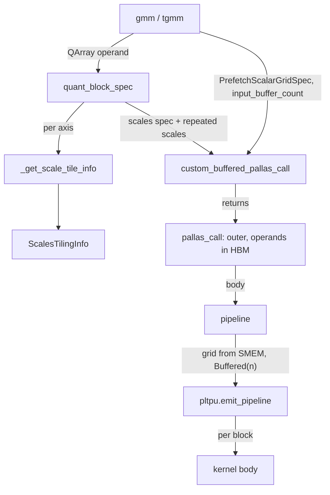
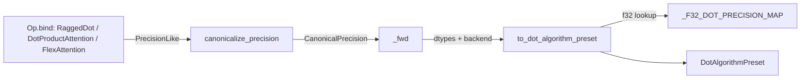

# Mosaic TPU helpers - custom-buffered pallas_call, quantized BlockSpecs, memory poisoning and dot precision

## Overview
`tokamax/_src/mosaic_tpu.py` ("Mosaic-TPU utils") is small: two kernel-construction helpers, one
test helper, and a re-export of qwix's [`QArray`](https://github.com/openxla/tokamax/blob/3a0a3a34a5ccb8a6ac71f343d9cc44649d73db68/tokamax/_src/mosaic_tpu.py#L28 "tokamax/_src/mosaic_tpu#QArray").
[`custom_buffered_pallas_call`](https://github.com/openxla/tokamax/blob/3a0a3a34a5ccb8a6ac71f343d9cc44649d73db68/tokamax/_src/mosaic_tpu.py#L165 "tokamax/_src/mosaic_tpu#custom_buffered_pallas_call")
looks like a `pallas_call` with a `PrefetchScalarGridSpec`, but it actually runs as one outer
kernel invocation with every operand left in HBM, and drives the grid loop itself with
`pltpu.emit_pipeline`. That gives it two things a plain grid does not: a per-input pipeline depth
(`input_buffer_count`), and grid extents that are traced values read from SMEM.
[`quant_block_spec`](https://github.com/openxla/tokamax/blob/3a0a3a34a5ccb8a6ac71f343d9cc44649d73db68/tokamax/_src/mosaic_tpu.py#L100 "tokamax/_src/mosaic_tpu#quant_block_spec")
lets a quantized operand ride the same pipeline. It derives a scales BlockSpec from the values
BlockSpec and repeats the scales in HBM until each scale tile covers a whole (sublane, lane) tile,
so the kernel never addresses individual scales. Both helpers are used by the grouped-matmul
kernels [`gmm`](https://github.com/openxla/tokamax/blob/3a0a3a34a5ccb8a6ac71f343d9cc44649d73db68/tokamax/_src/ops/ragged_dot/pallas_mosaic_tpu_kernel.py#L330 "tokamax/_src/ops/ragged_dot/pallas_mosaic_tpu_kernel#gmm")
and [`tgmm`](https://github.com/openxla/tokamax/blob/3a0a3a34a5ccb8a6ac71f343d9cc44649d73db68/tokamax/_src/ops/ragged_dot/pallas_mosaic_tpu_kernel.py#L635 "tokamax/_src/ops/ragged_dot/pallas_mosaic_tpu_kernel#tgmm").
`precision.py` is backend-neutral. Ops canonicalize the user's `precision` at `bind` time and turn
it into an explicit `DotAlgorithmPreset` per backend when they lower.

## Diagram

Legend:
- `GMM` - [`gmm`](https://github.com/openxla/tokamax/blob/3a0a3a34a5ccb8a6ac71f343d9cc44649d73db68/tokamax/_src/ops/ragged_dot/pallas_mosaic_tpu_kernel.py#L330 "tokamax/_src/ops/ragged_dot/pallas_mosaic_tpu_kernel#gmm"), [`tgmm`](https://github.com/openxla/tokamax/blob/3a0a3a34a5ccb8a6ac71f343d9cc44649d73db68/tokamax/_src/ops/ragged_dot/pallas_mosaic_tpu_kernel.py#L635 "tokamax/_src/ops/ragged_dot/pallas_mosaic_tpu_kernel#tgmm")
- `QBS` - [`quant_block_spec`](https://github.com/openxla/tokamax/blob/3a0a3a34a5ccb8a6ac71f343d9cc44649d73db68/tokamax/_src/mosaic_tpu.py#L100 "tokamax/_src/mosaic_tpu#quant_block_spec")
- `STI` - [`_get_scale_tile_info`](https://github.com/openxla/tokamax/blob/3a0a3a34a5ccb8a6ac71f343d9cc44649d73db68/tokamax/_src/mosaic_tpu.py#L58 "tokamax/_src/mosaic_tpu#_get_scale_tile_info")
- `INFO` - [`ScalesTilingInfo`](https://github.com/openxla/tokamax/blob/3a0a3a34a5ccb8a6ac71f343d9cc44649d73db68/tokamax/_src/mosaic_tpu.py#L48 "tokamax/_src/mosaic_tpu#ScalesTilingInfo")
- `CBPC` - [`custom_buffered_pallas_call`](https://github.com/openxla/tokamax/blob/3a0a3a34a5ccb8a6ac71f343d9cc44649d73db68/tokamax/_src/mosaic_tpu.py#L165 "tokamax/_src/mosaic_tpu#custom_buffered_pallas_call")
- `PC` - [`pallas_call`](https://github.com/openxla/tokamax/blob/3a0a3a34a5ccb8a6ac71f343d9cc44649d73db68/tokamax/_src/mosaic_tpu.py#L198 "tokamax/_src/mosaic_tpu#custom_buffered_pallas_call.pallas_call")
- `PIPE` - [`pipeline`](https://github.com/openxla/tokamax/blob/3a0a3a34a5ccb8a6ac71f343d9cc44649d73db68/tokamax/_src/mosaic_tpu.py#L201 "tokamax/_src/mosaic_tpu#custom_buffered_pallas_call.pallas_call.pipeline")
- `EP` - (concept) Pallas TPU's `emit_pipeline`
- `KER` - (concept) the caller's kernel function

Legend:
- `BIND` - [`bind`](https://github.com/openxla/tokamax/blob/3a0a3a34a5ccb8a6ac71f343d9cc44649d73db68/tokamax/_src/ops/ragged_dot/base.py#L222 "tokamax/_src/ops/ragged_dot/base#RaggedDot.bind"), [`bind`](https://github.com/openxla/tokamax/blob/3a0a3a34a5ccb8a6ac71f343d9cc44649d73db68/tokamax/_src/ops/attention/base.py#L488 "tokamax/_src/ops/attention/base#DotProductAttention.bind"), [`bind`](https://github.com/openxla/tokamax/blob/3a0a3a34a5ccb8a6ac71f343d9cc44649d73db68/tokamax/_src/ops/flex_attention/base.py#L191 "tokamax/_src/ops/flex_attention/base#FlexAttention.bind")
- `CAN` - [`canonicalize_precision`](https://github.com/openxla/tokamax/blob/3a0a3a34a5ccb8a6ac71f343d9cc44649d73db68/tokamax/_src/precision.py#L72 "tokamax/_src/precision#canonicalize_precision")
- `FWD` - [`_fwd`](https://github.com/openxla/tokamax/blob/3a0a3a34a5ccb8a6ac71f343d9cc44649d73db68/tokamax/_src/ops/attention/base.py#L568 "tokamax/_src/ops/attention/base#DotProductAttention._fwd"), [`_fwd`](https://github.com/openxla/tokamax/blob/3a0a3a34a5ccb8a6ac71f343d9cc44649d73db68/tokamax/_src/ops/flex_attention/base.py#L235 "tokamax/_src/ops/flex_attention/base#FlexAttention._fwd")
- `TDA` - [`to_dot_algorithm_preset`](https://github.com/openxla/tokamax/blob/3a0a3a34a5ccb8a6ac71f343d9cc44649d73db68/tokamax/_src/precision.py#L104 "tokamax/_src/precision#to_dot_algorithm_preset")
- `MAP` - [`_F32_DOT_PRECISION_MAP`](https://github.com/openxla/tokamax/blob/3a0a3a34a5ccb8a6ac71f343d9cc44649d73db68/tokamax/_src/precision.py#L43 "tokamax/_src/precision#_F32_DOT_PRECISION_MAP._F32_DOT_PRECISION_MAP")
- `PRE` - [`DotAlgorithmPreset`](https://github.com/openxla/tokamax/blob/3a0a3a34a5ccb8a6ac71f343d9cc44649d73db68/tokamax/_src/precision.py#L26 "tokamax/_src/precision#DotAlgorithmPreset")

## Design rationale (why it's built this way)
- **Own the pipeline to tune buffering depth.** A standard `pallas_call` double-buffers each
  BlockSpec. [`custom_buffered_pallas_call`](https://github.com/openxla/tokamax/blob/3a0a3a34a5ccb8a6ac71f343d9cc44649d73db68/tokamax/_src/mosaic_tpu.py#L165 "tokamax/_src/mosaic_tpu#custom_buffered_pallas_call")
  rewrites each input spec to `pl.Buffered(buffer_count=n, use_lookahead=True)` whenever `n != 2`.
  Deeper buffering hides HBM latency on irregular access patterns, and grouped matmul is one:
  which `rhs` expert block comes next depends on group metadata. `gmm` deliberately passes
  `input_buffer_count=(input_buffer_count, 2)` ("rhs always default buffered"), while `tgmm`
  applies the count to both inputs. The TPU tuning script sweeps the count over `{2, 3, 4}`
  together with the tiles (see [torch-tpu-bridge](./torch-tpu-bridge.md)).
- **Grid extents can be data-dependent.** Non-`int` grid entries are wrapped with
  `jnp.atleast_1d`, passed as an extra SMEM operand, and unpacked inside the body. In `gmm` the
  middle grid axis is `num_active_tiles`, computed from `group_sizes` at runtime, so the kernel
  loops only over m-tiles that hold real rows.
- **Pay for scale broadcasting in HBM, not in the kernel.** [`quant_block_spec`](https://github.com/openxla/tokamax/blob/3a0a3a34a5ccb8a6ac71f343d9cc44649d73db68/tokamax/_src/mosaic_tpu.py#L100 "tokamax/_src/mosaic_tpu#quant_block_spec")
  states its own constraint: the number of elements per scale along the reduction axis must be at
  least the minimum addressable size "because we don't want to pay the in-kernel cost of
  individually addressing the scales". Scales are repeated with `jnp.repeat` until a scale tile
  is a whole sublane-by-lane granule, so every scale load is an ordinary tile-aligned
  BlockSpec copy.
- **Canonical, hashable precision at bind time.** [`canonicalize_precision`](https://github.com/openxla/tokamax/blob/3a0a3a34a5ccb8a6ac71f343d9cc44649d73db68/tokamax/_src/precision.py#L72 "tokamax/_src/precision#canonicalize_precision")
  collapses `None`, strings, single `Precision`s, pairs and presets into one of three shapes, the
  [`CanonicalPrecision`](https://github.com/openxla/tokamax/blob/3a0a3a34a5ccb8a6ac71f343d9cc44649d73db68/tokamax/_src/precision.py#L67 "tokamax/_src/precision#CanonicalPrecision")
  union. That way equal requests bind to equal arguments, and the bound arguments are what the
  autotuning cache keys on (see [op-framework](./op-framework.md)).
- **Make the backend's implicit choice explicit.** [`to_dot_algorithm_preset`](https://github.com/openxla/tokamax/blob/3a0a3a34a5ccb8a6ac71f343d9cc44649d73db68/tokamax/_src/precision.py#L104 "tokamax/_src/precision#to_dot_algorithm_preset")
  converts `Precision.DEFAULT/HIGH/HIGHEST` into the preset XLA would really use on the current
  backend. [`test_precision_equivalence`](https://github.com/openxla/tokamax/blob/3a0a3a34a5ccb8a6ac71f343d9cc44649d73db68/tokamax/_src/precision_test.py#L38 "tokamax/_src/precision_test#PrecisionTest.test_precision_equivalence")
  asserts bit-identical `jnp.dot` results between the old and new spellings. Kernels written by
  hand, which have to pick the dot algorithm themselves, can then match what XLA would have done.

## Entry points
- [`custom_buffered_pallas_call`](https://github.com/openxla/tokamax/blob/3a0a3a34a5ccb8a6ac71f343d9cc44649d73db68/tokamax/_src/mosaic_tpu.py#L165 "tokamax/_src/mosaic_tpu#custom_buffered_pallas_call") -
  `(kernel, out_shape, grid_spec: PrefetchScalarGridSpec, compiler_params, input_buffer_count=None, **kw)`;
  returns a callable taking `(*scalar_prefetch_args, *inputs)`. Reached from `gmm` and `tgmm`
  in the Mosaic TPU ragged-dot kernel ([ragged-dot-gmm](./ragged-dot-gmm.md)).
- [`quant_block_spec`](https://github.com/openxla/tokamax/blob/3a0a3a34a5ccb8a6ac71f343d9cc44649d73db68/tokamax/_src/mosaic_tpu.py#L100 "tokamax/_src/mosaic_tpu#quant_block_spec") -
  `(x: QArray, x_spec: BlockSpec, reduction_axis) -> (QArray with repeated scales, QArray of BlockSpecs)`;
  called by `gmm` (lhs on axis 1, rhs on axis 1 or 2) and by `tgmm` (both operands on axis 0)
  whenever an operand is a `QArray`.
- [`poison_tpu_memory`](https://github.com/openxla/tokamax/blob/3a0a3a34a5ccb8a6ac71f343d9cc44649d73db68/tokamax/_src/mosaic_tpu.py#L264 "tokamax/_src/mosaic_tpu#poison_tpu_memory") -
  a test helper, called before a kernel in
  [`test_gmm_uninitialized_memory_robustness`](https://github.com/openxla/tokamax/blob/3a0a3a34a5ccb8a6ac71f343d9cc44649d73db68/tokamax/_src/ops/experimental/gmm_v2/gmm_v2_test.py#L866 "tokamax/_src/ops/experimental/gmm_v2/gmm_v2_test#GmmTest.test_gmm_uninitialized_memory_robustness")
  and [`test_uninitialized_memory_robustness`](https://github.com/openxla/tokamax/blob/3a0a3a34a5ccb8a6ac71f343d9cc44649d73db68/tokamax/_src/ops/causal_conv1d_gated_delta_rule/test_base.py#L480 "tokamax/_src/ops/causal_conv1d_gated_delta_rule/test_base#CausalConv1dGatedDeltaRuleSecurityTestBase.test_uninitialized_memory_robustness").
- [`canonicalize_precision`](https://github.com/openxla/tokamax/blob/3a0a3a34a5ccb8a6ac71f343d9cc44649d73db68/tokamax/_src/precision.py#L72 "tokamax/_src/precision#canonicalize_precision") -
  called from op `bind`s such as [`bind`](https://github.com/openxla/tokamax/blob/3a0a3a34a5ccb8a6ac71f343d9cc44649d73db68/tokamax/_src/ops/ragged_dot/base.py#L222 "tokamax/_src/ops/ragged_dot/base#RaggedDot.bind"),
  [`bind`](https://github.com/openxla/tokamax/blob/3a0a3a34a5ccb8a6ac71f343d9cc44649d73db68/tokamax/_src/ops/gated_linear_unit/base.py#L43 "tokamax/_src/ops/gated_linear_unit/base#GatedLinearUnit.bind")
  and [`bind`](https://github.com/openxla/tokamax/blob/3a0a3a34a5ccb8a6ac71f343d9cc44649d73db68/tokamax/_src/ops/triangle_multiplication/base.py#L39 "tokamax/_src/ops/triangle_multiplication/base#TriangleMultiplication.bind").
- [`to_dot_algorithm_preset`](https://github.com/openxla/tokamax/blob/3a0a3a34a5ccb8a6ac71f343d9cc44649d73db68/tokamax/_src/precision.py#L104 "tokamax/_src/precision#to_dot_algorithm_preset") -
  called in `bind` to derive defaults (attention's `logits_dtype=AUTO` becomes the preset's
  accumulation type in [`bind`](https://github.com/openxla/tokamax/blob/3a0a3a34a5ccb8a6ac71f343d9cc44649d73db68/tokamax/_src/ops/attention/base.py#L488 "tokamax/_src/ops/attention/base#DotProductAttention.bind"))
  and in `_fwd`s such as [`_fwd`](https://github.com/openxla/tokamax/blob/3a0a3a34a5ccb8a6ac71f343d9cc44649d73db68/tokamax/_src/ops/attention/base.py#L568 "tokamax/_src/ops/attention/base#DotProductAttention._fwd").

## Mechanism (step-by-step)
1. **Split the grid.** [`custom_buffered_pallas_call`](https://github.com/openxla/tokamax/blob/3a0a3a34a5ccb8a6ac71f343d9cc44649d73db68/tokamax/_src/mosaic_tpu.py#L165 "tokamax/_src/mosaic_tpu#custom_buffered_pallas_call")
   splits `grid_spec.grid` into a static tuple (ints, `None` elsewhere) and a dynamic tuple
   (`jnp.atleast_1d(dim)` for traced entries, `None` elsewhere). It counts operands as
   `len(in_specs) + len(out_specs)` to locate the input, output and scratch refs later.
2. **Build the outer call.** The returned [`pallas_call`](https://github.com/openxla/tokamax/blob/3a0a3a34a5ccb8a6ac71f343d9cc44649d73db68/tokamax/_src/mosaic_tpu.py#L198 "tokamax/_src/mosaic_tpu#custom_buffered_pallas_call.pallas_call")
   issues a real `pl.pallas_call` with no grid. The dynamic grid tuple and the scalar-prefetch
   arguments get `BlockSpec(memory_space=SMEM)`; every input and output gets
   `BlockSpec(memory_space=pl.ANY)`, so it stays in HBM and nothing is auto-copied. Scratch shapes
   pass through unchanged. The user's `dimension_semantics` is cleared from the outer
   `CompilerParams` (`dimension_semantics=()`) and handed to the inner pipeline instead.
   Extra `**kw` (`name`, `cost_estimate`, `metadata`, `interpret`) go to the outer call.
3. **Run the pipeline in the body.** Inside the kernel, [`pipeline`](https://github.com/openxla/tokamax/blob/3a0a3a34a5ccb8a6ac71f343d9cc44649d73db68/tokamax/_src/mosaic_tpu.py#L201 "tokamax/_src/mosaic_tpu#custom_buffered_pallas_call.pallas_call.pipeline")
   reconstructs the grid (reading `d[0]` from SMEM for dynamic axes). It wraps every input and
   output BlockSpec so its `index_map(*grid_idxs)` also receives the scalar-prefetch SMEM refs:
   the same calling convention `PrefetchScalarGridSpec` index maps expect. It applies
   `pl.Buffered(n)` per input when `input_buffer_count` is given (its length must equal the number
   of in-specs) and calls `pltpu.emit_pipeline(kernel', grid, in_specs, out_specs,
   dimension_semantics)` on the HBM refs. `kernel'` prepends the SMEM refs and appends the scratch
   refs, so the user kernel's signature matches a normal scalar-prefetch kernel.
4. **Per-axis scale tiling.** [`quant_block_spec`](https://github.com/openxla/tokamax/blob/3a0a3a34a5ccb8a6ac71f343d9cc44649d73db68/tokamax/_src/mosaic_tpu.py#L100 "tokamax/_src/mosaic_tpu#quant_block_spec")
   computes, per axis, `eps` = elements per scale (`cdiv(values_dim, scales_dim)`). It takes the
   values tile size from `x_spec.block_shape` and the minimum addressable size: 1 for leading
   axes, the sublane count for the second-to-last axis (8, or 16 on TPU generation 7 and later),
   and the lane count (128) for the last. It then enforces three limits. Non-reduction axes must
   be per-element or full-axis. `eps` along the reduction axis must be at least the addressable
   size. Any other `eps` must divide by it or span the full axis. Each axis then gets a
   [`ScalesTilingInfo`](https://github.com/openxla/tokamax/blob/3a0a3a34a5ccb8a6ac71f343d9cc44649d73db68/tokamax/_src/mosaic_tpu.py#L48 "tokamax/_src/mosaic_tpu#ScalesTilingInfo")
   from [`_get_scale_tile_info`](https://github.com/openxla/tokamax/blob/3a0a3a34a5ccb8a6ac71f343d9cc44649d73db68/tokamax/_src/mosaic_tpu.py#L58 "tokamax/_src/mosaic_tpu#_get_scale_tile_info").
5. **Derive the scales BlockSpec and inflate the scales.** The scales spec copies `x_spec` with
   `block_shape = [info.scales_tile_size ...]` and an [`index_map`](https://github.com/openxla/tokamax/blob/3a0a3a34a5ccb8a6ac71f343d9cc44649d73db68/tokamax/_src/mosaic_tpu.py#L146 "tokamax/_src/mosaic_tpu#quant_block_spec.index_map")
   that calls the values index map and maps each tile index through `ti_to_sti`. The scales
   array is then repeated `scales_inflation` times along each axis. Worked example: K-tile 512
   with one scale per 128 elements on the lane axis gives 4 true scales per tile, a scale tile
   of 4 x 128 = 512 and an inflation of 128, so each scale is copied across a full lane row.
   The function returns the QArray with new scales and a QArray-shaped pytree of BlockSpecs, so
   the pair drops straight into `in_specs`.
6. **Poison scratch for robustness tests.** [`poison_tpu_memory`](https://github.com/openxla/tokamax/blob/3a0a3a34a5ccb8a6ac71f343d9cc44649d73db68/tokamax/_src/mosaic_tpu.py#L264 "tokamax/_src/mosaic_tpu#poison_tpu_memory")
   does nothing off TPU. On TPU it runs a one-step `pallas_call` that allocates a 4 MiB f32 VMEM
   scratch and an SMEM scratch of `smem_capacity_bytes // 4 - 8192` int32 words. It fills them
   with NaN (VMEM) and the NaN bit pattern `0x7FC00000` (SMEM) with bounds checks disabled, then
   blocks. A kernel run afterwards that reads scratch it never wrote produces NaNs, which the
   tests detect.
7. **Canonicalize, then resolve precision.** [`canonicalize_precision`](https://github.com/openxla/tokamax/blob/3a0a3a34a5ccb8a6ac71f343d9cc44649d73db68/tokamax/_src/precision.py#L72 "tokamax/_src/precision#canonicalize_precision")
   maps `None` to `jax_default_matmul_precision` (or `(DEFAULT, DEFAULT)`), a preset name string
   to a [`DotAlgorithmPreset`](https://github.com/openxla/tokamax/blob/3a0a3a34a5ccb8a6ac71f343d9cc44649d73db68/tokamax/_src/precision.py#L26 "tokamax/_src/precision#DotAlgorithmPreset"),
   other strings to a `(Precision, Precision)` pair, a single [`Precision`](https://github.com/openxla/tokamax/blob/3a0a3a34a5ccb8a6ac71f343d9cc44649d73db68/tokamax/_src/precision.py#L27 "tokamax/_src/precision#Precision")
   to a pair, and passes `DotAlgorithm`s and presets through.
   [`to_dot_algorithm_preset`](https://github.com/openxla/tokamax/blob/3a0a3a34a5ccb8a6ac71f343d9cc44649d73db68/tokamax/_src/precision.py#L104 "tokamax/_src/precision#to_dot_algorithm_preset")
   then returns explicit presets unchanged (except `DotAlgorithmPreset.DEFAULT`, which it resolves
   like `(DEFAULT, DEFAULT)`), rejects `DotAlgorithm` and mismatched pairs, and
   switches on `result_type(a, b)` and the backend. On TPU: f32 maps `DEFAULT -> BF16_BF16_F32`,
   `HIGH -> BF16_BF16_F32_X3`, `HIGHEST -> BF16_BF16_F32_X6`, through
   [`_F32_DOT_PRECISION_MAP`](https://github.com/openxla/tokamax/blob/3a0a3a34a5ccb8a6ac71f343d9cc44649d73db68/tokamax/_src/precision.py#L43 "tokamax/_src/precision#_F32_DOT_PRECISION_MAP._F32_DOT_PRECISION_MAP").
   f16 uses the same three bf16 presets, bf16 is always `BF16_BF16_F32`, and f64 is
   `F64_F64_F64`. The other branches are GPU (TF32 / F16 presets, with a pre-Ampere branch) and
   CPU (`F32_F32_F32` for every f32 precision).
   [`is_default`](https://github.com/openxla/tokamax/blob/3a0a3a34a5ccb8a6ac71f343d9cc44649d73db68/tokamax/_src/precision.py#L168 "tokamax/_src/precision#is_default")
   answers "is this request equivalent to DEFAULT for these dtypes" by comparing resolved presets.
8. **Lowering a preset inside a Mosaic TPU kernel.** The `dot` closure in [`gmm`](https://github.com/openxla/tokamax/blob/3a0a3a34a5ccb8a6ac71f343d9cc44649d73db68/tokamax/_src/ops/ragged_dot/pallas_mosaic_tpu_kernel.py#L330 "tokamax/_src/ops/ragged_dot/pallas_mosaic_tpu_kernel#gmm")
   carries the comment "Pallas-MTPU doesn't support `DotAlgorithmPreset`". When it sees
   `BF16_BF16_F32` it casts both tiles to bf16, uses `(DEFAULT, DEFAULT)` precision and sets
   `preferred_element_type=float32`: a single bf16 MXU pass with f32 accumulation.

## Key data structures
- [`ScalesTilingInfo`](https://github.com/openxla/tokamax/blob/3a0a3a34a5ccb8a6ac71f343d9cc44649d73db68/tokamax/_src/mosaic_tpu.py#L48 "tokamax/_src/mosaic_tpu#ScalesTilingInfo") -
  static pytree per axis: `true_scales_per_tile`, [`scales_tile_size`](https://github.com/openxla/tokamax/blob/3a0a3a34a5ccb8a6ac71f343d9cc44649d73db68/tokamax/_src/mosaic_tpu.py#L50 "tokamax/_src/mosaic_tpu#ScalesTilingInfo.scales_tile_size")
  (block size of the scales spec; `None` when the axis is squeezed), and `ti_to_sti` (values tile
  index to scales tile index). [`scales_inflation`](https://github.com/openxla/tokamax/blob/3a0a3a34a5ccb8a6ac71f343d9cc44649d73db68/tokamax/_src/mosaic_tpu.py#L54 "tokamax/_src/mosaic_tpu#ScalesTilingInfo.scales_inflation")
  is `scales_tile_size // true_scales_per_tile`, the repeat factor applied in HBM.
- [`CanonicalPrecision`](https://github.com/openxla/tokamax/blob/3a0a3a34a5ccb8a6ac71f343d9cc44649d73db68/tokamax/_src/precision.py#L67 "tokamax/_src/precision#CanonicalPrecision") -
  `tuple[Precision, Precision] | DotAlgorithmPreset | DotAlgorithm`, the only form ops store
  after `bind`. Aliases [`PrecisionLike`](https://github.com/openxla/tokamax/blob/3a0a3a34a5ccb8a6ac71f343d9cc44649d73db68/tokamax/_src/precision.py#L28 "tokamax/_src/precision#PrecisionLike"),
  [`DotAlgorithm`](https://github.com/openxla/tokamax/blob/3a0a3a34a5ccb8a6ac71f343d9cc44649d73db68/tokamax/_src/precision.py#L25 "tokamax/_src/precision#DotAlgorithm") and
  [`DTypeLike`](https://github.com/openxla/tokamax/blob/3a0a3a34a5ccb8a6ac71f343d9cc44649d73db68/tokamax/_src/precision.py#L29 "tokamax/_src/precision#DTypeLike") re-export
  the JAX types.
- [`QArray`](https://github.com/openxla/tokamax/blob/3a0a3a34a5ccb8a6ac71f343d9cc44649d73db68/tokamax/_src/mosaic_tpu.py#L28 "tokamax/_src/mosaic_tpu#QArray") - qwix's
  `(qvalue, scale)` dataclass. `quant_block_spec` returns it both as data and, by
  `dataclasses.replace`, as a container of BlockSpecs.

## Dynamics (design intent)
- **VMEM cost of depth.** Each extra buffer on an input adds one more block of that input to the
  pipeline's VMEM footprint, so raising `input_buffer_count` trades VMEM for latency hiding
  alongside the `(tile_m, tile_k, tile_n)` choice. The `gmm` call also reserves a `(tm, tn)` f32
  VMEM accumulator as scratch.
- **Megacore.** `dimension_semantics` (in `gmm`: `("parallel", "arbitrary", "arbitrary")`, n-tiles
  parallel) is given only to the inner `emit_pipeline`, and the outer call has an empty grid.

> [!inferred]
> With an empty outer grid there is no outer axis for Mosaic to split across TensorCores, so
> whether the n-axis `"parallel"` hint yields a megacore split depends entirely on how
> `emit_pipeline` treats `dimension_semantics`. This page does not establish that from tokamax
> source.

- **Generation awareness.** The sublane granule used for scale addressing is cached per process
  and switches from 8 to 16 at TPU generation 7. On v7 parts, scales therefore inflate to 16-row
  granules on the second-to-last axis.

## Edge cases
- `quant_block_spec` raises `NotImplementedError` for sub-channel scales on a non-reduction axis,
  for fewer than one addressable granule of elements per scale on the reduction axis, and for an
  `eps` that is neither a multiple of the granule nor the full axis. A `None` (squeezed) tile is
  allowed only when the axis is individually addressable.
- The source carries `# TODO: Add tests for this file.` There is no direct unit test of
  `mosaic_tpu.py`; coverage comes through the ragged-dot kernels and the poisoning tests.
- `to_dot_algorithm_preset` raises `ValueError('Unsupported enum value ...')` for an unknown
  string ([`test_to_dot_algorithm_preset_invalid_name`](https://github.com/openxla/tokamax/blob/3a0a3a34a5ccb8a6ac71f343d9cc44649d73db68/tokamax/_src/precision_test.py#L96 "tokamax/_src/precision_test#PrecisionTest.test_to_dot_algorithm_preset_invalid_name")).
  It honours an ambient `jax.default_matmul_precision` when the request is `None`
  ([`test_precision_jax_default`](https://github.com/openxla/tokamax/blob/3a0a3a34a5ccb8a6ac71f343d9cc44649d73db68/tokamax/_src/precision_test.py#L76 "tokamax/_src/precision_test#PrecisionTest.test_precision_jax_default")).
- `poison_tpu_memory` poisons only 4 MiB of VMEM, not the whole VMEM, and leaves 8192 SMEM words
  untouched, to avoid OOM.

## GPU-side counterparts (context only)
`tokamax/_src/pallas/block.py` and `grid.py` are often grouped with these helpers, but they are
GPU plumbing. [`pallas_call`](https://github.com/openxla/tokamax/blob/3a0a3a34a5ccb8a6ac71f343d9cc44649d73db68/tokamax/_src/pallas/block.py#L271 "tokamax/_src/pallas/block#pallas_call")
wraps each ref in a `BlockRef` (with [`ref`](https://github.com/openxla/tokamax/blob/3a0a3a34a5ccb8a6ac71f343d9cc44649d73db68/tokamax/_src/pallas/block.py#L68 "tokamax/_src/pallas/block#BlockRef.ref"),
full shape and spec) so the kernel gets automatic out-of-bounds masks. To do that it temporarily
patches the Triton backend's `load`/`store` under a lock ([`wrapped_kernel`](https://github.com/openxla/tokamax/blob/3a0a3a34a5ccb8a6ac71f343d9cc44649d73db68/tokamax/_src/pallas/block.py#L319 "tokamax/_src/pallas/block#pallas_call.helper.wrapped_kernel"),
[`ld_st`](https://github.com/openxla/tokamax/blob/3a0a3a34a5ccb8a6ac71f343d9cc44649d73db68/tokamax/_src/pallas/block.py#L327 "tokamax/_src/pallas/block#pallas_call.helper.wrapped_kernel.ld_st")).
Its users are GPU kernels only (Triton normalization and attention, and the sm90 Mosaic GPU
attention kernel), for example
[`_fwd`](https://github.com/openxla/tokamax/blob/3a0a3a34a5ccb8a6ac71f343d9cc44649d73db68/tokamax/_src/ops/normalization/pallas_triton.py#L97 "tokamax/_src/ops/normalization/pallas_triton#PallasTritonNormalization._fwd").
[`get_cheapest_grid_grouping`](https://github.com/openxla/tokamax/blob/3a0a3a34a5ccb8a6ac71f343d9cc44649d73db68/tokamax/_src/pallas/grid.py#L69 "tokamax/_src/pallas/grid#get_cheapest_grid_grouping")
picks a program-ID grouping that minimizes the blocks live across `core_count` concurrent
programs. It is re-exported through [`get_cheapest_grid_grouping`](https://github.com/openxla/tokamax/blob/3a0a3a34a5ccb8a6ac71f343d9cc44649d73db68/tokamax/_src/triton_utils.py#L28 "tokamax/_src/triton_utils#get_cheapest_grid_grouping")
for Triton kernels. No Mosaic TPU kernel in the pinned tree imports either module.

## Open questions
- Why `gmm` keeps the rhs at depth 2 while `tgmm` buffers both inputs is stated only as a comment
  ("rhs always default buffered"). No measurement is in source.
- Whether `custom_buffered_pallas_call` is also needed for the runtime grid, or only for
  buffering depth, is not documented. The docstring says only "Custom PrefetchScalarGrid
  pallas_call using emit_pipeline."
- The newer ragged-dot and gmm_v2 kernels ([gmm-v2](./gmm-v2.md)) do not import
  `custom_buffered_pallas_call`. Whether they replace it with plain `pl.Buffered` BlockSpecs is
  out of this packet's scope.

## See also
- [ragged-dot-gmm](./ragged-dot-gmm.md) - the gmm/tgmm kernels that use both helpers.
- [gmm-v2](./gmm-v2.md) - successor grouped-matmul kernel; uses `poison_tpu_memory` in tests.
- [gated-delta-rule](./gated-delta-rule.md) - its security test base poisons memory first.
- [op-framework](./op-framework.md) - `bind` canonicalization and autotuning keys.
- [autotuning](./autotuning.md) - where tile sizes and `input_buffer_count` are searched.
- [benchmarking-and-serialization](./benchmarking-and-serialization.md) - how those kernels are timed.
