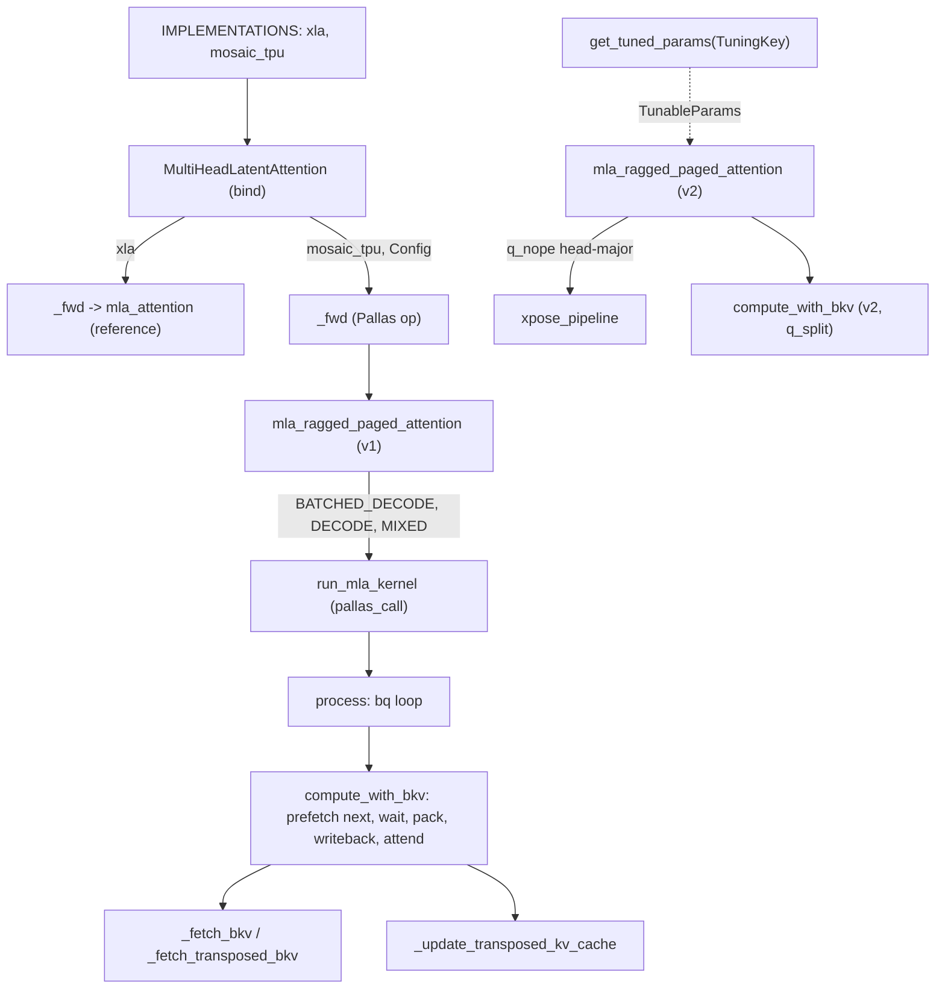

# Multi-Head Latent Attention (MLA) ragged paged attention on TPU

## Overview
MLA (the DeepSeek attention variant) caches one compressed latent vector `kv_c` (width
`lkv_dim`, for example 512) plus one shared RoPE key `k_pe` (width `r_dim`, for example 64)
per token, instead of per-head K and V. tokamax implements the **absorbed** form. The caller
has already folded the K up-projection into the query, giving `ql_nope` in latent space plus
the RoPE part `q_pe`. Inside the kernel every query head then attends to a single shared
"head": the score is `[ql_nope | q_pe] . [kv_c | k_pe]` and the value is `kv_c` itself. So
the output is in latent space (`lkv_dim` wide), and the V up-projection happens after the op.
That makes MLA multi-query attention with a very wide head. The TPU kernel exploits this by
folding all q heads into matmul rows (`bq_sz * num_q_heads`). The op
[`MultiHeadLatentAttention`](https://github.com/openxla/tokamax/blob/3a0a3a34a5ccb8a6ac71f343d9cc44649d73db68/tokamax/_src/ops/experimental/mla/base.py#L30 "tokamax/_src/ops/experimental/mla/base#MultiHeadLatentAttention") wraps the v1 kernel
[`mla_ragged_paged_attention`](https://github.com/openxla/tokamax/blob/3a0a3a34a5ccb8a6ac71f343d9cc44649d73db68/tokamax/_src/ops/experimental/mla/pallas_mosaic_tpu_kernel.py#L2183 "tokamax/_src/ops/experimental/mla/pallas_mosaic_tpu_kernel#mla_ragged_paged_attention"). A second kernel,
[`mla_ragged_paged_attention`](https://github.com/openxla/tokamax/blob/3a0a3a34a5ccb8a6ac71f343d9cc44649d73db68/tokamax/_src/ops/experimental/mla/v2/kernel.py#L2302 "tokamax/_src/ops/experimental/mla/v2/kernel#mla_ragged_paged_attention") in `mla/v2`, is a
library-level evolution with its own tuned-parameter table and is not wired into the op.
Like [batched-ragged-paged-attention](./batched-ragged-paged-attention.md), both kernels
take the vLLM-style ragged batch (`cu_q_lens`, `kv_lens`, `page_indices`, `distribution`),
write the new tokens into the paged cache, and return `(output, updated_cache)`.

## Diagram

Legend:
- `IMPL` - [`IMPLEMENTATIONS`](https://github.com/openxla/tokamax/blob/3a0a3a34a5ccb8a6ac71f343d9cc44649d73db68/tokamax/_src/ops/experimental/mla/api.py#L20 "tokamax/_src/ops/experimental/mla/api#IMPLEMENTATIONS.IMPLEMENTATIONS")
- `OP` - [`MultiHeadLatentAttention`](https://github.com/openxla/tokamax/blob/3a0a3a34a5ccb8a6ac71f343d9cc44649d73db68/tokamax/_src/ops/experimental/mla/base.py#L30 "tokamax/_src/ops/experimental/mla/base#MultiHeadLatentAttention"), [`bind`](https://github.com/openxla/tokamax/blob/3a0a3a34a5ccb8a6ac71f343d9cc44649d73db68/tokamax/_src/ops/experimental/mla/base.py#L34 "tokamax/_src/ops/experimental/mla/base#MultiHeadLatentAttention.bind")
- `REF` - [`_fwd`](https://github.com/openxla/tokamax/blob/3a0a3a34a5ccb8a6ac71f343d9cc44649d73db68/tokamax/_src/ops/experimental/mla/base.py#L101 "tokamax/_src/ops/experimental/mla/base#MultiHeadLatentAttention._fwd"), [`mla_attention`](https://github.com/openxla/tokamax/blob/3a0a3a34a5ccb8a6ac71f343d9cc44649d73db68/tokamax/_src/ops/experimental/mla/reference.py#L125 "tokamax/_src/ops/experimental/mla/reference#mla_attention")
- `PFWD` - [`_fwd`](https://github.com/openxla/tokamax/blob/3a0a3a34a5ccb8a6ac71f343d9cc44649d73db68/tokamax/_src/ops/experimental/mla/pallas_mosaic_tpu.py#L48 "tokamax/_src/ops/experimental/mla/pallas_mosaic_tpu#PallasTpuMultiHeadLatentAttention._fwd")
- `V1` - [`mla_ragged_paged_attention`](https://github.com/openxla/tokamax/blob/3a0a3a34a5ccb8a6ac71f343d9cc44649d73db68/tokamax/_src/ops/experimental/mla/pallas_mosaic_tpu_kernel.py#L2183 "tokamax/_src/ops/experimental/mla/pallas_mosaic_tpu_kernel#mla_ragged_paged_attention")
- `RUN` - [`run_mla_kernel`](https://github.com/openxla/tokamax/blob/3a0a3a34a5ccb8a6ac71f343d9cc44649d73db68/tokamax/_src/ops/experimental/mla/pallas_mosaic_tpu_kernel.py#L2325 "tokamax/_src/ops/experimental/mla/pallas_mosaic_tpu_kernel#mla_ragged_paged_attention.run_mla_kernel")
- `PROC` - [`process`](https://github.com/openxla/tokamax/blob/3a0a3a34a5ccb8a6ac71f343d9cc44649d73db68/tokamax/_src/ops/experimental/mla/pallas_mosaic_tpu_kernel.py#L1787 "tokamax/_src/ops/experimental/mla/pallas_mosaic_tpu_kernel#_mla_ragged_paged_attention_kernel.process")
- `CWB` - [`compute_with_bkv`](https://github.com/openxla/tokamax/blob/3a0a3a34a5ccb8a6ac71f343d9cc44649d73db68/tokamax/_src/ops/experimental/mla/pallas_mosaic_tpu_kernel.py#L1834 "tokamax/_src/ops/experimental/mla/pallas_mosaic_tpu_kernel#_mla_ragged_paged_attention_kernel.process.compute_with_bq.compute_with_bkv")
- `FETCH` - [`_fetch_bkv`](https://github.com/openxla/tokamax/blob/3a0a3a34a5ccb8a6ac71f343d9cc44649d73db68/tokamax/_src/ops/experimental/mla/pallas_mosaic_tpu_kernel.py#L783 "tokamax/_src/ops/experimental/mla/pallas_mosaic_tpu_kernel#_mla_ragged_paged_attention_kernel._fetch_bkv"), [`_fetch_transposed_bkv`](https://github.com/openxla/tokamax/blob/3a0a3a34a5ccb8a6ac71f343d9cc44649d73db68/tokamax/_src/ops/experimental/mla/pallas_mosaic_tpu_kernel.py#L580 "tokamax/_src/ops/experimental/mla/pallas_mosaic_tpu_kernel#_mla_ragged_paged_attention_kernel._fetch_transposed_bkv")
- `UPD` - [`_update_transposed_kv_cache`](https://github.com/openxla/tokamax/blob/3a0a3a34a5ccb8a6ac71f343d9cc44649d73db68/tokamax/_src/ops/experimental/mla/pallas_mosaic_tpu_kernel.py#L1304 "tokamax/_src/ops/experimental/mla/pallas_mosaic_tpu_kernel#_mla_ragged_paged_attention_kernel._update_transposed_kv_cache")
- `V2` - [`mla_ragged_paged_attention`](https://github.com/openxla/tokamax/blob/3a0a3a34a5ccb8a6ac71f343d9cc44649d73db68/tokamax/_src/ops/experimental/mla/v2/kernel.py#L2302 "tokamax/_src/ops/experimental/mla/v2/kernel#mla_ragged_paged_attention")
- `XP` - [`xpose_pipeline`](https://github.com/openxla/tokamax/blob/3a0a3a34a5ccb8a6ac71f343d9cc44649d73db68/tokamax/_src/ops/experimental/mla/v2/transpose.py#L156 "tokamax/_src/ops/experimental/mla/v2/transpose#xpose_pipeline")
- `CWB2` - [`compute_with_bkv`](https://github.com/openxla/tokamax/blob/3a0a3a34a5ccb8a6ac71f343d9cc44649d73db68/tokamax/_src/ops/experimental/mla/v2/kernel.py#L1890 "tokamax/_src/ops/experimental/mla/v2/kernel#_mla_ragged_paged_attention_kernel.process.compute_with_bq.compute_with_bkv")
- `TP` - [`get_tuned_params`](https://github.com/openxla/tokamax/blob/3a0a3a34a5ccb8a6ac71f343d9cc44649d73db68/tokamax/_src/ops/experimental/mla/v2/tuned_params.py#L1137 "tokamax/_src/ops/experimental/mla/v2/tuned_params#get_tuned_params")

## Design rationale (why it's built this way)
- **Absorbed attention with heads as rows.** All heads share K and V, so the kernel loads
  one KV block and multiplies it against a `(bq_sz * num_q_heads, lkv_dim + r_dim)` query
  tile. A decode step with 128 heads still produces a 128-row MXU matmul, even though
  `bq_sz = 1`. This is why the op's heuristics default to `num_queries_per_block = 1`
  (see [`_get_heuristics_config`](https://github.com/openxla/tokamax/blob/3a0a3a34a5ccb8a6ac71f343d9cc44649d73db68/tokamax/_src/ops/experimental/mla/pallas_mosaic_tpu.py#L113 "tokamax/_src/ops/experimental/mla/pallas_mosaic_tpu#PallasTpuMultiHeadLatentAttention._get_heuristics_config")): rows come from heads, not
  tokens. The mask computation derives a row's query position as
  `row // num_q_heads`.
- **One cache row per token, packed along sublanes.** The default cache is
  `[pages, page_size / kv_packing, kv_packing, align(lkv_dim + r_dim, 128)]`. `kv_c` and
  `k_pe` sit side by side in the last dimension, and `kv_packing` tokens share one 32-bit
  word (4 for fp8). A page DMA moves whole tokens, and
  [`_fetch_bkv`](https://github.com/openxla/tokamax/blob/3a0a3a34a5ccb8a6ac71f343d9cc44649d73db68/tokamax/_src/ops/experimental/mla/pallas_mosaic_tpu_kernel.py#L783 "tokamax/_src/ops/experimental/mla/pallas_mosaic_tpu_kernel#_mla_ragged_paged_attention_kernel._fetch_bkv") splits nope and rope into separate VMEM buffers by
  slicing the last dimension. The cost is that new tokens rarely start on a word boundary.
  The kernel appends them "right after the last word containing old cache data" and then
  shifts and packs them into place. For that reason each KV buffer carries two extra words:
  the source comment works an example with packing 4 where 12 tokens need 5 words, not 3.
  An optional `transpose_kv_cache` layout (`[pages, kv_dim, page_size]`, tokens on lanes)
  has its own fetch/pack/update path
  ([`_fetch_transposed_bkv`](https://github.com/openxla/tokamax/blob/3a0a3a34a5ccb8a6ac71f343d9cc44649d73db68/tokamax/_src/ops/experimental/mla/pallas_mosaic_tpu_kernel.py#L580 "tokamax/_src/ops/experimental/mla/pallas_mosaic_tpu_kernel#_mla_ragged_paged_attention_kernel._fetch_transposed_bkv"),
  [`_update_transposed_kv_cache`](https://github.com/openxla/tokamax/blob/3a0a3a34a5ccb8a6ac71f343d9cc44649d73db68/tokamax/_src/ops/experimental/mla/pallas_mosaic_tpu_kernel.py#L1304 "tokamax/_src/ops/experimental/mla/pallas_mosaic_tpu_kernel#_mla_ragged_paged_attention_kernel._update_transposed_kv_cache")), which aligns
  everything to 128 lanes instead.
- **Manual double buffering instead of `emit_pipeline`.** v1 manages its own pipeline (RPA3
  style). It keeps two VMEM slots each for the KV block, the Q block and the output block,
  plus a semaphore array `[4, batch_size, 2]` (bkv fetch, bq fetch, bo send, cache update).
  The current slot indices are stored in scalar-prefetch refs that persist across grid
  iterations. While block i is being computed,
  [`compute_with_bkv`](https://github.com/openxla/tokamax/blob/3a0a3a34a5ccb8a6ac71f343d9cc44649d73db68/tokamax/_src/ops/experimental/mla/pallas_mosaic_tpu_kernel.py#L1834 "tokamax/_src/ops/experimental/mla/pallas_mosaic_tpu_kernel#_mla_ragged_paged_attention_kernel.process.compute_with_bq.compute_with_bkv") already starts the DMA for block i+1,
  which may belong to the next sequence or the next grid step. The grid is therefore
  declared `("arbitrary",)` (sequential). No megacore split is expressed, because the
  cross-step prefetch chain would break.
- **Two-step flash attention.** With `two_step_flash_attention=True` (the default), QK +
  softmax for batch item b is issued before PV for item b-1. The docstring says this is "to
  make them be more parallelized with VALU ops instead of batched matmul in one step".
- **Separate launches per workload class.** Decode-only sequences that fill whole
  `decode_batch_size` groups run in a BATCHED_DECODE launch (`static_q_len = 1`, many
  sequences per grid step). The leftover decode sequences run one per step, and mixed
  sequences run with a dynamic q length. Each launch is a separate `pallas_call` (and
  compile), but the per-case knobs are indexed (decode, prefill, mixed): BATCHED_DECODE and
  DECODE share the decode slot and MIXED uses the mixed slot of
  [`num_kv_pages_per_block`](https://github.com/openxla/tokamax/blob/3a0a3a34a5ccb8a6ac71f343d9cc44649d73db68/tokamax/_src/ops/experimental/mla/v2/tuned_params.py#L51 "tokamax/_src/ops/experimental/mla/v2/tuned_params#TunableParams.num_kv_pages_per_block") /
  [`num_queries_per_block`](https://github.com/openxla/tokamax/blob/3a0a3a34a5ccb8a6ac71f343d9cc44649d73db68/tokamax/_src/ops/experimental/mla/v2/tuned_params.py#L53 "tokamax/_src/ops/experimental/mla/v2/tuned_params#TunableParams.num_queries_per_block").

## Entry points
- [`IMPLEMENTATIONS`](https://github.com/openxla/tokamax/blob/3a0a3a34a5ccb8a6ac71f343d9cc44649d73db68/tokamax/_src/ops/experimental/mla/api.py#L20 "tokamax/_src/ops/experimental/mla/api#IMPLEMENTATIONS.IMPLEMENTATIONS") - `xla` (the reference op) and, if the Pallas
  module imports, `mosaic_tpu`.
- [`MultiHeadLatentAttention`](https://github.com/openxla/tokamax/blob/3a0a3a34a5ccb8a6ac71f343d9cc44649d73db68/tokamax/_src/ops/experimental/mla/base.py#L30 "tokamax/_src/ops/experimental/mla/base#MultiHeadLatentAttention") - the tokamax [`Op`](https://github.com/openxla/tokamax/blob/3a0a3a34a5ccb8a6ac71f343d9cc44649d73db68/tokamax/_src/ops/op.py#L121 "tokamax/_src/ops/op#Op").
  Its [`bind`](https://github.com/openxla/tokamax/blob/3a0a3a34a5ccb8a6ac71f343d9cc44649d73db68/tokamax/_src/ops/experimental/mla/base.py#L34 "tokamax/_src/ops/experimental/mla/base#MultiHeadLatentAttention.bind") requires `len(page_indices)` to be divisible by `max_num_seqs`
  and `cu_q_lens` to have `max_num_seqs + 1` entries. Its [`_fwd`](https://github.com/openxla/tokamax/blob/3a0a3a34a5ccb8a6ac71f343d9cc44649d73db68/tokamax/_src/ops/experimental/mla/base.py#L101 "tokamax/_src/ops/experimental/mla/base#MultiHeadLatentAttention._fwd") calls the
  pure-JAX [`mla_attention`](https://github.com/openxla/tokamax/blob/3a0a3a34a5ccb8a6ac71f343d9cc44649d73db68/tokamax/_src/ops/experimental/mla/reference.py#L125 "tokamax/_src/ops/experimental/mla/reference#mla_attention") reference, which "updates the KV cache with
  new key and value embeddings and then computes attention outputs in a paged structure".
- [`_fwd`](https://github.com/openxla/tokamax/blob/3a0a3a34a5ccb8a6ac71f343d9cc44649d73db68/tokamax/_src/ops/experimental/mla/pallas_mosaic_tpu.py#L48 "tokamax/_src/ops/experimental/mla/pallas_mosaic_tpu#PallasTpuMultiHeadLatentAttention._fwd") of the Pallas op - asserts that a [`Config`](https://github.com/openxla/tokamax/blob/3a0a3a34a5ccb8a6ac71f343d9cc44649d73db68/tokamax/_src/ops/experimental/mla/pallas_mosaic_tpu.py#L33 "tokamax/_src/ops/experimental/mla/pallas_mosaic_tpu#Config") is present,
  then forwards its fields to the v1 kernel (`chunk_prefill_size = 0` means None).
  [`supported_on`](https://github.com/openxla/tokamax/blob/3a0a3a34a5ccb8a6ac71f343d9cc44649d73db68/tokamax/_src/ops/experimental/mla/pallas_mosaic_tpu.py#L148 "tokamax/_src/ops/experimental/mla/pallas_mosaic_tpu#PallasTpuMultiHeadLatentAttention.supported_on") is true only for TPU generation >= 7.
- [`mla_ragged_paged_attention`](https://github.com/openxla/tokamax/blob/3a0a3a34a5ccb8a6ac71f343d9cc44649d73db68/tokamax/_src/ops/experimental/mla/pallas_mosaic_tpu_kernel.py#L2183 "tokamax/_src/ops/experimental/mla/pallas_mosaic_tpu_kernel#mla_ragged_paged_attention") (v1) - jitted, donates
  `cache_kv`. The tuning knobs may be given as one int or as a `(decode, prefill, mixed)`
  tuple.
- [`mla_ragged_paged_attention`](https://github.com/openxla/tokamax/blob/3a0a3a34a5ccb8a6ac71f343d9cc44649d73db68/tokamax/_src/ops/experimental/mla/v2/kernel.py#L2302 "tokamax/_src/ops/experimental/mla/v2/kernel#mla_ragged_paged_attention") (v2) - exported from
  `mla.v2` together with [`get_tuned_params`](https://github.com/openxla/tokamax/blob/3a0a3a34a5ccb8a6ac71f343d9cc44649d73db68/tokamax/_src/ops/experimental/mla/v2/tuned_params.py#L1137 "tokamax/_src/ops/experimental/mla/v2/tuned_params#get_tuned_params"),
  [`TuningKey`](https://github.com/openxla/tokamax/blob/3a0a3a34a5ccb8a6ac71f343d9cc44649d73db68/tokamax/_src/ops/experimental/mla/v2/tuned_params.py#L26 "tokamax/_src/ops/experimental/mla/v2/tuned_params#TuningKey") and [`TunableParams`](https://github.com/openxla/tokamax/blob/3a0a3a34a5ccb8a6ac71f343d9cc44649d73db68/tokamax/_src/ops/experimental/mla/v2/tuned_params.py#L50 "tokamax/_src/ops/experimental/mla/v2/tuned_params#TunableParams"), for serving stacks
  that call the kernel directly.

## Mechanism (step-by-step)
1. **Prepare inputs.** In [`mla_ragged_paged_attention`](https://github.com/openxla/tokamax/blob/3a0a3a34a5ccb8a6ac71f343d9cc44649d73db68/tokamax/_src/ops/experimental/mla/pallas_mosaic_tpu_kernel.py#L2183 "tokamax/_src/ops/experimental/mla/pallas_mosaic_tpu_kernel#mla_ragged_paged_attention"),
   Q heads are padded to the q packing and dims to 128, and Q is reshaped to
   `[tokens, heads/packing, packing, dim]`. New `kv_c` / `k_pe` are padded to a multiple of
   `kv_packing` tokens and reshaped to `[tokens/packing, packing, dim]`, so they can be DMA'd
   word by word next to cached tokens. If `mask_value` is not given, it is the minimum of
   `s_dtype` (bf16 by default; this is the dtype of the QK scores fed to softmax).
2. **Launch per case.** [`run_mla_kernel`](https://github.com/openxla/tokamax/blob/3a0a3a34a5ccb8a6ac71f343d9cc44649d73db68/tokamax/_src/ops/experimental/mla/pallas_mosaic_tpu_kernel.py#L2325 "tokamax/_src/ops/experimental/mla/pallas_mosaic_tpu_kernel#mla_ragged_paged_attention.run_mla_kernel") builds one `pallas_call` with
   `grid = ((end_seq - start_seq) / batch_size,)` and all big operands left in HBM
   (`memory_space=HBM` BlockSpecs). Scratch is allocated explicitly: double-buffered
   nope/rope KV blocks, Q blocks and output blocks, f32 `l`/`m` of shape
   `[batch, bq_sz * heads, 128]`, and an f32 accumulator `[batch, bq_sz * heads, lkv_dim]`.
   Output aliases `ql_nope` and the updated cache aliases `cache_kv`. v1 calls it three
   times: BATCHED_DECODE over
   `[0, floor(distribution[0] / decode_batch_size) * decode_batch_size)`, DECODE over the
   remainder up to `distribution[0]`, and MIXED over `[distribution[1], distribution[2])`.
3. **Per grid step.** The kernel body's [`process`](https://github.com/openxla/tokamax/blob/3a0a3a34a5ccb8a6ac71f343d9cc44649d73db68/tokamax/_src/ops/experimental/mla/pallas_mosaic_tpu_kernel.py#L1787 "tokamax/_src/ops/experimental/mla/pallas_mosaic_tpu_kernel#_mla_ragged_paged_attention_kernel.process") loops over q blocks and,
   inside each, over KV blocks up to the longest sequence in the batch. The prologue (first
   grid step only) zeroes both KV buffers, so uninitialized NaNs cannot leak
   through masked scores, and starts the first Q/KV fetch. The epilogue (last grid step)
   drains the output and cache-update semaphores.
4. **One KV block.** [`compute_with_bkv`](https://github.com/openxla/tokamax/blob/3a0a3a34a5ccb8a6ac71f343d9cc44649d73db68/tokamax/_src/ops/experimental/mla/pallas_mosaic_tpu_kernel.py#L1834 "tokamax/_src/ops/experimental/mla/pallas_mosaic_tpu_kernel#_mla_ragged_paged_attention_kernel.process.compute_with_bq.compute_with_bkv") works in a fixed order. (The next Q
   block was already prefetched by the enclosing q-block loop before the KV loop started.) It
   first prefetches the next KV block, possibly for the next sequence batch. It then waits for the current Q
   (on the first KV block) and the current KV, and packs the new tokens into place
   ([`_update`](https://github.com/openxla/tokamax/blob/3a0a3a34a5ccb8a6ac71f343d9cc44649d73db68/tokamax/_src/ops/experimental/mla/pallas_mosaic_tpu_kernel.py#L1014 "tokamax/_src/ops/experimental/mla/pallas_mosaic_tpu_kernel#_mla_ragged_paged_attention_kernel._pack_new_transposed_kv._update") runs under `pl.when(update_sz > 0)` for the transposed layout). On the
   first q block only, it starts writing the updated KV block back to the paged cache ("only
   needed in first bq loop"), so each new token is written exactly once. Finally it runs
   flash attention. Invalid KV slots are not masked on the KV side, because "the score of
   invalid Q.K^T pairs are masked", and zero-initialized buffers keep them finite.
   [`_fetch_bkv`](https://github.com/openxla/tokamax/blob/3a0a3a34a5ccb8a6ac71f343d9cc44649d73db68/tokamax/_src/ops/experimental/mla/pallas_mosaic_tpu_kernel.py#L783 "tokamax/_src/ops/experimental/mla/pallas_mosaic_tpu_kernel#_mla_ragged_paged_attention_kernel._fetch_bkv") waits for the previous writeback from the same slot
   before overwriting it, issues two DMAs per page (nope and rope slices) via the page table (out-of-range pages
   are clamped to the last page with size 0), then appends the new tokens from the packed
   new-KV input. All DMAs go through [`_async_copy`](https://github.com/openxla/tokamax/blob/3a0a3a34a5ccb8a6ac71f343d9cc44649d73db68/tokamax/_src/ops/experimental/mla/pallas_mosaic_tpu_kernel.py#L570 "tokamax/_src/ops/experimental/mla/pallas_mosaic_tpu_kernel#_mla_ragged_paged_attention_kernel._async_copy"), which turns
   into a no-op in debug mode.
5. **Finish a q block.** At the end of each q block in [`process`](https://github.com/openxla/tokamax/blob/3a0a3a34a5ccb8a6ac71f343d9cc44649d73db68/tokamax/_src/ops/experimental/mla/pallas_mosaic_tpu_kernel.py#L1787 "tokamax/_src/ops/experimental/mla/pallas_mosaic_tpu_kernel#_mla_ragged_paged_attention_kernel.process"), the accumulator is normalized by `l` (approximate reciprocal for
   non-f32 dtypes), stored into the free output slot after waiting for that slot's previous
   send, and DMA'd to HBM asynchronously.
6. **v2 differences.** [`mla_ragged_paged_attention`](https://github.com/openxla/tokamax/blob/3a0a3a34a5ccb8a6ac71f343d9cc44649d73db68/tokamax/_src/ops/experimental/mla/v2/kernel.py#L2302 "tokamax/_src/ops/experimental/mla/v2/kernel#mla_ragged_paged_attention")
   accepts `ql_nope` **head-major** `[heads, tokens, lkv_dim]` (what the absorbed q
   einsum emits). It transposes it to token-major with
   [`xpose_pipeline`](https://github.com/openxla/tokamax/blob/3a0a3a34a5ccb8a6ac71f343d9cc44649d73db68/tokamax/_src/ops/experimental/mla/v2/transpose.py#L156 "tokamax/_src/ops/experimental/mla/v2/transpose#xpose_pipeline"), a tiled Pallas transpose with
   `("parallel", "arbitrary")` grid semantics, and returns the output head-major again for
   the following up-projection. When `chunk_prefill_size` is set it also runs a PREFILL
   launch over `[distribution[0], distribution[1])`. It adds `mixed_q_split`
   ([`q_split`](https://github.com/openxla/tokamax/blob/3a0a3a34a5ccb8a6ac71f343d9cc44649d73db68/tokamax/_src/ops/experimental/mla/v2/tuned_params.py#L59 "tokamax/_src/ops/experimental/mla/v2/tuned_params#TunableParams.q_split")), which cuts the mixed-case query rows into independent slices
   inside [`compute_with_bkv`](https://github.com/openxla/tokamax/blob/3a0a3a34a5ccb8a6ac71f343d9cc44649d73db68/tokamax/_src/ops/experimental/mla/v2/kernel.py#L1890 "tokamax/_src/ops/experimental/mla/v2/kernel#_mla_ragged_paged_attention_kernel.process.compute_with_bq.compute_with_bkv") so the two-step QK/PV overlap
   has more independent work. New-KV packing moves into `kv_utils`. If `vmem_limit_bytes`
   is not given, it defaults to the chip's VMEM capacity instead of raising.

## Key data structures
- [`Config`](https://github.com/openxla/tokamax/blob/3a0a3a34a5ccb8a6ac71f343d9cc44649d73db68/tokamax/_src/ops/experimental/mla/pallas_mosaic_tpu.py#L33 "tokamax/_src/ops/experimental/mla/pallas_mosaic_tpu#Config") (op autotuning) - `num_kv_pages_per_block`,
  `num_queries_per_block`, `vmem_limit_bytes`, `chunk_prefill_size` (multiple of 256, or 0)
  and `decode_batch_size`.
  [`_get_autotuning_configs`](https://github.com/openxla/tokamax/blob/3a0a3a34a5ccb8a6ac71f343d9cc44649d73db68/tokamax/_src/ops/experimental/mla/pallas_mosaic_tpu.py#L123 "tokamax/_src/ops/experimental/mla/pallas_mosaic_tpu#PallasTpuMultiHeadLatentAttention._get_autotuning_configs") sweeps KV pages per block over
  {1, 4, 8, 16, 32, 48, 64} and VMEM limits of 50/80/100% of capacity, with
  `decode_batch_size = 8` and `num_queries_per_block = 1` fixed.
- [`TuningKey`](https://github.com/openxla/tokamax/blob/3a0a3a34a5ccb8a6ac71f343d9cc44649d73db68/tokamax/_src/ops/experimental/mla/v2/tuned_params.py#L26 "tokamax/_src/ops/experimental/mla/v2/tuned_params#TuningKey") (v2) - a frozen key of [`case`](https://github.com/openxla/tokamax/blob/3a0a3a34a5ccb8a6ac71f343d9cc44649d73db68/tokamax/_src/ops/experimental/mla/v2/tuned_params.py#L27 "tokamax/_src/ops/experimental/mla/v2/tuned_params#TuningKey.case")
  (batched_decode / decode_only / mixed), [`max_num_tokens`](https://github.com/openxla/tokamax/blob/3a0a3a34a5ccb8a6ac71f343d9cc44649d73db68/tokamax/_src/ops/experimental/mla/v2/tuned_params.py#L28 "tokamax/_src/ops/experimental/mla/v2/tuned_params#TuningKey.max_num_tokens"),
  [`actual_num_q_heads`](https://github.com/openxla/tokamax/blob/3a0a3a34a5ccb8a6ac71f343d9cc44649d73db68/tokamax/_src/ops/experimental/mla/v2/tuned_params.py#L29 "tokamax/_src/ops/experimental/mla/v2/tuned_params#TuningKey.actual_num_q_heads"), [`actual_lkv_dim`](https://github.com/openxla/tokamax/blob/3a0a3a34a5ccb8a6ac71f343d9cc44649d73db68/tokamax/_src/ops/experimental/mla/v2/tuned_params.py#L30 "tokamax/_src/ops/experimental/mla/v2/tuned_params#TuningKey.actual_lkv_dim"),
  [`actual_r_dim`](https://github.com/openxla/tokamax/blob/3a0a3a34a5ccb8a6ac71f343d9cc44649d73db68/tokamax/_src/ops/experimental/mla/v2/tuned_params.py#L31 "tokamax/_src/ops/experimental/mla/v2/tuned_params#TuningKey.actual_r_dim"), dtypes (fp8 by default),
  [`page_size_per_kv_packing`](https://github.com/openxla/tokamax/blob/3a0a3a34a5ccb8a6ac71f343d9cc44649d73db68/tokamax/_src/ops/experimental/mla/v2/tuned_params.py#L34 "tokamax/_src/ops/experimental/mla/v2/tuned_params#TuningKey.page_size_per_kv_packing"),
  [`kv_packing`](https://github.com/openxla/tokamax/blob/3a0a3a34a5ccb8a6ac71f343d9cc44649d73db68/tokamax/_src/ops/experimental/mla/v2/tuned_params.py#L35 "tokamax/_src/ops/experimental/mla/v2/tuned_params#TuningKey.kv_packing"), [`max_num_seqs`](https://github.com/openxla/tokamax/blob/3a0a3a34a5ccb8a6ac71f343d9cc44649d73db68/tokamax/_src/ops/experimental/mla/v2/tuned_params.py#L36 "tokamax/_src/ops/experimental/mla/v2/tuned_params#TuningKey.max_num_seqs"),
  [`pages_per_seq`](https://github.com/openxla/tokamax/blob/3a0a3a34a5ccb8a6ac71f343d9cc44649d73db68/tokamax/_src/ops/experimental/mla/v2/tuned_params.py#L37 "tokamax/_src/ops/experimental/mla/v2/tuned_params#TuningKey.pages_per_seq") and options. The table entries are commented per
  model and slice: Mistral-Small, DeepSeekV3 and Kimi 2.6 on TPU v7-8, and Mistral-Large-3
  on v7x-16. [`TunableParams`](https://github.com/openxla/tokamax/blob/3a0a3a34a5ccb8a6ac71f343d9cc44649d73db68/tokamax/_src/ops/experimental/mla/v2/tuned_params.py#L50 "tokamax/_src/ops/experimental/mla/v2/tuned_params#TunableParams")
  holds the block sizes, [`vmem_limit_bytes`](https://github.com/openxla/tokamax/blob/3a0a3a34a5ccb8a6ac71f343d9cc44649d73db68/tokamax/_src/ops/experimental/mla/v2/tuned_params.py#L54 "tokamax/_src/ops/experimental/mla/v2/tuned_params#TunableParams.vmem_limit_bytes"),
  [`decode_batch_size`](https://github.com/openxla/tokamax/blob/3a0a3a34a5ccb8a6ac71f343d9cc44649d73db68/tokamax/_src/ops/experimental/mla/v2/tuned_params.py#L57 "tokamax/_src/ops/experimental/mla/v2/tuned_params#TunableParams.decode_batch_size") and `q_split`, plus a partial order (bigger
  blocks and a smaller VMEM limit count as more OOM-prone).
  [`tuned_params_mapping`](https://github.com/openxla/tokamax/blob/3a0a3a34a5ccb8a6ac71f343d9cc44649d73db68/tokamax/_src/ops/experimental/mla/v2/tuned_params.py#L83 "tokamax/_src/ops/experimental/mla/v2/tuned_params#tuned_params_mapping.tuned_params_mapping") is a hand-maintained table. On a miss,
  [`get_tuned_params`](https://github.com/openxla/tokamax/blob/3a0a3a34a5ccb8a6ac71f343d9cc44649d73db68/tokamax/_src/ops/experimental/mla/v2/tuned_params.py#L1137 "tokamax/_src/ops/experimental/mla/v2/tuned_params#get_tuned_params") logs a warning and returns conservative
  defaults.
- The KV block buffers: `[2, batch, bkv_sz/packing + 2, packing, dim]` for nope and rope
  separately. The "+2" words absorb misaligned new tokens.

## Dynamics (design intent)
- The pipeline is cross-iteration: the semaphore and slot indices for bq, bkv and bo live
  in SMEM scalar refs that persist across grid steps, and the prologue/epilogue run only on
  the first/last grid step. The grid must therefore execute in order (`"arbitrary"`).
- Writeback of block i overlaps compute of later blocks. A slot is reused only after
  `wait_update_kv_cache` on that slot, which [`_fetch_bkv`](https://github.com/openxla/tokamax/blob/3a0a3a34a5ccb8a6ac71f343d9cc44649d73db68/tokamax/_src/ops/experimental/mla/pallas_mosaic_tpu_kernel.py#L783 "tokamax/_src/ops/experimental/mla/pallas_mosaic_tpu_kernel#_mla_ragged_paged_attention_kernel._fetch_bkv") calls before
  starting a new fetch into it.
- [`debug_print`](https://github.com/openxla/tokamax/blob/3a0a3a34a5ccb8a6ac71f343d9cc44649d73db68/tokamax/_src/ops/experimental/mla/pallas_mosaic_tpu_kernel.py#L348 "tokamax/_src/ops/experimental/mla/pallas_mosaic_tpu_kernel#_mla_ragged_paged_attention_kernel.debug_print") (and its v2 twin [`debug_print`](https://github.com/openxla/tokamax/blob/3a0a3a34a5ccb8a6ac71f343d9cc44649d73db68/tokamax/_src/ops/experimental/mla/v2/kernel.py#L454 "tokamax/_src/ops/experimental/mla/v2/kernel#_mla_ragged_paged_attention_kernel.debug_print"))
  emit `pl.debug_print` only in debug mode, which also skips DMAs and attention. The
  docstring notes this needs `--xla_tpu_enable_log_recorder`.

## Edge cases
- **v1 skips the prefill-only range.** No launch covers sequences in
  `[distribution[0], distribution[1])` (the source has "TODO: evaluate if
  chunk-prefill-only branch is needed"). Callers must classify chunked prefills as
  "mixed". The benchmark spec builder [`_make_mla_spec`](https://github.com/openxla/tokamax/blob/3a0a3a34a5ccb8a6ac71f343d9cc44649d73db68/tokamax/_src/ops/experimental/mla/arg_specs.py#L36 "tokamax/_src/ops/experimental/mla/arg_specs#_make_mla_spec") does this by
  emitting `distribution = [num_decode, num_decode, n]`. v2 runs the prefill launch only
  when `chunk_prefill_size` is set.
- `lkv_dim` and `r_dim` must be multiples of 128 after padding, and the kernel asserts
  `nope_dim + pe_dim == kv_dim`. The output keeps the padded head count until it is sliced
  in post-processing.
- `q_scale` / `k_scale` multiply the scores and `v_scale` multiplies PV. They are static
  floats (per-tensor), with no per-token path.
- v1 raises if `num_kv_pages_per_block`, `num_queries_per_block` or `vmem_limit_bytes` is
  missing. The op always supplies them from [`Config`](https://github.com/openxla/tokamax/blob/3a0a3a34a5ccb8a6ac71f343d9cc44649d73db68/tokamax/_src/ops/experimental/mla/pallas_mosaic_tpu.py#L33 "tokamax/_src/ops/experimental/mla/pallas_mosaic_tpu#Config").
- Op-level support starts at TPU v7 ([`supported_on`](https://github.com/openxla/tokamax/blob/3a0a3a34a5ccb8a6ac71f343d9cc44649d73db68/tokamax/_src/ops/experimental/mla/pallas_mosaic_tpu.py#L148 "tokamax/_src/ops/experimental/mla/pallas_mosaic_tpu#PallasTpuMultiHeadLatentAttention.supported_on")). The
  [`AbstractArray`](https://github.com/openxla/tokamax/blob/3a0a3a34a5ccb8a6ac71f343d9cc44649d73db68/tokamax/_src/ops/experimental/mla/base.py#L27 "tokamax/_src/ops/experimental/mla/base#AbstractArray") union lets `bind` accept shape-only stand-ins for
  autotuning and benchmarking.

## Open questions
- v2 is not reachable through [`IMPLEMENTATIONS`](https://github.com/openxla/tokamax/blob/3a0a3a34a5ccb8a6ac71f343d9cc44649d73db68/tokamax/_src/ops/experimental/mla/api.py#L20 "tokamax/_src/ops/experimental/mla/api#IMPLEMENTATIONS.IMPLEMENTATIONS"). Whether it will
  replace v1 behind the op (and use [`tuned_params_mapping`](https://github.com/openxla/tokamax/blob/3a0a3a34a5ccb8a6ac71f343d9cc44649d73db68/tokamax/_src/ops/experimental/mla/v2/tuned_params.py#L83 "tokamax/_src/ops/experimental/mla/v2/tuned_params#tuned_params_mapping.tuned_params_mapping")
  instead of the op autotuner) is not stated in the source.
- [`TuningKey`](https://github.com/openxla/tokamax/blob/3a0a3a34a5ccb8a6ac71f343d9cc44649d73db68/tokamax/_src/ops/experimental/mla/v2/tuned_params.py#L26 "tokamax/_src/ops/experimental/mla/v2/tuned_params#TuningKey") documents three cases ("batched_decode", "decode_only",
  "mixed"), but the table only has batched_decode (37) and mixed (22) entries. The
  per-sequence DECODE launch always falls back to the defaults.
- No custom VJP exists. MLA here is inference-only.

## See also
- [batched-ragged-paged-attention](./batched-ragged-paged-attention.md) - the GQA/MHA
  counterpart with a precomputed schedule and `emit_pipeline`.
- [op-framework](./op-framework.md), [autotuning](./autotuning.md),
  [benchmarking-and-serialization](./benchmarking-and-serialization.md) - op dispatch,
  config search and arg specs.
- [kernel-catalog](./kernel-catalog.md), [mosaic-tpu-helpers](./mosaic-tpu-helpers.md).
- [splash-attention](./splash-attention.md), [dot-product-attention](./dot-product-attention.md).
