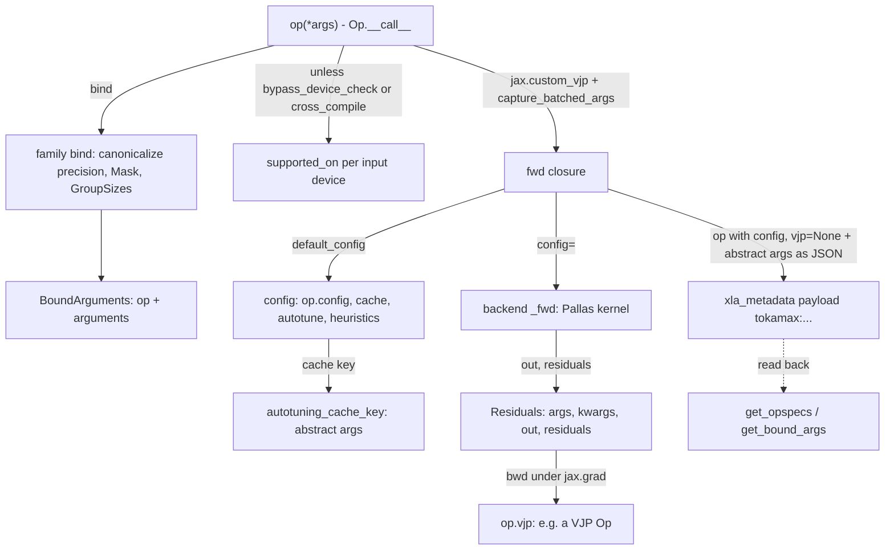

# The Op framework: Op, bind, BoundArguments, configs and custom VJP

## Overview
Every kernel in `tokamax/_src/ops` is a subclass of one abstract class,
[`Op`](https://github.com/openxla/tokamax/blob/3a0a3a34a5ccb8a6ac71f343d9cc44649d73db68/tokamax/_src/ops/op.py#L121 "tokamax/_src/ops/op#Op")
("Base class for operations"). An op *family* (for example
[`RaggedDot`](https://github.com/openxla/tokamax/blob/3a0a3a34a5ccb8a6ac71f343d9cc44649d73db68/tokamax/_src/ops/ragged_dot/base.py#L201 "tokamax/_src/ops/ragged_dot/base#RaggedDot")
or [`DotProductAttention`](https://github.com/openxla/tokamax/blob/3a0a3a34a5ccb8a6ac71f343d9cc44649d73db68/tokamax/_src/ops/attention/base.py#L222 "tokamax/_src/ops/attention/base#DotProductAttention"))
subclasses `Op`, implements `bind` to validate and canonicalize arguments, and implements `_fwd` as
the XLA reference. Each *backend* (for example
[`PallasMosaicTpuRaggedDot`](https://github.com/openxla/tokamax/blob/3a0a3a34a5ccb8a6ac71f343d9cc44649d73db68/tokamax/_src/ops/ragged_dot/pallas_mosaic_tpu.py#L90 "tokamax/_src/ops/ragged_dot/pallas_mosaic_tpu#PallasMosaicTpuRaggedDot"))
subclasses the family, overrides `_fwd` with a Pallas kernel, declares a `Config` dataclass of
tunables, and optionally supplies heuristics, an autotuning search space and a backward op. The key
idea is that **the op instance plus its canonical abstract arguments
([`BoundArguments`](https://github.com/openxla/tokamax/blob/3a0a3a34a5ccb8a6ac71f343d9cc44649d73db68/tokamax/_src/ops/op.py#L437 "tokamax/_src/ops/op#BoundArguments"))
is a serializable, hashable value**: it keys the autotuning cache, it is embedded in the lowered HLO,
and it can be read back out to autotune or benchmark a model offline. `Op.__call__` ties it together:
bind, check the device, pick a config, run `_fwd` under a `jax.custom_vjp`, and route gradients to
the op's `vjp`.

## Diagram

Legend:
- `CALL` - [`Op`](https://github.com/openxla/tokamax/blob/3a0a3a34a5ccb8a6ac71f343d9cc44649d73db68/tokamax/_src/ops/op.py#L121 "tokamax/_src/ops/op#Op")
- `BIND` - [`bind`](https://github.com/openxla/tokamax/blob/3a0a3a34a5ccb8a6ac71f343d9cc44649d73db68/tokamax/_src/ops/op.py#L317 "tokamax/_src/ops/op#Op.bind") (overridden by [`RaggedDot`](https://github.com/openxla/tokamax/blob/3a0a3a34a5ccb8a6ac71f343d9cc44649d73db68/tokamax/_src/ops/ragged_dot/base.py#L201 "tokamax/_src/ops/ragged_dot/base#RaggedDot"), [`DotProductAttention`](https://github.com/openxla/tokamax/blob/3a0a3a34a5ccb8a6ac71f343d9cc44649d73db68/tokamax/_src/ops/attention/base.py#L222 "tokamax/_src/ops/attention/base#DotProductAttention"))
- `BA` - [`BoundArguments`](https://github.com/openxla/tokamax/blob/3a0a3a34a5ccb8a6ac71f343d9cc44649d73db68/tokamax/_src/ops/op.py#L437 "tokamax/_src/ops/op#BoundArguments")
- `SUP` - [`supported_on`](https://github.com/openxla/tokamax/blob/3a0a3a34a5ccb8a6ac71f343d9cc44649d73db68/tokamax/_src/ops/op.py#L409 "tokamax/_src/ops/op#Op.supported_on")
- `FWD` - [`fwd`](https://github.com/openxla/tokamax/blob/3a0a3a34a5ccb8a6ac71f343d9cc44649d73db68/tokamax/_src/ops/op.py#L226 "tokamax/_src/ops/op#Op.fwd")
- `CFG` - [`config`](https://github.com/openxla/tokamax/blob/3a0a3a34a5ccb8a6ac71f343d9cc44649d73db68/tokamax/_src/ops/op.py#L166 "tokamax/_src/ops/op#Op.config"), [`_get_heuristics_config`](https://github.com/openxla/tokamax/blob/3a0a3a34a5ccb8a6ac71f343d9cc44649d73db68/tokamax/_src/ops/op.py#L359 "tokamax/_src/ops/op#Op._get_heuristics_config")
- `KEY` - [`autotuning_cache_key`](https://github.com/openxla/tokamax/blob/3a0a3a34a5ccb8a6ac71f343d9cc44649d73db68/tokamax/_src/ops/op.py#L538 "tokamax/_src/ops/op#BoundArguments.autotuning_cache_key")
- `META` - (concept) the `tokamax:<json>` XLA metadata payload set inside `fwd`
- `KFWD` - [`_fwd`](https://github.com/openxla/tokamax/blob/3a0a3a34a5ccb8a6ac71f343d9cc44649d73db68/tokamax/_src/ops/op.py#L356 "tokamax/_src/ops/op#Op._fwd")
- `RES` - (concept) the `Residuals` pytree saved for the backward pass
- `VJP` - [`vjp`](https://github.com/openxla/tokamax/blob/3a0a3a34a5ccb8a6ac71f343d9cc44649d73db68/tokamax/_src/ops/op.py#L174 "tokamax/_src/ops/op#Op.vjp")
- `SPECS` - [`get_opspecs`](https://github.com/openxla/tokamax/blob/3a0a3a34a5ccb8a6ac71f343d9cc44649d73db68/tokamax/_src/hlo_utils.py#L63 "tokamax/_src/hlo_utils#get_opspecs"), [`get_bound_args`](https://github.com/openxla/tokamax/blob/3a0a3a34a5ccb8a6ac71f343d9cc44649d73db68/tokamax/_src/hlo_utils.py#L103 "tokamax/_src/hlo_utils#get_bound_args")

## Design rationale
- **One call protocol for every backend.** The `Op` docstring spells out the split of
  responsibilities: family implementors "Implement the `bind` method ... Implement the `_fwd` method,
  providing a default XLA implementation"; backend implementors "Override the `_fwd` method ...
  Optionally, override `_get_heuristics_config` and `_get_autotuning_configs`. Optionally, set a
  default `vjp` function." Because dispatch, config resolution, vmap capture, serialization and
  autodiff all live in `Op.__call__`, a new Pallas TPU kernel gets autotuning, offline tuning,
  benchmarking and `jax.grad` support by filling in three or four methods.
- **Canonicalize before keying.** `bind` turns equivalent spellings into one value (precision into a
  canonical form - a `Precision` pair or a dot algorithm - `is_causal` into a [`Mask`](https://github.com/openxla/tokamax/blob/3a0a3a34a5ccb8a6ac71f343d9cc44649d73db68/tokamax/_src/ops/attention/base.py#L60 "tokamax/_src/ops/attention/base#Mask"),
  `logits_scale=AUTO` into `1/sqrt(head_dim)`, raw group sizes into a `GroupSizes` with a
  representative distribution). The canonical, abstractified arguments are what the cache key and
  the serialized HLO payload are built from, so two call sites that mean the same thing share an
  autotuned config.
- **Configs are values, not code.** A backend's config is a frozen, hashable pydantic dataclass,
  e.g. the GMM v1 [`Config`](https://github.com/openxla/tokamax/blob/3a0a3a34a5ccb8a6ac71f343d9cc44649d73db68/tokamax/_src/ops/ragged_dot/pallas_mosaic_tpu.py#L58 "tokamax/_src/ops/ragged_dot/pallas_mosaic_tpu#Config")
  ("Pallas Mosaic TPU Ragged Dot config": `tile_m`, `tile_k`, `tile_n`, `input_buffer_count`,
  `combine_scopes`). Hashability lets autotuning use sets of configs; pydantic lets an
  `AutotuningResult` and the on-disk cache round-trip them as JSON.
- **The backward is another Op.** Making `vjp` a field (often an `Op` subclass such as a
  `...Vjp` class) means the backward kernel has its own `Config`, heuristics and autotuning space,
  and appears in the HLO with its own payload, so "autotune `jax.grad(f)`" tunes forward and backward
  kernels separately (docs/autotuning.md: "Tokamax VJP ops may be implemented as their own Op class
  and have their own search space").
- **Always a `custom_vjp`, even with no `vjp`.** The source comment: "We must wrap the op in a
  `custom_vjp`, even if no `vjp` function is provided, as we use `custom_batching` to capture the
  batched arguments, and `custom_batching` doesn't support `jax.vjp`." vmap capture is what lets a
  config and cache key see the true (vmapped) problem size.

## Entry points
- [`Op`](https://github.com/openxla/tokamax/blob/3a0a3a34a5ccb8a6ac71f343d9cc44649d73db68/tokamax/_src/ops/op.py#L121 "tokamax/_src/ops/op#Op")`.__call__` -
  reached whenever user code calls a registered implementation, directly or through a public
  function such as `tokamax.ragged_dot` (see [kernel-catalog](kernel-catalog.md) for the dispatch
  loop that tries implementations in order).
- [`bind`](https://github.com/openxla/tokamax/blob/3a0a3a34a5ccb8a6ac71f343d9cc44649d73db68/tokamax/_src/ops/op.py#L317 "tokamax/_src/ops/op#Op.bind") -
  called by `__call__`, and directly by users who want a config without running the op: the `Op`
  docstring's example is `op.bind(*args, **kwargs).cached_autotuning_data.fastest_config`.
- [`BoundArguments`](https://github.com/openxla/tokamax/blob/3a0a3a34a5ccb8a6ac71f343d9cc44649d73db68/tokamax/_src/ops/op.py#L437 "tokamax/_src/ops/op#BoundArguments") -
  the most externally used symbol of the subsystem: autotuning, benchmarking, HLO extraction and
  the torch_tpu wrappers all pass these around.
- [`replace`](https://github.com/openxla/tokamax/blob/3a0a3a34a5ccb8a6ac71f343d9cc44649d73db68/tokamax/_src/ops/op.py#L326 "tokamax/_src/ops/op#Op.replace") -
  how callers pin a config (`op.replace(config=...)`) or strip the VJP (`replace(vjp=None)`) for
  cache lookups and serialization.
- [`get_bound_args`](https://github.com/openxla/tokamax/blob/3a0a3a34a5ccb8a6ac71f343d9cc44649d73db68/tokamax/_src/hlo_utils.py#L103 "tokamax/_src/hlo_utils#get_bound_args")
  and [`autotune`](https://github.com/openxla/tokamax/blob/3a0a3a34a5ccb8a6ac71f343d9cc44649d73db68/tokamax/_src/autotuning/api.py#L309 "tokamax/_src/autotuning/api#autotune")
  (outside this subsystem) - lower a function and recover every op's `BoundArguments` from its HLO.

## Mechanism (step-by-step)
1. **Shape and symbolic checks, then bind.** `__call__` first rejects symbolic shapes if the class
   sets `supports_symbolic_shapes = False` (the GPU ragged dot, GLU and normalization kernels, and
   Mosaic TPU flash attention do). It then calls
   [`bind`](https://github.com/openxla/tokamax/blob/3a0a3a34a5ccb8a6ac71f343d9cc44649d73db68/tokamax/_src/ops/op.py#L317 "tokamax/_src/ops/op#Op.bind").
   The default `bind` binds against the signature of `_fwd` minus its `config` parameter and applies
   defaults; families override it to canonicalize. [`RaggedDot`](https://github.com/openxla/tokamax/blob/3a0a3a34a5ccb8a6ac71f343d9cc44649d73db68/tokamax/_src/ops/ragged_dot/base.py#L201 "tokamax/_src/ops/ragged_dot/base#RaggedDot")
   fills default dimension numbers, wraps group sizes in `GroupSizes` (optionally checkified for
   negative or oversized groups) and canonicalizes precision;
   [`DotProductAttention`](https://github.com/openxla/tokamax/blob/3a0a3a34a5ccb8a6ac71f343d9cc44649d73db68/tokamax/_src/ops/attention/base.py#L222 "tokamax/_src/ops/attention/base#DotProductAttention")
   splits precision into a (qk, pv) pair, derives `logits_dtype` from the qk dot algorithm's
   accumulation type, and folds `is_causal` into the mask.
2. **Device gate.** Unless `bypass_device_check` is set on the op or the global
   `tokamax_cross_compile` flag is on, every device holding an input array (or the default device
   if none can be inferred) must pass
   [`supported_on`](https://github.com/openxla/tokamax/blob/3a0a3a34a5ccb8a6ac71f343d9cc44649d73db68/tokamax/_src/ops/op.py#L409 "tokamax/_src/ops/op#Op.supported_on");
   failure raises `NotImplementedError("Not supported on <device_kind>")`, the signal the public
   dispatchers use to move on to the next implementation. The base returns `True`; Mosaic TPU
   backends check `platform == "tpu"` and a minimum TPU generation.
3. **Split arrays from statics and capture vmap.** Arguments are flattened; arrays become the
   differentiable inputs of the [`fwd`](https://github.com/openxla/tokamax/blob/3a0a3a34a5ccb8a6ac71f343d9cc44649d73db68/tokamax/_src/ops/op.py#L226 "tokamax/_src/ops/op#Op.fwd")
   closure and everything else is closed over. `fwd` is wrapped by `capture_batched_args`, a
   `custom_batching` rule that, under `jax.vmap`, re-enters `fwd` with `BatchedShapeDtype` records
   carrying the vmap axes. `fwd` then rebuilds `BoundArguments` from those batched shapes, so the
   config choice and cache key see the full vmapped problem. Ops that cannot support this set
   `supports_batched_args_capture = False` ([`FlexAttention`](https://github.com/openxla/tokamax/blob/3a0a3a34a5ccb8a6ac71f343d9cc44649d73db68/tokamax/_src/ops/flex_attention/base.py#L45 "tokamax/_src/ops/flex_attention/base#FlexAttention") does).
4. **Resolve the config.** `fwd` reads `BoundArguments.default_config`, which calls `get_config` with
   the `tokamax_autotuning_cache_miss_fallback` policy (default `heuristics`). The order is: the
   op's own [`config`](https://github.com/openxla/tokamax/blob/3a0a3a34a5ccb8a6ac71f343d9cc44649d73db68/tokamax/_src/ops/op.py#L166 "tokamax/_src/ops/op#Op.config")
   if set; the heuristics config if it is the `NullConfig` (unconfigurable op, done); the fastest
   entry from the autotuning cache (`AutotuningResult` overlays first, innermost wins, then the
   per-device-kind on-disk cache), keyed by
   [`autotuning_cache_key`](https://github.com/openxla/tokamax/blob/3a0a3a34a5ccb8a6ac71f343d9cc44649d73db68/tokamax/_src/ops/op.py#L538 "tokamax/_src/ops/op#BoundArguments.autotuning_cache_key");
   an inline autotune if the policy is `autotune`; the heuristics config if allowed; otherwise
   `ValueError("No config found ...")`. Backend heuristics can be substantial: GMM v1's
   [`_get_heuristics_config`](https://github.com/openxla/tokamax/blob/3a0a3a34a5ccb8a6ac71f343d9cc44649d73db68/tokamax/_src/ops/ragged_dot/pallas_mosaic_tpu.py#L308 "tokamax/_src/ops/ragged_dot/pallas_mosaic_tpu#PallasMosaicTpuRaggedDot._get_heuristics_config")
   starts from `tile_m = min(m, 1024)`, full `n` and `k`, and halves m, then n, then k (multiples
   of 128) until double-buffered inputs plus a 3x output tile fit in the scoped VMEM budget (half of
   VMEM, further divided by 2 on v6 and 4 on v5); it only does this on TPU7x and returns the 128^3
   default elsewhere.
5. **Stamp the op into the HLO.** Before calling `_fwd`, `fwd` serializes
   `op.replace(config=chosen, vjp=None)` plus the abstractified arguments to JSON and sets it as the
   XLA metadata payload `tokamax:<json>` for every HLO op emitted inside. Nested tokamax ops stack
   their payloads outermost-first (`outer/tokamax:inner`). This is what
   [`get_opspecs`](https://github.com/openxla/tokamax/blob/3a0a3a34a5ccb8a6ac71f343d9cc44649d73db68/tokamax/_src/hlo_utils.py#L63 "tokamax/_src/hlo_utils#get_opspecs")
   later parses back into `BoundArguments`, and what the payload-stacking test
   [`test_get_opspecs_stacked_payloads`](https://github.com/openxla/tokamax/blob/3a0a3a34a5ccb8a6ac71f343d9cc44649d73db68/tokamax/_src/hlo_utils_test.py#L547 "tokamax/_src/hlo_utils_test#HloUtilsHelpersTest.test_get_opspecs_stacked_payloads") exercises.
6. **Run the backend kernel.** [`_fwd`](https://github.com/openxla/tokamax/blob/3a0a3a34a5ccb8a6ac71f343d9cc44649d73db68/tokamax/_src/ops/op.py#L356 "tokamax/_src/ops/op#Op._fwd")
   receives the bound arguments plus `config=` and returns `(out, residuals)`. For example GMM v2's
   [`_fwd`](https://github.com/openxla/tokamax/blob/3a0a3a34a5ccb8a6ac71f343d9cc44649d73db68/tokamax/_src/ops/ragged_dot/pallas_mosaic_tpu_v2.py#L152 "tokamax/_src/ops/ragged_dot/pallas_mosaic_tpu_v2#PallasMosaicTpuV2RaggedDot._fwd")
   validates quantization and dimension numbers (raising `NotImplementedError` for unsupported
   cases so dispatch can fall through) and calls [`gmm_v2`](https://github.com/openxla/tokamax/blob/3a0a3a34a5ccb8a6ac71f343d9cc44649d73db68/tokamax/_src/ops/experimental/gmm_v2/gmm_v2.py#L1537 "tokamax/_src/ops/experimental/gmm_v2/gmm_v2#gmm_v2").
   The forward output, arguments and residuals are packed into a `Residuals` pytree (arrays as
   leaves, statics in the treedef) for the backward pass.
7. **Backward.** With a `vjp`, `bwd` unpacks `Residuals` and calls
   [`vjp`](https://github.com/openxla/tokamax/blob/3a0a3a34a5ccb8a6ac71f343d9cc44649d73db68/tokamax/_src/ops/op.py#L174 "tokamax/_src/ops/op#Op.vjp")`(residuals, out, dout, *args, **kwargs)`.
   The VJP may return a tuple (one gradient per positional argument) or a dict by argument name;
   keyword arrays it omits get zeros, and the result is structure-checked against the inputs. The
   `custom_vjp` is defined with `optimize_remat=True`. Without a `vjp`, `fwd` instead runs
   `jax.vjp` over `_fwd` itself; if that raises (typical for a raw `pallas_call`), the error is
   deferred and resurfaces as `NotImplementedError("vjp not implemented")` only if a gradient is
   actually taken, so inference-only kernels still run forward under a `custom_vjp`.

## Key data structures
- [`Op`](https://github.com/openxla/tokamax/blob/3a0a3a34a5ccb8a6ac71f343d9cc44649d73db68/tokamax/_src/ops/op.py#L121 "tokamax/_src/ops/op#Op")`[P, T, R, C, K]` -
  a frozen dataclass generic over the call signature, output, residuals, config type and cache-key
  type. Instance fields: `config` (None = choose per call), `bypass_device_check`, `vjp`. Class
  variables: `config_cls` (defaults to `NullConfig`, meaning "no tunables"),
  `supports_symbolic_shapes`, `supports_batched_args_capture`. Being a frozen dataclass makes the op
  hashable and comparable, so it can key the in-process cache dictionary.
- [`BoundArguments`](https://github.com/openxla/tokamax/blob/3a0a3a34a5ccb8a6ac71f343d9cc44649d73db68/tokamax/_src/ops/op.py#L437 "tokamax/_src/ops/op#BoundArguments") -
  [`op`](https://github.com/openxla/tokamax/blob/3a0a3a34a5ccb8a6ac71f343d9cc44649d73db68/tokamax/_src/ops/op.py#L440 "tokamax/_src/ops/op#BoundArguments.op")
  plus an immutable [`arguments`](https://github.com/openxla/tokamax/blob/3a0a3a34a5ccb8a6ac71f343d9cc44649d73db68/tokamax/_src/ops/op.py#L441 "tokamax/_src/ops/op#BoundArguments.arguments")
  mapping. Its properties are the framework's query surface: `default_config` / `get_config`,
  `heuristics_config`, `autotuning_cache_key`, `cached_autotuning_data`, `autotuning_configs`
  (`{heuristics} | _get_autotuning_configs`), `autotune()`, `benchmark()`, and `vjp_arg_spec`
  (arguments plus `residuals`, `out`, `dout` shapes for tuning the backward). It has a custom
  pydantic schema: the op serializes with its import path (`__type`) and fields, arguments through a
  per-op arg-spec model; [`test_roundtrip`](https://github.com/openxla/tokamax/blob/3a0a3a34a5ccb8a6ac71f343d9cc44649d73db68/tokamax/_src/ops/op_test.py#L302 "tokamax/_src/ops/op_test#BoundArgumentsTest.test_roundtrip")
  checks Python and JSON round trips.
- The cache key - by default an `immutabledict` of positional parameter names to abstractified
  values (`ShapeDtypeStruct` for arrays) plus abstractified keyword values. For ragged dot,
  `GroupSizes` carries "a representative distribution of group sizes" because the real values are
  runtime data that "will vary from one step to the next".
- Backend `Config` classes, e.g. the GMM v1 [`Config`](https://github.com/openxla/tokamax/blob/3a0a3a34a5ccb8a6ac71f343d9cc44649d73db68/tokamax/_src/ops/ragged_dot/pallas_mosaic_tpu.py#L58 "tokamax/_src/ops/ragged_dot/pallas_mosaic_tpu#Config"),
  and their search spaces in `_get_autotuning_configs`: GMM v1 sweeps power-of-two and divisor tiles
  in multiples of 128 (m capped at 1024) times `input_buffer_count` in {2, 3, 4}; Mosaic TPU flash
  attention's [`_get_autotuning_configs`](https://github.com/openxla/tokamax/blob/3a0a3a34a5ccb8a6ac71f343d9cc44649d73db68/tokamax/_src/ops/attention/pallas_mosaic_tpu.py#L192 "tokamax/_src/ops/attention/pallas_mosaic_tpu#PallasMosaicTpuFlashAttention._get_autotuning_configs")
  sweeps `block_q`/`block_kv` in 256..2048 and `block_kv_compute` in 256..1024, q/k/v layouts (head-dim-minor vs
  sequence-minor) and the experimental scheduler, pruning tiles of 4096+ because they push compile
  time past 15 minutes per config.

## Dynamics (design intent)
- Everything above runs at trace time. Config resolution, cache lookups and even inline autotuning
  (`fallback=autotune`) happen while JAX traces the function; the chosen config is baked into the
  lowered kernel and recorded in its metadata. `AutotuningResult` contexts work by pushing an
  overlay onto a context variable and also appending their id to a JAX user context
  (`jax.make_user_context`).
  The autotuning test suite checks the consequence: an already-jitted function retraces when a
  result context is entered and reuses its earlier trace on exit, so the overlay (consulted only at
  trace time) always takes effect (see [autotuning](autotuning.md)).
- The heuristics config is computed on every resolution (it is needed to detect `NullConfig`),
  even when the cache will supply the final answer, so heuristics must be cheap and side-effect free.
- The device kind used for cache lookup comes from the input arrays; during export or
  cross-compilation with no concrete devices it falls back to the abstract mesh's device, then the
  default device. Inputs on mixed device kinds are an error.
- The on-disk cache is loaded lazily once per op (keyed on the op with `vjp=None`) and memoized in a
  module-level dict; `tokamax_ignore_autotuning_cache` disables both reading and lookup.

## Edge cases
- `replace(vjp=None)` really clears the VJP: `Op.replace` re-sets `vjp` after
  `dataclasses.replace`, because most backends install a default VJP in `__post_init__` whenever
  `vjp is None`. Note that `BoundArguments` rebinds `replace` to plain `dataclasses.replace`.
- An explicit `config` short-circuits everything, including the cache; get_bound_args strips the
  serialized config (`op.replace(config=None)`) so extracted specs re-tune from scratch.
- `bypass_device_check` only skips the `supported_on` pre-check; a kernel lowered for the wrong chip
  still fails at lowering. Cross-compilation (`tokamax.config.cross_compile(True)`) also makes the GPU
  capability helpers return true.
- The VJP receives the canonicalized (bound) arguments, not the user's originals, and must return
  gradients matching their pytree structure; returning a dict is the easy way to skip non-differentiable inputs.
- [`DotProductAttention`](https://github.com/openxla/tokamax/blob/3a0a3a34a5ccb8a6ac71f343d9cc44649d73db68/tokamax/_src/ops/attention/base.py#L222 "tokamax/_src/ops/attention/base#DotProductAttention")
  overrides `__call__` to handle `q_sharding` itself (it wraps `Op.__call__` in a `shard_map` built from
  the query PartitionSpec and rejects head-dim or kv-sequence sharding); `bind` raises if a sharding
  is passed to it directly.

## Open questions
- `Op._get_autotuning_cache_key` is overridable per op, but no in-subgraph backend overrides it, so
  whether any op narrows the key (for example ignoring irrelevant kwargs) is not settled here.
- `snake_case_name` derives implementation names from class names, but the public registries use
  hand-written short names (`mosaic_tpu`, `triton`); how the two are meant to relate is not documented.

## See also
- [kernel-catalog](kernel-catalog.md): every op family and backend built on this framework, and the per-op dispatch loops.
- [autotuning](autotuning.md): the autotuner, `AutotuningResult` overlays and the on-disk cache this page's config resolution reads.
- [benchmarking-and-serialization](benchmarking-and-serialization.md): `BoundArguments.benchmark`, HLO extraction and export.
- [ragged-dot-gmm](ragged-dot-gmm.md) and [dot-product-attention](dot-product-attention.md): the two families used as examples here.
- [torch-tpu-bridge](torch-tpu-bridge.md): how the PyTorch wrappers reuse `BoundArguments` and configs.
