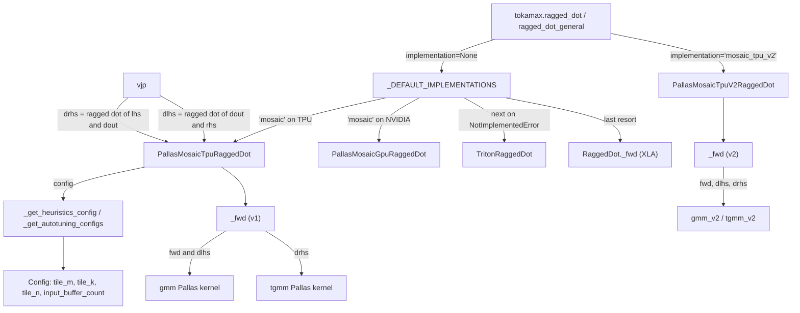

# Ragged dot (grouped matmul, GMM) - API, dispatch and the Pallas Mosaic TPU kernels

## Overview
`tokamax.ragged_dot` is a drop-in for `jax.lax.ragged_dot`: `lhs [m, k]` rows are split into
contiguous groups by `group_sizes [g]`, and group `i` is multiplied by its own weight matrix
`rhs[i] : [k, n]` - the MoE expert matmul the authors cite as "MegaBlocks-style"
([`RaggedDot`](https://github.com/openxla/tokamax/blob/3a0a3a34a5ccb8a6ac71f343d9cc44649d73db68/tokamax/_src/ops/ragged_dot/base.py#L201 "tokamax/_src/ops/ragged_dot/base#RaggedDot")).
The op is a tokamax [`Op`](https://github.com/openxla/tokamax/blob/3a0a3a34a5ccb8a6ac71f343d9cc44649d73db68/tokamax/_src/ops/op.py#L121 "tokamax/_src/ops/op#Op")
with one reference (XLA) implementation and several kernel backends; on TPU the backend is
[`PallasMosaicTpuRaggedDot`](https://github.com/openxla/tokamax/blob/3a0a3a34a5ccb8a6ac71f343d9cc44649d73db68/tokamax/_src/ops/ragged_dot/pallas_mosaic_tpu.py#L90 "tokamax/_src/ops/ragged_dot/pallas_mosaic_tpu#PallasMosaicTpuRaggedDot")
("v1", the default) or, only when asked for by name,
[`PallasMosaicTpuV2RaggedDot`](https://github.com/openxla/tokamax/blob/3a0a3a34a5ccb8a6ac71f343d9cc44649d73db68/tokamax/_src/ops/ragged_dot/pallas_mosaic_tpu_v2.py#L78 "tokamax/_src/ops/ragged_dot/pallas_mosaic_tpu_v2#PallasMosaicTpuV2RaggedDot")
("v2", a thin wrapper over the [GMM v2 kernels](./gmm-v2.md)). The key design idea is that
**one op class serves forward and both gradients**: the backward pass is two more ragged dots
with different dimension numbers, and each TPU implementation recognizes exactly three
dimension-number layouts - forward (gmm), dlhs (gmm with a transposed rhs) and drhs (tgmm,
"transposed gmm", whose output is per-group `[g, k, n]`).

## Diagram

Legend:
- `API` - (concept) public entry `tokamax.ragged_dot`; see [op-framework](./op-framework.md)
- `DEF` - [`_DEFAULT_IMPLEMENTATIONS`](https://github.com/openxla/tokamax/blob/3a0a3a34a5ccb8a6ac71f343d9cc44649d73db68/tokamax/_src/ops/ragged_dot/api.py#L32 "tokamax/_src/ops/ragged_dot/api#_DEFAULT_IMPLEMENTATIONS")
- `V1` - [`PallasMosaicTpuRaggedDot`](https://github.com/openxla/tokamax/blob/3a0a3a34a5ccb8a6ac71f343d9cc44649d73db68/tokamax/_src/ops/ragged_dot/pallas_mosaic_tpu.py#L90 "tokamax/_src/ops/ragged_dot/pallas_mosaic_tpu#PallasMosaicTpuRaggedDot")
- `MGPU` - [`PallasMosaicGpuRaggedDot`](https://github.com/openxla/tokamax/blob/3a0a3a34a5ccb8a6ac71f343d9cc44649d73db68/tokamax/_src/ops/ragged_dot/pallas_mosaic_gpu.py#L85 "tokamax/_src/ops/ragged_dot/pallas_mosaic_gpu#PallasMosaicGpuRaggedDot")
- `TRI` - [`TritonRaggedDot`](https://github.com/openxla/tokamax/blob/3a0a3a34a5ccb8a6ac71f343d9cc44649d73db68/tokamax/_src/ops/ragged_dot/triton.py#L508 "tokamax/_src/ops/ragged_dot/triton#TritonRaggedDot")
- `XLA` - [`_fwd`](https://github.com/openxla/tokamax/blob/3a0a3a34a5ccb8a6ac71f343d9cc44649d73db68/tokamax/_src/ops/ragged_dot/base.py#L277 "tokamax/_src/ops/ragged_dot/base#RaggedDot._fwd")
- `V2` - [`PallasMosaicTpuV2RaggedDot`](https://github.com/openxla/tokamax/blob/3a0a3a34a5ccb8a6ac71f343d9cc44649d73db68/tokamax/_src/ops/ragged_dot/pallas_mosaic_tpu_v2.py#L78 "tokamax/_src/ops/ragged_dot/pallas_mosaic_tpu_v2#PallasMosaicTpuV2RaggedDot")
- `HEUR` - [`_get_heuristics_config`](https://github.com/openxla/tokamax/blob/3a0a3a34a5ccb8a6ac71f343d9cc44649d73db68/tokamax/_src/ops/ragged_dot/pallas_mosaic_tpu.py#L308 "tokamax/_src/ops/ragged_dot/pallas_mosaic_tpu#PallasMosaicTpuRaggedDot._get_heuristics_config") and [`_get_autotuning_configs`](https://github.com/openxla/tokamax/blob/3a0a3a34a5ccb8a6ac71f343d9cc44649d73db68/tokamax/_src/ops/ragged_dot/pallas_mosaic_tpu.py#L435 "tokamax/_src/ops/ragged_dot/pallas_mosaic_tpu#PallasMosaicTpuRaggedDot._get_autotuning_configs")
- `CFG` - [`Config`](https://github.com/openxla/tokamax/blob/3a0a3a34a5ccb8a6ac71f343d9cc44649d73db68/tokamax/_src/ops/ragged_dot/pallas_mosaic_tpu.py#L58 "tokamax/_src/ops/ragged_dot/pallas_mosaic_tpu#Config")
- `F1` - [`_fwd`](https://github.com/openxla/tokamax/blob/3a0a3a34a5ccb8a6ac71f343d9cc44649d73db68/tokamax/_src/ops/ragged_dot/pallas_mosaic_tpu.py#L119 "tokamax/_src/ops/ragged_dot/pallas_mosaic_tpu#PallasMosaicTpuRaggedDot._fwd")
- `GMM` - [`gmm`](https://github.com/openxla/tokamax/blob/3a0a3a34a5ccb8a6ac71f343d9cc44649d73db68/tokamax/_src/ops/ragged_dot/pallas_mosaic_tpu_kernel.py#L330 "tokamax/_src/ops/ragged_dot/pallas_mosaic_tpu_kernel#gmm")
- `TGMM` - (concept) the v1 transposed-gmm kernel in the same module as `gmm`
- `F2` - [`_fwd`](https://github.com/openxla/tokamax/blob/3a0a3a34a5ccb8a6ac71f343d9cc44649d73db68/tokamax/_src/ops/ragged_dot/pallas_mosaic_tpu_v2.py#L152 "tokamax/_src/ops/ragged_dot/pallas_mosaic_tpu_v2#PallasMosaicTpuV2RaggedDot._fwd")
- `G2` - (concept) the GMM v2 kernels, see [gmm-v2](./gmm-v2.md)
- `VJP` - [`vjp`](https://github.com/openxla/tokamax/blob/3a0a3a34a5ccb8a6ac71f343d9cc44649d73db68/tokamax/_src/ops/ragged_dot/base.py#L347 "tokamax/_src/ops/ragged_dot/base#vjp")

## Design rationale (why it's built this way)
- **Gradients are ragged dots too.** [`vjp`](https://github.com/openxla/tokamax/blob/3a0a3a34a5ccb8a6ac71f343d9cc44649d73db68/tokamax/_src/ops/ragged_dot/base.py#L347 "tokamax/_src/ops/ragged_dot/base#vjp")
  derives new `RaggedDotDimensionNumbers` for `dlhs = dout @ rhs^T` (still ragged in m, grouped
  rhs) and `drhs = lhs^T @ dout` (ragged *contracting* dimension, no rhs group dimension, so the
  result is one `[k, n]` block per group). Each TPU implementation therefore only has to
  pattern-match three layouts; anything else raises `NotImplementedError` with the supported list.
  The v1 [`__post_init__`](https://github.com/openxla/tokamax/blob/3a0a3a34a5ccb8a6ac71f343d9cc44649d73db68/tokamax/_src/ops/ragged_dot/pallas_mosaic_tpu.py#L100 "tokamax/_src/ops/ragged_dot/pallas_mosaic_tpu#PallasMosaicTpuRaggedDot.__post_init__")
  wires `dlhs_ragged_dot` / `drhs_ragged_dot` to a *fresh* `PallasMosaicTpuRaggedDot` with the
  same `qdtype` (the comment says this is to "avoid infinite recursion"), so the backward sub-calls
  run the same Pallas kernels as the forward.
- **No transposes in HBM.** dlhs reuses the forward gmm kernel with `transpose_rhs=True` (the
  rhs BlockSpec is `(None, tn, tk)` and the in-kernel `dot_general` contracts rhs axis 1), and
  swaps the meaning of the Config fields - "Treat config.tile_n as tk (backend contracting dim) and
  config.tile_k as tn" - so one Config describes the forward shape for all three passes.
- **Ragged rows are handled by metadata, not padding.** Group boundaries do not align to `tile_m`,
  so v1 builds per-grid-step metadata (which group, which m-tile) with XLA ops outside the
  kernel and scalar-prefetches it; tiles shared by two groups are visited once per group, consecutively, and
  each visit stores only its own rows. This keeps the HBM layout of `lhs` untouched.
- **Two TPU generations of the kernel coexist.** v2's docstring: "GMM v2 kernel is functionally
  equivalent to v1, but offers improved performance ... uses dynamic dma to reduce redundant
  compute as much as possible, offers heuristic based tile searching, and supports lots of fusion
  options." v1 remains the default (`"mosaic"` resolves to `mosaic_tpu`), and the GMM-v2-only
  features (`zero_initialize`, `fuse_gateup_activation`, `group_offset`) make v1 raise
  `NotImplementedError`, which is exactly the signal the fallback loop uses.

> [!inferred]
> Keeping v2 opt-in (it lives under `ops/experimental/gmm_v2` and is not prepended to the default
> sequence) reads as a staging decision: v2 rejects `manual_axis_type` with real axes (no
> `shard_map` support yet) and a non-fused `activation`, so it cannot yet replace v1 for every
> caller.

## Entry points
- [`_DEFAULT_IMPLEMENTATIONS`](https://github.com/openxla/tokamax/blob/3a0a3a34a5ccb8a6ac71f343d9cc44649d73db68/tokamax/_src/ops/ragged_dot/api.py#L32 "tokamax/_src/ops/ragged_dot/api#_DEFAULT_IMPLEMENTATIONS") -
  the backend order `ragged_dot_general` walks when `implementation=None`. It starts as `("xla",)`
  and each successful import prepends: Triton, then `"mosaic"` (added once, whether the Mosaic GPU
  or Mosaic TPU module imported). With everything importable the order is `mosaic, triton, xla`;
  `"mosaic"` resolves at call time to `mosaic_gpu` if the default device kind contains "NVIDIA",
  else `mosaic_tpu`. An explicit single implementation bypasses the device check (for CPU export);
  auto-selection and fallback sequences keep it.
- [`bind`](https://github.com/openxla/tokamax/blob/3a0a3a34a5ccb8a6ac71f343d9cc44649d73db68/tokamax/_src/ops/ragged_dot/base.py#L222 "tokamax/_src/ops/ragged_dot/base#RaggedDot.bind") -
  every call (and every `tokamax.autotune` / `PallasMosaicTpuRaggedDot.bind(...)` request in
  `docs/autotuning.md`) goes through it. It defaults the dimension numbers, canonicalizes precision,
  and for the forward layout wraps `group_sizes` in a representative-distribution wrapper sized by
  `lhs.shape[0]`, so the autotuning cache key carries a serializable stand-in for runtime group
  sizes. `checkify_group_sizes=True` adds debug checks for negative sizes and sums above `m`.
- [`PallasMosaicTpuRaggedDot`](https://github.com/openxla/tokamax/blob/3a0a3a34a5ccb8a6ac71f343d9cc44649d73db68/tokamax/_src/ops/ragged_dot/pallas_mosaic_tpu.py#L90 "tokamax/_src/ops/ragged_dot/pallas_mosaic_tpu#PallasMosaicTpuRaggedDot") -
  the TPU v1 op; `qdtype` turns on on-the-fly quantization of unquantized operands, `interpret`
  runs the Pallas kernels in interpret mode. Supported on TPU generation 5 and newer.
- [`PallasMosaicTpuV2RaggedDot`](https://github.com/openxla/tokamax/blob/3a0a3a34a5ccb8a6ac71f343d9cc44649d73db68/tokamax/_src/ops/ragged_dot/pallas_mosaic_tpu_v2.py#L78 "tokamax/_src/ops/ragged_dot/pallas_mosaic_tpu_v2#PallasMosaicTpuV2RaggedDot") -
  reached with `implementation="mosaic_tpu_v2"`. Extra fields `dlhs_config` / `drhs_config` pin
  backward tilings and `num_actual_groups` carries the local expert count into the drhs pass.
- [`dlhs_bwd`](https://github.com/openxla/tokamax/blob/3a0a3a34a5ccb8a6ac71f343d9cc44649d73db68/tokamax/experimental/utils/tuning/tpu/ragged_dot_benchmarking.py#L157 "tokamax/experimental/utils/tuning/tpu/ragged_dot_benchmarking#dlhs_bwd") and
  [`drhs_bwd`](https://github.com/openxla/tokamax/blob/3a0a3a34a5ccb8a6ac71f343d9cc44649d73db68/tokamax/experimental/utils/tuning/tpu/ragged_dot_benchmarking.py#L171 "tokamax/experimental/utils/tuning/tpu/ragged_dot_benchmarking#drhs_bwd") -
  the TPU tuning harness calls the v1 op directly with the dlhs / drhs dimension numbers and an
  explicit Config, which is the easiest way to benchmark one backward kernel in isolation.

## Mechanism (step-by-step)
1. **Dispatch.** `ragged_dot` forwards to `ragged_dot_general`, which validates that contracting
   sizes match, then tries each entry of
   [`_DEFAULT_IMPLEMENTATIONS`](https://github.com/openxla/tokamax/blob/3a0a3a34a5ccb8a6ac71f343d9cc44649d73db68/tokamax/_src/ops/ragged_dot/api.py#L32 "tokamax/_src/ops/ragged_dot/api#_DEFAULT_IMPLEMENTATIONS")
   (or the caller's sequence). Optional arguments (`group_offset`, `zero_initialize`,
   `fuse_gateup_activation`, `manual_axis_type`) are forwarded only when non-default, so older
   implementations never see them. A `NotImplementedError` moves to the next entry; if all fail
   the errors are raised as an `ExceptionGroup`. The reference
   [`_fwd`](https://github.com/openxla/tokamax/blob/3a0a3a34a5ccb8a6ac71f343d9cc44649d73db68/tokamax/_src/ops/ragged_dot/base.py#L277 "tokamax/_src/ops/ragged_dot/base#RaggedDot._fwd")
   calls `jax.lax.ragged_dot_general` with an f32 (or i32) accumulator and rejects `group_offset`.
2. **Config selection (v1).** The op framework asks the backend for a Config (see
   [autotuning](./autotuning.md)). [`_get_heuristics_config`](https://github.com/openxla/tokamax/blob/3a0a3a34a5ccb8a6ac71f343d9cc44649d73db68/tokamax/_src/ops/ragged_dot/pallas_mosaic_tpu.py#L308 "tokamax/_src/ops/ragged_dot/pallas_mosaic_tpu#PallasMosaicTpuRaggedDot._get_heuristics_config")
   returns the 128/128/128 default unless the chip is TPU7x or newer and `qdtype` is unset. On
   TPU7x it starts from the largest tile (`tile_m = min(m, 1024)`, `tile_n = n`, `tile_k = k`) and
   "deflates" - halving and flooring to a multiple of 128, never below 128 - first `tile_m`, then
   `tile_n`, and last `tile_k` (the reduction axis), until the tiles fit. The fit test sums
   `input_buffer_count` copies of each input tile plus 3 output tiles (accumulator and prefetch),
   counts every dtype as at least 2 bytes, and compares against 75% of a scoped VMEM budget of
   half the VMEM capacity (further halved on v6 and quartered on v5). For drhs,
   [`_tgmm_heuristics_config`](https://github.com/openxla/tokamax/blob/3a0a3a34a5ccb8a6ac71f343d9cc44649d73db68/tokamax/_src/ops/ragged_dot/pallas_mosaic_tpu.py#L381 "tokamax/_src/ops/ragged_dot/pallas_mosaic_tpu#PallasMosaicTpuRaggedDot._tgmm_heuristics_config")
   uses the same loop but deflates `k`, then `n`, and `m` (now the reduction axis) last.
3. **Autotuning search space (v1).** [`_get_autotuning_configs`](https://github.com/openxla/tokamax/blob/3a0a3a34a5ccb8a6ac71f343d9cc44649d73db68/tokamax/_src/ops/ragged_dot/pallas_mosaic_tpu.py#L435 "tokamax/_src/ops/ragged_dot/pallas_mosaic_tpu#PallasMosaicTpuRaggedDot._get_autotuning_configs")
   enumerates the Cartesian product of `tile_m` in powers of two from 128 up to `min(m, 1024)`
   ("no need on current TPU generations to search for larger tiles for m"), `tile_k` / `tile_n`
   in upward powers of two, downward halvings of the 128-rounded size, and the full size, and
   `input_buffer_count` in {2, 3, 4}. The cap at 1024 is there "to ensure reasonable compilation
   time".
4. **Layout routing in v1 `_fwd`.** [`_fwd`](https://github.com/openxla/tokamax/blob/3a0a3a34a5ccb8a6ac71f343d9cc44649d73db68/tokamax/_src/ops/ragged_dot/pallas_mosaic_tpu.py#L119 "tokamax/_src/ops/ragged_dot/pallas_mosaic_tpu#PallasMosaicTpuRaggedDot._fwd")
   first refuses GMM-v2-only arguments and any operand whose last two dims are below 128 ("pallas
   mosaic TPU requires all non-expert dimensions to be >= 128") - both raise
   `NotImplementedError`, so auto-dispatch falls through to the next backend. Then: forward
   calls [`gmm`](https://github.com/openxla/tokamax/blob/3a0a3a34a5ccb8a6ac71f343d9cc44649d73db68/tokamax/_src/ops/ragged_dot/pallas_mosaic_tpu_kernel.py#L330 "tokamax/_src/ops/ragged_dot/pallas_mosaic_tpu_kernel#gmm")
   with tiling `(tile_m, tile_k, tile_n)`; dlhs calls `gmm` with `transpose_rhs=True` and tiling
   `(tile_m, tile_n, tile_k)`; drhs transposes `lhs` to `[k, m]` and calls the tgmm kernel. A
   user `activation` is fused into the kernel epilogue only when residuals are not requested;
   under autodiff it is applied after the kernel so the pre-activation output can be saved.
5. **The v1 gmm kernel: grid and BlockSpecs.** [`gmm`](https://github.com/openxla/tokamax/blob/3a0a3a34a5ccb8a6ac71f343d9cc44649d73db68/tokamax/_src/ops/ragged_dot/pallas_mosaic_tpu_kernel.py#L330 "tokamax/_src/ops/ragged_dot/pallas_mosaic_tpu_kernel#gmm")
   builds group metadata (`group_offsets`, per-step `group_ids`, per-step `m_tile_ids`) plus the
   number of active tiles (bounded by `m // tm + g - 1`); the metadata tuple and `group_offset` are
   the two scalar-prefetch operands of a `PrefetchScalarGridSpec`, and the active-tile count sizes
   the grid. The grid is `(tiles_n, num_active_tiles, tiles_k)` with
   `dimension_semantics=("parallel", "arbitrary", "arbitrary")`, so megacore splits only the N
   axis. Index maps read the metadata: the lhs block `(tm, tk)` comes from `m_tile_ids[step]`, the
   rhs block `(None, tk, tn)` from `group_ids[step] - group_offset` (the group ids are in the
   unsharded domain), and the output block `(tm, tn)` from the m-tile again. A `(tm, tn)` f32 VMEM
   scratch accumulates over k; at the last k step a row mask selects between the accumulator and
   the existing output, so a tile visited by two groups ends up with each group's rows. The call
   goes through the custom-buffered pallas_call helper (see
   [mosaic-tpu-helpers](./mosaic-tpu-helpers.md)) with `input_buffer_count` applied to lhs only -
   "rhs always default buffered" at 2.
6. **K tail and quantized subchannels inside v1.** In [`gmm`](https://github.com/openxla/tokamax/blob/3a0a3a34a5ccb8a6ac71f343d9cc44649d73db68/tokamax/_src/ops/ragged_dot/pallas_mosaic_tpu_kernel.py#L330 "tokamax/_src/ops/ragged_dot/pallas_mosaic_tpu_kernel#gmm"), `tiles_k = cdiv(k, tk)`. On the last k tile
   the kernel shrinks the number of subchannel iterations to cover only the real remainder and,
   if `k % tk` leaves a partial subchannel, zeroes both the lhs columns and the rhs rows past the
   remainder with an iota mask before the dot - so garbage in the out-of-bounds part of the last
   block never reaches the accumulator. For quantized operands (qwix `QArray`), the BlockSpecs are
   extended to carry the scales, `subchannel_iters = tk // elements_per_scale`, and each
   subchannel dot is rescaled before accumulation (int32 accumulation when both sides are
   integer). `PallasMosaicTpuRaggedDot(qdtype=...)` quantizes unquantized inputs "full-channel
   along the reduction dimension" ("STRATEGY 1"); in dlhs / drhs it folds a full-channel scale into
   the float operand and contracts against the raw quantized values.
7. **Expert sharding.** When [`gmm`](https://github.com/openxla/tokamax/blob/3a0a3a34a5ccb8a6ac71f343d9cc44649d73db68/tokamax/_src/ops/ragged_dot/pallas_mosaic_tpu_kernel.py#L330 "tokamax/_src/ops/ragged_dot/pallas_mosaic_tpu_kernel#gmm") sees `rhs.shape[0]` is smaller than the number of groups (rhs sharded by
   expert; the kernel takes a `group_offset` for the first local group, though the v1 op refuses
   one and so always starts at group 0), it computes only the local groups'
   tiles and then zeroes every output row outside them, because those rows were never written.
8. **v2 path.** [`_fwd`](https://github.com/openxla/tokamax/blob/3a0a3a34a5ccb8a6ac71f343d9cc44649d73db68/tokamax/_src/ops/ragged_dot/pallas_mosaic_tpu_v2.py#L152 "tokamax/_src/ops/ragged_dot/pallas_mosaic_tpu_v2#PallasMosaicTpuV2RaggedDot._fwd")
   casts `group_sizes` to int32 (unsigned sizes from `jax.lax.ragged_dot` would break the kernel's
   `cdiv`), turns an all-set Config into explicit tile sizes or otherwise passes the kernel's own
   tiling function, converts `QArray` / `AsQArray` operands into the kernel's `rhs_scale` /
   `lhs_scale` arguments, and calls the v2 gmm (forward, or dlhs with `transpose_rhs=True`) or tgmm
   (drhs). Its heuristics hook returns an all-`None` Config: "The v2 kernel can compute its own
   VMEM-aware tiling internally, so there is nothing to search here." Kernel internals are on
   [gmm-v2](./gmm-v2.md).
9. **Backward wiring in v2.** v2's `__post_init__` builds a custom vjp that calls
   [`vjp`](https://github.com/openxla/tokamax/blob/3a0a3a34a5ccb8a6ac71f343d9cc44649d73db68/tokamax/_src/ops/ragged_dot/base.py#L347 "tokamax/_src/ops/ragged_dot/base#vjp")
   with two fresh v2 sub-ops: the dlhs one gets the forward Config with `tile_k` and `tile_n`
   swapped (unless `dlhs_config` is given), the drhs one gets `num_actual_groups = rhs.shape[0]`,
   because "Under expert parallelism `group_sizes` is global" and the drhs pass only sees `lhs`
   and `dout`. The base VJP refuses `group_offset`, `zero_initialize` and `fuse_gateup_activation`:
   they are forward-only features.

## Key data structures
- [`Config`](https://github.com/openxla/tokamax/blob/3a0a3a34a5ccb8a6ac71f343d9cc44649d73db68/tokamax/_src/ops/ragged_dot/pallas_mosaic_tpu.py#L58 "tokamax/_src/ops/ragged_dot/pallas_mosaic_tpu#Config") (v1) -
  [`tile_m`](https://github.com/openxla/tokamax/blob/3a0a3a34a5ccb8a6ac71f343d9cc44649d73db68/tokamax/_src/ops/ragged_dot/pallas_mosaic_tpu.py#L61 "tokamax/_src/ops/ragged_dot/pallas_mosaic_tpu#Config.tile_m"),
  [`tile_k`](https://github.com/openxla/tokamax/blob/3a0a3a34a5ccb8a6ac71f343d9cc44649d73db68/tokamax/_src/ops/ragged_dot/pallas_mosaic_tpu.py#L62 "tokamax/_src/ops/ragged_dot/pallas_mosaic_tpu#Config.tile_k"),
  [`tile_n`](https://github.com/openxla/tokamax/blob/3a0a3a34a5ccb8a6ac71f343d9cc44649d73db68/tokamax/_src/ops/ragged_dot/pallas_mosaic_tpu.py#L63 "tokamax/_src/ops/ragged_dot/pallas_mosaic_tpu#Config.tile_n")
  (all default 128, always in *forward* terms: m = ragged rows, k = contraction, n = output
  columns), [`input_buffer_count`](https://github.com/openxla/tokamax/blob/3a0a3a34a5ccb8a6ac71f343d9cc44649d73db68/tokamax/_src/ops/ragged_dot/pallas_mosaic_tpu.py#L64 "tokamax/_src/ops/ragged_dot/pallas_mosaic_tpu#Config.input_buffer_count")
  (pipeline depth of the lhs stream, default 2) and `combine_scopes` (tgmm only). The module
  comment: tiles "technically" must be multiples of 128, but a full-axis tile of any size is
  allowed. The v2 Config has the same three tile fields plus `bucket_base`, all optional.
- **Dimension-number layouts.** forward `(([1],[1]),...)` with lhs ragged dim 0 and rhs group
  dim 0; dlhs contracts lhs dim 1 with rhs dim 2; drhs contracts dim 0 of both and has no rhs
  group dimension. These three constants are the whole contract between the VJP and the kernels.
- **Group metadata (v1).** CSR-like `group_offsets [g+1]` plus two per-grid-step arrays of length
  `m // tm + g - 1`, rolled so the local shard's tiles come first; they live in SMEM via scalar
  prefetch.

## Dynamics (design intent)
- **Output tiles are revisited consecutively.** The metadata builder comments: "Output tiles can
  only be re-visited consecutively. The following procedure guarantees that m-dimension tile
  indices respect this." That is what lets the output block stay resident across the two visits of
  a boundary tile while the second visit masks in its rows.
- **Shard-map aware outputs.** `manual_axis_type` is threaded into the output `ShapeDtypeStruct`;
  tests [`test_heuristics_config`](https://github.com/openxla/tokamax/blob/3a0a3a34a5ccb8a6ac71f343d9cc44649d73db68/tokamax/_src/ops/ragged_dot/pallas_mosaic_tpu_test.py#L259 "tokamax/_src/ops/ragged_dot/pallas_mosaic_tpu_test#PallasMosaicTpuRaggedDotTest.test_heuristics_config")
  and the shard_map varying / unreduced tests in the same file exercise Config and
  `manual_axis_type` together.
- **Autotuning registration.** `ragged_dot`'s implementation table is registered in
  [`_API_IMPLEMENTATIONS`](https://github.com/openxla/tokamax/blob/3a0a3a34a5ccb8a6ac71f343d9cc44649d73db68/tokamax/_src/autotuning/api.py#L260 "tokamax/_src/autotuning/api#_API_IMPLEMENTATIONS._API_IMPLEMENTATIONS"),
  which is how `tokamax.autotune` finds the TPU backends for a bound `RaggedDot` (checked by
  [`test_get_op_implementations`](https://github.com/openxla/tokamax/blob/3a0a3a34a5ccb8a6ac71f343d9cc44649d73db68/tokamax/_src/autotuning/api_test.py#L117 "tokamax/_src/autotuning/api_test#AutotuningTest.test_get_op_implementations")).

## Edge cases
- `m` must be divisible by `tile_m` in v1 (`NotImplementedError` from the metadata builder); the
  heuristic tiles are powers-of-two multiples of 128 capped at `m`, so odd row counts usually need
  a full-axis `tile_m` or v2.
- Any of the last two dims of lhs or rhs below 128 makes v1 raise; auto-dispatch then falls to
  Triton (on GPU builds) or XLA - a silent backend change, not an error.
- The v1 heuristic only does real work on TPU7x+; on v5 / v6 every unconfigured call gets
  128x128x128 unless autotuned.
- v2 is never chosen automatically; `zero_initialize` defaults to False on the ragged_dot path
  (the raw v2 kernel defaults it to True), so rows outside the active groups are left unwritten
  unless the caller asks.
- Direct (non-autodiff) drhs calls on v2 raise: `num_actual_groups` "is only available on the
  autodiff backward path".
- The GPU benchmark table [`_IMPLS`](https://github.com/openxla/tokamax/blob/3a0a3a34a5ccb8a6ac71f343d9cc44649d73db68/tokamax/_src/ops/ragged_dot/bench.py#L60 "tokamax/_src/ops/ragged_dot/bench#_IMPLS")
  lists Triton, Mosaic GPU and XLA only; TPU benchmarking goes through the tuning harness above.

## Open questions
- The v1 backward sub-ops are built without a Config, so each backward pass picks its own
  heuristic or autotuned tiling; whether autotuning results for the dlhs / drhs bound arguments are
  cached separately from the forward is decided by the op framework, not visible here.
- v2 overrides the heuristics hook but not the autotuning-configs hook; what search space the op
  framework then uses for v2 is not settled by this subsystem's source.
- The v1 tgmm kernel and the metadata builder are not symbols in this page's index, so they are
  described rather than linked.

## See also
- [gmm-v2](./gmm-v2.md) - the v2 kernels, tiling math and K-tail handling.
- [fused-moe](./fused-moe.md) - a whole MoE layer in one expert-parallel kernel.
- [op-framework](./op-framework.md), [autotuning](./autotuning.md),
  [benchmarking-and-serialization](./benchmarking-and-serialization.md),
  [mosaic-tpu-helpers](./mosaic-tpu-helpers.md), [kernel-catalog](./kernel-catalog.md),
  [ragged-gather-reduce](./ragged-gather-reduce.md), [torch-tpu-bridge](./torch-tpu-bridge.md).
