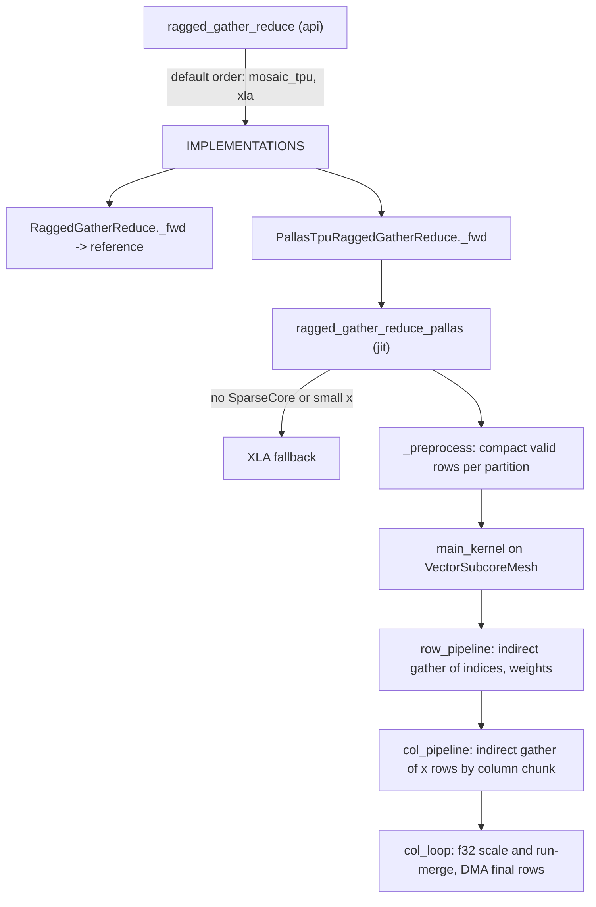

# Ragged gather-reduce (MoE combine) on the TPU SparseCore

## Overview
`ragged_gather_reduce` is the combine step of a mixture-of-experts layer. Each of the `T * k`
routed rows (token t's output from its k-th expert) is gathered from the expert-sorted
activation buffer `x` by `indices`, scaled by its router weight `topk_weights`, dropped if
`valid_rows_mask` is false, and summed in groups of `reduce_group_size` consecutive rows
(k rows per token). The XLA reference
[`ragged_gather_reduce`](https://github.com/openxla/tokamax/blob/3a0a3a34a5ccb8a6ac71f343d9cc44649d73db68/tokamax/_src/ops/ragged_gather_reduce/base.py#L28 "tokamax/_src/ops/ragged_gather_reduce/base#ragged_gather_reduce") states the whole contract in four lines:
`x[indices] * w` in f32, mask, reshape to `(-1, group, hidden)`, sum, cast back. The TPU
implementation is not a TensorCore kernel. It is a **SparseCore** kernel
([`main_kernel`](https://github.com/openxla/tokamax/blob/3a0a3a34a5ccb8a6ac71f343d9cc44649d73db68/tokamax/_src/ops/ragged_gather_reduce/pallas_mosaic_tpu_kernel.py#L195 "tokamax/_src/ops/ragged_gather_reduce/pallas_mosaic_tpu_kernel#main_kernel")) that runs on every vector subcore. It uses indirect
(index-driven) DMA gathers of x rows from HBM, f32 SIMD multiply-adds, and per-row DMA
scatters of finished group sums back to HBM. The sibling ops `ragged_gather` and
`ragged_scatter` (separate packages next to this one) cover the plain permutation
directions of MoE dispatch/combine.

## Diagram

Legend:
- `API` - [`ragged_gather_reduce`](https://github.com/openxla/tokamax/blob/3a0a3a34a5ccb8a6ac71f343d9cc44649d73db68/tokamax/_src/ops/ragged_gather_reduce/api.py#L46 "tokamax/_src/ops/ragged_gather_reduce/api#ragged_gather_reduce")
- `IMPLS` - [`IMPLEMENTATIONS`](https://github.com/openxla/tokamax/blob/3a0a3a34a5ccb8a6ac71f343d9cc44649d73db68/tokamax/_src/ops/ragged_gather_reduce/api.py#L40 "tokamax/_src/ops/ragged_gather_reduce/api#IMPLEMENTATIONS.IMPLEMENTATIONS"), [`_DEFAULT_IMPLEMENTATIONS`](https://github.com/openxla/tokamax/blob/3a0a3a34a5ccb8a6ac71f343d9cc44649d73db68/tokamax/_src/ops/ragged_gather_reduce/api.py#L27 "tokamax/_src/ops/ragged_gather_reduce/api#_DEFAULT_IMPLEMENTATIONS")
- `REF` - [`_fwd`](https://github.com/openxla/tokamax/blob/3a0a3a34a5ccb8a6ac71f343d9cc44649d73db68/tokamax/_src/ops/ragged_gather_reduce/base.py#L67 "tokamax/_src/ops/ragged_gather_reduce/base#RaggedGatherReduce._fwd"), [`ragged_gather_reduce`](https://github.com/openxla/tokamax/blob/3a0a3a34a5ccb8a6ac71f343d9cc44649d73db68/tokamax/_src/ops/ragged_gather_reduce/base.py#L28 "tokamax/_src/ops/ragged_gather_reduce/base#ragged_gather_reduce")
- `PT` - [`_fwd`](https://github.com/openxla/tokamax/blob/3a0a3a34a5ccb8a6ac71f343d9cc44649d73db68/tokamax/_src/ops/ragged_gather_reduce/pallas_mosaic_tpu.py#L32 "tokamax/_src/ops/ragged_gather_reduce/pallas_mosaic_tpu#PallasTpuRaggedGatherReduce._fwd")
- `WRAP` - [`ragged_gather_reduce_pallas`](https://github.com/openxla/tokamax/blob/3a0a3a34a5ccb8a6ac71f343d9cc44649d73db68/tokamax/_src/ops/ragged_gather_reduce/pallas_mosaic_tpu_kernel.py#L465 "tokamax/_src/ops/ragged_gather_reduce/pallas_mosaic_tpu_kernel#ragged_gather_reduce_pallas")
- `REF2` - (concept) the same math as the reference, inlined in the kernel module
- `PRE` - [`_preprocess`](https://github.com/openxla/tokamax/blob/3a0a3a34a5ccb8a6ac71f343d9cc44649d73db68/tokamax/_src/ops/ragged_gather_reduce/pallas_mosaic_tpu_kernel.py#L130 "tokamax/_src/ops/ragged_gather_reduce/pallas_mosaic_tpu_kernel#_preprocess")
- `MK` - [`main_kernel`](https://github.com/openxla/tokamax/blob/3a0a3a34a5ccb8a6ac71f343d9cc44649d73db68/tokamax/_src/ops/ragged_gather_reduce/pallas_mosaic_tpu_kernel.py#L195 "tokamax/_src/ops/ragged_gather_reduce/pallas_mosaic_tpu_kernel#main_kernel")
- `RP` - [`row_pipeline`](https://github.com/openxla/tokamax/blob/3a0a3a34a5ccb8a6ac71f343d9cc44649d73db68/tokamax/_src/ops/ragged_gather_reduce/pallas_mosaic_tpu_kernel.py#L269 "tokamax/_src/ops/ragged_gather_reduce/pallas_mosaic_tpu_kernel#main_kernel.row_pipeline")
- `CP` - [`col_pipeline`](https://github.com/openxla/tokamax/blob/3a0a3a34a5ccb8a6ac71f343d9cc44649d73db68/tokamax/_src/ops/ragged_gather_reduce/pallas_mosaic_tpu_kernel.py#L388 "tokamax/_src/ops/ragged_gather_reduce/pallas_mosaic_tpu_kernel#main_kernel.row_pipeline.col_pipeline")
- `CL` - [`col_loop`](https://github.com/openxla/tokamax/blob/3a0a3a34a5ccb8a6ac71f343d9cc44649d73db68/tokamax/_src/ops/ragged_gather_reduce/pallas_mosaic_tpu_kernel.py#L400 "tokamax/_src/ops/ragged_gather_reduce/pallas_mosaic_tpu_kernel#main_kernel.row_pipeline.col_pipeline.col_loop")

## Design rationale (why it's built this way)
- **Why SparseCore.** The op is a row gather with a tiny amount of arithmetic per byte:
  one multiply-add per gathered element. There is no matmul for the MXU to do, and the
  gather pattern is data-dependent. The SparseCore's indirect-stream DMAs and many
  independent vector subcores fit that well. [`supported_on`](https://github.com/openxla/tokamax/blob/3a0a3a34a5ccb8a6ac71f343d9cc44649d73db68/tokamax/_src/ops/ragged_gather_reduce/pallas_mosaic_tpu.py#L51 "tokamax/_src/ops/ragged_gather_reduce/pallas_mosaic_tpu#PallasTpuRaggedGatherReduce.supported_on") requires
  TPU generation >= 5 **and** a SparseCore. Even then,
  [`ragged_gather_reduce_pallas`](https://github.com/openxla/tokamax/blob/3a0a3a34a5ccb8a6ac71f343d9cc44649d73db68/tokamax/_src/ops/ragged_gather_reduce/pallas_mosaic_tpu_kernel.py#L465 "tokamax/_src/ops/ragged_gather_reduce/pallas_mosaic_tpu_kernel#ragged_gather_reduce_pallas") falls back to XLA when
  `2 * bytes(x) < 0.6 * VMEM capacity`.
  > [!inferred]
  > The small-input fallback reflects that for inputs that fit comfortably on-chip, XLA's
  > fused gather + reduce beats the fixed cost of a SparseCore launch and its preprocessing.
- **2-D partitioning over all subcores.** With `num_cores = sc.num_cores * sc.num_subcores`,
  the hidden dimension is split into
  [`num_column_partitions`](https://github.com/openxla/tokamax/blob/3a0a3a34a5ccb8a6ac71f343d9cc44649d73db68/tokamax/_src/ops/ragged_gather_reduce/pallas_mosaic_tpu_kernel.py#L30 "tokamax/_src/ops/ragged_gather_reduce/pallas_mosaic_tpu_kernel#_Config.num_column_partitions"). This number doubles while it still
  divides the core count and each partition keeps at least 4 lane-width column "stages".
  The remaining cores become [`num_row_partitions`](https://github.com/openxla/tokamax/blob/3a0a3a34a5ccb8a6ac71f343d9cc44649d73db68/tokamax/_src/ops/ragged_gather_reduce/pallas_mosaic_tpu_kernel.py#L29 "tokamax/_src/ops/ragged_gather_reduce/pallas_mosaic_tpu_kernel#_Config.num_row_partitions"). Inside
  [`main_kernel`](https://github.com/openxla/tokamax/blob/3a0a3a34a5ccb8a6ac71f343d9cc44649d73db68/tokamax/_src/ops/ragged_gather_reduce/pallas_mosaic_tpu_kernel.py#L195 "tokamax/_src/ops/ragged_gather_reduce/pallas_mosaic_tpu_kernel#main_kernel"), a subcore's flat id maps to
  `(row_partition, col_partition)`. Rows are padded so that every row partition holds whole
  reduce groups (`input_size` aligned to `num_row_partitions * reduce_group_size`), so no
  group ever spans two subcores.
- **Skip invalid rows instead of multiplying by zero.** [`_preprocess`](https://github.com/openxla/tokamax/blob/3a0a3a34a5ccb8a6ac71f343d9cc44649d73db68/tokamax/_src/ops/ragged_gather_reduce/pallas_mosaic_tpu_kernel.py#L130 "tokamax/_src/ops/ragged_gather_reduce/pallas_mosaic_tpu_kernel#_preprocess")
  stable-argsorts `~valid_rows_mask` inside each row partition. The result,
  [`sorted_by_validity`](https://github.com/openxla/tokamax/blob/3a0a3a34a5ccb8a6ac71f343d9cc44649d73db68/tokamax/_src/ops/ragged_gather_reduce/pallas_mosaic_tpu_kernel.py#L58 "tokamax/_src/ops/ragged_gather_reduce/pallas_mosaic_tpu_kernel#_Inputs.sorted_by_validity"), lists valid row positions first, in their
  original order. The per-partition valid counts,
  [`num_src_rows_per_row_partition`](https://github.com/openxla/tokamax/blob/3a0a3a34a5ccb8a6ac71f343d9cc44649d73db68/tokamax/_src/ops/ragged_gather_reduce/pallas_mosaic_tpu_kernel.py#L54 "tokamax/_src/ops/ragged_gather_reduce/pallas_mosaic_tpu_kernel#_Inputs.num_src_rows_per_row_partition"), bound the row
  loop. Masked rows (expert-capacity drops) therefore cost no HBM traffic. Because the
  sort is stable, rows of the same group stay adjacent, which the run-merge relies on.
- **Merge runs in registers, write each group once.** Within a SIMD-width slab of rows,
  consecutive rows with the same destination group (`position // reduce_group_size`) are
  accumulated as a running f32 sum. Only the last row of each run is DMA'd to its output
  row. Every other lane's DMA targets a **garbage row**: the output is allocated with one
  extra row, `padded_input_size / group + 1`, so all lanes can issue a copy without
  branching. Runs that cross slab or chunk boundaries continue through
  [`prev_iter_last_row_vmem`](https://github.com/openxla/tokamax/blob/3a0a3a34a5ccb8a6ac71f343d9cc44649d73db68/tokamax/_src/ops/ragged_gather_reduce/pallas_mosaic_tpu_kernel.py#L65 "tokamax/_src/ops/ragged_gather_reduce/pallas_mosaic_tpu_kernel#_Scratch.prev_iter_last_row_vmem") (the last accumulated row per
  column chunk) and [`prev_dst_row_smem`](https://github.com/openxla/tokamax/blob/3a0a3a34a5ccb8a6ac71f343d9cc44649d73db68/tokamax/_src/ops/ragged_gather_reduce/pallas_mosaic_tpu_kernel.py#L66 "tokamax/_src/ops/ragged_gather_reduce/pallas_mosaic_tpu_kernel#_Scratch.prev_dst_row_smem") (its destination).

## Entry points
- [`ragged_gather_reduce`](https://github.com/openxla/tokamax/blob/3a0a3a34a5ccb8a6ac71f343d9cc44649d73db68/tokamax/_src/ops/ragged_gather_reduce/api.py#L46 "tokamax/_src/ops/ragged_gather_reduce/api#ragged_gather_reduce") - the functional API. With
  `implementation=None` it tries [`_DEFAULT_IMPLEMENTATIONS`](https://github.com/openxla/tokamax/blob/3a0a3a34a5ccb8a6ac71f343d9cc44649d73db68/tokamax/_src/ops/ragged_gather_reduce/api.py#L27 "tokamax/_src/ops/ragged_gather_reduce/api#_DEFAULT_IMPLEMENTATIONS")
  in order (`mosaic_tpu` first if its module imported, then `xla`). It moves to the next
  one only on `NotImplementedError`, and raises an `ExceptionGroup` if all fail. `"mosaic"`
  is accepted as an alias of `mosaic_tpu`.
- [`RaggedGatherReduce`](https://github.com/openxla/tokamax/blob/3a0a3a34a5ccb8a6ac71f343d9cc44649d73db68/tokamax/_src/ops/ragged_gather_reduce/base.py#L42 "tokamax/_src/ops/ragged_gather_reduce/base#RaggedGatherReduce") - the tokamax [`Op`](https://github.com/openxla/tokamax/blob/3a0a3a34a5ccb8a6ac71f343d9cc44649d73db68/tokamax/_src/ops/op.py#L121 "tokamax/_src/ops/op#Op"). Its
  [`bind`](https://github.com/openxla/tokamax/blob/3a0a3a34a5ccb8a6ac71f343d9cc44649d73db68/tokamax/_src/ops/ragged_gather_reduce/base.py#L46 "tokamax/_src/ops/ragged_gather_reduce/base#RaggedGatherReduce.bind") fixes the shapes (`x: [input_size, hidden]`, the three 1-D arrays of
  length `input_size`, static `reduce_group_size`), and its [`_fwd`](https://github.com/openxla/tokamax/blob/3a0a3a34a5ccb8a6ac71f343d9cc44649d73db68/tokamax/_src/ops/ragged_gather_reduce/base.py#L67 "tokamax/_src/ops/ragged_gather_reduce/base#RaggedGatherReduce._fwd") runs the
  reference. It is registered in autotuning through
  [`_API_IMPLEMENTATIONS`](https://github.com/openxla/tokamax/blob/3a0a3a34a5ccb8a6ac71f343d9cc44649d73db68/tokamax/_src/autotuning/api.py#L260 "tokamax/_src/autotuning/api#_API_IMPLEMENTATIONS._API_IMPLEMENTATIONS").
- [`PallasTpuRaggedGatherReduce`](https://github.com/openxla/tokamax/blob/3a0a3a34a5ccb8a6ac71f343d9cc44649d73db68/tokamax/_src/ops/ragged_gather_reduce/pallas_mosaic_tpu.py#L27 "tokamax/_src/ops/ragged_gather_reduce/pallas_mosaic_tpu#PallasTpuRaggedGatherReduce") - the TPU op. Its
  [`_fwd`](https://github.com/openxla/tokamax/blob/3a0a3a34a5ccb8a6ac71f343d9cc44649d73db68/tokamax/_src/ops/ragged_gather_reduce/pallas_mosaic_tpu.py#L32 "tokamax/_src/ops/ragged_gather_reduce/pallas_mosaic_tpu#PallasTpuRaggedGatherReduce._fwd") ignores `config` and calls the jitted kernel wrapper. There is no
  heuristic or autotuning config: all tiling is derived from hardware info.
- [`ARG_SPECS`](https://github.com/openxla/tokamax/blob/3a0a3a34a5ccb8a6ac71f343d9cc44649d73db68/tokamax/_src/ops/ragged_gather_reduce/arg_specs.py#L55 "tokamax/_src/ops/ragged_gather_reduce/arg_specs#ARG_SPECS.ARG_SPECS") built by [`_make_argspec`](https://github.com/openxla/tokamax/blob/3a0a3a34a5ccb8a6ac71f343d9cc44649d73db68/tokamax/_src/ops/ragged_gather_reduce/arg_specs.py#L27 "tokamax/_src/ops/ragged_gather_reduce/arg_specs#_make_argspec") - the two
  benchmark shapes, 8192x4096 with group 8 and 1024x512 with group 4, both bf16. `indices`
  is drawn from `[0, input_size)`.

## Mechanism (step-by-step)
1. **Gate and size.** [`ragged_gather_reduce_pallas`](https://github.com/openxla/tokamax/blob/3a0a3a34a5ccb8a6ac71f343d9cc44649d73db68/tokamax/_src/ops/ragged_gather_reduce/pallas_mosaic_tpu_kernel.py#L465 "tokamax/_src/ops/ragged_gather_reduce/pallas_mosaic_tpu_kernel#ragged_gather_reduce_pallas") reads
   the SparseCore info (cores, subcores, SIMD lanes). It derives the partitions,
   `num_row_subchunks` (1..4 SIMD slabs per row block, which sets
   [`row_chunk_size`](https://github.com/openxla/tokamax/blob/3a0a3a34a5ccb8a6ac71f343d9cc44649d73db68/tokamax/_src/ops/ragged_gather_reduce/pallas_mosaic_tpu_kernel.py#L42 "tokamax/_src/ops/ragged_gather_reduce/pallas_mosaic_tpu_kernel#_Config.row_chunk_size")), the per-partition column width
   [`col_size`](https://github.com/openxla/tokamax/blob/3a0a3a34a5ccb8a6ac71f343d9cc44649d73db68/tokamax/_src/ops/ragged_gather_reduce/pallas_mosaic_tpu_kernel.py#L32 "tokamax/_src/ops/ragged_gather_reduce/pallas_mosaic_tpu_kernel#_Config.col_size") (hidden aligned to `128 * col_partitions`), and
   [`col_chunk_size`](https://github.com/openxla/tokamax/blob/3a0a3a34a5ccb8a6ac71f343d9cc44649d73db68/tokamax/_src/ops/ragged_gather_reduce/pallas_mosaic_tpu_kernel.py#L33 "tokamax/_src/ops/ragged_gather_reduce/pallas_mosaic_tpu_kernel#_Config.col_chunk_size"). The column chunk is the largest multiple of 128
   that divides `col_size` and keeps an f32 working slab under a generation-specific
   budget: about 95% of 512 KiB on v5/v7, 256 KiB on v6, and 128 KiB otherwise. bf16
   router weights are widened to u32 bit patterns, so the kernel can rebuild f32 values
   with a shift.
2. **Preprocess in XLA.** [`_preprocess`](https://github.com/openxla/tokamax/blob/3a0a3a34a5ccb8a6ac71f343d9cc44649d73db68/tokamax/_src/ops/ragged_gather_reduce/pallas_mosaic_tpu_kernel.py#L130 "tokamax/_src/ops/ragged_gather_reduce/pallas_mosaic_tpu_kernel#_preprocess") pads the mask to the
   partition-aligned size and builds [`sorted_by_validity`](https://github.com/openxla/tokamax/blob/3a0a3a34a5ccb8a6ac71f343d9cc44649d73db68/tokamax/_src/ops/ragged_gather_reduce/pallas_mosaic_tpu_kernel.py#L58 "tokamax/_src/ops/ragged_gather_reduce/pallas_mosaic_tpu_kernel#_Inputs.sorted_by_validity"): global
   row positions, each partition padded to a multiple of `row_chunk_size`. It also computes
   the per-partition valid counts and a per-group "any valid" mask, which is used at the
   end to zero groups that never received a write.
3. **Kernel setup.** The kernel is launched with `pl.kernel` on a `VectorSubcoreMesh` with
   `use_tc_tiling_on_sc=True`, and its inputs are packed in [`_Inputs`](https://github.com/openxla/tokamax/blob/3a0a3a34a5ccb8a6ac71f343d9cc44649d73db68/tokamax/_src/ops/ragged_gather_reduce/pallas_mosaic_tpu_kernel.py#L53 "tokamax/_src/ops/ragged_gather_reduce/pallas_mosaic_tpu_kernel#_Inputs")
   ([`x`](https://github.com/openxla/tokamax/blob/3a0a3a34a5ccb8a6ac71f343d9cc44649d73db68/tokamax/_src/ops/ragged_gather_reduce/pallas_mosaic_tpu_kernel.py#L55 "tokamax/_src/ops/ragged_gather_reduce/pallas_mosaic_tpu_kernel#_Inputs.x"), [`indices`](https://github.com/openxla/tokamax/blob/3a0a3a34a5ccb8a6ac71f343d9cc44649d73db68/tokamax/_src/ops/ragged_gather_reduce/pallas_mosaic_tpu_kernel.py#L56 "tokamax/_src/ops/ragged_gather_reduce/pallas_mosaic_tpu_kernel#_Inputs.indices"), [`topk_weights`](https://github.com/openxla/tokamax/blob/3a0a3a34a5ccb8a6ac71f343d9cc44649d73db68/tokamax/_src/ops/ragged_gather_reduce/pallas_mosaic_tpu_kernel.py#L57 "tokamax/_src/ops/ragged_gather_reduce/pallas_mosaic_tpu_kernel#_Inputs.topk_weights"), counts,
   order). Each subcore in [`main_kernel`](https://github.com/openxla/tokamax/blob/3a0a3a34a5ccb8a6ac71f343d9cc44649d73db68/tokamax/_src/ops/ragged_gather_reduce/pallas_mosaic_tpu_kernel.py#L195 "tokamax/_src/ops/ragged_gather_reduce/pallas_mosaic_tpu_kernel#main_kernel") DMAs the counts into
   [`num_rows_per_row_partition_vmem`](https://github.com/openxla/tokamax/blob/3a0a3a34a5ccb8a6ac71f343d9cc44649d73db68/tokamax/_src/ops/ragged_gather_reduce/pallas_mosaic_tpu_kernel.py#L64 "tokamax/_src/ops/ragged_gather_reduce/pallas_mosaic_tpu_kernel#_Scratch.num_rows_per_row_partition_vmem") and its
   partition's slice of the order into
   [`sorted_by_validity_vmem`](https://github.com/openxla/tokamax/blob/3a0a3a34a5ccb8a6ac71f343d9cc44649d73db68/tokamax/_src/ops/ragged_gather_reduce/pallas_mosaic_tpu_kernel.py#L67 "tokamax/_src/ops/ragged_gather_reduce/pallas_mosaic_tpu_kernel#_Scratch.sorted_by_validity_vmem"). It then picks its own row
   count with a select chain (no dynamic scalar indexing) and views `x` as uint32.
4. **Row pipeline.** [`row_pipeline`](https://github.com/openxla/tokamax/blob/3a0a3a34a5ccb8a6ac71f343d9cc44649d73db68/tokamax/_src/ops/ragged_gather_reduce/pallas_mosaic_tpu_kernel.py#L269 "tokamax/_src/ops/ragged_gather_reduce/pallas_mosaic_tpu_kernel#main_kernel.row_pipeline") is an `emit_pipeline` over
   `cdiv(valid_rows, row_chunk_size)` row blocks. Its in_specs are `pl.Indirect` BlockSpecs
   whose index map reads positions from the compacted order, so the pipeline DMA-gathers
   `indices[pos]` and `topk_weights[pos]` for each SIMD slab. The body computes destination
   groups (`pos // reduce_group_size`) and converts weights to f32. It precomputes, per
   lane, whether that row ends its run (`is_final_write`) and which VMEM row holds the run's
   sum. The result is a source/destination DMA plan, where non-final lanes point at the
   garbage row.
5. **Column pipeline.** For each row block, [`col_pipeline`](https://github.com/openxla/tokamax/blob/3a0a3a34a5ccb8a6ac71f343d9cc44649d73db68/tokamax/_src/ops/ragged_gather_reduce/pallas_mosaic_tpu_kernel.py#L388 "tokamax/_src/ops/ragged_gather_reduce/pallas_mosaic_tpu_kernel#main_kernel.row_pipeline.col_pipeline") runs a nested
   `emit_pipeline` over `(row_subchunks, col_chunks)`. Its input BlockSpec is
   `(pl.Indirect(num_simd_lanes), col_chunk_size)`, indexed by `src_index >> row_shift`, so
   each step gathers SIMD-many rows of `x` for one column chunk. For bf16, two rows share a
   32-bit word: `row_shift` drops the parity bit, and the parity later selects the high or
   low half.
6. **Compute and scatter.** [`col_loop`](https://github.com/openxla/tokamax/blob/3a0a3a34a5ccb8a6ac71f343d9cc44649d73db68/tokamax/_src/ops/ragged_gather_reduce/pallas_mosaic_tpu_kernel.py#L400 "tokamax/_src/ops/ragged_gather_reduce/pallas_mosaic_tpu_kernel#main_kernel.row_pipeline.col_pipeline.col_loop") runs under `plsc.parallel_loop` over
   SIMD-width column slices. For each gathered row it unpacks to f32, multiplies by the
   weight, and either adds to the previous row's running sum (same destination) or restarts
   it. It writes the running value into an f32 VMEM slab and saves the slab's last row for
   the next chunk. The body then issues one async copy per lane from the slab's run-final
   row to `out[dst, col_range]` and waits on all of them. After the call the wrapper slices
   off padding and the garbage row, applies the group mask, and casts to `x.dtype`.

## Key data structures
- [`_Config`](https://github.com/openxla/tokamax/blob/3a0a3a34a5ccb8a6ac71f343d9cc44649d73db68/tokamax/_src/ops/ragged_gather_reduce/pallas_mosaic_tpu_kernel.py#L28 "tokamax/_src/ops/ragged_gather_reduce/pallas_mosaic_tpu_kernel#_Config") - static kernel geometry:
  [`num_row_partitions`](https://github.com/openxla/tokamax/blob/3a0a3a34a5ccb8a6ac71f343d9cc44649d73db68/tokamax/_src/ops/ragged_gather_reduce/pallas_mosaic_tpu_kernel.py#L29 "tokamax/_src/ops/ragged_gather_reduce/pallas_mosaic_tpu_kernel#_Config.num_row_partitions"),
  [`num_column_partitions`](https://github.com/openxla/tokamax/blob/3a0a3a34a5ccb8a6ac71f343d9cc44649d73db68/tokamax/_src/ops/ragged_gather_reduce/pallas_mosaic_tpu_kernel.py#L30 "tokamax/_src/ops/ragged_gather_reduce/pallas_mosaic_tpu_kernel#_Config.num_column_partitions"),
  [`reduce_group_size`](https://github.com/openxla/tokamax/blob/3a0a3a34a5ccb8a6ac71f343d9cc44649d73db68/tokamax/_src/ops/ragged_gather_reduce/pallas_mosaic_tpu_kernel.py#L31 "tokamax/_src/ops/ragged_gather_reduce/pallas_mosaic_tpu_kernel#_Config.reduce_group_size"), [`col_size`](https://github.com/openxla/tokamax/blob/3a0a3a34a5ccb8a6ac71f343d9cc44649d73db68/tokamax/_src/ops/ragged_gather_reduce/pallas_mosaic_tpu_kernel.py#L32 "tokamax/_src/ops/ragged_gather_reduce/pallas_mosaic_tpu_kernel#_Config.col_size"),
  [`col_chunk_size`](https://github.com/openxla/tokamax/blob/3a0a3a34a5ccb8a6ac71f343d9cc44649d73db68/tokamax/_src/ops/ragged_gather_reduce/pallas_mosaic_tpu_kernel.py#L33 "tokamax/_src/ops/ragged_gather_reduce/pallas_mosaic_tpu_kernel#_Config.col_chunk_size"), [`num_row_subchunks`](https://github.com/openxla/tokamax/blob/3a0a3a34a5ccb8a6ac71f343d9cc44649d73db68/tokamax/_src/ops/ragged_gather_reduce/pallas_mosaic_tpu_kernel.py#L34 "tokamax/_src/ops/ragged_gather_reduce/pallas_mosaic_tpu_kernel#_Config.num_row_subchunks"),
  [`num_simd_lanes`](https://github.com/openxla/tokamax/blob/3a0a3a34a5ccb8a6ac71f343d9cc44649d73db68/tokamax/_src/ops/ragged_gather_reduce/pallas_mosaic_tpu_kernel.py#L35 "tokamax/_src/ops/ragged_gather_reduce/pallas_mosaic_tpu_kernel#_Config.num_simd_lanes"), [`topk_dtype`](https://github.com/openxla/tokamax/blob/3a0a3a34a5ccb8a6ac71f343d9cc44649d73db68/tokamax/_src/ops/ragged_gather_reduce/pallas_mosaic_tpu_kernel.py#L36 "tokamax/_src/ops/ragged_gather_reduce/pallas_mosaic_tpu_kernel#_Config.topk_dtype"),
  [`in_dtype`](https://github.com/openxla/tokamax/blob/3a0a3a34a5ccb8a6ac71f343d9cc44649d73db68/tokamax/_src/ops/ragged_gather_reduce/pallas_mosaic_tpu_kernel.py#L37 "tokamax/_src/ops/ragged_gather_reduce/pallas_mosaic_tpu_kernel#_Config.in_dtype"), and the mesh axis names
  [`core_axis_name`](https://github.com/openxla/tokamax/blob/3a0a3a34a5ccb8a6ac71f343d9cc44649d73db68/tokamax/_src/ops/ragged_gather_reduce/pallas_mosaic_tpu_kernel.py#L38 "tokamax/_src/ops/ragged_gather_reduce/pallas_mosaic_tpu_kernel#_Config.core_axis_name") / [`subcore_axis_name`](https://github.com/openxla/tokamax/blob/3a0a3a34a5ccb8a6ac71f343d9cc44649d73db68/tokamax/_src/ops/ragged_gather_reduce/pallas_mosaic_tpu_kernel.py#L39 "tokamax/_src/ops/ragged_gather_reduce/pallas_mosaic_tpu_kernel#_Config.subcore_axis_name").
  `row_chunk_size = num_simd_lanes * num_row_subchunks`, and `row_shift` is
  log2(32 / input bits).
- [`_Inputs`](https://github.com/openxla/tokamax/blob/3a0a3a34a5ccb8a6ac71f343d9cc44649d73db68/tokamax/_src/ops/ragged_gather_reduce/pallas_mosaic_tpu_kernel.py#L53 "tokamax/_src/ops/ragged_gather_reduce/pallas_mosaic_tpu_kernel#_Inputs") - the HBM operands, with weights pre-bitcast to u32 and
  [`sorted_by_validity`](https://github.com/openxla/tokamax/blob/3a0a3a34a5ccb8a6ac71f343d9cc44649d73db68/tokamax/_src/ops/ragged_gather_reduce/pallas_mosaic_tpu_kernel.py#L58 "tokamax/_src/ops/ragged_gather_reduce/pallas_mosaic_tpu_kernel#_Inputs.sorted_by_validity") /
  [`num_src_rows_per_row_partition`](https://github.com/openxla/tokamax/blob/3a0a3a34a5ccb8a6ac71f343d9cc44649d73db68/tokamax/_src/ops/ragged_gather_reduce/pallas_mosaic_tpu_kernel.py#L54 "tokamax/_src/ops/ragged_gather_reduce/pallas_mosaic_tpu_kernel#_Inputs.num_src_rows_per_row_partition") from preprocessing.
- Scratch - per-subcore VMEM for the order slice, per-block index, weight and DMA-plan
  vectors, the `[simd, col_chunk]` f32 output slab, the cross-block carry
  ([`prev_iter_last_row_vmem`](https://github.com/openxla/tokamax/blob/3a0a3a34a5ccb8a6ac71f343d9cc44649d73db68/tokamax/_src/ops/ragged_gather_reduce/pallas_mosaic_tpu_kernel.py#L65 "tokamax/_src/ops/ragged_gather_reduce/pallas_mosaic_tpu_kernel#_Scratch.prev_iter_last_row_vmem"),
  [`prev_dst_row_smem`](https://github.com/openxla/tokamax/blob/3a0a3a34a5ccb8a6ac71f343d9cc44649d73db68/tokamax/_src/ops/ragged_gather_reduce/pallas_mosaic_tpu_kernel.py#L66 "tokamax/_src/ops/ragged_gather_reduce/pallas_mosaic_tpu_kernel#_Scratch.prev_dst_row_smem")) and two DMA semaphores.
  [`_align_to`](https://github.com/openxla/tokamax/blob/3a0a3a34a5ccb8a6ac71f343d9cc44649d73db68/tokamax/_src/ops/ragged_gather_reduce/pallas_mosaic_tpu_kernel.py#L78 "tokamax/_src/ops/ragged_gather_reduce/pallas_mosaic_tpu_kernel#_align_to") does all padding arithmetic.

## Dynamics (design intent)
- All subcores run the same program on disjoint `(row_partition, col_partition)` tiles,
  with no cross-subcore communication. The output tiles are disjoint because groups never
  straddle row partitions and column ranges are disjoint.
- Inside a subcore the order is fixed: row blocks run in sequence (the run carry depends on
  it). Inside a block, column chunks are pipelined, so the next chunk's indirect gather
  overlaps the current chunk's compute. The output DMAs of a chunk are waited before the
  chunk ends.
- The kernel accumulates and writes f32 and casts to the input dtype only at the end, the
  same numerics as the reference (`x[indices] * w.astype(f32)`).

## Edge cases
- Groups with no valid rows are never written by the kernel. The final group mask forces
  them to zero, matching the reference.
- `indices` must be in `[0, rows of x)`. The kernel runs with `disable_bounds_checks=True`,
  so out-of-range indices read arbitrary HBM instead of raising.
- `num_row_partitions` must be <= the SparseCore SIMD width (asserted).
- Hidden sizes that are not multiples of `128 * col_partitions` are padded, and the
  padding is sliced off afterwards.
- The kernel test exercises only all-true `valid_rows_mask` (groups 4 and 8). The
  masked-row compaction path is covered only through its equivalence to the reference
  semantics.
- No VJP is defined. The op is forward-only.

## Open questions
- The small-input fallback threshold (`2 * bytes(x) < 0.6 * VMEM`) compares against
  TensorCore VMEM capacity. No source comment explains why that budget is the right
  crossover for a SparseCore kernel.
- The op does not appear in the top-level public `tokamax` exports in this pin, only in
  the internal API and the autotuning registry. Whether it is meant to be public is not
  stated.

## See also
- [fused-moe](./fused-moe.md) - the MoE layer whose combine step this implements.
- [ragged-dot-gmm](./ragged-dot-gmm.md), [gmm-v2](./gmm-v2.md) - the grouped expert matmuls
  that produce `x`.
- [mosaic-tpu-helpers](./mosaic-tpu-helpers.md), [tpu-topk](./tpu-topk.md).
- [op-framework](./op-framework.md), [kernel-catalog](./kernel-catalog.md),
  [benchmarking-and-serialization](./benchmarking-and-serialization.md).
