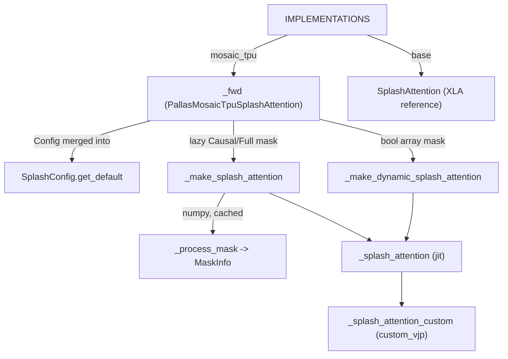
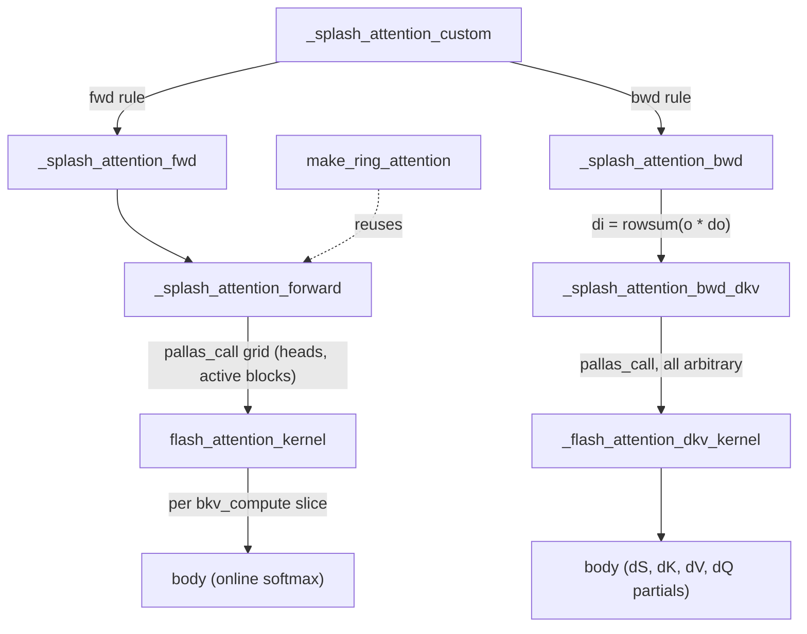

# Splash attention: block-sparse flash attention on TPU

## Overview
The kernel module calls itself "Sparse Flash Attention, a.k.a. 'Splash' attention". It is a flash attention (online softmax over KV blocks, with running max `m`, running denominator `l` and output accumulator kept in VMEM) whose **Pallas grid lists only the mask blocks that are not empty**. Before any kernel runs, the attention mask is cut into `(block_q, block_kv)` tiles. [`_process_mask`](https://github.com/openxla/tokamax/blob/3a0a3a34a5ccb8a6ac71f343d9cc44649d73db68/tokamax/_src/ops/experimental/tpu/splash_attention/splash_attention_mask_info.py#L358 "tokamax/_src/ops/experimental/tpu/splash_attention/splash_attention_mask_info#_process_mask") ("Transform a dense mask into a sparse representation") sorts each tile into empty, partial or full. It records which tiles are active, keeps one copy of each distinct partial tile, and puts the per-step metadata into small integer arrays that the kernel receives through scalar prefetch (SMEM). The forward kernel [`flash_attention_kernel`](https://github.com/openxla/tokamax/blob/3a0a3a34a5ccb8a6ac71f343d9cc44649d73db68/tokamax/_src/ops/experimental/tpu/splash_attention/splash_attention_kernel.py#L565 "tokamax/_src/ops/experimental/tpu/splash_attention/splash_attention_kernel#flash_attention_kernel") and the fused backward kernel [`_flash_attention_dkv_kernel`](https://github.com/openxla/tokamax/blob/3a0a3a34a5ccb8a6ac71f343d9cc44649d73db68/tokamax/_src/ops/experimental/tpu/splash_attention/splash_attention_kernel.py#L1621 "tokamax/_src/ops/experimental/tpu/splash_attention/splash_attention_kernel#_flash_attention_dkv_kernel") read that metadata to choose which Q/K/V blocks the BlockSpec index maps fetch, and whether a step needs masking at all. The tokamax op [`SplashAttention`](https://github.com/openxla/tokamax/blob/3a0a3a34a5ccb8a6ac71f343d9cc44649d73db68/tokamax/_src/ops/experimental/tpu/splash_attention/base.py#L102 "tokamax/_src/ops/experimental/tpu/splash_attention/base#SplashAttention") ("Tokamax operator template for Splash Attention") wraps all of this so it plugs into tokamax config, autotuning and VJP plumbing. [`make_ring_attention`](https://github.com/openxla/tokamax/blob/3a0a3a34a5ccb8a6ac71f343d9cc44649d73db68/tokamax/_src/ops/experimental/tpu/splash_attention/ring_attention_kernel.py#L618 "tokamax/_src/ops/experimental/tpu/splash_attention/ring_attention_kernel#make_ring_attention") reuses the same forward kernel for sequence-parallel attention over a device ring.

## Diagram
Dispatch and kernel construction (op layer to kernel object):

Legend:
- `IMPLS` - [`IMPLEMENTATIONS`](https://github.com/openxla/tokamax/blob/3a0a3a34a5ccb8a6ac71f343d9cc44649d73db68/tokamax/_src/ops/experimental/tpu/splash_attention/api.py#L43 "tokamax/_src/ops/experimental/tpu/splash_attention/api#IMPLEMENTATIONS.IMPLEMENTATIONS")
- `PFWD` - [`_fwd`](https://github.com/openxla/tokamax/blob/3a0a3a34a5ccb8a6ac71f343d9cc44649d73db68/tokamax/_src/ops/experimental/tpu/splash_attention/pallas_mosaic_tpu.py#L89 "tokamax/_src/ops/experimental/tpu/splash_attention/pallas_mosaic_tpu#PallasMosaicTpuSplashAttention._fwd")
- `SA` - [`SplashAttention`](https://github.com/openxla/tokamax/blob/3a0a3a34a5ccb8a6ac71f343d9cc44649d73db68/tokamax/_src/ops/experimental/tpu/splash_attention/base.py#L102 "tokamax/_src/ops/experimental/tpu/splash_attention/base#SplashAttention")
- `DEF` - [`get_default`](https://github.com/openxla/tokamax/blob/3a0a3a34a5ccb8a6ac71f343d9cc44649d73db68/tokamax/_src/ops/experimental/tpu/splash_attention/splash_attention_kernel.py#L449 "tokamax/_src/ops/experimental/tpu/splash_attention/splash_attention_kernel#SplashConfig.get_default")
- `MK` - [`_make_splash_attention`](https://github.com/openxla/tokamax/blob/3a0a3a34a5ccb8a6ac71f343d9cc44649d73db68/tokamax/_src/ops/experimental/tpu/splash_attention/splash_attention_kernel.py#L2548 "tokamax/_src/ops/experimental/tpu/splash_attention/splash_attention_kernel#_make_splash_attention")
- `DMK` - [`_make_dynamic_splash_attention`](https://github.com/openxla/tokamax/blob/3a0a3a34a5ccb8a6ac71f343d9cc44649d73db68/tokamax/_src/ops/experimental/tpu/splash_attention/splash_attention_kernel.py#L2626 "tokamax/_src/ops/experimental/tpu/splash_attention/splash_attention_kernel#_make_dynamic_splash_attention")
- `PM` - [`_process_mask`](https://github.com/openxla/tokamax/blob/3a0a3a34a5ccb8a6ac71f343d9cc44649d73db68/tokamax/_src/ops/experimental/tpu/splash_attention/splash_attention_mask_info.py#L358 "tokamax/_src/ops/experimental/tpu/splash_attention/splash_attention_mask_info#_process_mask")
- `SAJ` - [`_splash_attention`](https://github.com/openxla/tokamax/blob/3a0a3a34a5ccb8a6ac71f343d9cc44649d73db68/tokamax/_src/ops/experimental/tpu/splash_attention/splash_attention_kernel.py#L2441 "tokamax/_src/ops/experimental/tpu/splash_attention/splash_attention_kernel#_splash_attention")
- `CV` - [`_splash_attention_custom`](https://github.com/openxla/tokamax/blob/3a0a3a34a5ccb8a6ac71f343d9cc44649d73db68/tokamax/_src/ops/experimental/tpu/splash_attention/splash_attention_kernel.py#L1381 "tokamax/_src/ops/experimental/tpu/splash_attention/splash_attention_kernel#_splash_attention_custom")

Forward and backward kernels under the custom VJP:

Legend:
- `CV` - [`_splash_attention_custom`](https://github.com/openxla/tokamax/blob/3a0a3a34a5ccb8a6ac71f343d9cc44649d73db68/tokamax/_src/ops/experimental/tpu/splash_attention/splash_attention_kernel.py#L1381 "tokamax/_src/ops/experimental/tpu/splash_attention/splash_attention_kernel#_splash_attention_custom")
- `FWDR` - [`_splash_attention_fwd`](https://github.com/openxla/tokamax/blob/3a0a3a34a5ccb8a6ac71f343d9cc44649d73db68/tokamax/_src/ops/experimental/tpu/splash_attention/splash_attention_kernel.py#L1436 "tokamax/_src/ops/experimental/tpu/splash_attention/splash_attention_kernel#_splash_attention_fwd")
- `BWDR` - [`_splash_attention_bwd`](https://github.com/openxla/tokamax/blob/3a0a3a34a5ccb8a6ac71f343d9cc44649d73db68/tokamax/_src/ops/experimental/tpu/splash_attention/splash_attention_kernel.py#L2344 "tokamax/_src/ops/experimental/tpu/splash_attention/splash_attention_kernel#_splash_attention_bwd")
- `FWD` - [`_splash_attention_forward`](https://github.com/openxla/tokamax/blob/3a0a3a34a5ccb8a6ac71f343d9cc44649d73db68/tokamax/_src/ops/experimental/tpu/splash_attention/splash_attention_kernel.py#L917 "tokamax/_src/ops/experimental/tpu/splash_attention/splash_attention_kernel#_splash_attention_forward")
- `FK` - [`flash_attention_kernel`](https://github.com/openxla/tokamax/blob/3a0a3a34a5ccb8a6ac71f343d9cc44649d73db68/tokamax/_src/ops/experimental/tpu/splash_attention/splash_attention_kernel.py#L565 "tokamax/_src/ops/experimental/tpu/splash_attention/splash_attention_kernel#flash_attention_kernel")
- `FB` - [`body`](https://github.com/openxla/tokamax/blob/3a0a3a34a5ccb8a6ac71f343d9cc44649d73db68/tokamax/_src/ops/experimental/tpu/splash_attention/splash_attention_kernel.py#L670 "tokamax/_src/ops/experimental/tpu/splash_attention/splash_attention_kernel#flash_attention_kernel.body")
- `BDKV` - [`_splash_attention_bwd_dkv`](https://github.com/openxla/tokamax/blob/3a0a3a34a5ccb8a6ac71f343d9cc44649d73db68/tokamax/_src/ops/experimental/tpu/splash_attention/splash_attention_kernel.py#L1931 "tokamax/_src/ops/experimental/tpu/splash_attention/splash_attention_kernel#_splash_attention_bwd_dkv")
- `DKV` - [`_flash_attention_dkv_kernel`](https://github.com/openxla/tokamax/blob/3a0a3a34a5ccb8a6ac71f343d9cc44649d73db68/tokamax/_src/ops/experimental/tpu/splash_attention/splash_attention_kernel.py#L1621 "tokamax/_src/ops/experimental/tpu/splash_attention/splash_attention_kernel#_flash_attention_dkv_kernel")
- `DB` - [`body`](https://github.com/openxla/tokamax/blob/3a0a3a34a5ccb8a6ac71f343d9cc44649d73db68/tokamax/_src/ops/experimental/tpu/splash_attention/splash_attention_kernel.py#L1725 "tokamax/_src/ops/experimental/tpu/splash_attention/splash_attention_kernel#_flash_attention_dkv_kernel.body")
- `RING` - [`make_ring_attention`](https://github.com/openxla/tokamax/blob/3a0a3a34a5ccb8a6ac71f343d9cc44649d73db68/tokamax/_src/ops/experimental/tpu/splash_attention/ring_attention_kernel.py#L618 "tokamax/_src/ops/experimental/tpu/splash_attention/ring_attention_kernel#make_ring_attention")

## Design rationale (why it's built this way)
- **Sparsity is resolved at trace time, on the host.** For lazy masks, `_process_mask` runs in NumPy at kernel-construction time. Its output is a pytree of small arrays (`MaskInfo`), and the grid length is the number of active blocks. Fully masked tiles therefore cost no grid step and no DMA. The `MaskInfo` docstring explains why the arrays are downcast: "The arrays, mask_next and block_mask are placed in TPU scalar-memory. This is a scarse resource so the mask creation logic attempts to shrink the data-type of these arrays to the smallest possible one". Partial tiles are deduplicated by content (`_HashableNDArray`), so a causal mask stores only a handful of distinct diagonal tiles, not one per block. A module comment explains the `lru_cache(maxsize=12)` on mask processing: the kernel "is created several times with the same mask", and the cache avoids "blowing up compile times".
- **Masks you can compute are never loaded.** A [`_ComputableMask`](https://github.com/openxla/tokamax/blob/3a0a3a34a5ccb8a6ac71f343d9cc44649d73db68/tokamax/_src/ops/experimental/tpu/splash_attention/splash_attention_mask.py#L177 "tokamax/_src/ops/experimental/tpu/splash_attention/splash_attention_mask#_ComputableMask") (for example [`CausalMask`](https://github.com/openxla/tokamax/blob/3a0a3a34a5ccb8a6ac71f343d9cc44649d73db68/tokamax/_src/ops/experimental/tpu/splash_attention/splash_attention_mask.py#L247 "tokamax/_src/ops/experimental/tpu/splash_attention/splash_attention_mask#CausalMask")) carries a `mask_function` and a `q_sequence`. `_process_mask` then drops `partial_mask_blocks`/`mask_next`, and the kernel evaluates `mask_function(q_ids, kv_ids)` on iota vectors inside partial blocks only. The docstring says this avoids "the memory cost of materializing the full (sequence_length, sequence_length) boolean mask array".
- **The forward kernel runs only two code paths per step.** `block_mask` tells the kernel whether a step is full (no masking) or partial. The kernel compiles two unrolled copies of `body` behind `pl.when` and picks one at run time. Full blocks skip the block-mask work (no partial-tile load, no `mask_function` evaluation); the soft cap and any segment-id mask are still applied on every block.
- **base-2 exponentials.** With `use_base2_exp` (on by default), `q` is pre-scaled by `log2(e)` and the kernel uses `exp2`/`log2`. The residual `logsumexp` stays in base 2 for the backward pass and is divided by `LOG2E` only when returned to the user.
- **Forward heads are parallel. Every backward axis is arbitrary.** The forward `pallas_call` uses `dimension_semantics=("parallel", "arbitrary")`, so megacore can split heads. The backward comment lists three reasons for making everything arbitrary: "for heads, we are reducing over heads", "the splash attention prefetch schedule assumes no megacore", and "for q_seq_len, we are reducing over it to compute dkv".
- **One fused backward kernel.** `SplashConfig.__post_init__` raises unless `use_fused_bwd_kernel` is set ("Only the fused bwd kernel is supported"). dQ is produced inside the dKV kernel as per-KV-step partials, which are summed afterwards (`dq_unreduced.sum(axis=0)`). With `dq_reduction_steps=3`, the partials go into a 3-slot buffer aliased in place, which makes the dQ residency independent of the number of KV steps.

## Entry points
- [`SplashAttention`](https://github.com/openxla/tokamax/blob/3a0a3a34a5ccb8a6ac71f343d9cc44649d73db68/tokamax/_src/ops/experimental/tpu/splash_attention/base.py#L102 "tokamax/_src/ops/experimental/tpu/splash_attention/base#SplashAttention") - the tokamax [`Op`](https://github.com/openxla/tokamax/blob/3a0a3a34a5ccb8a6ac71f343d9cc44649d73db68/tokamax/_src/ops/op.py#L121 "tokamax/_src/ops/op#Op") subclass. Its `bind` validates `dropout_rate` and GQA head divisibility and canonicalizes the mask into the op-level `base.Mask`. Its own `_fwd` is the XLA reference (`base` implementation), and its default VJP is the reference [`_fwd`](https://github.com/openxla/tokamax/blob/3a0a3a34a5ccb8a6ac71f343d9cc44649d73db68/tokamax/_src/ops/experimental/tpu/splash_attention/base.py#L275 "tokamax/_src/ops/experimental/tpu/splash_attention/base#SplashAttentionVjp._fwd") of `SplashAttentionVjp` ("Computes attention VJP").
- [`IMPLEMENTATIONS`](https://github.com/openxla/tokamax/blob/3a0a3a34a5ccb8a6ac71f343d9cc44649d73db68/tokamax/_src/ops/experimental/tpu/splash_attention/api.py#L43 "tokamax/_src/ops/experimental/tpu/splash_attention/api#IMPLEMENTATIONS.IMPLEMENTATIONS") - the `{"base", "mosaic_tpu"}` registry used by the public `splash_attention(...)` function. The default order is `("mosaic_tpu", "base")`, and each implementation falls through to the next on `NotImplementedError` (for example dropout, or a pre-v5 TPU). The registry is also listed in tokamax's autotuning API table ([`_API_IMPLEMENTATIONS`](https://github.com/openxla/tokamax/blob/3a0a3a34a5ccb8a6ac71f343d9cc44649d73db68/tokamax/_src/autotuning/api.py#L260 "tokamax/_src/autotuning/api#_API_IMPLEMENTATIONS._API_IMPLEMENTATIONS")).
- [`SplashConfig`](https://github.com/openxla/tokamax/blob/3a0a3a34a5ccb8a6ac71f343d9cc44649d73db68/tokamax/_src/ops/experimental/tpu/splash_attention/splash_attention_kernel.py#L244 "tokamax/_src/ops/experimental/tpu/splash_attention/splash_attention_kernel#SplashConfig") and [`QKVLayout`](https://github.com/openxla/tokamax/blob/3a0a3a34a5ccb8a6ac71f343d9cc44649d73db68/tokamax/_src/ops/experimental/tpu/splash_attention/splash_attention_kernel.py#L103 "tokamax/_src/ops/experimental/tpu/splash_attention/splash_attention_kernel#QKVLayout") - the kernel-level knobs, used directly by callers of the `make_splash_mha/mqa` factories (which wrap [`_make_splash_attention`](https://github.com/openxla/tokamax/blob/3a0a3a34a5ccb8a6ac71f343d9cc44649d73db68/tokamax/_src/ops/experimental/tpu/splash_attention/splash_attention_kernel.py#L2548 "tokamax/_src/ops/experimental/tpu/splash_attention/splash_attention_kernel#_make_splash_attention")) and by the benchmarking harness [`run_benchmark`](https://github.com/openxla/tokamax/blob/3a0a3a34a5ccb8a6ac71f343d9cc44649d73db68/tokamax/experimental/utils/tuning/tpu/splash_attention_benchmarking.py#L108 "tokamax/experimental/utils/tuning/tpu/splash_attention_benchmarking#run_benchmark").
- [`make_ring_attention`](https://github.com/openxla/tokamax/blob/3a0a3a34a5ccb8a6ac71f343d9cc44649d73db68/tokamax/_src/ops/experimental/tpu/splash_attention/ring_attention_kernel.py#L618 "tokamax/_src/ops/experimental/tpu/splash_attention/ring_attention_kernel#make_ring_attention") - "Creates a RingSplashAttentionKernel" for use inside a `shard_map` with a named `ring_axis`. Only `NumpyMask` and `FullMask` are accepted.

## Mechanism (step-by-step)
1. **Op dispatch and config.** The `mosaic_tpu` [`_fwd`](https://github.com/openxla/tokamax/blob/3a0a3a34a5ccb8a6ac71f343d9cc44649d73db68/tokamax/_src/ops/experimental/tpu/splash_attention/pallas_mosaic_tpu.py#L89 "tokamax/_src/ops/experimental/tpu/splash_attention/pallas_mosaic_tpu#PallasMosaicTpuSplashAttention._fwd") of `PallasMosaicTpuSplashAttention` rejects dropout. It overlays the tokamax `Config` (block sizes, layouts, scheduler flag, diagonal-skip flags) on [`get_default`](https://github.com/openxla/tokamax/blob/3a0a3a34a5ccb8a6ac71f343d9cc44649d73db68/tokamax/_src/ops/experimental/tpu/splash_attention/splash_attention_kernel.py#L449 "tokamax/_src/ops/experimental/tpu/splash_attention/splash_attention_kernel#SplashConfig.get_default") (all blocks 128, fused reciprocal) and blanks the backward blocks: the backward is a separate tokamax op with its own config. The `Config` comes from [`_get_heuristics_config`](https://github.com/openxla/tokamax/blob/3a0a3a34a5ccb8a6ac71f343d9cc44649d73db68/tokamax/_src/ops/experimental/tpu/splash_attention/pallas_mosaic_tpu.py#L185 "tokamax/_src/ops/experimental/tpu/splash_attention/pallas_mosaic_tpu#PallasMosaicTpuSplashAttention._get_heuristics_config") (128/128/128, `HEAD_DIM_MINOR`, experimental scheduler on), from the autotuning cache, or from autotuning over [`_get_autotuning_configs`](https://github.com/openxla/tokamax/blob/3a0a3a34a5ccb8a6ac71f343d9cc44649d73db68/tokamax/_src/ops/experimental/tpu/splash_attention/pallas_mosaic_tpu.py#L200 "tokamax/_src/ops/experimental/tpu/splash_attention/pallas_mosaic_tpu#PallasMosaicTpuSplashAttention._get_autotuning_configs"). That search is the product of tiles {128..4096} x 2 layouts per operand x scheduler on/off. It is pruned to tiles that divide the sequence, `bkv_compute <= 1024`, tiles >= 1024 for sequences >= 1024 and < 4096 overall, and for causal square tiles it adds `qk_diag_skip`/`sv_diag_skip` variants with `qk_diag_grid` 2 or 4.
2. **Choose static or dynamic mask processing.** A lazy causal or full mask becomes a `CausalMask`/[`FullMask`](https://github.com/openxla/tokamax/blob/3a0a3a34a5ccb8a6ac71f343d9cc44649d73db68/tokamax/_src/ops/experimental/tpu/splash_attention/splash_attention_mask.py#L481 "tokamax/_src/ops/experimental/tpu/splash_attention/splash_attention_mask#FullMask") and goes to `make_splash_{mha,mqa}_single_device` -> [`_make_splash_attention`](https://github.com/openxla/tokamax/blob/3a0a3a34a5ccb8a6ac71f343d9cc44649d73db68/tokamax/_src/ops/experimental/tpu/splash_attention/splash_attention_kernel.py#L2548 "tokamax/_src/ops/experimental/tpu/splash_attention/splash_attention_kernel#_make_splash_attention"). A boolean array goes to [`_make_dynamic_splash_attention`](https://github.com/openxla/tokamax/blob/3a0a3a34a5ccb8a6ac71f343d9cc44649d73db68/tokamax/_src/ops/experimental/tpu/splash_attention/splash_attention_kernel.py#L2626 "tokamax/_src/ops/experimental/tpu/splash_attention/splash_attention_kernel#_make_dynamic_splash_attention"), which computes the same metadata with traced jnp ops, keeps every tile as a "partial block" candidate, and forces `dq_reduction_steps=3` ("This is the only mode that supports the dynamic grid"). The static path wraps a raw `np.ndarray` in [`NumpyMask`](https://github.com/openxla/tokamax/blob/3a0a3a34a5ccb8a6ac71f343d9cc44649d73db68/tokamax/_src/ops/experimental/tpu/splash_attention/splash_attention_mask.py#L442 "tokamax/_src/ops/experimental/tpu/splash_attention/splash_attention_mask#NumpyMask"). It also rejects `qk_diag_skip`/`sv_diag_skip` unless the mask is a pure `CausalMask`, because "the skip assumes the kv > q region is masked".
3. **Build MaskInfo twice.** [`_process_mask`](https://github.com/openxla/tokamax/blob/3a0a3a34a5ccb8a6ac71f343d9cc44649d73db68/tokamax/_src/ops/experimental/tpu/splash_attention/splash_attention_mask_info.py#L358 "tokamax/_src/ops/experimental/tpu/splash_attention/splash_attention_mask_info#_process_mask") runs once with the forward `(block_q, block_kv)`. If the config has backward blocks, it runs again with `(block_q_dkv, block_kv_dkv)` and `is_dkv=True`, which transposes the block grid so the backward iterates KV-major. If every tile is full it returns an all-`None` `MaskInfo`, and the kernel falls back to a dense `(heads, q_steps * kv_steps)` grid. For each shard it emits `active_rows/active_cols` (block coordinates of each grid step), `block_mask` (per-step state), `mask_next` (which deduplicated partial tile to prefetch) and the `partial_mask_blocks` stack. The forward fraction of active blocks becomes `fwd_mask_sparsity`, which feeds the `pl.CostEstimate`.
4. **Forward pallas_call.** [`_splash_attention_forward`](https://github.com/openxla/tokamax/blob/3a0a3a34a5ccb8a6ac71f343d9cc44649d73db68/tokamax/_src/ops/experimental/tpu/splash_attention/splash_attention_kernel.py#L917 "tokamax/_src/ops/experimental/tpu/splash_attention/splash_attention_kernel#_splash_attention_forward") builds a `PrefetchScalarGridSpec(num_scalar_prefetch=7)`. The seven prefetched operands are active rows/cols, `mask_next`, the `find_bounds` start/end flags, `block_mask` and an optional PRNG key. The grid is `(num_q_heads // num_stacked_q_heads, num_active_blocks)`. Every BlockSpec index map "unravels" the flat grid index through `active_rows/active_cols`, so Q is fetched by row block, K/V by column block (and by KV head `h // q_heads_per_kv_head` for GQA), and the mask tile by `mask_next`. K and V blocks are `bkv` wide, and VMEM scratch holds `m`, `l` (each `(heads, bq, 128)` f32) and the `(heads, bq, head_dim_v)` f32 accumulator. Physical layouts come from `q_layout/k_layout/v_layout`: a `SEQ_MINOR` operand is passed transposed (`.mT`), and [`from_head_minor`](https://github.com/openxla/tokamax/blob/3a0a3a34a5ccb8a6ac71f343d9cc44649d73db68/tokamax/_src/ops/experimental/tpu/splash_attention/splash_attention_kernel.py#L108 "tokamax/_src/ops/experimental/tpu/splash_attention/splash_attention_kernel#from_head_minor") swaps the last two block dims and index-map coordinates to match.
5. **Forward kernel step.** [`flash_attention_kernel`](https://github.com/openxla/tokamax/blob/3a0a3a34a5ccb8a6ac71f343d9cc44649d73db68/tokamax/_src/ops/experimental/tpu/splash_attention/splash_attention_kernel.py#L565 "tokamax/_src/ops/experimental/tpu/splash_attention/splash_attention_kernel#flash_attention_kernel") initializes scratch when `bounds_start` marks the first active block of a Q row. It seeds `m` with `mask_value`, with a sink logit, or with a constant `max_logit` estimate. It then runs [`body`](https://github.com/openxla/tokamax/blob/3a0a3a34a5ccb8a6ac71f343d9cc44649d73db68/tokamax/_src/ops/experimental/tpu/splash_attention/splash_attention_kernel.py#L670 "tokamax/_src/ops/experimental/tpu/splash_attention/splash_attention_kernel#flash_attention_kernel.body") over `bkv / bkv_compute` sub-slices, which separates the DMA block size from the MXU tile size. Each sub-slice does the QK matmul (stacked heads collapsed into one larger matmul), masks and soft-caps partial blocks, updates the online softmax, and does the SV matmul. On partial causal blocks with `qk_diag_skip`/`sv_diag_skip`, the matmul is split into a `qk_diag_grid`^2 sub-grid and the sub-tiles above the diagonal are skipped; the comment notes this is "bit-exact". When `bounds_end` marks the last active block, the kernel writes `o * 1/l` (`fuse_reciprocal`) and the optional `logsumexp`/`max_logits` residuals, padded to 128 lanes.
6. **Custom VJP wiring.** [`_splash_attention`](https://github.com/openxla/tokamax/blob/3a0a3a34a5ccb8a6ac71f343d9cc44649d73db68/tokamax/_src/ops/experimental/tpu/splash_attention/splash_attention_kernel.py#L2441 "tokamax/_src/ops/experimental/tpu/splash_attention/splash_attention_kernel#_splash_attention") jits [`_splash_attention_custom`](https://github.com/openxla/tokamax/blob/3a0a3a34a5ccb8a6ac71f343d9cc44649d73db68/tokamax/_src/ops/experimental/tpu/splash_attention/splash_attention_kernel.py#L1381 "tokamax/_src/ops/experimental/tpu/splash_attention/splash_attention_kernel#_splash_attention_custom"), a `jax.custom_vjp` whose forward rule [`_splash_attention_fwd`](https://github.com/openxla/tokamax/blob/3a0a3a34a5ccb8a6ac71f343d9cc44649d73db68/tokamax/_src/ops/experimental/tpu/splash_attention/splash_attention_kernel.py#L1436 "tokamax/_src/ops/experimental/tpu/splash_attention/splash_attention_kernel#_splash_attention_fwd") always saves residuals. The residuals are `(q, k, v, segment_ids, sinks, out, logsumexp, dkv_mask_info, prng_key)`. The dKV `MaskInfo` travels as a residual on purpose. The comment explains that "When sharding computation MaskInfos are partitioned so both the forward and the backward kernels need to work on the relevant slice"; recomputing it in the backward from the numpy mask would lose that per-device slice.
7. **Fused backward.** [`_splash_attention_bwd`](https://github.com/openxla/tokamax/blob/3a0a3a34a5ccb8a6ac71f343d9cc44649d73db68/tokamax/_src/ops/experimental/tpu/splash_attention/splash_attention_kernel.py#L2344 "tokamax/_src/ops/experimental/tpu/splash_attention/splash_attention_kernel#_splash_attention_bwd") computes `di = sum(o * do)` per row and calls [`_splash_attention_bwd_dkv`](https://github.com/openxla/tokamax/blob/3a0a3a34a5ccb8a6ac71f343d9cc44649d73db68/tokamax/_src/ops/experimental/tpu/splash_attention/splash_attention_kernel.py#L1931 "tokamax/_src/ops/experimental/tpu/splash_attention/splash_attention_kernel#_splash_attention_bwd_dkv"). On a static grid this is `(kv_steps, num_q_heads, q_steps)`; on a dynamic grid it is `(num_q_heads, active blocks)` in KV-major order. In [`_flash_attention_dkv_kernel`](https://github.com/openxla/tokamax/blob/3a0a3a34a5ccb8a6ac71f343d9cc44649d73db68/tokamax/_src/ops/experimental/tpu/splash_attention/splash_attention_kernel.py#L1621 "tokamax/_src/ops/experimental/tpu/splash_attention/splash_attention_kernel#_flash_attention_dkv_kernel"), the dK/dV scratch accumulates over Q blocks. Under GQA it also accumulates across the Q heads that share a KV head: scratch is initialized at the first such head and written at the last, as the in-code comment about "Q_heads 0, 2, 4, 6" explains. Each inner [`body`](https://github.com/openxla/tokamax/blob/3a0a3a34a5ccb8a6ac71f343d9cc44649d73db68/tokamax/_src/ops/experimental/tpu/splash_attention/splash_attention_kernel.py#L1725 "tokamax/_src/ops/experimental/tpu/splash_attention/splash_attention_kernel#_flash_attention_dkv_kernel.body") step recomputes `p = exp(qk - lse)` and forms `dS`, then produces dV, dK and a dQ partial. dQ partials go into a `(kv_steps, ...)` buffer, or into a 3-slot aliased buffer when `dq_reduction_steps == 3`, and are summed outside. The buffer is f32 when there are more than 4 KV steps. Sink gradients are computed outside the kernel in plain JAX.
8. **Tokamax VJP op.** Under `jax.grad` of the tokamax op, the `PallasMosaicTpuSplashAttentionVjp` [`_fwd`](https://github.com/openxla/tokamax/blob/3a0a3a34a5ccb8a6ac71f343d9cc44649d73db68/tokamax/_src/ops/experimental/tpu/splash_attention/pallas_mosaic_tpu_vjp.py#L65 "tokamax/_src/ops/experimental/tpu/splash_attention/pallas_mosaic_tpu_vjp#PallasMosaicTpuSplashAttentionVjp._fwd") rebuilds a kernel object using its own `block_*_dkv` config, rescales the natural-log `lse` by `LOG2E`, assembles the residual tuple by hand, and calls `_splash_attention_bwd` directly. The forward and backward block sizes are therefore autotuned independently. The backward search uses tiles up to 2048.
9. **Ring attention.** [`make_ring_attention`](https://github.com/openxla/tokamax/blob/3a0a3a34a5ccb8a6ac71f343d9cc44649d73db68/tokamax/_src/ops/experimental/tpu/splash_attention/ring_attention_kernel.py#L618 "tokamax/_src/ops/experimental/tpu/splash_attention/ring_attention_kernel#make_ring_attention") processes the mask with `kv_seq_shards`, so each ring step can `dynamic_slice` its own KV shard's `MaskInfo`. Ring steps run in an unrolled `lax.scan`. Each step issues a `ppermute` of K/V (and KV segment ids) to the next device, runs `_splash_attention_forward` on the current shard with residuals, and merges the per-shard `(out, lse, max)` with a second-level online softmax in f32. The ring has its own custom VJP. Because a ring step can see an empty block set, `_splash_attention_forward` replaces outputs with defaults when `num_active_blocks == 0`; the comment calls this "a common case in ring attention".

## Key data structures
- **`MaskInfo`** (not in this page's symbol index; produced by [`_process_mask`](https://github.com/openxla/tokamax/blob/3a0a3a34a5ccb8a6ac71f343d9cc44649d73db68/tokamax/_src/ops/experimental/tpu/splash_attention/splash_attention_mask_info.py#L358 "tokamax/_src/ops/experimental/tpu/splash_attention/splash_attention_mask_info#_process_mask")):
  - `active_rows/active_cols/num_active_blocks` define the sparse grid.
  - `block_mask` holds per-step state. The kernel treats value `1` as "needs mask" (`should_not_mask = block_mask != 1`), which matches the processing comment "0 = Empty, 1 = Partial, 2 = Full".
  - `mask_next` and `partial_mask_blocks` (int8, deduplicated, transposed for dKV) carry the materialized partial tiles.
  - `q_sequence` is used by computable masks.
- [`SplashConfig`](https://github.com/openxla/tokamax/blob/3a0a3a34a5ccb8a6ac71f343d9cc44649d73db68/tokamax/_src/ops/experimental/tpu/splash_attention/splash_attention_kernel.py#L244 "tokamax/_src/ops/experimental/tpu/splash_attention/splash_attention_kernel#SplashConfig") - "Tile sizes parameterizing SplashAttention kernels. Those parameters have negligible effect on numerics, but affect performance greatly." The ones that matter most:
  - [`block_q`](https://github.com/openxla/tokamax/blob/3a0a3a34a5ccb8a6ac71f343d9cc44649d73db68/tokamax/_src/ops/experimental/tpu/splash_attention/splash_attention_kernel.py#L255 "tokamax/_src/ops/experimental/tpu/splash_attention/splash_attention_kernel#SplashConfig.block_q") and [`block_kv`](https://github.com/openxla/tokamax/blob/3a0a3a34a5ccb8a6ac71f343d9cc44649d73db68/tokamax/_src/ops/experimental/tpu/splash_attention/splash_attention_kernel.py#L256 "tokamax/_src/ops/experimental/tpu/splash_attention/splash_attention_kernel#SplashConfig.block_kv") set the DMA/grid tile and the mask granularity.
  - [`block_kv_compute`](https://github.com/openxla/tokamax/blob/3a0a3a34a5ccb8a6ac71f343d9cc44649d73db68/tokamax/_src/ops/experimental/tpu/splash_attention/splash_attention_kernel.py#L257 "tokamax/_src/ops/experimental/tpu/splash_attention/splash_attention_kernel#SplashConfig.block_kv_compute") is the inner matmul slice, which must divide `block_kv` and be a multiple of 128.
  - [`block_q_dkv`](https://github.com/openxla/tokamax/blob/3a0a3a34a5ccb8a6ac71f343d9cc44649d73db68/tokamax/_src/ops/experimental/tpu/splash_attention/splash_attention_kernel.py#L259 "tokamax/_src/ops/experimental/tpu/splash_attention/splash_attention_kernel#SplashConfig.block_q_dkv"), [`block_kv_dkv`](https://github.com/openxla/tokamax/blob/3a0a3a34a5ccb8a6ac71f343d9cc44649d73db68/tokamax/_src/ops/experimental/tpu/splash_attention/splash_attention_kernel.py#L260 "tokamax/_src/ops/experimental/tpu/splash_attention/splash_attention_kernel#SplashConfig.block_kv_dkv") and [`block_kv_dkv_compute`](https://github.com/openxla/tokamax/blob/3a0a3a34a5ccb8a6ac71f343d9cc44649d73db68/tokamax/_src/ops/experimental/tpu/splash_attention/splash_attention_kernel.py#L261 "tokamax/_src/ops/experimental/tpu/splash_attention/splash_attention_kernel#SplashConfig.block_kv_dkv_compute") are the same three for the backward pass.
  - [`q_layout`](https://github.com/openxla/tokamax/blob/3a0a3a34a5ccb8a6ac71f343d9cc44649d73db68/tokamax/_src/ops/experimental/tpu/splash_attention/splash_attention_kernel.py#L268 "tokamax/_src/ops/experimental/tpu/splash_attention/splash_attention_kernel#SplashConfig.q_layout"), [`k_layout`](https://github.com/openxla/tokamax/blob/3a0a3a34a5ccb8a6ac71f343d9cc44649d73db68/tokamax/_src/ops/experimental/tpu/splash_attention/splash_attention_kernel.py#L269 "tokamax/_src/ops/experimental/tpu/splash_attention/splash_attention_kernel#SplashConfig.k_layout") and [`v_layout`](https://github.com/openxla/tokamax/blob/3a0a3a34a5ccb8a6ac71f343d9cc44649d73db68/tokamax/_src/ops/experimental/tpu/splash_attention/splash_attention_kernel.py#L270 "tokamax/_src/ops/experimental/tpu/splash_attention/splash_attention_kernel#SplashConfig.v_layout") set the physical layouts.
  - The rest: `use_base2_exp`, `fuse_reciprocal`, `num_stacked_q_heads`, `max_logit_const`, `dq_reduction_steps`, `use_experimental_scheduler` (passes the `XLA_TPU_FORCE_LP_LLO_SCHEDULER` flag), `qk_diag_skip`/`sv_diag_skip`/`qk_diag_grid`, dropout (`dropout_rate`, `dropout_block_q/kv`), and `fwd/bwd_cost_estimate` overrides. [`__post_init__`](https://github.com/openxla/tokamax/blob/3a0a3a34a5ccb8a6ac71f343d9cc44649d73db68/tokamax/_src/ops/experimental/tpu/splash_attention/splash_attention_kernel.py#L332 "tokamax/_src/ops/experimental/tpu/splash_attention/splash_attention_kernel#SplashConfig.__post_init__") enforces their compatibility.
- [`QKVLayout`](https://github.com/openxla/tokamax/blob/3a0a3a34a5ccb8a6ac71f343d9cc44649d73db68/tokamax/_src/ops/experimental/tpu/splash_attention/splash_attention_kernel.py#L103 "tokamax/_src/ops/experimental/tpu/splash_attention/splash_attention_kernel#QKVLayout") - [`HEAD_DIM_MINOR`](https://github.com/openxla/tokamax/blob/3a0a3a34a5ccb8a6ac71f343d9cc44649d73db68/tokamax/_src/ops/experimental/tpu/splash_attention/splash_attention_kernel.py#L104 "tokamax/_src/ops/experimental/tpu/splash_attention/splash_attention_kernel#QKVLayout.HEAD_DIM_MINOR") `[..., seq_len, head_dim]` vs [`SEQ_MINOR`](https://github.com/openxla/tokamax/blob/3a0a3a34a5ccb8a6ac71f343d9cc44649d73db68/tokamax/_src/ops/experimental/tpu/splash_attention/splash_attention_kernel.py#L105 "tokamax/_src/ops/experimental/tpu/splash_attention/splash_attention_kernel#QKVLayout.SEQ_MINOR") `[..., head_dim, seq_len]`. It is an `IntEnum` "to make it JSON serializable as regen metadata". The `SplashConfig` docstring notes that a layout changes only the physical layout: "The logical interface to splash attention always takes the head dimension as the minormost one." The op module re-exports it as [`QKVLayout`](https://github.com/openxla/tokamax/blob/3a0a3a34a5ccb8a6ac71f343d9cc44649d73db68/tokamax/_src/ops/experimental/tpu/splash_attention/pallas_mosaic_tpu.py#L35 "tokamax/_src/ops/experimental/tpu/splash_attention/pallas_mosaic_tpu#QKVLayout").
- Mask classes - [`Mask`](https://github.com/openxla/tokamax/blob/3a0a3a34a5ccb8a6ac71f343d9cc44649d73db68/tokamax/_src/ops/experimental/tpu/splash_attention/splash_attention_mask.py#L27 "tokamax/_src/ops/experimental/tpu/splash_attention/splash_attention_mask#Mask") ("A base class for splash attention masks") supports `|`/`&` composition and slice indexing only. `_ComputableMask` subclasses (`CausalMask`, local, chunked) are lazy and fused into the kernel. `NumpyMask` is dense. `FullMask` is lazy all-ones, and a TODO says it should become a `_ComputableMask`.

## Dynamics (design intent)
- Grid order is what makes the scalar-prefetch schedule work. Forward steps for one Q row are consecutive, so `find_bounds` can flag the first and last step for init and write. Backward steps are KV-major, for the same reason with dK/dV.
- Tests (`splash_attention_kernel_test.py`, `ring_attention_kernel_test.py`, `pallas_mosaic_tpu_test.py`) compare against `attention_reference`. The ring test builds a config with `use_base2_exp=False` ([`test_ring_attention`](https://github.com/openxla/tokamax/blob/3a0a3a34a5ccb8a6ac71f343d9cc44649d73db68/tokamax/_src/ops/experimental/tpu/splash_attention/ring_attention_kernel_test.py#L59 "tokamax/_src/ops/experimental/tpu/splash_attention/ring_attention_kernel_test#RingAttentionTest.test_ring_attention")).

> [!inferred]
> `mask_next` holds, for every grid step, the index of the next partial tile rather than the current one. On full blocks the mask BlockSpec index therefore stays unchanged, and the Pallas pipeline does not issue a new DMA. Mask tiles are fetched only when the partial tile actually changes, which matches the docstring's "next mask block index ... to prefetch".

## Edge cases
- **Op-level mask canonicalization.** `SplashAttention.bind` turns any splash `Mask` other than `CausalMask`/`FullMask` into a dense boolean array, so through the tokamax op a `LocalMask` or `NumpyMask` takes the **dynamic** path, with every tile materialized as an int8 partial block. `CausalMask` is canonicalized to `Mask(is_causal=True)` and rebuilt as `CausalMask(shape)`, which drops any `offset`.
- **The `MaskInfo` docstring disagrees with the code.** The docstring says `block_mask` "1 means the corresponding block is full and 2 means ... partially masked". The kernel and `_process_mask` use 1 = partial, 2 = full.
- **Divisibility.** Block sizes must divide the sequence lengths (and each shard's length). `bkv_compute` and segment-id blocks must be multiples of 128. Tokamax `Config` fields are pydantic-validated as multiples of 128.
- **Rows that are fully masked.** Rows of the mask (after AND with segment ids) with no allowed key give an invalid softmax, as the `SegmentIds` docstring warns. Mask validation is disabled for speed ("checking the validity of the masks is slow for large masks").
- **Unsupported features.** `PallasMosaicTpuSplashAttention` and its VJP raise `NotImplementedError` for dropout (so `splash_attention` falls back to `base`), for `return_residuals` in the VJP, and on TPU generations below 5 (`supported_on`). Ring attention rejects sinks and lazy computable masks.
- **Stacked heads.** `num_stacked_q_heads > 1` cannot be combined with sinks or `max_logit_value`.

## Open questions
- `_flash_attention_dq_kernel` ([`_flash_attention_dq_kernel`](https://github.com/openxla/tokamax/blob/3a0a3a34a5ccb8a6ac71f343d9cc44649d73db68/tokamax/_src/ops/experimental/tpu/splash_attention/splash_attention_kernel.py#L1498 "tokamax/_src/ops/experimental/tpu/splash_attention/splash_attention_kernel#_flash_attention_dq_kernel")) is defined but never called in this revision, since only the fused dKV kernel is allowed. It looks like a leftover from the unfused backward.
- The ring forward merges shards with `jnp.exp(lse - max)` on the stats returned by `_splash_attention_forward`, which are in base 2 when `use_base2_exp=True` (the `SplashConfig` default). The only ring test turns base 2 off.

> [!inferred]
> If that reading is right, ring attention with the default config would combine shards incorrectly. Either callers must set `use_base2_exp=False` for ring attention, or there is a conversion the source does not show.

- `docs/splash_attention.md` only says the op is "currently an experimental TPU op ... More info on its capabilities and usage are coming soon!", so there is no author documentation beyond docstrings.
- `MaskInfo`, `SplashAttentionKernel`, `RingSplashAttentionKernel`, `find_bounds` and the `make_splash_*` partials are not in this page's symbol index, so they are named here without links.
- No torch_tpu wrapper for splash attention exists under `tokamax/experimental/torch_tpu/ops` (only `batched_rpa` and `linear_softmax_cross_entropy`). See [torch-tpu-bridge](./torch-tpu-bridge.md).

## See also
- [dot-product-attention](./dot-product-attention.md) - the dense Mosaic TPU flash attention behind `tokamax.dot_product_attention`.
- [op-framework](./op-framework.md) - `Op`, `bind`, VJP ops and config resolution.
- [autotuning](./autotuning.md) - how `_get_autotuning_configs` sets are searched and cached.
- [benchmarking-and-serialization](./benchmarking-and-serialization.md) - benchmarking harnesses, including splash.
- [batched-ragged-paged-attention](./batched-ragged-paged-attention.md) and [multi-head-latent-attention](./multi-head-latent-attention.md) - other TPU attention kernels.
- [mosaic-tpu-helpers](./mosaic-tpu-helpers.md) - shared Pallas TPU utilities.
