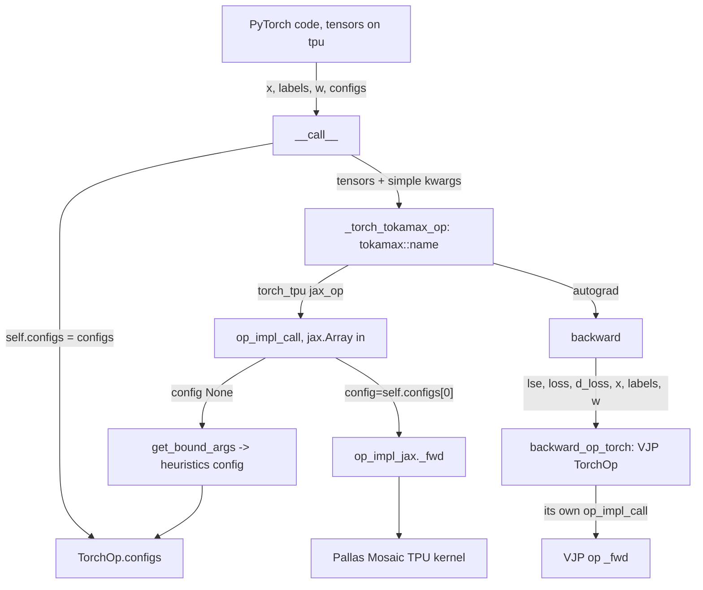
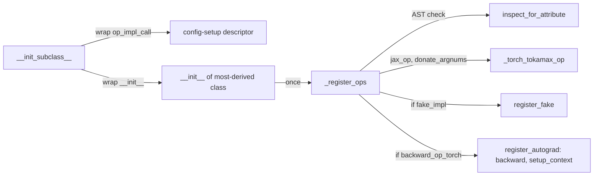

# Calling tokamax TPU kernels from PyTorch (TorchOp over torch_tpu jax_op) and the TPU tuning scripts

## Overview
`tokamax/experimental/torch_tpu` is the "Top level wrapper to create PyTorch interfaces to Tokamax
JAX Ops". A PyTorch user on a TPU device calls a module-level singleton such as
`PallasMosaicTpuLinearSoftmaxCrossEntropyLoss(x, labels, w, reduction="mean")` with ordinary
`torch.Tensor`s on `device="tpu"`. Each singleton is a [`TorchOp`](https://github.com/openxla/tokamax/blob/3a0a3a34a5ccb8a6ac71f343d9cc44649d73db68/tokamax/experimental/torch_tpu/ops/torch_op.py#L236 "tokamax/experimental/torch_tpu/ops/torch_op#TorchOp")
subclass. At construction it registers its [`op_impl_call`](https://github.com/openxla/tokamax/blob/3a0a3a34a5ccb8a6ac71f343d9cc44649d73db68/tokamax/experimental/torch_tpu/ops/torch_op.py#L546 "tokamax/experimental/torch_tpu/ops/torch_op#TorchOp.op_impl_call")
(a JAX function that calls the tokamax op's `_fwd`) with torch_tpu's `jax_op` as a PyTorch
custom op named `tokamax::<jax_op_name>`. When the op has a backward pass, its constructor also
builds a second VJP TorchOp (registered as its own custom op), and the forward op binds its
`backward`/`setup_context` callbacks, which call that VJP op, through PyTorch's
`register_autograd`. The design idea: torch_tpu handles
crossing tensors into JAX and running the JIT-compiled Pallas kernel. TorchOp only handles what
`jax_op` cannot carry, which is kernel configs, non-tensor arguments and backward wiring. It keeps
that state on the singleton instance between the PyTorch-facing `__call__` and the JAX-facing
`op_impl_call`. Two ops are wrapped in the pinned tree, Pallas Mosaic TPU batched ragged paged
attention (forward only) and linear softmax cross-entropy (forward and backward), each with a
reference-implementation twin.

## Diagram

Legend:
- `USER` - (concept) caller with `torch.Tensor`s on `device="tpu"`
- `CALL` - [`__call__`](https://github.com/openxla/tokamax/blob/3a0a3a34a5ccb8a6ac71f343d9cc44649d73db68/tokamax/experimental/torch_tpu/ops/batched_rpa/torch_pallas_mosaic_tpu.py#L105 "tokamax/experimental/torch_tpu/ops/batched_rpa/torch_pallas_mosaic_tpu#_PallasMosaicTpuBatchedRpa.__call__")
- `CFGS` - [`configs`](https://github.com/openxla/tokamax/blob/3a0a3a34a5ccb8a6ac71f343d9cc44649d73db68/tokamax/experimental/torch_tpu/ops/torch_op.py#L299 "tokamax/experimental/torch_tpu/ops/torch_op#TorchOp.configs")
- `TTO` - [`_torch_tokamax_op`](https://github.com/openxla/tokamax/blob/3a0a3a34a5ccb8a6ac71f343d9cc44649d73db68/tokamax/experimental/torch_tpu/ops/torch_op.py#L290 "tokamax/experimental/torch_tpu/ops/torch_op#TorchOp._torch_tokamax_op")
- `OIC` - [`op_impl_call`](https://github.com/openxla/tokamax/blob/3a0a3a34a5ccb8a6ac71f343d9cc44649d73db68/tokamax/experimental/torch_tpu/ops/linear_softmax_cross_entropy/torch_pallas_mosaic_tpu.py#L141 "tokamax/experimental/torch_tpu/ops/linear_softmax_cross_entropy/torch_pallas_mosaic_tpu#_PallasMosaicTpuLinearSoftmaxCrossEntropyLoss.op_impl_call")
- `GBA` - [`get_bound_args`](https://github.com/openxla/tokamax/blob/3a0a3a34a5ccb8a6ac71f343d9cc44649d73db68/tokamax/experimental/torch_tpu/ops/torch_op.py#L346 "tokamax/experimental/torch_tpu/ops/torch_op#TorchOp.get_bound_args")
- `FWD` - [`op_impl_jax`](https://github.com/openxla/tokamax/blob/3a0a3a34a5ccb8a6ac71f343d9cc44649d73db68/tokamax/experimental/torch_tpu/ops/torch_op.py#L286 "tokamax/experimental/torch_tpu/ops/torch_op#TorchOp.op_impl_jax")
- `KER` - (concept) the JAX tokamax kernel, see [linear-softmax-cross-entropy](./linear-softmax-cross-entropy.md), [batched-ragged-paged-attention](./batched-ragged-paged-attention.md)
- `BWD` - [`backward`](https://github.com/openxla/tokamax/blob/3a0a3a34a5ccb8a6ac71f343d9cc44649d73db68/tokamax/experimental/torch_tpu/ops/linear_softmax_cross_entropy/torch_base.py#L199 "tokamax/experimental/torch_tpu/ops/linear_softmax_cross_entropy/torch_base#_LinearSoftmaxCrossEntropyLoss.backward")
- `VJP` - [`backward_op_torch`](https://github.com/openxla/tokamax/blob/3a0a3a34a5ccb8a6ac71f343d9cc44649d73db68/tokamax/experimental/torch_tpu/ops/torch_op.py#L295 "tokamax/experimental/torch_tpu/ops/torch_op#TorchOp.backward_op_torch")
- `VFWD` - [`op_impl_call`](https://github.com/openxla/tokamax/blob/3a0a3a34a5ccb8a6ac71f343d9cc44649d73db68/tokamax/experimental/torch_tpu/ops/linear_softmax_cross_entropy/torch_pallas_mosaic_tpu.py#L75 "tokamax/experimental/torch_tpu/ops/linear_softmax_cross_entropy/torch_pallas_mosaic_tpu#_PallasMosaicTpuLinearSoftmaxCrossEntropyLossVjp.op_impl_call")

Legend:
- `SUB` - [`__init_subclass__`](https://github.com/openxla/tokamax/blob/3a0a3a34a5ccb8a6ac71f343d9cc44649d73db68/tokamax/experimental/torch_tpu/ops/torch_op.py#L321 "tokamax/experimental/torch_tpu/ops/torch_op#TorchOp.__init_subclass__")
- `DESC` - (concept) the descriptor installed on `op_impl_call`; see [`op_impl_call`](https://github.com/openxla/tokamax/blob/3a0a3a34a5ccb8a6ac71f343d9cc44649d73db68/tokamax/experimental/torch_tpu/ops/torch_op.py#L546 "tokamax/experimental/torch_tpu/ops/torch_op#TorchOp.op_impl_call")
- `INIT` - [`__init__`](https://github.com/openxla/tokamax/blob/3a0a3a34a5ccb8a6ac71f343d9cc44649d73db68/tokamax/experimental/torch_tpu/ops/torch_op.py#L275 "tokamax/experimental/torch_tpu/ops/torch_op#TorchOp.__init__")
- `REG` - [`_register_ops`](https://github.com/openxla/tokamax/blob/3a0a3a34a5ccb8a6ac71f343d9cc44649d73db68/tokamax/experimental/torch_tpu/ops/torch_op.py#L468 "tokamax/experimental/torch_tpu/ops/torch_op#TorchOp._register_ops")
- `IFA` - [`inspect_for_attribute`](https://github.com/openxla/tokamax/blob/3a0a3a34a5ccb8a6ac71f343d9cc44649d73db68/tokamax/experimental/torch_tpu/ops/torch_utils.py#L89 "tokamax/experimental/torch_tpu/ops/torch_utils#inspect_for_attribute")
- `TTO2` - [`_torch_tokamax_op`](https://github.com/openxla/tokamax/blob/3a0a3a34a5ccb8a6ac71f343d9cc44649d73db68/tokamax/experimental/torch_tpu/ops/torch_op.py#L290 "tokamax/experimental/torch_tpu/ops/torch_op#TorchOp._torch_tokamax_op")
- `FAKE` - [`fake_impl`](https://github.com/openxla/tokamax/blob/3a0a3a34a5ccb8a6ac71f343d9cc44649d73db68/tokamax/experimental/torch_tpu/ops/torch_op.py#L319 "tokamax/experimental/torch_tpu/ops/torch_op#TorchOp.fake_impl")
- `AG` - [`setup_context`](https://github.com/openxla/tokamax/blob/3a0a3a34a5ccb8a6ac71f343d9cc44649d73db68/tokamax/experimental/torch_tpu/ops/torch_op.py#L569 "tokamax/experimental/torch_tpu/ops/torch_op#TorchOp.setup_context"), [`backward`](https://github.com/openxla/tokamax/blob/3a0a3a34a5ccb8a6ac71f343d9cc44649d73db68/tokamax/experimental/torch_tpu/ops/torch_op.py#L589 "tokamax/experimental/torch_tpu/ops/torch_op#TorchOp.backward")

## Design rationale (why it's built this way)
- **Reuse the JAX kernels unchanged.** The bridge calls the same tokamax op classes JAX users call
  (`op_impl_jax = PallasMosaicTpuLinearSoftmaxCrossEntropyLoss()` and so on). The kernel's grid,
  BlockSpecs, VMEM budget and VJP kernels are therefore exactly those documented on the kernel
  pages. Crossing into JAX is delegated to torch_tpu's `jax_op` in
  [`_register_ops`](https://github.com/openxla/tokamax/blob/3a0a3a34a5ccb8a6ac71f343d9cc44649d73db68/tokamax/experimental/torch_tpu/ops/torch_op.py#L468 "tokamax/experimental/torch_tpu/ops/torch_op#TorchOp._register_ops").
- **Stash what jax_op cannot carry.** The custom-op boundary takes tensors and simple Python
  scalars. Dtypes, `BlockSizes` dataclasses, `KVLayout`/`AttentionScope` enums and kernel configs
  are assigned to `self` in `__call__` ("Store the inputs that cannot go through jax_op.") and
  read back in `op_impl_call`. That is why "All Torch Tokamax ops are singleton instances. You may
  not have multiple instances of the same Torch Op class."
- **Always have a valid config before the kernel runs.** `__init_subclass__` wraps every
  subclass's `op_impl_call` so that a config-setup step runs first. If `__call__` left the config
  as `None`, the step builds abstract `BoundArguments` and asks for
  `get_config(check_autotuning_cache=False)`, then writes the result into
  [`configs`](https://github.com/openxla/tokamax/blob/3a0a3a34a5ccb8a6ac71f343d9cc44649d73db68/tokamax/experimental/torch_tpu/ops/torch_op.py#L299 "tokamax/experimental/torch_tpu/ops/torch_op#TorchOp.configs").
  Inside the custom op the config is the heuristic one. Cached autotuning results reach PyTorch
  only when the caller fetches them up front with
  [`get_configs`](https://github.com/openxla/tokamax/blob/3a0a3a34a5ccb8a6ac71f343d9cc44649d73db68/tokamax/experimental/torch_tpu/ops/torch_utils.py#L51 "tokamax/experimental/torch_tpu/ops/torch_utils#get_configs")
  and passes them in.
- **Fail at import, not at first call.** [`inspect_for_attribute`](https://github.com/openxla/tokamax/blob/3a0a3a34a5ccb8a6ac71f343d9cc44649d73db68/tokamax/experimental/torch_tpu/ops/torch_utils.py#L89 "tokamax/experimental/torch_tpu/ops/torch_utils#inspect_for_attribute")
  parses the source (AST, falling back to `co_names`) to assert that `op_impl_call` uses
  `op_impl_jax`, `__call__` uses `_torch_tokamax_op`, and `backward` uses `backward_op_torch`.
  A subclass that forgets to route through the registered op fails when the singleton is
  constructed.
- **torch.compile correctness over elegance.** Under Dynamo, `self.configs = ...` in `__call__`
  is buffered as a side effect and replayed after the graph. The custom op body runs outside
  Dynamo, so it would see stale attributes, and the replay would then overwrite the resolved
  config. The descriptor therefore flushes pending attribute mutations onto the live instance and
  drops `configs` from Dynamo's replay list (the module documents this at length). The authors
  mark it temporary ("This can be removed once Arian's CL is in.").

## Entry points
- [`_PallasMosaicTpuLinearSoftmaxCrossEntropyLoss`](https://github.com/openxla/tokamax/blob/3a0a3a34a5ccb8a6ac71f343d9cc44649d73db68/tokamax/experimental/torch_tpu/ops/linear_softmax_cross_entropy/torch_pallas_mosaic_tpu.py#L103 "tokamax/experimental/torch_tpu/ops/linear_softmax_cross_entropy/torch_pallas_mosaic_tpu#_PallasMosaicTpuLinearSoftmaxCrossEntropyLoss") -
  exported as the singleton `PallasMosaicTpuLinearSoftmaxCrossEntropyLoss`. Call
  `(x, labels, w, reduction, configs=(fwd_cfg, bwd_cfg) | None)` to get `(loss, lse)`; `loss.backward()`
  produces gradients for `x` and `w`. The reference twin
  [`_LinearSoftmaxCrossEntropyLoss`](https://github.com/openxla/tokamax/blob/3a0a3a34a5ccb8a6ac71f343d9cc44649d73db68/tokamax/experimental/torch_tpu/ops/linear_softmax_cross_entropy/torch_base.py#L130 "tokamax/experimental/torch_tpu/ops/linear_softmax_cross_entropy/torch_base#_LinearSoftmaxCrossEntropyLoss")
  wraps the base JAX op the same way.
- [`__call__`](https://github.com/openxla/tokamax/blob/3a0a3a34a5ccb8a6ac71f343d9cc44649d73db68/tokamax/experimental/torch_tpu/ops/batched_rpa/torch_pallas_mosaic_tpu.py#L105 "tokamax/experimental/torch_tpu/ops/batched_rpa/torch_pallas_mosaic_tpu#_PallasMosaicTpuBatchedRpa.__call__") -
  the singleton `PallasMosaicTpuBatchedRpa(queries, keys, values, kv_cache, kv_lens, page_indices,
  cu_q_lens, distribution, cp_rank=None, *, ..., config=None)` returns `(out, kv_cache)`. It has
  no backward. Its reference twin is [`_BatchedRpa`](https://github.com/openxla/tokamax/blob/3a0a3a34a5ccb8a6ac71f343d9cc44649d73db68/tokamax/experimental/torch_tpu/ops/batched_rpa/torch_base.py#L30 "tokamax/experimental/torch_tpu/ops/batched_rpa/torch_base#_BatchedRpa").
- [`get_configs`](https://github.com/openxla/tokamax/blob/3a0a3a34a5ccb8a6ac71f343d9cc44649d73db68/tokamax/experimental/torch_tpu/ops/torch_utils.py#L51 "tokamax/experimental/torch_tpu/ops/torch_utils#get_configs") -
  `torch_utils.get_configs(op, *tensors, from_autotuning_cache=False, **kwargs) -> (fwd, vjp)`. It
  returns heuristic configs, or `default_config` (autotuning cache first) when
  `from_autotuning_cache=True`, for the op and its `backward_op_torch`. The tests call it before
  the op and pass the pair as `configs=`.
- [`TorchOp`](https://github.com/openxla/tokamax/blob/3a0a3a34a5ccb8a6ac71f343d9cc44649d73db68/tokamax/experimental/torch_tpu/ops/torch_op.py#L236 "tokamax/experimental/torch_tpu/ops/torch_op#TorchOp") -
  the base class for wrapping a new op. Its docstring recipe: set `jax_op_name`, `op_impl_jax`,
  `is_vjp` (and optionally `backward_op_torch`, `donate_argnums`, `fake_impl`); implement
  `op_impl_call` and `__call__`; add `setup_context`/`backward` for a forward op with a
  gradient and `derive_backward_shapes` for a VJP op; then make a module-level singleton.
- [`run_benchmark`](https://github.com/openxla/tokamax/blob/3a0a3a34a5ccb8a6ac71f343d9cc44649d73db68/tokamax/experimental/utils/tuning/tpu/ragged_dot_benchmarking.py#L188 "tokamax/experimental/utils/tuning/tpu/ragged_dot_benchmarking#run_benchmark")
  and [`main`](https://github.com/openxla/tokamax/blob/3a0a3a34a5ccb8a6ac71f343d9cc44649d73db68/tokamax/experimental/utils/tuning/tpu/splash_attention_benchmarking.py#L251 "tokamax/experimental/utils/tuning/tpu/splash_attention_benchmarking#main") -
  the tune-jax scripts (`python3 ragged_dot_benchmarking.py`, `python3
  splash_attention_benchmarking.py`). They are pure JAX and print a runtime-sorted table and the
  optimal hyperparameters to plug into the op's config.

## Mechanism (step-by-step)
1. **Construction registers the op once.** [`__init_subclass__`](https://github.com/openxla/tokamax/blob/3a0a3a34a5ccb8a6ac71f343d9cc44649d73db68/tokamax/experimental/torch_tpu/ops/torch_op.py#L321 "tokamax/experimental/torch_tpu/ops/torch_op#TorchOp.__init_subclass__")
   replaces the subclass's `op_impl_call` with the config-setup descriptor and wraps `__init__`.
   Only when the most-derived class's `__init__` finishes does it call
   [`_register_ops`](https://github.com/openxla/tokamax/blob/3a0a3a34a5ccb8a6ac71f343d9cc44649d73db68/tokamax/experimental/torch_tpu/ops/torch_op.py#L468 "tokamax/experimental/torch_tpu/ops/torch_op#TorchOp._register_ops"),
   guarded by `_ops_registered`. That method asserts `jax_op_name` and `op_impl_jax` are set, runs
   the AST checks, and creates `jax_op(f"tokamax::{jax_op_name}", self.op_impl_call,
   donate_argnums=...)`. It replaces the default fake with [`fake_impl`](https://github.com/openxla/tokamax/blob/3a0a3a34a5ccb8a6ac71f343d9cc44649d73db68/tokamax/experimental/torch_tpu/ops/torch_op.py#L319 "tokamax/experimental/torch_tpu/ops/torch_op#TorchOp.fake_impl")
   if one is given (needed for "a torch.compile region with a dynamic dimension", because the
   default re-exports the JAX function and rejects symbolic shapes). With a backward op it calls
   `register_autograd(self.backward, setup_context=self.setup_context)`.
2. **`__call__` stages state, then enters the custom op.** The Pallas LSCE wrapper sets
   `self.configs = configs or (None, None)` and calls `_torch_tokamax_op(x, labels, w,
   reduction=..., return_residuals=True)`. The batched-RPA
   [`__call__`](https://github.com/openxla/tokamax/blob/3a0a3a34a5ccb8a6ac71f343d9cc44649d73db68/tokamax/experimental/torch_tpu/ops/batched_rpa/torch_pallas_mosaic_tpu.py#L105 "tokamax/experimental/torch_tpu/ops/batched_rpa/torch_pallas_mosaic_tpu#_PallasMosaicTpuBatchedRpa.__call__")
   additionally stores `out_dtype`, `decode_block_sizes`, `prefill_block_sizes`, `kv_layout` and
   `attention_scope` on `self`, because those cannot cross the boundary.
3. **Config resolution inside the custom op.** torch_tpu invokes the registered `op_impl_call`
   with `jax.Array`s. The descriptor first syncs Dynamo side effects, then reads
   `configs[1] if is_vjp else configs[0]`. If that is `None` it asks
   [`get_bound_args`](https://github.com/openxla/tokamax/blob/3a0a3a34a5ccb8a6ac71f343d9cc44649d73db68/tokamax/experimental/torch_tpu/ops/torch_op.py#L346 "tokamax/experimental/torch_tpu/ops/torch_op#TorchOp.get_bound_args")
   for an abstract `BoundArguments` and takes its config without consulting the autotuning cache.
   `get_bound_args` maps positional args onto `op_impl_jax._fwd`'s parameters. Every array becomes
   a `ShapeDtypeStruct`, so nothing is copied: the `jax.Array`s seen here directly, and
   `torch.Tensor`s (when `get_configs` calls it from PyTorch) via the meta device. Missing parameters are filled
   from attributes stashed on `self`, then from `_fwd` defaults. A VJP op adds its backward-only
   arguments (`residuals`, `out`, `dout`) from [`derive_backward_shapes`](https://github.com/openxla/tokamax/blob/3a0a3a34a5ccb8a6ac71f343d9cc44649d73db68/tokamax/experimental/torch_tpu/ops/torch_op.py#L603 "tokamax/experimental/torch_tpu/ops/torch_op#TorchOp.derive_backward_shapes"),
   so the backward config is keyed by shapes derived from the forward inputs.
4. **The kernel call.** The subclass body calls `op_impl_jax._fwd(..., config=self.configs[0])`
   directly, as in [`op_impl_call`](https://github.com/openxla/tokamax/blob/3a0a3a34a5ccb8a6ac71f343d9cc44649d73db68/tokamax/experimental/torch_tpu/ops/batched_rpa/torch_pallas_mosaic_tpu.py#L41 "tokamax/experimental/torch_tpu/ops/batched_rpa/torch_pallas_mosaic_tpu#_PallasMosaicTpuBatchedRpa.op_impl_call"),
   which invokes [`_fwd`](https://github.com/openxla/tokamax/blob/3a0a3a34a5ccb8a6ac71f343d9cc44649d73db68/tokamax/_src/ops/experimental/batched_rpa/pallas_mosaic_tpu.py#L62 "tokamax/_src/ops/experimental/batched_rpa/pallas_mosaic_tpu#PallasTpuBatchedRpa._fwd").
   That `_fwd` asserts a config is present, fills default `BlockSizes` from it, and calls
   [`ragged_paged_attention`](https://github.com/openxla/tokamax/blob/3a0a3a34a5ccb8a6ac71f343d9cc44649d73db68/tokamax/_src/ops/experimental/batched_rpa/kernel/wrapper.py#L511 "tokamax/_src/ops/experimental/batched_rpa/kernel/wrapper#ragged_paged_attention").
   Because `_fwd` is called rather than the op's `__call__`, the JAX-side `Op` machinery (`bind`
   validation, the device check, the HLO `tokamax:{json}` payload and JAX autodiff) is not
   involved. Gradients come from the PyTorch side.
5. **Forward residuals for autograd.** The LSCE [`op_impl_call`](https://github.com/openxla/tokamax/blob/3a0a3a34a5ccb8a6ac71f343d9cc44649d73db68/tokamax/experimental/torch_tpu/ops/linear_softmax_cross_entropy/torch_pallas_mosaic_tpu.py#L141 "tokamax/experimental/torch_tpu/ops/linear_softmax_cross_entropy/torch_pallas_mosaic_tpu#_PallasMosaicTpuLinearSoftmaxCrossEntropyLoss.op_impl_call")
   runs `_fwd(x, labels, w, reduction, return_residuals=True)` and returns `(loss, lse)`. Its
   `setup_context` saves `x, labels, w, lse, loss` and the `reduction` string on `ctx`.
6. **Backward through a second TorchOp.** On `loss.backward()`, the
   [`backward`](https://github.com/openxla/tokamax/blob/3a0a3a34a5ccb8a6ac71f343d9cc44649d73db68/tokamax/experimental/torch_tpu/ops/linear_softmax_cross_entropy/torch_base.py#L199 "tokamax/experimental/torch_tpu/ops/linear_softmax_cross_entropy/torch_base#_LinearSoftmaxCrossEntropyLoss.backward")
   callback discards `d_lse` and calls `backward_op_torch(lse, loss, d_loss, x, labels, w,
   reduction=..., config=self.configs[1])`. That is another registered custom op
   (`tokamax::pallas_mosaic_tpu_linear_softmax_cross_entropy_loss_vjp`) whose
   [`op_impl_call`](https://github.com/openxla/tokamax/blob/3a0a3a34a5ccb8a6ac71f343d9cc44649d73db68/tokamax/experimental/torch_tpu/ops/linear_softmax_cross_entropy/torch_pallas_mosaic_tpu.py#L75 "tokamax/experimental/torch_tpu/ops/linear_softmax_cross_entropy/torch_pallas_mosaic_tpu#_PallasMosaicTpuLinearSoftmaxCrossEntropyLossVjp.op_impl_call")
   runs the Pallas VJP op's `_fwd((lse,), loss, d_loss, x, labels, w, ...)` and returns
   `(x_grad, w_grad)`. The callback returns `(grad_x, None, grad_w, None, None)`, one slot per
   forward input.
7. **Tuning the kernels (JAX side).** The ragged-dot script jits
   [`gmm_fwd`](https://github.com/openxla/tokamax/blob/3a0a3a34a5ccb8a6ac71f343d9cc44649d73db68/tokamax/experimental/utils/tuning/tpu/ragged_dot_benchmarking.py#L143 "tokamax/experimental/utils/tuning/tpu/ragged_dot_benchmarking#gmm_fwd"),
   [`dlhs_bwd`](https://github.com/openxla/tokamax/blob/3a0a3a34a5ccb8a6ac71f343d9cc44649d73db68/tokamax/experimental/utils/tuning/tpu/ragged_dot_benchmarking.py#L157 "tokamax/experimental/utils/tuning/tpu/ragged_dot_benchmarking#dlhs_bwd")
   and [`drhs_bwd`](https://github.com/openxla/tokamax/blob/3a0a3a34a5ccb8a6ac71f343d9cc44649d73db68/tokamax/experimental/utils/tuning/tpu/ragged_dot_benchmarking.py#L171 "tokamax/experimental/utils/tuning/tpu/ragged_dot_benchmarking#drhs_bwd")
   with static `tile_m/tile_k/tile_n/input_buffer_count` ([`jit_wrapper`](https://github.com/openxla/tokamax/blob/3a0a3a34a5ccb8a6ac71f343d9cc44649d73db68/tokamax/experimental/utils/tuning/tpu/ragged_dot_benchmarking.py#L95 "tokamax/experimental/utils/tuning/tpu/ragged_dot_benchmarking#jit_wrapper")).
   Each builds a `PallasMosaicTpuRaggedDot(config=Config(...))`; `drhs` (tgmm) also sets
   `combine_scopes=True`. [`run_benchmark`](https://github.com/openxla/tokamax/blob/3a0a3a34a5ccb8a6ac71f343d9cc44649d73db68/tokamax/experimental/utils/tuning/tpu/ragged_dot_benchmarking.py#L188 "tokamax/experimental/utils/tuning/tpu/ragged_dot_benchmarking#run_benchmark")
   rounds tile candidates up to multiples of 128, sweeps `input_buffer_count` over `{2, 3, 4}`,
   and pre-samples one shared subset of the Cartesian product.
   [`_sampled`](https://github.com/openxla/tokamax/blob/3a0a3a34a5ccb8a6ac71f343d9cc44649d73db68/tokamax/experimental/utils/tuning/tpu/ragged_dot_benchmarking.py#L241 "tokamax/experimental/utils/tuning/tpu/ragged_dot_benchmarking#run_benchmark._sampled")
   raises `NotImplementedError` (a skip to tune-jax) for unselected combinations. It sets
   `allow_fallback_timing = False` ("do not allow timing in Python") and filters profiler events
   with `"gmm"` or `"tgmm"`. It also tunes an XLA `ragged_dot_general` baseline (filter
   `"ragged"`) and quantized variants via [`_quantize`](https://github.com/openxla/tokamax/blob/3a0a3a34a5ccb8a6ac71f343d9cc44649d73db68/tokamax/experimental/utils/tuning/tpu/ragged_dot_benchmarking.py#L248 "tokamax/experimental/utils/tuning/tpu/ragged_dot_benchmarking#run_benchmark._quantize").
   The splash script builds a [`SplashConfig`](https://github.com/openxla/tokamax/blob/3a0a3a34a5ccb8a6ac71f343d9cc44649d73db68/tokamax/_src/ops/experimental/tpu/splash_attention/splash_attention_kernel.py#L244 "tokamax/_src/ops/experimental/tpu/splash_attention/splash_attention_kernel#SplashConfig")
   inside [`attention_fn`](https://github.com/openxla/tokamax/blob/3a0a3a34a5ccb8a6ac71f343d9cc44649d73db68/tokamax/experimental/utils/tuning/tpu/splash_attention_benchmarking.py#L133 "tokamax/experimental/utils/tuning/tpu/splash_attention_benchmarking#run_benchmark.attention_fn")
   from block sizes in `{256 ... 8192}` and q/k/v layouts in `{HEAD_DIM_MINOR, SEQ_MINOR}`
   ([`QKVLayout`](https://github.com/openxla/tokamax/blob/3a0a3a34a5ccb8a6ac71f343d9cc44649d73db68/tokamax/experimental/utils/tuning/tpu/splash_attention_benchmarking.py#L35 "tokamax/experimental/utils/tuning/tpu/splash_attention_benchmarking#QKVLayout")).
   [`get_benchmark_func`](https://github.com/openxla/tokamax/blob/3a0a3a34a5ccb8a6ac71f343d9cc44649d73db68/tokamax/experimental/utils/tuning/tpu/splash_attention_benchmarking.py#L74 "tokamax/experimental/utils/tuning/tpu/splash_attention_benchmarking#get_benchmark_func")
   vmaps the single-device MHA or MQA kernel and differentiates it for `bwd`.
   [`run_benchmark`](https://github.com/openxla/tokamax/blob/3a0a3a34a5ccb8a6ac71f343d9cc44649d73db68/tokamax/experimental/utils/tuning/tpu/splash_attention_benchmarking.py#L108 "tokamax/experimental/utils/tuning/tpu/splash_attention_benchmarking#run_benchmark")
   then writes a `jax.profiler` trace with the best config to `/tmp/splash_attention_benchmark`.

## Key data structures
- [`configs`](https://github.com/openxla/tokamax/blob/3a0a3a34a5ccb8a6ac71f343d9cc44649d73db68/tokamax/experimental/torch_tpu/ops/torch_op.py#L299 "tokamax/experimental/torch_tpu/ops/torch_op#TorchOp.configs") -
  `(forward_config, vjp_config)` on the singleton. A forward op writes slot 0 and a VJP op slot 1
  ([`is_vjp`](https://github.com/openxla/tokamax/blob/3a0a3a34a5ccb8a6ac71f343d9cc44649d73db68/tokamax/experimental/torch_tpu/ops/torch_op.py#L306 "tokamax/experimental/torch_tpu/ops/torch_op#TorchOp.is_vjp")).
  Defaults are pinned by [`test_init_defaults`](https://github.com/openxla/tokamax/blob/3a0a3a34a5ccb8a6ac71f343d9cc44649d73db68/tokamax/experimental/torch_tpu/ops/torch_op_test.py#L396 "tokamax/experimental/torch_tpu/ops/torch_op_test#TorchOpTest.test_init_defaults").
- [`_torch_tokamax_op`](https://github.com/openxla/tokamax/blob/3a0a3a34a5ccb8a6ac71f343d9cc44649d73db68/tokamax/experimental/torch_tpu/ops/torch_op.py#L290 "tokamax/experimental/torch_tpu/ops/torch_op#TorchOp._torch_tokamax_op") -
  the `torch._library` `CustomOpDef` returned by `jax_op`. `__call__` must invoke it (asserted
  at registration).
- [`BoundArguments`](https://github.com/openxla/tokamax/blob/3a0a3a34a5ccb8a6ac71f343d9cc44649d73db68/tokamax/_src/ops/op.py#L437 "tokamax/_src/ops/op#BoundArguments") built by
  `get_bound_args` - the same type the JAX side autotunes on. A PyTorch call therefore maps onto
  the same heuristic and cached configs as an equivalent JAX call with the same shapes.
- Batched-RPA layout knobs such as [`KVLayout`](https://github.com/openxla/tokamax/blob/3a0a3a34a5ccb8a6ac71f343d9cc44649d73db68/tokamax/_src/ops/experimental/batched_rpa/kernel/configs.py#L85 "tokamax/_src/ops/experimental/batched_rpa/kernel/configs#KVLayout")
  (default `HEAD_ALONG_SUBLANE`) travel on `self`, not through the custom op.

## Dynamics (design intent)
- **Mutable singleton state.** `__call__` writes attributes and `op_impl_call` reads them. Two
  interleaved calls on the same singleton with different configs or layouts would race.

> [!inferred]
> The design assumes calls are serialized per op (single-threaded eager, or one compiled graph
> at a time). Nothing in the source locks the instance.

- **torch.compile.** The LSCE tests run the op inside `@torch.compile(fullgraph=True,
  dynamic=False)` with pointwise ops before and after, and backpropagate through it. Dynamic
  shapes need a `fake_impl`, which neither wrapped op sets.
- **Timing for tuning is device-only.** Both scripts disable tune-jax's Python fallback timing and
  can restrict timing to Pallas kernels (splash `--tune_pallas_only` filters on
  `splash_{mha|mqa}_{fwd|dkv}`), mirroring the `event_filter_regex` mechanism in
  [benchmarking-and-serialization](./benchmarking-and-serialization.md).

## Edge cases
- **Silently ignored batched-RPA kwargs.** Both RPA wrappers accept `chunk_prefill_size`,
  `vmem_limit_bytes` and `debug_mode` and pass them into the custom op, but their `op_impl_call`s
  ([`op_impl_call`](https://github.com/openxla/tokamax/blob/3a0a3a34a5ccb8a6ac71f343d9cc44649d73db68/tokamax/experimental/torch_tpu/ops/batched_rpa/torch_pallas_mosaic_tpu.py#L41 "tokamax/experimental/torch_tpu/ops/batched_rpa/torch_pallas_mosaic_tpu#_PallasMosaicTpuBatchedRpa.op_impl_call"),
  [`op_impl_call`](https://github.com/openxla/tokamax/blob/3a0a3a34a5ccb8a6ac71f343d9cc44649d73db68/tokamax/experimental/torch_tpu/ops/batched_rpa/torch_base.py#L118 "tokamax/experimental/torch_tpu/ops/batched_rpa/torch_base#_BatchedRpa.op_impl_call"))
  do not forward them to `_fwd`, so the JAX defaults apply. To change the VMEM limit or block
  sizes from PyTorch, use `config=` or `decode_block_sizes`/`prefill_block_sizes`.
- **Reference RPA has no config.** [`_BatchedRpa`](https://github.com/openxla/tokamax/blob/3a0a3a34a5ccb8a6ac71f343d9cc44649d73db68/tokamax/experimental/torch_tpu/ops/batched_rpa/torch_base.py#L30 "tokamax/experimental/torch_tpu/ops/batched_rpa/torch_base#_BatchedRpa")
  calls the base op's `_fwd` with `config=None`, while the Pallas variant requires one
  ("Config must be supplied."), which the descriptor guarantees.
- **KV cache is returned, not updated in place.** The RPA wrappers set no `donate_argnums`, so
  `kv_cache` comes back as a new tensor that the caller must keep.
- **LSCE backward ignores `d_lse`.** Only `d_loss` flows back. A loss built on the returned
  `lse` gets no gradient through it.
- **VJP ops need `derive_backward_shapes`.** The base raises `NotImplementedError` for a VJP op
  that does not override it. For LSCE, the residual is shaped `(x.shape[0],)` with `x`'s dtype
  and `out`/`dout` are scalars.

## Open questions
- `_PallasMosaicTpuLinearSoftmaxCrossEntropyLoss.__init__` runs the base class `__init__`, which
  constructs a base `_LinearSoftmaxCrossEntropyLossVjp()` singleton before the Pallas VJP replaces
  it. Whether torch_tpu's `jax_op` tolerates the base VJP name being registered twice (once by the
  base module singleton, once here) is not visible in tokamax source.
- The docstring says `donate_argnums` is "passed through to jax.jit". How torch_tpu maps donated
  JAX buffers back onto PyTorch tensors is outside this repo.
- Inside the custom op the config ignores the autotuning cache (`check_autotuning_cache=False`).
  Whether that is deliberate (tracing cost, determinism) or provisional is not stated.

## See also
- [linear-softmax-cross-entropy](./linear-softmax-cross-entropy.md) - the JAX op and Pallas kernels behind the LSCE wrapper.
- [batched-ragged-paged-attention](./batched-ragged-paged-attention.md) - the RPA kernel, `KVLayout`, block sizes.
- [ragged-dot-gmm](./ragged-dot-gmm.md) and [splash-attention](./splash-attention.md) - kernels the tuning scripts target.
- [op-framework](./op-framework.md) - `Op`, `BoundArguments`, heuristics vs cached configs.
- [autotuning](./autotuning.md) - the built-in autotuner that `from_autotuning_cache=True` reads from.
- [benchmarking-and-serialization](./benchmarking-and-serialization.md) - device-time measurement.
