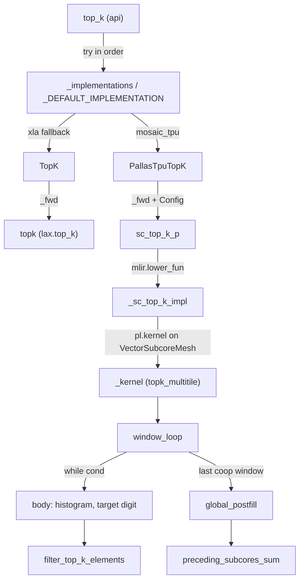

# TPU TopK: SparseCore MSB radix select (topk_multitile)

## Overview
`tokamax/_src/ops/experimental/tpu/topk` is a drop-in for `jax.lax.top_k` ("Based on the jax.lax.top_k API") that, on TPU v6 and later, runs on the **SparseCore vector subcores** instead of the TensorCore. The public function [`top_k`](https://github.com/openxla/tokamax/blob/3a0a3a34a5ccb8a6ac71f343d9cc44649d73db68/tokamax/_src/ops/experimental/tpu/topk/api.py#L40 "tokamax/_src/ops/experimental/tpu/topk/api#top_k") walks an implementation list (`mosaic_tpu` first, `xla` as fallback). Both entries are instances of the tokamax op class [`TopK`](https://github.com/openxla/tokamax/blob/3a0a3a34a5ccb8a6ac71f343d9cc44649d73db68/tokamax/_src/ops/experimental/tpu/topk/base.py#L60 "tokamax/_src/ops/experimental/tpu/topk/base#TopK"). The key idea of the kernel is a **most-significant-digit radix select**. Each 32-bit key is turned into an order-preserving unsigned integer and cut into `num_digits` digits of `digit_width` bits. For each digit, from most significant to least, the kernel builds a histogram of the digit over the surviving candidates and finds a threshold digit. Everything above the threshold is definitely in the top-k, everything below is dropped, and only the elements equal to the threshold go on to the next digit. Nothing is ever sorted inside the kernel. The wrapper [`PallasTpuTopK`](https://github.com/openxla/tokamax/blob/3a0a3a34a5ccb8a6ac71f343d9cc44649d73db68/tokamax/_src/ops/experimental/tpu/topk/pallas_mosaic_tpu.py#L41 "tokamax/_src/ops/experimental/tpu/topk/pallas_mosaic_tpu#PallasTpuTopK") does one small `lax.sort` over just the k results afterwards.

## Diagram

Legend:
- `API` - [`top_k`](https://github.com/openxla/tokamax/blob/3a0a3a34a5ccb8a6ac71f343d9cc44649d73db68/tokamax/_src/ops/experimental/tpu/topk/api.py#L40 "tokamax/_src/ops/experimental/tpu/topk/api#top_k")
- `IMPLS` - [`_implementations`](https://github.com/openxla/tokamax/blob/3a0a3a34a5ccb8a6ac71f343d9cc44649d73db68/tokamax/_src/ops/experimental/tpu/topk/api.py#L26 "tokamax/_src/ops/experimental/tpu/topk/api#_implementations"), [`_DEFAULT_IMPLEMENTATION`](https://github.com/openxla/tokamax/blob/3a0a3a34a5ccb8a6ac71f343d9cc44649d73db68/tokamax/_src/ops/experimental/tpu/topk/api.py#L27 "tokamax/_src/ops/experimental/tpu/topk/api#_DEFAULT_IMPLEMENTATION")
- `PT` - [`PallasTpuTopK`](https://github.com/openxla/tokamax/blob/3a0a3a34a5ccb8a6ac71f343d9cc44649d73db68/tokamax/_src/ops/experimental/tpu/topk/pallas_mosaic_tpu.py#L41 "tokamax/_src/ops/experimental/tpu/topk/pallas_mosaic_tpu#PallasTpuTopK")
- `BASE` - [`TopK`](https://github.com/openxla/tokamax/blob/3a0a3a34a5ccb8a6ac71f343d9cc44649d73db68/tokamax/_src/ops/experimental/tpu/topk/base.py#L60 "tokamax/_src/ops/experimental/tpu/topk/base#TopK")
- `REF` - [`topk`](https://github.com/openxla/tokamax/blob/3a0a3a34a5ccb8a6ac71f343d9cc44649d73db68/tokamax/_src/ops/experimental/tpu/topk/base.py#L30 "tokamax/_src/ops/experimental/tpu/topk/base#topk")
- `PRIM` - [`sc_top_k_p`](https://github.com/openxla/tokamax/blob/3a0a3a34a5ccb8a6ac71f343d9cc44649d73db68/tokamax/_src/ops/experimental/tpu/topk/pallas_mosaic_tpu_kernel.py#L711 "tokamax/_src/ops/experimental/tpu/topk/pallas_mosaic_tpu_kernel#sc_top_k_p")
- `IMPL` - [`_sc_top_k_impl`](https://github.com/openxla/tokamax/blob/3a0a3a34a5ccb8a6ac71f343d9cc44649d73db68/tokamax/_src/ops/experimental/tpu/topk/pallas_mosaic_tpu_kernel.py#L223 "tokamax/_src/ops/experimental/tpu/topk/pallas_mosaic_tpu_kernel#_sc_top_k_impl")
- `K` - [`_kernel`](https://github.com/openxla/tokamax/blob/3a0a3a34a5ccb8a6ac71f343d9cc44649d73db68/tokamax/_src/ops/experimental/tpu/topk/pallas_mosaic_tpu_kernel.py#L318 "tokamax/_src/ops/experimental/tpu/topk/pallas_mosaic_tpu_kernel#_sc_top_k_impl._kernel")
- `WL` - [`window_loop`](https://github.com/openxla/tokamax/blob/3a0a3a34a5ccb8a6ac71f343d9cc44649d73db68/tokamax/_src/ops/experimental/tpu/topk/pallas_mosaic_tpu_kernel.py#L370 "tokamax/_src/ops/experimental/tpu/topk/pallas_mosaic_tpu_kernel#_sc_top_k_impl._kernel.batch_loop.window_loop")
- `BODY` - [`body`](https://github.com/openxla/tokamax/blob/3a0a3a34a5ccb8a6ac71f343d9cc44649d73db68/tokamax/_src/ops/experimental/tpu/topk/pallas_mosaic_tpu_kernel.py#L437 "tokamax/_src/ops/experimental/tpu/topk/pallas_mosaic_tpu_kernel#_sc_top_k_impl._kernel.batch_loop.window_loop.body")
- `FILT` - [`filter_top_k_elements`](https://github.com/openxla/tokamax/blob/3a0a3a34a5ccb8a6ac71f343d9cc44649d73db68/tokamax/_src/ops/experimental/tpu/topk/pallas_mosaic_tpu_kernel.py#L503 "tokamax/_src/ops/experimental/tpu/topk/pallas_mosaic_tpu_kernel#_sc_top_k_impl._kernel.batch_loop.window_loop.body.filter_top_k_elements")
- `GPF` - [`global_postfill`](https://github.com/openxla/tokamax/blob/3a0a3a34a5ccb8a6ac71f343d9cc44649d73db68/tokamax/_src/ops/experimental/tpu/topk/pallas_mosaic_tpu_kernel.py#L615 "tokamax/_src/ops/experimental/tpu/topk/pallas_mosaic_tpu_kernel#_sc_top_k_impl._kernel.batch_loop.window_loop.global_postfill")
- `PSS` - [`preceding_subcores_sum`](https://github.com/openxla/tokamax/blob/3a0a3a34a5ccb8a6ac71f343d9cc44649d73db68/tokamax/_src/ops/experimental/tpu/topk/pallas_mosaic_tpu_kernel.py#L186 "tokamax/_src/ops/experimental/tpu/topk/pallas_mosaic_tpu_kernel#preceding_subcores_sum")

## Design rationale (why it's built this way)
- **Radix select rather than sort.** One pass per digit costs O(N) work in vector-wide chunks: a histogram via `plsc.scan_count` + `plsc.addupdate_scatter`, then a compaction via `plsc.store_compressed`. Only the threshold bucket survives, so the candidate set usually shrinks fast. The work is gathers, scatters and compaction, which SparseCore vector subcores are built for, and there is no MXU work at all. The module docstring calls this the "Large K: Distributed MSB Radix Select (`topk_multitile`)" path.
- **Order-preserving bit trick.** [`__getitem__`](https://github.com/openxla/tokamax/blob/3a0a3a34a5ccb8a6ac71f343d9cc44649d73db68/tokamax/_src/ops/experimental/tpu/topk/pallas_mosaic_tpu_kernel.py#L104 "tokamax/_src/ops/experimental/tpu/topk/pallas_mosaic_tpu_kernel#_DigitGetter.__getitem__") views each key as `uint32`. For `int32` it flips the sign bit. For `float32` it XORs with `(sign >> 31) | 0x80000000`, so negative floats have all bits inverted and positive floats only the sign bit. After that, unsigned digit order matches numeric order, and the same digit loop works for both dtypes.
- **Cooperate only when a row is long.** `_sc_top_k_impl` sets `num_cooperating_tiles = 1` when `N <= 4096` and otherwise uses every subcore on one row (`# TODO: bjp - tune this.`). Independent subcores handle strided batch rows and never synchronize. The docstring says this "can be performance beneficial for large enough batches". Cooperating subcores pay for barriers and a shared-VMEM histogram, but only in the last window.
- **Second SparseCore only if there is enough batch.** The mesh starts with `num_cores=1` and switches to 2 when `batch_size / (num_subcores // num_cooperating_tiles) > 1`. This is how the kernel uses the second core, playing the role megacore plays for TensorCore kernels.
- **Sort only k elements, outside.** The kernel writes results in histogram-filter order. The `_fwd` of `PallasTpuTopK` then runs `jax.lax.sort` on `(keys, vals)` and flips the result to get descending order. That costs O(k log k), not O(N log N).

> [!inferred]
> The kernel is registered as its own JAX primitive ([`sc_top_k_p`](https://github.com/openxla/tokamax/blob/3a0a3a34a5ccb8a6ac71f343d9cc44649d73db68/tokamax/_src/ops/experimental/tpu/topk/pallas_mosaic_tpu_kernel.py#L711 "tokamax/_src/ops/experimental/tpu/topk/pallas_mosaic_tpu_kernel#sc_top_k_p")) with an abstract eval and a vmap rule, not called directly. The likely reason is that batching can then fold a vmapped axis into the kernel's batch loop rather than tracing the `pl.kernel` once per vmapped element: the batch rule just re-binds with the batched shapes.

## Entry points
- [`top_k`](https://github.com/openxla/tokamax/blob/3a0a3a34a5ccb8a6ac71f343d9cc44649d73db68/tokamax/_src/ops/experimental/tpu/topk/api.py#L40 "tokamax/_src/ops/experimental/tpu/topk/api#top_k") - the user-facing function. `implementation=None` tries [`_DEFAULT_IMPLEMENTATION`](https://github.com/openxla/tokamax/blob/3a0a3a34a5ccb8a6ac71f343d9cc44649d73db68/tokamax/_src/ops/experimental/tpu/topk/api.py#L27 "tokamax/_src/ops/experimental/tpu/topk/api#_DEFAULT_IMPLEMENTATION") in order. That is `("mosaic_tpu", "xla")` when the Pallas module imports and `("xla",)` otherwise. A `NotImplementedError` from one implementation moves on to the next. If every implementation fails you get an `ExceptionGroup`. A single string calls that implementation directly with no fallback. Only `axis=-1` is accepted.
- [`TopK`](https://github.com/openxla/tokamax/blob/3a0a3a34a5ccb8a6ac71f343d9cc44649d73db68/tokamax/_src/ops/experimental/tpu/topk/base.py#L60 "tokamax/_src/ops/experimental/tpu/topk/base#TopK") - "Tokamax operator for TopK", a subclass of [`Op`](https://github.com/openxla/tokamax/blob/3a0a3a34a5ccb8a6ac71f343d9cc44649d73db68/tokamax/_src/ops/op.py#L121 "tokamax/_src/ops/op#Op"). Its [`bind`](https://github.com/openxla/tokamax/blob/3a0a3a34a5ccb8a6ac71f343d9cc44649d73db68/tokamax/_src/ops/experimental/tpu/topk/base.py#L64 "tokamax/_src/ops/experimental/tpu/topk/base#TopK.bind") validates `k > 0`, `N >= k`, the last-axis restriction and a matching `values` shape, then returns a [`BoundArguments`](https://github.com/openxla/tokamax/blob/3a0a3a34a5ccb8a6ac71f343d9cc44649d73db68/tokamax/_src/ops/op.py#L437 "tokamax/_src/ops/op#BoundArguments"). Its base [`_fwd`](https://github.com/openxla/tokamax/blob/3a0a3a34a5ccb8a6ac71f343d9cc44649d73db68/tokamax/_src/ops/experimental/tpu/topk/base.py#L102 "tokamax/_src/ops/experimental/tpu/topk/base#TopK._fwd") is the `xla` implementation: it calls the jitted reference [`topk`](https://github.com/openxla/tokamax/blob/3a0a3a34a5ccb8a6ac71f343d9cc44649d73db68/tokamax/_src/ops/experimental/tpu/topk/base.py#L30 "tokamax/_src/ops/experimental/tpu/topk/base#topk"), which is `lax.top_k` followed by `take_along_axis` when `values` is given.
- [`PallasTpuTopK`](https://github.com/openxla/tokamax/blob/3a0a3a34a5ccb8a6ac71f343d9cc44649d73db68/tokamax/_src/ops/experimental/tpu/topk/pallas_mosaic_tpu.py#L41 "tokamax/_src/ops/experimental/tpu/topk/pallas_mosaic_tpu#PallasTpuTopK") - the `mosaic_tpu` implementation. [`supported_on`](https://github.com/openxla/tokamax/blob/3a0a3a34a5ccb8a6ac71f343d9cc44649d73db68/tokamax/_src/ops/experimental/tpu/topk/pallas_mosaic_tpu.py#L95 "tokamax/_src/ops/experimental/tpu/topk/pallas_mosaic_tpu#PallasTpuTopK.supported_on") requires `platform == "tpu"` and `get_tpu_info().generation >= 6`. On older chips the generic `Op.__call__` raises `NotImplementedError` and `top_k` falls back to XLA.

## Mechanism (step-by-step)
1. **Config resolution.** The `_fwd` of [`PallasTpuTopK`](https://github.com/openxla/tokamax/blob/3a0a3a34a5ccb8a6ac71f343d9cc44649d73db68/tokamax/_src/ops/experimental/tpu/topk/pallas_mosaic_tpu.py#L48 "tokamax/_src/ops/experimental/tpu/topk/pallas_mosaic_tpu#PallasTpuTopK._fwd") takes a [`Config`](https://github.com/openxla/tokamax/blob/3a0a3a34a5ccb8a6ac71f343d9cc44649d73db68/tokamax/_src/ops/experimental/tpu/topk/pallas_mosaic_tpu.py#L30 "tokamax/_src/ops/experimental/tpu/topk/pallas_mosaic_tpu#Config") from the op framework. If none is given, it uses [`_get_heuristics_config`](https://github.com/openxla/tokamax/blob/3a0a3a34a5ccb8a6ac71f343d9cc44649d73db68/tokamax/_src/ops/experimental/tpu/topk/pallas_mosaic_tpu.py#L84 "tokamax/_src/ops/experimental/tpu/topk/pallas_mosaic_tpu#PallasTpuTopK._get_heuristics_config"), which returns the plain default `Config()`: `num_seq_windows=1, digit_width=4, num_digits=8`, i.e. 8 digits of 4 bits for 32-bit keys. [`_get_autotuning_configs`](https://github.com/openxla/tokamax/blob/3a0a3a34a5ccb8a6ac71f343d9cc44649d73db68/tokamax/_src/ops/experimental/tpu/topk/pallas_mosaic_tpu.py#L88 "tokamax/_src/ops/experimental/tpu/topk/pallas_mosaic_tpu#PallasTpuTopK._get_autotuning_configs") only offers one or two sequential windows, so the autotuning search space is tiny (see [autotuning](./autotuning.md)). `axis` and `is_stable` are deleted unused at this point.
2. **Primitive bind and lowering.** The kernel-module `top_k` binds [`sc_top_k_p`](https://github.com/openxla/tokamax/blob/3a0a3a34a5ccb8a6ac71f343d9cc44649d73db68/tokamax/_src/ops/experimental/tpu/topk/pallas_mosaic_tpu_kernel.py#L711 "tokamax/_src/ops/experimental/tpu/topk/pallas_mosaic_tpu_kernel#sc_top_k_p"), which is lowered with `mlir.lower_fun(_sc_top_k_impl)`. Its eager impl raises `"sc_top_k must be JIT'ed"`. The abstract eval enforces `int32` values with the same shape as the keys.
3. **Mesh, tiling and scratch budgeting.** [`_sc_top_k_impl`](https://github.com/openxla/tokamax/blob/3a0a3a34a5ccb8a6ac71f343d9cc44649d73db68/tokamax/_src/ops/experimental/tpu/topk/pallas_mosaic_tpu_kernel.py#L223 "tokamax/_src/ops/experimental/tpu/topk/pallas_mosaic_tpu_kernel#_sc_top_k_impl") builds a `plsc.VectorSubcoreMesh` and picks the cooperation mode and core count described above. It splits each row into `num_seq_windows * num_cooperating_tiles` tiles of `elements_tile_size` elements. Every buffer is a fixed-size scratch, and there are no BlockSpecs at all. Per-subcore VMEM holds the key/value window: `elements_tile_size` plus a `k`-sized "carry-forward" pad when there are several windows. It also holds three histograms of `2**digit_width` int32 each, and the `aligned_k` top-k output buffers. SMEM holds the scalar counters. `VMEM_SHARED` holds the cooperative global histogram and the output staging. When there is no cooperation, the shared buffers are set to `None`. The kernel is launched with `pl.kernel(..., name="topk_multitile")` and outputs padded to `aligned_k`, which are sliced back to `k`.
4. **Batch and window loops.** Inside [`_kernel`](https://github.com/openxla/tokamax/blob/3a0a3a34a5ccb8a6ac71f343d9cc44649d73db68/tokamax/_src/ops/experimental/tpu/topk/pallas_mosaic_tpu_kernel.py#L318 "tokamax/_src/ops/experimental/tpu/topk/pallas_mosaic_tpu_kernel#_sc_top_k_impl._kernel"), each subcore loops over a strided set of batch rows. For each row, [`window_loop`](https://github.com/openxla/tokamax/blob/3a0a3a34a5ccb8a6ac71f343d9cc44649d73db68/tokamax/_src/ops/experimental/tpu/topk/pallas_mosaic_tpu_kernel.py#L370 "tokamax/_src/ops/experimental/tpu/topk/pallas_mosaic_tpu_kernel#_sc_top_k_impl._kernel.batch_loop.window_loop") async-copies one window of keys (and values) from HBM into VMEM. If no values were passed, it fills global indices instead. From the second window on, it appends the previous window's top-k after the window, so each window only has to choose among "new elements plus the current best k".
5. **Digit loop.** A `lax.while_loop` runs [`body`](https://github.com/openxla/tokamax/blob/3a0a3a34a5ccb8a6ac71f343d9cc44649d73db68/tokamax/_src/ops/experimental/tpu/topk/pallas_mosaic_tpu_kernel.py#L437 "tokamax/_src/ops/experimental/tpu/topk/pallas_mosaic_tpu_kernel#_sc_top_k_impl._kernel.batch_loop.window_loop.body") while [`cond`](https://github.com/openxla/tokamax/blob/3a0a3a34a5ccb8a6ac71f343d9cc44649d73db68/tokamax/_src/ops/experimental/tpu/topk/pallas_mosaic_tpu_kernel.py#L434 "tokamax/_src/ops/experimental/tpu/topk/pallas_mosaic_tpu_kernel#_sc_top_k_impl._kernel.batch_loop.window_loop.cond") holds, i.e. while digits remain and `num_global_outputs < k`. Each iteration clears and fills the local histogram for the current digit. On the last cooperative window it also scatter-adds every subcore's histogram into the shared `global_histogram` between two `subcore_barrier`s and copies the sum back. It then computes `n_minus_k = num_remaining_global - (k - found)` and scans the histogram in ascending digit order with a running cumsum and `all_reduce_ffs` to find `target_digit`, the first digit where the cumulative count reaches `n_minus_k`.
6. **Filter and compact.** [`filter_top_k_elements`](https://github.com/openxla/tokamax/blob/3a0a3a34a5ccb8a6ac71f343d9cc44649d73db68/tokamax/_src/ops/experimental/tpu/topk/pallas_mosaic_tpu_kernel.py#L503 "tokamax/_src/ops/experimental/tpu/topk/pallas_mosaic_tpu_kernel#_sc_top_k_impl._kernel.batch_loop.window_loop.body.filter_top_k_elements") compacts in place with `store_compressed`. Elements with `digit > target_digit` are appended to `topk_keys/topk_values`. Elements with `digit == target_digit` are packed into the front of the window buffer as survivors for the next digit. Everything else is dropped. The survivors are padded to a lane multiple with `(0, INVALID_VALUE)`. On the last cooperative window, `sum_across_subcores` reduces the counters through SMEM `fetch_and_add`.
7. **Postfill ties.** If every digit is used up and fewer than `k` elements were found, the remaining candidates are bit-identical ties. `local_postfill` copies them in order. When subcores cooperate, [`global_postfill`](https://github.com/openxla/tokamax/blob/3a0a3a34a5ccb8a6ac71f343d9cc44649d73db68/tokamax/_src/ops/experimental/tpu/topk/pallas_mosaic_tpu_kernel.py#L615 "tokamax/_src/ops/experimental/tpu/topk/pallas_mosaic_tpu_kernel#_sc_top_k_impl._kernel.batch_loop.window_loop.global_postfill") uses [`preceding_subcores_sum`](https://github.com/openxla/tokamax/blob/3a0a3a34a5ccb8a6ac71f343d9cc44649d73db68/tokamax/_src/ops/experimental/tpu/topk/pallas_mosaic_tpu_kernel.py#L186 "tokamax/_src/ops/experimental/tpu/topk/pallas_mosaic_tpu_kernel#preceding_subcores_sum"), an exclusive prefix sum that subcore 0 computes in SMEM, so lower subcores (lower indices) win the ties. The docstring says ties are broken "by index (earlier windows = lower subcores = lower indices are preferred)".
8. **Emit.** On the last window each subcore writes its `num_local_outputs` results to offsets taken from [`output_iota`](https://github.com/openxla/tokamax/blob/3a0a3a34a5ccb8a6ac71f343d9cc44649d73db68/tokamax/_src/ops/experimental/tpu/topk/pallas_mosaic_tpu_kernel.py#L137 "tokamax/_src/ops/experimental/tpu/topk/pallas_mosaic_tpu_kernel#TopKScratch.output_iota"). Independent subcores write straight to HBM. Cooperating subcores first scatter into the shared `output_vmshd_*` buffers at prefix-sum offsets, and then the leader copies the full `aligned_k` row to HBM. Back in the `_fwd` of `PallasTpuTopK`, a small `lax.sort` and a flip produce descending order.

## Key data structures
- [`Config`](https://github.com/openxla/tokamax/blob/3a0a3a34a5ccb8a6ac71f343d9cc44649d73db68/tokamax/_src/ops/experimental/tpu/topk/pallas_mosaic_tpu.py#L30 "tokamax/_src/ops/experimental/tpu/topk/pallas_mosaic_tpu#Config") - the frozen pydantic config. `num_seq_windows` sets how many VMEM windows a subcore streams through per row and so bounds per-subcore VMEM. `digit_width` x `num_digits` should cover the 32 key bits, and `2**digit_width` must be at least the lane count (asserted). `poison_scratch` fills scratch with `0xDEADDEAD` to catch reads of uninitialized data. `use_tc_tiling_on_sc` pads histograms to 128 and forwards a compiler flag. `debug` is passed to `pl.kernel`.
- The `TopKScratch` fields are the whole memory plan:
  - [`keys`](https://github.com/openxla/tokamax/blob/3a0a3a34a5ccb8a6ac71f343d9cc44649d73db68/tokamax/_src/ops/experimental/tpu/topk/pallas_mosaic_tpu_kernel.py#L133 "tokamax/_src/ops/experimental/tpu/topk/pallas_mosaic_tpu_kernel#TopKScratch.keys") and [`values`](https://github.com/openxla/tokamax/blob/3a0a3a34a5ccb8a6ac71f343d9cc44649d73db68/tokamax/_src/ops/experimental/tpu/topk/pallas_mosaic_tpu_kernel.py#L134 "tokamax/_src/ops/experimental/tpu/topk/pallas_mosaic_tpu_kernel#TopKScratch.values") are the window and also the compacted survivor list.
  - [`topk_keys`](https://github.com/openxla/tokamax/blob/3a0a3a34a5ccb8a6ac71f343d9cc44649d73db68/tokamax/_src/ops/experimental/tpu/topk/pallas_mosaic_tpu_kernel.py#L135 "tokamax/_src/ops/experimental/tpu/topk/pallas_mosaic_tpu_kernel#TopKScratch.topk_keys") and [`topk_values`](https://github.com/openxla/tokamax/blob/3a0a3a34a5ccb8a6ac71f343d9cc44649d73db68/tokamax/_src/ops/experimental/tpu/topk/pallas_mosaic_tpu_kernel.py#L136 "tokamax/_src/ops/experimental/tpu/topk/pallas_mosaic_tpu_kernel#TopKScratch.topk_values") collect the results.
  - [`histogram`](https://github.com/openxla/tokamax/blob/3a0a3a34a5ccb8a6ac71f343d9cc44649d73db68/tokamax/_src/ops/experimental/tpu/topk/pallas_mosaic_tpu_kernel.py#L130 "tokamax/_src/ops/experimental/tpu/topk/pallas_mosaic_tpu_kernel#TopKScratch.histogram"), [`histogram_indices`](https://github.com/openxla/tokamax/blob/3a0a3a34a5ccb8a6ac71f343d9cc44649d73db68/tokamax/_src/ops/experimental/tpu/topk/pallas_mosaic_tpu_kernel.py#L129 "tokamax/_src/ops/experimental/tpu/topk/pallas_mosaic_tpu_kernel#TopKScratch.histogram_indices") (the scatter-add index vector), [`zeros_histogram`](https://github.com/openxla/tokamax/blob/3a0a3a34a5ccb8a6ac71f343d9cc44649d73db68/tokamax/_src/ops/experimental/tpu/topk/pallas_mosaic_tpu_kernel.py#L131 "tokamax/_src/ops/experimental/tpu/topk/pallas_mosaic_tpu_kernel#TopKScratch.zeros_histogram") (the DMA source used to clear the shared one) and [`global_histogram`](https://github.com/openxla/tokamax/blob/3a0a3a34a5ccb8a6ac71f343d9cc44649d73db68/tokamax/_src/ops/experimental/tpu/topk/pallas_mosaic_tpu_kernel.py#L132 "tokamax/_src/ops/experimental/tpu/topk/pallas_mosaic_tpu_kernel#TopKScratch.global_histogram") (`VMEM_SHARED`) hold the histograms.
  - [`num_remaining_global`](https://github.com/openxla/tokamax/blob/3a0a3a34a5ccb8a6ac71f343d9cc44649d73db68/tokamax/_src/ops/experimental/tpu/topk/pallas_mosaic_tpu_kernel.py#L125 "tokamax/_src/ops/experimental/tpu/topk/pallas_mosaic_tpu_kernel#TopKScratch.num_remaining_global"), [`top_k_found_global`](https://github.com/openxla/tokamax/blob/3a0a3a34a5ccb8a6ac71f343d9cc44649d73db68/tokamax/_src/ops/experimental/tpu/topk/pallas_mosaic_tpu_kernel.py#L127 "tokamax/_src/ops/experimental/tpu/topk/pallas_mosaic_tpu_kernel#TopKScratch.top_k_found_global") and [`cross_subcore_cumsum`](https://github.com/openxla/tokamax/blob/3a0a3a34a5ccb8a6ac71f343d9cc44649d73db68/tokamax/_src/ops/experimental/tpu/topk/pallas_mosaic_tpu_kernel.py#L128 "tokamax/_src/ops/experimental/tpu/topk/pallas_mosaic_tpu_kernel#TopKScratch.cross_subcore_cumsum") are the SMEM reduction slots.
  - [`output_iota`](https://github.com/openxla/tokamax/blob/3a0a3a34a5ccb8a6ac71f343d9cc44649d73db68/tokamax/_src/ops/experimental/tpu/topk/pallas_mosaic_tpu_kernel.py#L137 "tokamax/_src/ops/experimental/tpu/topk/pallas_mosaic_tpu_kernel#TopKScratch.output_iota"), [`output_vmshd_keys`](https://github.com/openxla/tokamax/blob/3a0a3a34a5ccb8a6ac71f343d9cc44649d73db68/tokamax/_src/ops/experimental/tpu/topk/pallas_mosaic_tpu_kernel.py#L138 "tokamax/_src/ops/experimental/tpu/topk/pallas_mosaic_tpu_kernel#TopKScratch.output_vmshd_keys") and [`output_vmshd_vals`](https://github.com/openxla/tokamax/blob/3a0a3a34a5ccb8a6ac71f343d9cc44649d73db68/tokamax/_src/ops/experimental/tpu/topk/pallas_mosaic_tpu_kernel.py#L139 "tokamax/_src/ops/experimental/tpu/topk/pallas_mosaic_tpu_kernel#TopKScratch.output_vmshd_vals") are used for output scatter.
  - [`sem`](https://github.com/openxla/tokamax/blob/3a0a3a34a5ccb8a6ac71f343d9cc44649d73db68/tokamax/_src/ops/experimental/tpu/topk/pallas_mosaic_tpu_kernel.py#L123 "tokamax/_src/ops/experimental/tpu/topk/pallas_mosaic_tpu_kernel#TopKScratch.sem") is the one DMA semaphore.
- [`DigitLoopArgs`](https://github.com/openxla/tokamax/blob/3a0a3a34a5ccb8a6ac71f343d9cc44649d73db68/tokamax/_src/ops/experimental/tpu/topk/pallas_mosaic_tpu_kernel.py#L152 "tokamax/_src/ops/experimental/tpu/topk/pallas_mosaic_tpu_kernel#DigitLoopArgs") - the while-loop carry. [`digit_num`](https://github.com/openxla/tokamax/blob/3a0a3a34a5ccb8a6ac71f343d9cc44649d73db68/tokamax/_src/ops/experimental/tpu/topk/pallas_mosaic_tpu_kernel.py#L153 "tokamax/_src/ops/experimental/tpu/topk/pallas_mosaic_tpu_kernel#DigitLoopArgs.digit_num") counts down from `num_digits - 1`. [`num_remaining`](https://github.com/openxla/tokamax/blob/3a0a3a34a5ccb8a6ac71f343d9cc44649d73db68/tokamax/_src/ops/experimental/tpu/topk/pallas_mosaic_tpu_kernel.py#L154 "tokamax/_src/ops/experimental/tpu/topk/pallas_mosaic_tpu_kernel#DigitLoopArgs.num_remaining") is the lane-aligned survivor count. [`num_local_outputs`](https://github.com/openxla/tokamax/blob/3a0a3a34a5ccb8a6ac71f343d9cc44649d73db68/tokamax/_src/ops/experimental/tpu/topk/pallas_mosaic_tpu_kernel.py#L156 "tokamax/_src/ops/experimental/tpu/topk/pallas_mosaic_tpu_kernel#DigitLoopArgs.num_local_outputs") and [`num_global_outputs`](https://github.com/openxla/tokamax/blob/3a0a3a34a5ccb8a6ac71f343d9cc44649d73db68/tokamax/_src/ops/experimental/tpu/topk/pallas_mosaic_tpu_kernel.py#L157 "tokamax/_src/ops/experimental/tpu/topk/pallas_mosaic_tpu_kernel#DigitLoopArgs.num_global_outputs") count the results found by this subcore and by all subcores.

## Dynamics (design intent)
- Cooperation is all-or-nothing: the source asserts `num_cooperating_tiles in {1, mesh.num_subcores}`. Cross-subcore synchronization (barriers, the shared histogram, SMEM `fetch_and_add`) happens only on the last window. Earlier windows run independently, as the docstring says: "they will work independently on all windows except for the final window".
- On the last window the coop leader starts an async DMA from `zeros_histogram` to clear `global_histogram` before the local histogram fill, and waits on it just before the global sync. This overlaps the clearing with local work.
- Inline TODOs mark planned performance work: "Double buffer scratch.keys + write_outputs", and an async-DMA zeroing of the histogram, which the authors note may be slower for small inputs.
- Tests: `api_test.py` checks that `implementation="mosaic_tpu"` matches the `xla` result and that the lowered HLO contains a tokamax opspec of type `PallasTpuTopK`. The suite is skipped unless the device is `TPU7x`.

## Edge cases
- **Shape divisibility.** `N` must be divisible by `num_seq_windows * num_cooperating_tiles`, and each tile must be a non-zero multiple of the lane count. Otherwise the kernel raises `NotImplementedError`, and under default dispatch `top_k` silently falls back to `lax.top_k`. Rows longer than 4096 switch to cooperative mode, which changes the divisor.
- **Sentinel.** `0xFFFFFFFF` (`-1` as int32, `INVALID_VALUE`) marks padding in `values`. The kernel docstring warns that if user-supplied `values` contain it, "results are undefined".
- **`is_stable` is ignored** by the Pallas path. When ties straddle the k boundary, the kernel keeps the lower-index elements. The final ordering, though, comes from a `lax.sort` on the keys followed by `jnp.flip`, and the flip reverses whatever order equal keys had. So the output order among equal keys is not guaranteed to be lowest-index-first, as it is for `lax.top_k`.
- **Two default configurations.** `Config` defaults to 4-bit x 8 digits, while the kernel-level `top_k` function defaults to 8-bit x 4 digits. The op always passes its own `Config`.
- **vmap.** The batch rule rejects broadcasting vmap, mismatched batch dims between keys and values, and vmapping over the innermost axis.
- **Eager calls.** Calling the primitive outside `jit` raises.

## Open questions
- `num_to_process` ([`num_to_process`](https://github.com/openxla/tokamax/blob/3a0a3a34a5ccb8a6ac71f343d9cc44649d73db68/tokamax/_src/ops/experimental/tpu/topk/pallas_mosaic_tpu_kernel.py#L124 "tokamax/_src/ops/experimental/tpu/topk/pallas_mosaic_tpu_kernel#TopKScratch.num_to_process")) and [`top_k_found`](https://github.com/openxla/tokamax/blob/3a0a3a34a5ccb8a6ac71f343d9cc44649d73db68/tokamax/_src/ops/experimental/tpu/topk/pallas_mosaic_tpu_kernel.py#L126 "tokamax/_src/ops/experimental/tpu/topk/pallas_mosaic_tpu_kernel#TopKScratch.top_k_found") are allocated in SMEM but never read in this revision. They look like leftovers or reserved slots.
- The kernel-module `top_k` (with `use_approx_top_k`, which pre-reduces with `lax.approx_max_k`), `TopKScratch` and `sum_across_subcores` are not in this page's symbol index, so they are described without links. The op wrapper never sets `use_approx_top_k`.
- The `N <= 4096` cooperation threshold is marked as untuned (`TODO: bjp - tune this.`). It is not part of `Config`, so autotuning cannot change it.
- No torch_tpu wrapper for `top_k` was found in this unit (see [torch-tpu-bridge](./torch-tpu-bridge.md) for the ops that have one).

## See also
- [op-framework](./op-framework.md) - `Op`, `bind`, config resolution and the `supported_on` check.
- [autotuning](./autotuning.md) - how `_get_autotuning_configs` sets are searched and cached.
- [kernel-catalog](./kernel-catalog.md) - where `top_k` sits among tokamax ops.
- [mosaic-tpu-helpers](./mosaic-tpu-helpers.md) - shared Pallas TPU utilities.
- [ragged-gather-reduce](./ragged-gather-reduce.md) - another SparseCore-style gather/scatter kernel.
