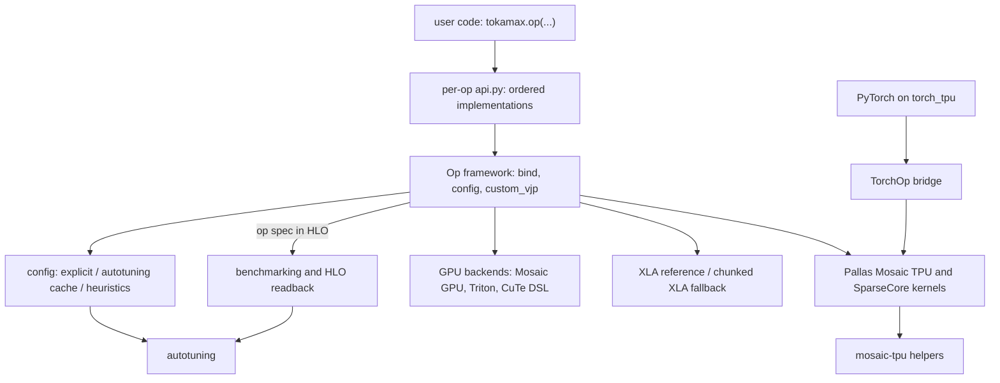
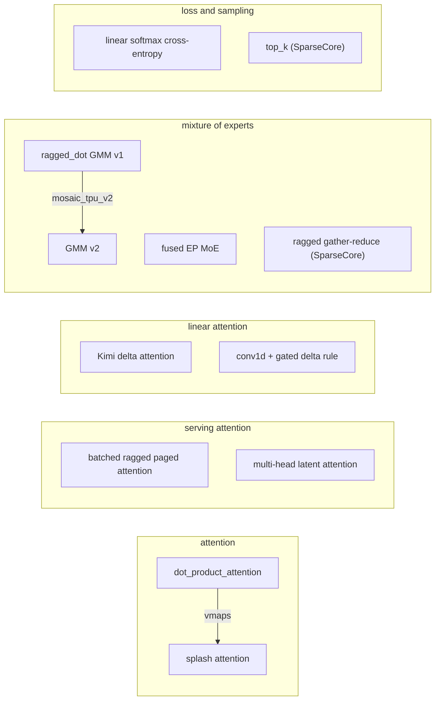

# tokamax - what it is and how it fits together

## In one paragraph
Tokamax is "a library of custom accelerator kernels, supporting both NVIDIA GPUs and Google
TPUs", written in JAX and Pallas. Every kernel is packaged the same way: an **op** (a subclass
of the framework `Op`) owns the argument contract and an XLA reference implementation, and
each **backend** - Pallas Mosaic TPU, Pallas Mosaic GPU, Pallas Triton, CuTe DSL, chunked
XLA - is a subclass that swaps in a kernel, declares where it runs and which `Config`
(tile sizes, buffering) it takes. The public function for an op walks an ordered list of
backends and takes the first that accepts the arguments, so every op runs everywhere and
falls back to XLA when a kernel declines. Because an op plus its canonical arguments is a
serializable value stamped into the lowered HLO, a whole model can be autotuned, benchmarked
or exported offline. On TPU the kernels are Pallas Mosaic TPU (TensorCore) or SparseCore
kernels; two of them are also callable from PyTorch through torch_tpu.

## Core architecture

Legend:
- `USER` - (concept) a JAX program calling `tokamax.*`
- `API` - [kernel-catalog](concepts/kernel-catalog.md) (registries and dispatch order per op)
- `OP` - [op-framework](concepts/op-framework.md)
- `CFG` - [op-framework](concepts/op-framework.md) (config resolution)
- `TUNE` - [autotuning](concepts/autotuning.md)
- `TPU` - [kernel-catalog](concepts/kernel-catalog.md), one concept page per kernel (below)
- `GPU` - [kernel-catalog](concepts/kernel-catalog.md) (index-only under this wiki's TPU lens)
- `XLA` - [kernel-catalog](concepts/kernel-catalog.md)
- `HELP` - [mosaic-tpu-helpers](concepts/mosaic-tpu-helpers.md)
- `BENCH` - [benchmarking-and-serialization](concepts/benchmarking-and-serialization.md)
- `TORCH` - (concept) PyTorch tensors on a torch_tpu device
- `BRIDGE` - [torch-tpu-bridge](concepts/torch-tpu-bridge.md)

The TPU kernels, grouped by the model layer they serve:

Legend:
- `DPA` - [dot-product-attention](concepts/dot-product-attention.md)
- `SPLASH` - [splash-attention](concepts/splash-attention.md)
- `BRPA` - [batched-ragged-paged-attention](concepts/batched-ragged-paged-attention.md)
- `MLA` - [multi-head-latent-attention](concepts/multi-head-latent-attention.md)
- `KDA` - [kimi-delta-attention](concepts/kimi-delta-attention.md)
- `GDN` - [gated-delta-rule](concepts/gated-delta-rule.md)
- `RD` - [ragged-dot-gmm](concepts/ragged-dot-gmm.md)
- `G2` - [gmm-v2](concepts/gmm-v2.md)
- `FMOE` - [fused-moe](concepts/fused-moe.md)
- `RGR` - [ragged-gather-reduce](concepts/ragged-gather-reduce.md)
- `LSCE` - [linear-softmax-cross-entropy](concepts/linear-softmax-cross-entropy.md)
- `TOPK` - [tpu-topk](concepts/tpu-topk.md)

## Main concepts

### One op contract, many backends, XLA as the floor
Each op's `api.py` registers the backends whose modules import and keeps a default order
(for example `mosaic, triton, xla` for `ragged_dot`); with no `implementation=` argument the
dispatcher takes the first backend that does not raise `NotImplementedError`. The
consequence on TPU: a kernel that declines (unsupported dtype, shape, bias, window) silently
hands the call to XLA, which may be the quadratic-memory path. Pass `implementation=` to
make a missing kernel an error instead. See [op-framework](concepts/op-framework.md) and the
dispatch-order table in [kernel-catalog](concepts/kernel-catalog.md).

### Which ops have a TPU kernel
TPU kernels exist for attention (via splash), splash attention, ragged dot (GMM v1; GMM v2
by name only), fused MoE, ragged gather / gather-reduce / scatter, batched RPA, MLA, KDA,
GDN, linear softmax cross-entropy and top-k; each has a TPU-generation gate (v5+, v6+ or
v7+, some needing SparseCore). `layer_norm`, `gated_linear_unit`, `flex_attention` and
`triangle_multiplication` have no TPU kernel and run XLA on TPU.
[kernel-catalog](concepts/kernel-catalog.md) has the full op x backend table, GPU included.

### Configs: explicit, cached, autotuned, heuristic
Every backend has a `Config` of tunables. An op call resolves it from an explicit argument,
then the active autotuning result or shipped per-device cache (`tokamax/data/autotuning/`),
then heuristics (often a VMEM-footprint model). `tokamax.autotune` finds every tokamax op in
a function's lowered HLO, compiles candidate configs in parallel and times them serially.
See [autotuning](concepts/autotuning.md) and [op-framework](concepts/op-framework.md).

### Measuring device time, not Python time
Small kernels are dominated by JAX dispatch overhead, so benchmarks compile once and time
only XLA device events through an XProf session (`hermetic_xprof` on TPU). The same HLO
metadata that drives autotuning lets you list the tokamax ops in an exported program. See
[benchmarking-and-serialization](concepts/benchmarking-and-serialization.md).

### TPU kernel design patterns
Recurring patterns across the TPU kernels: scalar-prefetched metadata in SMEM driving
BlockSpec index maps (splash `MaskInfo`, GMM group metadata, bRPA schedule tables, GDN
metadata); `emit_pipeline` with custom buffering depth when a plain grid is too rigid
([mosaic-tpu-helpers](concepts/mosaic-tpu-helpers.md)); online softmax / log-sum-exp so the
big intermediate never reaches HBM ([splash-attention](concepts/splash-attention.md),
[linear-softmax-cross-entropy](concepts/linear-softmax-cross-entropy.md)); tile sizes
chosen to fit VMEM; and SparseCore kernels for gather/scatter/select work
([ragged-gather-reduce](concepts/ragged-gather-reduce.md), [tpu-topk](concepts/tpu-topk.md)).

### Grouped matmul for MoE: v1, v2 and the K tail
`ragged_dot` on TPU lowers forward, dlhs and drhs to `gmm`/`tgmm` kernels. v1 is the default;
v2 computes group segments in-kernel and DMAs only valid rows. Both mask the K remainder on
both operands; the v2 lhs mask was added after a NaN bug. See
[ragged-dot-gmm](concepts/ragged-dot-gmm.md) and [gmm-v2](concepts/gmm-v2.md).

### Serving kernels
[batched-ragged-paged-attention](concepts/batched-ragged-paged-attention.md),
[multi-head-latent-attention](concepts/multi-head-latent-attention.md),
[gated-delta-rule](concepts/gated-delta-rule.md), [fused-moe](concepts/fused-moe.md) and
[ragged-gather-reduce](concepts/ragged-gather-reduce.md) are forward-only and built around
ragged token batches and paged or slot-indexed caches.

### From PyTorch
`tokamax.experimental.torch_tpu` wraps batched RPA and linear softmax cross-entropy as
PyTorch custom ops over torch_tpu's `jax_op`, with autograd wired to the tokamax VJP op. See
[torch-tpu-bridge](concepts/torch-tpu-bridge.md).

## How a call flows
`tokamax.ragged_dot(lhs, rhs, group_sizes)` -> the op's `bind` canonicalizes arguments ->
`supported_on` checks the device -> a config is resolved -> the call runs under
`jax.custom_vjp` with its op spec written into the HLO -> the TPU backend's `_fwd` launches
the Pallas kernel -> on backward, the op's VJP runs the dlhs/drhs kernels. Pages in order:
[op-framework](concepts/op-framework.md) -> [autotuning](concepts/autotuning.md) ->
[ragged-dot-gmm](concepts/ragged-dot-gmm.md).

## Map of the wiki
- Areas: [tokamax/_src](areas/src.md) (the library: every op, including the ops with no
  page of their own, such as `ragged_gather`, `ragged_scatter`, `flex_attention`,
  `triangle_multiplication`, GPU-only `layer_norm` / `gated_linear_unit`) and
  [tokamax/experimental](areas/experimental.md) (the PyTorch bridge and TPU tuning scripts).
- Which kernel runs for op X on TPU or GPU: [kernel-catalog](concepts/kernel-catalog.md).
- How a kernel works: the concept page linked from the second diagram above.
- Where is symbol X / who calls X: `catalog/symbols.tsv` and `catalog/edges.tsv` (grep by
  anchor `<path>#<Symbol>`, path without `.py`), and [catalog/index.md](catalog/index.md)
  for the module map.
- What the project's own docs say (README, `docs/`): `doc-concepts/` - start at
  [supported ops and hardware](doc-concepts/supported-ops-and-hardware.md) and
  [implementation selection and fallback](doc-concepts/implementation-selection-and-fallback.md);
  the KDA design docs are split into six pages (for example
  [kda-chunked-forward-pipeline](doc-concepts/kda-chunked-forward-pipeline.md)). Several of
  these pages carry `[!warning]` notes where the docs disagree with the code at this pin
  (benchmark method name, autotuning examples, supported-ops lists).
- Not covered: installation (`pip install tokamax`, per the README) and contributing; read
  the upstream README.
- The concept table: [index.md](index.md).

## Where to go for a given task

| Task | Start here | Then |
|---|---|---|
| Find which kernel serves an op on TPU (or GPU) | [kernel-catalog](concepts/kernel-catalog.md) | the op's concept page |
| Add a new kernel backend to an op | [op-framework](concepts/op-framework.md) | [mosaic-tpu-helpers](concepts/mosaic-tpu-helpers.md), [autotuning](concepts/autotuning.md) |
| Autotune a model's tokamax ops and ship the result | [autotuning](concepts/autotuning.md) | [autotuner input formats](doc-concepts/autotuner-input-formats.md), [autotuning result reuse](doc-concepts/autotuning-result-reuse.md) |
| Benchmark a kernel on TPU | [benchmarking-and-serialization](concepts/benchmarking-and-serialization.md) | [benchmark timing methods](doc-concepts/benchmark-timing-methods.md), [standardized benchmark functions](doc-concepts/standardized-benchmark-functions.md) |
| Export or cross-compile a model with tokamax kernels (StableHLO, CPU host) | [stablehlo export and cross-compilation](doc-concepts/stablehlo-export-and-cross-compilation.md) | [benchmarking-and-serialization](concepts/benchmarking-and-serialization.md) |
| Change or debug the KDA kernels | [kimi-delta-attention](concepts/kimi-delta-attention.md) | [kda-chunked-forward-pipeline](doc-concepts/kda-chunked-forward-pipeline.md), [kda-chunked-backward-fusion](doc-concepts/kda-chunked-backward-fusion.md) |
| Debug a silent fallback to XLA on TPU | [kernel-catalog](concepts/kernel-catalog.md) | [implementation selection and fallback](doc-concepts/implementation-selection-and-fallback.md), [dot-product-attention](concepts/dot-product-attention.md) |
| Tune or debug MoE grouped matmul (NaN, tiling) | [ragged-dot-gmm](concepts/ragged-dot-gmm.md) | [gmm-v2](concepts/gmm-v2.md), [fused-moe](concepts/fused-moe.md) |
| Serve with paged attention or MLA | [batched-ragged-paged-attention](concepts/batched-ragged-paged-attention.md) | [multi-head-latent-attention](concepts/multi-head-latent-attention.md) |
| Call a tokamax kernel from PyTorch on TPU | [torch-tpu-bridge](concepts/torch-tpu-bridge.md) | [linear-softmax-cross-entropy](concepts/linear-softmax-cross-entropy.md) |
