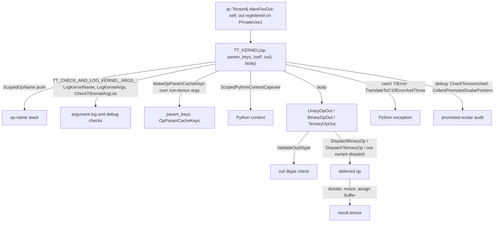

# ATen kernel authoring with TT_KERNEL and the unary/binary helpers

## Overview
Every ATen op TorchTPU implements is a C++ function registered for the `PrivateUse1` dispatch key
whose body is wrapped in `TT_KERNEL(op_name, param_keys, (args...), { ... })`. The macro is the
kernel's runtime frame: it pushes the [`OpName`](https://github.com/google-pytorch/torch_tpu/blob/6d2a45754bdb52743883f75fbf753408345f6d1b/csrc/ops/op_names.h#L29 "csrc/ops/op_names.h#OpName")
so dispatch knows the op, logs every argument by name at verbosity 1, verifies in debug builds
that the argument list matches the function signature, computes the op-parameter cache keys from
the non-tensor arguments, captures the Python context, and converts any `TtError` escaping the
body into the right `c10::Error`. Inside the frame most kernels do not touch buffers at all: they
hand a StableHLO builder closure to a helper family, [`UnaryOp`](https://github.com/google-pytorch/torch_tpu/blob/6d2a45754bdb52743883f75fbf753408345f6d1b/csrc/ops/unary_aten_kernels.cc#L106 "csrc/ops/unary_aten_kernels.cc#UnaryOp"),
[`UnaryOpOut`](https://github.com/google-pytorch/torch_tpu/blob/6d2a45754bdb52743883f75fbf753408345f6d1b/csrc/ops/unary_aten_kernels.cc#L163 "csrc/ops/unary_aten_kernels.cc#UnaryOpOut"),
[`UnaryOpInPlace`](https://github.com/google-pytorch/torch_tpu/blob/6d2a45754bdb52743883f75fbf753408345f6d1b/csrc/ops/unary_aten_kernels.cc#L140 "csrc/ops/unary_aten_kernels.cc#UnaryOpInPlace"),
[`BinaryOp`](https://github.com/google-pytorch/torch_tpu/blob/6d2a45754bdb52743883f75fbf753408345f6d1b/csrc/ops/binary_aten_kernels.h#L124 "csrc/ops/binary_aten_kernels.h#BinaryOp"),
[`BinaryOpOut`](https://github.com/google-pytorch/torch_tpu/blob/6d2a45754bdb52743883f75fbf753408345f6d1b/csrc/ops/binary_aten_kernels.h#L135 "csrc/ops/binary_aten_kernels.h#BinaryOpOut") and
[`TernaryOpOut`](https://github.com/google-pytorch/torch_tpu/blob/6d2a45754bdb52743883f75fbf753408345f6d1b/csrc/ops/binary_aten_kernels.cc#L262 "csrc/ops/binary_aten_kernels.cc#TernaryOpOut"), which resolve
output dtype and shape, validate the `out` tensor against PyTorch's casting rules, dispatch one
deferred op, and wrap or assign the result. A "simple unary" op (one input, same shape and dtype,
no parameters) is a single macro line; the source records the intent to keep such macro-defined
kernels to a minimum.

## Diagram

Legend:
- `REG` - (concept) the registered kernel function (registration blocks are generated per op file)
- `ONS` - (concept) the op-name scope, see [python-context-and-op-names](python-context-and-op-names.md)
- `CTX` - (concept) the Python-context capture, see [python-context-and-op-names](python-context-and-op-names.md)
- `DO` - (concept) the deferred op recorded by [eager-op-dispatch](eager-op-dispatch.md)
- `OUT` - (concept) the returned or assigned ATen tensor
- `ERR` - [`TranslateToC10ErrorAndThrow`](https://github.com/google-pytorch/torch_tpu/blob/6d2a45754bdb52743883f75fbf753408345f6d1b/csrc/common/error_utils.cc#L1223 "csrc/common/error_utils.cc#TranslateToC10ErrorAndThrow"), see [error-handling](error-handling.md)
- `TK` - (concept) the `TT_KERNEL` macro in `csrc/ops/macros/kernel.h`
- `LOG` - [`LogKernelName`](https://github.com/google-pytorch/torch_tpu/blob/6d2a45754bdb52743883f75fbf753408345f6d1b/csrc/ops/macros/logging.h#L131 "csrc/ops/macros/logging.h#LogKernelName"), [`LogKernelArgs`](https://github.com/google-pytorch/torch_tpu/blob/6d2a45754bdb52743883f75fbf753408345f6d1b/csrc/ops/macros/logging.h#L157 "csrc/ops/macros/logging.h#LogKernelArgs"), [`CheckTtKernelArgList`](https://github.com/google-pytorch/torch_tpu/blob/6d2a45754bdb52743883f75fbf753408345f6d1b/csrc/ops/macros/logging.h#L564 "csrc/ops/macros/logging.h#CheckTtKernelArgList")
- `OPK` - (concept) keys built as in [compilation-cache-key](compilation-cache-key.md)
- `VAL` - (concept) the shared out-dtype validator used by [`UnaryOpOut`](https://github.com/google-pytorch/torch_tpu/blob/6d2a45754bdb52743883f75fbf753408345f6d1b/csrc/ops/unary_aten_kernels.cc#L163 "csrc/ops/unary_aten_kernels.cc#UnaryOpOut") and [`BinaryOpOut`](https://github.com/google-pytorch/torch_tpu/blob/6d2a45754bdb52743883f75fbf753408345f6d1b/csrc/ops/binary_aten_kernels.h#L135 "csrc/ops/binary_aten_kernels.h#BinaryOpOut")
- `H` - [`UnaryOpOut`](https://github.com/google-pytorch/torch_tpu/blob/6d2a45754bdb52743883f75fbf753408345f6d1b/csrc/ops/unary_aten_kernels.cc#L163 "csrc/ops/unary_aten_kernels.cc#UnaryOpOut"), [`BinaryOpOut`](https://github.com/google-pytorch/torch_tpu/blob/6d2a45754bdb52743883f75fbf753408345f6d1b/csrc/ops/binary_aten_kernels.h#L135 "csrc/ops/binary_aten_kernels.h#BinaryOpOut"), [`TernaryOpOut`](https://github.com/google-pytorch/torch_tpu/blob/6d2a45754bdb52743883f75fbf753408345f6d1b/csrc/ops/binary_aten_kernels.cc#L262 "csrc/ops/binary_aten_kernels.cc#TernaryOpOut")
- `AUD` - [`CheckTensorsUsed`](https://github.com/google-pytorch/torch_tpu/blob/6d2a45754bdb52743883f75fbf753408345f6d1b/csrc/ops/macros/kernel.cc#L33 "csrc/ops/macros/kernel.cc#CheckTensorsUsed") over [`CollectPromotedScalarPointers`](https://github.com/google-pytorch/torch_tpu/blob/6d2a45754bdb52743883f75fbf753408345f6d1b/csrc/ops/macros/kernel.h#L208 "csrc/ops/macros/kernel.h#CollectPromotedScalarPointers")

## Design rationale (why it's built this way)
- **One macro so that nothing is forgotten.** The `TT_KERNEL` comment lists its jobs: "logging,
  capturing the Python context, computing parameter cache keys, and attributing errors to the
  correct root op". Putting them in the frame rather than in each kernel means a kernel author
  cannot ship an op that forgets its cache keys or leaks a `TtError` as a bare `runtime_error`.
- **The argument list is the single source of truth.** The author must pass *all* parameters
  "exactly as they are"; [`CheckTtKernelArgList`](https://github.com/google-pytorch/torch_tpu/blob/6d2a45754bdb52743883f75fbf753408345f6d1b/csrc/ops/macros/logging.h#L564 "csrc/ops/macros/logging.h#CheckTtKernelArgList")
  with a [`KernelArgCheckerContext`](https://github.com/google-pytorch/torch_tpu/blob/6d2a45754bdb52743883f75fbf753408345f6d1b/csrc/ops/macros/logging.h#L204 "csrc/ops/macros/logging.h#KernelArgCheckerContext")
  first rejects an argument passed twice, then compares the listed types (parsed from
  `__PRETTY_FUNCTION__` by [`ParseArgTypesOrEmpty`](https://github.com/google-pytorch/torch_tpu/blob/6d2a45754bdb52743883f75fbf753408345f6d1b/csrc/ops/macros/logging.cc#L150 "csrc/ops/macros/logging.cc#ParseArgTypesOrEmpty"))
  against the enclosing function once per kernel in debug mode, and a `static_assert` counts the
  parameters at compile time. The same list feeds the argument log and the cache keys, so the
  three can never disagree.
- **Cache keys by default, opt-out by name.** With a real `param_keys` name the macro builds keys
  from every non-tensor argument through the non-enforcing key maker; with the special name `_` it
  skips the work and, via [`InvalidOpParamCacheKeys`](https://github.com/google-pytorch/torch_tpu/blob/6d2a45754bdb52743883f75fbf753408345f6d1b/csrc/ops/macros/kernel.h#L223 "csrc/ops/macros/kernel.h#InvalidOpParamCacheKeys"),
  makes any use of `_` fail the build (its conversions and methods are declared but never defined, so a
  use in the active branch fails to link) while a `static_assert` checks that no argument would have
  affected the key (the assert message tells the author to wrap such an argument in
  `IgnoreInCacheKey()` with a reason, or to rename `_`). Kernels with parameters that need custom
  encoding compute keys themselves with `TT_MAKE_OP_PARAM_CACHE_KEYS` (see
  [compilation-cache-key](compilation-cache-key.md)).
- **Promoted scalars are audited.** In debug builds [`CollectPromotedScalarPointers`](https://github.com/google-pytorch/torch_tpu/blob/6d2a45754bdb52743883f75fbf753408345f6d1b/csrc/ops/macros/kernel.h#L208 "csrc/ops/macros/kernel.h#CollectPromotedScalarPointers")
  (built on the [`AppendPromotedScalarPointers`](https://github.com/google-pytorch/torch_tpu/blob/6d2a45754bdb52743883f75fbf753408345f6d1b/csrc/ops/macros/kernel.h#L171 "csrc/ops/macros/kernel.h#AppendPromotedScalarPointers")
  overloads) gathers every `PromotedScalar` argument, and [`CheckTensorsUsed`](https://github.com/google-pytorch/torch_tpu/blob/6d2a45754bdb52743883f75fbf753408345f6d1b/csrc/ops/macros/kernel.cc#L33 "csrc/ops/macros/kernel.cc#CheckTensorsUsed")
  crashes after a *successful* body if one was never converted to a tensor; the comment explains
  this catches kernels that "use the original Scalar instead of the Tensor promoted from it", which
  would bake the value into the program without a key. The check is skipped when the body threw.
- **Helpers encode the ATen output conventions.** [`UnaryOpOut`](https://github.com/google-pytorch/torch_tpu/blob/6d2a45754bdb52743883f75fbf753408345f6d1b/csrc/ops/unary_aten_kernels.cc#L163 "csrc/ops/unary_aten_kernels.cc#UnaryOpOut")
  checks that `out` is on the TPU, validates that the op's natural result dtype may be written into
  `out`, and hands off to the out-variant dispatch path, which may donate an input buffer, resizes
  `out` if the shape differs, and assigns the buffer; [`UnaryOpInPlace`](https://github.com/google-pytorch/torch_tpu/blob/6d2a45754bdb52743883f75fbf753408345f6d1b/csrc/ops/unary_aten_kernels.cc#L140 "csrc/ops/unary_aten_kernels.cc#UnaryOpInPlace")
  dispatches with `self` as the destination; [`UnaryOp`](https://github.com/google-pytorch/torch_tpu/blob/6d2a45754bdb52743883f75fbf753408345f6d1b/csrc/ops/unary_aten_kernels.cc#L106 "csrc/ops/unary_aten_kernels.cc#UnaryOp")
  wraps a fresh tensor. [`BinaryOpOut`](https://github.com/google-pytorch/torch_tpu/blob/6d2a45754bdb52743883f75fbf753408345f6d1b/csrc/ops/binary_aten_kernels.h#L135 "csrc/ops/binary_aten_kernels.h#BinaryOpOut")
  computes the expected result dtype (PyTorch type promotion, or the default float dtype when
  integer inputs are forced to float) before dispatching, and the out path rejects an in-place
  alias whose shape differs from the broadcast shape.
- **`out` dtype follows PyTorch's casting rules.** The out-variant helpers check either strict
  equality or `c10::canCast` from the natural result dtype to `out`'s dtype, selected by the
  `allow_out_dtype_cast` option: arithmetic ops allow safe casts, while dtype-preserving ops (the
  simple-unary macro, `complex`, `polar`) require an exact match, mirroring ATen's
  `check_all_same_dtype`.
- **Options structs carry the per-family knobs.** [`BinaryOpOptions`](https://github.com/google-pytorch/torch_tpu/blob/6d2a45754bdb52743883f75fbf753408345f6d1b/csrc/ops/binary_aten_kernels.h#L44 "csrc/ops/binary_aten_kernels.h#BinaryOpOptions")
  has `reverse_operands`, `force_float_inputs` (cast integers to float, for ops like `div`),
  `result_dtype` (the natural result dtype, for example `bool` for comparisons),
  `allow_out_dtype_cast`, cache keys, a split mode and explicit `donated_indices`; unary options add
  `computation_dtype` and explicit `out_dtype`/`out_dims`. Explicit `op_name` in options is only for
  helpers that must not inherit the kernel's name, and passing both an explicit name parameter and
  an options name aborts.
- **FP-only unary ops capture the default dtype at dispatch.** The `TT_DEFINE_FP_ONLY_ATEN_UNARY_OUT`
  macro mirrors eager CUDA by casting integer inputs to the *current* default PyTorch dtype and
  therefore includes it in the parameter keys; a TODO notes this causes avoidable cache misses and
  should become an explicit output dtype.

> [!inferred]
> Reading a kernel file therefore takes three steps: find the `TT_KERNEL` line to learn the op
> name and which arguments are keyed, find the helper call to learn the output convention and any
> dtype forcing or casting policy, and read the `Build*Shlo` closure (see
> [stablehlo-op-builder](stablehlo-op-builder.md)) for the actual math. Anything else in the file
> is validation. The recent stream of native lowerings (factory ops, `linear`, `masked_fill`,
> `stack`) follows exactly this shape, replacing PyTorch composite decompositions that used to
> split one op into several dispatches.

## Entry points
- `TT_KERNEL(op_name, param_keys, (args...), statements)`: wraps every registered kernel body,
  collecting promoted-scalar pointers with [`CollectPromotedScalarPointers`](https://github.com/google-pytorch/torch_tpu/blob/6d2a45754bdb52743883f75fbf753408345f6d1b/csrc/ops/macros/kernel.h#L208 "csrc/ops/macros/kernel.h#CollectPromotedScalarPointers")
  and checking them afterwards with [`CheckTensorsUsed`](https://github.com/google-pytorch/torch_tpu/blob/6d2a45754bdb52743883f75fbf753408345f6d1b/csrc/ops/macros/kernel.cc#L33 "csrc/ops/macros/kernel.cc#CheckTensorsUsed");
  `TT_DEFINE_ATEN_UNARY_OUT(op, Func, builder)` and the FP-only variant generate complete `*Out`
  kernels for simple unary ops.
- [`UnaryOp`](https://github.com/google-pytorch/torch_tpu/blob/6d2a45754bdb52743883f75fbf753408345f6d1b/csrc/ops/unary_aten_kernels.cc#L106 "csrc/ops/unary_aten_kernels.cc#UnaryOp") /
  [`UnaryOpOut`](https://github.com/google-pytorch/torch_tpu/blob/6d2a45754bdb52743883f75fbf753408345f6d1b/csrc/ops/unary_aten_kernels.cc#L163 "csrc/ops/unary_aten_kernels.cc#UnaryOpOut") /
  [`UnaryOpInPlace`](https://github.com/google-pytorch/torch_tpu/blob/6d2a45754bdb52743883f75fbf753408345f6d1b/csrc/ops/unary_aten_kernels.cc#L140 "csrc/ops/unary_aten_kernels.cc#UnaryOpInPlace"): one-input
  kernels, with overloads taking an explicit [`OpName`](https://github.com/google-pytorch/torch_tpu/blob/6d2a45754bdb52743883f75fbf753408345f6d1b/csrc/ops/op_names.h#L29 "csrc/ops/op_names.h#OpName").
- [`BinaryOp`](https://github.com/google-pytorch/torch_tpu/blob/6d2a45754bdb52743883f75fbf753408345f6d1b/csrc/ops/binary_aten_kernels.h#L124 "csrc/ops/binary_aten_kernels.h#BinaryOp") /
  [`BinaryOpOut`](https://github.com/google-pytorch/torch_tpu/blob/6d2a45754bdb52743883f75fbf753408345f6d1b/csrc/ops/binary_aten_kernels.h#L135 "csrc/ops/binary_aten_kernels.h#BinaryOpOut") (templated on a
  tensor or scalar `other`) and [`TernaryOpOut`](https://github.com/google-pytorch/torch_tpu/blob/6d2a45754bdb52743883f75fbf753408345f6d1b/csrc/ops/binary_aten_kernels.cc#L262 "csrc/ops/binary_aten_kernels.cc#TernaryOpOut"):
  broadcasting element-wise kernels built on [`DispatchBinaryOp`](https://github.com/google-pytorch/torch_tpu/blob/6d2a45754bdb52743883f75fbf753408345f6d1b/csrc/ops/binary_aten_kernels.cc#L101 "csrc/ops/binary_aten_kernels.cc#DispatchBinaryOp")
  and [`DispatchTernaryOp`](https://github.com/google-pytorch/torch_tpu/blob/6d2a45754bdb52743883f75fbf753408345f6d1b/csrc/ops/binary_aten_kernels.cc#L142 "csrc/ops/binary_aten_kernels.cc#DispatchTernaryOp").
- [`LogKernelArgs`](https://github.com/google-pytorch/torch_tpu/blob/6d2a45754bdb52743883f75fbf753408345f6d1b/csrc/ops/macros/logging.h#L157 "csrc/ops/macros/logging.h#LogKernelArgs") with
  [`LogKernelName`](https://github.com/google-pytorch/torch_tpu/blob/6d2a45754bdb52743883f75fbf753408345f6d1b/csrc/ops/macros/logging.h#L131 "csrc/ops/macros/logging.h#LogKernelName"): the verbosity-1
  trace of every kernel call (`[C++ KERNEL foo]` followed by `name: value` lines), the first thing
  to enable when an op misbehaves.

## Mechanism (step-by-step)
1. **Enter the frame.** `TT_KERNEL` constructs the op-name scope, runs the argument check-and-log
   block ([`LogKernelName`](https://github.com/google-pytorch/torch_tpu/blob/6d2a45754bdb52743883f75fbf753408345f6d1b/csrc/ops/macros/logging.h#L131 "csrc/ops/macros/logging.h#LogKernelName"),
   [`LogKernelArgs`](https://github.com/google-pytorch/torch_tpu/blob/6d2a45754bdb52743883f75fbf753408345f6d1b/csrc/ops/macros/logging.h#L157 "csrc/ops/macros/logging.h#LogKernelArgs") when verbose,
   [`CheckKernelArgTypes`](https://github.com/google-pytorch/torch_tpu/blob/6d2a45754bdb52743883f75fbf753408345f6d1b/csrc/ops/macros/logging.h#L554 "csrc/ops/macros/logging.h#CheckKernelArgTypes") via
   [`CheckTtKernelArgList`](https://github.com/google-pytorch/torch_tpu/blob/6d2a45754bdb52743883f75fbf753408345f6d1b/csrc/ops/macros/logging.h#L564 "csrc/ops/macros/logging.h#CheckTtKernelArgList") in
   debug mode), collects promoted-scalar pointers in debug mode, and constructs the Python-context
   capturer.
2. **Build the keys.** Unless `param_keys` is `_` (typed as [`InvalidOpParamCacheKeys`](https://github.com/google-pytorch/torch_tpu/blob/6d2a45754bdb52743883f75fbf753408345f6d1b/csrc/ops/macros/kernel.h#L223 "csrc/ops/macros/kernel.h#InvalidOpParamCacheKeys")
   so it cannot be used by accident), the macro calls the key maker over the argument
   list and binds the result to the named variable with `TT_ASSIGN_OR_THROW`, so an unencodable
   parameter fails before any device work.
3. **Run the body under a translator.** The statements execute inside a `try`; a `TtError` is
   passed to [`TranslateToC10ErrorAndThrow`](https://github.com/google-pytorch/torch_tpu/blob/6d2a45754bdb52743883f75fbf753408345f6d1b/csrc/common/error_utils.cc#L1223 "csrc/common/error_utils.cc#TranslateToC10ErrorAndThrow")
   (see [error-handling](error-handling.md)), any other exception is rethrown, and in debug mode a
   flag records that the body threw; afterwards [`CheckTensorsUsed`](https://github.com/google-pytorch/torch_tpu/blob/6d2a45754bdb52743883f75fbf753408345f6d1b/csrc/ops/macros/kernel.cc#L33 "csrc/ops/macros/kernel.cc#CheckTensorsUsed")
   verifies that every promoted scalar was consumed.
4. **Helpers resolve the output.** [`UnaryOpOut`](https://github.com/google-pytorch/torch_tpu/blob/6d2a45754bdb52743883f75fbf753408345f6d1b/csrc/ops/unary_aten_kernels.cc#L163 "csrc/ops/unary_aten_kernels.cc#UnaryOpOut")
   takes the expected dtype from the options or from `self`, validates it against `out`, and
   dispatches one deferred op whose output dtype is `out`'s dtype, carrying the op name, dims,
   computation dtype and keys. [`DispatchBinaryOp`](https://github.com/google-pytorch/torch_tpu/blob/6d2a45754bdb52743883f75fbf753408345f6d1b/csrc/ops/binary_aten_kernels.cc#L101 "csrc/ops/binary_aten_kernels.cc#DispatchBinaryOp")
   first moves one-element CPU tensors (as in `tpu_tensor + cpu_scalar`) onto the TPU, infers the
   broadcast shape, applies type promotion and float forcing, uses `result_dtype` as the output
   dtype if set, and wraps the builder so `reverse_operands` swaps the operands;
   [`BinaryOp`](https://github.com/google-pytorch/torch_tpu/blob/6d2a45754bdb52743883f75fbf753408345f6d1b/csrc/ops/binary_aten_kernels.h#L124 "csrc/ops/binary_aten_kernels.h#BinaryOp") then wraps the buffer with
   [`MakeTensor`](https://github.com/google-pytorch/torch_tpu/blob/6d2a45754bdb52743883f75fbf753408345f6d1b/csrc/eager/tensor_to_buffer.cc#L396 "csrc/eager/tensor_to_buffer.cc#MakeTensor"), while
   [`BinaryOpOut`](https://github.com/google-pytorch/torch_tpu/blob/6d2a45754bdb52743883f75fbf753408345f6d1b/csrc/ops/binary_aten_kernels.h#L135 "csrc/ops/binary_aten_kernels.h#BinaryOpOut") validates the
   expected result dtype against `out` before the out-variant dispatch.
5. **Leave the frame.** Scopes pop; in debug builds [`CheckTensorsUsed`](https://github.com/google-pytorch/torch_tpu/blob/6d2a45754bdb52743883f75fbf753408345f6d1b/csrc/ops/macros/kernel.cc#L33 "csrc/ops/macros/kernel.cc#CheckTensorsUsed")
   aborts if a promoted scalar went unused after a successful body.

## Key data structures
- [`BinaryOpOptions`](https://github.com/google-pytorch/torch_tpu/blob/6d2a45754bdb52743883f75fbf753408345f6d1b/csrc/ops/binary_aten_kernels.h#L44 "csrc/ops/binary_aten_kernels.h#BinaryOpOptions") and the
  ternary variant: op name override, operand reversal, float forcing, natural result dtype, out
  cast policy, cache keys, split mode, donated input indices.
- [`KernelArgCheckerContext`](https://github.com/google-pytorch/torch_tpu/blob/6d2a45754bdb52743883f75fbf753408345f6d1b/csrc/ops/macros/logging.h#L204 "csrc/ops/macros/logging.h#KernelArgCheckerContext"):
  file, line, signature, parsed types and argument names used by the debug checker.
- [`InvalidOpParamCacheKeys`](https://github.com/google-pytorch/torch_tpu/blob/6d2a45754bdb52743883f75fbf753408345f6d1b/csrc/ops/macros/kernel.h#L223 "csrc/ops/macros/kernel.h#InvalidOpParamCacheKeys"):
  the poison type bound to `_`.

## Dynamics (design intent)
- Argument type checking runs once per kernel function (a function-local static), so debug-mode
  overhead is paid at first call, not per call.
- Logging is gated on `ABSL_VLOG_IS_ON(1)`; the stringification of tensors happens only when on.

## Edge cases
- Passing an argument list that does not match the function signature is a compile-time error
  (parameter count) or a debug-mode crash (types, or a name passed twice).
- `param_keys` named `_` with an argument that *would* affect the key trips a `static_assert`,
  so opting out is only possible when it is provably safe.
- An `out` tensor on the wrong device, or whose dtype the result cannot be cast to, produces an
  invalid-argument error phrased "expected ..., got ..." or "result type X can't be cast to the
  desired output type Y".
- An in-place binary op whose broadcast shape differs from the destination's shape fails rather
  than resizing the aliased input.
- Ops implemented by calling other ops must construct their own Python-context capturer before
  the nested calls so the call chain records them (see [python-context-and-op-names](python-context-and-op-names.md)).

## Open questions
- The registration side (`TORCH_LIBRARY_IMPL` blocks binding `AtenFooOut` to `aten::foo.out`) is
  generated per op file and not part of this packet.
- The out-variant dispatch helper (`DispatchOpOut` in the eager dispatcher) and the shared
  out-dtype validator are not in this packet's subgraph; their donation and resize rules are
  described from source, see [eager-op-dispatch](eager-op-dispatch.md).

## See also
- [eager-op-dispatch](eager-op-dispatch.md): what `DispatchOp` does with the closure.
- [stablehlo-op-builder](stablehlo-op-builder.md): writing the `Build*Shlo` closure.
- [compilation-cache-key](compilation-cache-key.md): parameter keys in depth.
- [error-handling](error-handling.md): the `TtError` translation the macro performs.
- [python-context-and-op-names](python-context-and-op-names.md): the two scopes the macro opens.
- [dtype-and-precision](dtype-and-precision.md): `computation_dtype` and float forcing.

## Recent changes
- Many ops gained native lowerings that replace PyTorch composite decompositions: `4124b3780`
  "Register native PrivateUse1 kernels for tensor factory ops", `5d0907a8e` (`linear` and
  `linear_backward`), `0b9aa68ea` (out-of-place `masked_fill`), `3bedaa917` (`stack`),
  `94954963f` (`cross_entropy_loss`, `nll_loss_nd`), `d23c5ad10` (`frac.out`), `dc7a694e2` (`lcm.out`).
- `3e61b0f48` implements `repeat_interleave.Tensor_out` "using `DispatchOpOut<1>` for buffer
  donation" and standardizes error messages; `ab198664a` fixes messages to conform to the error
  guidelines after context prefixes.
- `25294aaae` makes `ldexp` reject a boolean exponent with a floating-point base, and `c45488dd7`
  makes `arange` and `relu` fail on booleans for consistency with CUDA.
- `cb2635779`, `eff2ed1cd`, `6ba94701b` and `6c76a52b8` move TPU custom ops to public
  `torch.tpu.ops` wrappers and mark dynamism ops internal.
- [all changes in 6d2a45754b](../changes/6d2a45754b.md)
