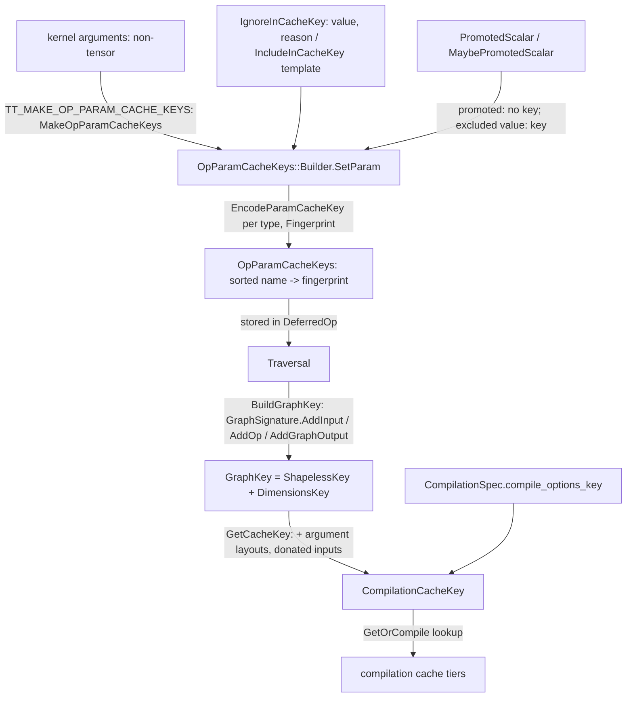

# Compilation cache keys, graph signatures and op-param keys

## Overview
A [`CompilationCacheKey`](https://github.com/google-pytorch/torch_tpu/blob/6d2a45754bdb52743883f75fbf753408345f6d1b/csrc/common/cache_key.h#L846 "csrc/common/cache_key.h#CompilationCacheKey") is
three 64-bit fingerprints plus an optional string id: a [`ShapelessKey`](https://github.com/google-pytorch/torch_tpu/blob/6d2a45754bdb52743883f75fbf753408345f6d1b/csrc/common/cache_key.h#L757 "csrc/common/cache_key.h#ShapelessKey")
for the *structure* of a deferred-op graph (which ops, how they connect, which dtypes and ranks,
which inputs are donated, which op parameters), a dimensions key for the concrete tensor shapes, and
a [`CompileOptionsKey`](https://github.com/google-pytorch/torch_tpu/blob/6d2a45754bdb52743883f75fbf753408345f6d1b/csrc/common/compile_options_key.h#L27 "csrc/common/compile_options_key.h#CompileOptionsKey") for
the resolved XLA options. The [compilation cache](compilation-cache.md) indexes executables by all
of them and, for bounded and unbounded dynamic shapes, by the shapeless key alone. The key is
computed from a traversal by [`BuildGraphKey`](https://github.com/google-pytorch/torch_tpu/blob/6d2a45754bdb52743883f75fbf753408345f6d1b/csrc/eager/traversal.cc#L336 "csrc/eager/traversal.cc#Traversal.BuildGraphKey"),
which streams the graph into a signature object rather than hashing MLIR text, so keys are cheap
and independent of how the module is printed. The part a kernel author controls is
[`OpParamCacheKeys`](https://github.com/google-pytorch/torch_tpu/blob/6d2a45754bdb52743883f75fbf753408345f6d1b/csrc/common/cache_key.h#L541 "csrc/common/cache_key.h#OpParamCacheKeys"): "any parameters
that can change the compilation of the op without changing the shape or dtype of the inputs or
outputs" must be encoded into it, and the `TT_KERNEL` macro does this automatically for every
non-tensor kernel argument unless the author opts out.

## Diagram

Legend:
- `ARGS` - (concept) kernel signature, see [aten-kernel-authoring](aten-kernel-authoring.md)
- `TR` - (concept) the traversal, see [deferred-execution-and-materialization](deferred-execution-and-materialization.md)
- `CO` - (concept) the options fingerprint, see [compilation-pipeline](compilation-pipeline.md)
- `CACHE` - (concept) see [compilation-cache](compilation-cache.md)
- `B` - [`Builder`](https://github.com/google-pytorch/torch_tpu/blob/6d2a45754bdb52743883f75fbf753408345f6d1b/csrc/common/cache_key.h#L643 "csrc/common/cache_key.h#OpParamCacheKeys.Builder") and [`SetParam`](https://github.com/google-pytorch/torch_tpu/blob/6d2a45754bdb52743883f75fbf753408345f6d1b/csrc/common/cache_key.h#L580 "csrc/common/cache_key.h#OpParamCacheKeys.SetParam"), driven by [`MakeOpParamCacheKeys`](https://github.com/google-pytorch/torch_tpu/blob/6d2a45754bdb52743883f75fbf753408345f6d1b/csrc/common/cache_key.h#L746 "csrc/common/cache_key.h#MakeOpParamCacheKeys")
- `OPK` - [`OpParamCacheKeys`](https://github.com/google-pytorch/torch_tpu/blob/6d2a45754bdb52743883f75fbf753408345f6d1b/csrc/common/cache_key.h#L541 "csrc/common/cache_key.h#OpParamCacheKeys") built from [`EncodeParamCacheKey`](https://github.com/google-pytorch/torch_tpu/blob/6d2a45754bdb52743883f75fbf753408345f6d1b/csrc/common/cache_key.cc#L91 "csrc/common/cache_key.cc#EncodeParamCacheKey") and [`Fingerprint`](https://github.com/google-pytorch/torch_tpu/blob/6d2a45754bdb52743883f75fbf753408345f6d1b/csrc/common/fingerprint_utils.h#L168 "csrc/common/fingerprint_utils.h#Fingerprint")
- `IGN` - [`IgnoredInCacheKey`](https://github.com/google-pytorch/torch_tpu/blob/6d2a45754bdb52743883f75fbf753408345f6d1b/csrc/common/cache_key.h#L210 "csrc/common/cache_key.h#IgnoredInCacheKey") / [`IncludeInCacheKey`](https://github.com/google-pytorch/torch_tpu/blob/6d2a45754bdb52743883f75fbf753408345f6d1b/csrc/common/cache_key.h#L241 "csrc/common/cache_key.h#IncludeInCacheKey")
- `PS` - [`PromotedScalar`](https://github.com/google-pytorch/torch_tpu/blob/6d2a45754bdb52743883f75fbf753408345f6d1b/csrc/common/cache_key.h#L98 "csrc/common/cache_key.h#PromotedScalar") / [`MaybePromotedScalar`](https://github.com/google-pytorch/torch_tpu/blob/6d2a45754bdb52743883f75fbf753408345f6d1b/csrc/common/cache_key.h#L150 "csrc/common/cache_key.h#MaybePromotedScalar")
- `GK` - [`GraphKey`](https://github.com/google-pytorch/torch_tpu/blob/6d2a45754bdb52743883f75fbf753408345f6d1b/csrc/common/cache_key.h#L809 "csrc/common/cache_key.h#GraphKey") from [`BuildGraphKey`](https://github.com/google-pytorch/torch_tpu/blob/6d2a45754bdb52743883f75fbf753408345f6d1b/csrc/eager/traversal.cc#L336 "csrc/eager/traversal.cc#Traversal.BuildGraphKey"), holding a [`ShapelessKey`](https://github.com/google-pytorch/torch_tpu/blob/6d2a45754bdb52743883f75fbf753408345f6d1b/csrc/common/cache_key.h#L757 "csrc/common/cache_key.h#ShapelessKey")
- `CK` - [`CompilationCacheKey`](https://github.com/google-pytorch/torch_tpu/blob/6d2a45754bdb52743883f75fbf753408345f6d1b/csrc/common/cache_key.h#L846 "csrc/common/cache_key.h#CompilationCacheKey") from [`GetCacheKey`](https://github.com/google-pytorch/torch_tpu/blob/6d2a45754bdb52743883f75fbf753408345f6d1b/csrc/eager/traversal.cc#L322 "csrc/eager/traversal.cc#Traversal.GetCacheKey"), with a [`CompileOptionsKey`](https://github.com/google-pytorch/torch_tpu/blob/6d2a45754bdb52743883f75fbf753408345f6d1b/csrc/common/compile_options_key.h#L27 "csrc/common/compile_options_key.h#CompileOptionsKey")

## Design rationale (why it's built this way)
- **Structure and shapes are hashed separately on purpose.** The header defines
  [`ShapelessKey`](https://github.com/google-pytorch/torch_tpu/blob/6d2a45754bdb52743883f75fbf753408345f6d1b/csrc/common/cache_key.h#L757 "csrc/common/cache_key.h#ShapelessKey") and the dimensions key
  as distinct types "to avoid accidentally using the wrong key", and
  [`GraphKey`](https://github.com/google-pytorch/torch_tpu/blob/6d2a45754bdb52743883f75fbf753408345f6d1b/csrc/common/cache_key.h#L809 "csrc/common/cache_key.h#GraphKey") is simply the pair. The split
  is what makes dynamic shapes cacheable: the cache looks up dynamic entries by shapeless
  key and then checks whether the concrete dimensions fit the recorded bounds or a kernel's
  compatibility predicate (see [compilation-cache](compilation-cache.md) and
  [eager-dynamic-shapes](eager-dynamic-shapes.md)). Ranks still reach the shapeless key; only the
  extents are left out.
- **A signature, not the MLIR.** The comment above the graph signature walks through
  `a.mm(b)`: tensors are numbered topologically, each op contributes its
  `OpName` (fingerprinted by its stable string name), its input indices, its outputs'
  dimensions and dtypes, its donated input indices and its sorted op-param fingerprints; graph
  outputs are recorded by index, and the traversal's core-pinning mode (TensorCore, SparseCore or
  unpinned) is part of the signature too. Two graphs are equal only if all of those match, which
  the field comments spell out one invariant at a time. Because it never looks at the builder
  closures, two kernels with identical structure but different captured parameters collide unless
  those parameters are in the op-param keys; that is the whole reason the keys exist.
- **The compile options are part of identity.** [`CompilationCacheKey`](https://github.com/google-pytorch/torch_tpu/blob/6d2a45754bdb52743883f75fbf753408345f6d1b/csrc/common/cache_key.h#L846 "csrc/common/cache_key.h#CompilationCacheKey")
  hashes the graph key together with the [`CompileOptionsKey`](https://github.com/google-pytorch/torch_tpu/blob/6d2a45754bdb52743883f75fbf753408345f6d1b/csrc/common/compile_options_key.h#L27 "csrc/common/compile_options_key.h#CompileOptionsKey")
  produced by the [compilation pipeline](compilation-pipeline.md) (itself a
  [`Fingerprint`](https://github.com/google-pytorch/torch_tpu/blob/6d2a45754bdb52743883f75fbf753408345f6d1b/csrc/common/compilation.cc#L422 "csrc/common/compilation.cc#Fingerprint") over only the option fields TorchTPU sets), so switching
  optimization level, `XLA_FLAGS` or a `custom_compiler_options` context yields a different
  executable rather than a wrong one. Its `CompactFormat` (three 16-digit hex parts, plus the id
  when one is set) is also the file name in the tier-2 and tier-3 caches.
- **Deterministic by construction.** [`OpParamCacheKeys`](https://github.com/google-pytorch/torch_tpu/blob/6d2a45754bdb52743883f75fbf753408345f6d1b/csrc/common/cache_key.h#L541 "csrc/common/cache_key.h#OpParamCacheKeys")
  is a `std::map` "because we need the keys to be sorted for deterministic cache keys", is
  `[[nodiscard]]` so a computed key cannot be silently dropped, is move-only, and crashes on a
  duplicate parameter name because that is a programmer error. [`Fingerprint`](https://github.com/google-pytorch/torch_tpu/blob/6d2a45754bdb52743883f75fbf753408345f6d1b/csrc/common/fingerprint_utils.h#L168 "csrc/common/fingerprint_utils.h#Fingerprint")
  deliberately refuses to fingerprint enums by numeric value (not stable) and the dtype
  encoder hashes the stable string name instead.
- **The type system decides what is a parameter.** [`IncludeInCacheKey`](https://github.com/google-pytorch/torch_tpu/blob/6d2a45754bdb52743883f75fbf753408345f6d1b/csrc/common/cache_key.h#L241 "csrc/common/cache_key.h#IncludeInCacheKey")
  is `false` for tensors, tensor lists, generators, promoted scalars and collective option structs,
  "as their information is already included in the cache key automatically" (shapes and dtypes
  come from the signature; promoted scalars are arguments). [`SetParam`](https://github.com/google-pytorch/torch_tpu/blob/6d2a45754bdb52743883f75fbf753408345f6d1b/csrc/common/cache_key.h#L580 "csrc/common/cache_key.h#OpParamCacheKeys.SetParam")
  `static_assert`s on it, so passing a tensor as a key is a compile error, and
  [`IgnoredInCacheKey`](https://github.com/google-pytorch/torch_tpu/blob/6d2a45754bdb52743883f75fbf753408345f6d1b/csrc/common/cache_key.h#L210 "csrc/common/cache_key.h#IgnoredInCacheKey") (via
  `IgnoreInCacheKey(value, reason)`, reason mandatory) is the explicit way to exclude a parameter
  that genuinely does not affect compilation.
- **Every encodable type has one encoder.** The [`EncodeParamCacheKey`](https://github.com/google-pytorch/torch_tpu/blob/6d2a45754bdb52743883f75fbf753408345f6d1b/csrc/common/cache_key.cc#L91 "csrc/common/cache_key.cc#EncodeParamCacheKey")
  family covers scalars, symbolic ints (encoded as strings because they "may be symbolic"), dtypes,
  layouts, devices, reduce ops, optionals (prefixed with `+` to distinguish empty from absent),
  pairs, ranges and collective options; the header documents the contract that "different values
  produce different keys" and that overloads for a type live next to that type, found by ADL.

> [!inferred]
> The most common self-inflicted recompilation is a Python-side value that changes every step and
> lands in the op-param keys: an `int` dimension computed from data, a float `alpha` that the
> kernel keeps as a raw scalar instead of a promoted one, or a list whose length varies. The
> remedy pattern in the source is [`MaybePromotedScalar`](https://github.com/google-pytorch/torch_tpu/blob/6d2a45754bdb52743883f75fbf753408345f6d1b/csrc/common/cache_key.h#L150 "csrc/common/cache_key.h#MaybePromotedScalar"):
> keep only the algebraically special values (0, 1, -1) in the key and promote everything else to
> a device argument.

## Entry points
- [`MakeOpParamCacheKeys`](https://github.com/google-pytorch/torch_tpu/blob/6d2a45754bdb52743883f75fbf753408345f6d1b/csrc/common/cache_key.h#L746 "csrc/common/cache_key.h#MakeOpParamCacheKeys"),
  reached through `TT_MAKE_OP_PARAM_CACHE_KEYS(args...)` (enforcing) or the non-enforcing variant
  the `TT_KERNEL` macro uses: it parses the stringified argument list into names and calls
  [`SetParam`](https://github.com/google-pytorch/torch_tpu/blob/6d2a45754bdb52743883f75fbf753408345f6d1b/csrc/common/cache_key.h#L673 "csrc/common/cache_key.h#OpParamCacheKeys.Builder.SetParam") for
  each argument whose type is included; [`EnforceSetParamType`](https://github.com/google-pytorch/torch_tpu/blob/6d2a45754bdb52743883f75fbf753408345f6d1b/csrc/common/cache_key.h#L711 "csrc/common/cache_key.h#EnforceSetParamType")
  selects whether excluded types are an error or silently skipped.
- [`Builder`](https://github.com/google-pytorch/torch_tpu/blob/6d2a45754bdb52743883f75fbf753408345f6d1b/csrc/common/cache_key.h#L643 "csrc/common/cache_key.h#OpParamCacheKeys.Builder"): the chaining
  API (`*OpParamCacheKeysBuilder().SetParam("approximate", approximate)`) used when a kernel
  computes keys by hand; the first failure is remembered and returned by `operator*`.
- [`BuildGraphKey`](https://github.com/google-pytorch/torch_tpu/blob/6d2a45754bdb52743883f75fbf753408345f6d1b/csrc/eager/traversal.cc#L336 "csrc/eager/traversal.cc#Traversal.BuildGraphKey") and
  [`GetCacheKey`](https://github.com/google-pytorch/torch_tpu/blob/6d2a45754bdb52743883f75fbf753408345f6d1b/csrc/eager/traversal.cc#L322 "csrc/eager/traversal.cc#Traversal.GetCacheKey"): called once
  per traversal compilation to produce the [`CompilationCacheKey`](https://github.com/google-pytorch/torch_tpu/blob/6d2a45754bdb52743883f75fbf753408345f6d1b/csrc/common/cache_key.h#L846 "csrc/common/cache_key.h#CompilationCacheKey"); the graph key
  is memoized on the traversal, so recompiling the same traversal with other options only redoes
  the cheap annotation steps.
- [`PromotedTensorStates`](https://github.com/google-pytorch/torch_tpu/blob/6d2a45754bdb52743883f75fbf753408345f6d1b/csrc/common/cache_key.h#L86 "csrc/common/cache_key.h#PromotedTensorStates"): the
  list of promoted-scalar states the kernel macro audits at exit (in debug builds) to catch a scalar
  that was read raw and thus never keyed.

## Mechanism (step-by-step)
1. **The kernel declares its parameters.** Inside `TT_KERNEL(op, param_keys, (args...), ...)`
   the macro calls [`MakeOpParamCacheKeys`](https://github.com/google-pytorch/torch_tpu/blob/6d2a45754bdb52743883f75fbf753408345f6d1b/csrc/common/cache_key.h#L746 "csrc/common/cache_key.h#MakeOpParamCacheKeys")
   over every argument; tensors and promoted scalars are skipped by
   [`IncludeInCacheKey`](https://github.com/google-pytorch/torch_tpu/blob/6d2a45754bdb52743883f75fbf753408345f6d1b/csrc/common/cache_key.h#L241 "csrc/common/cache_key.h#IncludeInCacheKey"), and each
   remaining value is encoded by the matching [`EncodeParamCacheKey`](https://github.com/google-pytorch/torch_tpu/blob/6d2a45754bdb52743883f75fbf753408345f6d1b/csrc/common/cache_key.cc#L91 "csrc/common/cache_key.cc#EncodeParamCacheKey")
   overload, fingerprinted with [`Fingerprint`](https://github.com/google-pytorch/torch_tpu/blob/6d2a45754bdb52743883f75fbf753408345f6d1b/csrc/common/fingerprint_utils.h#L168 "csrc/common/fingerprint_utils.h#Fingerprint"),
   and stored under the argument's name; a value that encodes as the empty string is dropped so
   `nullopt` and "absent" cost nothing.
2. **Scalars are keyed by policy.** A [`PromotedScalar`](https://github.com/google-pytorch/torch_tpu/blob/6d2a45754bdb52743883f75fbf753408345f6d1b/csrc/common/cache_key.h#L98 "csrc/common/cache_key.h#PromotedScalar")
   contributes nothing (its value is a device argument); a
   [`MaybePromotedScalar`](https://github.com/google-pytorch/torch_tpu/blob/6d2a45754bdb52743883f75fbf753408345f6d1b/csrc/common/cache_key.h#L150 "csrc/common/cache_key.h#MaybePromotedScalar") encodes
   its value only when it matched an excluded value; for example, `add.out` keeps `alpha` unpromoted
   only when it is 1, so `alpha=1` and `alpha=2.5` compile to different programs while `alpha=2.5`
   and `alpha=3.7` share one.
3. **Dispatch stores the keys on the op.** The [`OpParamCacheKeys`](https://github.com/google-pytorch/torch_tpu/blob/6d2a45754bdb52743883f75fbf753408345f6d1b/csrc/common/cache_key.h#L541 "csrc/common/cache_key.h#OpParamCacheKeys")
   travel in the deferred op ([eager-op-dispatch](eager-op-dispatch.md)) next to the op name and
   output shapes.
4. **A traversal becomes a signature.** [`BuildGraphKey`](https://github.com/google-pytorch/torch_tpu/blob/6d2a45754bdb52743883f75fbf753408345f6d1b/csrc/eager/traversal.cc#L336 "csrc/eager/traversal.cc#Traversal.BuildGraphKey")
   records the core-pinning mode, adds every argument (dimensions, dtype) as an input, then walks
   the execution order adding each op with its name, param keys, donated indices, input indices and
   output tensors, then marks the graph outputs. An op that carries a device assignment (a
   process-group collective) gets a cloned param-key map with a `device_assignment` entry, unless
   the op (a Pallas kernel, for example) already recorded one. `GetKey()` sorts what must be sorted
   and produces the [`GraphKey`](https://github.com/google-pytorch/torch_tpu/blob/6d2a45754bdb52743883f75fbf753408345f6d1b/csrc/common/cache_key.h#L809 "csrc/common/cache_key.h#GraphKey"), whose
   [`ShapelessKey`](https://github.com/google-pytorch/torch_tpu/blob/6d2a45754bdb52743883f75fbf753408345f6d1b/csrc/common/cache_key.h#L757 "csrc/common/cache_key.h#ShapelessKey") omits the dimension values.
5. **Layouts, donation and options join.** [`GetCacheKey`](https://github.com/google-pytorch/torch_tpu/blob/6d2a45754bdb52743883f75fbf753408345f6d1b/csrc/eager/traversal.cc#L322 "csrc/eager/traversal.cc#Traversal.GetCacheKey")
   folds any custom argument layouts (minor-to-major order, tiles, element size) and the
   graph-level donated input set (sorted and de-duplicated, so order and repeats do not matter) into
   the shapeless key, then pairs the result with the
   [`CompileOptionsKey`](https://github.com/google-pytorch/torch_tpu/blob/6d2a45754bdb52743883f75fbf753408345f6d1b/csrc/common/compile_options_key.h#L27 "csrc/common/compile_options_key.h#CompileOptionsKey")
   of the effective compilation spec into a [`CompilationCacheKey`](https://github.com/google-pytorch/torch_tpu/blob/6d2a45754bdb52743883f75fbf753408345f6d1b/csrc/common/cache_key.h#L846 "csrc/common/cache_key.h#CompilationCacheKey");
   `Hash` folds all parts, equality compares them exactly.

## Key data structures
- [`OpParamCacheKeys`](https://github.com/google-pytorch/torch_tpu/blob/6d2a45754bdb52743883f75fbf753408345f6d1b/csrc/common/cache_key.h#L541 "csrc/common/cache_key.h#OpParamCacheKeys"): sorted
  name-to-fingerprint map; `Empty()`, `Clone()`, read-only iteration.
- [`ShapelessKey`](https://github.com/google-pytorch/torch_tpu/blob/6d2a45754bdb52743883f75fbf753408345f6d1b/csrc/common/cache_key.h#L757 "csrc/common/cache_key.h#ShapelessKey"), dimensions key,
  [`GraphKey`](https://github.com/google-pytorch/torch_tpu/blob/6d2a45754bdb52743883f75fbf753408345f6d1b/csrc/common/cache_key.h#L809 "csrc/common/cache_key.h#GraphKey"),
  [`CompileOptionsKey`](https://github.com/google-pytorch/torch_tpu/blob/6d2a45754bdb52743883f75fbf753408345f6d1b/csrc/common/compile_options_key.h#L27 "csrc/common/compile_options_key.h#CompileOptionsKey"),
  [`CompilationCacheKey`](https://github.com/google-pytorch/torch_tpu/blob/6d2a45754bdb52743883f75fbf753408345f6d1b/csrc/common/cache_key.h#L846 "csrc/common/cache_key.h#CompilationCacheKey"): strongly
  typed 64-bit fingerprints. The cache key additionally holds an optional `id_key` string, which
  the header describes as a way to tell apart "multiple different dynamic kernels that share a
  graph_key but are optimized for different sizes".
- The graph signature: topological tensor indices, flattened dimension spans, element types,
  op input index spans, op names, sorted op-param entries, output indices, donated indices, core
  pinning mode.
- [`IgnoredInCacheKey`](https://github.com/google-pytorch/torch_tpu/blob/6d2a45754bdb52743883f75fbf753408345f6d1b/csrc/common/cache_key.h#L210 "csrc/common/cache_key.h#IgnoredInCacheKey"): a
  reference wrapper that still prints for logging but is excluded from keys.

## Dynamics (design intent)
- Key construction is synchronous and lock-free; signatures use inlined vectors sized for small
  graphs, and the graph key is computed once per traversal and cached on it.
- The dimensions key deliberately carries a legacy `false` parameter for backward compatibility of
  on-disk cache file names (a TODO tracks removing it).

## Edge cases
- Symbolic ints are encoded as strings, so a `SymInt` that is symbolic never collides with a
  concrete value.
- A parameter encoded as the empty string is omitted from the map, which makes "no value" and
  "default" identical by design.
- Enum parameters need an explicit encoder; fingerprinting an enum's integer value is refused
  because enum numbering is not stable across versions.
- The same op with different donated input indices has a different shapeless key, so buffer
  donation is never accidentally applied to a non-donating call.
- A precompiled kernel can only be found by a traversal if the traversal's op carries exactly the
  same param keys as the kernel's hand-built signature; this is why the `k` param key was removed
  from `aten::nonzero` at this pin.

## Open questions
- The `id_key` is set by the experimental precompiled nonzero kernel; whether other dynamic kernels
  will use it, and how it interacts with the shapeless-key lookups, is not settled in this unit.

## See also
- [compilation-cache](compilation-cache.md): what is looked up by these keys.
- [compilation-pipeline](compilation-pipeline.md): the compile-options fingerprint.
- [eager-op-dispatch](eager-op-dispatch.md): promoted scalars and where keys are attached.
- [aten-kernel-authoring](aten-kernel-authoring.md): the `TT_KERNEL` macro that builds the keys.
- [eager-dynamic-shapes](eager-dynamic-shapes.md): why the shapeless key exists.

## Recent changes
- `908a8db4b` lets the precompiled nonzero kernel live in the cache: it removes the param cache key
  for `k` in `aten::nonzero` "to allow it to match dynamic nonzero kernel in cache" and adds a
  function that builds the nonzero shapeless key.
- `2e0c3677a` simplifies the device assignment pipeline and enforces world-sized meshes for Pallas
  distributed kernels; device assignments still enter the key through the op-param map.
- `de1dad098` and `4d48d5bbe` inline private helper functions when the traversal builds its MLIR
  module and register the needed inliner extension; they change the module, not the key.
- [all changes in 6d2a45754b](../changes/6d2a45754b.md)
