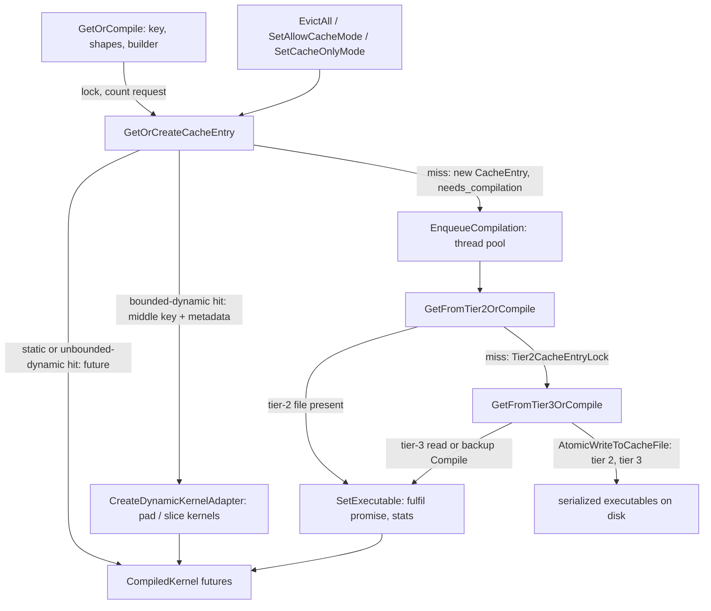

# Compilation cache tiers

## Overview
[`CompilationCache`](https://github.com/google-pytorch/torch_tpu/blob/6d2a45754bdb52743883f75fbf753408345f6d1b/csrc/common/compilation_cache.h#L201 "csrc/common/compilation_cache.h#CompilationCache") is the
process-wide singleton that decides whether a materialization needs a new XLA compilation. Its
contract is [`GetOrCompile`](https://github.com/google-pytorch/torch_tpu/blob/6d2a45754bdb52743883f75fbf753408345f6d1b/csrc/common/compilation_cache.cc#L1015 "csrc/common/compilation_cache.cc#CompilationCache.GetOrCompile"):
given a [cache key](compilation-cache-key.md), input and output shapes, and a lazy MLIR builder, it
returns a `CompiledKernel` of *futures*
immediately, and only on a miss builds the module and schedules the compile on a thread pool. Three
tiers sit behind that call. Tier 1 is the in-memory map of `CacheEntry` futures; it is what makes
the second step of a training loop fast. Tier 2 is a directory of serialized executables on the host
(a tmpfs root under `/dev/shm`, mmapped on read) that lets every process on a multi-chip host reuse
one compilation, guarded by per-key file locks. Tier 3 is an optional persistent root (set with
`TORCH_TPU_TIER3_COMPILATION_CACHE_ROOT`) that survives job restarts, read in a race against
a local backup compilation. The key idea is that all three tiers agree on one key and one binary
fingerprint: an executable compiled anywhere is valid everywhere the same TorchTPU and PjRt versions
run, and never valid otherwise.

## Diagram

Legend:
- `REQ` - [`GetOrCompile`](https://github.com/google-pytorch/torch_tpu/blob/6d2a45754bdb52743883f75fbf753408345f6d1b/csrc/common/compilation_cache.cc#L1015 "csrc/common/compilation_cache.cc#CompilationCache.GetOrCompile")
- `LOOK` - [`GetOrCreateCacheEntry`](https://github.com/google-pytorch/torch_tpu/blob/6d2a45754bdb52743883f75fbf753408345f6d1b/csrc/common/compilation_cache.cc#L607 "csrc/common/compilation_cache.cc#CompilationCache.GetOrCreateCacheEntry")
- `CK` - (concept) the `CompiledKernel` handle of futures, catalogued under [compilation-pipeline](compilation-pipeline.md)
- `ADP` - [`CreateDynamicKernelAdapter`](https://github.com/google-pytorch/torch_tpu/blob/6d2a45754bdb52743883f75fbf753408345f6d1b/csrc/common/compilation_cache.cc#L870 "csrc/common/compilation_cache.cc#CompilationCache.CreateDynamicKernelAdapter")
- `ENQ` - [`EnqueueCompilation`](https://github.com/google-pytorch/torch_tpu/blob/6d2a45754bdb52743883f75fbf753408345f6d1b/csrc/common/compilation_cache.cc#L1026 "csrc/common/compilation_cache.cc#CompilationCache.EnqueueCompilation")
- `T2` - [`GetFromTier2OrCompile`](https://github.com/google-pytorch/torch_tpu/blob/6d2a45754bdb52743883f75fbf753408345f6d1b/csrc/common/compilation_cache.cc#L1127 "csrc/common/compilation_cache.cc#CompilationCache.GetFromTier2OrCompile")
- `T3` - [`GetFromTier3OrCompile`](https://github.com/google-pytorch/torch_tpu/blob/6d2a45754bdb52743883f75fbf753408345f6d1b/csrc/common/compilation_cache.cc#L1180 "csrc/common/compilation_cache.cc#CompilationCache.GetFromTier3OrCompile")
- `SET` - [`SetExecutable`](https://github.com/google-pytorch/torch_tpu/blob/6d2a45754bdb52743883f75fbf753408345f6d1b/csrc/common/compilation_cache.cc#L1056 "csrc/common/compilation_cache.cc#CompilationCache.SetExecutable")
- `FILES` - (concept) files written by [`AtomicWriteToCacheFile`](https://github.com/google-pytorch/torch_tpu/blob/6d2a45754bdb52743883f75fbf753408345f6d1b/csrc/common/compilation_cache_utils.cc#L129 "csrc/common/compilation_cache_utils.cc#AtomicWriteToCacheFile"), read by [`LoadSerializedExecutable`](https://github.com/google-pytorch/torch_tpu/blob/6d2a45754bdb52743883f75fbf753408345f6d1b/csrc/common/compilation_cache_utils.cc#L109 "csrc/common/compilation_cache_utils.cc#LoadSerializedExecutable")
- `EV` - [`EvictAll`](https://github.com/google-pytorch/torch_tpu/blob/6d2a45754bdb52743883f75fbf753408345f6d1b/csrc/common/compilation_cache.cc#L280 "csrc/common/compilation_cache.cc#CompilationCache.EvictAll"), [`SetAllowCacheMode`](https://github.com/google-pytorch/torch_tpu/blob/6d2a45754bdb52743883f75fbf753408345f6d1b/csrc/common/compilation_cache.cc#L359 "csrc/common/compilation_cache.cc#CompilationCache.SetAllowCacheMode"), [`SetCacheOnlyMode`](https://github.com/google-pytorch/torch_tpu/blob/6d2a45754bdb52743883f75fbf753408345f6d1b/csrc/common/compilation_cache.cc#L365 "csrc/common/compilation_cache.cc#CompilationCache.SetCacheOnlyMode")

## Design rationale (why it's built this way)
- **Futures as cache values.** A [`CacheEntry`](https://github.com/google-pytorch/torch_tpu/blob/6d2a45754bdb52743883f75fbf753408345f6d1b/csrc/common/compilation_cache.h#L84 "csrc/common/compilation_cache.h#CacheEntry")
  is created *before* compilation starts and holds a promise/shared-future pair, so concurrent
  requests for the same key all receive the same future and only one compilation runs. Ownership of
  the executable is shared between the cache and its users, which the header explains is what makes
  eviction safe while an execution is in flight.
- **Lazy initialization because PjRt is lazy.** The singleton exists from the first
  `GetInstance`, but [`EnsureInitialized`](https://github.com/google-pytorch/torch_tpu/blob/6d2a45754bdb52743883f75fbf753408345f6d1b/csrc/common/compilation_cache.cc#L162 "csrc/common/compilation_cache.cc#CompilationCache.EnsureInitialized")
  creates the thread pools only on first use; the header says this is required because the pool
  needs an initialized PjRt client, and PjRt itself initializes lazily
  ([`EnsureInitialized`](https://github.com/google-pytorch/torch_tpu/blob/6d2a45754bdb52743883f75fbf753408345f6d1b/csrc/pjrt/pjrt_state.cc#L202 "csrc/pjrt/pjrt_state.cc#PjrtBackend.EnsureInitialized"); see [pjrt-client](pjrt-client.md)).
- **Compilation threads leave one core for PyTorch.** [`GetNumCompilationThreads`](https://github.com/google-pytorch/torch_tpu/blob/6d2a45754bdb52743883f75fbf753408345f6d1b/csrc/common/compilation_cache.cc#L114 "csrc/common/compilation_cache.cc#GetNumCompilationThreads")
  honors the `--torch_tpu_internal_num_compilation_threads` flag, else `NPROC` (assuming four
  hyperthreads per CPU), else hardware concurrency, and in both derived cases subtracts a whole core
  "so as to not interfere with the PyTorch main thread". A tier-3 backup pool gets half as many
  threads and no low-latency hint.
- **Tier 2 is on by default only when it pays off.** The cache name from
  `TORCH_TPU_TIER2_COMPILATION_CACHE` (`disabled` turns it off) defaults to `default` when
  `WORLD_SIZE` is greater than one, because that is exactly when several processes on one host
  would otherwise compile the same programs; a single-device process skips the file cache. Enabling
  tier 3 forces tier 2 on, since tier 3 is read and written through the tier-2 path. Both cache env
  vars are registered as experimental at this pin.
- **Binary fingerprint, not version string.** Both file tiers live under a directory named by
  [`GetTorchTpuBinaryFingerprint`](https://github.com/google-pytorch/torch_tpu/blob/6d2a45754bdb52743883f75fbf753408345f6d1b/csrc/common/compilation_cache_utils.cc#L91 "csrc/common/compilation_cache_utils.cc#GetTorchTpuBinaryFingerprint"),
  a hash of a hand-bumped TorchTPU binary version and the PjRt plugin version. Either change
  invalidates everything on disk "to be safe", which is cheaper than reasoning about which
  executables are still loadable.
- **Cross-process correctness by lock and atomic rename.** A
  [`Tier2CacheEntryLock`](https://github.com/google-pytorch/torch_tpu/blob/6d2a45754bdb52743883f75fbf753408345f6d1b/csrc/common/tier2_compilation_cache.h#L81 "csrc/common/tier2_compilation_cache.h#Tier2CacheEntryLock")
  serializes compilers of the same key across processes, with a double-check after acquiring it, and
  [`AtomicWriteToCacheFile`](https://github.com/google-pytorch/torch_tpu/blob/6d2a45754bdb52743883f75fbf753408345f6d1b/csrc/common/compilation_cache_utils.cc#L129 "csrc/common/compilation_cache_utils.cc#AtomicWriteToCacheFile")
  writes to a unique temp file in the same directory and renames ("last writer wins"), so a reader
  never sees a partial executable. Writes to both file tiers are best-effort: a failure is logged
  and the program merely runs slower.
- **Bounded dynamic shapes are a second index.** A
  [`BoundedDynamicCacheEntry`](https://github.com/google-pytorch/torch_tpu/blob/6d2a45754bdb52743883f75fbf753408345f6d1b/csrc/common/compilation_cache.h#L116 "csrc/common/compilation_cache.h#BoundedDynamicCacheEntry")
  is stored under the *shapeless* graph key with shape-dynamism metadata; a later request whose
  static shapes fit the recorded bounds reuses the "middle" executable and only compiles lightweight
  pad and slice adapters ([`CreatePaddingKernel`](https://github.com/google-pytorch/torch_tpu/blob/6d2a45754bdb52743883f75fbf753408345f6d1b/csrc/common/compilation_cache.cc#L776 "csrc/common/compilation_cache.cc#CompilationCache.CreatePaddingKernel"),
  [`CreateSlicingKernel`](https://github.com/google-pytorch/torch_tpu/blob/6d2a45754bdb52743883f75fbf753408345f6d1b/csrc/common/compilation_cache.cc#L805 "csrc/common/compilation_cache.cc#CompilationCache.CreateSlicingKernel")).
  This is the runtime half of [eager-dynamic-shapes](eager-dynamic-shapes.md).
- **Unbounded dynamic kernels are a third index.** New since the previous pin, tier 1 also keeps
  precompiled unbounded-dynamic executables (the experimental nonzero kernel is the first user)
  under the shapeless key, each with a compatibility predicate over input *and* output shapes.
  [`GetOrCreateCacheEntry`](https://github.com/google-pytorch/torch_tpu/blob/6d2a45754bdb52743883f75fbf753408345f6d1b/csrc/common/compilation_cache.cc#L607 "csrc/common/compilation_cache.cc#CompilationCache.GetOrCreateCacheEntry") consults them between the static and the bounded-dynamic lookups, and
  [`SetExecutable`](https://github.com/google-pytorch/torch_tpu/blob/6d2a45754bdb52743883f75fbf753408345f6d1b/csrc/common/compilation_cache.cc#L1056 "csrc/common/compilation_cache.cc#CompilationCache.SetExecutable") attaches the entry's dynamic metadata to whatever executable arrives, because
  executables loaded from the file tiers "carry no metadata".

> [!inferred]
> For a customer chasing recompiles, the practical readings are: [`GetCacheStats`](https://github.com/google-pytorch/torch_tpu/blob/6d2a45754bdb52743883f75fbf753408345f6d1b/csrc/common/compilation_cache.cc#L397 "csrc/common/compilation_cache.cc#CompilationCache.GetCacheStats") (exposed to
> Python) tells you request, hit and miss counts plus per-entry compile durations;
> [`SetDumpOnCacheMissMode`](https://github.com/google-pytorch/torch_tpu/blob/6d2a45754bdb52743883f75fbf753408345f6d1b/csrc/common/compilation_cache.cc#L371 "csrc/common/compilation_cache.cc#CompilationCache.SetDumpOnCacheMissMode") prints the StableHLO of every miss so you can diff two "identical"
> steps; and cache-only mode turns any further miss into a hard error, which is the cleanest way to
> prove a warm-up loop has covered every shape.

## Entry points
- [`GetOrCompile`](https://github.com/google-pytorch/torch_tpu/blob/6d2a45754bdb52743883f75fbf753408345f6d1b/csrc/common/compilation_cache.cc#L1015 "csrc/common/compilation_cache.cc#CompilationCache.GetOrCompile")
  is called by every traversal compilation (eager materialization and the `torch.compile` backend
  alike) with the key, shapes and a builder that is only invoked on a miss. A second overload,
  [`GetOrCompile`](https://github.com/google-pytorch/torch_tpu/blob/6d2a45754bdb52743883f75fbf753408345f6d1b/csrc/common/compilation_cache.cc#L1015 "csrc/common/compilation_cache.cc#CompilationCache.GetOrCompile"), takes the compile options by const reference: the
  "zero-copy fast path" for cache hits, which copies the options only when a compilation must be
  enqueued.
- [`EnqueueCompilation`](https://github.com/google-pytorch/torch_tpu/blob/6d2a45754bdb52743883f75fbf753408345f6d1b/csrc/common/compilation_cache.cc#L1026 "csrc/common/compilation_cache.cc#CompilationCache.EnqueueCompilation")
  schedules a compilation for a module that is already built. At this pin its only caller is the
  shared `GetOrCompile` implementation; the pad and slice adapter kernels reach it indirectly through
  `GetOrCompile`.
- The Python-facing controls: [`EvictAll`](https://github.com/google-pytorch/torch_tpu/blob/6d2a45754bdb52743883f75fbf753408345f6d1b/csrc/common/compilation_cache.cc#L280 "csrc/common/compilation_cache.cc#CompilationCache.EvictAll")
  (waits for in-flight compilations), [`SetAllowCacheMode`](https://github.com/google-pytorch/torch_tpu/blob/6d2a45754bdb52743883f75fbf753408345f6d1b/csrc/common/compilation_cache.cc#L359 "csrc/common/compilation_cache.cc#CompilationCache.SetAllowCacheMode")
  (disable caching for perf analysis), [`SetCacheOnlyMode`](https://github.com/google-pytorch/torch_tpu/blob/6d2a45754bdb52743883f75fbf753408345f6d1b/csrc/common/compilation_cache.cc#L365 "csrc/common/compilation_cache.cc#CompilationCache.SetCacheOnlyMode")
  (misses become errors), [`SetDumpOnCacheMissMode`](https://github.com/google-pytorch/torch_tpu/blob/6d2a45754bdb52743883f75fbf753408345f6d1b/csrc/common/compilation_cache.cc#L371 "csrc/common/compilation_cache.cc#CompilationCache.SetDumpOnCacheMissMode"),
  [`GetCacheStats`](https://github.com/google-pytorch/torch_tpu/blob/6d2a45754bdb52743883f75fbf753408345f6d1b/csrc/common/compilation_cache.cc#L397 "csrc/common/compilation_cache.cc#CompilationCache.GetCacheStats")
  and [`HbmUsageSummary`](https://github.com/google-pytorch/torch_tpu/blob/6d2a45754bdb52743883f75fbf753408345f6d1b/csrc/common/compilation_cache.cc#L1346 "csrc/common/compilation_cache.cc#CompilationCache.HbmUsageSummary")
  (resident size of loaded executables in HBM); [`CompilationCacheInitializationOptions`](https://github.com/google-pytorch/torch_tpu/blob/6d2a45754bdb52743883f75fbf753408345f6d1b/csrc/common/compilation_cache.h#L51 "csrc/common/compilation_cache.h#CompilationCacheInitializationOptions")
  carries the cache-only flag at startup.
- [`IsExecutableReady`](https://github.com/google-pytorch/torch_tpu/blob/6d2a45754bdb52743883f75fbf753408345f6d1b/csrc/common/compilation_cache.cc#L693 "csrc/common/compilation_cache.cc#CompilationCache.IsExecutableReady")
  lets a caller (and the tier-3 backup path) poll a key in either the static or the
  unbounded-dynamic map without blocking.

## Mechanism (step-by-step)
1. **Look up under the lock.** [`GetOrCompile`](https://github.com/google-pytorch/torch_tpu/blob/6d2a45754bdb52743883f75fbf753408345f6d1b/csrc/common/compilation_cache.cc#L1015 "csrc/common/compilation_cache.cc#CompilationCache.GetOrCompile")
   increments the request counter and calls [`GetOrCreateCacheEntry`](https://github.com/google-pytorch/torch_tpu/blob/6d2a45754bdb52743883f75fbf753408345f6d1b/csrc/common/compilation_cache.cc#L607 "csrc/common/compilation_cache.cc#CompilationCache.GetOrCreateCacheEntry"),
   which tries the static map first, then the unbounded-dynamic entries by shapeless key (an entry
   matches when its compatibility predicate accepts the shapes; in-flight entries are served too, and
   entries whose compilation failed are skipped), then the bounded-dynamic map (an entry matches when
   its metadata is static-shape compatible with the inputs and its compile-options key matches),
   then, if nothing fits and cache-only mode is off, creates a static entry, or a bounded-dynamic
   entry when any input shape has dynamic dimensions. With caching disabled an entry is still
   inserted so it can be tracked and evicted.
2. **Return futures immediately.** For a static hit the lookup's shared future is returned as the
   fixed-shape kernel of a `CompiledKernel` without touching the compile options at all. For a
   bounded-dynamic hit the storage key is re-derived from the shapeless key plus the recorded
   dimensions and a [`CreateDynamicKernelAdapter`](https://github.com/google-pytorch/torch_tpu/blob/6d2a45754bdb52743883f75fbf753408345f6d1b/csrc/common/compilation_cache.cc#L870 "csrc/common/compilation_cache.cc#CompilationCache.CreateDynamicKernelAdapter")
   adds the pad kernel and, only if padding changes layouts, a slice kernel. The caller never blocks
   here.
3. **Build the module only on a miss.** When `needs_compilation` is set, the MLIR module is built
   from the traversal's builder (a failure is written straight into the promise), optionally dumped
   when dump-on-miss is enabled, and passed to [`EnqueueCompilation`](https://github.com/google-pytorch/torch_tpu/blob/6d2a45754bdb52743883f75fbf753408345f6d1b/csrc/common/compilation_cache.cc#L1026 "csrc/common/compilation_cache.cc#CompilationCache.EnqueueCompilation"),
   which ensures the pools exist, wraps the module into a one-shot PjRt builder, and schedules
   [`GetFromTier2OrCompile`](https://github.com/google-pytorch/torch_tpu/blob/6d2a45754bdb52743883f75fbf753408345f6d1b/csrc/common/compilation_cache.cc#L1127 "csrc/common/compilation_cache.cc#CompilationCache.GetFromTier2OrCompile")
   on a compilation thread with thread-local context access forbidden, memory measurement on, and
   the thread's warnings routed back to the dispatch thread.
4. **Tier 2 read, lock, double-check.** If [`ShouldUseTier2Cache`](https://github.com/google-pytorch/torch_tpu/blob/6d2a45754bdb52743883f75fbf753408345f6d1b/csrc/common/compilation_cache.cc#L1118 "csrc/common/compilation_cache.cc#CompilationCache.ShouldUseTier2Cache")
   is false the thread compiles directly. Otherwise it first tries to mmap and load the key's file
   ([`LoadSerializedExecutable`](https://github.com/google-pytorch/torch_tpu/blob/6d2a45754bdb52743883f75fbf753408345f6d1b/csrc/common/compilation_cache_utils.cc#L109 "csrc/common/compilation_cache_utils.cc#LoadSerializedExecutable")),
   recording [`Tier2CacheEntryStats`](https://github.com/google-pytorch/torch_tpu/blob/6d2a45754bdb52743883f75fbf753408345f6d1b/csrc/common/tier2_compilation_cache.h#L46 "csrc/common/tier2_compilation_cache.h#Tier2CacheEntryStats")
   on a hit; on a miss it blocks on the per-key [`Tier2CacheEntryLock`](https://github.com/google-pytorch/torch_tpu/blob/6d2a45754bdb52743883f75fbf753408345f6d1b/csrc/common/tier2_compilation_cache.cc#L249 "csrc/common/tier2_compilation_cache.cc#Tier2CacheEntryLock.Tier2CacheEntryLock"),
   re-reads in case another process finished meanwhile, and only then proceeds to tier 3.
5. **Tier 3 read versus backup compile.** [`GetFromTier3OrCompile`](https://github.com/google-pytorch/torch_tpu/blob/6d2a45754bdb52743883f75fbf753408345f6d1b/csrc/common/compilation_cache.cc#L1180 "csrc/common/compilation_cache.cc#CompilationCache.GetFromTier3OrCompile")
   optionally schedules a local compilation on the backup pool at once (the default unless
   `TORCH_TPU_INTERNAL_TIER3_COMPILATION_CACHE_LOCAL_BACKUP_TASK` is false), which later skips itself
   if the tier-3 read already populated the entry. It then reads the persistent root; on a miss
   without a backup it compiles inline (through
   [`CompilationCache::Compile`](compilation-pipeline.md), which fails the promise immediately if the
   PjRt client cannot be obtained). Either path fulfils the tier-1 future through
   [`SetExecutable`](https://github.com/google-pytorch/torch_tpu/blob/6d2a45754bdb52743883f75fbf753408345f6d1b/csrc/common/compilation_cache.cc#L1056 "csrc/common/compilation_cache.cc#CompilationCache.SetExecutable"),
   which records [`CacheEntryStats`](https://github.com/google-pytorch/torch_tpu/blob/6d2a45754bdb52743883f75fbf753408345f6d1b/csrc/common/compilation_cache.h#L56 "csrc/common/compilation_cache.h#CacheEntryStats"),
   ignores a second completion, and drops a static entry again when caching is disabled.
6. **Write back, release early.** The thread waits on the tier-1 future *outside* the lock (the
   comment documents the deadlock this avoids with the backup pool), writes the executable to the
   tier-2 path with [`AtomicWriteToCacheFile`](https://github.com/google-pytorch/torch_tpu/blob/6d2a45754bdb52743883f75fbf753408345f6d1b/csrc/common/compilation_cache_utils.cc#L129 "csrc/common/compilation_cache_utils.cc#AtomicWriteToCacheFile"),
   releases the entry lock before doing anything else so waiting processes proceed, records write
   timings, and writes to tier 3 as well when the executable was freshly compiled here.
7. **Eviction waits for the in-flight.** [`EvictAll`](https://github.com/google-pytorch/torch_tpu/blob/6d2a45754bdb52743883f75fbf753408345f6d1b/csrc/common/compilation_cache.cc#L280 "csrc/common/compilation_cache.cc#CompilationCache.EvictAll")
   snapshots the static and unbounded-dynamic keys, then loops with one-second sleeps erasing
   entries whose futures are ready until none remain, and finally clears both dynamic indexes; a
   compilation that finishes after its key was evicted is logged and dropped by `SetExecutable`.

> [!inferred]
> Unbounded-dynamic entries are registered by a dedicated method rather than by a miss in
> `GetOrCompile`: it inserts a pending entry, runs the same tier-2/tier-3/compile path with the
> unbounded-dynamic kind (so these kernels are now persisted and reloaded like any other), and
> blocks until the entry is ready. That method and its entry type are not in this packet's subgraph.

## Key data structures
- [`CacheEntry`](https://github.com/google-pytorch/torch_tpu/blob/6d2a45754bdb52743883f75fbf753408345f6d1b/csrc/common/compilation_cache.h#L84 "csrc/common/compilation_cache.h#CacheEntry"): promise, shared
  future and mutable [`CacheEntryStats`](https://github.com/google-pytorch/torch_tpu/blob/6d2a45754bdb52743883f75fbf753408345f6d1b/csrc/common/compilation_cache.h#L56 "csrc/common/compilation_cache.h#CacheEntryStats")
  (compile duration when compiled here, last read, read count, optional tier-2 timings). Fields are
  ordered so the promise outlives the future.
- [`BoundedDynamicCacheEntry`](https://github.com/google-pytorch/torch_tpu/blob/6d2a45754bdb52743883f75fbf753408345f6d1b/csrc/common/compilation_cache.h#L116 "csrc/common/compilation_cache.h#BoundedDynamicCacheEntry"):
  the middle executable's key plus shape-dynamism metadata; stored in a map from shapeless key to a
  vector of candidates. The unbounded-dynamic index has the same shape, with a key, the dynamic
  execution metadata and an embedded `CacheEntry` per candidate.
- [`PerfStats`](https://github.com/google-pytorch/torch_tpu/blob/6d2a45754bdb52743883f75fbf753408345f6d1b/csrc/common/compilation_cache.h#L137 "csrc/common/compilation_cache.h#PerfStats"): requests, tier-1
  hits and misses, number of compilations, peak compilation host memory, and per-entry stats with
  total compile time; its string form is what `GetCacheStats` prints.
- [`Tier2CacheEntryStats`](https://github.com/google-pytorch/torch_tpu/blob/6d2a45754bdb52743883f75fbf753408345f6d1b/csrc/common/tier2_compilation_cache.h#L46 "csrc/common/tier2_compilation_cache.h#Tier2CacheEntryStats"):
  pre-read/read and pre-compile/write durations, so lock contention is measurable.
- File layout: `/dev/shm/torch_tpu_cache/<cache name>/<binary fingerprint>/<compact key>.bin` and
  `<TORCH_TPU_TIER3_COMPILATION_CACHE_ROOT>/<binary fingerprint>/<compact key>.bin`; tier-2
  reads use `mmap` with prefaulting because the root is tmpfs.

## Dynamics (design intent)
- One compilation per key per host: tier 1 dedupes threads within a process, the tier-2 entry lock
  dedupes processes on a host; different hosts may still race, which tier 3 tolerates by atomic
  writes.
- All compilation threads run with thread-local context state disallowed, so every option they use
  arrived explicitly through the [`CompilationSpec`](compilation-pipeline.md). C++ warnings raised on
  those threads are buffered and surfaced as Python warnings on the dispatch thread.
- Reads of a tier-2 entry bump the file's access time; `last_read` and `read_count` in the stats
  are the basis for any future eviction policy (none is implemented in tier 1 beyond `EvictAll`).

## Edge cases
- Cache-only mode fails the *lookup* with a failed-precondition error naming the key, so the user
  sees which graph would have compiled.
- If the PjRt client cannot be obtained when a compilation runs, the promise is fulfilled with the
  backend's own initialization error instead of hanging waiters.
- A tier-2 entry written by a different TorchTPU or PjRt version is invisible (different
  fingerprint directory), not corrupt.
- With `allow_cache_mode` off, `SetExecutable` still fulfils the future before erasing the entry, so
  the requester that triggered the compile can use it once.
- Bounded-dynamic entries are only created when an input shape carries dynamic dimensions; a static
  request never matches a bounded-dynamic entry with the same shapeless key unless its shapes fit
  the bounds. An unbounded-dynamic entry with no compatibility predicate matches every request with
  its shapeless key.

## Open questions
- The header notes a TODO to fold tier-2 stats into the per-entry summary; aggregate read statistics
  are not yet reported, and `GetCacheStats` lists only static entries.
- Whether multi-host jobs should share a tier-2 root over a network filesystem is exercised by a
  remote-filesystem test but not documented as a supported configuration.

## See also
- [compilation-pipeline](compilation-pipeline.md): what `Compile` does and where options come from.
- [compilation-cache-key](compilation-cache-key.md): the key the tiers agree on.
- [deferred-execution-and-materialization](deferred-execution-and-materialization.md): the caller that waits on the futures.
- [eager-dynamic-shapes](eager-dynamic-shapes.md) and [dynamic-shapes-compiler](dynamic-shapes-compiler.md): who produces bounded dynamic shapes.
- [pjrt-client](pjrt-client.md): the client that loads executables.

## Recent changes
- `908a8db4b` adds the infrastructure for the nonzero kernel to live in the cache (a shapeless key
  for the dynamic kernel, the compatibility function moved onto the shared executable, a compilation
  callback instead of a precompiled executable); `afc6483e1` then enables persistence for the
  unbounded dynamic cache: "try to load dynamic kernels from the persistent cache before running the
  compilation". `32d7cb344` passes output shapes to the compatibility check.
- `90deb04a3` returns a status from the PjRt client getter, so a failed compile reports the
  actionable initialization error rather than a generic "not initialized".
- `4edaaba49` routes warnings from the compilation and backup-compilation threads to the dispatch
  thread, so they surface as Python warnings instead of stderr output.
- [all changes in 6d2a45754b](../changes/6d2a45754b.md)
