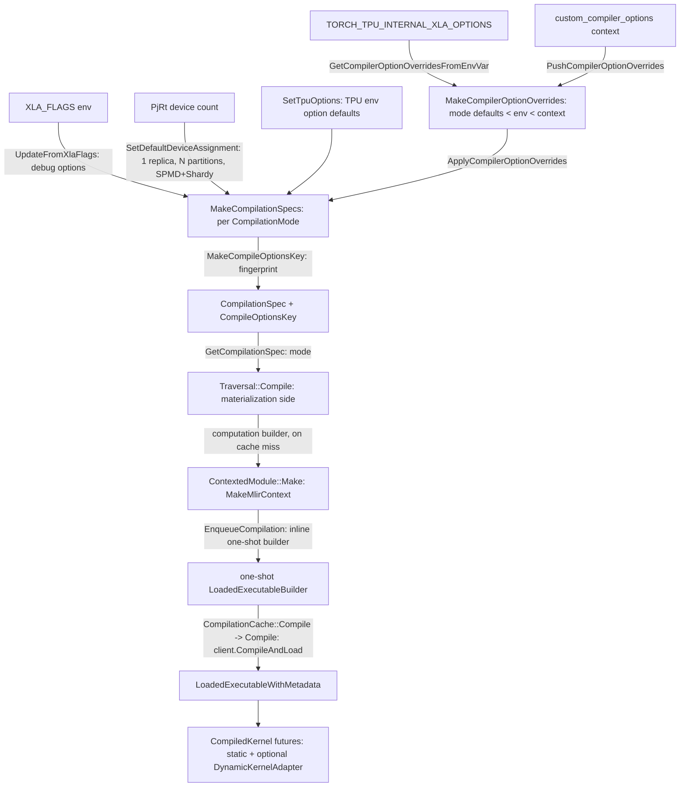

# Compilation pipeline, from MLIR module to loaded PjRt executable

## Overview
Everything TorchTPU executes on a TPU is an XLA program compiled through PjRt. This unit is the
thin, deterministic layer between "an MLIR module builder produced by a traversal" and "a loaded
executable with known output shapes": it owns the MLIR context and dialect registration, the
one-shot builder that hands the module to `PjRtClient::CompileAndLoad`, the
[`LoadedExecutableWithMetadata`](https://github.com/google-pytorch/torch_tpu/blob/6d2a45754bdb52743883f75fbf753408345f6d1b/csrc/common/compilation.h#L119 "csrc/common/compilation.h#LoadedExecutableWithMetadata")
wrapper that callers share, and, most importantly for users, the resolution of
`xla::CompileOptions`. Options are resolved once per *compilation mode* into a
[`CompilationSpec`](https://github.com/google-pytorch/torch_tpu/blob/6d2a45754bdb52743883f75fbf753408345f6d1b/csrc/common/compilation_spec.h#L54 "csrc/common/compilation_spec.h#CompilationSpec") that pairs the
options with a fingerprint, so that the [compilation cache](compilation-cache.md) can key executables
on the exact flags they were built with. The key design decision is layering with a strict
precedence order: the Python `custom_compiler_options` context wins over the internal env var
`TORCH_TPU_INTERNAL_XLA_OPTIONS`, which wins over TorchTPU's hard-coded TPU defaults, which sit on top
of the device assignment and whatever `XLA_FLAGS` says. Eager mode compiles at `O1` for speed
("fast compile"); `torch.compile` gets XLA's default level ("fast runtime").

## Diagram

Legend:
- `XF` - (concept) inputs: environment variables, the Python context manager, and the PjRt client
- `ENV` - (concept) inputs: environment variables, the Python context manager, and the PjRt client
- `CTX` - (concept) inputs: environment variables, the Python context manager, and the PjRt client
- `DEV` - (concept) inputs: environment variables, the Python context manager, and the PjRt client
- `SPEC` - [`MakeCompilationSpecs`](https://github.com/google-pytorch/torch_tpu/blob/6d2a45754bdb52743883f75fbf753408345f6d1b/csrc/common/compilation.cc#L487 "csrc/common/compilation.cc#MakeCompilationSpecs")
- `TPU` - [`SetTpuOptions`](https://github.com/google-pytorch/torch_tpu/blob/6d2a45754bdb52743883f75fbf753408345f6d1b/csrc/common/compilation.cc#L299 "csrc/common/compilation.cc#SetTpuOptions")
- `OVR` - [`MakeCompilerOptionOverrides`](https://github.com/google-pytorch/torch_tpu/blob/6d2a45754bdb52743883f75fbf753408345f6d1b/csrc/common/compilation.cc#L325 "csrc/common/compilation.cc#MakeCompilerOptionOverrides") fed by [`GetCompilerOptionOverridesFromEnvVar`](https://github.com/google-pytorch/torch_tpu/blob/6d2a45754bdb52743883f75fbf753408345f6d1b/csrc/common/compilation.cc#L197 "csrc/common/compilation.cc#GetCompilerOptionOverridesFromEnvVar") and [`PushCompilerOptionOverrides`](https://github.com/google-pytorch/torch_tpu/blob/6d2a45754bdb52743883f75fbf753408345f6d1b/csrc/common/compilation.cc#L541 "csrc/common/compilation.cc#PushCompilerOptionOverrides"), applied by [`ApplyCompilerOptionOverrides`](https://github.com/google-pytorch/torch_tpu/blob/6d2a45754bdb52743883f75fbf753408345f6d1b/csrc/common/compilation.cc#L354 "csrc/common/compilation.cc#ApplyCompilerOptionOverrides")
- `CS` - [`CompilationSpec`](https://github.com/google-pytorch/torch_tpu/blob/6d2a45754bdb52743883f75fbf753408345f6d1b/csrc/common/compilation_spec.h#L54 "csrc/common/compilation_spec.h#CompilationSpec") keyed by [`MakeCompileOptionsKey`](https://github.com/google-pytorch/torch_tpu/blob/6d2a45754bdb52743883f75fbf753408345f6d1b/csrc/common/compilation.cc#L441 "csrc/common/compilation.cc#MakeCompileOptionsKey"), read through [`GetCompilationSpec`](https://github.com/google-pytorch/torch_tpu/blob/6d2a45754bdb52743883f75fbf753408345f6d1b/csrc/common/compilation.cc#L566 "csrc/common/compilation.cc#GetCompilationSpec")
- `TRAV` - [`Compile`](https://github.com/google-pytorch/torch_tpu/blob/6d2a45754bdb52743883f75fbf753408345f6d1b/csrc/eager/traversal.cc#L1065 "csrc/eager/traversal.cc#Traversal.Compile"); see also [deferred-execution-and-materialization](deferred-execution-and-materialization.md)
- `CM` - [`ContextedModule`](https://github.com/google-pytorch/torch_tpu/blob/6d2a45754bdb52743883f75fbf753408345f6d1b/csrc/common/compilation.h#L216 "csrc/common/compilation.h#ContextedModule") built with [`MakeMlirContext`](https://github.com/google-pytorch/torch_tpu/blob/6d2a45754bdb52743883f75fbf753408345f6d1b/csrc/common/compilation.cc#L88 "csrc/common/compilation.cc#MakeMlirContext")
- `EB` - one-shot builder made inline by `EnqueueCompilation` in the [compilation cache](compilation-cache.md) (same lifting as [`MlirComputationBuilderToExecutableBuilder`](https://github.com/google-pytorch/torch_tpu/blob/6d2a45754bdb52743883f75fbf753408345f6d1b/csrc/common/compilation.cc#L151 "csrc/common/compilation.cc#MlirComputationBuilderToExecutableBuilder"))
- `EXE` - [`Compile`](https://github.com/google-pytorch/torch_tpu/blob/6d2a45754bdb52743883f75fbf753408345f6d1b/csrc/common/compilation_cache.cc#L1316 "csrc/common/compilation_cache.cc#CompilationCache.Compile") calling [`Compile`](https://github.com/google-pytorch/torch_tpu/blob/6d2a45754bdb52743883f75fbf753408345f6d1b/csrc/common/compilation.cc#L141 "csrc/common/compilation.cc#Compile"), producing a [`LoadedExecutableWithMetadata`](https://github.com/google-pytorch/torch_tpu/blob/6d2a45754bdb52743883f75fbf753408345f6d1b/csrc/common/compilation.h#L119 "csrc/common/compilation.h#LoadedExecutableWithMetadata")
- `CK` - [`CompiledKernel`](https://github.com/google-pytorch/torch_tpu/blob/6d2a45754bdb52743883f75fbf753408345f6d1b/csrc/common/compilation.h#L197 "csrc/common/compilation.h#CompiledKernel") with an optional [`DynamicKernelAdapter`](https://github.com/google-pytorch/torch_tpu/blob/6d2a45754bdb52743883f75fbf753408345f6d1b/csrc/common/compilation.h#L189 "csrc/common/compilation.h#DynamicKernelAdapter")

## Design rationale (why it's built this way)
- **Options are resolved once, per mode, and fingerprinted.** `xla::CompileOptions` is large and
  expensive even to move, so it travels as a unique pointer inside a
  [`CompilationSpec`](https://github.com/google-pytorch/torch_tpu/blob/6d2a45754bdb52743883f75fbf753408345f6d1b/csrc/common/compilation_spec.h#L54 "csrc/common/compilation_spec.h#CompilationSpec") whose
  `Copy()` is documented as something to "use sparsely". Resolving all
  [`CompilationMode`](https://github.com/google-pytorch/torch_tpu/blob/6d2a45754bdb52743883f75fbf753408345f6d1b/csrc/common/compilation_spec.h#L33 "csrc/common/compilation_spec.h#CompilationMode") values up
  front lets every op compilation on a thread reuse the same spec, and the fingerprint computed by
  [`MakeCompileOptionsKey`](https://github.com/google-pytorch/torch_tpu/blob/6d2a45754bdb52743883f75fbf753408345f6d1b/csrc/common/compilation.cc#L441 "csrc/common/compilation.cc#MakeCompileOptionsKey")
  becomes part of the [compilation cache key](compilation-cache-key.md), which is what makes it safe
  to change flags at runtime: a different flag set is simply a different key.
- **Two modes, one switch.** [`CompilationMode`](https://github.com/google-pytorch/torch_tpu/blob/6d2a45754bdb52743883f75fbf753408345f6d1b/csrc/common/compilation_spec.h#L33 "csrc/common/compilation_spec.h#CompilationMode")
  is either fast-compile (eager: "Reduces compile time, but may result in slower execution") or
  fast-runtime (`torch.compile`). On TPU, [`MakeCompilerOptionOverrides`](https://github.com/google-pytorch/torch_tpu/blob/6d2a45754bdb52743883f75fbf753408345f6d1b/csrc/common/compilation.cc#L325 "csrc/common/compilation.cc#MakeCompilerOptionOverrides")
  implements fast-compile as `xla_optimization_level=O1` plus `xla_tpu_autofdo=false` (a TODO notes
  the autofdo interaction is not yet understood); fast-runtime leaves XLA at its default `O2`. The
  eager mode enum maps to these modes in the materialization layer.
- **Precedence is explicit and documented in one place.** The comment above
  [`MakeCompilationSpecs`](https://github.com/google-pytorch/torch_tpu/blob/6d2a45754bdb52743883f75fbf753408345f6d1b/csrc/common/compilation.cc#L487 "csrc/common/compilation.cc#MakeCompilationSpecs")
  lists the sources in order: `PushCompilerOptionOverrides` (innermost Python context wins), then
  `TORCH_TPU_INTERNAL_XLA_OPTIONS` (space-separated `key=value`, documented as internal), then
  hard-coded defaults, then the global device count, then `XLA_FLAGS` debug options. The merge relies
  on both maps being key-sorted (a `static_assert` pins the override map type to `std::map`) so
  [`ApplyCompilerOptionOverrides`](https://github.com/google-pytorch/torch_tpu/blob/6d2a45754bdb52743883f75fbf753408345f6d1b/csrc/common/compilation.cc#L354 "csrc/common/compilation.cc#ApplyCompilerOptionOverrides")
  can replace in one pass and append the rest.
- **A builder that can run only once.** [`MlirComputationBuilderToExecutableBuilder`](https://github.com/google-pytorch/torch_tpu/blob/6d2a45754bdb52743883f75fbf753408345f6d1b/csrc/common/compilation.cc#L151 "csrc/common/compilation.cc#MlirComputationBuilderToExecutableBuilder")
  returns an rvalue-qualified callable because compilation transfers ownership of the MLIR module
  *and* its context to PjRt; the type system, not a runtime check, prevents compiling the same module
  twice. [`ContextedModule`](https://github.com/google-pytorch/torch_tpu/blob/6d2a45754bdb52743883f75fbf753408345f6d1b/csrc/common/compilation.h#L216 "csrc/common/compilation.h#ContextedModule") exists to
  keep the context alive exactly as long as the module (a TODO plans to fold it into XLA's
  owning-module type).
- **Device assignment is deliberately simple.** [`SetDefaultDeviceAssignment`](https://github.com/google-pytorch/torch_tpu/blob/6d2a45754bdb52743883f75fbf753408345f6d1b/csrc/common/compilation.cc#L232 "csrc/common/compilation.cc#SetDefaultDeviceAssignment")
  always uses one replica and one partition per device, with SPMD partitioning and Shardy switched
  on. The comments explain why: every device runs identical HLO with explicit collectives (native
  PyTorch style), partitions align with JAX collective behavior and are *required* by Pallas/Mosaic
  kernels with RDMAs, Shardy is needed for `ragged_dot`, and since TorchTPU emits StableHLO without
  sharding annotations the partitioner is a no-op. A traversal can still narrow this per program:
  [`Compile`](https://github.com/google-pytorch/torch_tpu/blob/6d2a45754bdb52743883f75fbf753408345f6d1b/csrc/eager/traversal.cc#L1065 "csrc/eager/traversal.cc#Traversal.Compile") copies the spec and re-keys it when it needs an explicit device
  assignment, a SparseCore replication override, or pinned-host memory placements.
- **Excess precision is a first-class option.** [`UpdateFromXlaFlags`](https://github.com/google-pytorch/torch_tpu/blob/6d2a45754bdb52743883f75fbf753408345f6d1b/csrc/common/compilation.cc#L218 "csrc/common/compilation.cc#UpdateFromXlaFlags")
  copies the cached `XLA_FLAGS`-derived build options and then forces `xla_allow_excess_precision`
  from TorchTPU's own setting (see [dtype-and-precision](dtype-and-precision.md)); the value is part
  of the fingerprint, so toggling it recompiles rather than silently reusing a kernel.

> [!inferred]
> At this pin the only TPU-specific environment default baked in by
> [`SetTpuOptions`](https://github.com/google-pytorch/torch_tpu/blob/6d2a45754bdb52743883f75fbf753408345f6d1b/csrc/common/compilation.cc#L299 "csrc/common/compilation.cc#SetTpuOptions") is
> `xla_tpu_vmem_scavenging_mode=SAFE_IFF_KERNEL_REQUIRED` (the previous pin also set
> `xla_tpu_enable_deduplicated_calls`; the source no longer carries a comment explaining the
> remaining value). For a customer, this means the supported way to experiment with
> XLA flags is the Python `custom_compiler_options` context (per thread, nestable, cache-safe),
> while `XLA_FLAGS` changes debug options globally and `TORCH_TPU_INTERNAL_XLA_OPTIONS` is unsupported.

## Entry points
- [`GetCompilationSpec`](https://github.com/google-pytorch/torch_tpu/blob/6d2a45754bdb52743883f75fbf753408345f6d1b/csrc/common/compilation.cc#L566 "csrc/common/compilation.cc#GetCompilationSpec") returns a deep copy of the spec for the requested mode from the thread's
  current compilation context (or the memoized default). The `torch.compile` and compiled-mode
  paths call it per compilation; the copy exists because PjRt consumes the options by value.
- [`PushCompilerOptionOverrides`](https://github.com/google-pytorch/torch_tpu/blob/6d2a45754bdb52743883f75fbf753408345f6d1b/csrc/common/compilation.cc#L541 "csrc/common/compilation.cc#PushCompilerOptionOverrides")
  and [`PopCompilerOptionOverrides`](https://github.com/google-pytorch/torch_tpu/blob/6d2a45754bdb52743883f75fbf753408345f6d1b/csrc/common/compilation.cc#L557 "csrc/common/compilation.cc#PopCompilerOptionOverrides")
  are the C++ side of the Python `custom_compiler_options` context manager: push merges the new
  overrides on top of the current ones, rebuilds all specs, and pushes a new, immutable context
  state; a failure leaves the stack untouched.
- [`Compile`](https://github.com/google-pytorch/torch_tpu/blob/6d2a45754bdb52743883f75fbf753408345f6d1b/csrc/eager/traversal.cc#L1065 "csrc/eager/traversal.cc#Traversal.Compile") is where eager materialization enters: it wraps the traversal's
  MLIR-building closure, optionally specializes the spec (see above), derives the cache key from the
  spec's options key, and hands everything to the cache's `GetOrCompile`.
- [`Compile`](https://github.com/google-pytorch/torch_tpu/blob/6d2a45754bdb52743883f75fbf753408345f6d1b/csrc/common/compilation_cache.cc#L1316 "csrc/common/compilation_cache.cc#CompilationCache.Compile") is what the [compilation cache](compilation-cache.md) runs on
  a miss, on a compilation thread: it fetches the PjRt client, counts and times the compilation, and
  calls the free [`Compile`](https://github.com/google-pytorch/torch_tpu/blob/6d2a45754bdb52743883f75fbf753408345f6d1b/csrc/common/compilation.cc#L141 "csrc/common/compilation.cc#Compile") with the one-shot builder that
  `CompilationCache::EnqueueCompilation` wrapped around the already-built module (an inline equivalent of
  [`MlirComputationBuilderToExecutableBuilder`](https://github.com/google-pytorch/torch_tpu/blob/6d2a45754bdb52743883f75fbf753408345f6d1b/csrc/common/compilation.cc#L151 "csrc/common/compilation.cc#MlirComputationBuilderToExecutableBuilder"), which has no non-test caller at this pin). The free `Compile` is synchronous and cache-unaware
  by design ("Synchronously compiles a program, without any cache behavior").
- [`MakeMlirContext`](https://github.com/google-pytorch/torch_tpu/blob/6d2a45754bdb52743883f75fbf753408345f6d1b/csrc/common/compilation.cc#L88 "csrc/common/compilation.cc#MakeMlirContext") is used by
  anything that builds MLIR outside a compilation, for example the materialize thread, which creates
  one context and reuses it across tasks.

## Mechanism (step-by-step)
1. **Resolve specs for every mode.** [`MakeCompilationSpecs`](https://github.com/google-pytorch/torch_tpu/blob/6d2a45754bdb52743883f75fbf753408345f6d1b/csrc/common/compilation.cc#L487 "csrc/common/compilation.cc#MakeCompilationSpecs")
   loops over both modes. For each it starts from the `XLA_FLAGS`-derived build options
   ([`UpdateFromXlaFlags`](https://github.com/google-pytorch/torch_tpu/blob/6d2a45754bdb52743883f75fbf753408345f6d1b/csrc/common/compilation.cc#L218 "csrc/common/compilation.cc#UpdateFromXlaFlags")),
   sets the device assignment ([`SetDefaultDeviceAssignment`](https://github.com/google-pytorch/torch_tpu/blob/6d2a45754bdb52743883f75fbf753408345f6d1b/csrc/common/compilation.cc#L232 "csrc/common/compilation.cc#SetDefaultDeviceAssignment"),
   which asks the PjRt backend for the global device count and ids), installs the TPU environment
   defaults ([`SetTpuOptions`](https://github.com/google-pytorch/torch_tpu/blob/6d2a45754bdb52743883f75fbf753408345f6d1b/csrc/common/compilation.cc#L299 "csrc/common/compilation.cc#SetTpuOptions"), which
   also reports whether the platform is a TPU at all), and finally applies the merged overrides.
   Every PjRt lookup returns a status, so a backend initialization failure surfaces as the
   original error instead of a null client.
2. **Merge overrides in precedence order.** [`MakeCompilerOptionOverrides`](https://github.com/google-pytorch/torch_tpu/blob/6d2a45754bdb52743883f75fbf753408345f6d1b/csrc/common/compilation.cc#L325 "csrc/common/compilation.cc#MakeCompilerOptionOverrides")
   seeds the map with the mode defaults, overlays the memoized env-var map from
   [`GetCompilerOptionOverridesFromEnvVar`](https://github.com/google-pytorch/torch_tpu/blob/6d2a45754bdb52743883f75fbf753408345f6d1b/csrc/common/compilation.cc#L197 "csrc/common/compilation.cc#GetCompilerOptionOverridesFromEnvVar"),
   then overlays the active context's overrides. [`ApplyCompilerOptionOverrides`](https://github.com/google-pytorch/torch_tpu/blob/6d2a45754bdb52743883f75fbf753408345f6d1b/csrc/common/compilation.cc#L354 "csrc/common/compilation.cc#ApplyCompilerOptionOverrides")
   writes them into `env_option_overrides`, except for the two special keys
   `xla_optimization_level` and `xla_memory_fitting_level`, which are parsed by
   [`ParseEffortLevel`](https://github.com/google-pytorch/torch_tpu/blob/6d2a45754bdb52743883f75fbf753408345f6d1b/csrc/common/compilation.cc#L174 "csrc/common/compilation.cc#ParseEffortLevel") (`O0`..`O3`,
   anything else is an invalid-argument error) and stored as build-option effort levels.
3. **Fingerprint the result.** [`MakeCompileOptionsKey`](https://github.com/google-pytorch/torch_tpu/blob/6d2a45754bdb52743883f75fbf753408345f6d1b/csrc/common/compilation.cc#L441 "csrc/common/compilation.cc#MakeCompileOptionsKey")
   concatenates fingerprints of the raw `XLA_FLAGS` and `LIBTPU_INIT_ARGS` strings (order-sensitive
   by accepted trade-off) with a fingerprint of only the fields TorchTPU sets: the build-option
   subset (excess precision, replicas, partitions, SPMD, Shardy, device assignment, effort levels),
   the environment overrides, and any argument layouts. The pair of options and key is a
   [`CompilationSpec`](https://github.com/google-pytorch/torch_tpu/blob/6d2a45754bdb52743883f75fbf753408345f6d1b/csrc/common/compilation_spec.h#L54 "csrc/common/compilation_spec.h#CompilationSpec"); all modes
   together with the overrides that produced them form a
   [`CompilationContext`](https://github.com/google-pytorch/torch_tpu/blob/6d2a45754bdb52743883f75fbf753408345f6d1b/csrc/common/compilation_spec.h#L90 "csrc/common/compilation_spec.h#CompilationContext"),
   which is the thread-local context state the Python context manager pushes and pops.
4. **Hand a spec to a compilation.** A materialization task or `torch.compile` backend obtains the
   spec for its mode ([`GetCompilationSpec`](https://github.com/google-pytorch/torch_tpu/blob/6d2a45754bdb52743883f75fbf753408345f6d1b/csrc/common/compilation.cc#L566 "csrc/common/compilation.cc#GetCompilationSpec") for the compile paths); the spec must be resolved on the
   dispatching thread and passed down, because worker threads do not read thread-local context
   state. That is why the spec (not the context stack) is what crosses the thread boundary.
   [`Compile`](https://github.com/google-pytorch/torch_tpu/blob/6d2a45754bdb52743883f75fbf753408345f6d1b/csrc/eager/traversal.cc#L1065 "csrc/eager/traversal.cc#Traversal.Compile") then computes the [cache key](compilation-cache-key.md) and asks the
   cache for a kernel.
5. **Build the module in its own context.** [`ContextedModule`](https://github.com/google-pytorch/torch_tpu/blob/6d2a45754bdb52743883f75fbf753408345f6d1b/csrc/common/compilation.h#L216 "csrc/common/compilation.h#ContextedModule")
   `Make` creates a fresh context via [`MakeMlirContext`](https://github.com/google-pytorch/torch_tpu/blob/6d2a45754bdb52743883f75fbf753408345f6d1b/csrc/common/compilation.cc#L88 "csrc/common/compilation.cc#MakeMlirContext")
   (registering the MLIR-to-HLO dependent dialects and loading them all), runs the traversal's
   computation builder inside it, and then runs TorchTPU's own MLIR optimization passes over the
   result before the module is handed on. The module is only ever built when the cache reports a
   miss.
6. **Compile and load.** On the cache path, `CompilationCache::EnqueueCompilation`
   captures the module in a one-shot callable (the same lifting that
   [`MlirComputationBuilderToExecutableBuilder`](https://github.com/google-pytorch/torch_tpu/blob/6d2a45754bdb52743883f75fbf753408345f6d1b/csrc/common/compilation.cc#L151 "csrc/common/compilation.cc#MlirComputationBuilderToExecutableBuilder") provides as a helper) that moves it into
   `client.CompileAndLoad`, wrapping any XLA failure with the context "failed to compile MLIR
   module" (see [error-handling](error-handling.md) for how XLA errors are adapted).
   [`Compile`](https://github.com/google-pytorch/torch_tpu/blob/6d2a45754bdb52743883f75fbf753408345f6d1b/csrc/common/compilation.cc#L141 "csrc/common/compilation.cc#Compile") invokes it and wraps the loaded
   executable in a [`LoadedExecutableWithMetadata`](https://github.com/google-pytorch/torch_tpu/blob/6d2a45754bdb52743883f75fbf753408345f6d1b/csrc/common/compilation.h#L119 "csrc/common/compilation.h#LoadedExecutableWithMetadata") through a shared-pointer
   factory that flattens tuple output shapes into per-tensor shapes once, so execution never
   re-queries them. The [`LoadedExecutableWithMetadata`](https://github.com/google-pytorch/torch_tpu/blob/6d2a45754bdb52743883f75fbf753408345f6d1b/csrc/common/compilation.h#L163 "csrc/common/compilation.h#LoadedExecutableWithMetadata.LoadedExecutableWithMetadata") constructor itself is
   private, which keeps every instance shared and immutable.
7. **Futures, not executables, flow back.** The cache returns a
   [`CompiledKernel`](https://github.com/google-pytorch/torch_tpu/blob/6d2a45754bdb52743883f75fbf753408345f6d1b/csrc/common/compilation.h#L197 "csrc/common/compilation.h#CompiledKernel"): a shared future
   for the fixed-shape executable plus, for bounded dynamic shapes, a
   [`DynamicKernelAdapter`](https://github.com/google-pytorch/torch_tpu/blob/6d2a45754bdb52743883f75fbf753408345f6d1b/csrc/common/compilation.h#L189 "csrc/common/compilation.h#DynamicKernelAdapter") with
   preamble (pad) and postamble (slice) executable futures. The execute thread blocks on these futures
   right before launching, which is how compilation overlaps with the rest of dispatch.

> [!inferred]
> Eager materialization at this pin reads specs straight from the shared, immutable compilation
> context captured in its settings rather than deep-copying per task, and it selectively promotes a
> fast-compile traversal to the fast-runtime spec when it contains a convolution that benefits from
> `O2`. Both behaviors live in the materialization layer, outside this packet.

## Key data structures
- [`CompilationSpec`](https://github.com/google-pytorch/torch_tpu/blob/6d2a45754bdb52743883f75fbf753408345f6d1b/csrc/common/compilation_spec.h#L54 "csrc/common/compilation_spec.h#CompilationSpec"):
  `xla_compile_options` (unique pointer) plus `compile_options_key`; movable, deep-copyable on demand.
- [`CompilationContext`](https://github.com/google-pytorch/torch_tpu/blob/6d2a45754bdb52743883f75fbf753408345f6d1b/csrc/common/compilation_spec.h#L90 "csrc/common/compilation_spec.h#CompilationContext"):
  specs by mode plus the override map that produced them; the unit of the thread-local context
  stack. It is immutable once built: every push allocates a new one, so a shared pointer to it stays
  valid across scope exits and threads.
- [`CompilationMode`](https://github.com/google-pytorch/torch_tpu/blob/6d2a45754bdb52743883f75fbf753408345f6d1b/csrc/common/compilation_spec.h#L33 "csrc/common/compilation_spec.h#CompilationMode"):
  `kFastCompile`, `kFastRuntime`.
- [`LoadedExecutableWithMetadata`](https://github.com/google-pytorch/torch_tpu/blob/6d2a45754bdb52743883f75fbf753408345f6d1b/csrc/common/compilation.h#L119 "csrc/common/compilation.h#LoadedExecutableWithMetadata"):
  const loaded executable plus cached flattened output shapes, optional argument indices, and
  optional metadata for precompiled unbounded-dynamic kernels (how logical inputs and outputs map to
  physical PjRt parameters, an output transform, and a compatibility check). Always shared via
  `shared_ptr` so the cache can evict while an execution still holds it.
- [`CompiledKernel`](https://github.com/google-pytorch/torch_tpu/blob/6d2a45754bdb52743883f75fbf753408345f6d1b/csrc/common/compilation.h#L197 "csrc/common/compilation.h#CompiledKernel") and
  [`DynamicKernelAdapter`](https://github.com/google-pytorch/torch_tpu/blob/6d2a45754bdb52743883f75fbf753408345f6d1b/csrc/common/compilation.h#L189 "csrc/common/compilation.h#DynamicKernelAdapter"):
  shared futures for the static kernel and the optional pad/unpad adapters. The header notes that
  the `fixed_shape_kernel` field "can also hold dynamic kernels".
- [`ContextedModule`](https://github.com/google-pytorch/torch_tpu/blob/6d2a45754bdb52743883f75fbf753408345f6d1b/csrc/common/compilation.h#L216 "csrc/common/compilation.h#ContextedModule"): MLIR context
  and module with tied lifetimes; converted destructively into XLA's owning module type at compile.

## Dynamics (design intent)
- Spec resolution is memoized: the default context is built exactly once and asserted valid at
  startup (an obviously misconfigured compiler option aborts the process rather than failing later).
- `Compile` is synchronous, but callers always run it on the cache's compilation thread pool, so the
  dispatch thread only ever waits on futures. If the PjRt client cannot be obtained,
  [`Compile`](https://github.com/google-pytorch/torch_tpu/blob/6d2a45754bdb52743883f75fbf753408345f6d1b/csrc/common/compilation_cache.cc#L1316 "csrc/common/compilation_cache.cc#CompilationCache.Compile") fulfils the entry's promise with that error immediately, so
  waiters see the real initialization failure.
- The env-var override map is read once per process; changing `TORCH_TPU_INTERNAL_XLA_OPTIONS`,
  `XLA_FLAGS` or `LIBTPU_INIT_ARGS` after import has no effect, whereas the Python context can change
  options per thread and per scope at any time.

## Edge cases
- An unknown effort level (`xla_optimization_level=O4`) or an empty override key fails
  [`ApplyCompilerOptionOverrides`](https://github.com/google-pytorch/torch_tpu/blob/6d2a45754bdb52743883f75fbf753408345f6d1b/csrc/common/compilation.cc#L354 "csrc/common/compilation.cc#ApplyCompilerOptionOverrides"),
  so a bad `custom_compiler_options` value raises at push time, not at the next compile.
- Options are only applied for TPU platforms; on a non-TPU PjRt client (`is_tpu` false) the mode
  defaults are skipped and no TPU environment overrides are set.
- Reordering semantically identical `XLA_FLAGS` (or `LIBTPU_INIT_ARGS`) changes the key and forces a
  recompile; the comment calls this an acceptable trade-off for not re-implementing flag parsing.
- Pushing overrides that merely repeat the current values still creates a new context state with an
  identical key, which is harmless for the cache.
- Two unrelated types share a name: the C++ [`CompilationContext`](https://github.com/google-pytorch/torch_tpu/blob/6d2a45754bdb52743883f75fbf753408345f6d1b/csrc/common/compilation_spec.h#L90 "csrc/common/compilation_spec.h#CompilationContext") holds
  compile options, while the Python [`CompilationContext`](https://github.com/google-pytorch/torch_tpu/blob/6d2a45754bdb52743883f75fbf753408345f6d1b/src/torch_tpu/_internal/compile/compiler.py#L57 "src/torch_tpu/_internal/compile/compiler#CompilationContext") in the `torch.compile`
  backend is "Compilation state for a single graph module" passed between forward and backward
  compilations.

## Open questions
- How argument layouts enter `compile_options.argument_layouts` (they are fingerprinted here when
  present) is decided by the traversal, outside this unit.
- The autofdo/optimization-level interaction disabled by the `xla_tpu_autofdo=false` default is an
  open TODO in the source.
- The header now exposes a `GetCompilationContext` accessor (shared immutable context, no deep
  copy) and a `MakeShared` factory on the executable wrapper; neither is in this packet's subgraph,
  so their callers are not traced here.

## See also
- [compilation-cache](compilation-cache.md): where `Compile` is invoked and executables are kept.
- [compilation-cache-key](compilation-cache-key.md): how the options key joins the graph key.
- [deferred-execution-and-materialization](deferred-execution-and-materialization.md): who asks for a spec and when.
- [torch-compile-backend](torch-compile-backend.md): the fast-runtime consumer.
- [dtype-and-precision](dtype-and-precision.md): the excess-precision flag.
- [pjrt-client](pjrt-client.md): the client whose devices define the assignment.

## Recent changes
- `90deb04a3` makes the PjRt backend's client and device getters return a status instead of a null
  pointer, so the compile path (device assignment, TPU options, `CompilationCache::Compile`) now
  propagates "the actionable initialization error" rather than a generic "not initialized".
- `ddf6629e7`, `908a8db4b` and `32d7cb344` extend the executable wrapper for precompiled
  unbounded-dynamic kernels (the nonzero kernel): input/output transform callbacks, a compatibility
  function moved onto the shared executable, and output shapes passed to that check.
- [all changes in 6d2a45754b](../changes/6d2a45754b.md)
