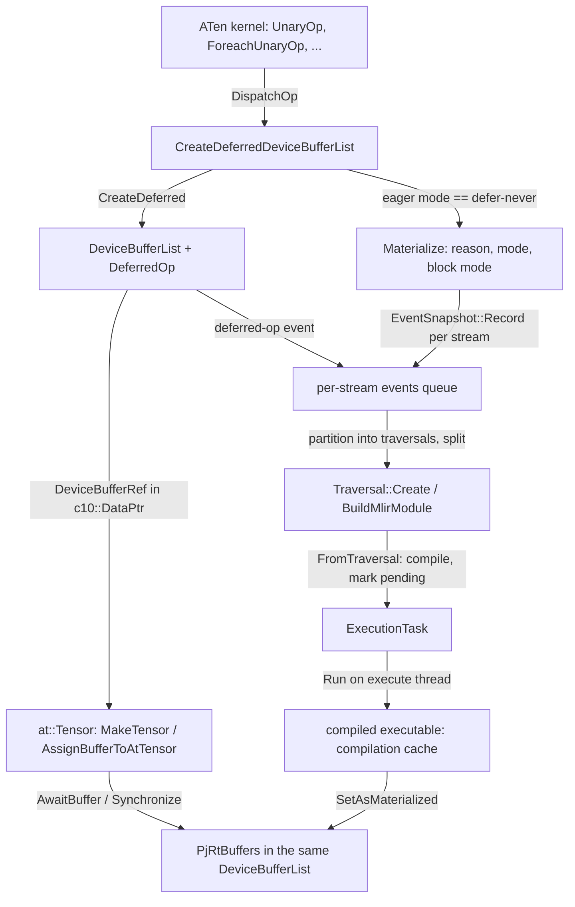
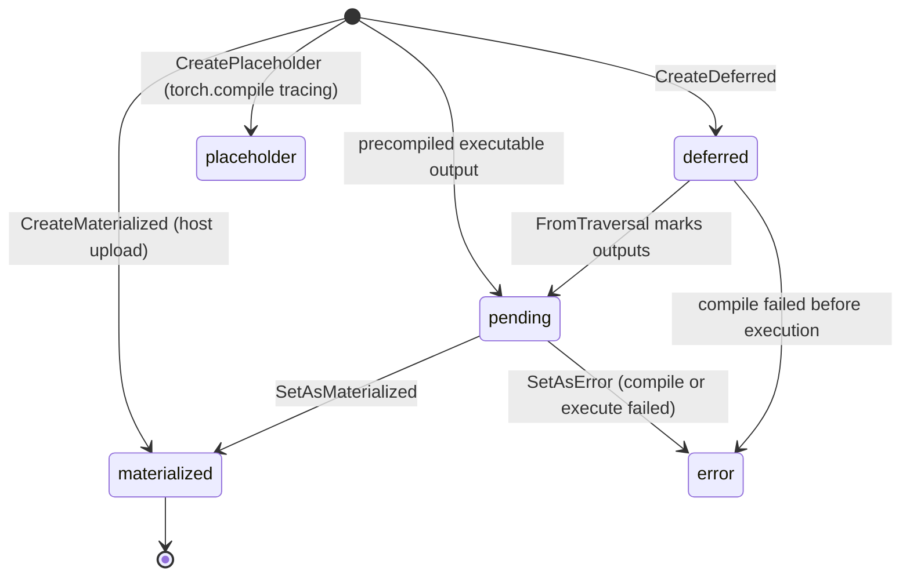

# Deferred execution and materialization

## Overview
On CUDA a tensor's `c10::DataPtr` always names a block of device memory. On TorchTPU it names a
[`DeviceBufferRef`](https://github.com/google-pytorch/torch_tpu/blob/6d2a45754bdb52743883f75fbf753408345f6d1b/csrc/eager/device_buffer.h#L173 "csrc/eager/device_buffer.h#DeviceBufferRef"): a shared pointer
to a [`DeviceBufferList`](https://github.com/google-pytorch/torch_tpu/blob/6d2a45754bdb52743883f75fbf753408345f6d1b/csrc/eager/device_buffer.h#L529 "csrc/eager/device_buffer.h#DeviceBufferList") plus an
index into it, and that list may hold either materialized PjRt buffers **or** a
[`DeferredOp`](https://github.com/google-pytorch/torch_tpu/blob/6d2a45754bdb52743883f75fbf753408345f6d1b/csrc/eager/device_buffer.h#L383 "csrc/eager/device_buffer.h#DeferredOp") that can produce them. Every
ATen kernel therefore returns a *promise* of data, recorded on its stream's events queue, and the
graph of promises grows until something needs real bytes (a `.cpu()`, an `item()`, a collective, an
explicit sync). That moment is **materialization**: the pending subgraph is traversed, compiled
through the compilation cache into one or more XLA executables, executed on a worker thread, and
the lists are updated in place. The payoff is the key design idea: many small ops become one fused
XLA program, and intermediates that nobody reads never get device memory at all. The default eager
mode still materializes right after each dispatch (CUDA-like semantics); the fusion win is opt-in
through `TORCH_TPU_DEFER_AND_FUSE=1`, with `TORCH_TPU_LAUNCH_BLOCKING=1` as the blocking debug mode.

## Diagram

Legend:
- `K` - [`UnaryOp`](https://github.com/google-pytorch/torch_tpu/blob/6d2a45754bdb52743883f75fbf753408345f6d1b/csrc/ops/unary_aten_kernels.cc#L106 "csrc/ops/unary_aten_kernels.cc#UnaryOp"), [`ForeachUnaryOp`](https://github.com/google-pytorch/torch_tpu/blob/6d2a45754bdb52743883f75fbf753408345f6d1b/csrc/ops/foreach_aten_kernels.cc#L635 "csrc/ops/foreach_aten_kernels.cc#ForeachUnaryOp") (two of hundreds of kernels)
- `CDL` - [`CreateDeferredDeviceBufferList`](https://github.com/google-pytorch/torch_tpu/blob/6d2a45754bdb52743883f75fbf753408345f6d1b/csrc/eager/device_buffer_utils.cc#L213 "csrc/eager/device_buffer_utils.cc#CreateDeferredDeviceBufferList") over [`CreateDeferred`](https://github.com/google-pytorch/torch_tpu/blob/6d2a45754bdb52743883f75fbf753408345f6d1b/csrc/eager/device_buffer.cc#L357 "csrc/eager/device_buffer.cc#DeviceBufferList.CreateDeferred")
- `DBL` - [`DeviceBufferList`](https://github.com/google-pytorch/torch_tpu/blob/6d2a45754bdb52743883f75fbf753408345f6d1b/csrc/eager/device_buffer.h#L529 "csrc/eager/device_buffer.h#DeviceBufferList") holding a [`DeferredOp`](https://github.com/google-pytorch/torch_tpu/blob/6d2a45754bdb52743883f75fbf753408345f6d1b/csrc/eager/device_buffer.h#L383 "csrc/eager/device_buffer.h#DeferredOp")
- `T` - [`MakeTensor`](https://github.com/google-pytorch/torch_tpu/blob/6d2a45754bdb52743883f75fbf753408345f6d1b/csrc/eager/tensor_to_buffer.cc#L396 "csrc/eager/tensor_to_buffer.cc#MakeTensor") / [`AssignBufferToAtTensor`](https://github.com/google-pytorch/torch_tpu/blob/6d2a45754bdb52743883f75fbf753408345f6d1b/csrc/eager/tensor_to_buffer.cc#L138 "csrc/eager/tensor_to_buffer.cc#AssignBufferToAtTensor")
- `EQ` - [`EventSnapshot`](https://github.com/google-pytorch/torch_tpu/blob/6d2a45754bdb52743883f75fbf753408345f6d1b/csrc/eager/events_queue.h#L91 "csrc/eager/events_queue.h#EventSnapshot") and the per-stream queue in `csrc/eager/events_queue.cc`
- `M` - [`Materialize`](https://github.com/google-pytorch/torch_tpu/blob/6d2a45754bdb52743883f75fbf753408345f6d1b/csrc/eager/materialize.cc#L812 "csrc/eager/materialize.cc#Materialize")
- `TR` - [`Create`](https://github.com/google-pytorch/torch_tpu/blob/6d2a45754bdb52743883f75fbf753408345f6d1b/csrc/eager/traversal.cc#L100 "csrc/eager/traversal.cc#Traversal.Create"), [`BuildMlirModule`](https://github.com/google-pytorch/torch_tpu/blob/6d2a45754bdb52743883f75fbf753408345f6d1b/csrc/eager/traversal.cc#L583 "csrc/eager/traversal.cc#Traversal.BuildMlirModule")
- `ET` - [`ExecutionTask`](https://github.com/google-pytorch/torch_tpu/blob/6d2a45754bdb52743883f75fbf753408345f6d1b/csrc/eager/execution_task.h#L47 "csrc/eager/execution_task.h#ExecutionTask")
- `X` - (concept) see [compilation-pipeline](compilation-pipeline.md) and [compilation-cache](compilation-cache.md)
- `PJ` - (concept) XLA `PjRtBuffer`; reached through [`AwaitBuffer`](https://github.com/google-pytorch/torch_tpu/blob/6d2a45754bdb52743883f75fbf753408345f6d1b/csrc/eager/device_buffer.cc#L722 "csrc/eager/device_buffer.cc#DeviceBufferRef.AwaitBuffer")

## Design rationale (why it's built this way)
- **A tensor is a node in a DAG, not a buffer.** The header comment on
  [`DeviceBufferList`](https://github.com/google-pytorch/torch_tpu/blob/6d2a45754bdb52743883f75fbf753408345f6d1b/csrc/eager/device_buffer.h#L529 "csrc/eager/device_buffer.h#DeviceBufferList") states the
  contrast directly: a CUDA `DataPtr` is "a 1D untyped data buffer" with strides describing views,
  while an XLA buffer is "a concrete, typed buffer with some on-device layout" that does not support
  random-access indexing. Views are therefore *ops*: [`CreateViewDeviceBufferRef`](https://github.com/google-pytorch/torch_tpu/blob/6d2a45754bdb52743883f75fbf753408345f6d1b/csrc/eager/device_buffer_utils.cc#L535 "csrc/eager/device_buffer_utils.cc#CreateViewDeviceBufferRef")
  and [`CreateInverseViewDeviceBufferRef`](https://github.com/google-pytorch/torch_tpu/blob/6d2a45754bdb52743883f75fbf753408345f6d1b/csrc/eager/device_buffer_utils.cc#L633 "csrc/eager/device_buffer_utils.cc#CreateInverseViewDeviceBufferRef")
  build deferred base-to-view and view-to-base conversions on demand (the primitives, such as
  [`ContiguousToView`](https://github.com/google-pytorch/torch_tpu/blob/6d2a45754bdb52743883f75fbf753408345f6d1b/csrc/ops/view_decomposition/contiguous_to_view.cc#L261 "csrc/ops/view_decomposition/contiguous_to_view.cc#ContiguousToView"), live in
  [view-decomposition](view-decomposition.md)).
- **Why three kinds of list.** "Materialized" and "deferred" cover eager execution; the third,
  *placeholder* ([`CreatePlaceholder`](https://github.com/google-pytorch/torch_tpu/blob/6d2a45754bdb52743883f75fbf753408345f6d1b/csrc/eager/device_buffer.cc#L459 "csrc/eager/device_buffer.cc#DeviceBufferList.CreatePlaceholder")),
  exists so `torch.compile` can trace an FX graph with known shapes and dtypes but no data.
  [`Materialize`](https://github.com/google-pytorch/torch_tpu/blob/6d2a45754bdb52743883f75fbf753408345f6d1b/csrc/eager/materialize.cc#L812 "csrc/eager/materialize.cc#Materialize") rejects a placeholder
  outright ("cannot Materialize() a placeholder tensor"), and the worker additionally drops any
  traversal output that transitively depends on a placeholder: eager ops traced over placeholder
  tensors "leave abandoned DeferredOps on the events queue", and pruning them lets the real ops
  sharing that traversal still materialize.
- **One op can produce many tensors.** Normalization ops and fused optimizers return several
  outputs, so a [`DeviceBufferList`](https://github.com/google-pytorch/torch_tpu/blob/6d2a45754bdb52743883f75fbf753408345f6d1b/csrc/eager/device_buffer.h#L529 "csrc/eager/device_buffer.h#DeviceBufferList") is the unit of
  deferred work and a [`DeviceBufferRef`](https://github.com/google-pytorch/torch_tpu/blob/6d2a45754bdb52743883f75fbf753408345f6d1b/csrc/eager/device_buffer.h#L173 "csrc/eager/device_buffer.h#DeviceBufferRef")
  is "a reference to an element in a DeviceBufferList". The ref is immutable; the list is mutated only
  by materialization, which is why holding a raw `DeviceBufferRef*` past one kernel is documented as
  unsafe (the at::Tensor may drop the last owner). Live `DataPtr`s are now counted per output slot,
  so in-place donation can tell which outputs of a multi-output op are still held.
- **Immutability at the XLA level, mutation at the ATen level.** In-place PyTorch semantics are
  provided by swapping the `DataPtr` inside the `StorageImpl`
  ([`AssignBufferToAtTensor`](https://github.com/google-pytorch/torch_tpu/blob/6d2a45754bdb52743883f75fbf753408345f6d1b/csrc/eager/tensor_to_buffer.cc#L138 "csrc/eager/tensor_to_buffer.cc#AssignBufferToAtTensor")),
  never by rewriting a buffer. The graph stays acyclic by construction because a new node can only
  point at already-existing nodes.
- **Constants stay deferred on purpose.** A list whose op has a statically known value
  ([`is_constant`](https://github.com/google-pytorch/torch_tpu/blob/6d2a45754bdb52743883f75fbf753408345f6d1b/csrc/eager/device_buffer.cc#L693 "csrc/eager/device_buffer.cc#DeviceBufferRef.is_constant"), which includes
  "empty" fills such as [`CreateEmptyDeviceBufferRef`](https://github.com/google-pytorch/torch_tpu/blob/6d2a45754bdb52743883f75fbf753408345f6d1b/csrc/eager/device_buffer_utils.cc#L354 "csrc/eager/device_buffer_utils.cc#CreateEmptyDeviceBufferRef"))
  is not recorded as a deferred-op event: "materializing a constant prevents later constant folding;
  re-execution preserves their constantness in later compilations". XLA never allocates
  uninitialized memory, so `torch.empty` is a deterministic fill op rather than a raw allocation.
- **Two worker threads, not inline compilation.** [`Materialize`](https://github.com/google-pytorch/torch_tpu/blob/6d2a45754bdb52743883f75fbf753408345f6d1b/csrc/eager/materialize.cc#L812 "csrc/eager/materialize.cc#Materialize")
  hands work to a process-wide worker with a *materialize* thread (traversal, split, compile
  submission) and an *execute* thread (wait for compilation and arguments, run, publish results).
  Both threads are forbidden from reading thread-local context state so that every decision is
  resolved on the dispatching thread and passed down explicitly, and their warnings are routed back
  to the dispatching thread. With [`MaterializationBlockMode`](https://github.com/google-pytorch/torch_tpu/blob/6d2a45754bdb52743883f75fbf753408345f6d1b/csrc/eager/materialize.h#L54 "csrc/eager/materialize.h#MaterializationBlockMode")
  the caller chooses to wait until the stream's snapshot has been enqueued (`kBlockUntilStarted`)
  or to return immediately (`kNonBlocking`); in neither case does it wait for execution.

> [!inferred]
> The comment on the `EagerMode` enum calls defer-never "primarily used for debugging" with
> "suboptimal compile and execution performance", yet the default-mode selection makes it the
> default unless `TORCH_TPU_DEFER_AND_FUSE=1` is set. The likely reason is semantic safety for
> onboarding code (CUDA-eager ordering, errors surfacing near the op that caused them) at the cost of
> fusion; treat defer-and-fuse as the performance mode to enable deliberately, and the repeated-op
> heuristic (`TORCH_TPU_INTERNAL_DETECT_REPEATED_OPS`, values `safe` or `aggressive`, default
> `safe`) as its safety valve against unbounded graph growth.

## Entry points
- [`CreateDeferredDeviceBufferList`](https://github.com/google-pytorch/torch_tpu/blob/6d2a45754bdb52743883f75fbf753408345f6d1b/csrc/eager/device_buffer_utils.cc#L213 "csrc/eager/device_buffer_utils.cc#CreateDeferredDeviceBufferList"),
  a thin helper over [`CreateDeferred`](https://github.com/google-pytorch/torch_tpu/blob/6d2a45754bdb52743883f75fbf753408345f6d1b/csrc/eager/device_buffer.cc#L357 "csrc/eager/device_buffer.cc#DeviceBufferList.CreateDeferred"),
  is where every dispatched op enters this subsystem: [`DispatchOp`](https://github.com/google-pytorch/torch_tpu/blob/6d2a45754bdb52743883f75fbf753408345f6d1b/csrc/eager/op_dispatcher.h#L312 "csrc/eager/op_dispatcher.h#DispatchOp")
  packs the kernel's op builder, inputs, cache keys and output shapes into it, and its docstring says
  "Don't use this directly when defining ops". It applies the computation dtype, creates the
  deferred list, then consults the eager mode: defer-never records the op and starts a non-blocking
  full-graph materialization (launch-blocking waits until it starts and then synchronizes),
  defer-and-fuse records the op and runs the repeated-op heuristic, internal-defer-all only records,
  and FX-graph compilation records nothing.
- [`CreateDeferred`](https://github.com/google-pytorch/torch_tpu/blob/6d2a45754bdb52743883f75fbf753408345f6d1b/csrc/eager/device_buffer.cc#L357 "csrc/eager/device_buffer.cc#DeviceBufferList.CreateDeferred"),
  [`CreateMaterialized`](https://github.com/google-pytorch/torch_tpu/blob/6d2a45754bdb52743883f75fbf753408345f6d1b/csrc/eager/device_buffer.cc#L344 "csrc/eager/device_buffer.cc#DeviceBufferList.CreateMaterialized")
  and [`CreatePlaceholder`](https://github.com/google-pytorch/torch_tpu/blob/6d2a45754bdb52743883f75fbf753408345f6d1b/csrc/eager/device_buffer.cc#L459 "csrc/eager/device_buffer.cc#DeviceBufferList.CreatePlaceholder")
  are constructors of a list per initial state; a fourth, pending constructor is used for the
  outputs of a precompiled `torch.compile` executable, which own a future even before the execution
  has run.
- [`Materialize`](https://github.com/google-pytorch/torch_tpu/blob/6d2a45754bdb52743883f75fbf753408345f6d1b/csrc/eager/materialize.cc#L812 "csrc/eager/materialize.cc#Materialize") is the request side:
  callers such as host copies, `item()` and the collectives that need real buffers name a
  [`MaterializationReason`](https://github.com/google-pytorch/torch_tpu/blob/6d2a45754bdb52743883f75fbf753408345f6d1b/csrc/eager/structured_log_buffer.h#L36 "csrc/eager/structured_log_buffer.h#MaterializationReason"),
  a [`MaterializationMode`](https://github.com/google-pytorch/torch_tpu/blob/6d2a45754bdb52743883f75fbf753408345f6d1b/csrc/eager/events_queue.h#L87 "csrc/eager/events_queue.h#MaterializationMode")
  (default [`kSplitGraph`](https://github.com/google-pytorch/torch_tpu/blob/6d2a45754bdb52743883f75fbf753408345f6d1b/csrc/eager/events_queue.h#L87 "csrc/eager/events_queue.h#MaterializationMode.kSplitGraph")) and a block mode. Most collectives, such as
  [`_reduce_scatter_base`](https://github.com/google-pytorch/torch_tpu/blob/6d2a45754bdb52743883f75fbf753408345f6d1b/csrc/distributed/process_group_tpu.cc#L2385 "csrc/distributed/process_group_tpu.cc#ProcessGroupTpu._reduce_scatter_base"),
  do not materialize at all: they are dispatched as ordinary deferred ops with a split mode.
- [`AwaitBuffer`](https://github.com/google-pytorch/torch_tpu/blob/6d2a45754bdb52743883f75fbf753408345f6d1b/csrc/eager/device_buffer.cc#L722 "csrc/eager/device_buffer.cc#DeviceBufferRef.AwaitBuffer") and
  [`Synchronize`](https://github.com/google-pytorch/torch_tpu/blob/6d2a45754bdb52743883f75fbf753408345f6d1b/csrc/eager/device_buffer.cc#L718 "csrc/eager/device_buffer.cc#DeviceBufferRef.Synchronize")
  are how consumers wait: they block on the list's materialization future and then on the PjRt
  buffer's own ready future, or surface the stored error.
- [`ExecutionTask`](https://github.com/google-pytorch/torch_tpu/blob/6d2a45754bdb52743883f75fbf753408345f6d1b/csrc/eager/execution_task.h#L47 "csrc/eager/execution_task.h#ExecutionTask") is the boundary
  between "graph of deferred ops" and "thing the compiler understands": it is built once per
  (split) traversal on the materialize thread, or directly from a precompiled executable.

## Mechanism (step-by-step)
1. **Dispatch creates a promise.** A kernel such as [`UnaryOp`](https://github.com/google-pytorch/torch_tpu/blob/6d2a45754bdb52743883f75fbf753408345f6d1b/csrc/ops/unary_aten_kernels.cc#L106 "csrc/ops/unary_aten_kernels.cc#UnaryOp")
   or [`ForeachUnaryOp`](https://github.com/google-pytorch/torch_tpu/blob/6d2a45754bdb52743883f75fbf753408345f6d1b/csrc/ops/foreach_aten_kernels.cc#L635 "csrc/ops/foreach_aten_kernels.cc#ForeachUnaryOp")
   never builds MLIR itself; it resolves its scalar arguments through
   [`PromoteScalar`](https://github.com/google-pytorch/torch_tpu/blob/6d2a45754bdb52743883f75fbf753408345f6d1b/csrc/eager/op_dispatcher.cc#L302 "csrc/eager/op_dispatcher.cc#PromoteScalar")
   and hands an op builder closure to [`DispatchOp`](https://github.com/google-pytorch/torch_tpu/blob/6d2a45754bdb52743883f75fbf753408345f6d1b/csrc/eager/op_dispatcher.h#L312 "csrc/eager/op_dispatcher.h#DispatchOp"), which calls [`CreateDeferredDeviceBufferList`](https://github.com/google-pytorch/torch_tpu/blob/6d2a45754bdb52743883f75fbf753408345f6d1b/csrc/eager/device_buffer_utils.cc#L213 "csrc/eager/device_buffer_utils.cc#CreateDeferredDeviceBufferList"),
   which forwards to [`CreateDeferred`](https://github.com/google-pytorch/torch_tpu/blob/6d2a45754bdb52743883f75fbf753408345f6d1b/csrc/eager/device_buffer.cc#L357 "csrc/eager/device_buffer.cc#DeviceBufferList.CreateDeferred").
   The resulting [`DeferredOp`](https://github.com/google-pytorch/torch_tpu/blob/6d2a45754bdb52743883f75fbf753408345f6d1b/csrc/eager/device_buffer.h#L383 "csrc/eager/device_buffer.h#DeferredOp") carries the
   op name, the builder, the input refs (which keep their lists alive), per-op cache keys (so `div`
   with `floor` and `trunc` never share a compiled kernel), output shapes, the Python context captured
   at dispatch, a split mode, donated input indices and a device assignment. Each new list gets a
   global creation index ([`g_creation_index_`](https://github.com/google-pytorch/torch_tpu/blob/6d2a45754bdb52743883f75fbf753408345f6d1b/csrc/eager/device_buffer.cc#L342 "csrc/eager/device_buffer.cc#DeviceBufferList.g_creation_index_")).
2. **The tensor wraps the ref.** [`MakeTensor`](https://github.com/google-pytorch/torch_tpu/blob/6d2a45754bdb52743883f75fbf753408345f6d1b/csrc/eager/tensor_to_buffer.cc#L396 "csrc/eager/tensor_to_buffer.cc#MakeTensor")
   builds an `at::Tensor` whose storage owns a [`DeviceBufferRef`](https://github.com/google-pytorch/torch_tpu/blob/6d2a45754bdb52743883f75fbf753408345f6d1b/csrc/eager/device_buffer.h#L173 "csrc/eager/device_buffer.h#DeviceBufferRef"),
   and [`AssignBufferToAtTensor`](https://github.com/google-pytorch/torch_tpu/blob/6d2a45754bdb52743883f75fbf753408345f6d1b/csrc/eager/tensor_to_buffer.cc#L138 "csrc/eager/tensor_to_buffer.cc#AssignBufferToAtTensor")
   swaps a new ref into an existing tensor for `out=` and in-place variants. Creating and destroying
   these `DataPtr`s is reported to the events queue ([`RecordNewDataPtrCreated`](https://github.com/google-pytorch/torch_tpu/blob/6d2a45754bdb52743883f75fbf753408345f6d1b/csrc/eager/events_queue.cc#L1160 "csrc/eager/events_queue.cc#RecordNewDataPtrCreated")),
   which is how the runtime knows which deferred lists are still *live* (referenced by some tensor)
   versus garbage that never needs to run.
3. **Something asks for data.** Every [`Materialize`](https://github.com/google-pytorch/torch_tpu/blob/6d2a45754bdb52743883f75fbf753408345f6d1b/csrc/eager/materialize.cc#L812 "csrc/eager/materialize.cc#Materialize")
   call names a [`MaterializationReason`](https://github.com/google-pytorch/torch_tpu/blob/6d2a45754bdb52743883f75fbf753408345f6d1b/csrc/eager/structured_log_buffer.h#L36 "csrc/eager/structured_log_buffer.h#MaterializationReason"),
   rendered as the user-facing trigger: `.cpu()`, `item()`, `synchronize()`,
   `autograd_post_backward`, `repeated_op_heuristic`, `debug_mode` (the defer-never path),
   `distributed_op`, and `compile_mode_execution`. The call skips lists that are not
   [`is_deferred`](https://github.com/google-pytorch/torch_tpu/blob/6d2a45754bdb52743883f75fbf753408345f6d1b/csrc/eager/device_buffer.cc#L669 "csrc/eager/device_buffer.cc#DeviceBufferRef.is_deferred"),
   rejects placeholders, groups the rest by device and stream, records one
   [`Record`](https://github.com/google-pytorch/torch_tpu/blob/6d2a45754bdb52743883f75fbf753408345f6d1b/csrc/eager/events_queue.cc#L1287 "csrc/eager/events_queue.cc#EventSnapshot.Record")
   per stream with the de-duplicated nodes, and wakes the worker for that stream. With
   `kBlockUntilStarted` it then waits until the snapshot has been processed, by which time every
   requested list is [`is_materializing`](https://github.com/google-pytorch/torch_tpu/blob/6d2a45754bdb52743883f75fbf753408345f6d1b/csrc/eager/device_buffer.cc#L673 "csrc/eager/device_buffer.cc#DeviceBufferRef.is_materializing").
4. **The events queue becomes traversals.** On the materialize thread the stream's queue of
   deferred-op events is taken up to the snapshot and partitioned by the rules in
   `events_queue.cc`: an op marked split-before starts a new execution order, split-after ends one and
   must be an output, any list with live `DataPtr`s must be an output (so fusion never drops a tensor
   the user still holds), requested nodes are outputs, every non-constant op must be executed by at
   least one output (unused ops are promoted to outputs, side-effecting ops are kept alive), and
   constant or empty ops are inserted right before their first read. Each partition becomes a
   traversal built by [`Create`](https://github.com/google-pytorch/torch_tpu/blob/6d2a45754bdb52743883f75fbf753408345f6d1b/csrc/eager/traversal.cc#L100 "csrc/eager/traversal.cc#Traversal.Create")
   (a topological [`execution_order`](https://github.com/google-pytorch/torch_tpu/blob/6d2a45754bdb52743883f75fbf753408345f6d1b/csrc/eager/traversal.h#L169 "csrc/eager/traversal.h#Traversal.execution_order")
   plus [`outputs`](https://github.com/google-pytorch/torch_tpu/blob/6d2a45754bdb52743883f75fbf753408345f6d1b/csrc/eager/traversal.h#L175 "csrc/eager/traversal.h#Traversal.outputs")), and
   [`BuildMlirModule`](https://github.com/google-pytorch/torch_tpu/blob/6d2a45754bdb52743883f75fbf753408345f6d1b/csrc/eager/traversal.cc#L583 "csrc/eager/traversal.cc#Traversal.BuildMlirModule")
   walks outputs back to arguments (materialized or placeholder leaves), emits one MLIR module, and
   runs an inliner pass so private helper functions (for example injected custom kernels) end up in
   the main function.
5. **Split, compile, mark pending.** Placeholder-dependent outputs are pruned first. In
   [`kSplitGraph`](https://github.com/google-pytorch/torch_tpu/blob/6d2a45754bdb52743883f75fbf753408345f6d1b/csrc/eager/events_queue.h#L87 "csrc/eager/events_queue.h#MaterializationMode.kSplitGraph") mode a traversal is then
   cut by the materialization heuristics into traversals that each have a single output;
   full-graph mode keeps it whole. A traversal containing an eligible convolution may be promoted
   from the fast-compile to the fast-runtime compilation spec. [`ExecutionTask`](https://github.com/google-pytorch/torch_tpu/blob/6d2a45754bdb52743883f75fbf753408345f6d1b/csrc/eager/execution_task.h#L47 "csrc/eager/execution_task.h#ExecutionTask")
   is then created from each traversal: it propagates bounded-dynamism annotations, computes the
   cache key, starts compilation through the cache, and flips every output list to pending
   materialization before the executable exists. A failure here is written into the lists as an
   error and resolves the snapshot with that status, so waiters get the message instead of a hang.
6. **Execute and publish.** The execute thread runs each [`ExecutionTask`](https://github.com/google-pytorch/torch_tpu/blob/6d2a45754bdb52743883f75fbf753408345f6d1b/csrc/eager/execution_task.h#L47 "csrc/eager/execution_task.h#ExecutionTask"):
   it waits for the compiled kernel (a static executable plus optional pad and unpad adapters for
   dynamic shapes), waits for argument buffers via
   [`AwaitBuffer`](https://github.com/google-pytorch/torch_tpu/blob/6d2a45754bdb52743883f75fbf753408345f6d1b/csrc/eager/device_buffer.cc#L722 "csrc/eager/device_buffer.cc#DeviceBufferRef.AwaitBuffer"), runs
   the executables in sequence, and stores the resulting PjRt buffers back into the same
   [`DeviceBufferList`](https://github.com/google-pytorch/torch_tpu/blob/6d2a45754bdb52743883f75fbf753408345f6d1b/csrc/eager/device_buffer.h#L529 "csrc/eager/device_buffer.h#DeviceBufferList") objects the
   tensors already point at, so no tensor is rewritten. Readers that called
   [`Synchronize`](https://github.com/google-pytorch/torch_tpu/blob/6d2a45754bdb52743883f75fbf753408345f6d1b/csrc/eager/device_buffer.cc#L718 "csrc/eager/device_buffer.cc#DeviceBufferRef.Synchronize")
   wake up when the buffer's own ready future resolves; failures propagate as the stored status.
7. **Precompiled executables reuse the tail of the pipeline.** `torch.compile` outputs are created
   as pending lists and an [`ExecutionTask`](https://github.com/google-pytorch/torch_tpu/blob/6d2a45754bdb52743883f75fbf753408345f6d1b/csrc/eager/execution_task.h#L47 "csrc/eager/execution_task.h#ExecutionTask")
   built from the executable is recorded on the stream with reason `compile_mode_execution`,
   skipping traversal and compilation entirely; outputs the executable places in host memory are
   marked with [`set_is_pinned_host`](https://github.com/google-pytorch/torch_tpu/blob/6d2a45754bdb52743883f75fbf753408345f6d1b/csrc/eager/device_buffer.cc#L644 "csrc/eager/device_buffer.cc#DeviceBufferList.set_is_pinned_host").
   See [torch-compile-backend](torch-compile-backend.md).

## Key data structures
- [`DeviceBufferRef`](https://github.com/google-pytorch/torch_tpu/blob/6d2a45754bdb52743883f75fbf753408345f6d1b/csrc/eager/device_buffer.h#L173 "csrc/eager/device_buffer.h#DeviceBufferRef"): copyable,
  movable, immutable handle; accessors [`dimensions`](https://github.com/google-pytorch/torch_tpu/blob/6d2a45754bdb52743883f75fbf753408345f6d1b/csrc/eager/device_buffer.cc#L701 "csrc/eager/device_buffer.cc#DeviceBufferRef.dimensions"),
  [`element_type`](https://github.com/google-pytorch/torch_tpu/blob/6d2a45754bdb52743883f75fbf753408345f6d1b/csrc/eager/device_buffer.cc#L709 "csrc/eager/device_buffer.cc#DeviceBufferRef.element_type"),
  [`num_elements`](https://github.com/google-pytorch/torch_tpu/blob/6d2a45754bdb52743883f75fbf753408345f6d1b/csrc/eager/device_buffer.cc#L705 "csrc/eager/device_buffer.cc#DeviceBufferRef.num_elements"),
  [`size_bytes`](https://github.com/google-pytorch/torch_tpu/blob/6d2a45754bdb52743883f75fbf753408345f6d1b/csrc/eager/device_buffer.cc#L657 "csrc/eager/device_buffer.cc#DeviceBufferRef.size_bytes") (logical),
  [`device_index`](https://github.com/google-pytorch/torch_tpu/blob/6d2a45754bdb52743883f75fbf753408345f6d1b/csrc/eager/device_buffer.cc#L813 "csrc/eager/device_buffer.cc#DeviceBufferRef.device_index"),
  [`dynamic_dimensions`](https://github.com/google-pytorch/torch_tpu/blob/6d2a45754bdb52743883f75fbf753408345f6d1b/csrc/eager/device_buffer.cc#L804 "csrc/eager/device_buffer.cc#DeviceBufferRef.dynamic_dimensions"),
  and the state predicates [`is_deferred`](https://github.com/google-pytorch/torch_tpu/blob/6d2a45754bdb52743883f75fbf753408345f6d1b/csrc/eager/device_buffer.cc#L669 "csrc/eager/device_buffer.cc#DeviceBufferRef.is_deferred"),
  [`is_materializing`](https://github.com/google-pytorch/torch_tpu/blob/6d2a45754bdb52743883f75fbf753408345f6d1b/csrc/eager/device_buffer.cc#L673 "csrc/eager/device_buffer.cc#DeviceBufferRef.is_materializing"),
  [`is_materialized`](https://github.com/google-pytorch/torch_tpu/blob/6d2a45754bdb52743883f75fbf753408345f6d1b/csrc/eager/device_buffer.cc#L681 "csrc/eager/device_buffer.cc#DeviceBufferRef.is_materialized"),
  [`is_placeholder`](https://github.com/google-pytorch/torch_tpu/blob/6d2a45754bdb52743883f75fbf753408345f6d1b/csrc/eager/device_buffer.cc#L665 "csrc/eager/device_buffer.cc#DeviceBufferRef.is_placeholder"),
  [`is_constant`](https://github.com/google-pytorch/torch_tpu/blob/6d2a45754bdb52743883f75fbf753408345f6d1b/csrc/eager/device_buffer.cc#L693 "csrc/eager/device_buffer.cc#DeviceBufferRef.is_constant") and
  [`is_pinned_host`](https://github.com/google-pytorch/torch_tpu/blob/6d2a45754bdb52743883f75fbf753408345f6d1b/csrc/eager/device_buffer.cc#L685 "csrc/eager/device_buffer.cc#DeviceBufferRef.is_pinned_host").
  [`deferred_op`](https://github.com/google-pytorch/torch_tpu/blob/6d2a45754bdb52743883f75fbf753408345f6d1b/csrc/eager/device_buffer.cc#L714 "csrc/eager/device_buffer.cc#DeviceBufferRef.deferred_op") returns
  the op only while the list is still deferred.
- [`DeviceBufferList`](https://github.com/google-pytorch/torch_tpu/blob/6d2a45754bdb52743883f75fbf753408345f6d1b/csrc/eager/device_buffer.h#L529 "csrc/eager/device_buffer.h#DeviceBufferList"): the shapes
  and dtypes of all outputs of one op plus a state machine (deferred, placeholder, pending,
  materialized, error). Shapes and dtypes are fixed at creation; the comment calls it invalid to
  change them or the deferred op, "as this would change the behavior of already-dispatched ops".
- [`DeferredOp`](https://github.com/google-pytorch/torch_tpu/blob/6d2a45754bdb52743883f75fbf753408345f6d1b/csrc/eager/device_buffer.h#L383 "csrc/eager/device_buffer.h#DeferredOp"): op name, MLIR builder
  closure, input refs, op-param cache keys, output shapes, captured Python context, split mode,
  donated indices, device assignment.
- [`EventSnapshot`](https://github.com/google-pytorch/torch_tpu/blob/6d2a45754bdb52743883f75fbf753408345f6d1b/csrc/eager/events_queue.h#L91 "csrc/eager/events_queue.h#EventSnapshot"): "a joined XLA future that
  represents the state of a stream at a particular point in time"; materialization requests and
  stream synchronization both resolve through it.
- [`MaterializationMode`](https://github.com/google-pytorch/torch_tpu/blob/6d2a45754bdb52743883f75fbf753408345f6d1b/csrc/eager/events_queue.h#L87 "csrc/eager/events_queue.h#MaterializationMode"): `kFullGraph`
  or [`kSplitGraph`](https://github.com/google-pytorch/torch_tpu/blob/6d2a45754bdb52743883f75fbf753408345f6d1b/csrc/eager/events_queue.h#L87 "csrc/eager/events_queue.h#MaterializationMode.kSplitGraph"). A kernel's split
  mode (split before, after or both, used by collectives and custom kernels) forces a compilation
  boundary that materialization honors even in full-graph mode.

## Dynamics (design intent)
- **Ordering.** Each stream's events queue preserves dispatch order, and the traversal partitioning
  consumes it in that order, so execution order matches program order within a stream; the execute
  thread runs tasks FIFO. Chained tasks are legal only because a task's arguments are already at
  least pending when it is created, which the earlier task guaranteed.
- **Blocking points.** The dispatching thread blocks in [`Materialize`](https://github.com/google-pytorch/torch_tpu/blob/6d2a45754bdb52743883f75fbf753408345f6d1b/csrc/eager/materialize.cc#L812 "csrc/eager/materialize.cc#Materialize")
  at most until the stream snapshot has been turned into tasks (compilation submitted), not until
  execution finishes, and not at all with `kNonBlocking`; true blocking happens in
  [`AwaitBuffer`](https://github.com/google-pytorch/torch_tpu/blob/6d2a45754bdb52743883f75fbf753408345f6d1b/csrc/eager/device_buffer.cc#L722 "csrc/eager/device_buffer.cc#DeviceBufferRef.AwaitBuffer") or
  [`Synchronize`](https://github.com/google-pytorch/torch_tpu/blob/6d2a45754bdb52743883f75fbf753408345f6d1b/csrc/eager/device_buffer.cc#L718 "csrc/eager/device_buffer.cc#DeviceBufferRef.Synchronize"). With
  `TORCH_TPU_LAUNCH_BLOCKING=1` the dispatch path additionally synchronizes after every op.
- **Streams.** Materialization is per (device, stream): a request records an
  [`EventSnapshot`](https://github.com/google-pytorch/torch_tpu/blob/6d2a45754bdb52743883f75fbf753408345f6d1b/csrc/eager/events_queue.h#L91 "csrc/eager/events_queue.h#EventSnapshot") on each
  stream it touches, and `torch.tpu.synchronize()` style calls wait on those snapshots (see
  [synchronization](synchronization.md)).
- **Failure isolation.** A compile error marks every requested list as error and resolves the
  snapshot with that status; an execute error marks the task's outputs. Both are surfaced to the
  next reader through [`AwaitBuffer`](https://github.com/google-pytorch/torch_tpu/blob/6d2a45754bdb52743883f75fbf753408345f6d1b/csrc/eager/device_buffer.cc#L722 "csrc/eager/device_buffer.cc#DeviceBufferRef.AwaitBuffer"),
  which is why a TPU error can appear at a `.cpu()` several ops after the offending dispatch in
  defer-and-fuse mode. Warnings raised on the worker threads are buffered and surfaced on the
  dispatching thread once it has waited on that work.

## Edge cases
- Materializing a placeholder is an internal error: it means eager code tried to read data during
  `torch.compile` tracing; outputs that merely depend on a placeholder are pruned instead.
- Metadata-only ops are skipped by the defer-never eager materialization and by the repeated-op
  heuristic, so a chain of pure view ops does not trigger compilation on its own.
- Constant and empty tensors are re-executed inside the traversal that reads them rather than
  materialized once, to keep them foldable.
- An in-place op on a view goes through [`CreateInverseViewDeviceBufferRef`](https://github.com/google-pytorch/torch_tpu/blob/6d2a45754bdb52743883f75fbf753408345f6d1b/csrc/eager/device_buffer_utils.cc#L633 "csrc/eager/device_buffer_utils.cc#CreateInverseViewDeviceBufferRef"):
  the write is expressed as a deferred op producing a new base, then the base tensor's storage is
  re-pointed; there is no partial buffer update (the old base may be donated to that op).
- [`Materialize`](https://github.com/google-pytorch/torch_tpu/blob/6d2a45754bdb52743883f75fbf753408345f6d1b/csrc/eager/materialize.cc#L812 "csrc/eager/materialize.cc#Materialize") on an already
  materialized list is a no-op, and the worker filters such lists out again in case an earlier task
  materialized them in between.
- Debug output: [`DebugString`](https://github.com/google-pytorch/torch_tpu/blob/6d2a45754bdb52743883f75fbf753408345f6d1b/csrc/eager/device_buffer.cc#L287 "csrc/eager/device_buffer.cc#DeviceBufferRef.DebugString")
  prints the state, shape and op of a buffer; `TORCH_TRACE` logging of the materialized MLIR is
  wired through the logging variant of task creation.

## Open questions
- The materialization heuristics that choose internal split points for split-graph mode live in
  `materialization_heuristics.cc`, outside this packet; whether multi-output executables would
  change the fusion characteristics of defer-and-fuse is not settled in the source.
- The exact policy of the repeated-op heuristic (which sequence lengths trigger) is documented on
  the env var but lives outside this unit.
- The pending-list constructor, the per-slot live-pointer counter and the split-mode enum are not
  in this packet's subgraph and are described without citations.

## See also
- [eager-op-dispatch](eager-op-dispatch.md): the kernel-side half, from ATen call to `DispatchOp`.
- [compilation-pipeline](compilation-pipeline.md) and [compilation-cache](compilation-cache.md): what happens to a traversal's MLIR.
- [compilation-cache-key](compilation-cache-key.md): why the `DeferredOp` carries op-param cache keys.
- [view-decomposition](view-decomposition.md): the primitives behind view and inverse-view refs.
- [host-device-transfer](host-device-transfer.md): `.cpu()` and non-blocking device-to-host copies.
- [synchronization](synchronization.md): the Python-visible sync and stream APIs.
- [torch-compile-backend](torch-compile-backend.md): placeholders and precompiled executables.
- [eager-dynamic-shapes](eager-dynamic-shapes.md): bounded dynamism.

## Recent changes
- `de1dad098` and `4d48d5bbe` make `Traversal::BuildMlirModule` inline private helper functions
  (as emitted for injected Pallas/JAX kernels) and register the inliner extension it needs.
- `2d4acc93a` "Track live_data_ptrs per buffer slot in multi-output DeviceBufferLists", motivated
  by multi-output in-place ops such as fused optimizers.
- `58c282d9d` "Add base-donating option to buffer assignment" lets a partial in-place write donate
  the old base buffer.
- `680ac5a06` and `2d706f904` rework C++ warnings into prefixed built-in Python warnings, which the
  worker threads now route back to dispatch threads.
- [all changes in 6d2a45754b](../changes/6d2a45754b.md)
