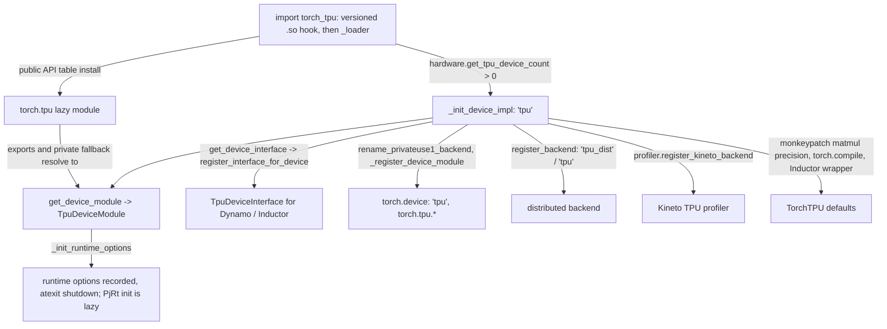

# Device backend registration and the torch.tpu device module

## Overview
`import torch_tpu` turns PyTorch's generic `PrivateUse1` slot into a device named `tpu`. The
loader (`_loader.py`) first installs the declarative public API table that builds `torch.tpu` and
its submodules as lazy `types.ModuleType` objects, then detects a TPU over PCI and, only if one is
present, runs the device initializer [`_init_device_impl`](https://github.com/google-pytorch/torch_tpu/blob/6d2a45754bdb52743883f75fbf753408345f6d1b/src/torch_tpu/_loader.py#L206 "src/torch_tpu/_loader#_init_device_impl"): it fetches the
Python device class with [`get_device_module`](https://github.com/google-pytorch/torch_tpu/blob/6d2a45754bdb52743883f75fbf753408345f6d1b/src/torch_tpu/_internal/device/_device_module.py#L1123 "src/torch_tpu/_internal/device/_device_module#get_device_module"), initializes runtime options
([`_init_runtime_options`](https://github.com/google-pytorch/torch_tpu/blob/6d2a45754bdb52743883f75fbf753408345f6d1b/src/torch_tpu/_internal/device/_device_module.py#L719 "src/torch_tpu/_internal/device/_device_module#_DeviceModule._init_runtime_options")), registers [`get_device_interface`](https://github.com/google-pytorch/torch_tpu/blob/6d2a45754bdb52743883f75fbf753408345f6d1b/src/torch_tpu/_internal/device/_device_module.py#L1151 "src/torch_tpu/_internal/device/_device_module#get_device_interface")'s class as the Dynamo device
interface, renames the backend, generates the `Tensor.is_tpu` / `.tpu()` conveniences, registers
the `tpu_dist` (and `tpu`) process group factory and the Kineto profiler backend, and
monkeypatches `torch.set_float32_matmul_precision` and `torch.compile` to route to TorchTPU. The
device class hierarchy ([`_DeviceModule`](https://github.com/google-pytorch/torch_tpu/blob/6d2a45754bdb52743883f75fbf753408345f6d1b/src/torch_tpu/_internal/device/_device_module.py#L365 "src/torch_tpu/_internal/device/_device_module#_DeviceModule") with its metaclass [`_DeviceModuleMeta`](https://github.com/google-pytorch/torch_tpu/blob/6d2a45754bdb52743883f75fbf753408345f6d1b/src/torch_tpu/_internal/device/_device_module.py#L271 "src/torch_tpu/_internal/device/_device_module#_DeviceModuleMeta"), the single
concrete [`TpuDeviceModule`](https://github.com/google-pytorch/torch_tpu/blob/6d2a45754bdb52743883f75fbf753408345f6d1b/src/torch_tpu/_internal/device/_device_module.py#L1006 "src/torch_tpu/_internal/device/_device_module#TpuDeviceModule"), and the Dynamo adapter [`TpuDeviceInterface`](https://github.com/google-pytorch/torch_tpu/blob/6d2a45754bdb52743883f75fbf753408345f6d1b/src/torch_tpu/_internal/device/_device_module.py#L1140 "src/torch_tpu/_internal/device/_device_module#TpuDeviceInterface")) is the "torch_tpu
device equivalent to functions in torch/cuda/__init__.py": device count and selection, streams and
events (mostly stubs, since XLA schedules by data dependency), RNG state, autocast support, and
TorchTPU-specific controls such as cache-only mode. Since the previous pin, `tpu` is the only
device (the `xla_cpu`/`xla_cuda` fallbacks are gone), and every `torch.tpu` API that has a
`torch.accelerator` equivalent is marked internal on recent PyTorch. The PjRt runtime itself stays
uninitialized until first use ([pjrt-client](pjrt-client.md)).

## Diagram

Legend:
- `IMP` - (concept) package import: the versioned native-glue import hook, then the loader module; distributed and profiler registration are covered in [distributed-launchers-and-spmd](distributed-launchers-and-spmd.md) and [profiler](profiler.md)
- `PUB` - (concept) the `torch.tpu` module built from the public API table (`public_api.py`), which serves attribute access from [`TpuDeviceModule`](https://github.com/google-pytorch/torch_tpu/blob/6d2a45754bdb52743883f75fbf753408345f6d1b/src/torch_tpu/_internal/device/_device_module.py#L1006 "src/torch_tpu/_internal/device/_device_module#TpuDeviceModule") and its [`__tt_api_stages__`](https://github.com/google-pytorch/torch_tpu/blob/6d2a45754bdb52743883f75fbf753408345f6d1b/src/torch_tpu/_internal/device/_device_module.py#L135 "src/torch_tpu/_internal/device/_device_module#__tt_api_stages__.__tt_api_stages__") map
- `INIT` - [`_init_device_impl`](https://github.com/google-pytorch/torch_tpu/blob/6d2a45754bdb52743883f75fbf753408345f6d1b/src/torch_tpu/_loader.py#L206 "src/torch_tpu/_loader#_init_device_impl")
- `DM` - [`get_device_module`](https://github.com/google-pytorch/torch_tpu/blob/6d2a45754bdb52743883f75fbf753408345f6d1b/src/torch_tpu/_internal/device/_device_module.py#L1123 "src/torch_tpu/_internal/device/_device_module#get_device_module") returning [`TpuDeviceModule`](https://github.com/google-pytorch/torch_tpu/blob/6d2a45754bdb52743883f75fbf753408345f6d1b/src/torch_tpu/_internal/device/_device_module.py#L1006 "src/torch_tpu/_internal/device/_device_module#TpuDeviceModule")
- `OPT` - [`_init_runtime_options`](https://github.com/google-pytorch/torch_tpu/blob/6d2a45754bdb52743883f75fbf753408345f6d1b/src/torch_tpu/_internal/device/_device_module.py#L719 "src/torch_tpu/_internal/device/_device_module#_DeviceModule._init_runtime_options") registering [`_shutdown_runtime`](https://github.com/google-pytorch/torch_tpu/blob/6d2a45754bdb52743883f75fbf753408345f6d1b/src/torch_tpu/_internal/device/_device_module.py#L971 "src/torch_tpu/_internal/device/_device_module#_DeviceModule._shutdown_runtime")
- `DI` - [`get_device_interface`](https://github.com/google-pytorch/torch_tpu/blob/6d2a45754bdb52743883f75fbf753408345f6d1b/src/torch_tpu/_internal/device/_device_module.py#L1151 "src/torch_tpu/_internal/device/_device_module#get_device_interface") returning [`TpuDeviceInterface`](https://github.com/google-pytorch/torch_tpu/blob/6d2a45754bdb52743883f75fbf753408345f6d1b/src/torch_tpu/_internal/device/_device_module.py#L1140 "src/torch_tpu/_internal/device/_device_module#TpuDeviceInterface")
- `REG` - (concept) PyTorch's PrivateUse1 rename and device-module registration
- `PG` - (concept) the distributed backend registration
- `PROF` - (concept) the Kineto profiler registration
- `MP` - (concept) the precision and compile monkeypatches

## Design rationale (why it's built this way)
- **Import must not touch the device.** The docstring of [`_init_device_impl`](https://github.com/google-pytorch/torch_tpu/blob/6d2a45754bdb52743883f75fbf753408345f6d1b/src/torch_tpu/_loader.py#L206 "src/torch_tpu/_loader#_init_device_impl") says the device
  "will be a lazy-initialized device, so InitializePjRt will not be called until an attribute is
  accessed", and advises eagerly accessing an attribute if initialization failures must be handled
  early. [`_init_runtime_options`](https://github.com/google-pytorch/torch_tpu/blob/6d2a45754bdb52743883f75fbf753408345f6d1b/src/torch_tpu/_internal/device/_device_module.py#L719 "src/torch_tpu/_internal/device/_device_module#_DeviceModule._init_runtime_options") only hands the device type to the native runtime (and registers
  an `atexit` shutdown once, tracked by [`_atexit_registered`](https://github.com/google-pytorch/torch_tpu/blob/6d2a45754bdb52743883f75fbf753408345f6d1b/src/torch_tpu/_internal/device/_device_module.py#L733 "src/torch_tpu/_internal/device/_device_module#_DeviceModule._atexit_registered")); [`is_initialized`](https://github.com/google-pytorch/torch_tpu/blob/6d2a45754bdb52743883f75fbf753408345f6d1b/src/torch_tpu/_internal/device/_device_module.py#L576 "src/torch_tpu/_internal/device/_device_module#_DeviceModule.is_initialized") and
  [`is_available`](https://github.com/google-pytorch/torch_tpu/blob/6d2a45754bdb52743883f75fbf753408345f6d1b/src/torch_tpu/_internal/device/_device_module.py#L526 "src/torch_tpu/_internal/device/_device_module#_DeviceModule.is_available") answer without initializing, and [`device_count`](https://github.com/google-pytorch/torch_tpu/blob/6d2a45754bdb52743883f75fbf753408345f6d1b/src/torch_tpu/_internal/device/_device_module.py#L779 "src/torch_tpu/_internal/device/_device_module#_DeviceModule.device_count") falls back to the PCI count
  from the hardware layer until the runtime is up.
- **`torch.tpu` is a real module built from one table.** The public API table is "the single
  source of truth for the `torch.tpu` public module hierarchy": it turns each entry into a
  `types.ModuleType` registered in `sys.modules`, resolving exports lazily from
  `torch_tpu._internal` "so `import torch` stays fast and internal imports never leak onto the
  public namespace". Exports point at attributes of [`TpuDeviceModule`](https://github.com/google-pytorch/torch_tpu/blob/6d2a45754bdb52743883f75fbf753408345f6d1b/src/torch_tpu/_internal/device/_device_module.py#L1006 "src/torch_tpu/_internal/device/_device_module#TpuDeviceModule"); properties such as
  [`allow_excess_precision`](https://github.com/google-pytorch/torch_tpu/blob/6d2a45754bdb52743883f75fbf753408345f6d1b/src/torch_tpu/_internal/device/_device_module.py#L283 "src/torch_tpu/_internal/device/_device_module#_DeviceModuleMeta.allow_excess_precision") and [`eager_mode`](https://github.com/google-pytorch/torch_tpu/blob/6d2a45754bdb52743883f75fbf753408345f6d1b/src/torch_tpu/_internal/device/_device_module.py#L329 "src/torch_tpu/_internal/device/_device_module#_DeviceModuleMeta.eager_mode") are defined on [`_DeviceModuleMeta`](https://github.com/google-pytorch/torch_tpu/blob/6d2a45754bdb52743883f75fbf753408345f6d1b/src/torch_tpu/_internal/device/_device_module.py#L271 "src/torch_tpu/_internal/device/_device_module#_DeviceModuleMeta") and installed
  as module-type properties so `torch.tpu.allow_excess_precision = True` runs the setter;
  single-underscore names (the cache controls and statistics) fall back to the class live.
  [`_public_module`](https://github.com/google-pytorch/torch_tpu/blob/6d2a45754bdb52743883f75fbf753408345f6d1b/src/torch_tpu/_internal/device/_device_module.py#L404 "src/torch_tpu/_internal/device/_device_module#_DeviceModule._public_module") ("Returns the public device module (`torch.tpu`) if registered, else `cls`")
  is how class methods reach that module, so state mutated through either path stays coherent.
- **Version-specific native glue.** The package bundles one thin `.so` per supported PyTorch ABI;
  an import hook installed by `torch_tpu/__init__.py` picks "the newest glue whose version is <="
  the installed PyTorch, and loads eagerly so an ABI-incompatible glue "fails loudly at import
  rather than" crashing later.
- **Register before PyTorch can clobber.** [`_init_device_impl`](https://github.com/google-pytorch/torch_tpu/blob/6d2a45754bdb52743883f75fbf753408345f6d1b/src/torch_tpu/_loader.py#L206 "src/torch_tpu/_loader#_init_device_impl") forces PyTorch's own
  device-interface table to initialize (upstream ships a TPU interface as of 2.13) *before*
  registering [`TpuDeviceInterface`](https://github.com/google-pytorch/torch_tpu/blob/6d2a45754bdb52743883f75fbf753408345f6d1b/src/torch_tpu/_internal/device/_device_module.py#L1140 "src/torch_tpu/_internal/device/_device_module#TpuDeviceInterface"), "that way if any code somehow manages to call
  `get_interface_for_device` before we're able to register our own DeviceInterface it won't
  clobber the one we register below"; the comment expects this to disappear once TorchTPU is an
  in-tree backend.
- **Dynamo SPIs live on the interface, not on `torch.tpu`.** [`TpuDeviceInterface`](https://github.com/google-pytorch/torch_tpu/blob/6d2a45754bdb52743883f75fbf753408345f6d1b/src/torch_tpu/_internal/device/_device_module.py#L1140 "src/torch_tpu/_internal/device/_device_module#TpuDeviceInterface") binds
  [`exchange_device`](https://github.com/google-pytorch/torch_tpu/blob/6d2a45754bdb52743883f75fbf753408345f6d1b/src/torch_tpu/_internal/device/_device_module.py#L1143 "src/torch_tpu/_internal/device/_device_module#TpuDeviceInterface.exchange_device"), [`maybe_exchange_device`](https://github.com/google-pytorch/torch_tpu/blob/6d2a45754bdb52743883f75fbf753408345f6d1b/src/torch_tpu/_internal/device/_device_module.py#L1148 "src/torch_tpu/_internal/device/_device_module#TpuDeviceInterface.maybe_exchange_device"), [`get_compute_capability`](https://github.com/google-pytorch/torch_tpu/blob/6d2a45754bdb52743883f75fbf753408345f6d1b/src/torch_tpu/_internal/device/_device_module.py#L1144 "src/torch_tpu/_internal/device/_device_module#TpuDeviceInterface.get_compute_capability"),
  [`get_multi_processor_count`](https://github.com/google-pytorch/torch_tpu/blob/6d2a45754bdb52743883f75fbf753408345f6d1b/src/torch_tpu/_internal/device/_device_module.py#L1145 "src/torch_tpu/_internal/device/_device_module#TpuDeviceInterface.get_multi_processor_count"), [`is_gpu`](https://github.com/google-pytorch/torch_tpu/blob/6d2a45754bdb52743883f75fbf753408345f6d1b/src/torch_tpu/_internal/device/_device_module.py#L1146 "src/torch_tpu/_internal/device/_device_module#TpuDeviceInterface.is_gpu") and [`is_triton_capable`](https://github.com/google-pytorch/torch_tpu/blob/6d2a45754bdb52743883f75fbf753408345f6d1b/src/torch_tpu/_internal/device/_device_module.py#L1147 "src/torch_tpu/_internal/device/_device_module#TpuDeviceInterface.is_triton_capable") to private class methods
  (for example [`_get_multi_processor_count`](https://github.com/google-pytorch/torch_tpu/blob/6d2a45754bdb52743883f75fbf753408345f6d1b/src/torch_tpu/_internal/device/_device_module.py#L561 "src/torch_tpu/_internal/device/_device_module#_DeviceModule._get_multi_processor_count"), which reads `multi_processor_count` from
  [`get_device_properties`](https://github.com/google-pytorch/torch_tpu/blob/6d2a45754bdb52743883f75fbf753408345f6d1b/src/torch_tpu/_internal/device/_device_module.py#L1035 "src/torch_tpu/_internal/device/_device_module#TpuDeviceModule.get_device_properties") and defaults to 1), so TorchDynamo and Inductor find what they need
  while those names are no longer public `torch.tpu` APIs.
- **Prefer `torch.accelerator`; keep `torch.tpu` honest.** APIs with a device-agnostic equivalent
  ([`device_count`](https://github.com/google-pytorch/torch_tpu/blob/6d2a45754bdb52743883f75fbf753408345f6d1b/src/torch_tpu/_internal/device/_device_module.py#L779 "src/torch_tpu/_internal/device/_device_module#_DeviceModule.device_count"), [`is_available`](https://github.com/google-pytorch/torch_tpu/blob/6d2a45754bdb52743883f75fbf753408345f6d1b/src/torch_tpu/_internal/device/_device_module.py#L526 "src/torch_tpu/_internal/device/_device_module#_DeviceModule.is_available"), [`synchronize`](https://github.com/google-pytorch/torch_tpu/blob/6d2a45754bdb52743883f75fbf753408345f6d1b/src/torch_tpu/_internal/device/_device_module.py#L762 "src/torch_tpu/_internal/device/_device_module#_DeviceModule.synchronize"), [`current_stream`](https://github.com/google-pytorch/torch_tpu/blob/6d2a45754bdb52743883f75fbf753408345f6d1b/src/torch_tpu/_internal/device/_device_module.py#L856 "src/torch_tpu/_internal/device/_device_module#_DeviceModule.current_stream"), [`get_rng_state`](https://github.com/google-pytorch/torch_tpu/blob/6d2a45754bdb52743883f75fbf753408345f6d1b/src/torch_tpu/_internal/device/_device_module.py#L680 "src/torch_tpu/_internal/device/_device_module#_DeviceModule.get_rng_state"), the
  [`_DeviceContext`](https://github.com/google-pytorch/torch_tpu/blob/6d2a45754bdb52743883f75fbf753408345f6d1b/src/torch_tpu/_internal/device/_device_module.py#L222 "src/torch_tpu/_internal/device/_device_module#_DeviceContext") behind `torch.tpu.device`, and others) are decorated with
  [`internal_or_experimental`](https://github.com/google-pytorch/torch_tpu/blob/6d2a45754bdb52743883f75fbf753408345f6d1b/src/torch_tpu/_internal/utils/annotations.py#L406 "src/torch_tpu/_internal/utils/annotations#internal_or_experimental"): experimental on older PyTorch, internal once
  [`get_torch_version`](https://github.com/google-pytorch/torch_tpu/blob/6d2a45754bdb52743883f75fbf753408345f6d1b/src/torch_tpu/_internal/device/_device_module.py#L39 "src/torch_tpu/_internal/device/_device_module#get_torch_version") reaches the version that ships the `torch.accelerator` API. An internal
  API called from outside the torch / torch_tpu packages raises a `RuntimeError` naming the
  preferred API, unless [`_STRICT_INTERNAL_DEVICE_APIS`](https://github.com/google-pytorch/torch_tpu/blob/6d2a45754bdb52743883f75fbf753408345f6d1b/src/torch_tpu/_internal/device/_device_module.py#L46 "src/torch_tpu/_internal/device/_device_module#_STRICT_INTERNAL_DEVICE_APIS._STRICT_INTERNAL_DEVICE_APIS") is relaxed by
  `TORCH_TPU_ALLOW_LEGACY_DEVICE_APIS=1`, in which case it warns once. The remaining TPU-specific
  APIs carry [`experimental`](https://github.com/google-pytorch/torch_tpu/blob/6d2a45754bdb52743883f75fbf753408345f6d1b/src/torch_tpu/_internal/utils/annotations.py#L339 "src/torch_tpu/_internal/utils/annotations#experimental") (one-time `UserWarning`).
- **The device module mirrors `torch.cuda`, honestly.** Device selection cannot actually switch
  devices: one process owns one TPU, so `torch.tpu.set_device` only validates the index and
  [`_exchange_device`](https://github.com/google-pytorch/torch_tpu/blob/6d2a45754bdb52743883f75fbf753408345f6d1b/src/torch_tpu/_internal/device/_device_module.py#L502 "src/torch_tpu/_internal/device/_device_module#_DeviceModule._exchange_device") / [`_maybe_exchange_device`](https://github.com/google-pytorch/torch_tpu/blob/6d2a45754bdb52743883f75fbf753408345f6d1b/src/torch_tpu/_internal/device/_device_module.py#L510 "src/torch_tpu/_internal/device/_device_module#_DeviceModule._maybe_exchange_device") return the previous index for
  [`__enter__`](https://github.com/google-pytorch/torch_tpu/blob/6d2a45754bdb52743883f75fbf753408345f6d1b/src/torch_tpu/_internal/device/_device_module.py#L237 "src/torch_tpu/_internal/device/_device_module#_DeviceContext.__enter__") / [`__exit__`](https://github.com/google-pytorch/torch_tpu/blob/6d2a45754bdb52743883f75fbf753408345f6d1b/src/torch_tpu/_internal/device/_device_module.py#L240 "src/torch_tpu/_internal/device/_device_module#_DeviceContext.__exit__") of [`_DeviceContext`](https://github.com/google-pytorch/torch_tpu/blob/6d2a45754bdb52743883f75fbf753408345f6d1b/src/torch_tpu/_internal/device/_device_module.py#L222 "src/torch_tpu/_internal/device/_device_module#_DeviceContext"). The streams module states the position on
  streams: they "are a CUDA concept with no clear analog in XLA", XLA schedules on data
  dependencies, and the stream class "implements dummy methods that are needed to enable PyTorch's
  Fully Sharded Data Parallel", leaving others unimplemented "to help identify new use cases".
- **Global PyTorch knobs are redirected, not duplicated.** `torch.set_float32_matmul_precision`
  is replaced so `medium`/`high`/`highest` map to the StableHLO precisions of
  [dtype-and-precision](dtype-and-precision.md) (and `get` reads them back); `torch.compile` is
  replaced with a wrapper that defaults to the TPU backend (and `dynamic=False` for TPU backends)
  until PyTorch offers an official override hook; `backend='inductor'` with TPU inputs raises
  unless the Pallas Inductor backend is requested. [`allow_excess_precision`](https://github.com/google-pytorch/torch_tpu/blob/6d2a45754bdb52743883f75fbf753408345f6d1b/src/torch_tpu/_internal/device/_device_module.py#L283 "src/torch_tpu/_internal/device/_device_module#_DeviceModuleMeta.allow_excess_precision") moved from the
  removed `torch.backends.tpu` onto `torch.tpu`.

> [!inferred]
> Onboarding checklist from this unit: replace `torch.cuda.*` calls with `torch.accelerator.*`
> where an equivalent exists (device count, synchronize, current device, streams), and with
> `torch.tpu.*` only for TPU-specific knobs (precision, eager mode, device properties); expect
> `torch.device("tpu")` and `tensor.tpu()` to exist after import, and know that the first tensor
> placement, not the import, is where a missing or misconfigured TPU surfaces.

## Entry points
- The loader's device initializer [`_init_device_impl`](https://github.com/google-pytorch/torch_tpu/blob/6d2a45754bdb52743883f75fbf753408345f6d1b/src/torch_tpu/_loader.py#L206 "src/torch_tpu/_loader#_init_device_impl"), reached once
  under a lock from `load()` (auto-invoked through PyTorch's backend autoload or an explicit
  import) when the hardware layer reports at least one TPU; it resolves the class through
  [`get_device_module`](https://github.com/google-pytorch/torch_tpu/blob/6d2a45754bdb52743883f75fbf753408345f6d1b/src/torch_tpu/_internal/device/_device_module.py#L1123 "src/torch_tpu/_internal/device/_device_module#get_device_module") and the Dynamo adapter through [`get_device_interface`](https://github.com/google-pytorch/torch_tpu/blob/6d2a45754bdb52743883f75fbf753408345f6d1b/src/torch_tpu/_internal/device/_device_module.py#L1151 "src/torch_tpu/_internal/device/_device_module#get_device_interface").
- [`get_device_module`](https://github.com/google-pytorch/torch_tpu/blob/6d2a45754bdb52743883f75fbf753408345f6d1b/src/torch_tpu/_internal/device/_device_module.py#L1123 "src/torch_tpu/_internal/device/_device_module#get_device_module") and [`get_device_interface`](https://github.com/google-pytorch/torch_tpu/blob/6d2a45754bdb52743883f75fbf753408345f6d1b/src/torch_tpu/_internal/device/_device_module.py#L1151 "src/torch_tpu/_internal/device/_device_module#get_device_interface"): map `"tpu"` to [`TpuDeviceModule`](https://github.com/google-pytorch/torch_tpu/blob/6d2a45754bdb52743883f75fbf753408345f6d1b/src/torch_tpu/_internal/device/_device_module.py#L1006 "src/torch_tpu/_internal/device/_device_module#TpuDeviceModule") /
  [`TpuDeviceInterface`](https://github.com/google-pytorch/torch_tpu/blob/6d2a45754bdb52743883f75fbf753408345f6d1b/src/torch_tpu/_internal/device/_device_module.py#L1140 "src/torch_tpu/_internal/device/_device_module#TpuDeviceInterface"); any other device type raises `ValueError` ("only 'tpu' is supported").
- [`_init_runtime_options`](https://github.com/google-pytorch/torch_tpu/blob/6d2a45754bdb52743883f75fbf753408345f6d1b/src/torch_tpu/_internal/device/_device_module.py#L719 "src/torch_tpu/_internal/device/_device_module#_DeviceModule._init_runtime_options"): also re-entered lazily, for example by
  [`_get_local_device_attributes`](https://github.com/google-pytorch/torch_tpu/blob/6d2a45754bdb52743883f75fbf753408345f6d1b/src/torch_tpu/_internal/device/_device_module.py#L665 "src/torch_tpu/_internal/device/_device_module#_DeviceModule._get_local_device_attributes") ("Returns attributes of the local PJRT device, initializing
  options if needed").
- `torch.tpu.*`: [`device_count`](https://github.com/google-pytorch/torch_tpu/blob/6d2a45754bdb52743883f75fbf753408345f6d1b/src/torch_tpu/_internal/device/_device_module.py#L779 "src/torch_tpu/_internal/device/_device_module#_DeviceModule.device_count"), [`is_available`](https://github.com/google-pytorch/torch_tpu/blob/6d2a45754bdb52743883f75fbf753408345f6d1b/src/torch_tpu/_internal/device/_device_module.py#L526 "src/torch_tpu/_internal/device/_device_module#_DeviceModule.is_available"), [`is_initialized`](https://github.com/google-pytorch/torch_tpu/blob/6d2a45754bdb52743883f75fbf753408345f6d1b/src/torch_tpu/_internal/device/_device_module.py#L576 "src/torch_tpu/_internal/device/_device_module#_DeviceModule.is_initialized"), [`synchronize`](https://github.com/google-pytorch/torch_tpu/blob/6d2a45754bdb52743883f75fbf753408345f6d1b/src/torch_tpu/_internal/device/_device_module.py#L762 "src/torch_tpu/_internal/device/_device_module#_DeviceModule.synchronize"),
  [`current_stream`](https://github.com/google-pytorch/torch_tpu/blob/6d2a45754bdb52743883f75fbf753408345f6d1b/src/torch_tpu/_internal/device/_device_module.py#L856 "src/torch_tpu/_internal/device/_device_module#_DeviceModule.current_stream"), [`manual_seed`](https://github.com/google-pytorch/torch_tpu/blob/6d2a45754bdb52743883f75fbf753408345f6d1b/src/torch_tpu/_internal/device/_device_module.py#L608 "src/torch_tpu/_internal/device/_device_module#_DeviceModule.manual_seed"), [`manual_seed_all`](https://github.com/google-pytorch/torch_tpu/blob/6d2a45754bdb52743883f75fbf753408345f6d1b/src/torch_tpu/_internal/device/_device_module.py#L627 "src/torch_tpu/_internal/device/_device_module#_DeviceModule.manual_seed_all"), [`get_rng_state`](https://github.com/google-pytorch/torch_tpu/blob/6d2a45754bdb52743883f75fbf753408345f6d1b/src/torch_tpu/_internal/device/_device_module.py#L680 "src/torch_tpu/_internal/device/_device_module#_DeviceModule.get_rng_state"),
  [`get_device_properties`](https://github.com/google-pytorch/torch_tpu/blob/6d2a45754bdb52743883f75fbf753408345f6d1b/src/torch_tpu/_internal/device/_device_module.py#L1035 "src/torch_tpu/_internal/device/_device_module#TpuDeviceModule.get_device_properties"), [`allow_excess_precision`](https://github.com/google-pytorch/torch_tpu/blob/6d2a45754bdb52743883f75fbf753408345f6d1b/src/torch_tpu/_internal/device/_device_module.py#L283 "src/torch_tpu/_internal/device/_device_module#_DeviceModuleMeta.allow_excess_precision"), [`eager_mode`](https://github.com/google-pytorch/torch_tpu/blob/6d2a45754bdb52743883f75fbf753408345f6d1b/src/torch_tpu/_internal/device/_device_module.py#L329 "src/torch_tpu/_internal/device/_device_module#_DeviceModuleMeta.eager_mode"), the deprecated
  [`topology_aware_mesh`](https://github.com/google-pytorch/torch_tpu/blob/6d2a45754bdb52743883f75fbf753408345f6d1b/src/torch_tpu/_internal/device/_device_module.py#L1090 "src/torch_tpu/_internal/device/_device_module#TpuDeviceModule.topology_aware_mesh") alias, and the private [`_shutdown_runtime`](https://github.com/google-pytorch/torch_tpu/blob/6d2a45754bdb52743883f75fbf753408345f6d1b/src/torch_tpu/_internal/device/_device_module.py#L971 "src/torch_tpu/_internal/device/_device_module#_DeviceModule._shutdown_runtime").
- PyTorch's PrivateUse1 hooks: [`_lazy_init`](https://github.com/google-pytorch/torch_tpu/blob/6d2a45754bdb52743883f75fbf753408345f6d1b/src/torch_tpu/_internal/device/_device_module.py#L588 "src/torch_tpu/_internal/device/_device_module#_DeviceModule._lazy_init") ("Initialization method to satisfy PyTorch's
  PrivateUse1 requirements") and the autocast accessors [`_is_autocast_enabled`](https://github.com/google-pytorch/torch_tpu/blob/6d2a45754bdb52743883f75fbf753408345f6d1b/src/torch_tpu/_internal/device/_device_module.py#L900 "src/torch_tpu/_internal/device/_device_module#_DeviceModule._is_autocast_enabled"),
  [`_get_autocast_dtype`](https://github.com/google-pytorch/torch_tpu/blob/6d2a45754bdb52743883f75fbf753408345f6d1b/src/torch_tpu/_internal/device/_device_module.py#L904 "src/torch_tpu/_internal/device/_device_module#_DeviceModule._get_autocast_dtype"), [`_set_autocast_enabled`](https://github.com/google-pytorch/torch_tpu/blob/6d2a45754bdb52743883f75fbf753408345f6d1b/src/torch_tpu/_internal/device/_device_module.py#L908 "src/torch_tpu/_internal/device/_device_module#_DeviceModule._set_autocast_enabled"), [`_set_autocast_dtype`](https://github.com/google-pytorch/torch_tpu/blob/6d2a45754bdb52743883f75fbf753408345f6d1b/src/torch_tpu/_internal/device/_device_module.py#L915 "src/torch_tpu/_internal/device/_device_module#_DeviceModule._set_autocast_dtype").

## Mechanism (step-by-step)
1. **Load glue and build the namespace.** Importing the package installs the versioned native
   glue hook, then the loader disables backend autoload while it imports `torch` (to break the
   import cycle), installs the public API table so `torch.tpu` exists as a lazy module whose
   exports resolve to [`TpuDeviceModule`](https://github.com/google-pytorch/torch_tpu/blob/6d2a45754bdb52743883f75fbf753408345f6d1b/src/torch_tpu/_internal/device/_device_module.py#L1006 "src/torch_tpu/_internal/device/_device_module#TpuDeviceModule") attributes, and enables Dynamo RNN tracing. Nothing here
   touches the TPU.
2. **Detect and initialize.** `load()` restores the autoload variable and asks the hardware layer
   ([hardware-introspection](hardware-introspection.md)) for the TPU count; with zero TPUs nothing
   else is registered. Otherwise [`_init_device_impl`](https://github.com/google-pytorch/torch_tpu/blob/6d2a45754bdb52743883f75fbf753408345f6d1b/src/torch_tpu/_loader.py#L206 "src/torch_tpu/_loader#_init_device_impl") imports the compile and sync packages for
   their registration side effects, calls [`get_device_module`](https://github.com/google-pytorch/torch_tpu/blob/6d2a45754bdb52743883f75fbf753408345f6d1b/src/torch_tpu/_internal/device/_device_module.py#L1123 "src/torch_tpu/_internal/device/_device_module#get_device_module") and [`_init_runtime_options`](https://github.com/google-pytorch/torch_tpu/blob/6d2a45754bdb52743883f75fbf753408345f6d1b/src/torch_tpu/_internal/device/_device_module.py#L719 "src/torch_tpu/_internal/device/_device_module#_DeviceModule._init_runtime_options")
   (which refuses to run in a forked child and registers [`_shutdown_runtime`](https://github.com/google-pytorch/torch_tpu/blob/6d2a45754bdb52743883f75fbf753408345f6d1b/src/torch_tpu/_internal/device/_device_module.py#L971 "src/torch_tpu/_internal/device/_device_module#_DeviceModule._shutdown_runtime") at exit), then
   registers the [`TpuDeviceInterface`](https://github.com/google-pytorch/torch_tpu/blob/6d2a45754bdb52743883f75fbf753408345f6d1b/src/torch_tpu/_internal/device/_device_module.py#L1140 "src/torch_tpu/_internal/device/_device_module#TpuDeviceInterface") from [`get_device_interface`](https://github.com/google-pytorch/torch_tpu/blob/6d2a45754bdb52743883f75fbf753408345f6d1b/src/torch_tpu/_internal/device/_device_module.py#L1151 "src/torch_tpu/_internal/device/_device_module#get_device_interface").
3. **Bind the backend.** The same function renames PrivateUse1 to `tpu`, generates the
   `is_tpu` / `.tpu()` methods, and registers the public `torch.tpu` module from `sys.modules` as the PyTorch device module so
   `torch.tpu` resolves; then registers the `tpu_dist` and `tpu` distributed backends (plus
   torchcomms), the Kineto profiler, the libtpu version, the DTensor `from_local` and max-pool
   patches, and the precision and compile monkeypatches. [`_init_device_impl`](https://github.com/google-pytorch/torch_tpu/blob/6d2a45754bdb52743883f75fbf753408345f6d1b/src/torch_tpu/_loader.py#L206 "src/torch_tpu/_loader#_init_device_impl") is memoized and the
   flag check runs under a lock, so repeated loads are no-ops.
4. **Serve device calls.** [`device_count`](https://github.com/google-pytorch/torch_tpu/blob/6d2a45754bdb52743883f75fbf753408345f6d1b/src/torch_tpu/_internal/device/_device_module.py#L779 "src/torch_tpu/_internal/device/_device_module#_DeviceModule.device_count") caches [`_device_count`](https://github.com/google-pytorch/torch_tpu/blob/6d2a45754bdb52743883f75fbf753408345f6d1b/src/torch_tpu/_internal/device/_device_module.py#L383 "src/torch_tpu/_internal/device/_device_module#_DeviceModule._device_count") once the runtime is
   initialized (before that it returns the PCI count without caching); [`is_available`](https://github.com/google-pytorch/torch_tpu/blob/6d2a45754bdb52743883f75fbf753408345f6d1b/src/torch_tpu/_internal/device/_device_module.py#L526 "src/torch_tpu/_internal/device/_device_module#_DeviceModule.is_available") is
   `device_count() > 0`; [`current_stream`](https://github.com/google-pytorch/torch_tpu/blob/6d2a45754bdb52743883f75fbf753408345f6d1b/src/torch_tpu/_internal/device/_device_module.py#L856 "src/torch_tpu/_internal/device/_device_module#_DeviceModule.current_stream") wraps the native current stream id in a stream object;
   [`synchronize`](https://github.com/google-pytorch/torch_tpu/blob/6d2a45754bdb52743883f75fbf753408345f6d1b/src/torch_tpu/_internal/device/_device_module.py#L762 "src/torch_tpu/_internal/device/_device_module#_DeviceModule.synchronize") delegates to the streams module ([synchronization](synchronization.md));
   [`get_rng_state`](https://github.com/google-pytorch/torch_tpu/blob/6d2a45754bdb52743883f75fbf753408345f6d1b/src/torch_tpu/_internal/device/_device_module.py#L680 "src/torch_tpu/_internal/device/_device_module#_DeviceModule.get_rng_state") validates that the requested device is this process's TPU before reading the
   generator state; and the `default_generators` attribute is a descriptor ([`__get__`](https://github.com/google-pytorch/torch_tpu/blob/6d2a45754bdb52743883f75fbf753408345f6d1b/src/torch_tpu/_internal/device/_device_module.py#L98 "src/torch_tpu/_internal/device/_device_module#_DefaultGeneratorsProperty.__get__")) that
   caches one generator per device. [`manual_seed`](https://github.com/google-pytorch/torch_tpu/blob/6d2a45754bdb52743883f75fbf753408345f6d1b/src/torch_tpu/_internal/device/_device_module.py#L608 "src/torch_tpu/_internal/device/_device_module#_DeviceModule.manual_seed") and [`manual_seed_all`](https://github.com/google-pytorch/torch_tpu/blob/6d2a45754bdb52743883f75fbf753408345f6d1b/src/torch_tpu/_internal/device/_device_module.py#L627 "src/torch_tpu/_internal/device/_device_module#_DeviceModule.manual_seed_all") are no-ops without a
   TPU but raise if TPU initialization fails. Access to staged attributes goes through the
   metaclass, which consults [`__tt_api_stages__`](https://github.com/google-pytorch/torch_tpu/blob/6d2a45754bdb52743883f75fbf753408345f6d1b/src/torch_tpu/_internal/device/_device_module.py#L135 "src/torch_tpu/_internal/device/_device_module#__tt_api_stages__.__tt_api_stages__") (for `default_generators`,
   [`EagerMode`](https://github.com/google-pytorch/torch_tpu/blob/6d2a45754bdb52743883f75fbf753408345f6d1b/src/torch_tpu/_internal/execution_mode/__init__.py#L30 "src/torch_tpu/_internal/execution_mode/__init__#EagerMode"), `Precision`) and emits the stage warning on first external access.

## Key data structures
- [`TpuDeviceModule`](https://github.com/google-pytorch/torch_tpu/blob/6d2a45754bdb52743883f75fbf753408345f6d1b/src/torch_tpu/_internal/device/_device_module.py#L1006 "src/torch_tpu/_internal/device/_device_module#TpuDeviceModule"): the concrete class, `_device_type = "tpu"` ([`_device_type`](https://github.com/google-pytorch/torch_tpu/blob/6d2a45754bdb52743883f75fbf753408345f6d1b/src/torch_tpu/_internal/device/_device_module.py#L387 "src/torch_tpu/_internal/device/_device_module#_DeviceModule._device_type")); the abstract
  [`_DeviceModule`](https://github.com/google-pytorch/torch_tpu/blob/6d2a45754bdb52743883f75fbf753408345f6d1b/src/torch_tpu/_internal/device/_device_module.py#L365 "src/torch_tpu/_internal/device/_device_module#_DeviceModule") rejects subclasses that do not define it.
- [`__tt_api_stages__`](https://github.com/google-pytorch/torch_tpu/blob/6d2a45754bdb52743883f75fbf753408345f6d1b/src/torch_tpu/_internal/device/_device_module.py#L135 "src/torch_tpu/_internal/device/_device_module#__tt_api_stages__.__tt_api_stages__"): attribute name to stage metadata for attributes that
  are values rather than methods; [`_TpuDeviceProperties`](https://github.com/google-pytorch/torch_tpu/blob/6d2a45754bdb52743883f75fbf753408345f6d1b/src/torch_tpu/_internal/device/_device_module.py#L983 "src/torch_tpu/_internal/device/_device_module#_TpuDeviceProperties") carries its own
  [`__tt_api_stages__`](https://github.com/google-pytorch/torch_tpu/blob/6d2a45754bdb52743883f75fbf753408345f6d1b/src/torch_tpu/_internal/device/_device_module.py#L998 "src/torch_tpu/_internal/device/_device_module#_TpuDeviceProperties.__tt_api_stages__") for `multi_processor_count`.
- [`_TpuDeviceProperties`](https://github.com/google-pytorch/torch_tpu/blob/6d2a45754bdb52743883f75fbf753408345f6d1b/src/torch_tpu/_internal/device/_device_module.py#L983 "src/torch_tpu/_internal/device/_device_module#_TpuDeviceProperties"): "Static TPU device properties, analog of _CudaDeviceProperties"; a
  frozen dataclass of `name`, `total_memory` (HBM per device, from the hardware layer) and
  `multi_processor_count` (default 1). Peak FLOP/s "is intentionally absent".
- Autocast state: class attributes read by [`_is_autocast_enabled`](https://github.com/google-pytorch/torch_tpu/blob/6d2a45754bdb52743883f75fbf753408345f6d1b/src/torch_tpu/_internal/device/_device_module.py#L900 "src/torch_tpu/_internal/device/_device_module#_DeviceModule._is_autocast_enabled") / [`_get_autocast_dtype`](https://github.com/google-pytorch/torch_tpu/blob/6d2a45754bdb52743883f75fbf753408345f6d1b/src/torch_tpu/_internal/device/_device_module.py#L904 "src/torch_tpu/_internal/device/_device_module#_DeviceModule._get_autocast_dtype")
  (default bfloat16); [`_set_autocast_dtype`](https://github.com/google-pytorch/torch_tpu/blob/6d2a45754bdb52743883f75fbf753408345f6d1b/src/torch_tpu/_internal/device/_device_module.py#L915 "src/torch_tpu/_internal/device/_device_module#_DeviceModule._set_autocast_dtype") rejects dtypes outside the AMP-supported list
  (bfloat16, float16, float32, float64, complex, fp8 variants, integer types, bool).
- [`_STRICT_INTERNAL_DEVICE_APIS`](https://github.com/google-pytorch/torch_tpu/blob/6d2a45754bdb52743883f75fbf753408345f6d1b/src/torch_tpu/_internal/device/_device_module.py#L46 "src/torch_tpu/_internal/device/_device_module#_STRICT_INTERNAL_DEVICE_APIS._STRICT_INTERNAL_DEVICE_APIS"): read once at import from `TORCH_TPU_ALLOW_LEGACY_DEVICE_APIS`.

## Dynamics (design intent)
- Initialization is idempotent and cached: the device initializer is memoized and guarded by a
  lock, and a device already registered is reused.
- RNG state accessors validate the device index so multi-process code cannot read or seed another
  process's device by mistake.
- Shutdown at exit runs a `torch.distributed` barrier first when a process group is initialized,
  so ranks do not tear down the runtime while peers still communicate.
- `annotations_test` covers the warning behavior on the real module:
  [`test_annotated_real_api_enum_class_precision`](https://github.com/google-pytorch/torch_tpu/blob/6d2a45754bdb52743883f75fbf753408345f6d1b/src/torch_tpu/_internal/utils/annotations_test.py#L470 "src/torch_tpu/_internal/utils/annotations_test#AnnotationsTest.test_annotated_real_api_enum_class_precision") ("Precision Enum class emits UserWarning on 1st
  access and no additional warnings on 2nd access") and [`test_stage_warning_from_user_getattr`](https://github.com/google-pytorch/torch_tpu/blob/6d2a45754bdb52743883f75fbf753408345f6d1b/src/torch_tpu/_internal/utils/annotations_test.py#L506 "src/torch_tpu/_internal/utils/annotations_test#AnnotationsTest.test_stage_warning_from_user_getattr")
  (the warning points at the user's line even through a user `__getattr__`).

## Edge cases
- Without a TPU, `load()` registers nothing and `torch.device("tpu")` is unavailable; there is no
  longer an XLA CPU/GPU fallback device.
- Calling an internal `torch.tpu` API (for example `torch.tpu.device_count()` on PyTorch >= 2.11)
  from user code raises `RuntimeError` pointing at the `torch.accelerator` equivalent; set
  `TORCH_TPU_ALLOW_LEGACY_DEVICE_APIS=1` to downgrade it to a one-time warning. The caller check is
  skipped while TorchDynamo traces.
- `torch.tpu.set_device` to a different index raises: changing the active TPU within a process is not
  supported.
- Using the TPU in a `fork()`ed child raises from [`_lazy_init`](https://github.com/google-pytorch/torch_tpu/blob/6d2a45754bdb52743883f75fbf753408345f6d1b/src/torch_tpu/_internal/device/_device_module.py#L588 "src/torch_tpu/_internal/device/_device_module#_DeviceModule._lazy_init") and [`_init_runtime_options`](https://github.com/google-pytorch/torch_tpu/blob/6d2a45754bdb52743883f75fbf753408345f6d1b/src/torch_tpu/_internal/device/_device_module.py#L719 "src/torch_tpu/_internal/device/_device_module#_DeviceModule._init_runtime_options"),
  directing the user to the `spawn` start method; [`is_initialized`](https://github.com/google-pytorch/torch_tpu/blob/6d2a45754bdb52743883f75fbf753408345f6d1b/src/torch_tpu/_internal/device/_device_module.py#L576 "src/torch_tpu/_internal/device/_device_module#_DeviceModule.is_initialized") reports `False` there.
- [`get_device_properties`](https://github.com/google-pytorch/torch_tpu/blob/6d2a45754bdb52743883f75fbf753408345f6d1b/src/torch_tpu/_internal/device/_device_module.py#L1035 "src/torch_tpu/_internal/device/_device_module#TpuDeviceModule.get_device_properties") raises for an unrecognized TPU generation because HBM size is unknown.
- [`topology_aware_mesh`](https://github.com/google-pytorch/torch_tpu/blob/6d2a45754bdb52743883f75fbf753408345f6d1b/src/torch_tpu/_internal/device/_device_module.py#L1090 "src/torch_tpu/_internal/device/_device_module#TpuDeviceModule.topology_aware_mesh") on `torch.tpu` is deprecated (0.2.0) in favor of
  `torch.tpu.distributed.topology_aware_mesh`.

## Open questions
- The in-tree backend onboarding mentioned in the loader comments would move the device module
  upstream and change several of these registration steps.
- The stream context manager returned by `torch.tpu.stream` is documented in source as currently
  non-functional; it is not in this packet's subgraph, so its future semantics are unsettled here.

## See also
- [pjrt-client](pjrt-client.md): the runtime these options initialize.
- [synchronization](synchronization.md): stream and device synchronization semantics.
- [dtype-and-precision](dtype-and-precision.md): the precision monkeypatch targets and `allow_excess_precision`.
- [torch-compile-backend](torch-compile-backend.md): the `torch.compile` default backend.
- [distributed-launchers-and-spmd](distributed-launchers-and-spmd.md) and [profiler](profiler.md): the sibling registrations.
- [hardware-introspection](hardware-introspection.md): TPU detection and device properties used here.

## Recent changes
- `376128b5e` builds "`torch.tpu` and its submodules as lazy modules from one public API table";
  previously `torch.tpu` was the `TpuDeviceModule` class placed directly in `sys.modules`.
- `49a74e48c` adds `@internal_or_experimental` and makes "torch.tpu APIs with torch.accelerator
  equivalents internal"; `c3b084ea4` adds `TORCH_TPU_ALLOW_LEGACY_DEVICE_APIS` to relax that to a
  warning, and `7ba9f7078` does the same for `torch.tpu.device`.
- `b558f7f18`, `7fdac75ff` and `71a59f484` move the Dynamo SPIs (`get_compute_capability`,
  `get_multi_processor_count`, `is_triton_capable`) onto `TpuDeviceInterface`; `1d3ced53b` moves
  `allow_excess_precision` from `torch.backends.tpu` to `torch.tpu` and removes `torch.backends.tpu`.
- `8dd503745` fails fast on TPU use in forked subprocesses via PyTorch's native fork handler;
  `ab07e7f14` surfaces TPU initialization errors from seeding instead of leaving devices unseeded.
- `b52a6b7de` moves `topology_aware_mesh` to `torch.tpu.distributed`, leaving a deprecated alias.
- [all changes in 6d2a45754b](../changes/6d2a45754b.md)
