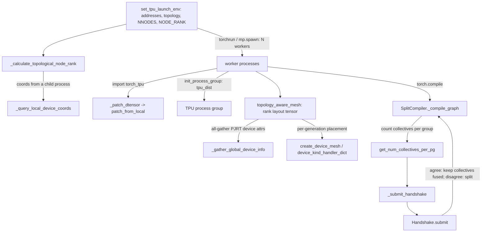
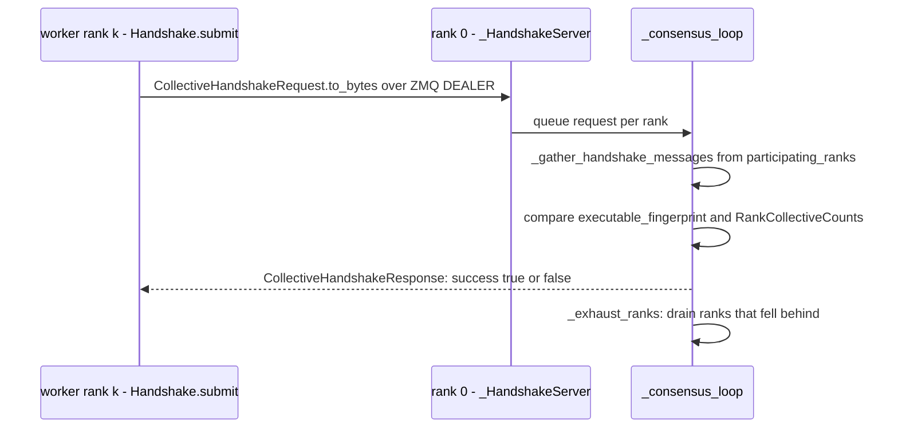

# Distributed launch environment, topology-aware meshes, spmd_safe and the collective handshake

## Overview
Distributed TorchTPU is launched like any PyTorch job (one process per chip via torchrun,
`torch.multiprocessing.spawn` or another launcher) plus a few TPU-specific variables that every
rank must agree on and that therefore have to be decided in the *parent* process before workers
spawn: `TORCH_TPU_SLICEBUILDER_ADDRESSES` ("one `host:port` per rank, same list on all"),
`TORCH_TPU_TOPOLOGY` ("physical mesh, e.g. 2,2,1") and `TORCH_TPU_XPROF_SESSION_ID`. A single
function, [`set_tpu_launch_env`](https://github.com/google-pytorch/torch_tpu/blob/6d2a45754bdb52743883f75fbf753408345f6d1b/src/torch_tpu/_internal/distributed/distributed.py#L328 "src/torch_tpu/_internal/distributed/distributed#set_tpu_launch_env"), now owns that step for both single-host and multi-host jobs; it "only mutates
`os.environ` and then gets out of the way", so it composes with any launcher. Inside the workers,
`import torch_tpu` registers the `tpu_dist` backend (see [process-group-and-collectives](process-group-and-collectives.md))
and patches `DTensor.from_local` ([`_patch_dtensor`](https://github.com/google-pytorch/torch_tpu/blob/6d2a45754bdb52743883f75fbf753408345f6d1b/src/torch_tpu/_loader.py#L192 "src/torch_tpu/_loader#_patch_dtensor")). On top of the group sit two mechanisms this subsystem
owns: [`topology_aware_mesh`](https://github.com/google-pytorch/torch_tpu/blob/6d2a45754bdb52743883f75fbf753408345f6d1b/src/torch_tpu/_internal/distributed/device_mesh.py#L224 "src/torch_tpu/_internal/distributed/device_mesh#topology_aware_mesh"), which turns the launcher's arbitrary rank numbering into a mesh whose logical
neighbours are physical ICI neighbours, and the collective-fusion policy: by default each
collective is isolated in its own graph so ranks that fuse differently cannot deadlock, and either
the user (`spmd_safe`) or a runtime consensus protocol ([`submit`](https://github.com/google-pytorch/torch_tpu/blob/6d2a45754bdb52743883f75fbf753408345f6d1b/src/torch_tpu/_internal/distributed/handshake.py#L1528 "src/torch_tpu/_internal/distributed/handshake#Handshake.submit")) can lift that isolation.

## Diagram

Legend:
- `SET` - [`set_tpu_launch_env`](https://github.com/google-pytorch/torch_tpu/blob/6d2a45754bdb52743883f75fbf753408345f6d1b/src/torch_tpu/_internal/distributed/distributed.py#L328 "src/torch_tpu/_internal/distributed/distributed#set_tpu_launch_env")
- `NR` - [`_calculate_topological_node_rank`](https://github.com/google-pytorch/torch_tpu/blob/6d2a45754bdb52743883f75fbf753408345f6d1b/src/torch_tpu/_internal/distributed/distributed.py#L191 "src/torch_tpu/_internal/distributed/distributed#_calculate_topological_node_rank")
- `QC` - [`_query_local_device_coords`](https://github.com/google-pytorch/torch_tpu/blob/6d2a45754bdb52743883f75fbf753408345f6d1b/src/torch_tpu/_internal/distributed/distributed.py#L265 "src/torch_tpu/_internal/distributed/distributed#_query_local_device_coords")
- `W` - (concept) the worker processes a launcher spawns, one per chip
- `PD` - [`_patch_dtensor`](https://github.com/google-pytorch/torch_tpu/blob/6d2a45754bdb52743883f75fbf753408345f6d1b/src/torch_tpu/_loader.py#L192 "src/torch_tpu/_loader#_patch_dtensor"), [`patch_from_local`](https://github.com/google-pytorch/torch_tpu/blob/6d2a45754bdb52743883f75fbf753408345f6d1b/src/torch_tpu/_internal/distributed/from_local.py#L74 "src/torch_tpu/_internal/distributed/from_local#patch_from_local")
- `PG` - (concept) the `tpu_dist` process group of [process-group-and-collectives](process-group-and-collectives.md), also wrapped by [`_pg`](https://github.com/google-pytorch/torch_tpu/blob/6d2a45754bdb52743883f75fbf753408345f6d1b/src/torch_tpu/_internal/distributed/torchcomm_tpu.py#L161 "src/torch_tpu/_internal/distributed/torchcomm_tpu#TorchCommsTPU._pg")
- `TAM` - [`topology_aware_mesh`](https://github.com/google-pytorch/torch_tpu/blob/6d2a45754bdb52743883f75fbf753408345f6d1b/src/torch_tpu/_internal/distributed/device_mesh.py#L224 "src/torch_tpu/_internal/distributed/device_mesh#topology_aware_mesh")
- `GG` - [`_gather_global_device_info`](https://github.com/google-pytorch/torch_tpu/blob/6d2a45754bdb52743883f75fbf753408345f6d1b/src/torch_tpu/_internal/distributed/device_mesh.py#L69 "src/torch_tpu/_internal/distributed/device_mesh#_gather_global_device_info")
- `CDM` - [`create_device_mesh`](https://github.com/google-pytorch/torch_tpu/blob/6d2a45754bdb52743883f75fbf753408345f6d1b/src/torch_tpu/_internal/distributed/device_utils.py#L785 "src/torch_tpu/_internal/distributed/device_utils#create_device_mesh"), [`device_kind_handler_dict`](https://github.com/google-pytorch/torch_tpu/blob/6d2a45754bdb52743883f75fbf753408345f6d1b/src/torch_tpu/_internal/distributed/device_utils.py#L233 "src/torch_tpu/_internal/distributed/device_utils#device_kind_handler_dict.device_kind_handler_dict")
- `CG` - [`_compile_graph`](https://github.com/google-pytorch/torch_tpu/blob/6d2a45754bdb52743883f75fbf753408345f6d1b/src/torch_tpu/_internal/compile/split_compiler.py#L608 "src/torch_tpu/_internal/compile/split_compiler#SplitCompiler._compile_graph")
- `GNC` - [`get_num_collectives_per_pg`](https://github.com/google-pytorch/torch_tpu/blob/6d2a45754bdb52743883f75fbf753408345f6d1b/src/torch_tpu/_internal/distributed/process_group_utils.py#L178 "src/torch_tpu/_internal/distributed/process_group_utils#get_num_collectives_per_pg")
- `SH` - [`_submit_handshake`](https://github.com/google-pytorch/torch_tpu/blob/6d2a45754bdb52743883f75fbf753408345f6d1b/src/torch_tpu/_internal/compile/split_compiler.py#L71 "src/torch_tpu/_internal/compile/split_compiler#_submit_handshake")
- `SUB` - [`submit`](https://github.com/google-pytorch/torch_tpu/blob/6d2a45754bdb52743883f75fbf753408345f6d1b/src/torch_tpu/_internal/distributed/handshake.py#L1528 "src/torch_tpu/_internal/distributed/handshake#Handshake.submit")

Legend:
- `K` - [`submit`](https://github.com/google-pytorch/torch_tpu/blob/6d2a45754bdb52743883f75fbf753408345f6d1b/src/torch_tpu/_internal/distributed/handshake.py#L1528 "src/torch_tpu/_internal/distributed/handshake#Handshake.submit") on a client rank ([`__new__`](https://github.com/google-pytorch/torch_tpu/blob/6d2a45754bdb52743883f75fbf753408345f6d1b/src/torch_tpu/_internal/distributed/handshake.py#L1395 "src/torch_tpu/_internal/distributed/handshake#_HandshakeClient.__new__"), [`send`](https://github.com/google-pytorch/torch_tpu/blob/6d2a45754bdb52743883f75fbf753408345f6d1b/src/torch_tpu/_internal/distributed/handshake.py#L1350 "src/torch_tpu/_internal/distributed/handshake#_ZMQClient.send"), [`recv`](https://github.com/google-pytorch/torch_tpu/blob/6d2a45754bdb52743883f75fbf753408345f6d1b/src/torch_tpu/_internal/distributed/handshake.py#L1355 "src/torch_tpu/_internal/distributed/handshake#_ZMQClient.recv"))
- `S` - [`__new__`](https://github.com/google-pytorch/torch_tpu/blob/6d2a45754bdb52743883f75fbf753408345f6d1b/src/torch_tpu/_internal/distributed/handshake.py#L1000 "src/torch_tpu/_internal/distributed/handshake#_HandshakeServer.__new__") with [`recv_request`](https://github.com/google-pytorch/torch_tpu/blob/6d2a45754bdb52743883f75fbf753408345f6d1b/src/torch_tpu/_internal/distributed/handshake.py#L916 "src/torch_tpu/_internal/distributed/handshake#_ZMQServer.recv_request")
- `C` - [`_consensus_loop`](https://github.com/google-pytorch/torch_tpu/blob/6d2a45754bdb52743883f75fbf753408345f6d1b/src/torch_tpu/_internal/distributed/handshake.py#L1205 "src/torch_tpu/_internal/distributed/handshake#_HandshakeServer._consensus_loop"), [`_gather_handshake_messages`](https://github.com/google-pytorch/torch_tpu/blob/6d2a45754bdb52743883f75fbf753408345f6d1b/src/torch_tpu/_internal/distributed/handshake.py#L1147 "src/torch_tpu/_internal/distributed/handshake#_HandshakeServer._gather_handshake_messages"), [`_exhaust_ranks`](https://github.com/google-pytorch/torch_tpu/blob/6d2a45754bdb52743883f75fbf753408345f6d1b/src/torch_tpu/_internal/distributed/handshake.py#L1165 "src/torch_tpu/_internal/distributed/handshake#_HandshakeServer._exhaust_ranks")

## Design rationale (why it's built this way)
- **One launch function, any launcher.** The module docstring explains the split of
  responsibilities: "Nothing upstream populates these, so TorchTPU has to own the step. What it
  does *not* need to own is spawning". [`set_tpu_launch_env`](https://github.com/google-pytorch/torch_tpu/blob/6d2a45754bdb52743883f75fbf753408345f6d1b/src/torch_tpu/_internal/distributed/distributed.py#L328 "src/torch_tpu/_internal/distributed/distributed#set_tpu_launch_env") is idempotent and "never overwrites a variable
  that is already set, so an operator can pin any of them from the outside". Single-host and
  multi-host "differ only in where the addresses come from, so they are one function rather than
  two modules": on one host the addresses are `localhost:<unused port>` per device and the
  topology is auto-detected (honouring a smaller `nproc_per_node`); on several hosts they are
  `<host>:<TORCH_TPU_BASE_PORT + i>` for every host in `TPU_WORKER_HOSTNAMES`, and the PyTorch
  rendezvous variables (`NNODES`, `NODE_RANK`, `MASTER_ADDR`, `MASTER_PORT`) are filled in too.
  It also assigns a shared `TORCH_TPU_XPROF_SESSION_ID` so all workers' profiles group together.
- **Count the hostnames, do not just test for them.** `TPU_WORKER_HOSTNAMES` is ambient: "A
  single-host TPU VM sets it to one name ... so treating its mere presence as multi-host would
  put a single-host job on the rendezvous path and hang it". Multi-host is chosen only when there
  are two or more hostnames, `nnodes > 1`, or `JOB_COMPLETION_INDEX` is set.
- **Topological NODE_RANK, measured out of process.** [`_calculate_topological_node_rank`](https://github.com/google-pytorch/torch_tpu/blob/6d2a45754bdb52743883f75fbf753408345f6d1b/src/torch_tpu/_internal/distributed/distributed.py#L191 "src/torch_tpu/_internal/distributed/distributed#_calculate_topological_node_rank") maps this host's chip
  coordinates to host coordinates (assuming 2x2x1 chips per host) and ranks hosts Z-major,
  X-minor, "match[ing] the JAX `mesh_utils` device coordinate ordering, so that node ranks are
  deterministic and topologically contiguous". Only an externally supplied `TORCH_TPU_TOPOLOGY`
  describes the whole slice, so the auto-detected host-local one "is never used to rank hosts".
  The coordinates come from [`_query_local_device_coords`](https://github.com/google-pytorch/torch_tpu/blob/6d2a45754bdb52743883f75fbf753408345f6d1b/src/torch_tpu/_internal/distributed/distributed.py#L265 "src/torch_tpu/_internal/distributed/distributed#_query_local_device_coords"), which runs a short-lived child process because "querying them
  initializes the PJRT client, which would otherwise hold on to the TPU devices in this process
  and keep the workers it spawns from claiming them".
- **Rank numbering is not topology.** The device-mesh module starts from the premise that
  "Launchers may assign global rank ids with no topology input, so we need to assume that the
  rank -> chip mapping is arbitrary." [`topology_aware_mesh`](https://github.com/google-pytorch/torch_tpu/blob/6d2a45754bdb52743883f75fbf753408345f6d1b/src/torch_tpu/_internal/distributed/device_mesh.py#L224 "src/torch_tpu/_internal/distributed/device_mesh#topology_aware_mesh") therefore all-gathers every rank's PJRT device
  ([`_gather_global_device_info`](https://github.com/google-pytorch/torch_tpu/blob/6d2a45754bdb52743883f75fbf753408345f6d1b/src/torch_tpu/_internal/distributed/device_mesh.py#L69 "src/torch_tpu/_internal/distributed/device_mesh#_gather_global_device_info")), feeds those stubs to a port of JAX's mesh builder ([`create_device_mesh`](https://github.com/google-pytorch/torch_tpu/blob/6d2a45754bdb52743883f75fbf753408345f6d1b/src/torch_tpu/_internal/distributed/device_utils.py#L785 "src/torch_tpu/_internal/distributed/device_utils#create_device_mesh"), which first tries a
  per-generation placement handler from [`device_kind_handler_dict`](https://github.com/google-pytorch/torch_tpu/blob/6d2a45754bdb52743883f75fbf753408345f6d1b/src/torch_tpu/_internal/distributed/device_utils.py#L233 "src/torch_tpu/_internal/distributed/device_utils#device_kind_handler_dict.device_kind_handler_dict") such as [`_v5e_create_device_mesh`](https://github.com/google-pytorch/torch_tpu/blob/6d2a45754bdb52743883f75fbf753408345f6d1b/src/torch_tpu/_internal/distributed/device_utils.py#L115 "src/torch_tpu/_internal/distributed/device_utils#_v5e_create_device_mesh"), then the generic torus
  assignment over [`_get_physical_tpu_mesh`](https://github.com/google-pytorch/torch_tpu/blob/6d2a45754bdb52743883f75fbf753408345f6d1b/src/torch_tpu/_internal/distributed/device_utils.py#L664 "src/torch_tpu/_internal/distributed/device_utils#_get_physical_tpu_mesh")), and maps the arranged devices back to torch ranks. Every rank derives
  the same layout from the same gathered payload, "satisfying DeviceMesh's requirement that the
  mesh tensor is identical on all ranks".
- **Multi-slice: pay DCN on the least chatty axis, never fall through.** `mesh_shape` follows the
  JAX convention (highest-traffic axis last) and always describes the whole job. When devices
  report more than one `slice_index`, the mesh is split across slices on the outermost
  non-trivial axis; if that axis is not divisible the call refuses rather than splitting an inner
  (shard) axis "across the slower inter-slice network". [`_validate_multi_slice`](https://github.com/google-pytorch/torch_tpu/blob/6d2a45754bdb52743883f75fbf753408345f6d1b/src/torch_tpu/_internal/distributed/device_mesh.py#L151 "src/torch_tpu/_internal/distributed/device_mesh#_validate_multi_slice") then checks that
  `dcn_mesh_shape` covers exactly the observed slices and that every slice contributes the same
  number of devices.
- **Collectives are isolated by default; fusion needs proof.** In the authors' words (the
  `spmd_safe` docstring): "By default, TorchTPU runs each eager collective ... in an execution
  graph of its own, separate from the surrounding operations, so that ranks that fuse different
  operations around a collective cannot deadlock." The compile path mirrors this:
  [`_compile_graph`](https://github.com/google-pytorch/torch_tpu/blob/6d2a45754bdb52743883f75fbf753408345f6d1b/src/torch_tpu/_internal/compile/split_compiler.py#L608 "src/torch_tpu/_internal/compile/split_compiler#SplitCompiler._compile_graph") cuts a new partition before and after every node [`is_collective_op`](https://github.com/google-pytorch/torch_tpu/blob/6d2a45754bdb52743883f75fbf753408345f6d1b/src/torch_tpu/_internal/distributed/collective_ops.py#L46 "src/torch_tpu/_internal/distributed/collective_ops#is_collective_op") recognises, unless the node
  carries the `spmd_safe` annotation or materialization was switched off. Fusion is then
  re-enabled either by the user's promise (`torch.tpu.distributed.spmd_safe`, for functions that
  "issue the same TPU operations, including collectives, in the same order and with the same
  shapes on all ranks") or by the SPMD handshake, which checks that promise at run time.
- **The handshake verifies the SPMD promise cheaply.** With `TORCH_TPU_SPMD_HANDSHAKE_STAGE` set,
  each rank sends a [`CollectiveHandshakeRequest`](https://github.com/google-pytorch/torch_tpu/blob/6d2a45754bdb52743883f75fbf753408345f6d1b/src/torch_tpu/_internal/distributed/handshake.py#L375 "src/torch_tpu/_internal/distributed/handshake#CollectiveHandshakeRequest") carrying its executable fingerprint and its running per-group
  collective counts ([`RankCollectiveCounts`](https://github.com/google-pytorch/torch_tpu/blob/6d2a45754bdb52743883f75fbf753408345f6d1b/src/torch_tpu/_internal/distributed/handshake.py#L144 "src/torch_tpu/_internal/distributed/handshake#RankCollectiveCounts")); rank 0 answers `success` only if every participating rank sent the
  same fingerprint and the same counts. A shared coordinator over ZMQ (rather than a collective
  on the device) keeps the check off the very TPU collectives whose safety is in question.
- **DTensor guardrail rather than DTensor rules.** [`from_local`](https://github.com/google-pytorch/torch_tpu/blob/6d2a45754bdb52743883f75fbf753408345f6d1b/src/torch_tpu/_internal/distributed/from_local.py#L43 "src/torch_tpu/_internal/distributed/from_local#from_local") wraps `DTensor.from_local` to warn,
  with the [`CORRECTNESS`](https://github.com/google-pytorch/torch_tpu/blob/6d2a45754bdb52743883f75fbf753408345f6d1b/src/torch_tpu/_internal/warnings.py#L112 "src/torch_tpu/_internal/warnings#CORRECTNESS.CORRECTNESS") category, when global `shape` and `stride` are omitted, because "Unevenly
  sharded tensors across ranks may cause collectives to hang or error out", and turns on
  `run_check` in debug eager mode.

> [!inferred]
> A working recipe from the source and the distributed tutorial: on one host, either call
> `torch.tpu.distributed.set_tpu_launch_env()` before `torch.multiprocessing.spawn`, or export the
> variables printed by `python -m torch.tpu.distributed` and launch
> `torchrun --nproc_per_node=$WORLD_SIZE script.py`; on several hosts set `TPU_WORKER_HOSTNAMES`
> (and `JOB_COMPLETION_INDEX` on Kubernetes Indexed Jobs) first. In the workers call
> `init_process_group(backend="tpu_dist")`, build meshes as
> `DeviceMesh("tpu", mesh=torch.tpu.distributed.topology_aware_mesh(shape))`, and either wrap
> rank-identical steps in `@torch.tpu.distributed.spmd_safe` or set
> `TORCH_TPU_SPMD_HANDSHAKE_STAGE` so compiled graphs keep their collectives fused when all ranks
> agree.

## Entry points
- [`set_tpu_launch_env`](https://github.com/google-pytorch/torch_tpu/blob/6d2a45754bdb52743883f75fbf753408345f6d1b/src/torch_tpu/_internal/distributed/distributed.py#L328 "src/torch_tpu/_internal/distributed/distributed#set_tpu_launch_env"): the public `torch.tpu.distributed.set_tpu_launch_env(nnodes=, nproc_per_node=)`,
  called once in the parent process before any launcher. Running the module with `python -m`
  calls it and prints `TORCH_TPU_TOPOLOGY`, `TORCH_TPU_SLICEBUILDER_ADDRESSES`,
  `TORCH_TPU_XPROF_SESSION_ID`, `WORLD_SIZE`, `NODE_RANK` (always, so launch scripts can pass
  `--node_rank` on single-host too) and any rendezvous variables for shell use.
- [`topology_aware_mesh`](https://github.com/google-pytorch/torch_tpu/blob/6d2a45754bdb52743883f75fbf753408345f6d1b/src/torch_tpu/_internal/distributed/device_mesh.py#L224 "src/torch_tpu/_internal/distributed/device_mesh#topology_aware_mesh"): the public `torch.tpu.distributed.topology_aware_mesh`; returns an int64 tensor of
  global ranks shaped `mesh_shape` for `DeviceMesh(device_type, mesh=...)`. Requires an
  initialized process group. The older [`topology_aware_mesh`](https://github.com/google-pytorch/torch_tpu/blob/6d2a45754bdb52743883f75fbf753408345f6d1b/src/torch_tpu/_internal/device/_device_module.py#L1090 "src/torch_tpu/_internal/device/_device_module#TpuDeviceModule.topology_aware_mesh") on the device module is a deprecated alias
  (deprecated in 0.2.0).
- [`_compile_graph`](https://github.com/google-pytorch/torch_tpu/blob/6d2a45754bdb52743883f75fbf753408345f6d1b/src/torch_tpu/_internal/compile/split_compiler.py#L608 "src/torch_tpu/_internal/compile/split_compiler#SplitCompiler._compile_graph") and [`_submit_handshake`](https://github.com/google-pytorch/torch_tpu/blob/6d2a45754bdb52743883f75fbf753408345f6d1b/src/torch_tpu/_internal/compile/split_compiler.py#L71 "src/torch_tpu/_internal/compile/split_compiler#_submit_handshake"): where the split compiler enters this subsystem, via [`get_num_collectives_per_pg`](https://github.com/google-pytorch/torch_tpu/blob/6d2a45754bdb52743883f75fbf753408345f6d1b/src/torch_tpu/_internal/distributed/process_group_utils.py#L178 "src/torch_tpu/_internal/distributed/process_group_utils#get_num_collectives_per_pg") to count
  collectives per group and [`submit`](https://github.com/google-pytorch/torch_tpu/blob/6d2a45754bdb52743883f75fbf753408345f6d1b/src/torch_tpu/_internal/distributed/handshake.py#L1528 "src/torch_tpu/_internal/distributed/handshake#Handshake.submit") to run the consensus round.
- [`_patch_dtensor`](https://github.com/google-pytorch/torch_tpu/blob/6d2a45754bdb52743883f75fbf753408345f6d1b/src/torch_tpu/_loader.py#L192 "src/torch_tpu/_loader#_patch_dtensor"): the loader hook that calls [`patch_from_local`](https://github.com/google-pytorch/torch_tpu/blob/6d2a45754bdb52743883f75fbf753408345f6d1b/src/torch_tpu/_internal/distributed/from_local.py#L74 "src/torch_tpu/_internal/distributed/from_local#patch_from_local") at import, replacing `DTensor.from_local` with
  [`from_local`](https://github.com/google-pytorch/torch_tpu/blob/6d2a45754bdb52743883f75fbf753408345f6d1b/src/torch_tpu/_internal/distributed/from_local.py#L43 "src/torch_tpu/_internal/distributed/from_local#from_local").
- [`is_collective_op`](https://github.com/google-pytorch/torch_tpu/blob/6d2a45754bdb52743883f75fbf753408345f6d1b/src/torch_tpu/_internal/distributed/collective_ops.py#L46 "src/torch_tpu/_internal/distributed/collective_ops#is_collective_op"): the collective registry consulted by the split compiler and by FX passes such as
  [`_is_collective_or_wait`](https://github.com/google-pytorch/torch_tpu/blob/6d2a45754bdb52743883f75fbf753408345f6d1b/src/torch_tpu/_internal/compile/fx_passes/force_collectives_output.py#L23 "src/torch_tpu/_internal/compile/fx_passes/force_collectives_output#_is_collective_or_wait"); it recognises the `_c10d_functional` collectives and the TorchTPU
  `tpu::_all_gather_dim` / `tpu::_reduce_scatter_dim` ops.

## Mechanism (step-by-step)
1. **Prepare the environment.** [`set_tpu_launch_env`](https://github.com/google-pytorch/torch_tpu/blob/6d2a45754bdb52743883f75fbf753408345f6d1b/src/torch_tpu/_internal/distributed/distributed.py#L328 "src/torch_tpu/_internal/distributed/distributed#set_tpu_launch_env") parses absl flags for spawned workers, sets the XPROF
   session id if absent, decides single- versus multi-host from the hostname count, then fills
   each unset variable lazily: slice-builder addresses, topology, and on multi-host `NNODES`,
   `NODE_RANK` (from [`_calculate_topological_node_rank`](https://github.com/google-pytorch/torch_tpu/blob/6d2a45754bdb52743883f75fbf753408345f6d1b/src/torch_tpu/_internal/distributed/distributed.py#L191 "src/torch_tpu/_internal/distributed/distributed#_calculate_topological_node_rank") using coordinates from [`_query_local_device_coords`](https://github.com/google-pytorch/torch_tpu/blob/6d2a45754bdb52743883f75fbf753408345f6d1b/src/torch_tpu/_internal/distributed/distributed.py#L265 "src/torch_tpu/_internal/distributed/distributed#_query_local_device_coords") when an external topology is present,
   else `JOB_COMPLETION_INDEX`), `MASTER_ADDR` (first hostname) and `MASTER_PORT` (29500).
2. **Spawn and join the group.** The launcher starts one process per chip with `RANK`,
   `LOCAL_RANK` and `WORLD_SIZE`; each imports `torch_tpu`, which registers `tpu_dist` (and the
   torchcomms adapter whose communicator holds the group in [`_pg`](https://github.com/google-pytorch/torch_tpu/blob/6d2a45754bdb52743883f75fbf753408345f6d1b/src/torch_tpu/_internal/distributed/torchcomm_tpu.py#L161 "src/torch_tpu/_internal/distributed/torchcomm_tpu#TorchCommsTPU._pg")), patches `from_local` via
   [`_patch_dtensor`](https://github.com/google-pytorch/torch_tpu/blob/6d2a45754bdb52743883f75fbf753408345f6d1b/src/torch_tpu/_loader.py#L192 "src/torch_tpu/_loader#_patch_dtensor"), and lazily initializes PjRt from the variables ([pjrt-client](pjrt-client.md)).
3. **Lay out the mesh.** [`topology_aware_mesh`](https://github.com/google-pytorch/torch_tpu/blob/6d2a45754bdb52743883f75fbf753408345f6d1b/src/torch_tpu/_internal/distributed/device_mesh.py#L224 "src/torch_tpu/_internal/distributed/device_mesh#topology_aware_mesh") gathers device stubs with [`_gather_global_device_info`](https://github.com/google-pytorch/torch_tpu/blob/6d2a45754bdb52743883f75fbf753408345f6d1b/src/torch_tpu/_internal/distributed/device_mesh.py#L69 "src/torch_tpu/_internal/distributed/device_mesh#_gather_global_device_info"), rejects duplicate PJRT ids
   and ranks that disagree on whether they report a `slice_index`, sorts devices by id (the
   order JAX's handlers expect), and calls [`create_device_mesh`](https://github.com/google-pytorch/torch_tpu/blob/6d2a45754bdb52743883f75fbf753408345f6d1b/src/torch_tpu/_internal/distributed/device_utils.py#L785 "src/torch_tpu/_internal/distributed/device_utils#create_device_mesh") for one slice or the hybrid builder after
   [`_validate_multi_slice`](https://github.com/google-pytorch/torch_tpu/blob/6d2a45754bdb52743883f75fbf753408345f6d1b/src/torch_tpu/_internal/distributed/device_mesh.py#L151 "src/torch_tpu/_internal/distributed/device_mesh#_validate_multi_slice") for several; the arranged devices are translated back to the torch ranks driving them.
4. **Decide whether to handshake.** When the handshake stage is not `OFF`, [`_compile_graph`](https://github.com/google-pytorch/torch_tpu/blob/6d2a45754bdb52743883f75fbf753408345f6d1b/src/torch_tpu/_internal/compile/split_compiler.py#L608 "src/torch_tpu/_internal/compile/split_compiler#SplitCompiler._compile_graph")'s caller counts
   collectives per process group with [`get_num_collectives_per_pg`](https://github.com/google-pytorch/torch_tpu/blob/6d2a45754bdb52743883f75fbf753408345f6d1b/src/torch_tpu/_internal/distributed/process_group_utils.py#L178 "src/torch_tpu/_internal/distributed/process_group_utils#get_num_collectives_per_pg"); each collective node's group is resolved by
   [`_extract_process_group_id_from_node`](https://github.com/google-pytorch/torch_tpu/blob/6d2a45754bdb52743883f75fbf753408345f6d1b/src/torch_tpu/_internal/distributed/process_group_utils.py#L106 "src/torch_tpu/_internal/distributed/process_group_utils#_extract_process_group_id_from_node") into a sorted [`ProcessGroupId`](https://github.com/google-pytorch/torch_tpu/blob/6d2a45754bdb52743883f75fbf753408345f6d1b/src/torch_tpu/_internal/distributed/process_group_utils.py#L25 "src/torch_tpu/_internal/distributed/process_group_utils#ProcessGroupId"). A handshake is attempted only when the graph has collectives
   and they all target the global group, and is skipped when
   `TORCH_TPU_INTERNAL_MATERIALIZE_COLLECTIVE_TENSORS` is false.
5. **Run a consensus round.** [`_submit_handshake`](https://github.com/google-pytorch/torch_tpu/blob/6d2a45754bdb52743883f75fbf753408345f6d1b/src/torch_tpu/_internal/compile/split_compiler.py#L71 "src/torch_tpu/_internal/compile/split_compiler#_submit_handshake") advances the process-wide [`RankCollectiveCounts`](https://github.com/google-pytorch/torch_tpu/blob/6d2a45754bdb52743883f75fbf753408345f6d1b/src/torch_tpu/_internal/distributed/handshake.py#L144 "src/torch_tpu/_internal/distributed/handshake#RankCollectiveCounts") with
   [`increment_pg_collective_counts`](https://github.com/google-pytorch/torch_tpu/blob/6d2a45754bdb52743883f75fbf753408345f6d1b/src/torch_tpu/_internal/distributed/handshake.py#L194 "src/torch_tpu/_internal/distributed/handshake#RankCollectiveCounts.increment_pg_collective_counts") (groups absent from this graph advance by zero), builds a [`CollectiveHandshakeRequest`](https://github.com/google-pytorch/torch_tpu/blob/6d2a45754bdb52743883f75fbf753408345f6d1b/src/torch_tpu/_internal/distributed/handshake.py#L375 "src/torch_tpu/_internal/distributed/handshake#CollectiveHandshakeRequest") and calls
   [`submit`](https://github.com/google-pytorch/torch_tpu/blob/6d2a45754bdb52743883f75fbf753408345f6d1b/src/torch_tpu/_internal/distributed/handshake.py#L1528 "src/torch_tpu/_internal/distributed/handshake#Handshake.submit"). `Handshake` picks its [`_backend`](https://github.com/google-pytorch/torch_tpu/blob/6d2a45754bdb52743883f75fbf753408345f6d1b/src/torch_tpu/_internal/distributed/handshake.py#L1512 "src/torch_tpu/_internal/distributed/handshake#Handshake._backend") by role: rank 0 gets the singleton server
   ([`__new__`](https://github.com/google-pytorch/torch_tpu/blob/6d2a45754bdb52743883f75fbf753408345f6d1b/src/torch_tpu/_internal/distributed/handshake.py#L1000 "src/torch_tpu/_internal/distributed/handshake#_HandshakeServer.__new__")), whose [`send`](https://github.com/google-pytorch/torch_tpu/blob/6d2a45754bdb52743883f75fbf753408345f6d1b/src/torch_tpu/_internal/distributed/handshake.py#L1095 "src/torch_tpu/_internal/distributed/handshake#_HandshakeServer.send") enqueues its own request locally and whose [`recv`](https://github.com/google-pytorch/torch_tpu/blob/6d2a45754bdb52743883f75fbf753408345f6d1b/src/torch_tpu/_internal/distributed/handshake.py#L1109 "src/torch_tpu/_internal/distributed/handshake#_HandshakeServer.recv") waits on a
   local reply queue; other ranks get a singleton client ([`__new__`](https://github.com/google-pytorch/torch_tpu/blob/6d2a45754bdb52743883f75fbf753408345f6d1b/src/torch_tpu/_internal/distributed/handshake.py#L1395 "src/torch_tpu/_internal/distributed/handshake#_HandshakeClient.__new__")) that sends
   [`to_bytes`](https://github.com/google-pytorch/torch_tpu/blob/6d2a45754bdb52743883f75fbf753408345f6d1b/src/torch_tpu/_internal/distributed/handshake.py#L425 "src/torch_tpu/_internal/distributed/handshake#CollectiveHandshakeRequest.to_bytes") bytes over a DEALER socket ([`_socket`](https://github.com/google-pytorch/torch_tpu/blob/6d2a45754bdb52743883f75fbf753408345f6d1b/src/torch_tpu/_internal/distributed/handshake.py#L1325 "src/torch_tpu/_internal/distributed/handshake#_ZMQClient._socket")) to the coordinator's ROUTER socket
   ([`_socket`](https://github.com/google-pytorch/torch_tpu/blob/6d2a45754bdb52743883f75fbf753408345f6d1b/src/torch_tpu/_internal/distributed/handshake.py#L897 "src/torch_tpu/_internal/distributed/handshake#_ZMQServer._socket")).
6. **Reach consensus and catch up stragglers.** On the coordinator's background loop,
   [`recv_request`](https://github.com/google-pytorch/torch_tpu/blob/6d2a45754bdb52743883f75fbf753408345f6d1b/src/torch_tpu/_internal/distributed/handshake.py#L916 "src/torch_tpu/_internal/distributed/handshake#_ZMQServer.recv_request") decodes each request ([`from_bytes`](https://github.com/google-pytorch/torch_tpu/blob/6d2a45754bdb52743883f75fbf753408345f6d1b/src/torch_tpu/_internal/distributed/handshake.py#L443 "src/torch_tpu/_internal/distributed/handshake#CollectiveHandshakeRequest.from_bytes")) into a per-rank queue; [`_consensus_loop`](https://github.com/google-pytorch/torch_tpu/blob/6d2a45754bdb52743883f75fbf753408345f6d1b/src/torch_tpu/_internal/distributed/handshake.py#L1205 "src/torch_tpu/_internal/distributed/handshake#_HandshakeServer._consensus_loop") takes the first
   request, uses its [`participating_ranks`](https://github.com/google-pytorch/torch_tpu/blob/6d2a45754bdb52743883f75fbf753408345f6d1b/src/torch_tpu/_internal/distributed/handshake.py#L417 "src/torch_tpu/_internal/distributed/handshake#CollectiveHandshakeRequest.participating_ranks") to wait for the rest ([`_gather_handshake_messages`](https://github.com/google-pytorch/torch_tpu/blob/6d2a45754bdb52743883f75fbf753408345f6d1b/src/torch_tpu/_internal/distributed/handshake.py#L1147 "src/torch_tpu/_internal/distributed/handshake#_HandshakeServer._gather_handshake_messages")), and replies success only if
   fingerprints and counts all match, answering remote ranks before the local one. It then runs
   [`_exhaust_ranks`](https://github.com/google-pytorch/torch_tpu/blob/6d2a45754bdb52743883f75fbf753408345f6d1b/src/torch_tpu/_internal/distributed/handshake.py#L1165 "src/torch_tpu/_internal/distributed/handshake#_HandshakeServer._exhaust_ranks"): any rank whose global-group count is below the round's maximum has its queued
   requests answered `False` until it catches up.
7. **Act on the answer.** In `COMPILE_STAGE` the fingerprint is a hash of the graph code, taken
   before compilation, and a match means [`_compile_graph`](https://github.com/google-pytorch/torch_tpu/blob/6d2a45754bdb52743883f75fbf753408345f6d1b/src/torch_tpu/_internal/compile/split_compiler.py#L608 "src/torch_tpu/_internal/compile/split_compiler#SplitCompiler._compile_graph") compiles without splitting at collectives; a
   mismatch compiles the split graph. In `DISPATCH_STAGE` the graph is first compiled unsplit and
   the handshake runs on the executable fingerprint when the executable is called; a mismatch
   recompiles with collectives split and swaps the executable in place.

## Key data structures
- The environment contract: `TORCH_TPU_SLICEBUILDER_ADDRESSES` (comma-separated `host:port`, one
  per rank), `TORCH_TPU_TOPOLOGY` (`X,Y,Z[,core]` or `XxYxZ`), `TORCH_TPU_XPROF_SESSION_ID`,
  plus on multi-host `NNODES`, `NODE_RANK`, `MASTER_ADDR`, `MASTER_PORT`; inputs
  `TPU_WORKER_HOSTNAMES`, `JOB_COMPLETION_INDEX`, `TORCH_TPU_BASE_PORT` (default 8070) and
  `TORCH_TPU_DEVICES_PER_HOST` (default the local device count, else 8).
- The rank layout tensor returned by [`topology_aware_mesh`](https://github.com/google-pytorch/torch_tpu/blob/6d2a45754bdb52743883f75fbf753408345f6d1b/src/torch_tpu/_internal/distributed/device_mesh.py#L224 "src/torch_tpu/_internal/distributed/device_mesh#topology_aware_mesh"): an int64 tensor of global ranks in logical-mesh
  shape, identical on every rank.
- [`ProcessGroupId`](https://github.com/google-pytorch/torch_tpu/blob/6d2a45754bdb52743883f75fbf753408345f6d1b/src/torch_tpu/_internal/distributed/process_group_utils.py#L25 "src/torch_tpu/_internal/distributed/process_group_utils#ProcessGroupId") (re-exported as [`ProcessGroupId`](https://github.com/google-pytorch/torch_tpu/blob/6d2a45754bdb52743883f75fbf753408345f6d1b/src/torch_tpu/_internal/distributed/handshake.py#L141 "src/torch_tpu/_internal/distributed/handshake#ProcessGroupId")): a validated, sorted, duplicate-free tuple of ranks, hashed
  and compared by ranks only, used as the key for per-group collective counts.
- [`RankCollectiveCounts`](https://github.com/google-pytorch/torch_tpu/blob/6d2a45754bdb52743883f75fbf753408345f6d1b/src/torch_tpu/_internal/distributed/handshake.py#L144 "src/torch_tpu/_internal/distributed/handshake#RankCollectiveCounts"): per-rank map [`_pg_to_count`](https://github.com/google-pytorch/torch_tpu/blob/6d2a45754bdb52743883f75fbf753408345f6d1b/src/torch_tpu/_internal/distributed/handshake.py#L160 "src/torch_tpu/_internal/distributed/handshake#RankCollectiveCounts._pg_to_count") from group to a count pair: `collective_count_before` (all
  collectives this rank has run on that group) and `num_collectives_in_graph` (collectives in the
  current graph). [`_increment_pg_collective_count`](https://github.com/google-pytorch/torch_tpu/blob/6d2a45754bdb52743883f75fbf753408345f6d1b/src/torch_tpu/_internal/distributed/handshake.py#L165 "src/torch_tpu/_internal/distributed/handshake#RankCollectiveCounts._increment_pg_collective_count") inserts new groups and [`increment_num_collectives_in_graph`](https://github.com/google-pytorch/torch_tpu/blob/6d2a45754bdb52743883f75fbf753408345f6d1b/src/torch_tpu/_internal/distributed/handshake.py#L109 "src/torch_tpu/_internal/distributed/handshake#ProcessGroupCollectiveCount.increment_num_collectives_in_graph") rolls the current graph's count into
  the history. Serialized to JSON and back with [`from_json`](https://github.com/google-pytorch/torch_tpu/blob/6d2a45754bdb52743883f75fbf753408345f6d1b/src/torch_tpu/_internal/distributed/handshake.py#L243 "src/torch_tpu/_internal/distributed/handshake#RankCollectiveCounts.from_json").
- [`CollectiveHandshakeRequest`](https://github.com/google-pytorch/torch_tpu/blob/6d2a45754bdb52743883f75fbf753408345f6d1b/src/torch_tpu/_internal/distributed/handshake.py#L375 "src/torch_tpu/_internal/distributed/handshake#CollectiveHandshakeRequest"): fingerprint, counts and sender [`rank`](https://github.com/google-pytorch/torch_tpu/blob/6d2a45754bdb52743883f75fbf753408345f6d1b/src/torch_tpu/_internal/distributed/handshake.py#L399 "src/torch_tpu/_internal/distributed/handshake#CollectiveHandshakeRequest.rank"); its [`participating_ranks`](https://github.com/google-pytorch/torch_tpu/blob/6d2a45754bdb52743883f75fbf753408345f6d1b/src/torch_tpu/_internal/distributed/handshake.py#L417 "src/torch_tpu/_internal/distributed/handshake#CollectiveHandshakeRequest.participating_ranks") is the union of all group ranks
  and must contain the sender. Its JSON wire format "is not guaranteed to be stable across
  different versions of TorchTPU". [`CollectiveHandshakeResponse`](https://github.com/google-pytorch/torch_tpu/blob/6d2a45754bdb52743883f75fbf753408345f6d1b/src/torch_tpu/_internal/distributed/handshake.py#L470 "src/torch_tpu/_internal/distributed/handshake#CollectiveHandshakeResponse") is a single byte (`0x01` or `0x00`); the server-side
  envelope keeps the ZMQ routing id next to the decoded [`request`](https://github.com/google-pytorch/torch_tpu/blob/6d2a45754bdb52743883f75fbf753408345f6d1b/src/torch_tpu/_internal/distributed/handshake.py#L559 "src/torch_tpu/_internal/distributed/handshake#_CollectiveHandshakeRequestZMQEnvelope.request").

## Dynamics (design intent)
- The handshake server is a per-process singleton running two asyncio tasks (listen and
  consensus) on a daemon thread's event loop ([`_loop`](https://github.com/google-pytorch/torch_tpu/blob/6d2a45754bdb52743883f75fbf753408345f6d1b/src/torch_tpu/_internal/distributed/handshake.py#L677 "src/torch_tpu/_internal/distributed/handshake#_LoopRunner._loop")); clients are synchronous. Both role
  objects are singletons guarded by a lock and closed at interpreter exit ([`close`](https://github.com/google-pytorch/torch_tpu/blob/6d2a45754bdb52743883f75fbf753408345f6d1b/src/torch_tpu/_internal/distributed/handshake.py#L1244 "src/torch_tpu/_internal/distributed/handshake#_HandshakeServer.close")).
- Timeouts: clients time out on send and receive, and the server on send, after
  `TORCH_TPU_INTERNAL_HANDSHAKE_TIMEOUT_S` (default 60 s); the server never times out on receive
  so it can idle between rounds. The port is `TORCH_TPU_INTERNAL_HANDSHAKE_PORT` (default 36423),
  and the coordinator fails fast if it is taken.
- Clients use a fixed routing id (`rank-<k>`) and the server enables router handover, so a client
  that reconnects still receives the reply addressed to it.
- Counts are cumulative per rank and are copied under a lock before sending, so two ranks agree
  only if they have run the same number of collectives on the global group so far, not merely the
  same graph now.
- [`set_tpu_launch_env`](https://github.com/google-pytorch/torch_tpu/blob/6d2a45754bdb52743883f75fbf753408345f6d1b/src/torch_tpu/_internal/distributed/distributed.py#L328 "src/torch_tpu/_internal/distributed/distributed#set_tpu_launch_env") resolves each variable through a get-or-set-once helper, so a second call is a no-op.

## Edge cases
- `nnodes` that disagrees with the number of `TPU_WORKER_HOSTNAMES` raises immediately instead of
  hanging in rendezvous; multi-host without hostnames raises only if a variable that needs them is
  still unset.
- [`_calculate_topological_node_rank`](https://github.com/google-pytorch/torch_tpu/blob/6d2a45754bdb52743883f75fbf753408345f6d1b/src/torch_tpu/_internal/distributed/distributed.py#L191 "src/torch_tpu/_internal/distributed/distributed#_calculate_topological_node_rank") falls back to `JOB_COMPLETION_INDEX` when coordinates are missing, out of the slice, or
  the topology string cannot be parsed, and raises only when there is no fallback; a single-host
  run with no TPUs raises "expected TPU devices, got none".
- [`topology_aware_mesh`](https://github.com/google-pytorch/torch_tpu/blob/6d2a45754bdb52743883f75fbf753408345f6d1b/src/torch_tpu/_internal/distributed/device_mesh.py#L224 "src/torch_tpu/_internal/distributed/device_mesh#topology_aware_mesh") raises if the process group is not initialized, if PJRT device ids repeat across ranks
  (one process per chip is required, or a multi-slice job is running without the MegaScale
  client), if only some ranks report `slice_index`, or if a DCN split is requested on devices that
  report none.
- The handshake is only for the global group: graphs with subgroup collectives log a warning and
  skip it, and [`submit`](https://github.com/google-pytorch/torch_tpu/blob/6d2a45754bdb52743883f75fbf753408345f6d1b/src/torch_tpu/_internal/distributed/handshake.py#L1528 "src/torch_tpu/_internal/distributed/handshake#Handshake.submit") raises "We currently do not support subgroup communication" if handed
  one.
- [`from_local`](https://github.com/google-pytorch/torch_tpu/blob/6d2a45754bdb52743883f75fbf753408345f6d1b/src/torch_tpu/_internal/distributed/from_local.py#L43 "src/torch_tpu/_internal/distributed/from_local#from_local") warns on every call without `shape`/`stride`; the check itself is off unless debug
  checks are enabled and the code is not being compiled.
- [`split`](https://github.com/google-pytorch/torch_tpu/blob/6d2a45754bdb52743883f75fbf753408345f6d1b/src/torch_tpu/_internal/distributed/torchcomm_tpu.py#L308 "src/torch_tpu/_internal/distributed/torchcomm_tpu#TorchCommsTPU.split") on the torchcomms adapter returns `None` when the calling rank is not in the
  requested rank list, and raises on a finalized communicator ([`_check_not_finalized`](https://github.com/google-pytorch/torch_tpu/blob/6d2a45754bdb52743883f75fbf753408345f6d1b/src/torch_tpu/_internal/distributed/torchcomm_tpu.py#L349 "src/torch_tpu/_internal/distributed/torchcomm_tpu#TorchCommsTPU._check_not_finalized")).

## Open questions
- `torch.tpu.distributed.spmd_safe`, the C++ region hooks it calls in eager mode, and the
  `tpu_distributed.create_process_group` factory are not in this page's symbol subgraph; they are
  described from the source and from their consumer [`_compile_graph`](https://github.com/google-pytorch/torch_tpu/blob/6d2a45754bdb52743883f75fbf753408345f6d1b/src/torch_tpu/_internal/compile/split_compiler.py#L608 "src/torch_tpu/_internal/compile/split_compiler#SplitCompiler._compile_graph").
- The handshake's restriction to the global process group is described in the source as
  temporary; how subgroup consensus will be keyed is not settled.
- [`_calculate_topological_node_rank`](https://github.com/google-pytorch/torch_tpu/blob/6d2a45754bdb52743883f75fbf753408345f6d1b/src/torch_tpu/_internal/distributed/distributed.py#L191 "src/torch_tpu/_internal/distributed/distributed#_calculate_topological_node_rank") assumes 2x2x1 chips per host for every generation; slices with other per-host shapes
  would need a different `chips_per_host`.
- In `DISPATCH_STAGE` a successful round leaves the recompile hook in place, so the handshake
  appears to repeat on every call of that executable; its steady-state cost is not measured here.

## See also
- [process-group-and-collectives](process-group-and-collectives.md): the `tpu_dist` group and what each collective does.
- [pjrt-client](pjrt-client.md): distributed runtime initialization from these variables.
- [hardware-introspection](hardware-introspection.md): topology and device-count detection.
- [synchronization](synchronization.md): the `synchronize(wait=False)` used at `spmd_safe` boundaries.
- [torch-compile-backend](torch-compile-backend.md): the split compiler that consumes the handshake.
- [device-backend-registration](device-backend-registration.md): backend registration at import.

## Recent changes
- `2e0c3677a` "Support world-sized Pallas meshes and restore SPMD GatherAllSubgroups": simplifies
  the device assignment pipeline, enforces world-sized meshes for Pallas distributed kernels, and
  updates ProcessGroupTpu to gather and tile subgroup ranks across SPMD partitions while respecting
  unsorted rank orderings.
- `90deb04a3` "Return StatusOr from PjrtBackend::GetClient() and GetDevice()": initialization
  failures (for example a VFIO device collision or a bad fork) now reach callers as actionable
  errors instead of a generic "not initialized" message.
- [all changes in 6d2a45754b](../changes/6d2a45754b.md)
