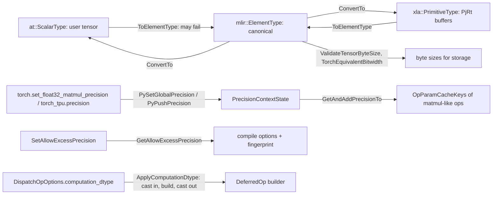

# Dtype mapping, matmul precision and mixed precision

## Overview
TorchTPU keeps four element-type vocabularies apart and converts between them at the edges:
`at::ScalarType` at the PyTorch boundary, `mlir::ElementType` as the canonical type inside every
kernel, `mlir::Type` for the MLIR builder, and `xla::PrimitiveType` at the PjRt boundary. The single
conversion entry, [`ConvertTo`](https://github.com/google-pytorch/torch_tpu/blob/6d2a45754bdb52743883f75fbf753408345f6d1b/csrc/common/dtype.h#L106 "csrc/common/dtype.h#ConvertTo"), is a template
constrained by [`IsValidElemType`](https://github.com/google-pytorch/torch_tpu/blob/6d2a45754bdb52743883f75fbf753408345f6d1b/csrc/common/dtype.h#L68 "csrc/common/dtype.h#IsValidElemType") so that
only `at::ScalarType`, `mlir::ElementType` and `xla::PrimitiveType` can be targets, and only
conversion *into* `mlir::ElementType` from a PyTorch, XLA or MLIR type
([`ToElementType`](https://github.com/google-pytorch/torch_tpu/blob/6d2a45754bdb52743883f75fbf753408345f6d1b/csrc/common/dtype.cc#L123 "csrc/common/dtype.cc#ToElementType")) can fail; conversion out of
`mlir::ElementType` is infallible because TorchTPU creates those values itself, whereas it cannot
control what dtype a user tensor arrives with.
Numerics are governed by three separate knobs that a onboarding user must not confuse: the StableHLO
*precision* of matmul-like ops (DEFAULT, HIGH, HIGHEST; global via
`torch.set_float32_matmul_precision`, scoped via `torch_tpu.precision`), XLA's *excess precision*
flag (may intermediates be kept wider than requested), and *autocast* (which ops run in bfloat16
under `torch.autocast`). The first is part of the op's cache key, the second is part of the compile
options fingerprint, and the third never touches the compiler at all.

## Diagram

Legend:
- `AT` - (concept) the boundaries and inputs named on the edges
- `XLA` - (concept) the boundaries and inputs named on the edges
- `SZ` - (concept) the boundaries and inputs named on the edges
- `PY` - (concept) the boundaries and inputs named on the edges
- `EP` - (concept) the boundaries and inputs named on the edges
- `OPT` - (concept) the boundaries and inputs named on the edges
- `CO` - (concept) the boundaries and inputs named on the edges
- `ET` - [`ToElementType`](https://github.com/google-pytorch/torch_tpu/blob/6d2a45754bdb52743883f75fbf753408345f6d1b/csrc/common/dtype.cc#L123 "csrc/common/dtype.cc#ToElementType") / [`ConvertTo`](https://github.com/google-pytorch/torch_tpu/blob/6d2a45754bdb52743883f75fbf753408345f6d1b/csrc/common/dtype.h#L106 "csrc/common/dtype.h#ConvertTo")
- `PC` - [`PrecisionContextState`](https://github.com/google-pytorch/torch_tpu/blob/6d2a45754bdb52743883f75fbf753408345f6d1b/csrc/common/context_states.h#L70 "csrc/common/context_states.h#PrecisionContextState") set by [`PySetGlobalPrecision`](https://github.com/google-pytorch/torch_tpu/blob/6d2a45754bdb52743883f75fbf753408345f6d1b/csrc/ops/precision_context.cc#L37 "csrc/ops/precision_context.cc#PySetGlobalPrecision"), [`PyPushPrecision`](https://github.com/google-pytorch/torch_tpu/blob/6d2a45754bdb52743883f75fbf753408345f6d1b/csrc/ops/precision_context.cc#L45 "csrc/ops/precision_context.cc#PyPushPrecision"), [`PyPopPrecision`](https://github.com/google-pytorch/torch_tpu/blob/6d2a45754bdb52743883f75fbf753408345f6d1b/csrc/ops/precision_context.cc#L49 "csrc/ops/precision_context.cc#PyPopPrecision")
- `KEY` - [`GetAndAddPrecisionTo`](https://github.com/google-pytorch/torch_tpu/blob/6d2a45754bdb52743883f75fbf753408345f6d1b/csrc/ops/precision_context.cc#L76 "csrc/ops/precision_context.cc#GetAndAddPrecisionTo") into [`OpParamCacheKeys`](https://github.com/google-pytorch/torch_tpu/blob/6d2a45754bdb52743883f75fbf753408345f6d1b/csrc/common/cache_key.h#L541 "csrc/common/cache_key.h#OpParamCacheKeys")
- `CO` - [`GetAllowExcessPrecision`](https://github.com/google-pytorch/torch_tpu/blob/6d2a45754bdb52743883f75fbf753408345f6d1b/csrc/common/excess_precision.cc#L59 "csrc/common/excess_precision.cc#GetAllowExcessPrecision") read into [`GetDefaultExecutableBuildOptions`](https://github.com/google-pytorch/torch_tpu/blob/6d2a45754bdb52743883f75fbf753408345f6d1b/csrc/common/excess_precision.cc#L43 "csrc/common/excess_precision.cc#GetDefaultExecutableBuildOptions")-based compile options
- `DO` - [`ApplyComputationDtype`](https://github.com/google-pytorch/torch_tpu/blob/6d2a45754bdb52743883f75fbf753408345f6d1b/csrc/eager/device_buffer_utils.cc#L113 "csrc/eager/device_buffer_utils.cc#ApplyComputationDtype") wrapping the [`DeferredOp`](https://github.com/google-pytorch/torch_tpu/blob/6d2a45754bdb52743883f75fbf753408345f6d1b/csrc/eager/device_buffer.h#L383 "csrc/eager/device_buffer.h#DeferredOp") builder

## Design rationale (why it's built this way)
- **One canonical type inside ops.** The header comment is explicit: "in most of the op logic, we
  should use mlir::ElementType", with `at::ScalarType` only at the PyTorch boundary and
  `xla::PrimitiveType` only at the XLA/PjRt boundary. Reverse conversions are declared infallible
  because TorchTPU authored every MLIR type; the fallible direction is fenced by a `StatusOr`.
- **Unsupported dtypes fail as `NotImplementedError`, at the first op.**
  [`ToElementType`](https://github.com/google-pytorch/torch_tpu/blob/6d2a45754bdb52743883f75fbf753408345f6d1b/csrc/common/dtype.cc#L123 "csrc/common/dtype.cc#ToElementType") enumerates every
  `at::ScalarType` without a `default:` branch so a new PyTorch dtype is a compile warning-as-error
  for the maintainers, and the leftover cases (quantized `qint`/`quint` types, the `Bits*` types,
  `ComplexHalf`, and the sub-byte `Int1..7`/`UInt1..7` types) return the Python-not-implemented code
  with "TorchTPU does not yet support dtype ...". Supported: bool, int8/16/32/64, uint8/16/32/64,
  float16, bfloat16, float32, float64, complex64, complex128, the fp8 variants (E4M3FN, E4M3FNUZ,
  E5M2, E5M2FNUZ, E8M0FNU) and fp4 (E2M1FN), which PyTorch packs two per byte.
- **Storage math is PyTorch's, not StableHLO's.** [`TorchEquivalentBitwidth`](https://github.com/google-pytorch/torch_tpu/blob/6d2a45754bdb52743883f75fbf753408345f6d1b/csrc/common/dtype.cc#L674 "csrc/common/dtype.cc#TorchEquivalentBitwidth")
  reports bool as 8 bits (PRED is `i1` in StableHLO but a `uint8` in torch) and complex64 as 64 bits,
  and [`ValidateTensorByteSize`](https://github.com/google-pytorch/torch_tpu/blob/6d2a45754bdb52743883f75fbf753408345f6d1b/csrc/common/dtype.cc#L648 "csrc/common/dtype.cc#ValidateTensorByteSize")
  rejects negative dimensions and products that overflow `int64`, so a shape error surfaces before
  any device allocation. [`RealComponentOf`](https://github.com/google-pytorch/torch_tpu/blob/6d2a45754bdb52743883f75fbf753408345f6d1b/csrc/common/dtype.cc#L738 "csrc/common/dtype.cc#RealComponentOf")
  gives complex ops their component type.
- **Accumulate like CUDA, not like CPU.** The accumulation-type helper in `dtype.cc` deliberately
  asks PyTorch for the CUDA rule (float16 and bfloat16 accumulate in float32) because, per the
  comment, TPUs "like GPUs, benefit from higher precision accumulation" in low-precision training.
- **Precision is an op parameter, so it is a cache key.** [`GetAndAddPrecisionTo`](https://github.com/google-pytorch/torch_tpu/blob/6d2a45754bdb52743883f75fbf753408345f6d1b/csrc/ops/precision_context.cc#L76 "csrc/ops/precision_context.cc#GetAndAddPrecisionTo")
  is the only sanctioned reader: it resolves the thread-local
  [`PrecisionContextState`](https://github.com/google-pytorch/torch_tpu/blob/6d2a45754bdb52743883f75fbf753408345f6d1b/csrc/common/context_states.h#L70 "csrc/common/context_states.h#PrecisionContextState")
  (falling back to the global atomic) *and* writes the value into the kernel's
  [`OpParamCacheKeys`](https://github.com/google-pytorch/torch_tpu/blob/6d2a45754bdb52743883f75fbf753408345f6d1b/csrc/common/cache_key.h#L541 "csrc/common/cache_key.h#OpParamCacheKeys"), so changing
  precision can never reuse a kernel compiled at another precision. The unsafe reader is private for
  exactly that reason. Its default is DEFAULT, which the context-state comment describes as `medium`
  for TPU: float32 matmuls execute natively in bfloat16 passes, and a non-default global setting
  triggers a one-time warning recommending `torch.set_float32_matmul_precision('medium')` for
  performance.
- **Excess precision is compiler policy, so it is a compile-options fingerprint.**
  [`SetAllowExcessPrecision`](https://github.com/google-pytorch/torch_tpu/blob/6d2a45754bdb52743883f75fbf753408345f6d1b/csrc/common/excess_precision.cc#L54 "csrc/common/excess_precision.cc#SetAllowExcessPrecision")
  stores a tri-state (unset, allow, disallow); [`GetAllowExcessPrecision`](https://github.com/google-pytorch/torch_tpu/blob/6d2a45754bdb52743883f75fbf753408345f6d1b/csrc/common/excess_precision.cc#L59 "csrc/common/excess_precision.cc#GetAllowExcessPrecision")
  falls back to whatever `XLA_FLAGS` says and otherwise to false. [`GetDefaultExecutableBuildOptions`](https://github.com/google-pytorch/torch_tpu/blob/6d2a45754bdb52743883f75fbf753408345f6d1b/csrc/common/excess_precision.cc#L43 "csrc/common/excess_precision.cc#GetDefaultExecutableBuildOptions")
  parses `XLA_FLAGS` exactly once; the [compilation pipeline](compilation-pipeline.md) then forces
  `xla_allow_excess_precision` from this value on every compile and includes it in the key.
- **Autocast is a static policy table.** `eager/amp_policies.cc` registers `AutocastPrivateUse1`
  policies with a fallthrough default: convolution and matmul-type ops (`addmm`, `bmm`, `conv*`,
  `einsum`, `linear`, `matmul`, `scaled_dot_product_attention`, LSTM/GRU cells, ...) cast to the
  lower-precision float, which on TPU is bfloat16 as on CPU rather than float16 as on CUDA, and a
  CPU-aligned list (losses, `cdist`, FFTs, 3-d pooling, `cholesky_*`, ...) is pinned to float32. The
  comment rules out the `promote` policy: an op that cannot mix bfloat16 and float32 inputs must be
  fixed in the kernel, not papered over by autocast. Policies must be registered even for ops that
  decompose (`mm` to `mm.out`) because autocast infers the output dtype at the outer op.

> [!inferred]
> The practical reading for onboarding: `torch.autocast(device_type="tpu")` gives bfloat16 matmuls
> with float32 losses without changing model code, float32 matmuls outside autocast are already
> bfloat16-pass by default, and `torch_tpu.precision(Precision.HIGHEST)` is the scoped way to get
> true float32 accuracy for a sensitive block at a compile-and-runtime cost. float64 is accepted by
> the type mapping, but its device performance is a property of XLA, not of this code.

## Entry points
- [`ConvertTo`](https://github.com/google-pytorch/torch_tpu/blob/6d2a45754bdb52743883f75fbf753408345f6d1b/csrc/common/dtype.h#L106 "csrc/common/dtype.h#ConvertTo"): every kernel that needs an
  output dtype calls `ConvertTo<mlir::ElementType>(tensor.scalar_type())`; every tensor creation
  calls the reverse to build the `at::Tensor`.
- [`ToElementType`](https://github.com/google-pytorch/torch_tpu/blob/6d2a45754bdb52743883f75fbf753408345f6d1b/csrc/common/dtype.cc#L123 "csrc/common/dtype.cc#ToElementType"): the fallible boundary
  from PyTorch and from XLA buffer types (the XLA overload also maps the sub-byte `S2/S4/U2/U4`
  buffer types that PyTorch cannot express).
- [`PySetGlobalPrecision`](https://github.com/google-pytorch/torch_tpu/blob/6d2a45754bdb52743883f75fbf753408345f6d1b/csrc/ops/precision_context.cc#L37 "csrc/ops/precision_context.cc#PySetGlobalPrecision") /
  [`PyGetGlobalPrecision`](https://github.com/google-pytorch/torch_tpu/blob/6d2a45754bdb52743883f75fbf753408345f6d1b/csrc/ops/precision_context.cc#L41 "csrc/ops/precision_context.cc#PyGetGlobalPrecision")
  back the global PyTorch matmul-precision setting; [`PyPushPrecision`](https://github.com/google-pytorch/torch_tpu/blob/6d2a45754bdb52743883f75fbf753408345f6d1b/csrc/ops/precision_context.cc#L45 "csrc/ops/precision_context.cc#PyPushPrecision")
  and [`PyPopPrecision`](https://github.com/google-pytorch/torch_tpu/blob/6d2a45754bdb52743883f75fbf753408345f6d1b/csrc/ops/precision_context.cc#L49 "csrc/ops/precision_context.cc#PyPopPrecision") back the
  `torch_tpu.precision(mode)` context manager, which validates the mode to DEFAULT, HIGH or HIGHEST
  and pops in a `finally`.
- [`GetAndAddPrecisionTo`](https://github.com/google-pytorch/torch_tpu/blob/6d2a45754bdb52743883f75fbf753408345f6d1b/csrc/ops/precision_context.cc#L76 "csrc/ops/precision_context.cc#GetAndAddPrecisionTo"):
  called by matmul-like kernels while building their cache keys.
- [`ApplyComputationDtype`](https://github.com/google-pytorch/torch_tpu/blob/6d2a45754bdb52743883f75fbf753408345f6d1b/csrc/eager/device_buffer_utils.cc#L113 "csrc/eager/device_buffer_utils.cc#ApplyComputationDtype"):
  applied to every deferred op's builder at dispatch; inputs are cast only when `computation_dtype`
  was set, but the output count is always checked and results are always converted to the declared
  output dtypes.

## Mechanism (step-by-step)
1. **A kernel resolves its types.** It converts input `at::ScalarType`s with
   [`ConvertTo`](https://github.com/google-pytorch/torch_tpu/blob/6d2a45754bdb52743883f75fbf753408345f6d1b/csrc/common/dtype.h#L106 "csrc/common/dtype.h#ConvertTo"); an unsupported dtype turns into
   the not-implemented status from [`ToElementType`](https://github.com/google-pytorch/torch_tpu/blob/6d2a45754bdb52743883f75fbf753408345f6d1b/csrc/common/dtype.cc#L123 "csrc/common/dtype.cc#ToElementType")
   and surfaces as a Python `NotImplementedError` naming the dtype (see [error-handling](error-handling.md)).
   Output shapes are validated with [`ValidateTensorByteSize`](https://github.com/google-pytorch/torch_tpu/blob/6d2a45754bdb52743883f75fbf753408345f6d1b/csrc/common/dtype.cc#L648 "csrc/common/dtype.cc#ValidateTensorByteSize")
   when the deferred list is created.
2. **Matmul-like kernels key their precision.** They call
   [`GetAndAddPrecisionTo`](https://github.com/google-pytorch/torch_tpu/blob/6d2a45754bdb52743883f75fbf753408345f6d1b/csrc/ops/precision_context.cc#L76 "csrc/ops/precision_context.cc#GetAndAddPrecisionTo"),
   which reads the [`PrecisionContextState`](https://github.com/google-pytorch/torch_tpu/blob/6d2a45754bdb52743883f75fbf753408345f6d1b/csrc/common/context_states.h#L70 "csrc/common/context_states.h#PrecisionContextState")
   pushed by [`PyPushPrecision`](https://github.com/google-pytorch/torch_tpu/blob/6d2a45754bdb52743883f75fbf753408345f6d1b/csrc/ops/precision_context.cc#L45 "csrc/ops/precision_context.cc#PyPushPrecision")
   or the global value from [`PyGetGlobalPrecision`](https://github.com/google-pytorch/torch_tpu/blob/6d2a45754bdb52743883f75fbf753408345f6d1b/csrc/ops/precision_context.cc#L41 "csrc/ops/precision_context.cc#PyGetGlobalPrecision"),
   records it in the op's [`OpParamCacheKeys`](https://github.com/google-pytorch/torch_tpu/blob/6d2a45754bdb52743883f75fbf753408345f6d1b/csrc/common/cache_key.h#L541 "csrc/common/cache_key.h#OpParamCacheKeys"),
   and returns it for the StableHLO `dot_general` precision config.
3. **`computation_dtype` widens the builder, not the tensors.** [`ApplyComputationDtype`](https://github.com/google-pytorch/torch_tpu/blob/6d2a45754bdb52743883f75fbf753408345f6d1b/csrc/eager/device_buffer_utils.cc#L113 "csrc/eager/device_buffer_utils.cc#ApplyComputationDtype")
   rewraps the [`DeferredOp`](https://github.com/google-pytorch/torch_tpu/blob/6d2a45754bdb52743883f75fbf753408345f6d1b/csrc/eager/device_buffer.h#L383 "csrc/eager/device_buffer.h#DeferredOp") builder so
   that, at MLIR build time, inputs are converted to the computation dtype, the original builder runs,
   the output count is checked, and each result is converted back to the dtype the kernel promised.
   Clamp and softmax use this to compute in the widest input type without per-kernel casting code.
4. **Excess precision reaches XLA through the compile options.** [`GetAllowExcessPrecision`](https://github.com/google-pytorch/torch_tpu/blob/6d2a45754bdb52743883f75fbf753408345f6d1b/csrc/common/excess_precision.cc#L59 "csrc/common/excess_precision.cc#GetAllowExcessPrecision")
   is read when compile options are built on top of [`GetDefaultExecutableBuildOptions`](https://github.com/google-pytorch/torch_tpu/blob/6d2a45754bdb52743883f75fbf753408345f6d1b/csrc/common/excess_precision.cc#L43 "csrc/common/excess_precision.cc#GetDefaultExecutableBuildOptions");
   the value is part of the options fingerprint, so a program compiled with one setting is never
   reused under the other.
5. **Buffers come back typed.** When PjRt returns buffers, their `xla::PrimitiveType` is mapped by
   [`ToElementType`](https://github.com/google-pytorch/torch_tpu/blob/6d2a45754bdb52743883f75fbf753408345f6d1b/csrc/common/dtype.cc#L123 "csrc/common/dtype.cc#ToElementType") into the
   [`DeviceBufferList`](https://github.com/google-pytorch/torch_tpu/blob/6d2a45754bdb52743883f75fbf753408345f6d1b/csrc/eager/device_buffer.h#L529 "csrc/eager/device_buffer.h#DeviceBufferList") shape, and
   `ConvertTo<at::ScalarType>` gives the `at::Tensor` its dtype; [`TorchEquivalentBitwidth`](https://github.com/google-pytorch/torch_tpu/blob/6d2a45754bdb52743883f75fbf753408345f6d1b/csrc/common/dtype.cc#L674 "csrc/common/dtype.cc#TorchEquivalentBitwidth")
   reconciles storage sizes where StableHLO and PyTorch disagree (bool, complex, fp4).

## Key data structures
- `mlir::ElementType`: the canonical enum; its short names (`f32`, `si32`, `bf16`) are stable and
  used in cache keys, while `ToString` renders
  PyTorch names (`float32`) for user messages, a distinction the error-message guidelines enforce.
- [`PrecisionContextState`](https://github.com/google-pytorch/torch_tpu/blob/6d2a45754bdb52743883f75fbf753408345f6d1b/csrc/common/context_states.h#L70 "csrc/common/context_states.h#PrecisionContextState"):
  a StableHLO precision enum in the per-thread context-state stack; empty means "use the global".
- The excess-precision tri-state atomic behind [`SetAllowExcessPrecision`](https://github.com/google-pytorch/torch_tpu/blob/6d2a45754bdb52743883f75fbf753408345f6d1b/csrc/common/excess_precision.cc#L54 "csrc/common/excess_precision.cc#SetAllowExcessPrecision").
- [`PromotedScalar`](https://github.com/google-pytorch/torch_tpu/blob/6d2a45754bdb52743883f75fbf753408345f6d1b/csrc/common/cache_key.h#L98 "csrc/common/cache_key.h#PromotedScalar") /
  [`MaybePromotedScalar`](https://github.com/google-pytorch/torch_tpu/blob/6d2a45754bdb52743883f75fbf753408345f6d1b/csrc/common/cache_key.h#L150 "csrc/common/cache_key.h#MaybePromotedScalar"): scalar
  arguments carry an optional target `at::ScalarType` when promoted (see [eager-op-dispatch](eager-op-dispatch.md)).

## Dynamics (design intent)
- Precision and excess-precision state live in thread-local context state; worker threads are
  forbidden from reading it, so both values are resolved on the dispatch thread (into the cache key
  and the compilation spec respectively) before any compile runs.
- The global precision is an atomic read on every matmul dispatch; the warning about non-default
  global precision fires once per process.

## Edge cases
- complex128 scalars are narrowed to complex64 at scalar promotion; complex128 tensors map to
  `COMPLEXF64` and are accepted by the type table.
- fp4 tensors have an even last dimension requirement and half-sized storage; element counts are
  doubled when checking buffer assignment.
- The precision context manager raises `ValueError` for any value outside DEFAULT/HIGH/HIGHEST
  before touching C++ state.
- `XLA_FLAGS` is consulted for excess precision only while the explicit setting is unset; once
  [`SetAllowExcessPrecision`](https://github.com/google-pytorch/torch_tpu/blob/6d2a45754bdb52743883f75fbf753408345f6d1b/csrc/common/excess_precision.cc#L54 "csrc/common/excess_precision.cc#SetAllowExcessPrecision")
  has been called, the env var is ignored for that process.

## Open questions
- The mapping from `torch.set_float32_matmul_precision` strings (`highest`, `high`, `medium`) to
  StableHLO precision values lives in the Python device module, outside this packet.
- Which kernels beyond `dot_general`-style ops consult the precision context is not enumerated here;
  grep for the cache-key helper to find them.

## See also
- [eager-op-dispatch](eager-op-dispatch.md): `computation_dtype` in `DispatchOpOptions` and scalar dtype handling.
- [compilation-cache-key](compilation-cache-key.md): why precision belongs in the op-param keys.
- [compilation-pipeline](compilation-pipeline.md): where excess precision enters the compile options.
- [scaled-dot-product-attention](scaled-dot-product-attention.md): the largest consumer of bfloat16 autocast.
- [error-handling](error-handling.md): how the not-implemented status becomes a Python exception.
