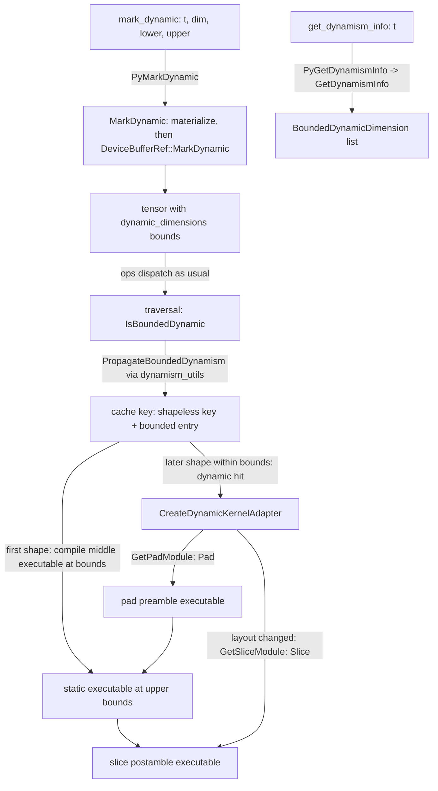

# Bounded dynamic shapes in eager mode (mark_dynamic)

## Overview
In eager mode every distinct shape is a distinct cache key, so a decode loop or a padded batch
whose sequence length changes recompiles per length. The manual bounded-dynamism API lets a user
declare that a dimension will vary within `[lower, upper]`: [`MarkDynamic`](https://github.com/google-pytorch/torch_tpu/blob/6d2a45754bdb52743883f75fbf753408345f6d1b/csrc/internal/dynamism/dynamism.cc#L38 "csrc/internal/dynamism/dynamism.cc#MarkDynamic")
(Python `mark_dynamic` in `torch_tpu._internal.dynamism`) records the bounds on the tensor's
device buffer, and the rest of the runtime treats the tensor as having a static *bound* and a
logical size. A traversal that contains such a tensor is "bounded dynamic": bounds are propagated
through the deferred graph before compilation, the program is compiled once at the bounds, the
[compilation cache](compilation-cache.md) stores the entry under the *shapeless* graph key with
shape-dynamism metadata, and later calls whose concrete shapes fit the bounds reuse the "middle"
executable, paying only for lightweight pad and slice adapters generated from the modules in this
unit
([`GetPadModule`](https://github.com/google-pytorch/torch_tpu/blob/6d2a45754bdb52743883f75fbf753408345f6d1b/csrc/internal/dynamism/dynamism_ops.cc#L171 "csrc/internal/dynamism/dynamism_ops.cc#GetPadModule"),
[`GetDynamicPadModule`](https://github.com/google-pytorch/torch_tpu/blob/6d2a45754bdb52743883f75fbf753408345f6d1b/csrc/internal/dynamism/dynamism_ops.cc#L214 "csrc/internal/dynamism/dynamism_ops.cc#GetDynamicPadModule"),
[`GetSliceModule`](https://github.com/google-pytorch/torch_tpu/blob/6d2a45754bdb52743883f75fbf753408345f6d1b/csrc/internal/dynamism/dynamism_ops.cc#L269 "csrc/internal/dynamism/dynamism_ops.cc#GetSliceModule")).
The same modules back the pad and slice bindings used by the
[dynamic torch.compile path](dynamic-shapes-compiler.md).

## Diagram

Legend:
- `U` - (concept) user call into the `_tpu_torch_dynamism` module registered by [`TorchTpuPyBindInitModule__tpu_torch_dynamism`](https://github.com/google-pytorch/torch_tpu/blob/6d2a45754bdb52743883f75fbf753408345f6d1b/csrc/internal/dynamism/dynamism_py.cc#L63 "csrc/internal/dynamism/dynamism_py.cc#TorchTpuPyBindInitModule__tpu_torch_dynamism")
- `T` - (concept) a tensor whose device buffer carries bounds, see [deferred-execution-and-materialization](deferred-execution-and-materialization.md)
- `TR` - (concept) the traversal of [deferred-execution-and-materialization](deferred-execution-and-materialization.md)
- `CK` - (concept) cache entries of [compilation-cache](compilation-cache.md)
- `MID` - (concept) the middle executable of a bounded cache entry
- `PRE` - (concept) pad preamble built from [`GetPadModule`](https://github.com/google-pytorch/torch_tpu/blob/6d2a45754bdb52743883f75fbf753408345f6d1b/csrc/internal/dynamism/dynamism_ops.cc#L171 "csrc/internal/dynamism/dynamism_ops.cc#GetPadModule")
- `POST` - (concept) slice postamble built from [`GetSliceModule`](https://github.com/google-pytorch/torch_tpu/blob/6d2a45754bdb52743883f75fbf753408345f6d1b/csrc/internal/dynamism/dynamism_ops.cc#L269 "csrc/internal/dynamism/dynamism_ops.cc#GetSliceModule")
- `INFO` - (concept) the returned list of bounded dimensions
- `MD` - [`PyMarkDynamic`](https://github.com/google-pytorch/torch_tpu/blob/6d2a45754bdb52743883f75fbf753408345f6d1b/csrc/internal/dynamism/dynamism_py.cc#L36 "csrc/internal/dynamism/dynamism_py.cc#PyMarkDynamic") / [`MarkDynamic`](https://github.com/google-pytorch/torch_tpu/blob/6d2a45754bdb52743883f75fbf753408345f6d1b/csrc/internal/dynamism/dynamism.cc#L38 "csrc/internal/dynamism/dynamism.cc#MarkDynamic")
- `ADP` - (concept) the cache's adapter builder, fed by [`GetPadModule`](https://github.com/google-pytorch/torch_tpu/blob/6d2a45754bdb52743883f75fbf753408345f6d1b/csrc/internal/dynamism/dynamism_ops.cc#L171 "csrc/internal/dynamism/dynamism_ops.cc#GetPadModule") and [`GetSliceModule`](https://github.com/google-pytorch/torch_tpu/blob/6d2a45754bdb52743883f75fbf753408345f6d1b/csrc/internal/dynamism/dynamism_ops.cc#L269 "csrc/internal/dynamism/dynamism_ops.cc#GetSliceModule") built on [`Pad`](https://github.com/google-pytorch/torch_tpu/blob/6d2a45754bdb52743883f75fbf753408345f6d1b/csrc/internal/dynamism/dynamism_ops.cc#L51 "csrc/internal/dynamism/dynamism_ops.cc#Pad"), [`Slice`](https://github.com/google-pytorch/torch_tpu/blob/6d2a45754bdb52743883f75fbf753408345f6d1b/csrc/internal/dynamism/dynamism_ops.cc#L92 "csrc/internal/dynamism/dynamism_ops.cc#Slice") and [`MakeDynamicTensorType`](https://github.com/google-pytorch/torch_tpu/blob/6d2a45754bdb52743883f75fbf753408345f6d1b/csrc/internal/dynamism/dynamism_ops.cc#L147 "csrc/internal/dynamism/dynamism_ops.cc#MakeDynamicTensorType")
- `Q` - [`PyGetDynamismInfo`](https://github.com/google-pytorch/torch_tpu/blob/6d2a45754bdb52743883f75fbf753408345f6d1b/csrc/internal/dynamism/dynamism_py.cc#L48 "csrc/internal/dynamism/dynamism_py.cc#PyGetDynamismInfo") / [`GetDynamismInfo`](https://github.com/google-pytorch/torch_tpu/blob/6d2a45754bdb52743883f75fbf753408345f6d1b/csrc/internal/dynamism/dynamism.cc#L86 "csrc/internal/dynamism/dynamism.cc#GetDynamismInfo")

## Design rationale (why it's built this way)
- **Bounds live on the buffer, not the tensor.** [`MarkDynamic`](https://github.com/google-pytorch/torch_tpu/blob/6d2a45754bdb52743883f75fbf753408345f6d1b/csrc/internal/dynamism/dynamism.cc#L38 "csrc/internal/dynamism/dynamism.cc#MarkDynamic")
  first materializes the tensor's buffer (blocking only until materialization starts; skipped for
  placeholders and while tracing an FX graph for `torch.compile`), so that "the buffer has already
  been traversed before mutating its dynamic dimensions for subsequent consumers". It then marks
  the dimension on that buffer through the `MarkDynamic` accessor described in
  [deferred-execution-and-materialization](deferred-execution-and-materialization.md). For a
  *view* tensor the marked buffer is the view's own, so, per the header comment, the call "returns
  a new tensor holding the DeferredOp" instead of the input. Downstream ops see the dynamism
  through `dynamic_dimensions` on their inputs.
- **Propagate once per traversal, not per op.** A traversal reports itself bounded dynamic when
  any argument carries bounds, and the execution task then runs bounded-dynamism propagation,
  which builds an MLIR graph in execution order to infer the StableHLO dimensions of every
  output (`GetTraversalOutputDimensions` in `common/dynamism_utils.h`). This keeps kernels
  unaware of dynamism: they build static-shaped StableHLO and the propagation rewrites types.
- **Split the executable into pad, middle, slice.** The cache stores a bounded entry as a
  triplet ("[preamble, middle, postamble] where the preamble and postamble are lightweight
  computations"). [`GetPadModule`](https://github.com/google-pytorch/torch_tpu/blob/6d2a45754bdb52743883f75fbf753408345f6d1b/csrc/internal/dynamism/dynamism_ops.cc#L171 "csrc/internal/dynamism/dynamism_ops.cc#GetPadModule")
  produces a module that zero-pads static inputs to the bound and, unless built as a pad-only
  module, also emits their logical sizes
  ([`Pad`](https://github.com/google-pytorch/torch_tpu/blob/6d2a45754bdb52743883f75fbf753408345f6d1b/csrc/internal/dynamism/dynamism_ops.cc#L51 "csrc/internal/dynamism/dynamism_ops.cc#Pad") requires
  static input shapes and is a no-op when nothing needs padding).
  [`GetDynamicPadModule`](https://github.com/google-pytorch/torch_tpu/blob/6d2a45754bdb52743883f75fbf753408345f6d1b/csrc/internal/dynamism/dynamism_ops.cc#L214 "csrc/internal/dynamism/dynamism_ops.cc#GetDynamicPadModule")
  is the variant that, instead of returning sizes separately, pads and then sets each dynamic
  dimension's runtime size on the padded output, so its results are themselves bounded-dynamic
  tensors. [`GetSliceModule`](https://github.com/google-pytorch/torch_tpu/blob/6d2a45754bdb52743883f75fbf753408345f6d1b/csrc/internal/dynamism/dynamism_ops.cc#L269 "csrc/internal/dynamism/dynamism_ops.cc#GetSliceModule")
  takes bounded-dynamic inputs
  ([`MakeDynamicTensorType`](https://github.com/google-pytorch/torch_tpu/blob/6d2a45754bdb52743883f75fbf753408345f6d1b/csrc/internal/dynamism/dynamism_ops.cc#L147 "csrc/internal/dynamism/dynamism_ops.cc#MakeDynamicTensorType"))
  and slices outputs back to their logical sizes
  ([`Slice`](https://github.com/google-pytorch/torch_tpu/blob/6d2a45754bdb52743883f75fbf753408345f6d1b/csrc/internal/dynamism/dynamism_ops.cc#L92 "csrc/internal/dynamism/dynamism_ops.cc#Slice")
  returns a static input as is, otherwise converts to static and slices from offset 0), and the
  cache emits it only when padding "induced layout changes", since a bounded output whose layout
  matches the static default needs no copy.
- **Same modules, two consumers.** The `torch.compile` side calls the pad and slice modules
  through its own bindings in `tpu_torch_compile` (the dynamic compiler's fallback pad program
  uses the dynamic pad module), so eager and compiled dynamism share one definition of "padding
  to a bound".

> [!inferred]
> The user-visible trade: after `mark_dynamic(x, dim, lo, hi)` a program compiles at `hi`,
> runs at the actual size for compute that XLA can bound (attention over the logical length, for
> instance), but allocates and transfers at the bound; choose bounds that cover the workload,
> because a shape outside the bounds is a plain cache miss and a fresh static compile. Because
> the call materializes its input, mark tensors right after creating them rather than in the
> middle of a long deferred chain.

## Entry points
- [`PyMarkDynamic`](https://github.com/google-pytorch/torch_tpu/blob/6d2a45754bdb52743883f75fbf753408345f6d1b/csrc/internal/dynamism/dynamism_py.cc#L36 "csrc/internal/dynamism/dynamism_py.cc#PyMarkDynamic") and
  [`PyGetDynamismInfo`](https://github.com/google-pytorch/torch_tpu/blob/6d2a45754bdb52743883f75fbf753408345f6d1b/csrc/internal/dynamism/dynamism_py.cc#L48 "csrc/internal/dynamism/dynamism_py.cc#PyGetDynamismInfo"):
  the pybind functions `mark_dynamic` and `get_dynamism_info` of the `_tpu_torch_dynamism`
  module ([`TorchTpuPyBindInitModule__tpu_torch_dynamism`](https://github.com/google-pytorch/torch_tpu/blob/6d2a45754bdb52743883f75fbf753408345f6d1b/csrc/internal/dynamism/dynamism_py.cc#L63 "csrc/internal/dynamism/dynamism_py.cc#TorchTpuPyBindInitModule__tpu_torch_dynamism")),
  re-exported by `torch_tpu._internal.dynamism`. Both reject tensors that are not on the TPU
  device.
- [`MarkDynamic`](https://github.com/google-pytorch/torch_tpu/blob/6d2a45754bdb52743883f75fbf753408345f6d1b/csrc/internal/dynamism/dynamism.cc#L38 "csrc/internal/dynamism/dynamism.cc#MarkDynamic") and
  [`GetDynamismInfo`](https://github.com/google-pytorch/torch_tpu/blob/6d2a45754bdb52743883f75fbf753408345f6d1b/csrc/internal/dynamism/dynamism.cc#L86 "csrc/internal/dynamism/dynamism.cc#GetDynamismInfo"):
  the C++ API returning the tensor (possibly new) and the span of bounded dimensions.
- [`GetPadModule`](https://github.com/google-pytorch/torch_tpu/blob/6d2a45754bdb52743883f75fbf753408345f6d1b/csrc/internal/dynamism/dynamism_ops.cc#L171 "csrc/internal/dynamism/dynamism_ops.cc#GetPadModule"),
  [`GetDynamicPadModule`](https://github.com/google-pytorch/torch_tpu/blob/6d2a45754bdb52743883f75fbf753408345f6d1b/csrc/internal/dynamism/dynamism_ops.cc#L214 "csrc/internal/dynamism/dynamism_ops.cc#GetDynamicPadModule"),
  [`GetSliceModule`](https://github.com/google-pytorch/torch_tpu/blob/6d2a45754bdb52743883f75fbf753408345f6d1b/csrc/internal/dynamism/dynamism_ops.cc#L269 "csrc/internal/dynamism/dynamism_ops.cc#GetSliceModule"):
  module factories used by the compilation cache's adapter kernels and by the compiled-mode
  bindings.

## Mechanism (step-by-step)
1. **Annotate.** [`MarkDynamic`](https://github.com/google-pytorch/torch_tpu/blob/6d2a45754bdb52743883f75fbf753408345f6d1b/csrc/internal/dynamism/dynamism.cc#L38 "csrc/internal/dynamism/dynamism.cc#MarkDynamic")
   resolves the tensor's base and own buffers, materializes the buffer if needed, refuses a
   second dynamic dimension on a tensor that already has a different one, and marks the buffer
   dimension dynamic (the buffer validates `dimension`, `lower_bound` and `upper_bound`); it
   returns the input tensor, or a new tensor for a view.
   [`GetDynamismInfo`](https://github.com/google-pytorch/torch_tpu/blob/6d2a45754bdb52743883f75fbf753408345f6d1b/csrc/internal/dynamism/dynamism.cc#L86 "csrc/internal/dynamism/dynamism.cc#GetDynamismInfo")
   reads the recorded bounds back from the base buffer, materializing it first unless it is a
   placeholder or a constant.
2. **Dispatch normally.** Kernels build static StableHLO; the deferred graph carries the bounds
   on its input refs, and [`MakeDynamicTensorType`](https://github.com/google-pytorch/torch_tpu/blob/6d2a45754bdb52743883f75fbf753408345f6d1b/csrc/internal/dynamism/dynamism_ops.cc#L147 "csrc/internal/dynamism/dynamism_ops.cc#MakeDynamicTensorType")
   (file-local to the dynamism ops) expresses a bounded dimension (padded size with a bound marker)
   as a StableHLO tensor type, but only for the slice module's inputs; propagation and the dynamic
   pad module produce bounded types by other means.
3. **Propagate and key.** At materialization the traversal is detected as bounded dynamic (from
   the bounds [`MarkDynamic`](https://github.com/google-pytorch/torch_tpu/blob/6d2a45754bdb52743883f75fbf753408345f6d1b/csrc/internal/dynamism/dynamism.cc#L38 "csrc/internal/dynamism/dynamism.cc#MarkDynamic") recorded, readable through
   [`GetDynamismInfo`](https://github.com/google-pytorch/torch_tpu/blob/6d2a45754bdb52743883f75fbf753408345f6d1b/csrc/internal/dynamism/dynamism.cc#L86 "csrc/internal/dynamism/dynamism.cc#GetDynamismInfo")),
   bounds are propagated to compute output dimensions, and the cache lookup uses the shapeless
   key to find or create a bounded entry ([compilation-cache-key](compilation-cache-key.md)).
4. **Adapt.** On a dynamic hit the cache builds a pad preamble from
   [`GetPadModule`](https://github.com/google-pytorch/torch_tpu/blob/6d2a45754bdb52743883f75fbf753408345f6d1b/csrc/internal/dynamism/dynamism_ops.cc#L171 "csrc/internal/dynamism/dynamism_ops.cc#GetPadModule")
   with [`Pad`](https://github.com/google-pytorch/torch_tpu/blob/6d2a45754bdb52743883f75fbf753408345f6d1b/csrc/internal/dynamism/dynamism_ops.cc#L51 "csrc/internal/dynamism/dynamism_ops.cc#Pad")
   sized to the recorded bounds, and, when layouts differ, a slice postamble from
   [`GetSliceModule`](https://github.com/google-pytorch/torch_tpu/blob/6d2a45754bdb52743883f75fbf753408345f6d1b/csrc/internal/dynamism/dynamism_ops.cc#L269 "csrc/internal/dynamism/dynamism_ops.cc#GetSliceModule");
   the execute thread runs preamble, middle and postamble in sequence.

## Key data structures
- `BoundedDynamicDimension`: dimension index plus lower and upper bound, the unit returned by
  [`GetDynamismInfo`](https://github.com/google-pytorch/torch_tpu/blob/6d2a45754bdb52743883f75fbf753408345f6d1b/csrc/internal/dynamism/dynamism.cc#L86 "csrc/internal/dynamism/dynamism.cc#GetDynamismInfo")
  and exposed to Python with read-only `dimension`, `lower_bound` and `upper_bound`.
- `ShapeDynamismMetadata` (in the cache): the input and output shapes with dynamism used to test
  compatibility and to size adapters.
- Bounded-dynamic MLIR tensor types with `#stablehlo.bounds` encodings produced by
  [`MakeDynamicTensorType`](https://github.com/google-pytorch/torch_tpu/blob/6d2a45754bdb52743883f75fbf753408345f6d1b/csrc/internal/dynamism/dynamism_ops.cc#L147 "csrc/internal/dynamism/dynamism_ops.cc#MakeDynamicTensorType").

## Dynamics (design intent)
- Propagation and adapter compilation run on the materialize and compile threads; the user's
  thread pays the annotation, including waiting for the marked buffer's materialization to start.
- Adapters are compiled through the same cache and are themselves keyed by the concrete shapes,
  so they are reused per shape.

## Edge cases
- Bounds outside the dimension's valid range or a dimension index out of range are errors at
  annotation time.
- Only one dynamic dimension per tensor is supported: marking a second, different dimension fails
  ("multiple dynamic dimensions in one tensor is not yet supported").
- `get_dynamism_info` returns an empty list (not an error) when the lookup fails.
- A concrete shape larger than the bound does not match the bounded entry and compiles a new
  static program.
- Zero-element inputs are left out of the pad modules' parameters.
- Padding uses zero as the fill value, which is only correct because the logical size masks the
  padded region for XLA; ops that read past the logical size (reductions over the full bound)
  must be avoided by the user.
- In [`GetDynamicPadModule`](https://github.com/google-pytorch/torch_tpu/blob/6d2a45754bdb52743883f75fbf753408345f6d1b/csrc/internal/dynamism/dynamism_ops.cc#L214 "csrc/internal/dynamism/dynamism_ops.cc#GetDynamicPadModule"),
  an input whose runtime size already equals the bound would otherwise have its size folded to a
  constant, and the lowering would then strip the dynamic dimension; the size is passed through an
  optimization barrier to keep the output dynamic.

## Open questions
- Which ops respect logical sizes end to end is a property of XLA's bounded-dynamism support and
  is not enumerated in this unit.

## See also
- [dynamic-shapes-compiler](dynamic-shapes-compiler.md): the `torch.compile` counterpart.
- [compilation-cache](compilation-cache.md): bounded entries and adapter kernels.
- [deferred-execution-and-materialization](deferred-execution-and-materialization.md): where bounds are stored and propagated.
- [compilation-cache-key](compilation-cache-key.md): the shapeless key.

## Recent changes
- `b269f5327` preserves dynamic dimension metadata in `GetDynamicPadModule` when the runtime size
  equals the upper bound, by wrapping the `get_dimension_size` result in
  `stablehlo.optimization_barrier` "so that MLIR-to-HLO lowering preserves" the dynamic dimension.
- [all changes in release/0.1.2](../changes/6d2a45754b.md)
