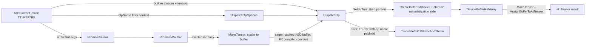

# Eager op dispatch, from an ATen kernel to a deferred op

## Overview
TorchTPU registers one C++ kernel per ATen op on the `PrivateUse1` dispatch key, but none of those
kernels lowers to XLA itself. Each one describes the op as a *builder closure* plus metadata and
hands it to [`DispatchOp`](https://github.com/google-pytorch/torch_tpu/blob/6d2a45754bdb52743883f75fbf753408345f6d1b/csrc/eager/op_dispatcher.h#L312 "csrc/eager/op_dispatcher.h#DispatchOp"), a template
that checks arity and output count at compile time, extracts the inputs' device buffers, and creates
one deferred op (see [deferred-execution-and-materialization](deferred-execution-and-materialization.md)).
The header states the contract plainly: whether execution "happens right away or is deferred to
later is an implementation detail and is not controlled through this API". What the kernel *does*
control is the cache identity of the op: an [`OpName`](https://github.com/google-pytorch/torch_tpu/blob/6d2a45754bdb52743883f75fbf753408345f6d1b/csrc/ops/op_names.h#L29 "csrc/ops/op_names.h#OpName")
taken from the enclosing `TT_KERNEL()` context, and
[`OpParamCacheKeys`](https://github.com/google-pytorch/torch_tpu/blob/6d2a45754bdb52743883f75fbf753408345f6d1b/csrc/common/cache_key.h#L541 "csrc/common/cache_key.h#OpParamCacheKeys") for any parameter
that changes the generated program. Scalars get special treatment through
[`PromoteScalar`](https://github.com/google-pytorch/torch_tpu/blob/6d2a45754bdb52743883f75fbf753408345f6d1b/csrc/eager/op_dispatcher.cc#L302 "csrc/eager/op_dispatcher.cc#PromoteScalar"): in eager mode a
scalar becomes a cached one-element device buffer passed as an *argument*, so `x * 0.5` and
`x * 0.7` share one compiled executable; only when compiling an FX graph for `torch.compile` does a
scalar become an MLIR constant the compiler may specialize on.

## Diagram

Legend:
- `KER` - (concept) any kernel, e.g. one built with the macros in [aten-kernel-authoring](aten-kernel-authoring.md)
- `OPT` - [`DispatchOpOptions`](https://github.com/google-pytorch/torch_tpu/blob/6d2a45754bdb52743883f75fbf753408345f6d1b/csrc/eager/op_dispatcher.h#L108 "csrc/eager/op_dispatcher.h#DispatchOpOptions")
- `DO` - [`DispatchOp`](https://github.com/google-pytorch/torch_tpu/blob/6d2a45754bdb52743883f75fbf753408345f6d1b/csrc/eager/op_dispatcher.h#L312 "csrc/eager/op_dispatcher.h#DispatchOp")
- `PS` - [`PromoteScalar`](https://github.com/google-pytorch/torch_tpu/blob/6d2a45754bdb52743883f75fbf753408345f6d1b/csrc/eager/op_dispatcher.cc#L302 "csrc/eager/op_dispatcher.cc#PromoteScalar")
- `PRS` - [`PromotedScalar`](https://github.com/google-pytorch/torch_tpu/blob/6d2a45754bdb52743883f75fbf753408345f6d1b/csrc/common/cache_key.h#L98 "csrc/common/cache_key.h#PromotedScalar")
- `MB` - [`MakeTensor`](https://github.com/google-pytorch/torch_tpu/blob/6d2a45754bdb52743883f75fbf753408345f6d1b/csrc/eager/op_dispatcher.cc#L295 "csrc/eager/op_dispatcher.cc#MakeTensor") (scalar overload)
- `CDL` - (concept) the deferred-list constructor documented in [deferred-execution-and-materialization](deferred-execution-and-materialization.md)
- `RES` - [`DeviceBufferRefArray`](https://github.com/google-pytorch/torch_tpu/blob/6d2a45754bdb52743883f75fbf753408345f6d1b/csrc/eager/op_dispatcher.h#L215 "csrc/eager/op_dispatcher.h#DeviceBufferRefArray")
- `OUT` - [`MakeTensor`](https://github.com/google-pytorch/torch_tpu/blob/6d2a45754bdb52743883f75fbf753408345f6d1b/csrc/eager/tensor_to_buffer.cc#L396 "csrc/eager/tensor_to_buffer.cc#MakeTensor") / [`AssignBufferToAtTensor`](https://github.com/google-pytorch/torch_tpu/blob/6d2a45754bdb52743883f75fbf753408345f6d1b/csrc/eager/tensor_to_buffer.cc#L138 "csrc/eager/tensor_to_buffer.cc#AssignBufferToAtTensor")
- `ERR` - [`TranslateToC10ErrorAndThrow`](https://github.com/google-pytorch/torch_tpu/blob/6d2a45754bdb52743883f75fbf753408345f6d1b/csrc/common/error_utils.cc#L1223 "csrc/common/error_utils.cc#TranslateToC10ErrorAndThrow")

## Design rationale (why it's built this way)
- **Compile-time arity.** [`DispatchOp`](https://github.com/google-pytorch/torch_tpu/blob/6d2a45754bdb52743883f75fbf753408345f6d1b/csrc/eager/op_dispatcher.h#L312 "csrc/eager/op_dispatcher.h#DispatchOp")
  is templated on `kArity` and `kNumOutputs`, and its inputs type is a `std::array` of a
  non-default-constructible `TensorHolder`, so passing too few or too many tensors is a compile
  error rather than a runtime shape mismatch. `kDynamicSize` opts out for variadic ops such as
  `cat`. The result type [`DeviceBufferRefArray`](https://github.com/google-pytorch/torch_tpu/blob/6d2a45754bdb52743883f75fbf753408345f6d1b/csrc/eager/op_dispatcher.h#L215 "csrc/eager/op_dispatcher.h#DeviceBufferRefArray")
  mirrors this: a bare ref for one output, an array for a fixed count, a vector for dynamic.
- **The op name is context, not an argument.** The name comes from the active `TT_KERNEL()`
  scope (an op-name stack maintained by the macros in [aten-kernel-authoring](aten-kernel-authoring.md));
  supplying one in [`DispatchOpOptions`](https://github.com/google-pytorch/torch_tpu/blob/6d2a45754bdb52743883f75fbf753408345f6d1b/csrc/eager/op_dispatcher.h#L108 "csrc/eager/op_dispatcher.h#DispatchOpOptions")
  is a hard error unless it *differs* from the context, which is exactly the case for shared helpers
  such as the scalar-tensor constructor that must not inherit the calling kernel's name.
- **Cache identity is the kernel author's responsibility.** The header's examples make the rule
  concrete: `relu` needs no keys, `gelu` must put `approximate` into
  [`OpParamCacheKeys`](https://github.com/google-pytorch/torch_tpu/blob/6d2a45754bdb52743883f75fbf753408345f6d1b/csrc/common/cache_key.h#L541 "csrc/common/cache_key.h#OpParamCacheKeys") (typically built with
  [`MakeOpParamCacheKeys`](https://github.com/google-pytorch/torch_tpu/blob/6d2a45754bdb52743883f75fbf753408345f6d1b/csrc/common/cache_key.h#L746 "csrc/common/cache_key.h#MakeOpParamCacheKeys")) because the
  closure captured it. Anything captured by the closure but absent from the keys is a silent cache
  collision; see [compilation-cache-key](compilation-cache-key.md).
- **Scalars are arguments in eager mode, constants in compiled mode.** The scalar overload of
  [`MakeTensor`](https://github.com/google-pytorch/torch_tpu/blob/6d2a45754bdb52743883f75fbf753408345f6d1b/csrc/eager/op_dispatcher.cc#L295 "csrc/eager/op_dispatcher.cc#MakeTensor") documents both modes:
  "variable" mode uploads a one-element buffer (cached per thread by value and dtype to avoid
  repeated host-to-device copies) so the executable does not specialize on the value; "constant"
  mode, active only while compiling an FX graph (where variable scalars are already graph inputs),
  emits an MLIR constant for better steady-state performance at the risk of recompiling when the
  value changes. The source is explicit that all eager modes, deferred or not, use variable mode
  because "the benefit of constant folding is not justified at the risk of over-specialization and
  recompilation". The scalar `MakeTensor` overload is now deprecated in favor of `PromoteScalar`.
- **Promotion is lazy and audited.** [`PromoteScalar`](https://github.com/google-pytorch/torch_tpu/blob/6d2a45754bdb52743883f75fbf753408345f6d1b/csrc/eager/op_dispatcher.cc#L302 "csrc/eager/op_dispatcher.cc#PromoteScalar")
  returns a move-only [`PromotedScalar`](https://github.com/google-pytorch/torch_tpu/blob/6d2a45754bdb52743883f75fbf753408345f6d1b/csrc/common/cache_key.h#L98 "csrc/common/cache_key.h#PromotedScalar")
  whose [`GetTensor`](https://github.com/google-pytorch/torch_tpu/blob/6d2a45754bdb52743883f75fbf753408345f6d1b/csrc/common/cache_key.cc#L186 "csrc/common/cache_key.cc#PromotedScalar.GetTensor") "must be
  called at least once when the op succeeds"; in debug builds the `TT_KERNEL` frame audits this
  at successful kernel exit (see [aten-kernel-authoring](aten-kernel-authoring.md)), which catches a kernel that read the raw
  scalar and thereby baked it into the program without a cache key.
- **In-place and `out=` writes donate when it is safe.** [`DispatchOpOptions`](https://github.com/google-pytorch/torch_tpu/blob/6d2a45754bdb52743883f75fbf753408345f6d1b/csrc/eager/op_dispatcher.h#L108 "csrc/eager/op_dispatcher.h#DispatchOpOptions")
  carries `donated_indices`; for out-variant dispatch they are filled automatically in synchronous
  eager modes when an input aliases the output, is dense, has the same shape and dtype, and is the
  only live owner of its device buffer. A partial in-place write through
  [`AssignBufferToAtTensor`](https://github.com/google-pytorch/torch_tpu/blob/6d2a45754bdb52743883f75fbf753408345f6d1b/csrc/eager/tensor_to_buffer.cc#L138 "csrc/eager/tensor_to_buffer.cc#AssignBufferToAtTensor")
  can likewise donate the old base buffer into the update when it holds the last live reference,
  so in-place ops do not double peak memory.

> [!inferred]
> The scalar cache is `thread_local` and keyed by value and dtype; the source comment accepts
> missing cross-thread reuse as a deliberate trade for lock-free lookups. A training loop that
> feeds a fresh Python float every step (a changing learning rate, a loss scale) therefore costs one
> small host-to-device copy per distinct value but never a recompile in eager mode. The same header
> also defines a conditionally promoted scalar (`AvoidPromoting` with values such as 0, 1 or -1)
> whose excluded values enter the cache key instead, so `alpha=1` can compile to a cheaper program.

## Entry points
- [`DispatchOp`](https://github.com/google-pytorch/torch_tpu/blob/6d2a45754bdb52743883f75fbf753408345f6d1b/csrc/eager/op_dispatcher.h#L312 "csrc/eager/op_dispatcher.h#DispatchOp") is called from inside
  every kernel body once the kernel has resolved dtypes and output dims; it is the only sanctioned
  way to create a deferred op (out-variant and in-place helpers wrap it and then assign the result).
- [`DispatchOpOptions`](https://github.com/google-pytorch/torch_tpu/blob/6d2a45754bdb52743883f75fbf753408345f6d1b/csrc/eager/op_dispatcher.h#L108 "csrc/eager/op_dispatcher.h#DispatchOpOptions") is the
  transient options struct the kernel fills: `out_dtype`/`out_dims` (or the multi-output spans),
  optional `computation_dtype` (inputs are cast to it before the builder runs, used by clamp and
  softmax), `op_param_cache_keys`, `split_mode`, `donated_indices` and `device_assignment`. It
  holds references to temporaries and must not be stored.
- [`PromoteScalar`](https://github.com/google-pytorch/torch_tpu/blob/6d2a45754bdb52743883f75fbf753408345f6d1b/csrc/eager/op_dispatcher.cc#L302 "csrc/eager/op_dispatcher.cc#PromoteScalar") (scalar, optional
  scalar, or list overloads) is what a kernel calls on each `at::Scalar` argument before dispatch;
  the deprecated scalar [`MakeTensor`](https://github.com/google-pytorch/torch_tpu/blob/6d2a45754bdb52743883f75fbf753408345f6d1b/csrc/eager/op_dispatcher.cc#L295 "csrc/eager/op_dispatcher.cc#MakeTensor")
  is its eager, non-audited predecessor.
- [`MakeTensor`](https://github.com/google-pytorch/torch_tpu/blob/6d2a45754bdb52743883f75fbf753408345f6d1b/csrc/eager/tensor_to_buffer.cc#L396 "csrc/eager/tensor_to_buffer.cc#MakeTensor") (buffer overload)
  and [`AssignBufferToAtTensor`](https://github.com/google-pytorch/torch_tpu/blob/6d2a45754bdb52743883f75fbf753408345f6d1b/csrc/eager/tensor_to_buffer.cc#L138 "csrc/eager/tensor_to_buffer.cc#AssignBufferToAtTensor")
  are how a kernel turns the returned refs into its ATen result: a fresh tensor, or a write into the
  caller's `out=`/in-place tensor.

## Mechanism (step-by-step)
1. **Check sticky state and resolve the op name.** [`DispatchOp`](https://github.com/google-pytorch/torch_tpu/blob/6d2a45754bdb52743883f75fbf753408345f6d1b/csrc/eager/op_dispatcher.h#L312 "csrc/eager/op_dispatcher.h#DispatchOp")
   first returns any sticky error recorded by earlier asynchronous work, then reads the top of the
   op-name stack and crashes with "called without an active TT_KERNEL() context" if there is none;
   an explicit `op_name` in [`DispatchOpOptions`](https://github.com/google-pytorch/torch_tpu/blob/6d2a45754bdb52743883f75fbf753408345f6d1b/csrc/eager/op_dispatcher.h#L108 "csrc/eager/op_dispatcher.h#DispatchOpOptions")
   is accepted only as a genuine override. A separate op-call chain, kept by the Python-context
   capturer that `TT_KERNEL()` also installs, feeds
   [`GetRootOpName`](https://github.com/google-pytorch/torch_tpu/blob/6d2a45754bdb52743883f75fbf753408345f6d1b/csrc/ops/python_context.cc#L325 "csrc/ops/python_context.cc#GetRootOpName"), which is what the
   `TT_` error macros attach to an error payload as the user-visible op.
2. **Gather inputs.** The inputs (a tensor, a fixed array, or a vector) are viewed as a span and
   converted to device buffer refs ([`DeviceBufferRef`](https://github.com/google-pytorch/torch_tpu/blob/6d2a45754bdb52743883f75fbf753408345f6d1b/csrc/eager/device_buffer.h#L173 "csrc/eager/device_buffer.h#DeviceBufferRef")). This is where a
   non-contiguous or offset tensor is turned into a deferred view op on top of its base (the
   primitives are in [view-decomposition](view-decomposition.md)), so the builder closure always
   sees a dense operand of the tensor's logical shape.
3. **Promote scalars on demand.** When the kernel calls
   [`GetTensor`](https://github.com/google-pytorch/torch_tpu/blob/6d2a45754bdb52743883f75fbf753408345f6d1b/csrc/common/cache_key.cc#L186 "csrc/common/cache_key.cc#PromotedScalar.GetTensor") on a
   [`PromotedScalar`](https://github.com/google-pytorch/torch_tpu/blob/6d2a45754bdb52743883f75fbf753408345f6d1b/csrc/common/cache_key.h#L98 "csrc/common/cache_key.h#PromotedScalar"), the promoter
   installed by [`PromoteScalar`](https://github.com/google-pytorch/torch_tpu/blob/6d2a45754bdb52743883f75fbf753408345f6d1b/csrc/eager/op_dispatcher.cc#L302 "csrc/eager/op_dispatcher.cc#PromoteScalar") builds
   the scalar's buffer exactly as the scalar overload of [`MakeTensor`](https://github.com/google-pytorch/torch_tpu/blob/6d2a45754bdb52743883f75fbf753408345f6d1b/csrc/eager/op_dispatcher.cc#L295 "csrc/eager/op_dispatcher.cc#MakeTensor") does:
   complex128 is downgraded to complex64 (unsupported on TPU), then either the per-thread scalar
   cache is consulted and a one-element buffer uploaded asynchronously, or, in FX-compile mode, a
   zero-input dispatch with the reserved scalar-tensor op name creates a constant whose value is part
   of its cache key.
4. **Build the deferred-op parameters.** For each of the three output arities the template packs
   the op name, the builder wrapped into the generic MLIR builder signature, the cache keys, the
   input refs, the output shapes (from [`Dimensions`](https://github.com/google-pytorch/torch_tpu/blob/6d2a45754bdb52743883f75fbf753408345f6d1b/csrc/common/dimension_types.h#L33 "csrc/common/dimension_types.h#Dimensions")
   plus element type), `computation_dtype`, `split_mode`, `donated_indices` and
   `device_assignment`, and a testing hook can force a named op to fail here. The parameters go to
   the deferred-list constructor described in
   [deferred-execution-and-materialization](deferred-execution-and-materialization.md), which
   creates a [`DeviceBufferList`](https://github.com/google-pytorch/torch_tpu/blob/6d2a45754bdb52743883f75fbf753408345f6d1b/csrc/eager/device_buffer.h#L529 "csrc/eager/device_buffer.h#DeviceBufferList") whose
   op also captures the current Python context through
   [`ScopedPythonContextCapturer`](https://github.com/google-pytorch/torch_tpu/blob/6d2a45754bdb52743883f75fbf753408345f6d1b/csrc/ops/python_context.h#L165 "csrc/ops/python_context.h#ScopedPythonContextCapturer")
   (see [python-context-and-op-names](python-context-and-op-names.md)).
5. **Return typed results.** The vector of refs is checked against `kNumOutputs` and converted to
   the [`DeviceBufferRefArray`](https://github.com/google-pytorch/torch_tpu/blob/6d2a45754bdb52743883f75fbf753408345f6d1b/csrc/eager/op_dispatcher.h#L215 "csrc/eager/op_dispatcher.h#DeviceBufferRefArray")
   shape the kernel expects. The kernel then wraps them with
   [`MakeTensor`](https://github.com/google-pytorch/torch_tpu/blob/6d2a45754bdb52743883f75fbf753408345f6d1b/csrc/eager/tensor_to_buffer.cc#L396 "csrc/eager/tensor_to_buffer.cc#MakeTensor"), which creates a
   `PrivateUse1` tensor with contiguous sizes over a storage owning the ref (FP4 halves the last
   dimension because PyTorch packs two values per byte), or writes them with
   [`AssignBufferToAtTensor`](https://github.com/google-pytorch/torch_tpu/blob/6d2a45754bdb52743883f75fbf753408345f6d1b/csrc/eager/tensor_to_buffer.cc#L138 "csrc/eager/tensor_to_buffer.cc#AssignBufferToAtTensor"),
   which first rejects a destination that is not on the TPU, checks element type and element count
   against the tensor's resolved TPU layout, swaps the storage directly only for a full, contiguous,
   non-conjugated overwrite, and otherwise builds an inverse-view update of the base buffer; either
   way it bumps the tensor's version for functionalization.
6. **Errors carry the op.** Failures flow as `absl::Status` through the `TT_` macros; the
   [`StatusBuilder`](https://github.com/google-pytorch/torch_tpu/blob/6d2a45754bdb52743883f75fbf753408345f6d1b/csrc/common/status_builder.h#L63 "csrc/common/status_builder.h#StatusBuilder") adds the C++
   source location ([`MaybeAddCppSourceLoc`](https://github.com/google-pytorch/torch_tpu/blob/6d2a45754bdb52743883f75fbf753408345f6d1b/csrc/common/status_builder.cc#L148 "csrc/common/status_builder.cc#MaybeAddCppSourceLoc"))
   and the root op name ([`SetRootOpNamePayload`](https://github.com/google-pytorch/torch_tpu/blob/6d2a45754bdb52743883f75fbf753408345f6d1b/csrc/common/status_builder.cc#L136 "csrc/common/status_builder.cc#SetRootOpNamePayload")),
   and at the Python boundary [`TranslateToC10ErrorAndThrow`](https://github.com/google-pytorch/torch_tpu/blob/6d2a45754bdb52743883f75fbf753408345f6d1b/csrc/common/error_utils.cc#L1223 "csrc/common/error_utils.cc#TranslateToC10ErrorAndThrow")
   converts the [`TtError`](https://github.com/google-pytorch/torch_tpu/blob/6d2a45754bdb52743883f75fbf753408345f6d1b/csrc/common/error_utils.h#L348 "csrc/common/error_utils.h#TtError") into the
   matching `c10::Error` subclass so user code sees a normal PyTorch exception (details in
   [error-handling](error-handling.md)).

## Key data structures
- [`DispatchOpOptions`](https://github.com/google-pytorch/torch_tpu/blob/6d2a45754bdb52743883f75fbf753408345f6d1b/csrc/eager/op_dispatcher.h#L108 "csrc/eager/op_dispatcher.h#DispatchOpOptions"): three
  specializations (one output, fixed N, dynamic); reference-typed required fields simulate mandatory
  arguments.
- [`DeviceBufferRefArray`](https://github.com/google-pytorch/torch_tpu/blob/6d2a45754bdb52743883f75fbf753408345f6d1b/csrc/eager/op_dispatcher.h#L215 "csrc/eager/op_dispatcher.h#DeviceBufferRefArray"):
  ref / `std::array` / `std::vector` by output arity.
- [`PromotedScalar`](https://github.com/google-pytorch/torch_tpu/blob/6d2a45754bdb52743883f75fbf753408345f6d1b/csrc/common/cache_key.h#L98 "csrc/common/cache_key.h#PromotedScalar"): scalar plus a
  promoter callback and shared state that outlives the kernel scope so the `TT_KERNEL` frame can
  audit it; the promoter is injected "to avoid a circular dependency between cache_key.h and
  op_dispatcher.h".
- [`OpParamCacheKeys`](https://github.com/google-pytorch/torch_tpu/blob/6d2a45754bdb52743883f75fbf753408345f6d1b/csrc/common/cache_key.h#L541 "csrc/common/cache_key.h#OpParamCacheKeys"): the
  parameter map that becomes part of the compilation cache key
  (see [compilation-cache-key](compilation-cache-key.md)).

## Dynamics (design intent)
- Dispatch itself never blocks on the device; the only synchronous work is the optional scalar
  upload, issued non-blocking, and the eager-mode materialization that the deferred-list constructor
  may trigger afterwards.
- Because the op name and Python context are captured *at dispatch*, profiles and error messages
  attribute work to the user's line even when execution happens later on a worker thread.
- Automatic buffer donation is restricted to the synchronous eager modes; in deferred
  (defer-and-fuse) execution it is not done automatically.
- The injected-failure hook exists so tests can exercise the error path of any op by base name
  without touching the kernel.

## Edge cases
- Calling [`DispatchOp`](https://github.com/google-pytorch/torch_tpu/blob/6d2a45754bdb52743883f75fbf753408345f6d1b/csrc/eager/op_dispatcher.h#L312 "csrc/eager/op_dispatcher.h#DispatchOp") outside a
  `TT_KERNEL()` scope aborts the process, not the op; the same holds for a redundant `op_name`
  override and for an output-count mismatch between `out_dtypes` and `out_dims_list`.
- In debug builds, a promoted scalar that a successful kernel never consumed aborts at kernel exit; reading
  `scalar()` for a branch decision without a matching cache key is the bug this guards against.
- Complex128 scalars are silently narrowed to complex64.
- [`AssignBufferToAtTensor`](https://github.com/google-pytorch/torch_tpu/blob/6d2a45754bdb52743883f75fbf753408345f6d1b/csrc/eager/tensor_to_buffer.cc#L138 "csrc/eager/tensor_to_buffer.cc#AssignBufferToAtTensor")
  allows view-equivalent shapes (a (10,10) tensor backed by a (100,) buffer) but aborts on an
  element-count or dtype mismatch; FP4 doubles the expected element count. A CPU `out=` tensor
  passed with TPU inputs is an invalid-argument error rather than a crash.
- A clone shares its source's device buffer, so an in-place op on the clone never donates that
  shared buffer.

## Open questions
- The exact algorithm that turns strided inputs into buffer refs (step 2) lives in
  `tensor_to_buffer.cc` outside this packet; how often view materialization is forced versus fused
  is best read from [view-decomposition](view-decomposition.md).
- The out-variant wrapper (`DispatchOpOut`), the automatic donation helper and the conditionally
  promoted scalar class (`MaybePromotedScalar`) are not in this packet's subgraph, so their
  behavior above is described from source without citations.

## See also
- [deferred-execution-and-materialization](deferred-execution-and-materialization.md): what happens to the deferred op.
- [aten-kernel-authoring](aten-kernel-authoring.md): the `TT_KERNEL` macros, unary and binary helpers around `DispatchOp`.
- [compilation-cache-key](compilation-cache-key.md): how op-param keys and promoted scalars become a cache key.
- [python-context-and-op-names](python-context-and-op-names.md): the op-name stack and captured Python traceback.
- [error-handling](error-handling.md): status builders and the translation to `c10::Error`.
- [dtype-and-precision](dtype-and-precision.md): `computation_dtype` and precision context.

## Recent changes
- `58c282d9d` "Add base-donating option to buffer assignment": a partial in-place write is built
  with a dynamic-update-slice on the old base, and donating that base avoids keeping two copies
  alive; it is skipped for full overwrites and bool-to-byte storage changes.
- `811810a87` "Validate output tensor device in AssignBufferToAtTensor": a CPU `out=` tensor with
  TPU inputs (for example `torch.cat(..., out=cpu_out)`) now raises an invalid-argument error.
- `4124b3780`, `5d0907a8e`, `0b9aa68ea`, `3bedaa917` and others register native kernels (factory
  ops, `linear`, `masked_fill`, `stack`) that previously fell back to PyTorch composite
  decompositions and split into several dispatches.
- `90deb04a3` makes the PjRt backend return initialization errors as `StatusOr` instead of null.
- [all changes in 6d2a45754b](../changes/6d2a45754b.md)
