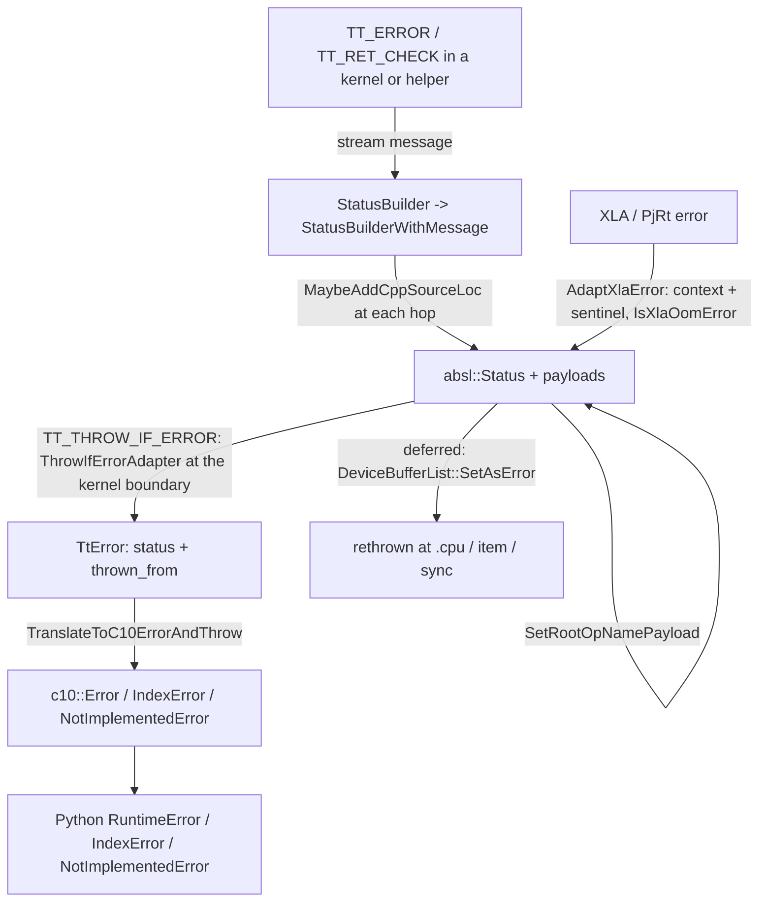

# Error handling, from absl::Status to Python exceptions

## Overview
Inside TorchTPU an error is an `absl::Status`, never an exception, until it reaches the ATen
kernel boundary. The `TT_` macro family (`TT_ERROR`, `TT_RET_CHECK`, `TT_ASSIGN_OR_RETURN`,
`TT_RETURN_IF_ERROR`, `TT_THROW_IF_ERROR`, `TT_ASSIGN_OR_THROW`, `TT_CHECK_THROW`) builds and
propagates statuses through a [`StatusBuilder`](https://github.com/google-pytorch/torch_tpu/blob/6d2a45754bdb52743883f75fbf753408345f6d1b/csrc/common/status_builder.h#L63 "csrc/common/status_builder.h#StatusBuilder")
that forces a streamed message, and, when `TORCH_SHOW_CPP_STACKTRACES=1`, appends a
`file:line: function()` line to a payload at every hop so the *history* of the status is recoverable.
At the boundary the macros throw a [`TtError`](https://github.com/google-pytorch/torch_tpu/blob/6d2a45754bdb52743883f75fbf753408345f6d1b/csrc/common/error_utils.h#L348 "csrc/common/error_utils.h#TtError"),
a `std::runtime_error` that still carries the status and the throw site, and the kernel wrapper
calls [`TranslateToC10ErrorAndThrow`](https://github.com/google-pytorch/torch_tpu/blob/6d2a45754bdb52743883f75fbf753408345f6d1b/csrc/common/error_utils.cc#L1223 "csrc/common/error_utils.cc#TranslateToC10ErrorAndThrow")
to turn it into the `c10::Error` subclass PyTorch maps to the right Python exception. The user-facing
message is `<root op>(): <message>` whenever the status carries a root-op payload, where the root op
is the op the user actually called, even when the failure happened deep inside a helper op; a status
created without that payload (for example a raw XLA status wrapped by the XLA adapter) is shown
without the prefix.

## Diagram

Legend:
- `M` - (concept) macro call sites, external errors, the Python surface, and the deferred path described in [deferred-execution-and-materialization](deferred-execution-and-materialization.md)
- `X` - (concept) macro call sites, external errors, the Python surface, and the deferred path described in [deferred-execution-and-materialization](deferred-execution-and-materialization.md)
- `PY` - (concept) macro call sites, external errors, the Python surface, and the deferred path described in [deferred-execution-and-materialization](deferred-execution-and-materialization.md)
- `LATER` - (concept) macro call sites, external errors, the Python surface, and the deferred path described in [deferred-execution-and-materialization](deferred-execution-and-materialization.md)
- `SB` - [`StatusBuilder`](https://github.com/google-pytorch/torch_tpu/blob/6d2a45754bdb52743883f75fbf753408345f6d1b/csrc/common/status_builder.h#L63 "csrc/common/status_builder.h#StatusBuilder") / [`StatusBuilderWithMessage`](https://github.com/google-pytorch/torch_tpu/blob/6d2a45754bdb52743883f75fbf753408345f6d1b/csrc/common/status_builder.h#L195 "csrc/common/status_builder.h#StatusBuilderWithMessage")
- `ST` - (concept) `absl::Status` enriched by [`MaybeAddCppSourceLoc`](https://github.com/google-pytorch/torch_tpu/blob/6d2a45754bdb52743883f75fbf753408345f6d1b/csrc/common/status_builder.cc#L148 "csrc/common/status_builder.cc#MaybeAddCppSourceLoc") and [`SetRootOpNamePayload`](https://github.com/google-pytorch/torch_tpu/blob/6d2a45754bdb52743883f75fbf753408345f6d1b/csrc/common/status_builder.cc#L136 "csrc/common/status_builder.cc#SetRootOpNamePayload"); XLA errors via [`AdaptXlaError`](https://github.com/google-pytorch/torch_tpu/blob/6d2a45754bdb52743883f75fbf753408345f6d1b/csrc/common/error_utils.cc#L986 "csrc/common/error_utils.cc#AdaptXlaError")
- `TE` - [`TtError`](https://github.com/google-pytorch/torch_tpu/blob/6d2a45754bdb52743883f75fbf753408345f6d1b/csrc/common/error_utils.h#L348 "csrc/common/error_utils.h#TtError")
- `C10` - [`TranslateToC10ErrorAndThrow`](https://github.com/google-pytorch/torch_tpu/blob/6d2a45754bdb52743883f75fbf753408345f6d1b/csrc/common/error_utils.cc#L1223 "csrc/common/error_utils.cc#TranslateToC10ErrorAndThrow")

## Design rationale (why it's built this way)
- **Status codes double as Python exception kinds.** The `error` namespace aliases the absl codes
  and adds three Python-flavored aliases: `kPythonIndexError` (out of range),
  `kPythonNotImplementedError` (unimplemented) and `kPythonRuntimeError` (unknown). A kernel author
  picks the alias that names the *Python* behavior they want, and
  [`TranslateToC10ErrorAndThrow`](https://github.com/google-pytorch/torch_tpu/blob/6d2a45754bdb52743883f75fbf753408345f6d1b/csrc/common/error_utils.cc#L1223 "csrc/common/error_utils.cc#TranslateToC10ErrorAndThrow")
  keeps the promise: out-of-range becomes `c10::IndexError`, unimplemented becomes
  `c10::NotImplementedError`, everything else `c10::Error` (a TODO notes more codes could be mapped).
- **A message is mandatory, by type.** [`StatusBuilder`](https://github.com/google-pytorch/torch_tpu/blob/6d2a45754bdb52743883f75fbf753408345f6d1b/csrc/common/status_builder.h#L63 "csrc/common/status_builder.h#StatusBuilder")
  cannot convert to `absl::Status` until something has been streamed into it; the conversion operator
  is a template whose instantiation fires a `static_assert`, so `return TT_ERROR(code);` with no text
  is a compile error. Once a message exists the result is a
  [`StatusBuilderWithMessage`](https://github.com/google-pytorch/torch_tpu/blob/6d2a45754bdb52743883f75fbf753408345f6d1b/csrc/common/status_builder.h#L195 "csrc/common/status_builder.h#StatusBuilderWithMessage")
  that converts implicitly to `Status` or `StatusOr<T>`. `SetPrepend()` and `SetOverride()` let
  propagation sites add context ("materialization failed with: ...") without losing the original.
- **The C++ trace is opt-in and cheap when off.** [`MaybeAddCppSourceLoc`](https://github.com/google-pytorch/torch_tpu/blob/6d2a45754bdb52743883f75fbf753408345f6d1b/csrc/common/status_builder.cc#L148 "csrc/common/status_builder.cc#MaybeAddCppSourceLoc")
  only appends to the payload when [`TorchShowCppStacktraces`](https://github.com/google-pytorch/torch_tpu/blob/6d2a45754bdb52743883f75fbf753408345f6d1b/csrc/common/status_builder.cc#L34 "csrc/common/status_builder.cc#TorchShowCppStacktraces")
  says the env var is set; the payload is a multi-line `<file>:<line>: <function>()` history from
  origin upward, recording, per the header comment, where a status was "created or propagated up the
  call stack". [`GetMessageWithCppErrorTrace`](https://github.com/google-pytorch/torch_tpu/blob/6d2a45754bdb52743883f75fbf753408345f6d1b/csrc/common/status_builder.cc#L162 "csrc/common/status_builder.cc#GetMessageWithCppErrorTrace")
  folds it into the message at throw time. The final message additionally gets PyTorch's own C++
  stack trace when the env var is `1` (external builds) or unless it is `0` (internal builds).
- **Errors name the user's op, not the helper.** [`SetRootOpNamePayload`](https://github.com/google-pytorch/torch_tpu/blob/6d2a45754bdb52743883f75fbf753408345f6d1b/csrc/common/status_builder.cc#L136 "csrc/common/status_builder.cc#SetRootOpNamePayload")
  stores the [`GetRootOpName`](https://github.com/google-pytorch/torch_tpu/blob/6d2a45754bdb52743883f75fbf753408345f6d1b/csrc/ops/python_context.cc#L325 "csrc/ops/python_context.cc#GetRootOpName") result
  (the first op in the call chain, see [python-context-and-op-names](python-context-and-op-names.md))
  in a payload, and [`GetRootOpNamePayload`](https://github.com/google-pytorch/torch_tpu/blob/6d2a45754bdb52743883f75fbf753408345f6d1b/csrc/common/status_builder.cc#L142 "csrc/common/status_builder.cc#GetRootOpNamePayload")
  reads it back when the message is formatted as `<root op>(): ...`. This is why a failure inside
  `mm.out` called from `linear` reads `linear(): ...`.
- **XLA errors are quarantined behind a sentinel.** [`AdaptXlaError`](https://github.com/google-pytorch/torch_tpu/blob/6d2a45754bdb52743883f75fbf753408345f6d1b/csrc/common/error_utils.cc#L986 "csrc/common/error_utils.cc#AdaptXlaError")
  wraps an XLA or PjRt status with TorchTPU context followed by the sentinel
  " -- the XLA compiler failed with: ", and [`AdaptExternalErrorMessage`](https://github.com/google-pytorch/torch_tpu/blob/6d2a45754bdb52743883f75fbf753408345f6d1b/csrc/common/error_utils.cc#L786 "csrc/common/error_utils.cc#AdaptExternalErrorMessage")
  normalizes external text. The internal message-style checker skips everything after the sentinel.
  Separately, [`IsXlaOomError`](https://github.com/google-pytorch/torch_tpu/blob/6d2a45754bdb52743883f75fbf753408345f6d1b/csrc/common/error_utils.cc#L911 "csrc/common/error_utils.cc#IsXlaOomError")
  recognizes a device out-of-memory condition by status code alone (resource-exhausted, or internal
  with `allocation_size` in the message), independent of the sentinel.
- **Message style is enforced in internal debug builds.** `error_utils.cc` carries a checker
  (lowercase first letter unless the message starts with an allowed proper noun such as TorchTPU,
  PjRt or XLA; no leading or trailing whitespace; PyTorch dtype names like `float32` instead of
  `f32`; "expected ..., got ..." ordering) that hard-crashes on violations when the guideline macro is
  enabled, so error text stays consistent across hundreds of kernels.

> [!inferred]
> For a user, the two switches that change what an error looks like are
> `TORCH_SHOW_CPP_STACKTRACES=1` (C++ origin trace and PyTorch's C++ backtrace) and
> `TORCH_TPU_ENABLE_DEBUG_CHECKS=1` (renamed from `TORCH_TPU_INTERNAL_ENABLE_DEBUG_CHECKS`, read once by
> [`GetEnableDebugChecks`](https://github.com/google-pytorch/torch_tpu/blob/6d2a45754bdb52743883f75fbf753408345f6d1b/csrc/common/error_utils.cc#L811 "csrc/common/error_utils.cc#GetEnableDebugChecks");
> enables expensive validation that the header says "catches more bugs in user code" at a
> significant per-op cost and is on by default in the debug eager mode). Everything else in an error
> message is deterministic given the failing op.

## Entry points
- The `TT_` macros are the only intended way to create or propagate an error; their expansion
  routes through [`StatusBuilder`](https://github.com/google-pytorch/torch_tpu/blob/6d2a45754bdb52743883f75fbf753408345f6d1b/csrc/common/status_builder.h#L63 "csrc/common/status_builder.h#StatusBuilder")
  (create), [`ReturnIfErrorAdaptor`](https://github.com/google-pytorch/torch_tpu/blob/6d2a45754bdb52743883f75fbf753408345f6d1b/csrc/common/error_utils.h#L831 "csrc/common/error_utils.h#ReturnIfErrorAdaptor")
  (propagate as a status while allowing `.SetPrepend() << ...` chaining) and
  [`ThrowIfErrorAdapter`](https://github.com/google-pytorch/torch_tpu/blob/6d2a45754bdb52743883f75fbf753408345f6d1b/csrc/common/error_utils.h#L791 "csrc/common/error_utils.h#ThrowIfErrorAdapter")
  (propagate as a [`TtError`](https://github.com/google-pytorch/torch_tpu/blob/6d2a45754bdb52743883f75fbf753408345f6d1b/csrc/common/error_utils.h#L348 "csrc/common/error_utils.h#TtError") at the boundary).
  [`GetStatus`](https://github.com/google-pytorch/torch_tpu/blob/6d2a45754bdb52743883f75fbf753408345f6d1b/csrc/common/error_utils.h#L329 "csrc/common/error_utils.h#GetStatus") lets the macros accept a
  `Status` or a `StatusOr<T>` uniformly.
- [`TranslateToC10ErrorAndThrow`](https://github.com/google-pytorch/torch_tpu/blob/6d2a45754bdb52743883f75fbf753408345f6d1b/csrc/common/error_utils.cc#L1223 "csrc/common/error_utils.cc#TranslateToC10ErrorAndThrow")
  is called by the kernel wrapper macros (see [aten-kernel-authoring](aten-kernel-authoring.md))
  around every kernel body; a `TtError` that escapes a kernel not yet migrated to the wrapper still
  reads correctly because its `runtime_error` text was formatted the same way at construction.
- [`AdaptXlaError`](https://github.com/google-pytorch/torch_tpu/blob/6d2a45754bdb52743883f75fbf753408345f6d1b/csrc/common/error_utils.cc#L986 "csrc/common/error_utils.cc#AdaptXlaError") is applied at the
  compile and execute boundaries in the [compilation pipeline](compilation-pipeline.md) and the
  materialization worker.
- Small validators used by many kernels: [`SafeWrapDim`](https://github.com/google-pytorch/torch_tpu/blob/6d2a45754bdb52743883f75fbf753408345f6d1b/csrc/common/error_utils.cc#L871 "csrc/common/error_utils.cc#SafeWrapDim")
  (negative dimension indices wrap and out-of-range ones become index errors) and
  [`CheckDeviceIsTpu`](https://github.com/google-pytorch/torch_tpu/blob/6d2a45754bdb52743883f75fbf753408345f6d1b/csrc/common/error_utils.cc#L904 "csrc/common/error_utils.cc#CheckDeviceIsTpu").

## Mechanism (step-by-step)
1. **Create.** `TT_ERROR(code) << "..."` constructs a [`StatusBuilder`](https://github.com/google-pytorch/torch_tpu/blob/6d2a45754bdb52743883f75fbf753408345f6d1b/csrc/common/status_builder.h#L63 "csrc/common/status_builder.h#StatusBuilder")
   with the code, streams the message, and, through [`MaybeAddCppSourceLoc`](https://github.com/google-pytorch/torch_tpu/blob/6d2a45754bdb52743883f75fbf753408345f6d1b/csrc/common/status_builder.cc#L148 "csrc/common/status_builder.cc#MaybeAddCppSourceLoc"),
   records the origin `file:line: function()` when traces are enabled. `TT_RET_CHECK(cond, code)`
   is the same with a condition; the `__func__` of the enclosing function is captured for the trace.
2. **Propagate.** `TT_RETURN_IF_ERROR(expr)` and `TT_ASSIGN_OR_RETURN(lhs, expr)` evaluate once,
   hand the status to [`ReturnIfErrorAdaptor`](https://github.com/google-pytorch/torch_tpu/blob/6d2a45754bdb52743883f75fbf753408345f6d1b/csrc/common/error_utils.h#L831 "csrc/common/error_utils.h#ReturnIfErrorAdaptor"),
   append another trace line, and return early; an optional `.SetPrepend() << "context"` adds the
   caller's framing. Compile and execute failures from XLA pass through
   [`AdaptXlaError`](https://github.com/google-pytorch/torch_tpu/blob/6d2a45754bdb52743883f75fbf753408345f6d1b/csrc/common/error_utils.cc#L986 "csrc/common/error_utils.cc#AdaptXlaError") first, so the
   sentinel separates TorchTPU text from compiler text.
3. **Attach the op.** At creation, `TT_ERROR` and `TT_CHECK_THROW` call [`SetRootOpNamePayload`](https://github.com/google-pytorch/torch_tpu/blob/6d2a45754bdb52743883f75fbf753408345f6d1b/csrc/common/status_builder.cc#L136 "csrc/common/status_builder.cc#SetRootOpNamePayload")
   with the root op of the creating thread, and the payload survives worker threads and deferred
   execution; propagation does not change it. A status created while a traversal builds an op's MLIR
   (under that op's captured Python context) and stored on a deferred buffer list (see [deferred-execution-and-materialization](deferred-execution-and-materialization.md))
   is rethrown later with the op that created the buffer, not the op that read it.
4. **Throw at the boundary.** `TT_THROW_IF_ERROR` / `TT_ASSIGN_OR_THROW` use
   [`ThrowIfErrorAdapter`](https://github.com/google-pytorch/torch_tpu/blob/6d2a45754bdb52743883f75fbf753408345f6d1b/csrc/common/error_utils.h#L791 "csrc/common/error_utils.h#ThrowIfErrorAdapter") to
   construct a [`TtError`](https://github.com/google-pytorch/torch_tpu/blob/6d2a45754bdb52743883f75fbf753408345f6d1b/csrc/common/error_utils.h#L348 "csrc/common/error_utils.h#TtError") from a non-OK status
   and the current `c10::SourceLocation`; the constructor asserts the status is not OK and formats a
   `runtime_error` message immediately so an uncaught `TtError` is still readable.
5. **Translate.** [`TranslateToC10ErrorAndThrow`](https://github.com/google-pytorch/torch_tpu/blob/6d2a45754bdb52743883f75fbf753408345f6d1b/csrc/common/error_utils.cc#L1223 "csrc/common/error_utils.cc#TranslateToC10ErrorAndThrow")
   optionally runs the style checker, rebuilds the message from [`GetMessageWithCppErrorTrace`](https://github.com/google-pytorch/torch_tpu/blob/6d2a45754bdb52743883f75fbf753408345f6d1b/csrc/common/status_builder.cc#L162 "csrc/common/status_builder.cc#GetMessageWithCppErrorTrace")
   plus the PyTorch backtrace policy decided by [`TorchShowCppStacktraces`](https://github.com/google-pytorch/torch_tpu/blob/6d2a45754bdb52743883f75fbf753408345f6d1b/csrc/common/status_builder.cc#L34 "csrc/common/status_builder.cc#TorchShowCppStacktraces"),
   prefixes the root op from [`GetRootOpNamePayload`](https://github.com/google-pytorch/torch_tpu/blob/6d2a45754bdb52743883f75fbf753408345f6d1b/csrc/common/status_builder.cc#L142 "csrc/common/status_builder.cc#GetRootOpNamePayload"),
   and throws the `c10::Error` subclass selected by the status code; PyTorch's binding layer then
   raises the corresponding Python exception.

## Key data structures
- [`TtError`](https://github.com/google-pytorch/torch_tpu/blob/6d2a45754bdb52743883f75fbf753408345f6d1b/csrc/common/error_utils.h#L348 "csrc/common/error_utils.h#TtError"): `status()` (never OK) and
  `thrown_from()`; copyable and movable.
- [`StatusBuilder`](https://github.com/google-pytorch/torch_tpu/blob/6d2a45754bdb52743883f75fbf753408345f6d1b/csrc/common/status_builder.h#L63 "csrc/common/status_builder.h#StatusBuilder"): original
  status, additional message, prepend/override mode; no-op when the original is OK.
- Payload URLs: `type.googleapis.com/torch_tpu.cpp_error_trace` (multi-line trace) and
  `type.googleapis.com/torch_tpu.root_op_name`.
- The sentinel string ` -- the XLA compiler failed with: ` used by [`AdaptXlaError`](https://github.com/google-pytorch/torch_tpu/blob/6d2a45754bdb52743883f75fbf753408345f6d1b/csrc/common/error_utils.cc#L986 "csrc/common/error_utils.cc#AdaptXlaError").

## Dynamics (design intent)
- Trace collection is memoized per process ([`TorchShowCppStacktraces`](https://github.com/google-pytorch/torch_tpu/blob/6d2a45754bdb52743883f75fbf753408345f6d1b/csrc/common/status_builder.cc#L34 "csrc/common/status_builder.cc#TorchShowCppStacktraces")
  and [`GetEnableDebugChecks`](https://github.com/google-pytorch/torch_tpu/blob/6d2a45754bdb52743883f75fbf753408345f6d1b/csrc/common/error_utils.cc#L811 "csrc/common/error_utils.cc#GetEnableDebugChecks")
  read their env vars once), so toggling them mid-process has no effect.
- Statuses are plain values and cross threads freely; exceptions only ever exist on the dispatching
  thread at the kernel boundary, which is what allows the worker threads in materialization and
  compilation to be exception-free.

## Edge cases
- A `TtError` thrown from a kernel that is not wrapped by the kernel macros reaches PyTorch as a
  generic `std::runtime_error`; the message is intact but the exception type is `RuntimeError`
  regardless of code.
- Device OOM arrives as an XLA status; [`IsXlaOomError`](https://github.com/google-pytorch/torch_tpu/blob/6d2a45754bdb52743883f75fbf753408345f6d1b/csrc/common/error_utils.cc#L911 "csrc/common/error_utils.cc#IsXlaOomError")
  treats every resource-exhausted status (and internal ones mentioning `allocation_size`) as OOM.
- The style checker treats text after the XLA sentinel as untouchable, so raw compiler messages are
  passed through verbatim.
- [`SafeWrapDim`](https://github.com/google-pytorch/torch_tpu/blob/6d2a45754bdb52743883f75fbf753408345f6d1b/csrc/common/error_utils.cc#L871 "csrc/common/error_utils.cc#SafeWrapDim") uses the index-error
  code, so a bad `dim=` argument surfaces as Python `IndexError`, matching CPU PyTorch.

## Open questions
- Which additional status codes will be mapped to dedicated `c10::Error` subclasses (the source
  marks this as a TODO).

## See also
- [eager-op-dispatch](eager-op-dispatch.md): where the root op payload is attached during dispatch.
- [aten-kernel-authoring](aten-kernel-authoring.md): the kernel wrapper that catches `TtError`.
- [python-context-and-op-names](python-context-and-op-names.md): how the root op name is determined.
- [deferred-execution-and-materialization](deferred-execution-and-materialization.md): errors stored on buffers and rethrown at await.
- [compilation-pipeline](compilation-pipeline.md): XLA compile errors and the sentinel.
