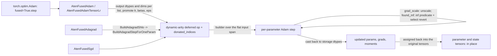

# Fused optimizer kernels (Adam, AdamW, SGD, Adagrad)

## Overview
PyTorch's `fused=True` optimizers call `_fused_adam`, `_fused_adamw`, `_fused_sgd` and
`_fused_adagrad`, each taking *lists* of parameters, gradients and state tensors. TorchTPU
registers [`AtenFusedAdam`](https://github.com/google-pytorch/torch_tpu/blob/6d2a45754bdb52743883f75fbf753408345f6d1b/csrc/ops/fused_adam/fused_adam_aten_kernels.cc#L690 "csrc/ops/fused_adam/fused_adam_aten_kernels.cc#AtenFusedAdam"),
[`AtenFusedAdamw`](https://github.com/google-pytorch/torch_tpu/blob/6d2a45754bdb52743883f75fbf753408345f6d1b/csrc/ops/fused_adamw/fused_adamw_aten_kernels.cc#L675 "csrc/ops/fused_adamw/fused_adamw_aten_kernels.cc#AtenFusedAdamw"),
[`AtenFusedSgd`](https://github.com/google-pytorch/torch_tpu/blob/6d2a45754bdb52743883f75fbf753408345f6d1b/csrc/ops/fused_sgd/fused_sgd_aten_kernels.cc#L638 "csrc/ops/fused_sgd/fused_sgd_aten_kernels.cc#AtenFusedSgd") and
[`AtenFusedAdagrad`](https://github.com/google-pytorch/torch_tpu/blob/6d2a45754bdb52743883f75fbf753408345f6d1b/csrc/ops/fused_adagrad/fused_adagrad_aten_kernels.cc#L543 "csrc/ops/fused_adagrad/fused_adagrad_aten_kernels.cc#AtenFusedAdagrad")
(plus the `TensorLr` variants that take the learning rate as a tensor) as one dynamic-arity
deferred op per call: all lists are flattened into a single input span, the StableHLO for every
parameter is built in one program, and the outputs are assigned back into the original parameter
and state tensors in place. The approach matters on TPU for two reasons the source spells out.
First, one executable per optimizer step replaces hundreds of tiny per-parameter programs.
Second, control flow is avoided: where CUDA kernels early-return on `found_inf`, the StableHLO
graph "unconditionally compute[s] the update and appl[ies] a predicated multiplexer" so no
host-device sync is needed. The mutated inputs (parameters, moments, and gradients when they are
unscaled) are also marked as donated, so XLA can reuse their HBM buffers for the outputs instead of
holding two copies of every optimizer state during the step. On the Python side, `torch_tpu` ships a forked `AdamW` that
pre-allocates optimizer state on the device so `torch.compile` does not graph-break on lazily
created CPU `step` counters, and Meta kernels (no-ops for the in-place schemas, `empty_like`
outputs for the functional ones) let `FakeTensor` tracing in `torch.compile` see these ops.

## Diagram

Legend:
- `OPT` - (concept) the PyTorch `fused=True` optimizer caller
- `DO` - (concept) the dynamic-arity deferred op of [eager-op-dispatch](eager-op-dispatch.md), with the donated input indices
- `OUT` - (concept) the output buffers of the one compiled program
- `T` - (concept) the original parameter and state tensors the buffers are assigned into
- `K` - [`AtenFusedAdam`](https://github.com/google-pytorch/torch_tpu/blob/6d2a45754bdb52743883f75fbf753408345f6d1b/csrc/ops/fused_adam/fused_adam_aten_kernels.cc#L690 "csrc/ops/fused_adam/fused_adam_aten_kernels.cc#AtenFusedAdam") / [`AtenFusedAdamTensorLr`](https://github.com/google-pytorch/torch_tpu/blob/6d2a45754bdb52743883f75fbf753408345f6d1b/csrc/ops/fused_adam/fused_adam_aten_kernels.cc#L741 "csrc/ops/fused_adam/fused_adam_aten_kernels.cc#AtenFusedAdamTensorLr"); the AdamW pair is [`AtenFusedAdamw`](https://github.com/google-pytorch/torch_tpu/blob/6d2a45754bdb52743883f75fbf753408345f6d1b/csrc/ops/fused_adamw/fused_adamw_aten_kernels.cc#L675 "csrc/ops/fused_adamw/fused_adamw_aten_kernels.cc#AtenFusedAdamw") / [`AtenFusedAdamwTensorLr`](https://github.com/google-pytorch/torch_tpu/blob/6d2a45754bdb52743883f75fbf753408345f6d1b/csrc/ops/fused_adamw/fused_adamw_aten_kernels.cc#L725 "csrc/ops/fused_adamw/fused_adamw_aten_kernels.cc#AtenFusedAdamwTensorLr")
- `P` - (concept) the per-parameter Adam builder in `fused_adam_aten_kernels.cc`
- `ADA` - [`AtenFusedAdagrad`](https://github.com/google-pytorch/torch_tpu/blob/6d2a45754bdb52743883f75fbf753408345f6d1b/csrc/ops/fused_adagrad/fused_adagrad_aten_kernels.cc#L543 "csrc/ops/fused_adagrad/fused_adagrad_aten_kernels.cc#AtenFusedAdagrad") / [`AtenFusedAdagradTensorLr`](https://github.com/google-pytorch/torch_tpu/blob/6d2a45754bdb52743883f75fbf753408345f6d1b/csrc/ops/fused_adagrad/fused_adagrad_aten_kernels.cc#L584 "csrc/ops/fused_adagrad/fused_adagrad_aten_kernels.cc#AtenFusedAdagradTensorLr") via [`BuildAdagradShlo`](https://github.com/google-pytorch/torch_tpu/blob/6d2a45754bdb52743883f75fbf753408345f6d1b/csrc/ops/fused_adagrad/fused_adagrad_aten_kernels.cc#L355 "csrc/ops/fused_adagrad/fused_adagrad_aten_kernels.cc#BuildAdagradShlo") and [`BuildAdagradStepForOneParam`](https://github.com/google-pytorch/torch_tpu/blob/6d2a45754bdb52743883f75fbf753408345f6d1b/csrc/ops/fused_adagrad/fused_adagrad_aten_kernels.cc#L182 "csrc/ops/fused_adagrad/fused_adagrad_aten_kernels.cc#BuildAdagradStepForOneParam")
- `SGD` - [`AtenFusedSgd`](https://github.com/google-pytorch/torch_tpu/blob/6d2a45754bdb52743883f75fbf753408345f6d1b/csrc/ops/fused_sgd/fused_sgd_aten_kernels.cc#L638 "csrc/ops/fused_sgd/fused_sgd_aten_kernels.cc#AtenFusedSgd") / [`AtenFusedSgdTensorLr`](https://github.com/google-pytorch/torch_tpu/blob/6d2a45754bdb52743883f75fbf753408345f6d1b/csrc/ops/fused_sgd/fused_sgd_aten_kernels.cc#L682 "csrc/ops/fused_sgd/fused_sgd_aten_kernels.cc#AtenFusedSgdTensorLr")

## Design rationale (why it's built this way)
- **One program for the whole parameter list.** The kernels collect dtypes and dimensions of
  every tensor in every list into flat vectors and dispatch a single deferred op with dynamic
  input and output counts; the builder slices the flat span back into per-list spans and loops
  over parameters, pre-allocating the result vector "to eliminate intermediate heap
  allocations". The program's cache key depends on list lengths, shapes and dtypes plus the flags
  (see [compilation-cache-key](compilation-cache-key.md)), so a model's optimizer step compiles
  once.
- **Branch-free AMP.** The comment on the found-inf revert explains the architectural
  difference: upstream CUDA kernels `return` early when `found_inf` is set, but "StableHLO
  dataflow graphs are static pipelines that do not support dynamic per-kernel branching without
  incurring host-device sync overhead", so the update is always computed and `stablehlo.select`
  restores the pre-step parameter, gradient and moments when the inf predicate is true. Adam
  computes the predicate once per group from the `found_inf` tensor; AdamW, SGD and Adagrad
  recompute it inside each parameter's revert. Gradient scaling divides the
  gradient by `grad_scale` inside the same program and returns the unscaled gradient as an extra
  output when scaling is on.
- **Compute in float32 (or float64), store in the parameter dtype.** Each parameter's update
  converts inputs and hyperparameters to a shared computation type (float64 only if the parameter
  or first moment is float64) and casts results back per output buffer, so bfloat16 parameters get
  float32 math without changing their storage dtype (see [dtype-and-precision](dtype-and-precision.md)).
- **Algebra for precision and speed.** The bias-corrected step multiplies numerator and
  denominator by `sqrt(1 - beta2^t)`, which the comment says "replaces an O(N) tensor division with
  O(1) scalar multiplications and improves IEEE floating-point precision in low-precision
  training"; step, lr, betas, eps and weight decay are 0-d scalars broadcast on demand with
  `BroadcastIfNeeded` (see [stablehlo-op-builder](stablehlo-op-builder.md)).
- **Hyperparameters are arguments, not constants.** `lr`, `beta1`, `beta2`, `eps` and
  `weight_decay` arrive as promoted scalars or tensors, and only the boolean modes (amsgrad,
  maximize, whether grad scale or found inf are present) enter the cache keys, so a learning-rate
  schedule never recompiles the optimizer program.
- **Donate every buffer the step overwrites.** Each kernel builds a list of donated input indices
  for the tensors it mutates in place: parameters, first and second moments, the amsgrad max
  moment, the SGD momentum buffers or Adagrad state sums, and the gradients only when `grad_scale`
  is present (because only then is the unscaled gradient written back). The source comment says
  the indices are selected "to donate to XLA for HBM buffer reuse"; `state_steps` are not donated
  "because step counters are scalars". For a large model this is the difference between holding
  one or two copies of the optimizer state at the peak of the step.
- **Meta kernels so `torch.compile` can trace the ops.** The fused kernel files also define Meta
  kernels: no-ops for the in-place schemas (they return nothing and do not change shapes or
  dtypes), and `empty_like` outputs for the functional `_fused_*` schemas that AOTAutograd produces
  when it functionalizes the in-place calls. The `tensor_lr` overloads exist so that, in the
  source's words, "`torch.compile` does not recompile on LR schedule steps".
- **A forked AdamW for `torch.compile`.** The Python `AdamW` subclass documents why it exists:
  lazily allocated CPU `step` tensors "cause compilation errors or graph breaks on TPU backends",
  so it allocates state eagerly on the device at construction, and it replaces the `_init_group`
  hook that Dynamo intercepts with a private method to avoid an "unconditional graph break" when
  parameters have pending mutations. Both live under `src/torch_tpu/_internal/optim/`. A companion patch module swaps PyTorch's
  `_use_grad_for_differentiable` decorator for one that does not insert graph breaks.

> [!inferred]
> Onboarding guidance that follows: keep `fused=True` (or `foreach` fallbacks) rather than
> hand-rolled optimizer loops, expect the first step to compile one large program, and prefer
> `torch_tpu`'s `AdamW` when compiling the training step with `torch.compile`. Gradient clipping
> and other per-parameter Python loops outside the fused call remain separate ops.

## Entry points
- [`AtenFusedAdam`](https://github.com/google-pytorch/torch_tpu/blob/6d2a45754bdb52743883f75fbf753408345f6d1b/csrc/ops/fused_adam/fused_adam_aten_kernels.cc#L690 "csrc/ops/fused_adam/fused_adam_aten_kernels.cc#AtenFusedAdam"),
  [`AtenFusedAdamTensorLr`](https://github.com/google-pytorch/torch_tpu/blob/6d2a45754bdb52743883f75fbf753408345f6d1b/csrc/ops/fused_adam/fused_adam_aten_kernels.cc#L741 "csrc/ops/fused_adam/fused_adam_aten_kernels.cc#AtenFusedAdamTensorLr"),
  [`AtenFusedAdamw`](https://github.com/google-pytorch/torch_tpu/blob/6d2a45754bdb52743883f75fbf753408345f6d1b/csrc/ops/fused_adamw/fused_adamw_aten_kernels.cc#L675 "csrc/ops/fused_adamw/fused_adamw_aten_kernels.cc#AtenFusedAdamw"),
  [`AtenFusedAdamwTensorLr`](https://github.com/google-pytorch/torch_tpu/blob/6d2a45754bdb52743883f75fbf753408345f6d1b/csrc/ops/fused_adamw/fused_adamw_aten_kernels.cc#L725 "csrc/ops/fused_adamw/fused_adamw_aten_kernels.cc#AtenFusedAdamwTensorLr"),
  [`AtenFusedSgd`](https://github.com/google-pytorch/torch_tpu/blob/6d2a45754bdb52743883f75fbf753408345f6d1b/csrc/ops/fused_sgd/fused_sgd_aten_kernels.cc#L638 "csrc/ops/fused_sgd/fused_sgd_aten_kernels.cc#AtenFusedSgd"),
  [`AtenFusedSgdTensorLr`](https://github.com/google-pytorch/torch_tpu/blob/6d2a45754bdb52743883f75fbf753408345f6d1b/csrc/ops/fused_sgd/fused_sgd_aten_kernels.cc#L682 "csrc/ops/fused_sgd/fused_sgd_aten_kernels.cc#AtenFusedSgdTensorLr"),
  [`AtenFusedAdagrad`](https://github.com/google-pytorch/torch_tpu/blob/6d2a45754bdb52743883f75fbf753408345f6d1b/csrc/ops/fused_adagrad/fused_adagrad_aten_kernels.cc#L543 "csrc/ops/fused_adagrad/fused_adagrad_aten_kernels.cc#AtenFusedAdagrad"),
  [`AtenFusedAdagradTensorLr`](https://github.com/google-pytorch/torch_tpu/blob/6d2a45754bdb52743883f75fbf753408345f6d1b/csrc/ops/fused_adagrad/fused_adagrad_aten_kernels.cc#L584 "csrc/ops/fused_adagrad/fused_adagrad_aten_kernels.cc#AtenFusedAdagradTensorLr"):
  registered for the PrivateUse1 fused optimizer schemas in
  [`TORCH_LIBRARY_IMPL_init_aten_PrivateUse1_3`](https://github.com/google-pytorch/torch_tpu/blob/6d2a45754bdb52743883f75fbf753408345f6d1b/csrc/eager/tpu_aten_kernels.cc#L364 "csrc/eager/tpu_aten_kernels.cc#TORCH_LIBRARY_IMPL_init_aten_PrivateUse1_3") (the `aten` PrivateUse1 dispatch table),
  and reached whenever a `fused=True` optimizer steps on TPU tensors.
- [`BuildAdagradShlo`](https://github.com/google-pytorch/torch_tpu/blob/6d2a45754bdb52743883f75fbf753408345f6d1b/csrc/ops/fused_adagrad/fused_adagrad_aten_kernels.cc#L355 "csrc/ops/fused_adagrad/fused_adagrad_aten_kernels.cc#BuildAdagradShlo")
  and [`BuildAdagradStepForOneParam`](https://github.com/google-pytorch/torch_tpu/blob/6d2a45754bdb52743883f75fbf753408345f6d1b/csrc/ops/fused_adagrad/fused_adagrad_aten_kernels.cc#L182 "csrc/ops/fused_adagrad/fused_adagrad_aten_kernels.cc#BuildAdagradStepForOneParam"):
  the Adagrad builders, structured like the Adam ones (validate list sizes, record grad-scale and
  found-inf modes in the cache keys, build per parameter, revert on inf, cast outputs).

## Mechanism (step-by-step)
1. **Validate and describe the lists.** The kernel ([`AtenFusedAdam`](https://github.com/google-pytorch/torch_tpu/blob/6d2a45754bdb52743883f75fbf753408345f6d1b/csrc/ops/fused_adam/fused_adam_aten_kernels.cc#L690 "csrc/ops/fused_adam/fused_adam_aten_kernels.cc#AtenFusedAdam"),
   [`AtenFusedAdamw`](https://github.com/google-pytorch/torch_tpu/blob/6d2a45754bdb52743883f75fbf753408345f6d1b/csrc/ops/fused_adamw/fused_adamw_aten_kernels.cc#L675 "csrc/ops/fused_adamw/fused_adamw_aten_kernels.cc#AtenFusedAdamw"),
   [`AtenFusedSgd`](https://github.com/google-pytorch/torch_tpu/blob/6d2a45754bdb52743883f75fbf753408345f6d1b/csrc/ops/fused_sgd/fused_sgd_aten_kernels.cc#L638 "csrc/ops/fused_sgd/fused_sgd_aten_kernels.cc#AtenFusedSgd") or
   [`AtenFusedAdagrad`](https://github.com/google-pytorch/torch_tpu/blob/6d2a45754bdb52743883f75fbf753408345f6d1b/csrc/ops/fused_adagrad/fused_adagrad_aten_kernels.cc#L543 "csrc/ops/fused_adagrad/fused_adagrad_aten_kernels.cc#AtenFusedAdagrad")), inside its `TT_KERNEL` frame
   ([aten-kernel-authoring](aten-kernel-authoring.md)), checks that parameter, gradient, state and
   step lists have equal lengths, appends each list's MLIR dtypes and dims to the output
   descriptors (real-valued dtypes for complex parameters), and records the grad-scale and
   found-inf modes and boolean flags as cache-key parameters. Before any of this, the scalar
   `lr`, `beta1`, `beta2`, `weight_decay` and `eps` arguments are wrapped by
   [`PromoteScalar`](https://github.com/google-pytorch/torch_tpu/blob/6d2a45754bdb52743883f75fbf753408345f6d1b/csrc/eager/op_dispatcher.cc#L302 "csrc/eager/op_dispatcher.cc#PromoteScalar") and materialized with
   [`GetTensor`](https://github.com/google-pytorch/torch_tpu/blob/6d2a45754bdb52743883f75fbf753408345f6d1b/csrc/common/cache_key.cc#L186 "csrc/common/cache_key.cc#PromotedScalar.GetTensor") at float64 when the parameters are float64
   and float32 otherwise; a non-floating-point parameter list is rejected with a Python
   `NotImplementedError`.
2. **Dispatch one op.** All tensors, followed by the hyperparameter tensors and the optional
   `grad_scale` and `found_inf`, become the inputs of a dynamic-arity deferred op whose output list
   is params, (unscaled grads), first moments, second moments and, with amsgrad, max second
   moments, for [`AtenFusedAdam`](https://github.com/google-pytorch/torch_tpu/blob/6d2a45754bdb52743883f75fbf753408345f6d1b/csrc/ops/fused_adam/fused_adam_aten_kernels.cc#L690 "csrc/ops/fused_adam/fused_adam_aten_kernels.cc#AtenFusedAdam")
   and its siblings. The same call passes the donated input indices for the in-place tensors and
   the flags recorded in the [`OpParamCacheKeys`](https://github.com/google-pytorch/torch_tpu/blob/6d2a45754bdb52743883f75fbf753408345f6d1b/csrc/common/cache_key.h#L541 "csrc/common/cache_key.h#OpParamCacheKeys"), so the compiled program is keyed
   on structure and modes rather than hyperparameter values.
3. **Build per parameter.** The builder (for Adagrad, [`BuildAdagradShlo`](https://github.com/google-pytorch/torch_tpu/blob/6d2a45754bdb52743883f75fbf753408345f6d1b/csrc/ops/fused_adagrad/fused_adagrad_aten_kernels.cc#L355 "csrc/ops/fused_adagrad/fused_adagrad_aten_kernels.cc#BuildAdagradShlo")
   calling [`BuildAdagradStepForOneParam`](https://github.com/google-pytorch/torch_tpu/blob/6d2a45754bdb52743883f75fbf753408345f6d1b/csrc/ops/fused_adagrad/fused_adagrad_aten_kernels.cc#L182 "csrc/ops/fused_adagrad/fused_adagrad_aten_kernels.cc#BuildAdagradStepForOneParam");
   the Adam family follows the same shape) slices spans (only the Adam builder computes the inf
   predicate once up front; the others derive it per parameter), and for each parameter converts to the computation type, unscales and optionally negates the gradient,
   applies coupled weight decay (Adam) or decoupled decay (AdamW), updates the two moments, forms
   the bias-corrected step size and epsilon, takes the amsgrad max if enabled, subtracts the
   update, applies the select-based revert, and casts back.
4. **Write back.** Results are assigned into the original tensors in list order (params, grads,
   moments), which is what makes the op in place from PyTorch's point of view: each original
   tensor of [`AtenFusedAdam`](https://github.com/google-pytorch/torch_tpu/blob/6d2a45754bdb52743883f75fbf753408345f6d1b/csrc/ops/fused_adam/fused_adam_aten_kernels.cc#L690 "csrc/ops/fused_adam/fused_adam_aten_kernels.cc#AtenFusedAdam") and its siblings is rebound to its
   output buffer, and because the matching inputs were donated the old buffers are consumed rather
   than kept alive. The deferred op then materializes with everything else in the step
   ([deferred-execution-and-materialization](deferred-execution-and-materialization.md)).

## Key data structures
- The flat input span layout: `params, grads, exp_avgs, exp_avg_sqs, steps, [max_exp_avg_sqs],
  lr, beta1, beta2, weight_decay, eps, [grad_scale], [found_inf]`, mirrored by the output dtype
  layout.
- Per-parameter result record: param, optional unscaled grad, first and second moments, optional
  max second moment.
- Mode enums for amsgrad, maximize, grad-scale and found-inf presence, encoded into cache keys.
- The donated-index list: flat input positions `[0*N + i]` (params), `[1*N + i]` (grads, only with
  `grad_scale`), `[2*N + i]` and `[3*N + i]` (moments) and `[5*N + i]` (amsgrad max moments) for
  Adam and AdamW; SGD and Adagrad donate params, optional grads and their single state list.

## Dynamics (design intent)
- The optimizer step is one deferred op and therefore one traversal boundary candidate; with
  defer-and-fuse it can join the backward pass program.
- The revert multiplexer costs a select per output tensor every step, the price of avoiding a
  host round trip on `found_inf`.

## Edge cases
- Mismatched list lengths abort with a [`kInvalidArgument`](https://github.com/google-pytorch/torch_tpu/blob/6d2a45754bdb52743883f75fbf753408345f6d1b/csrc/common/error_utils.h#L79 "csrc/common/error_utils.h#kInvalidArgument") error before dispatch; an empty
  parameter list returns without dispatching anything.
- `found_inf` set reverts parameters *and* moments *and* the gradient output, matching CUDA's
  "skip the step" semantics exactly.
- Complex parameters are described by their real value type for output dtype purposes.
- The tensor-lr variants accept a 0-d device tensor; scalar lr is promoted like any other scalar.
- A non-floating-point parameter list raises a Python `NotImplementedError` from inside the kernel
  frame rather than falling back to CPU.

> [!inferred]
> Donation only pays off when nothing else still references the old buffer. If a parameter or
> state slot is aliased through another storage (for example a shallow clone kept by user code),
> the runtime refuses to donate that slot, and peak memory during the step goes back up. See
> Recent changes for the per-slot tracking that made donation work across steps.

## Open questions
- Whether `foreach` (non-fused) optimizer paths are also lowered as multi-tensor programs is
  outside this unit; only the `_fused_*` schemas are covered here.
- The release also ships experimental stateless, functional optimizers for single-trace training
  under `src/torch_tpu/_internal/optimizers/` (AdamW, SGD, Muon); they are not in this unit's
  subgraph and their relationship to the fused kernels is not covered here.

## See also
- [eager-op-dispatch](eager-op-dispatch.md): promoted hyperparameters and dynamic-arity dispatch.
- [dtype-and-precision](dtype-and-precision.md): computation types and casting.
- [stablehlo-op-builder](stablehlo-op-builder.md): broadcasting and constants used by the builders.
- [torch-compile-backend](torch-compile-backend.md): why the Python AdamW fork exists.
- [compilation-cache-key](compilation-cache-key.md): which optimizer flags are keyed.

## Recent changes
- `2d4acc93a` "Track live_data_ptrs per buffer slot in multi-output DeviceBufferLists." The
  commit explains that a single list-wide alias counter across all outputs of a multi-output op
  meant that, for fused optimizers in `DeferNever` mode, the check `live_data_ptrs() <= 1` failed
  from step 2 onward and "silently disabled in-place buffer donation for all parameters and
  optimizer states after step 1". Tracking the counter per output slot restores donation; the
  commit reports roughly 30-40% lower training peak memory on several large models, at the cost of
  slightly constrained XLA buffer assignment on small shapes.
- [all changes in 6d2a45754b](../changes/6d2a45754b.md)
