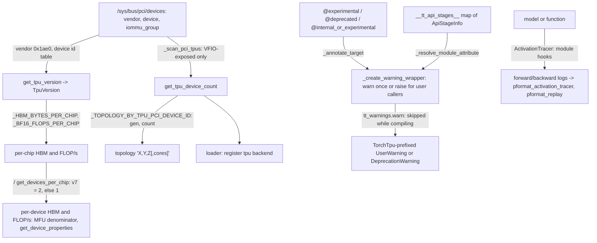

# Hardware introspection, API stage annotations and tracing utilities

## Overview
`torch_tpu._internal.utils` is the leaf toolbox the rest of the package imports, and at this pin it
has three jobs. **Hardware discovery** (`hardware.py`) answers "what TPU is here" by reading
`/sys/bus/pci/devices` rather than by initializing PjRt, which the docstring calls out as "safe to
call at import time and from concurrent processes": it maps Google's PCI vendor id and known device
ids to a [`TpuVersion`](https://github.com/google-pytorch/torch_tpu/blob/6d2a45754bdb52743883f75fbf753408345f6d1b/src/torch_tpu/_internal/utils/hardware.py#L109 "src/torch_tpu/_internal/utils/hardware#TpuVersion"), counts devices exposed via VFIO ([`_scan_pci_tpus`](https://github.com/google-pytorch/torch_tpu/blob/6d2a45754bdb52743883f75fbf753408345f6d1b/src/torch_tpu/_internal/utils/hardware.py#L280 "src/torch_tpu/_internal/utils/hardware#_scan_pci_tpus"),
[`get_tpu_device_count`](https://github.com/google-pytorch/torch_tpu/blob/6d2a45754bdb52743883f75fbf753408345f6d1b/src/torch_tpu/_internal/utils/hardware.py#L322 "src/torch_tpu/_internal/utils/hardware#get_tpu_device_count")), derives the topology a chip count implies for that generation
([`_TOPOLOGY_BY_TPU_PCI_DEVICE_ID`](https://github.com/google-pytorch/torch_tpu/blob/6d2a45754bdb52743883f75fbf753408345f6d1b/src/torch_tpu/_internal/utils/hardware.py#L81 "src/torch_tpu/_internal/utils/hardware#_TOPOLOGY_BY_TPU_PCI_DEVICE_ID._TOPOLOGY_BY_TPU_PCI_DEVICE_ID")), and publishes documented per-chip capacities with the
megacore-aware conversion to per-device figures ([`get_devices_per_chip`](https://github.com/google-pytorch/torch_tpu/blob/6d2a45754bdb52743883f75fbf753408345f6d1b/src/torch_tpu/_internal/utils/hardware.py#L216 "src/torch_tpu/_internal/utils/hardware#get_devices_per_chip")). **API lifecycle
annotations** (`annotations.py`, the most-called part of the unit) stamp every TorchTPU Python API
with a [`Stage`](https://github.com/google-pytorch/torch_tpu/blob/6d2a45754bdb52743883f75fbf753408345f6d1b/src/torch_tpu/_internal/utils/annotations.py#L104 "src/torch_tpu/_internal/utils/annotations#Stage") through [`experimental`](https://github.com/google-pytorch/torch_tpu/blob/6d2a45754bdb52743883f75fbf753408345f6d1b/src/torch_tpu/_internal/utils/annotations.py#L339 "src/torch_tpu/_internal/utils/annotations#experimental"), [`stable`](https://github.com/google-pytorch/torch_tpu/blob/6d2a45754bdb52743883f75fbf753408345f6d1b/src/torch_tpu/_internal/utils/annotations.py#L362 "src/torch_tpu/_internal/utils/annotations#stable"), [`deprecated`](https://github.com/google-pytorch/torch_tpu/blob/6d2a45754bdb52743883f75fbf753408345f6d1b/src/torch_tpu/_internal/utils/annotations.py#L380 "src/torch_tpu/_internal/utils/annotations#deprecated") and
[`internal_or_experimental`](https://github.com/google-pytorch/torch_tpu/blob/6d2a45754bdb52743883f75fbf753408345f6d1b/src/torch_tpu/_internal/utils/annotations.py#L406 "src/torch_tpu/_internal/utils/annotations#internal_or_experimental"), warn once (or raise) when user code calls a non-stable API, and
forbid selected context managers inside `torch.compile` ([`forbid_in_torch_compile`](https://github.com/google-pytorch/torch_tpu/blob/6d2a45754bdb52743883f75fbf753408345f6d1b/src/torch_tpu/_internal/utils/annotations.py#L471 "src/torch_tpu/_internal/utils/annotations#forbid_in_torch_compile")); warnings
go through [`warn`](https://github.com/google-pytorch/torch_tpu/blob/6d2a45754bdb52743883f75fbf753408345f6d1b/src/torch_tpu/_internal/utils/tt_warnings.py#L32 "src/torch_tpu/_internal/utils/tt_warnings#warn"), which never breaks a TorchDynamo graph. **Debugging tracers** (`utils.py`,
`tracer_utils.py`) record what a model executes: an op tracer that counts every dispatched ATen op
([`ops_log`](https://github.com/google-pytorch/torch_tpu/blob/6d2a45754bdb52743883f75fbf753408345f6d1b/src/torch_tpu/_internal/utils/utils.py#L365 "src/torch_tpu/_internal/utils/utils#OpTracer.ops_log")) and [`ActivationTracer`](https://github.com/google-pytorch/torch_tpu/blob/6d2a45754bdb52743883f75fbf753408345f6d1b/src/torch_tpu/_internal/utils/utils.py#L400 "src/torch_tpu/_internal/utils/utils#ActivationTracer"), which hooks `nn.Module` forward and backward
passes, plus formatters such as [`format_model`](https://github.com/google-pytorch/torch_tpu/blob/6d2a45754bdb52743883f75fbf753408345f6d1b/src/torch_tpu/_internal/utils/utils.py#L91 "src/torch_tpu/_internal/utils/utils#format_model") and [`pformat_activation_tracer`](https://github.com/google-pytorch/torch_tpu/blob/6d2a45754bdb52743883f75fbf753408345f6d1b/src/torch_tpu/_internal/utils/tracer_utils.py#L138 "src/torch_tpu/_internal/utils/tracer_utils#pformat_activation_tracer").

## Diagram

Legend:
- `PCI` - (concept) sysfs PCI device directory
- `VER` - [`get_tpu_version`](https://github.com/google-pytorch/torch_tpu/blob/6d2a45754bdb52743883f75fbf753408345f6d1b/src/torch_tpu/_internal/utils/hardware.py#L147 "src/torch_tpu/_internal/utils/hardware#get_tpu_version") returning [`TpuVersion`](https://github.com/google-pytorch/torch_tpu/blob/6d2a45754bdb52743883f75fbf753408345f6d1b/src/torch_tpu/_internal/utils/hardware.py#L109 "src/torch_tpu/_internal/utils/hardware#TpuVersion")
- `CNT` - [`_scan_pci_tpus`](https://github.com/google-pytorch/torch_tpu/blob/6d2a45754bdb52743883f75fbf753408345f6d1b/src/torch_tpu/_internal/utils/hardware.py#L280 "src/torch_tpu/_internal/utils/hardware#_scan_pci_tpus"), [`get_tpu_device_count`](https://github.com/google-pytorch/torch_tpu/blob/6d2a45754bdb52743883f75fbf753408345f6d1b/src/torch_tpu/_internal/utils/hardware.py#L322 "src/torch_tpu/_internal/utils/hardware#get_tpu_device_count")
- `TOPO` - [`_TOPOLOGY_BY_TPU_PCI_DEVICE_ID`](https://github.com/google-pytorch/torch_tpu/blob/6d2a45754bdb52743883f75fbf753408345f6d1b/src/torch_tpu/_internal/utils/hardware.py#L81 "src/torch_tpu/_internal/utils/hardware#_TOPOLOGY_BY_TPU_PCI_DEVICE_ID._TOPOLOGY_BY_TPU_PCI_DEVICE_ID")
- `CHIP` - [`_HBM_BYTES_PER_CHIP`](https://github.com/google-pytorch/torch_tpu/blob/6d2a45754bdb52743883f75fbf753408345f6d1b/src/torch_tpu/_internal/utils/hardware.py#L165 "src/torch_tpu/_internal/utils/hardware#_HBM_BYTES_PER_CHIP._HBM_BYTES_PER_CHIP") and [`_BF16_FLOPS_PER_CHIP`](https://github.com/google-pytorch/torch_tpu/blob/6d2a45754bdb52743883f75fbf753408345f6d1b/src/torch_tpu/_internal/utils/hardware.py#L205 "src/torch_tpu/_internal/utils/hardware#_BF16_FLOPS_PER_CHIP._BF16_FLOPS_PER_CHIP")
- `DEV` - [`get_devices_per_chip`](https://github.com/google-pytorch/torch_tpu/blob/6d2a45754bdb52743883f75fbf753408345f6d1b/src/torch_tpu/_internal/utils/hardware.py#L216 "src/torch_tpu/_internal/utils/hardware#get_devices_per_chip"); consumed by [`device_count`](https://github.com/google-pytorch/torch_tpu/blob/6d2a45754bdb52743883f75fbf753408345f6d1b/src/torch_tpu/_internal/device/_device_module.py#L779 "src/torch_tpu/_internal/device/_device_module#_DeviceModule.device_count")'s pre-initialization fallback and the device properties ([device-backend-registration](device-backend-registration.md))
- `LOADER` - [`load`](https://github.com/google-pytorch/torch_tpu/blob/6d2a45754bdb52743883f75fbf753408345f6d1b/src/torch_tpu/_loader.py#L379 "src/torch_tpu/_loader#load")
- `API` - [`experimental`](https://github.com/google-pytorch/torch_tpu/blob/6d2a45754bdb52743883f75fbf753408345f6d1b/src/torch_tpu/_internal/utils/annotations.py#L339 "src/torch_tpu/_internal/utils/annotations#experimental"), [`deprecated`](https://github.com/google-pytorch/torch_tpu/blob/6d2a45754bdb52743883f75fbf753408345f6d1b/src/torch_tpu/_internal/utils/annotations.py#L380 "src/torch_tpu/_internal/utils/annotations#deprecated"), [`internal_or_experimental`](https://github.com/google-pytorch/torch_tpu/blob/6d2a45754bdb52743883f75fbf753408345f6d1b/src/torch_tpu/_internal/utils/annotations.py#L406 "src/torch_tpu/_internal/utils/annotations#internal_or_experimental") (and [`stable`](https://github.com/google-pytorch/torch_tpu/blob/6d2a45754bdb52743883f75fbf753408345f6d1b/src/torch_tpu/_internal/utils/annotations.py#L362 "src/torch_tpu/_internal/utils/annotations#stable"), which never warns)
- `WRAP` - [`_annotate_target`](https://github.com/google-pytorch/torch_tpu/blob/6d2a45754bdb52743883f75fbf753408345f6d1b/src/torch_tpu/_internal/utils/annotations.py#L277 "src/torch_tpu/_internal/utils/annotations#_annotate_target") and [`_create_warning_wrapper`](https://github.com/google-pytorch/torch_tpu/blob/6d2a45754bdb52743883f75fbf753408345f6d1b/src/torch_tpu/_internal/utils/annotations.py#L213 "src/torch_tpu/_internal/utils/annotations#_create_warning_wrapper")
- `STG` - [`ApiStageInfo`](https://github.com/google-pytorch/torch_tpu/blob/6d2a45754bdb52743883f75fbf753408345f6d1b/src/torch_tpu/_internal/utils/annotations.py#L146 "src/torch_tpu/_internal/utils/annotations#ApiStageInfo") entries such as the device module's [`__tt_api_stages__`](https://github.com/google-pytorch/torch_tpu/blob/6d2a45754bdb52743883f75fbf753408345f6d1b/src/torch_tpu/_internal/device/_device_module.py#L135 "src/torch_tpu/_internal/device/_device_module#__tt_api_stages__.__tt_api_stages__"), resolved by [`_resolve_module_attribute`](https://github.com/google-pytorch/torch_tpu/blob/6d2a45754bdb52743883f75fbf753408345f6d1b/src/torch_tpu/_internal/utils/annotations.py#L529 "src/torch_tpu/_internal/utils/annotations#_resolve_module_attribute")
- `W` - [`warn`](https://github.com/google-pytorch/torch_tpu/blob/6d2a45754bdb52743883f75fbf753408345f6d1b/src/torch_tpu/_internal/utils/tt_warnings.py#L32 "src/torch_tpu/_internal/utils/tt_warnings#warn") with a [`WarningCategory`](https://github.com/google-pytorch/torch_tpu/blob/6d2a45754bdb52743883f75fbf753408345f6d1b/src/torch_tpu/_internal/warnings.py#L108 "src/torch_tpu/_internal/warnings#WarningCategory") from [`warning_category`](https://github.com/google-pytorch/torch_tpu/blob/6d2a45754bdb52743883f75fbf753408345f6d1b/src/torch_tpu/_internal/utils/annotations.py#L113 "src/torch_tpu/_internal/utils/annotations#Stage.warning_category")
- `M` - (concept) the user's model
- `ACT` - [`ActivationTracer`](https://github.com/google-pytorch/torch_tpu/blob/6d2a45754bdb52743883f75fbf753408345f6d1b/src/torch_tpu/_internal/utils/utils.py#L400 "src/torch_tpu/_internal/utils/utils#ActivationTracer") with [`pformat_activation_tracer`](https://github.com/google-pytorch/torch_tpu/blob/6d2a45754bdb52743883f75fbf753408345f6d1b/src/torch_tpu/_internal/utils/tracer_utils.py#L138 "src/torch_tpu/_internal/utils/tracer_utils#pformat_activation_tracer") and [`pformat_replay`](https://github.com/google-pytorch/torch_tpu/blob/6d2a45754bdb52743883f75fbf753408345f6d1b/src/torch_tpu/_internal/utils/tracer_utils.py#L321 "src/torch_tpu/_internal/utils/tracer_utils#pformat_replay")

## Design rationale (why it's built this way)
- **PCI, not PjRt.** Reading sysfs keeps discovery side-effect free and usable before and outside
  the runtime, including in the parent process of a launcher that must decide the topology before
  spawning workers. The module docstring frames it as "reading from the pcie devs, and then from
  that, determining the generation of TPU that we have (and that we have a TPU at all)". The loader
  ([`load`](https://github.com/google-pytorch/torch_tpu/blob/6d2a45754bdb52743883f75fbf753408345f6d1b/src/torch_tpu/_loader.py#L379 "src/torch_tpu/_loader#load")) registers the `tpu` device only if [`get_tpu_device_count`](https://github.com/google-pytorch/torch_tpu/blob/6d2a45754bdb52743883f75fbf753408345f6d1b/src/torch_tpu/_internal/utils/hardware.py#L322 "src/torch_tpu/_internal/utils/hardware#get_tpu_device_count") is non-zero, and
  [`device_count`](https://github.com/google-pytorch/torch_tpu/blob/6d2a45754bdb52743883f75fbf753408345f6d1b/src/torch_tpu/_internal/device/_device_module.py#L779 "src/torch_tpu/_internal/device/_device_module#_DeviceModule.device_count") returns this count until the runtime is initialized.
- **Topology is a lookup per generation.** [`_TOPOLOGY_BY_TPU_PCI_DEVICE_ID`](https://github.com/google-pytorch/torch_tpu/blob/6d2a45754bdb52743883f75fbf753408345f6d1b/src/torch_tpu/_internal/utils/hardware.py#L81 "src/torch_tpu/_internal/utils/hardware#_TOPOLOGY_BY_TPU_PCI_DEVICE_ID._TOPOLOGY_BY_TPU_PCI_DEVICE_ID") maps device id to a
  table of chip count to mesh string (v4/v5p: 1, 2, 4, 8 chips as `1,1,1` to `2,2,2`; v5e and
  v6e: 1, 4, 8 with `2,4,1` for eight, matching the physical 2x4 wiring of Cloud TPU VMs; v7: 2,
  4, 8 with a fourth coordinate for the two cores per chip). A detected TPU with a count not in
  the table now raises "No TPU topology found for count"; single-host sub-slicing is possible only
  for listed counts.
- **Per-chip numbers are published, per-device numbers are derived.** [`_HBM_BYTES_PER_CHIP`](https://github.com/google-pytorch/torch_tpu/blob/6d2a45754bdb52743883f75fbf753408345f6d1b/src/torch_tpu/_internal/utils/hardware.py#L165 "src/torch_tpu/_internal/utils/hardware#_HBM_BYTES_PER_CHIP._HBM_BYTES_PER_CHIP") and
  [`_BF16_FLOPS_PER_CHIP`](https://github.com/google-pytorch/torch_tpu/blob/6d2a45754bdb52743883f75fbf753408345f6d1b/src/torch_tpu/_internal/utils/hardware.py#L205 "src/torch_tpu/_internal/utils/hardware#_BF16_FLOPS_PER_CHIP._BF16_FLOPS_PER_CHIP") store "the published per-chip figure (easy to check against the docs)",
  and the per-chip-to-per-device divisor is "deliberately NOT the physical TensorCore count" but
  the number of separately addressable devices: 1 for single-core and megacore-fused generations
  (v4, v5p fuse two cores), 2 for v7, which "splits its two cores into two devices (verified, one
  device reports ~96 GB of the 192 GB chip)". The per-device FLOP/s figure is documented as "the
  correct denominator for per-device MFU (each rank drives one exposed device)", and the per-device
  HBM figure feeds `torch.tpu.get_device_properties().total_memory`.
- **API stages are metadata plus a one-time nudge.** [`_annotate_target`](https://github.com/google-pytorch/torch_tpu/blob/6d2a45754bdb52743883f75fbf753408345f6d1b/src/torch_tpu/_internal/utils/annotations.py#L277 "src/torch_tpu/_internal/utils/annotations#_annotate_target") attaches
  [`TT_API_STAGE`](https://github.com/google-pytorch/torch_tpu/blob/6d2a45754bdb52743883f75fbf753408345f6d1b/src/torch_tpu/_internal/utils/annotations.py#L51 "src/torch_tpu/_internal/utils/annotations#TT_API_STAGE") / [`TT_API_STAGE_REASON`](https://github.com/google-pytorch/torch_tpu/blob/6d2a45754bdb52743883f75fbf753408345f6d1b/src/torch_tpu/_internal/utils/annotations.py#L52 "src/torch_tpu/_internal/utils/annotations#TT_API_STAGE_REASON") attributes (via [`_attach_stage_metadata`](https://github.com/google-pytorch/torch_tpu/blob/6d2a45754bdb52743883f75fbf753408345f6d1b/src/torch_tpu/_internal/utils/annotations.py#L178 "src/torch_tpu/_internal/utils/annotations#_attach_stage_metadata")) so an API
  scanner can list every public API and its stage, then wraps functions (or a class's `__init__`;
  Enum classes only get metadata) in [`_create_warning_wrapper`](https://github.com/google-pytorch/torch_tpu/blob/6d2a45754bdb52743883f75fbf753408345f6d1b/src/torch_tpu/_internal/utils/annotations.py#L213 "src/torch_tpu/_internal/utils/annotations#_create_warning_wrapper"). The module docstring states the
  key rule: "Warnings are suppressed when the caller is within the torch or torch_tpu internal
  framework packages", so PyTorch's own calls into `torch.tpu` never warn and do not consume the
  one-time warning a user would see. Values that are not functions (`torch.tpu.EagerMode`,
  `Precision`, `default_generators`) are declared as [`ApiStageInfo`](https://github.com/google-pytorch/torch_tpu/blob/6d2a45754bdb52743883f75fbf753408345f6d1b/src/torch_tpu/_internal/utils/annotations.py#L146 "src/torch_tpu/_internal/utils/annotations#ApiStageInfo") entries in a
  `__tt_api_stages__` map and served by [`_resolve_module_attribute`](https://github.com/google-pytorch/torch_tpu/blob/6d2a45754bdb52743883f75fbf753408345f6d1b/src/torch_tpu/_internal/utils/annotations.py#L529 "src/torch_tpu/_internal/utils/annotations#_resolve_module_attribute") from a module or metaclass
  `__getattr__`, which walks past the public-API and import-machinery frames to find the real
  caller and caches the value only when the stage needs no warning or after an external caller
  has been warned, so framework-internal accesses do not suppress a later user warning.
- **"Internal" is a stage, not just an underscore.** [`internal_or_experimental`](https://github.com/google-pytorch/torch_tpu/blob/6d2a45754bdb52743883f75fbf753408345f6d1b/src/torch_tpu/_internal/utils/annotations.py#L406 "src/torch_tpu/_internal/utils/annotations#internal_or_experimental") is "for an
  experimental API that becomes internal once a replacement is available, e.g. a `torch.tpu` API
  whose `torch.accelerator` equivalent exists in the running PyTorch version". With
  [`INTERNAL`](https://github.com/google-pytorch/torch_tpu/blob/6d2a45754bdb52743883f75fbf753408345f6d1b/src/torch_tpu/_internal/utils/annotations.py#L107 "src/torch_tpu/_internal/utils/annotations#Stage.INTERNAL"), a user call raises `RuntimeError` naming the preferred API on every call
  (`strict=True`) or warns once (`strict=False`); TorchTPU's own tests can opt into the warning.
- **Never break a graph to warn.** TorchDynamo cannot trace `warnings.warn` or `sys._getframe`, so
  [`warn`](https://github.com/google-pytorch/torch_tpu/blob/6d2a45754bdb52743883f75fbf753408345f6d1b/src/torch_tpu/_internal/utils/tt_warnings.py#L32 "src/torch_tpu/_internal/utils/tt_warnings#warn") returns early while compiling ("Dynamo constant-folds that check, so the call traces
  away entirely") and the stage wrappers skip the caller check under `torch.compile`. The trade-off
  is explicit: a warning from code that only runs compiled is never shown. Conversely,
  [`forbid_in_torch_compile`](https://github.com/google-pytorch/torch_tpu/blob/6d2a45754bdb52743883f75fbf753408345f6d1b/src/torch_tpu/_internal/utils/annotations.py#L471 "src/torch_tpu/_internal/utils/annotations#forbid_in_torch_compile") makes TorchDynamo fail loudly on context managers that cannot work
  in a graph instead of "silently breaking the graph and running the surrounding frame eagerly",
  appending the reason to the API's docstring.
- **Tracers are for understanding a model, not the runtime.** The op tracer is a
  `TorchDispatchMode` usable as context manager, wrapper or decorator; it counts calls per op per
  namespace in [`ops_log`](https://github.com/google-pytorch/torch_tpu/blob/6d2a45754bdb52743883f75fbf753408345f6d1b/src/torch_tpu/_internal/utils/utils.py#L365 "src/torch_tpu/_internal/utils/utils#OpTracer.ops_log"). [`ActivationTracer`](https://github.com/google-pytorch/torch_tpu/blob/6d2a45754bdb52743883f75fbf753408345f6d1b/src/torch_tpu/_internal/utils/utils.py#L400 "src/torch_tpu/_internal/utils/utils#ActivationTracer") "traces activations in a model's forward
  and backward pass" by registering forward-pre, forward, backward-pre and backward hooks
  recursively ([`_register_hooks_recursive`](https://github.com/google-pytorch/torch_tpu/blob/6d2a45754bdb52743883f75fbf753408345f6d1b/src/torch_tpu/_internal/utils/utils.py#L547 "src/torch_tpu/_internal/utils/utils#ActivationTracer._register_hooks_recursive"); container modules do not add depth) and keeps event
  logs such as [`forward_pre_log`](https://github.com/google-pytorch/torch_tpu/blob/6d2a45754bdb52743883f75fbf753408345f6d1b/src/torch_tpu/_internal/utils/utils.py#L422 "src/torch_tpu/_internal/utils/utils#ActivationTracer.forward_pre_log") and [`forward_log`](https://github.com/google-pytorch/torch_tpu/blob/6d2a45754bdb52743883f75fbf753408345f6d1b/src/torch_tpu/_internal/utils/utils.py#L423 "src/torch_tpu/_internal/utils/utils#ActivationTracer.forward_log");
  `tracer_utils` links pre and post events, and [`pformat_replay`](https://github.com/google-pytorch/torch_tpu/blob/6d2a45754bdb52743883f75fbf753408345f6d1b/src/torch_tpu/_internal/utils/tracer_utils.py#L321 "src/torch_tpu/_internal/utils/tracer_utils#pformat_replay") renders a "diff of
  ActivationTracer forward_log and its replay".

> [!inferred]
> Uses that follow directly: compute MFU as achieved FLOP/s divided by the per-device bf16 figure
> per rank; size activation memory against the per-device HBM; when a model misbehaves on TPU, run
> it under the op tracer on CPU and TPU and diff the op counts, or under `ActivationTracer` to find
> the first diverging module, without touching runtime internals. To silence or escalate the stage
> warnings in a test suite, filter on the `<TorchTpu/ApiStage/` message prefix.

## Entry points
- [`experimental`](https://github.com/google-pytorch/torch_tpu/blob/6d2a45754bdb52743883f75fbf753408345f6d1b/src/torch_tpu/_internal/utils/annotations.py#L339 "src/torch_tpu/_internal/utils/annotations#experimental"), [`stable`](https://github.com/google-pytorch/torch_tpu/blob/6d2a45754bdb52743883f75fbf753408345f6d1b/src/torch_tpu/_internal/utils/annotations.py#L362 "src/torch_tpu/_internal/utils/annotations#stable"), [`deprecated`](https://github.com/google-pytorch/torch_tpu/blob/6d2a45754bdb52743883f75fbf753408345f6d1b/src/torch_tpu/_internal/utils/annotations.py#L380 "src/torch_tpu/_internal/utils/annotations#deprecated"), [`internal_or_experimental`](https://github.com/google-pytorch/torch_tpu/blob/6d2a45754bdb52743883f75fbf753408345f6d1b/src/torch_tpu/_internal/utils/annotations.py#L406 "src/torch_tpu/_internal/utils/annotations#internal_or_experimental"): decorators applied
  at definition time across the package (for example on [`set_tpu_launch_env`](https://github.com/google-pytorch/torch_tpu/blob/6d2a45754bdb52743883f75fbf753408345f6d1b/src/torch_tpu/_internal/distributed/distributed.py#L328 "src/torch_tpu/_internal/distributed/distributed#set_tpu_launch_env"),
  [`make_compiled_train_step`](https://github.com/google-pytorch/torch_tpu/blob/6d2a45754bdb52743883f75fbf753408345f6d1b/src/torch_tpu/_internal/optimizers/single_trace_trainer.py#L374 "src/torch_tpu/_internal/optimizers/single_trace_trainer#SingleTraceTrainer.make_compiled_train_step") and the device module); the wrapper runs on every call of the
  decorated API.
- [`forbid_in_torch_compile`](https://github.com/google-pytorch/torch_tpu/blob/6d2a45754bdb52743883f75fbf753408345f6d1b/src/torch_tpu/_internal/utils/annotations.py#L471 "src/torch_tpu/_internal/utils/annotations#forbid_in_torch_compile") (its inner [`decorator`](https://github.com/google-pytorch/torch_tpu/blob/6d2a45754bdb52743883f75fbf753408345f6d1b/src/torch_tpu/_internal/utils/annotations.py#L509 "src/torch_tpu/_internal/utils/annotations#forbid_in_torch_compile.decorator")): applied to context
  managers such as [`set_eager_mode`](https://github.com/google-pytorch/torch_tpu/blob/6d2a45754bdb52743883f75fbf753408345f6d1b/src/torch_tpu/_internal/execution_mode/__init__.py#L130 "src/torch_tpu/_internal/execution_mode/__init__#set_eager_mode") and the profiler's [`profile`](https://github.com/google-pytorch/torch_tpu/blob/6d2a45754bdb52743883f75fbf753408345f6d1b/src/torch_tpu/_internal/profiler/_api.py#L119 "src/torch_tpu/_internal/profiler/_api#profile"); fires when TorchDynamo traces
  a call.
- [`warn`](https://github.com/google-pytorch/torch_tpu/blob/6d2a45754bdb52743883f75fbf753408345f6d1b/src/torch_tpu/_internal/utils/tt_warnings.py#L32 "src/torch_tpu/_internal/utils/tt_warnings#warn"): the package-wide replacement for `warnings.warn`, used by the stage wrappers and by
  other modules (for example [`from_local`](https://github.com/google-pytorch/torch_tpu/blob/6d2a45754bdb52743883f75fbf753408345f6d1b/src/torch_tpu/_internal/distributed/from_local.py#L43 "src/torch_tpu/_internal/distributed/from_local#from_local")'s sharding warning).
- [`get_tpu_device_count`](https://github.com/google-pytorch/torch_tpu/blob/6d2a45754bdb52743883f75fbf753408345f6d1b/src/torch_tpu/_internal/utils/hardware.py#L322 "src/torch_tpu/_internal/utils/hardware#get_tpu_device_count"), [`get_tpu_version`](https://github.com/google-pytorch/torch_tpu/blob/6d2a45754bdb52743883f75fbf753408345f6d1b/src/torch_tpu/_internal/utils/hardware.py#L147 "src/torch_tpu/_internal/utils/hardware#get_tpu_version"), [`get_devices_per_chip`](https://github.com/google-pytorch/torch_tpu/blob/6d2a45754bdb52743883f75fbf753408345f6d1b/src/torch_tpu/_internal/utils/hardware.py#L216 "src/torch_tpu/_internal/utils/hardware#get_devices_per_chip"): called by the loader,
  the device module and the launchers, at import time or before workers spawn.
- [`ActivationTracer`](https://github.com/google-pytorch/torch_tpu/blob/6d2a45754bdb52743883f75fbf753408345f6d1b/src/torch_tpu/_internal/utils/utils.py#L400 "src/torch_tpu/_internal/utils/utils#ActivationTracer") ([`__init__`](https://github.com/google-pytorch/torch_tpu/blob/6d2a45754bdb52743883f75fbf753408345f6d1b/src/torch_tpu/_internal/utils/utils.py#L427 "src/torch_tpu/_internal/utils/utils#ActivationTracer.__init__") takes the model; entering installs the
  hooks), with [`format_model`](https://github.com/google-pytorch/torch_tpu/blob/6d2a45754bdb52743883f75fbf753408345f6d1b/src/torch_tpu/_internal/utils/utils.py#L91 "src/torch_tpu/_internal/utils/utils#format_model"), [`get_tensor_summary`](https://github.com/google-pytorch/torch_tpu/blob/6d2a45754bdb52743883f75fbf753408345f6d1b/src/torch_tpu/_internal/utils/utils.py#L219 "src/torch_tpu/_internal/utils/utils#get_tensor_summary") and [`get_primary_tensor_output`](https://github.com/google-pytorch/torch_tpu/blob/6d2a45754bdb52743883f75fbf753408345f6d1b/src/torch_tpu/_internal/utils/utils.py#L645 "src/torch_tpu/_internal/utils/utils#get_primary_tensor_output") for
  output.

## Mechanism (step-by-step)
1. **Identify the generation.** [`get_tpu_version`](https://github.com/google-pytorch/torch_tpu/blob/6d2a45754bdb52743883f75fbf753408345f6d1b/src/torch_tpu/_internal/utils/hardware.py#L147 "src/torch_tpu/_internal/utils/hardware#get_tpu_version") scans PCI devices for Google's vendor id and
   converts the first known device name to the [`TpuVersion`](https://github.com/google-pytorch/torch_tpu/blob/6d2a45754bdb52743883f75fbf753408345f6d1b/src/torch_tpu/_internal/utils/hardware.py#L109 "src/torch_tpu/_internal/utils/hardware#TpuVersion") enum (UNKNOWN otherwise). I/O errors
   are swallowed, so absence of sysfs means "no TPU".
2. **Count and shape.** [`_scan_pci_tpus`](https://github.com/google-pytorch/torch_tpu/blob/6d2a45754bdb52743883f75fbf753408345f6d1b/src/torch_tpu/_internal/utils/hardware.py#L280 "src/torch_tpu/_internal/utils/hardware#_scan_pci_tpus") counts only TPU functions whose IOMMU group exists under
   `/dev/vfio` ("Some devices have multiple tensorcores sharing the same bus. We count only those
   that are exposed via VFIO.") and returns the first match's topology table from
   [`_TOPOLOGY_BY_TPU_PCI_DEVICE_ID`](https://github.com/google-pytorch/torch_tpu/blob/6d2a45754bdb52743883f75fbf753408345f6d1b/src/torch_tpu/_internal/utils/hardware.py#L81 "src/torch_tpu/_internal/utils/hardware#_TOPOLOGY_BY_TPU_PCI_DEVICE_ID._TOPOLOGY_BY_TPU_PCI_DEVICE_ID"); [`get_tpu_device_count`](https://github.com/google-pytorch/torch_tpu/blob/6d2a45754bdb52743883f75fbf753408345f6d1b/src/torch_tpu/_internal/utils/hardware.py#L322 "src/torch_tpu/_internal/utils/hardware#get_tpu_device_count") returns just the count.
3. **Derive capacities.** The per-chip tables [`_HBM_BYTES_PER_CHIP`](https://github.com/google-pytorch/torch_tpu/blob/6d2a45754bdb52743883f75fbf753408345f6d1b/src/torch_tpu/_internal/utils/hardware.py#L165 "src/torch_tpu/_internal/utils/hardware#_HBM_BYTES_PER_CHIP._HBM_BYTES_PER_CHIP") and [`_BF16_FLOPS_PER_CHIP`](https://github.com/google-pytorch/torch_tpu/blob/6d2a45754bdb52743883f75fbf753408345f6d1b/src/torch_tpu/_internal/utils/hardware.py#L205 "src/torch_tpu/_internal/utils/hardware#_BF16_FLOPS_PER_CHIP._BF16_FLOPS_PER_CHIP")
   are divided by the exposed-device divisor reported by [`get_devices_per_chip`](https://github.com/google-pytorch/torch_tpu/blob/6d2a45754bdb52743883f75fbf753408345f6d1b/src/torch_tpu/_internal/utils/hardware.py#L216 "src/torch_tpu/_internal/utils/hardware#get_devices_per_chip"); unknown
   generations return `None`. `hardware_test`'s [`TpuVersion`](https://github.com/google-pytorch/torch_tpu/blob/6d2a45754bdb52743883f75fbf753408345f6d1b/src/torch_tpu/_internal/utils/hardware.py#L109 "src/torch_tpu/_internal/utils/hardware#TpuVersion") v7 case checks the name, FLOP/s and
   memory figures together.
4. **Stamp and police APIs.** At import, each decorator calls [`_annotate_target`](https://github.com/google-pytorch/torch_tpu/blob/6d2a45754bdb52743883f75fbf753408345f6d1b/src/torch_tpu/_internal/utils/annotations.py#L277 "src/torch_tpu/_internal/utils/annotations#_annotate_target"), which records
   the stage, reason, deprecation version and `prefer` hint, and installs [`_create_warning_wrapper`](https://github.com/google-pytorch/torch_tpu/blob/6d2a45754bdb52743883f75fbf753408345f6d1b/src/torch_tpu/_internal/utils/annotations.py#L213 "src/torch_tpu/_internal/utils/annotations#_create_warning_wrapper").
   On a call, the wrapper ([`wrapper`](https://github.com/google-pytorch/torch_tpu/blob/6d2a45754bdb52743883f75fbf753408345f6d1b/src/torch_tpu/_internal/utils/annotations.py#L244 "src/torch_tpu/_internal/utils/annotations#_create_warning_wrapper.wrapper")) inspects the caller frame: framework
   callers pass silently; user callers of an internal strict API get a `RuntimeError`; otherwise the
   first user call emits [`format_warning_message`](https://github.com/google-pytorch/torch_tpu/blob/6d2a45754bdb52743883f75fbf753408345f6d1b/src/torch_tpu/_internal/utils/annotations.py#L125 "src/torch_tpu/_internal/utils/annotations#Stage.format_warning_message") under [`warning_category`](https://github.com/google-pytorch/torch_tpu/blob/6d2a45754bdb52743883f75fbf753408345f6d1b/src/torch_tpu/_internal/utils/annotations.py#L113 "src/torch_tpu/_internal/utils/annotations#Stage.warning_category") through
   [`warn`](https://github.com/google-pytorch/torch_tpu/blob/6d2a45754bdb52743883f75fbf753408345f6d1b/src/torch_tpu/_internal/utils/tt_warnings.py#L32 "src/torch_tpu/_internal/utils/tt_warnings#warn"), and later calls are silent. Attribute-style APIs take the same decision in
   [`_resolve_module_attribute`](https://github.com/google-pytorch/torch_tpu/blob/6d2a45754bdb52743883f75fbf753408345f6d1b/src/torch_tpu/_internal/utils/annotations.py#L529 "src/torch_tpu/_internal/utils/annotations#_resolve_module_attribute"), which raises `AttributeError` for names absent from the stages
   map.
5. **Trace a model.** [`ActivationTracer`](https://github.com/google-pytorch/torch_tpu/blob/6d2a45754bdb52743883f75fbf753408345f6d1b/src/torch_tpu/_internal/utils/utils.py#L400 "src/torch_tpu/_internal/utils/utils#ActivationTracer") hooks append [`Event`](https://github.com/google-pytorch/torch_tpu/blob/6d2a45754bdb52743883f75fbf753408345f6d1b/src/torch_tpu/_internal/utils/utils.py#L397 "src/torch_tpu/_internal/utils/utils#Event.Event") records (module, inputs/outputs,
   depth, timestamp) indexed by [`_idx`](https://github.com/google-pytorch/torch_tpu/blob/6d2a45754bdb52743883f75fbf753408345f6d1b/src/torch_tpu/_internal/utils/utils.py#L585 "src/torch_tpu/_internal/utils/utils#ActivationTracer._idx"); exiting removes every hook so the model
   runs normally afterwards. The formatters render them ([`_pformat_value`](https://github.com/google-pytorch/torch_tpu/blob/6d2a45754bdb52743883f75fbf753408345f6d1b/src/torch_tpu/_internal/utils/tracer_utils.py#L39 "src/torch_tpu/_internal/utils/tracer_utils#_pformat_value"),
   [`pformat_activation_tracer`](https://github.com/google-pytorch/torch_tpu/blob/6d2a45754bdb52743883f75fbf753408345f6d1b/src/torch_tpu/_internal/utils/tracer_utils.py#L138 "src/torch_tpu/_internal/utils/tracer_utils#pformat_activation_tracer")); [`format_model`](https://github.com/google-pytorch/torch_tpu/blob/6d2a45754bdb52743883f75fbf753408345f6d1b/src/torch_tpu/_internal/utils/utils.py#L91 "src/torch_tpu/_internal/utils/utils#format_model") can additionally print parameter counts and
   memory, the PyTorch module tree, ATen op counts via the op tracer, or the generated StableHLO.

## Key data structures
- [`TpuVersion`](https://github.com/google-pytorch/torch_tpu/blob/6d2a45754bdb52743883f75fbf753408345f6d1b/src/torch_tpu/_internal/utils/hardware.py#L109 "src/torch_tpu/_internal/utils/hardware#TpuVersion") and the immutable tables: PCI id to name and topology, HBM bytes per chip (v4 32
  GiB, v5e 16 GiB, v5p 95 GiB, v6e 32 GiB, v7 192 GiB), bf16 FLOP/s per chip (v4 275T, v5e 197T,
  v5p 459T, v6e 918T, v7 2307T), devices per chip (v7 = 2, default 1).
- [`Stage`](https://github.com/google-pytorch/torch_tpu/blob/6d2a45754bdb52743883f75fbf753408345f6d1b/src/torch_tpu/_internal/utils/annotations.py#L104 "src/torch_tpu/_internal/utils/annotations#Stage") ([`INTERNAL`](https://github.com/google-pytorch/torch_tpu/blob/6d2a45754bdb52743883f75fbf753408345f6d1b/src/torch_tpu/_internal/utils/annotations.py#L107 "src/torch_tpu/_internal/utils/annotations#Stage.INTERNAL"), stable, [`EXPERIMENTAL`](https://github.com/google-pytorch/torch_tpu/blob/6d2a45754bdb52743883f75fbf753408345f6d1b/src/torch_tpu/_internal/utils/annotations.py#L109 "src/torch_tpu/_internal/utils/annotations#Stage.EXPERIMENTAL"), deprecated) mapping to TorchTPU
  warning categories, and [`ApiStageInfo`](https://github.com/google-pytorch/torch_tpu/blob/6d2a45754bdb52743883f75fbf753408345f6d1b/src/torch_tpu/_internal/utils/annotations.py#L146 "src/torch_tpu/_internal/utils/annotations#ApiStageInfo") ([`stage`](https://github.com/google-pytorch/torch_tpu/blob/6d2a45754bdb52743883f75fbf753408345f6d1b/src/torch_tpu/_internal/utils/annotations.py#L158 "src/torch_tpu/_internal/utils/annotations#ApiStageInfo.stage"), reason,
  [`value`](https://github.com/google-pytorch/torch_tpu/blob/6d2a45754bdb52743883f75fbf753408345f6d1b/src/torch_tpu/_internal/utils/annotations.py#L160 "src/torch_tpu/_internal/utils/annotations#ApiStageInfo.value"), version) for map-registered attributes.
- [`Event`](https://github.com/google-pytorch/torch_tpu/blob/6d2a45754bdb52743883f75fbf753408345f6d1b/src/torch_tpu/_internal/utils/utils.py#L397 "src/torch_tpu/_internal/utils/utils#Event.Event") records (a plain dict alias) in the [`ActivationTracer`](https://github.com/google-pytorch/torch_tpu/blob/6d2a45754bdb52743883f75fbf753408345f6d1b/src/torch_tpu/_internal/utils/utils.py#L400 "src/torch_tpu/_internal/utils/utils#ActivationTracer") logs, and the per-namespace
  op-count dict [`ops_log`](https://github.com/google-pytorch/torch_tpu/blob/6d2a45754bdb52743883f75fbf753408345f6d1b/src/torch_tpu/_internal/utils/utils.py#L365 "src/torch_tpu/_internal/utils/utils#OpTracer.ops_log").

## Dynamics (design intent)
- All hardware queries are cheap file reads and can be repeated; nothing is cached across calls.
- Stage warnings fire at most once per decorated API per process, and only for non-framework
  callers; `annotations_test` covers the first-call warning, class and Enum handling, the
  PEP 562 module `__getattr__` path ([`test_pep562_module_getattr_resolution_and_suppression`](https://github.com/google-pytorch/torch_tpu/blob/6d2a45754bdb52743883f75fbf753408345f6d1b/src/torch_tpu/_internal/utils/annotations_test.py#L572 "src/torch_tpu/_internal/utils/annotations_test#AnnotationsTest.test_pep562_module_getattr_resolution_and_suppression")),
  metadata propagation to bound methods ([`test_attach_stage_metadata_with_func_target`](https://github.com/google-pytorch/torch_tpu/blob/6d2a45754bdb52743883f75fbf753408345f6d1b/src/torch_tpu/_internal/utils/annotations_test.py#L634 "src/torch_tpu/_internal/utils/annotations_test#AnnotationsTest.test_attach_stage_metadata_with_func_target")), and the
  internal-API raise for user callers.
- The tracers add Python overhead per op or per module and are meant for debugging runs, not
  production.

## Edge cases
- A TPU generation with an unknown device id is reported as plain "TPU", has no capacity data,
  and [`get_devices_per_chip`](https://github.com/google-pytorch/torch_tpu/blob/6d2a45754bdb52743883f75fbf753408345f6d1b/src/torch_tpu/_internal/utils/hardware.py#L216 "src/torch_tpu/_internal/utils/hardware#get_devices_per_chip") returns `None`.
- Requesting a topology for an unsupported chip count raises `RuntimeError` (it returned `None`
  at the previous pin); with no TPU at all it returns `None`.
- Warnings emitted only inside compiled regions are never shown; internal-API calls traced by
  TorchDynamo neither raise nor warn.
- A stage decorator requires a non-empty reason (and version for [`deprecated`](https://github.com/google-pytorch/torch_tpu/blob/6d2a45754bdb52743883f75fbf753408345f6d1b/src/torch_tpu/_internal/utils/annotations.py#L380 "src/torch_tpu/_internal/utils/annotations#deprecated")); a
  [`forbid_in_torch_compile`](https://github.com/google-pytorch/torch_tpu/blob/6d2a45754bdb52743883f75fbf753408345f6d1b/src/torch_tpu/_internal/utils/annotations.py#L471 "src/torch_tpu/_internal/utils/annotations#forbid_in_torch_compile") reason must read as a clause following "because".
- GPU detection is by device node presence (including WSL2's `/dev/dxg`), not by driver query.

## Open questions
- The per-device divisor (1 for older generations, 2 for v7) is marked in source as still to be
  confirmed.
- Strict internal APIs are not enforced for callers inside `torch.compile` regions; the source
  notes this needs a trace-time caller check.
- Several helpers named on the previous version of this page (topology string, device-name, GPU
  detection and per-device getters, and the op tracer's input metadata) are outside this packet's
  subgraph and are described here from source without citations.

## See also
- [device-backend-registration](device-backend-registration.md): the loader's use of the device count, the device properties, and the `torch.tpu` APIs these annotations police.
- [distributed-launchers-and-spmd](distributed-launchers-and-spmd.md): topology in the launch environment.
- [pjrt-client](pjrt-client.md): runtime-side device information once initialized.
- [profiler](profiler.md): device timelines to pair with tracer logs.

## Recent changes
- The unit moved to `src/torch_tpu/_internal/utils` and is now planned as a subsystem, so the API
  stage annotations and the `torch.compile`-safe warning helper are documented here alongside
  hardware discovery.
- `e2d5c5510` exposes "`EagerMode`, `eager_mode`, and `set_eager_mode` under the public `torch.tpu`
  namespace with experimental stage annotations".
- `6b3ad6acd` enables the profiler integration test in open source "with a PyTorch >= 2.12 version
  guard", since native `torch.profiler` TPU integration depends on APIs introduced in 2.12.
- `0135fadad` replaces type-checker suppression comments (no behavior change).
- [all changes in 6d2a45754b](../changes/6d2a45754b.md)
