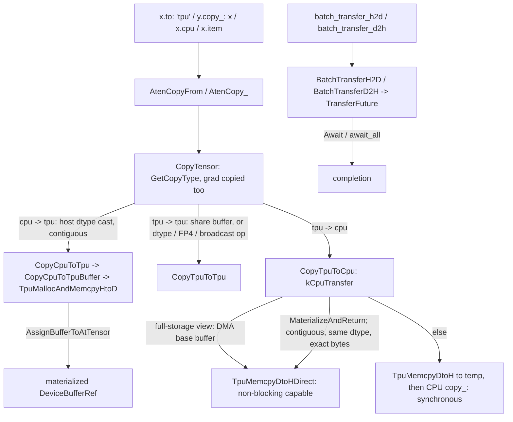

# Host-device transfer, copies and batch transfers

## Overview
Every cross-device copy in PyTorch funnels into `_copy_from`, which TorchTPU implements as
[`AtenCopyFrom`](https://github.com/google-pytorch/torch_tpu/blob/6d2a45754bdb52743883f75fbf753408345f6d1b/csrc/ops/copy_from/copy_from_aten_kernels.cc#L232 "csrc/ops/copy_from/copy_from_aten_kernels.cc#AtenCopyFrom")
(and the identical [`AtenCopy_`](https://github.com/google-pytorch/torch_tpu/blob/6d2a45754bdb52743883f75fbf753408345f6d1b/csrc/ops/copy_from/copy_from_aten_kernels.cc#L268 "csrc/ops/copy_from/copy_from_aten_kernels.cc#AtenCopy_")
registered to avoid a dispatch error). [`CopyTensor`](https://github.com/google-pytorch/torch_tpu/blob/6d2a45754bdb52743883f75fbf753408345f6d1b/csrc/ops/copy_from/copy_from_aten_kernels.cc#L189 "csrc/ops/copy_from/copy_from_aten_kernels.cc#CopyTensor")
classifies the pair with [`GetCopyType`](https://github.com/google-pytorch/torch_tpu/blob/6d2a45754bdb52743883f75fbf753408345f6d1b/csrc/ops/copy_from/copy_from_aten_kernels.cc#L61 "csrc/ops/copy_from/copy_from_aten_kernels.cc#GetCopyType")
into CPU-to-TPU, TPU-to-TPU or TPU-to-CPU (any other device pair is a `NotImplementedError`) and
routes to [`CopyCpuToTpu`](https://github.com/google-pytorch/torch_tpu/blob/6d2a45754bdb52743883f75fbf753408345f6d1b/csrc/ops/copy_from/cpu_to_tpu.cc#L61 "csrc/ops/copy_from/cpu_to_tpu.cc#CopyCpuToTpu"),
[`CopyTpuToTpu`](https://github.com/google-pytorch/torch_tpu/blob/6d2a45754bdb52743883f75fbf753408345f6d1b/csrc/ops/copy_from/tpu_to_tpu.cc#L87 "csrc/ops/copy_from/tpu_to_tpu.cc#CopyTpuToTpu") or
[`CopyTpuToCpu`](https://github.com/google-pytorch/torch_tpu/blob/6d2a45754bdb52743883f75fbf753408345f6d1b/csrc/ops/copy_from/tpu_to_cpu.cc#L77 "csrc/ops/copy_from/tpu_to_cpu.cc#CopyTpuToCpu"). The
directions are asymmetric by nature of the runtime: host-to-device creates a *materialized* buffer
immediately (there is nothing to defer), device-to-device is either a buffer share or an ordinary
deferred op, and device-to-host is the canonical trigger of materialization (`.cpu()` in the
materialization reasons), which is why it can surface a device out-of-memory error that happened
earlier. The experimental batch-transfer API exposes explicit, future-based H2D and D2H copies of
tensor lists for callers who want to overlap transfers with compute and manage synchronization
themselves.

## Diagram

Legend:
- `A` - (concept) the PyTorch entry points `.to`, `copy_`, `.cpu` and `item()`
- `DEV` - (concept) the resulting materialized device buffer (see [deferred-execution-and-materialization](deferred-execution-and-materialization.md))
- `FAST` - (concept) the direct PjRt device-to-host memcpy helper in [pjrt-client](pjrt-client.md)
- `SLOW` - (concept) the staged PjRt device-to-host memcpy plus PyTorch's CPU `copy_`
- `DONE` - (concept) completion of all futures held by the transfer
- `CF` - [`AtenCopyFrom`](https://github.com/google-pytorch/torch_tpu/blob/6d2a45754bdb52743883f75fbf753408345f6d1b/csrc/ops/copy_from/copy_from_aten_kernels.cc#L232 "csrc/ops/copy_from/copy_from_aten_kernels.cc#AtenCopyFrom"), [`AtenCopy_`](https://github.com/google-pytorch/torch_tpu/blob/6d2a45754bdb52743883f75fbf753408345f6d1b/csrc/ops/copy_from/copy_from_aten_kernels.cc#L268 "csrc/ops/copy_from/copy_from_aten_kernels.cc#AtenCopy_")
- `CT` - [`CopyTensor`](https://github.com/google-pytorch/torch_tpu/blob/6d2a45754bdb52743883f75fbf753408345f6d1b/csrc/ops/copy_from/copy_from_aten_kernels.cc#L189 "csrc/ops/copy_from/copy_from_aten_kernels.cc#CopyTensor") with [`GetCopyType`](https://github.com/google-pytorch/torch_tpu/blob/6d2a45754bdb52743883f75fbf753408345f6d1b/csrc/ops/copy_from/copy_from_aten_kernels.cc#L61 "csrc/ops/copy_from/copy_from_aten_kernels.cc#GetCopyType")
- `H2D` - [`CopyCpuToTpu`](https://github.com/google-pytorch/torch_tpu/blob/6d2a45754bdb52743883f75fbf753408345f6d1b/csrc/ops/copy_from/cpu_to_tpu.cc#L61 "csrc/ops/copy_from/cpu_to_tpu.cc#CopyCpuToTpu"), [`CopyCpuToTpuBuffer`](https://github.com/google-pytorch/torch_tpu/blob/6d2a45754bdb52743883f75fbf753408345f6d1b/csrc/ops/copy_from/cpu_to_tpu.cc#L38 "csrc/ops/copy_from/cpu_to_tpu.cc#CopyCpuToTpuBuffer")
- `D2D` - [`CopyTpuToTpu`](https://github.com/google-pytorch/torch_tpu/blob/6d2a45754bdb52743883f75fbf753408345f6d1b/csrc/ops/copy_from/tpu_to_tpu.cc#L87 "csrc/ops/copy_from/tpu_to_tpu.cc#CopyTpuToTpu")
- `D2H` - [`CopyTpuToCpu`](https://github.com/google-pytorch/torch_tpu/blob/6d2a45754bdb52743883f75fbf753408345f6d1b/csrc/ops/copy_from/tpu_to_cpu.cc#L77 "csrc/ops/copy_from/tpu_to_cpu.cc#CopyTpuToCpu") with [`MaterializeAndReturn`](https://github.com/google-pytorch/torch_tpu/blob/6d2a45754bdb52743883f75fbf753408345f6d1b/csrc/eager/tensor_to_buffer.cc#L677 "csrc/eager/tensor_to_buffer.cc#MaterializeAndReturn")
- `B` - the Python [`TransferFuture`](https://github.com/google-pytorch/torch_tpu/blob/6d2a45754bdb52743883f75fbf753408345f6d1b/src/torch_tpu/_internal/batch_transfer/__init__.py#L19 "src/torch_tpu/_internal/batch_transfer/__init__#TransferFuture") module wrappers
- `BATCH` - [`BatchTransferH2D`](https://github.com/google-pytorch/torch_tpu/blob/6d2a45754bdb52743883f75fbf753408345f6d1b/csrc/experimental/batch_transfer/batch_transfer.cc#L425 "csrc/experimental/batch_transfer/batch_transfer.cc#BatchTransferH2D"), [`BatchTransferD2H`](https://github.com/google-pytorch/torch_tpu/blob/6d2a45754bdb52743883f75fbf753408345f6d1b/csrc/experimental/batch_transfer/batch_transfer.cc#L212 "csrc/experimental/batch_transfer/batch_transfer.cc#BatchTransferD2H"), [`TransferFuture`](https://github.com/google-pytorch/torch_tpu/blob/6d2a45754bdb52743883f75fbf753408345f6d1b/csrc/experimental/batch_transfer/batch_transfer.h#L35 "csrc/experimental/batch_transfer/batch_transfer.h#TransferFuture") with [`Await`](https://github.com/google-pytorch/torch_tpu/blob/6d2a45754bdb52743883f75fbf753408345f6d1b/csrc/experimental/batch_transfer/batch_transfer.cc#L71 "csrc/experimental/batch_transfer/batch_transfer.cc#TransferFuture.Await")

## Design rationale (why it's built this way)
- **Host-to-device converts on the host and uploads once.** [`CopyCpuToTpu`](https://github.com/google-pytorch/torch_tpu/blob/6d2a45754bdb52743883f75fbf753408345f6d1b/csrc/ops/copy_from/cpu_to_tpu.cc#L61 "csrc/ops/copy_from/cpu_to_tpu.cc#CopyCpuToTpu")
  casts the source to the destination dtype *on the CPU* before transfer, and
  [`CopyCpuToTpuBuffer`](https://github.com/google-pytorch/torch_tpu/blob/6d2a45754bdb52743883f75fbf753408345f6d1b/csrc/ops/copy_from/cpu_to_tpu.cc#L38 "csrc/ops/copy_from/cpu_to_tpu.cc#CopyCpuToTpuBuffer")
  makes it contiguous, resolves the TPU layout, short-circuits zero-element tensors to a
  zero-size buffer "to avoid blocking on host/device synchronization", and calls the PjRt upload
  helper; with `non_blocking=true` the contiguous host tensor is handed to the transfer so its
  memory stays alive until the copy completes. Upload failures are prefixed "failed to transfer to
  'tpu' device:". A broadcasting copy (source shape differs from destination) is done as
  upload-then-device-broadcast rather than a strided host expansion.
- **Device-to-host is where deferred work becomes real.** [`CopyTpuToCpu`](https://github.com/google-pytorch/torch_tpu/blob/6d2a45754bdb52743883f75fbf753408345f6d1b/csrc/ops/copy_from/tpu_to_cpu.cc#L77 "csrc/ops/copy_from/tpu_to_cpu.cc#CopyTpuToCpu")
  materializes the source with reason `kCpuTransfer`. It has two direct paths. If the source is a
  pure reinterpretation of all the bytes of its base buffer, it materializes just that base buffer
  and DMAs it straight into the destination. Otherwise
  [`MaterializeAndReturn`](https://github.com/google-pytorch/torch_tpu/blob/6d2a45754bdb52743883f75fbf753408345f6d1b/csrc/eager/tensor_to_buffer.cc#L677 "csrc/eager/tensor_to_buffer.cc#MaterializeAndReturn")
  materializes the base and the ephemeral view buffer, and the direct copy is taken only when the
  destination is contiguous, has the same dtype and exactly the buffer's byte size, "because we
  don't need to invoke a secondary PyTorch CPU copy_() afterwards". Every other case copies
  synchronously into a temporary and re-dispatches PyTorch's CPU `copy_` for dtype and layout
  conversion, since "the CPU copy_() will read garbage" if the transfer were still in flight.
- **Non-blocking really is non-blocking on the fast paths.** With `non_blocking=true`
  [`CopyTpuToCpu`](https://github.com/google-pytorch/torch_tpu/blob/6d2a45754bdb52743883f75fbf753408345f6d1b/csrc/ops/copy_from/tpu_to_cpu.cc#L77 "csrc/ops/copy_from/tpu_to_cpu.cc#CopyTpuToCpu")
  requests a non-blocking materialization, so the caller thread enqueues the materialization and
  chains the DMA onto it instead of waiting for the graph to be lowered; with `non_blocking=false`
  it blocks until materialization has started.
- **OOM is explained in tensor terms.** A device out-of-memory during the await is rewritten as
  "the TPU ran out of memory while awaiting the materialization of value `float32[...]`" with the
  dtype and shape; other errors pass through unchanged. The recognition uses the XLA OOM predicate
  from [error-handling](error-handling.md).
- **Same-shape, same-dtype device copies share the buffer.** [`CopyTpuToTpu`](https://github.com/google-pytorch/torch_tpu/blob/6d2a45754bdb52743883f75fbf753408345f6d1b/csrc/ops/copy_from/tpu_to_tpu.cc#L87 "csrc/ops/copy_from/tpu_to_tpu.cc#CopyTpuToTpu")
  assigns the source's buffer (or, for full-storage reinterpret views on both sides, the source's
  base buffer) to the destination instead of dispatching an op. Only a dtype or shape change
  dispatches a StableHLO op, which pads or slices the last dimension when converting to or from
  packed FP4, whose device representation is one byte per unpacked element (see
  [dtype-and-precision](dtype-and-precision.md)).
- **Gradients travel with their tensor.** [`CopyTensor`](https://github.com/google-pytorch/torch_tpu/blob/6d2a45754bdb52743883f75fbf753408345f6d1b/csrc/ops/copy_from/copy_from_aten_kernels.cc#L189 "csrc/ops/copy_from/copy_from_aten_kernels.cc#CopyTensor")
  recursively copies `src.grad` into a (created if needed) destination grad, so `model.to('tpu')`
  preserves accumulated gradients as on CUDA; a sparse gradient is rebuilt as a sparse tensor on
  the destination device from copied indices and values.
- **Batch transfers make synchronization explicit.** [`BatchTransferH2D`](https://github.com/google-pytorch/torch_tpu/blob/6d2a45754bdb52743883f75fbf753408345f6d1b/csrc/experimental/batch_transfer/batch_transfer.cc#L425 "csrc/experimental/batch_transfer/batch_transfer.cc#BatchTransferH2D")
  and [`BatchTransferD2H`](https://github.com/google-pytorch/torch_tpu/blob/6d2a45754bdb52743883f75fbf753408345f6d1b/csrc/experimental/batch_transfer/batch_transfer.cc#L212 "csrc/experimental/batch_transfer/batch_transfer.cc#BatchTransferD2H")
  copy lists of tensors, optionally sub-ranges along the major dimension, and return a
  [`TransferFuture`](https://github.com/google-pytorch/torch_tpu/blob/6d2a45754bdb52743883f75fbf753408345f6d1b/csrc/experimental/batch_transfer/batch_transfer.h#L35 "csrc/experimental/batch_transfer/batch_transfer.h#TransferFuture")
  that keeps the involved buffers alive; the header warns that H2D "does not register the raw-copy
  future with TorchTPU stream state" and callers "must explicitly wait ... before launching TPU
  computations that consume the destination buffer". Synchronous variants and an `await_all`
  helper are exposed in Python under `torch_tpu._internal.batch_transfer`.

> [!inferred]
> Practical consequences for onboarding: `non_blocking=True` on `.to('tpu')` is honored for
> contiguous sources and on `.cpu()` only when the destination is preallocated and exactly
> matching (for example a pinned, contiguous buffer of the same dtype) or the source covers its
> whole storage; `item()` and `.cpu()` are the points where deferred-mode errors and OOMs appear;
> and `torch_tpu`'s batch transfer is the tool for input-pipeline overlap, at the cost of manual
> `Await` calls. Because the module now lives under `_internal`, treat it as unstable API.

## Entry points
- [`AtenCopyFrom`](https://github.com/google-pytorch/torch_tpu/blob/6d2a45754bdb52743883f75fbf753408345f6d1b/csrc/ops/copy_from/copy_from_aten_kernels.cc#L232 "csrc/ops/copy_from/copy_from_aten_kernels.cc#AtenCopyFrom")
  and [`AtenCopy_`](https://github.com/google-pytorch/torch_tpu/blob/6d2a45754bdb52743883f75fbf753408345f6d1b/csrc/ops/copy_from/copy_from_aten_kernels.cc#L268 "csrc/ops/copy_from/copy_from_aten_kernels.cc#AtenCopy_"):
  the registered kernels (`non_blocking` is ignored in the cache key because it "Doesn't affect
  SHLO"); the resize-and-copy and local-scalar (`item()`) kernels in the same file route through
  [`CopyTensor`](https://github.com/google-pytorch/torch_tpu/blob/6d2a45754bdb52743883f75fbf753408345f6d1b/csrc/ops/copy_from/copy_from_aten_kernels.cc#L189 "csrc/ops/copy_from/copy_from_aten_kernels.cc#CopyTensor")
  and `.to(cpu)` respectively.
- [`CopyCpuToTpuBuffer`](https://github.com/google-pytorch/torch_tpu/blob/6d2a45754bdb52743883f75fbf753408345f6d1b/csrc/ops/copy_from/cpu_to_tpu.cc#L38 "csrc/ops/copy_from/cpu_to_tpu.cc#CopyCpuToTpuBuffer"):
  also used by scalar promotion ([eager-op-dispatch](eager-op-dispatch.md)) to upload one-element
  buffers.
- [`BatchTransferH2D`](https://github.com/google-pytorch/torch_tpu/blob/6d2a45754bdb52743883f75fbf753408345f6d1b/csrc/experimental/batch_transfer/batch_transfer.cc#L425 "csrc/experimental/batch_transfer/batch_transfer.cc#BatchTransferH2D")
  / [`BatchTransferD2H`](https://github.com/google-pytorch/torch_tpu/blob/6d2a45754bdb52743883f75fbf753408345f6d1b/csrc/experimental/batch_transfer/batch_transfer.cc#L212 "csrc/experimental/batch_transfer/batch_transfer.cc#BatchTransferD2H")
  and the Python `batch_transfer_h2d`, `batch_transfer_d2h`, their `_sync` variants and
  `await_all`, re-exported next to [`TransferFuture`](https://github.com/google-pytorch/torch_tpu/blob/6d2a45754bdb52743883f75fbf753408345f6d1b/src/torch_tpu/_internal/batch_transfer/__init__.py#L19 "src/torch_tpu/_internal/batch_transfer/__init__#TransferFuture").

## Mechanism (step-by-step)
1. **Classify.** [`CopyTensor`](https://github.com/google-pytorch/torch_tpu/blob/6d2a45754bdb52743883f75fbf753408345f6d1b/csrc/ops/copy_from/copy_from_aten_kernels.cc#L189 "csrc/ops/copy_from/copy_from_aten_kernels.cc#CopyTensor")
   requires at least one TPU tensor, treats self-copy as a no-op, and asks
   [`GetCopyType`](https://github.com/google-pytorch/torch_tpu/blob/6d2a45754bdb52743883f75fbf753408345f6d1b/csrc/ops/copy_from/copy_from_aten_kernels.cc#L61 "csrc/ops/copy_from/copy_from_aten_kernels.cc#GetCopyType")
   for the direction; unsupported pairs produce a not-implemented error listing the three legal
   combinations.
2. **Upload.** [`CopyCpuToTpu`](https://github.com/google-pytorch/torch_tpu/blob/6d2a45754bdb52743883f75fbf753408345f6d1b/csrc/ops/copy_from/cpu_to_tpu.cc#L61 "csrc/ops/copy_from/cpu_to_tpu.cc#CopyCpuToTpu")
   converts dtype on the host, [`CopyCpuToTpuBuffer`](https://github.com/google-pytorch/torch_tpu/blob/6d2a45754bdb52743883f75fbf753408345f6d1b/csrc/ops/copy_from/cpu_to_tpu.cc#L38 "csrc/ops/copy_from/cpu_to_tpu.cc#CopyCpuToTpuBuffer")
   uploads into a fresh materialized buffer, and the buffer is assigned to the destination tensor
   (shape-equal case) or to a temporary that is then broadcast on device.
3. **Copy on device.** [`CopyTpuToTpu`](https://github.com/google-pytorch/torch_tpu/blob/6d2a45754bdb52743883f75fbf753408345f6d1b/csrc/ops/copy_from/tpu_to_tpu.cc#L87 "csrc/ops/copy_from/tpu_to_tpu.cc#CopyTpuToTpu")
   rejects mismatched device indices, shares the source buffer when shape and dtype match, and
   otherwise dispatches a deferred slice/broadcast/convert/pad op and assigns its result to the
   destination, so a converting device-side `copy_` participates in fusion like any other op.
4. **Download.** [`CopyTpuToCpu`](https://github.com/google-pytorch/torch_tpu/blob/6d2a45754bdb52743883f75fbf753408345f6d1b/csrc/ops/copy_from/tpu_to_cpu.cc#L77 "csrc/ops/copy_from/tpu_to_cpu.cc#CopyTpuToCpu")
   returns early for empty tensors, tries the full-storage fast path, otherwise calls
   [`MaterializeAndReturn`](https://github.com/google-pytorch/torch_tpu/blob/6d2a45754bdb52743883f75fbf753408345f6d1b/csrc/eager/tensor_to_buffer.cc#L677 "csrc/eager/tensor_to_buffer.cc#MaterializeAndReturn")
   and chooses the direct or the temporary-plus-`copy_` path; OOMs are translated as described
   above, and warnings rerouted from background threads are surfaced on the way out.
5. **Batch.** [`BatchTransferH2D`](https://github.com/google-pytorch/torch_tpu/blob/6d2a45754bdb52743883f75fbf753408345f6d1b/csrc/experimental/batch_transfer/batch_transfer.cc#L425 "csrc/experimental/batch_transfer/batch_transfer.cc#BatchTransferH2D")
   / [`BatchTransferD2H`](https://github.com/google-pytorch/torch_tpu/blob/6d2a45754bdb52743883f75fbf753408345f6d1b/csrc/experimental/batch_transfer/batch_transfer.cc#L212 "csrc/experimental/batch_transfer/batch_transfer.cc#BatchTransferD2H")
   issue PjRt raw copies per tensor (with optional major-dimension offsets and sizes) and
   accumulate their futures and buffer holds in a [`TransferFuture`](https://github.com/google-pytorch/torch_tpu/blob/6d2a45754bdb52743883f75fbf753408345f6d1b/csrc/experimental/batch_transfer/batch_transfer.h#L35 "csrc/experimental/batch_transfer/batch_transfer.h#TransferFuture");
   [`Await`](https://github.com/google-pytorch/torch_tpu/blob/6d2a45754bdb52743883f75fbf753408345f6d1b/csrc/experimental/batch_transfer/batch_transfer.cc#L71 "csrc/experimental/batch_transfer/batch_transfer.cc#TransferFuture.Await")
   blocks on all of them, throws "Async copy failed" with the first error, clears the holds even on
   failure, and logs `raw_copy_wait_ms` when the future carries a tag. `AndThen` chains futures and
   keeps additional tensors alive.

## Key data structures
- The copy-direction enum (`kCpuToTpu`, `kTpuToTpu`, `kTpuToCpu`).
- [`TransferFuture`](https://github.com/google-pytorch/torch_tpu/blob/6d2a45754bdb52743883f75fbf753408345f6d1b/csrc/experimental/batch_transfer/batch_transfer.h#L35 "csrc/experimental/batch_transfer/batch_transfer.h#TransferFuture"):
  vectors of XLA futures, raw-buffer holds, opaque holds and tensors, plus a debug tag.

## Dynamics (design intent)
- H2D never blocks on device compute; D2H blocks on materialization of the source and then on the
  copy unless a direct non-blocking path applies, in which case the caller only enqueues.
- Stream bookkeeping (so that `synchronize()` covers a copy) is done for the regular copy paths;
  batch transfers deliberately opt out and rely on the caller.

## Edge cases
- Copying to a TPU tensor of a different shape from CPU goes through a temporary and a device
  broadcast; from TPU to CPU, shape and dtype differences are handled by the CPU `copy_` fallback.
- A same-shape, same-dtype TPU-to-TPU copy makes the destination share the source's buffer
  rather than producing an independent device copy.
- FP4 sources or destinations must be at least 1-dimensional.
- `item()` on a multi-element tensor is an invalid-argument error; on one element it is a
  synchronous `.to(cpu)` followed by the CPU `item()`.
- Zero-element tensors skip the device entirely in both directions.

## Open questions
- The exact PjRt memcpy primitives (direct versus staged) and their interaction with the host
  allocator are in the PjRt transfer helpers ([pjrt-client](pjrt-client.md)).
- How the `.to('cpu', non_blocking=True)` kernel allocates its pinned destination is outside this
  packet's symbols.

## See also
- [deferred-execution-and-materialization](deferred-execution-and-materialization.md): `.cpu()` as a materialization reason.
- [pjrt-client](pjrt-client.md): the memcpy helpers.
- [synchronization](synchronization.md): stream and device synchronization.
- [dtype-and-precision](dtype-and-precision.md): FP4 packing.
- [error-handling](error-handling.md): OOM translation.

## Recent changes
- `5e2e59a68` "Avoid blocking on materialization and redundant host copy in non-blocking D2H": the
  full-storage fast path in `CopyTpuToCpu` now passes the non-blocking block mode so the caller
  thread no longer waits for the deferred graph to be lowered, and `tensor.to("cpu",
  non_blocking=True)` allocates its destination directly in pinned memory instead of pinning a
  second copy.
- `4edaaba49` "Delay warnings from background threads and route to dispatch threads": warnings
  raised on materialization and execution workers are buffered and surfaced when the copy has
  waited on that work, as Python warnings rather than stderr output.
- [all changes in 6d2a45754b](../changes/6d2a45754b.md)
