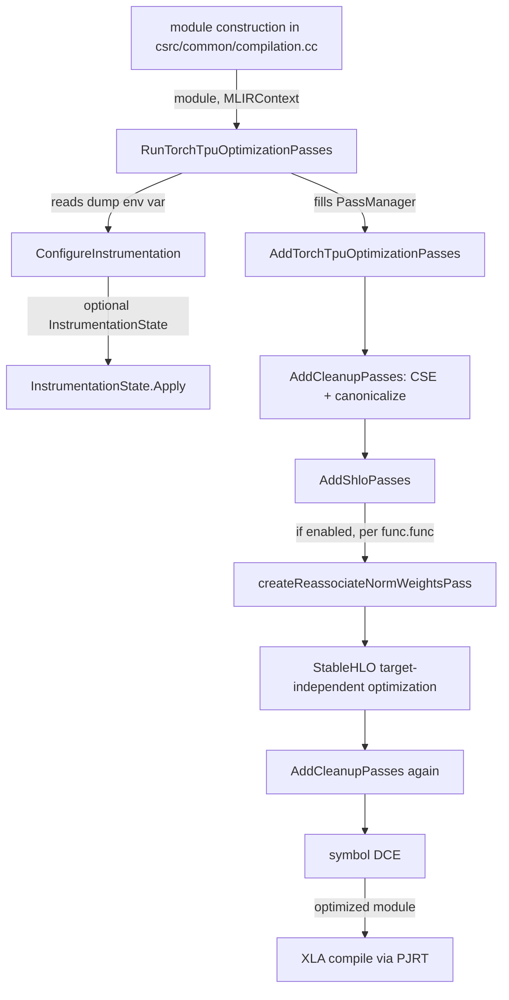
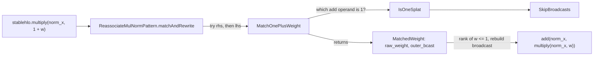

# MLIR optimization passes (csrc/mlir pass pipeline)

## Overview
Every StableHLO module torch_tpu builds, whether from an eager op, a deferred/fused graph or a
`torch.compile` graph, passes through one small, fixed MLIR pipeline before it is handed to the
PJRT client for XLA compilation. [`RunTorchTpuOptimizationPasses`](https://github.com/google-pytorch/torch_tpu/blob/6d2a45754bdb52743883f75fbf753408345f6d1b/csrc/mlir/pipeline.cc#L61 "csrc/mlir/pipeline.cc#RunTorchTpuOptimizationPasses")
("Runs all custom Torch TPU optimization passes on the given module") owns that step: it builds a
fresh `mlir::PassManager`, optionally attaches IR-dump and timing instrumentation, fills the
manager with [`AddTorchTpuOptimizationPasses`](https://github.com/google-pytorch/torch_tpu/blob/6d2a45754bdb52743883f75fbf753408345f6d1b/csrc/mlir/pipeline.cc#L54 "csrc/mlir/pipeline.cc#AddTorchTpuOptimizationPasses"),
and runs it. The key design idea is that graph-level rewrites live here, at the StableHLO
level, rather than in a Python FX pass, so one rewrite serves every execution mode. Today the
pipeline is mostly upstream passes (CSE, canonicalizer, the StableHLO target-independent
optimization suite, symbol DCE) plus one torch_tpu rewrite,
[`ReassociateNormWeightsPass`](https://github.com/google-pytorch/torch_tpu/blob/6d2a45754bdb52743883f75fbf753408345f6d1b/csrc/mlir/passes/reassociate_norm_weights.cc#L159 "csrc/mlir/passes/reassociate_norm_weights.cc#ReassociateNormWeightsPass"),
which turns `x * (1 + w)` (the scale used by some RMSNorm variants) into `x + x * w`. A separate
registration module exposes the custom passes to MLIR's global pass registry for tooling.

## Diagram
The production path, in pass-manager order:

Legend:
- `CALLER` - (concept) the shared module-construction step in `csrc/common/compilation.cc`, the only production caller
- `RUN` - [`RunTorchTpuOptimizationPasses`](https://github.com/google-pytorch/torch_tpu/blob/6d2a45754bdb52743883f75fbf753408345f6d1b/csrc/mlir/pipeline.cc#L61 "csrc/mlir/pipeline.cc#RunTorchTpuOptimizationPasses")
- `CFG` - [`ConfigureInstrumentation`](https://github.com/google-pytorch/torch_tpu/blob/6d2a45754bdb52743883f75fbf753408345f6d1b/csrc/mlir/instrumentation.cc#L78 "csrc/mlir/instrumentation.cc#ConfigureInstrumentation")
- `APPLY` - [`Apply`](https://github.com/google-pytorch/torch_tpu/blob/6d2a45754bdb52743883f75fbf753408345f6d1b/csrc/mlir/instrumentation.cc#L47 "csrc/mlir/instrumentation.cc#InstrumentationState.Apply")
- `ADD` - [`AddTorchTpuOptimizationPasses`](https://github.com/google-pytorch/torch_tpu/blob/6d2a45754bdb52743883f75fbf753408345f6d1b/csrc/mlir/pipeline.cc#L54 "csrc/mlir/pipeline.cc#AddTorchTpuOptimizationPasses")
- `C1` - [`AddCleanupPasses`](https://github.com/google-pytorch/torch_tpu/blob/6d2a45754bdb52743883f75fbf753408345f6d1b/csrc/mlir/pipeline.cc#L38 "csrc/mlir/pipeline.cc#AddCleanupPasses")
- `C2` - [`AddCleanupPasses`](https://github.com/google-pytorch/torch_tpu/blob/6d2a45754bdb52743883f75fbf753408345f6d1b/csrc/mlir/pipeline.cc#L38 "csrc/mlir/pipeline.cc#AddCleanupPasses") (second invocation)
- `SHLO` - [`AddShloPasses`](https://github.com/google-pytorch/torch_tpu/blob/6d2a45754bdb52743883f75fbf753408345f6d1b/csrc/mlir/pipeline.cc#L43 "csrc/mlir/pipeline.cc#AddShloPasses")
- `RNW` - [`createReassociateNormWeightsPass`](https://github.com/google-pytorch/torch_tpu/blob/6d2a45754bdb52743883f75fbf753408345f6d1b/csrc/mlir/passes/reassociate_norm_weights.cc#L187 "csrc/mlir/passes/reassociate_norm_weights.cc#createReassociateNormWeightsPass")
- `STHLO` - (concept) upstream StableHLO pass, added by [`AddShloPasses`](https://github.com/google-pytorch/torch_tpu/blob/6d2a45754bdb52743883f75fbf753408345f6d1b/csrc/mlir/pipeline.cc#L43 "csrc/mlir/pipeline.cc#AddShloPasses")
- `DCE` - (concept) upstream MLIR symbol DCE, added by [`AddTorchTpuOptimizationPasses`](https://github.com/google-pytorch/torch_tpu/blob/6d2a45754bdb52743883f75fbf753408345f6d1b/csrc/mlir/pipeline.cc#L54 "csrc/mlir/pipeline.cc#AddTorchTpuOptimizationPasses")
- `PJRT` - (concept) XLA compilation through the PJRT client

How the norm-weight rewrite matches and rewrites one `stablehlo.multiply`:

Legend:
- `MUL` - (concept) the input IR
- `MR` - [`matchAndRewrite`](https://github.com/google-pytorch/torch_tpu/blob/6d2a45754bdb52743883f75fbf753408345f6d1b/csrc/mlir/passes/reassociate_norm_weights.cc#L108 "csrc/mlir/passes/reassociate_norm_weights.cc#ReassociateMulNormPattern.matchAndRewrite")
- `M1` - [`MatchOnePlusWeight`](https://github.com/google-pytorch/torch_tpu/blob/6d2a45754bdb52743883f75fbf753408345f6d1b/csrc/mlir/passes/reassociate_norm_weights.cc#L80 "csrc/mlir/passes/reassociate_norm_weights.cc#MatchOnePlusWeight")
- `ONE` - [`IsOneSplat`](https://github.com/google-pytorch/torch_tpu/blob/6d2a45754bdb52743883f75fbf753408345f6d1b/csrc/mlir/passes/reassociate_norm_weights.cc#L55 "csrc/mlir/passes/reassociate_norm_weights.cc#IsOneSplat")
- `SKIP` - [`SkipBroadcasts`](https://github.com/google-pytorch/torch_tpu/blob/6d2a45754bdb52743883f75fbf753408345f6d1b/csrc/mlir/passes/reassociate_norm_weights.cc#L43 "csrc/mlir/passes/reassociate_norm_weights.cc#SkipBroadcasts")
- `MW` - [`MatchedWeight`](https://github.com/google-pytorch/torch_tpu/blob/6d2a45754bdb52743883f75fbf753408345f6d1b/csrc/mlir/passes/reassociate_norm_weights.cc#L70 "csrc/mlir/passes/reassociate_norm_weights.cc#MatchedWeight")
- `OUT` - (concept) the rewritten IR

## Design rationale (why it's built this way)
- **One pipeline for every mode.** The pass runner sits inside the shared module-construction
  step in `csrc/common/compilation.cc`, which both the eager compilation cache and the
  `torch.compile` paths go through. A rewrite added to
  [`AddTorchTpuOptimizationPasses`](https://github.com/google-pytorch/torch_tpu/blob/6d2a45754bdb52743883f75fbf753408345f6d1b/csrc/mlir/pipeline.cc#L54 "csrc/mlir/pipeline.cc#AddTorchTpuOptimizationPasses")
  therefore applies to eager, deferred and compiled execution alike, which an FX-graph pass
  could not do for eager ops.

> [!inferred]
> Repository history says the norm-weight rewrite used to be a Dynamo FX pass and was moved to
> StableHLO specifically so that eager execution and `torch.compile` both get it. The original
> pipeline commit likewise describes the pipeline as running for both eager and compiled
> modules, with the StableHLO target-independent suite as the main production pass.

- **Cleanup sandwiches the real work.** [`AddCleanupPasses`](https://github.com/google-pytorch/torch_tpu/blob/6d2a45754bdb52743883f75fbf753408345f6d1b/csrc/mlir/pipeline.cc#L38 "csrc/mlir/pipeline.cc#AddCleanupPasses")
  (module-level CSE, then the canonicalizer on each `func.func`) runs both before and after
  [`AddShloPasses`](https://github.com/google-pytorch/torch_tpu/blob/6d2a45754bdb52743883f75fbf753408345f6d1b/csrc/mlir/pipeline.cc#L43 "csrc/mlir/pipeline.cc#AddShloPasses"),
  and a symbol-DCE pass closes the pipeline. Op builders emit straightforward, often redundant
  StableHLO (repeated constants, broadcasts), so the first cleanup makes patterns easier to
  match and the second removes what the rewrites leave behind.
- **Rewrites are opt-out, not opt-in.** The norm-weight pass is added only if
  `TORCH_TPU_INTERNAL_ENABLE_REASSOCIATE_NORM_WEIGHTS` is not false; the env-var docs say "If set
  to '0' or 'false', disables reassociating normalization weights. Default is 'true'." That
  gives an escape hatch when a numerics difference is suspected, without a rebuild.
- **Matching is non-destructive until it commits.** [`MatchOnePlusWeight`](https://github.com/google-pytorch/torch_tpu/blob/6d2a45754bdb52743883f75fbf753408345f6d1b/csrc/mlir/passes/reassociate_norm_weights.cc#L80 "csrc/mlir/passes/reassociate_norm_weights.cc#MatchOnePlusWeight")
  "Returns matched weight metadata if matched, without mutating the IR", and the pattern only
  rebuilds the outer broadcast after the rank check passes. A failed match therefore leaves the
  IR untouched, which is the contract the greedy rewrite driver expects.

> [!inferred]
> Why reassociate `x * (1 + w)` at all: in bf16, `1 + w` for a small learned offset `w` rounds
> `w` to the few mantissa bits left next to 1.0, so the scale applied to the normalized
> activations is coarser than `w` itself. Computing `x * w` first and adding `x` keeps `w` at
> full precision. The source does not state the motive; this is the usual reason for this
> rewrite in Gemma-style RMSNorm (`weight` stored as an offset from 1). The rewrite is not
> bit-identical to the original expression.

## Entry points
- [`RunTorchTpuOptimizationPasses`](https://github.com/google-pytorch/torch_tpu/blob/6d2a45754bdb52743883f75fbf753408345f6d1b/csrc/mlir/pipeline.cc#L61 "csrc/mlir/pipeline.cc#RunTorchTpuOptimizationPasses"):
  the production entry. Called once per freshly built module, right after the computation
  builder has produced StableHLO and before the module is handed to the compiler. Returns an
  `absl::Status`; a failing pass becomes an internal error.
- [`AddTorchTpuOptimizationPasses`](https://github.com/google-pytorch/torch_tpu/blob/6d2a45754bdb52743883f75fbf753408345f6d1b/csrc/mlir/pipeline.cc#L54 "csrc/mlir/pipeline.cc#AddTorchTpuOptimizationPasses"):
  "Adds Torch TPU optimization passes to the pass manager." Public so a caller with its own
  `PassManager` (a tool or test) can reproduce the exact production pass list.
- [`RegisterTorchTpuPasses`](https://github.com/google-pytorch/torch_tpu/blob/6d2a45754bdb52743883f75fbf753408345f6d1b/csrc/mlir/registration.cc#L30 "csrc/mlir/registration.cc#RegisterTorchTpuPasses")
  and [`RegisterTorchTpuDialects`](https://github.com/google-pytorch/torch_tpu/blob/6d2a45754bdb52743883f75fbf753408345f6d1b/csrc/mlir/registration.cc#L38 "csrc/mlir/registration.cc#RegisterTorchTpuDialects"):
  "Registers all custom Torch TPU passes with the MLIR global registry" and "Registers
  dependent dialects for custom Torch TPU passes" (all StableHLO dialects). These make the passes
  addressable by name (`torch-tpu-reassociate-norm-weights`, `dummy-pass`) from an opt-style
  driver; nothing in the production runtime calls them.
- [`createReassociateNormWeightsPass`](https://github.com/google-pytorch/torch_tpu/blob/6d2a45754bdb52743883f75fbf753408345f6d1b/csrc/mlir/passes/reassociate_norm_weights.cc#L187 "csrc/mlir/passes/reassociate_norm_weights.cc#createReassociateNormWeightsPass")
  and [`createDummyPass`](https://github.com/google-pytorch/torch_tpu/blob/6d2a45754bdb52743883f75fbf753408345f6d1b/csrc/mlir/passes/dummy_pass.cc#L48 "csrc/mlir/passes/dummy_pass.cc#createDummyPass"):
  factories for the two custom passes. Only the first is in the production pipeline.

## Mechanism (step-by-step)
1. **Decide whether to instrument.** [`RunTorchTpuOptimizationPasses`](https://github.com/google-pytorch/torch_tpu/blob/6d2a45754bdb52743883f75fbf753408345f6d1b/csrc/mlir/pipeline.cc#L61 "csrc/mlir/pipeline.cc#RunTorchTpuOptimizationPasses")
   first calls [`ConfigureInstrumentation`](https://github.com/google-pytorch/torch_tpu/blob/6d2a45754bdb52743883f75fbf753408345f6d1b/csrc/mlir/instrumentation.cc#L78 "csrc/mlir/instrumentation.cc#ConfigureInstrumentation"),
   which reads `TORCH_TPU_INTERNAL_DUMP_MLIR_PASSES_TO` ("Specifies where to dump optimization
   pass IR artifacts (e.g. 'print' or a directory path)"). Unset or empty returns no state and
   the pipeline runs bare. `print` returns a state with
   [`dump_to_print`](https://github.com/google-pytorch/torch_tpu/blob/6d2a45754bdb52743883f75fbf753408345f6d1b/csrc/mlir/instrumentation.h#L33 "csrc/mlir/instrumentation.h#InstrumentationState.dump_to_print")
   set. Any other value is treated as a directory: the function takes a process-unique id from
   [`NextModuleId`](https://github.com/google-pytorch/torch_tpu/blob/6d2a45754bdb52743883f75fbf753408345f6d1b/csrc/mlir/instrumentation.cc#L43 "csrc/mlir/instrumentation.cc#NextModuleId")
   and opens `<module_name>_<id>_pass_dumps.mlir` into
   [`ir_os`](https://github.com/google-pytorch/torch_tpu/blob/6d2a45754bdb52743883f75fbf753408345f6d1b/csrc/mlir/instrumentation.h#L31 "csrc/mlir/instrumentation.h#InstrumentationState.ir_os")
   and `<module_name>_<id>_timing.txt` into
   [`timing_os`](https://github.com/google-pytorch/torch_tpu/blob/6d2a45754bdb52743883f75fbf753408345f6d1b/csrc/mlir/instrumentation.h#L32 "csrc/mlir/instrumentation.h#InstrumentationState.timing_os")
   (`unknown` when the module has no name). A file that cannot be opened only logs a warning,
   so compilation never fails because of a bad dump path.
2. **Attach the instrumentation.** When a state exists, the runner disables multithreading on the
   module's `MLIRContext` (MLIR requires that for IR printing) and calls
   [`Apply`](https://github.com/google-pytorch/torch_tpu/blob/6d2a45754bdb52743883f75fbf753408345f6d1b/csrc/mlir/instrumentation.cc#L47 "csrc/mlir/instrumentation.cc#InstrumentationState.Apply").
   It enables IR printing before every pass and after every pass that changed the IR, at module
   scope, into the file or (for `print`) to MLIR's default stream, and installs a timing manager
   that writes a text report to the timing file, or the default timing output for `print`.
3. **Build the pass list.** [`AddTorchTpuOptimizationPasses`](https://github.com/google-pytorch/torch_tpu/blob/6d2a45754bdb52743883f75fbf753408345f6d1b/csrc/mlir/pipeline.cc#L54 "csrc/mlir/pipeline.cc#AddTorchTpuOptimizationPasses")
   appends, in order: [`AddCleanupPasses`](https://github.com/google-pytorch/torch_tpu/blob/6d2a45754bdb52743883f75fbf753408345f6d1b/csrc/mlir/pipeline.cc#L38 "csrc/mlir/pipeline.cc#AddCleanupPasses")
   (CSE, then canonicalize nested on `func.func`), [`AddShloPasses`](https://github.com/google-pytorch/torch_tpu/blob/6d2a45754bdb52743883f75fbf753408345f6d1b/csrc/mlir/pipeline.cc#L43 "csrc/mlir/pipeline.cc#AddShloPasses"),
   the cleanup pair again, and a module-level symbol DCE. `AddShloPasses` adds the norm-weight
   pass (gated by the env var, default on) and then the upstream StableHLO target-independent
   optimization pass, both nested on `func.func`.
4. **Run and translate failures.** The runner installs a scoped diagnostic handler on the context
   and runs the manager. On failure it returns an internal error built through the
   [`StatusBuilder`](https://github.com/google-pytorch/torch_tpu/blob/6d2a45754bdb52743883f75fbf753408345f6d1b/csrc/common/status_builder.h#L63 "csrc/common/status_builder.h#StatusBuilder")
   machinery with the message "Failed to run custom MLIR optimization passes: " followed by the
   collected MLIR diagnostics. The only test in the package
   (`RunOptimizationPassesFailsOnInvalidModule`) feeds a function with no terminator and checks
   for the internal code and that message prefix (a substring match): post-pass verification is what fails, not a pass itself.
5. **The norm-weight rewrite.** Inside the pipeline,
   [`runOnOperation`](https://github.com/google-pytorch/torch_tpu/blob/6d2a45754bdb52743883f75fbf753408345f6d1b/csrc/mlir/passes/reassociate_norm_weights.cc#L172 "csrc/mlir/passes/reassociate_norm_weights.cc#ReassociateNormWeightsPass.runOnOperation")
   of [`ReassociateNormWeightsPass`](https://github.com/google-pytorch/torch_tpu/blob/6d2a45754bdb52743883f75fbf753408345f6d1b/csrc/mlir/passes/reassociate_norm_weights.cc#L159 "csrc/mlir/passes/reassociate_norm_weights.cc#ReassociateNormWeightsPass")
   applies a single pattern, [`ReassociateMulNormPattern`](https://github.com/google-pytorch/torch_tpu/blob/6d2a45754bdb52743883f75fbf753408345f6d1b/csrc/mlir/passes/reassociate_norm_weights.cc#L104 "csrc/mlir/passes/reassociate_norm_weights.cc#ReassociateMulNormPattern"),
   greedily to each function, and signals pass failure if the driver fails. The pattern's
   doc states the transform: "Rewrites: mul(norm_x, 1.0 + weight) OR mul(1.0 + weight, norm_x)
   Into: add(norm_x, mul(norm_x, weight))".
6. **Matching one multiply.** For every `stablehlo.multiply`,
   [`matchAndRewrite`](https://github.com/google-pytorch/torch_tpu/blob/6d2a45754bdb52743883f75fbf753408345f6d1b/csrc/mlir/passes/reassociate_norm_weights.cc#L108 "csrc/mlir/passes/reassociate_norm_weights.cc#ReassociateMulNormPattern.matchAndRewrite")
   tries the right operand, then the left, with
   [`MatchOnePlusWeight`](https://github.com/google-pytorch/torch_tpu/blob/6d2a45754bdb52743883f75fbf753408345f6d1b/csrc/mlir/passes/reassociate_norm_weights.cc#L80 "csrc/mlir/passes/reassociate_norm_weights.cc#MatchOnePlusWeight").
   That helper peels at most one `broadcast_in_dim` off the operand, requires a
   `stablehlo.add`, and asks [`IsOneSplat`](https://github.com/google-pytorch/torch_tpu/blob/6d2a45754bdb52743883f75fbf753408345f6d1b/csrc/mlir/passes/reassociate_norm_weights.cc#L55 "csrc/mlir/passes/reassociate_norm_weights.cc#IsOneSplat")
   which add operand "is a constant 1.0 (float) or 1 (integer) splat"; `IsOneSplat` looks through
   any chain of broadcasts via [`SkipBroadcasts`](https://github.com/google-pytorch/torch_tpu/blob/6d2a45754bdb52743883f75fbf753408345f6d1b/csrc/mlir/passes/reassociate_norm_weights.cc#L43 "csrc/mlir/passes/reassociate_norm_weights.cc#SkipBroadcasts").
   The other add operand becomes the weight.
7. **Guard and rewrite.** The pattern then strips broadcasts from the weight and bails unless the
   underlying tensor is ranked with rank 0 or 1 ("1D feature weight, optionally broadcasted to
   match norm_x's shape"). If the add was wrapped in a broadcast
   ([`outer_bcast`](https://github.com/google-pytorch/torch_tpu/blob/6d2a45754bdb52743883f75fbf753408345f6d1b/csrc/mlir/passes/reassociate_norm_weights.cc#L72 "csrc/mlir/passes/reassociate_norm_weights.cc#MatchedWeight.outer_bcast")),
   it re-creates that broadcast on the weight alone, emits `multiply(norm_x, weight)` and
   `add(norm_x, that)` with the original result type, and replaces the multiply. The now-dead
   `1 + w` add is left for the following cleanup passes to remove.

## Key data structures
- [`InstrumentationState`](https://github.com/google-pytorch/torch_tpu/blob/6d2a45754bdb52743883f75fbf753408345f6d1b/csrc/mlir/instrumentation.h#L30 "csrc/mlir/instrumentation.h#InstrumentationState")
  - per-module debug configuration: two owned output streams
  ([`ir_os`](https://github.com/google-pytorch/torch_tpu/blob/6d2a45754bdb52743883f75fbf753408345f6d1b/csrc/mlir/instrumentation.h#L31 "csrc/mlir/instrumentation.h#InstrumentationState.ir_os"),
  [`timing_os`](https://github.com/google-pytorch/torch_tpu/blob/6d2a45754bdb52743883f75fbf753408345f6d1b/csrc/mlir/instrumentation.h#L32 "csrc/mlir/instrumentation.h#InstrumentationState.timing_os"))
  and the [`dump_to_print`](https://github.com/google-pytorch/torch_tpu/blob/6d2a45754bdb52743883f75fbf753408345f6d1b/csrc/mlir/instrumentation.h#L33 "csrc/mlir/instrumentation.h#InstrumentationState.dump_to_print")
  flag. File streams win over `print` in [`Apply`](https://github.com/google-pytorch/torch_tpu/blob/6d2a45754bdb52743883f75fbf753408345f6d1b/csrc/mlir/instrumentation.cc#L47 "csrc/mlir/instrumentation.cc#InstrumentationState.Apply").
  It lives on the runner's stack, so the files are flushed and closed when the run returns.
- [`g_module_counter`](https://github.com/google-pytorch/torch_tpu/blob/6d2a45754bdb52743883f75fbf753408345f6d1b/csrc/mlir/instrumentation.cc#L41 "csrc/mlir/instrumentation.cc#g_module_counter")
  - a process-wide atomic counter that makes dump file names unique even when many modules share
  a name (for example many `main` modules).
- [`MatchedWeight`](https://github.com/google-pytorch/torch_tpu/blob/6d2a45754bdb52743883f75fbf753408345f6d1b/csrc/mlir/passes/reassociate_norm_weights.cc#L70 "csrc/mlir/passes/reassociate_norm_weights.cc#MatchedWeight")
  - the match result: [`raw_weight`](https://github.com/google-pytorch/torch_tpu/blob/6d2a45754bdb52743883f75fbf753408345f6d1b/csrc/mlir/passes/reassociate_norm_weights.cc#L71 "csrc/mlir/passes/reassociate_norm_weights.cc#MatchedWeight.raw_weight")
  (the non-one add operand) and the optional
  [`outer_bcast`](https://github.com/google-pytorch/torch_tpu/blob/6d2a45754bdb52743883f75fbf753408345f6d1b/csrc/mlir/passes/reassociate_norm_weights.cc#L72 "csrc/mlir/passes/reassociate_norm_weights.cc#MatchedWeight.outer_bcast")
  that wrapped the add, kept so the rewrite can reproduce the broadcast shape and dimensions.
- Pass identities - each custom pass is an `mlir::PassWrapper` with a command-line argument and
  description: [`getArgument`](https://github.com/google-pytorch/torch_tpu/blob/6d2a45754bdb52743883f75fbf753408345f6d1b/csrc/mlir/passes/reassociate_norm_weights.cc#L164 "csrc/mlir/passes/reassociate_norm_weights.cc#ReassociateNormWeightsPass.getArgument")
  returns `torch-tpu-reassociate-norm-weights` (a `func.func` pass), and
  [`DummyPass`](https://github.com/google-pytorch/torch_tpu/blob/6d2a45754bdb52743883f75fbf753408345f6d1b/csrc/mlir/passes/dummy_pass.cc#L31 "csrc/mlir/passes/dummy_pass.cc#DummyPass")
  answers to `dummy-pass` (a module pass whose
  [`runOnOperation`](https://github.com/google-pytorch/torch_tpu/blob/6d2a45754bdb52743883f75fbf753408345f6d1b/csrc/mlir/passes/dummy_pass.cc#L38 "csrc/mlir/passes/dummy_pass.cc#DummyPass.runOnOperation")
  only stamps a `torch_tpu.dummy_attr` string attribute on the module).

## Dynamics (design intent)
- One `PassManager` per module, built and destroyed inside each call to
  [`RunTorchTpuOptimizationPasses`](https://github.com/google-pytorch/torch_tpu/blob/6d2a45754bdb52743883f75fbf753408345f6d1b/csrc/mlir/pipeline.cc#L61 "csrc/mlir/pipeline.cc#RunTorchTpuOptimizationPasses");
  there is no shared pipeline state, so concurrent compilations on different threads do not
  contend on it. The only shared state is the atomic
  [`g_module_counter`](https://github.com/google-pytorch/torch_tpu/blob/6d2a45754bdb52743883f75fbf753408345f6d1b/csrc/mlir/instrumentation.cc#L41 "csrc/mlir/instrumentation.cc#g_module_counter").
- Turning on dumping disables multithreading on that module's context, so per-function passes
  run serially and the timing report reflects serial execution.
- Both env vars are read through the "once" env helpers, so their values are latched on first
  use in the process.

> [!inferred]
> Because the env values are latched, changing `TORCH_TPU_INTERNAL_DUMP_MLIR_PASSES_TO` or
> `TORCH_TPU_INTERNAL_ENABLE_REASSOCIATE_NORM_WEIGHTS` with `os.environ` after the first module
> has been compiled has no effect; set them before importing or first using torch_tpu.

## Edge cases
- **No dump files appear.** The passes run only when a module is actually built, and the
  compilation cache builds the module only on a miss. A cache hit (in memory or persistent)
  skips this subsystem entirely, so no dump is written; clear or bypass the cache to see the
  pipeline run.
- **Dump directory must exist.** [`ConfigureInstrumentation`](https://github.com/google-pytorch/torch_tpu/blob/6d2a45754bdb52743883f75fbf753408345f6d1b/csrc/mlir/instrumentation.cc#L78 "csrc/mlir/instrumentation.cc#ConfigureInstrumentation")
  does not create directories; an open failure is a logged warning and that stream is simply
  skipped.
- **The `print` mode is noisy.** It prints the full module before every pass and after every
  changing pass for every compiled module, which for eager execution means every newly compiled
  op.
- **Rewrite scope is narrow on purpose.** Only `multiply` by `(1 + w)` with `w` of rank 0 or 1
  (after broadcasts) is touched; a 2D or unranked weight, `w + 2`, or `1 - w` is left alone.
  Integer splats of 1 also match, so integer tensors of that shape are reassociated too
  (exact for integers).
- **Numerics change.** `x * (1 + w)` and `x + x * w` round differently in low precision; if a
  model's outputs shift slightly versus another backend, setting
  `TORCH_TPU_INTERNAL_ENABLE_REASSOCIATE_NORM_WEIGHTS=0` isolates this pass.
- **Failures surface as internal errors.** Any pass or verifier failure becomes an internal
  error whose text starts with "Failed to run custom MLIR optimization passes", raised from
  whatever op triggered compilation.

> [!inferred]
> The compilation cache key is computed before this pipeline runs, from the unoptimized
> computation, and does not obviously include the reassociation toggle. A persistent cache
> populated with the pass on could therefore serve those executables to a run that has it off.

## Open questions
- Nothing in the release tree calls [`RegisterTorchTpuPasses`](https://github.com/google-pytorch/torch_tpu/blob/6d2a45754bdb52743883f75fbf753408345f6d1b/csrc/mlir/registration.cc#L30 "csrc/mlir/registration.cc#RegisterTorchTpuPasses")
  or [`RegisterTorchTpuDialects`](https://github.com/google-pytorch/torch_tpu/blob/6d2a45754bdb52743883f75fbf753408345f6d1b/csrc/mlir/registration.cc#L38 "csrc/mlir/registration.cc#RegisterTorchTpuDialects"),
  and the lit/FileCheck tests for the rewrite are not shipped; the opt-style driver they serve is
  not part of this repository.
- Whether the reassociation toggle participates in the compile-options cache key is not settled
  by the subgraph; see [compilation-cache-key](compilation-cache-key.md).
- Both env vars are staged as internal APIs (not a stable user surface); there is no Python
  wrapper for the dump option.

## See also
- [compilation-pipeline](compilation-pipeline.md): where module construction and this pass step sit between op building and PJRT compile.
- [compilation-cache](compilation-cache.md): the cache-miss path that is the only place passes run.
- [compilation-cache-key](compilation-cache-key.md): what the cache key covers.
- [stablehlo-op-builder](stablehlo-op-builder.md): the builders that emit the StableHLO these passes clean up.
- [torch-compile-backend](torch-compile-backend.md): compiled graphs go through the same pipeline.
- [dtype-and-precision](dtype-and-precision.md): low-precision effects relevant to the norm-weight rewrite.
- [error-handling](error-handling.md): how the internal status becomes a Python exception.
