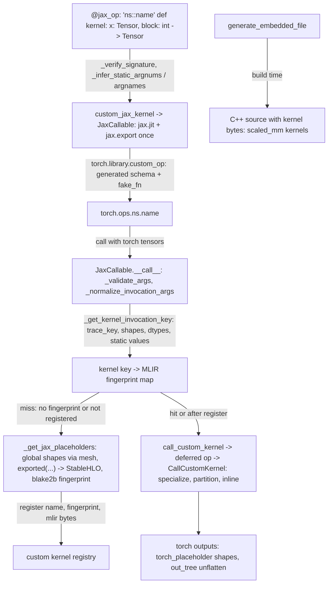

# Pallas and JAX custom kernels from PyTorch

## Overview
The `torch_tpu` Pallas API ("APIs to call Pallas kernels from PyTorch", requiring JAX in the
environment) lets a JAX function, typically a Pallas kernel or a thin JAX wrapper such as
tokamax's `ragged_dot`, be called with `torch.Tensor` arguments. `jax_op` (marked experimental)
is the current entry point: it validates the function's Python signature
([`_verify_signature`](https://github.com/google-pytorch/torch_tpu/blob/6d2a45754bdb52743883f75fbf753408345f6d1b/src/torch_tpu/_internal/pallas/pallas.py#L498 "src/torch_tpu/_internal/pallas/pallas#_verify_signature")), infers which positional and keyword-only arguments are static
compile-time values ([`_infer_static_argnums`](https://github.com/google-pytorch/torch_tpu/blob/6d2a45754bdb52743883f75fbf753408345f6d1b/src/torch_tpu/_internal/pallas/pallas.py#L591 "src/torch_tpu/_internal/pallas/pallas#_infer_static_argnums"), [`_infer_static_argnames`](https://github.com/google-pytorch/torch_tpu/blob/6d2a45754bdb52743883f75fbf753408345f6d1b/src/torch_tpu/_internal/pallas/pallas.py#L612 "src/torch_tpu/_internal/pallas/pallas#_infer_static_argnames")),
wraps the function in a [`JaxCallable`](https://github.com/google-pytorch/torch_tpu/blob/6d2a45754bdb52743883f75fbf753408345f6d1b/src/torch_tpu/_internal/pallas/pallas.py#L930 "src/torch_tpu/_internal/pallas/pallas#JaxCallable")
through the deprecated [`custom_jax_kernel`](https://github.com/google-pytorch/torch_tpu/blob/6d2a45754bdb52743883f75fbf753408345f6d1b/src/torch_tpu/_internal/pallas/pallas.py#L1399 "src/torch_tpu/_internal/pallas/pallas#custom_jax_kernel"),
and registers it as a namespaced `torch.library.custom_op` with an explicitly generated schema
([`_generate_torch_schema`](https://github.com/google-pytorch/torch_tpu/blob/6d2a45754bdb52743883f75fbf753408345f6d1b/src/torch_tpu/_internal/pallas/pallas.py#L897 "src/torch_tpu/_internal/pallas/pallas#_generate_torch_schema")) and a fake implementation so it works under eager, `torch.compile`
and export. The `JaxCallable` runs `jax.export` on the jitted function once, at construction.
At call time it normalizes the arguments ([`_normalize_invocation_args`](https://github.com/google-pytorch/torch_tpu/blob/6d2a45754bdb52743883f75fbf753408345f6d1b/src/torch_tpu/_internal/pallas/pallas.py#L1100 "src/torch_tpu/_internal/pallas/pallas#JaxCallable._normalize_invocation_args")), computes a
process-local invocation key from the trace key, input shapes and dtypes and static values
([`_get_kernel_invocation_key`](https://github.com/google-pytorch/torch_tpu/blob/6d2a45754bdb52743883f75fbf753408345f6d1b/src/torch_tpu/_internal/pallas/pallas.py#L290 "src/torch_tpu/_internal/pallas/pallas#_get_kernel_invocation_key")), and on a miss lowers the export with placeholder arrays
([`_get_jax_placeholders`](https://github.com/google-pytorch/torch_tpu/blob/6d2a45754bdb52743883f75fbf753408345f6d1b/src/torch_tpu/_internal/pallas/pallas.py#L1164 "src/torch_tpu/_internal/pallas/pallas#JaxCallable._get_jax_placeholders")) to StableHLO, fingerprints the MLIR text and registers the module
bytes with the C++ custom-kernel registry under that fingerprint
([`kernel_key_to_mlir_fingerprint`](https://github.com/google-pytorch/torch_tpu/blob/6d2a45754bdb52743883f75fbf753408345f6d1b/src/torch_tpu/_internal/pallas/pallas.py#L1006 "src/torch_tpu/_internal/pallas/pallas#JaxCallable.kernel_key_to_mlir_fingerprint")); either way it then calls the registered kernel through the
`tpu_torch_pallas` pybind module, which runs the registry path of
[scan-and-custom-kernels](scan-and-custom-kernels.md) inside a deferred op, so the kernel fuses
into the surrounding XLA program.

## Diagram

Legend:
- `DEF` - (concept) the user's annotated JAX function
- `CJK` - [`custom_jax_kernel`](https://github.com/google-pytorch/torch_tpu/blob/6d2a45754bdb52743883f75fbf753408345f6d1b/src/torch_tpu/_internal/pallas/pallas.py#L1399 "src/torch_tpu/_internal/pallas/pallas#custom_jax_kernel") building a [`JaxCallable`](https://github.com/google-pytorch/torch_tpu/blob/6d2a45754bdb52743883f75fbf753408345f6d1b/src/torch_tpu/_internal/pallas/pallas.py#L930 "src/torch_tpu/_internal/pallas/pallas#JaxCallable") ([`__init__`](https://github.com/google-pytorch/torch_tpu/blob/6d2a45754bdb52743883f75fbf753408345f6d1b/src/torch_tpu/_internal/pallas/pallas.py#L951 "src/torch_tpu/_internal/pallas/pallas#JaxCallable.__init__"), [`jit_fn`](https://github.com/google-pytorch/torch_tpu/blob/6d2a45754bdb52743883f75fbf753408345f6d1b/src/torch_tpu/_internal/pallas/pallas.py#L939 "src/torch_tpu/_internal/pallas/pallas#JaxCallable.jit_fn"), [`exported`](https://github.com/google-pytorch/torch_tpu/blob/6d2a45754bdb52743883f75fbf753408345f6d1b/src/torch_tpu/_internal/pallas/pallas.py#L947 "src/torch_tpu/_internal/pallas/pallas#JaxCallable.exported")); `jax_op` via [`dec`](https://github.com/google-pytorch/torch_tpu/blob/6d2a45754bdb52743883f75fbf753408345f6d1b/src/torch_tpu/_internal/pallas/pallas.py#L1619 "src/torch_tpu/_internal/pallas/pallas#jax_op.dec")
- `OP` - (concept) the registered `torch.library` op; its fake kernel is [`fake_fn`](https://github.com/google-pytorch/torch_tpu/blob/6d2a45754bdb52743883f75fbf753408345f6d1b/src/torch_tpu/_internal/pallas/pallas.py#L1650 "src/torch_tpu/_internal/pallas/pallas#jax_op.dec.fake_fn")
- `CALL` - [`__call__`](https://github.com/google-pytorch/torch_tpu/blob/6d2a45754bdb52743883f75fbf753408345f6d1b/src/torch_tpu/_internal/pallas/pallas.py#L1198 "src/torch_tpu/_internal/pallas/pallas#JaxCallable.__call__"), [`_validate_args`](https://github.com/google-pytorch/torch_tpu/blob/6d2a45754bdb52743883f75fbf753408345f6d1b/src/torch_tpu/_internal/pallas/pallas.py#L1078 "src/torch_tpu/_internal/pallas/pallas#JaxCallable._validate_args"), [`_normalize_invocation_args`](https://github.com/google-pytorch/torch_tpu/blob/6d2a45754bdb52743883f75fbf753408345f6d1b/src/torch_tpu/_internal/pallas/pallas.py#L1100 "src/torch_tpu/_internal/pallas/pallas#JaxCallable._normalize_invocation_args")
- `KEY` - [`_get_kernel_invocation_key`](https://github.com/google-pytorch/torch_tpu/blob/6d2a45754bdb52743883f75fbf753408345f6d1b/src/torch_tpu/_internal/pallas/pallas.py#L290 "src/torch_tpu/_internal/pallas/pallas#_get_kernel_invocation_key") ([`get_hash`](https://github.com/google-pytorch/torch_tpu/blob/6d2a45754bdb52743883f75fbf753408345f6d1b/src/torch_tpu/_internal/pallas/pallas.py#L314 "src/torch_tpu/_internal/pallas/pallas#_get_kernel_invocation_key.get_hash")), [`kernel_key_to_mlir_fingerprint`](https://github.com/google-pytorch/torch_tpu/blob/6d2a45754bdb52743883f75fbf753408345f6d1b/src/torch_tpu/_internal/pallas/pallas.py#L1006 "src/torch_tpu/_internal/pallas/pallas#JaxCallable.kernel_key_to_mlir_fingerprint")
- `TRACE` - [`_get_jax_placeholders`](https://github.com/google-pytorch/torch_tpu/blob/6d2a45754bdb52743883f75fbf753408345f6d1b/src/torch_tpu/_internal/pallas/pallas.py#L1164 "src/torch_tpu/_internal/pallas/pallas#JaxCallable._get_jax_placeholders") / [`jax_placeholders`](https://github.com/google-pytorch/torch_tpu/blob/6d2a45754bdb52743883f75fbf753408345f6d1b/src/torch_tpu/_internal/pallas/pallas.py#L198 "src/torch_tpu/_internal/pallas/pallas#jax_placeholders") / [`jax_placeholder`](https://github.com/google-pytorch/torch_tpu/blob/6d2a45754bdb52743883f75fbf753408345f6d1b/src/torch_tpu/_internal/pallas/pallas.py#L151 "src/torch_tpu/_internal/pallas/pallas#jax_placeholder")
- `REG` - (concept) the C++ custom-kernel registry, see [scan-and-custom-kernels](scan-and-custom-kernels.md)
- `RUN` - (concept) the `tpu_torch_pallas` call binding and the deferred op it dispatches
- `OUT` - [`torch_placeholder`](https://github.com/google-pytorch/torch_tpu/blob/6d2a45754bdb52743883f75fbf753408345f6d1b/src/torch_tpu/_internal/pallas/pallas.py#L220 "src/torch_tpu/_internal/pallas/pallas#torch_placeholder"), [`JAX_TO_TORCH_DTYPE_MAP`](https://github.com/google-pytorch/torch_tpu/blob/6d2a45754bdb52743883f75fbf753408345f6d1b/src/torch_tpu/_internal/pallas/pallas.py#L111 "src/torch_tpu/_internal/pallas/pallas#JAX_TO_TORCH_DTYPE_MAP")
- `GEN` - [`generate_embedded_file`](https://github.com/google-pytorch/torch_tpu/blob/6d2a45754bdb52743883f75fbf753408345f6d1b/src/torch_tpu/_internal/pallas/pallas_kernel_generate_utils.py#L18 "src/torch_tpu/_internal/pallas/pallas_kernel_generate_utils#generate_embedded_file")
- `EMB` - (concept) the generated C++ header and implementation file

## Design rationale (why it's built this way)
- **Export once, lower once per signature, register by content.** The [`__init__`](https://github.com/google-pytorch/torch_tpu/blob/6d2a45754bdb52743883f75fbf753408345f6d1b/src/torch_tpu/_internal/pallas/pallas.py#L951 "src/torch_tpu/_internal/pallas/pallas#JaxCallable.__init__")
  docstring: "The callable is cached based on the (trace_key, input_shapes, input_kwargs), if a
  hash is not found the function is re-traced and re-registered." The trace key
  ([`trace_key`](https://github.com/google-pytorch/torch_tpu/blob/6d2a45754bdb52743883f75fbf753408345f6d1b/src/torch_tpu/_internal/pallas/pallas.py#L938 "src/torch_tpu/_internal/pallas/pallas#JaxCallable.trace_key")) mixes the function name with its object id and the static and donation
  configuration, so two functions with the same name never collide. That key is process-local,
  though, so the C++ registry is no longer keyed by it: [`kernel_key_to_mlir_fingerprint`](https://github.com/google-pytorch/torch_tpu/blob/6d2a45754bdb52743883f75fbf753408345f6d1b/src/torch_tpu/_internal/pallas/pallas.py#L1006 "src/torch_tpu/_internal/pallas/pallas#JaxCallable.kernel_key_to_mlir_fingerprint") maps
  each invocation key to a BLAKE2b-128 fingerprint of the lowered MLIR module printed without
  location debug info. The source comment explains the bridge exists "so that compilation caches
  can be shared across processes", and that stripping the outer `#loc` info makes callers from
  different stack frames produce the same fingerprint while the Mosaic kernel body keeps its own
  debug info for profiling.
- **Static arguments are part of the kernel identity.** [`static_argnums`](https://github.com/google-pytorch/torch_tpu/blob/6d2a45754bdb52743883f75fbf753408345f6d1b/src/torch_tpu/_internal/pallas/pallas.py#L943 "src/torch_tpu/_internal/pallas/pallas#JaxCallable.static_argnums")
  (explicit for `custom_jax_kernel`, inferred from non-tensor annotations by
  [`_infer_static_argnums`](https://github.com/google-pytorch/torch_tpu/blob/6d2a45754bdb52743883f75fbf753408345f6d1b/src/torch_tpu/_internal/pallas/pallas.py#L591 "src/torch_tpu/_internal/pallas/pallas#_infer_static_argnums") and, for keyword-only parameters, [`_infer_static_argnames`](https://github.com/google-pytorch/torch_tpu/blob/6d2a45754bdb52743883f75fbf753408345f6d1b/src/torch_tpu/_internal/pallas/pallas.py#L612 "src/torch_tpu/_internal/pallas/pallas#_infer_static_argnames")
  for `jax_op`) are "compile-time constants ... used for caching by value", which is how block
  sizes or an implementation selector become separate kernels rather than runtime inputs. Because
  PyTorch dispatch turns enums into strings or ints, dtypes into `torch.dtype` and tuples into
  lists, [`_to_hashable_jax_static_arg`](https://github.com/google-pytorch/torch_tpu/blob/6d2a45754bdb52743883f75fbf753408345f6d1b/src/torch_tpu/_internal/pallas/pallas.py#L830 "src/torch_tpu/_internal/pallas/pallas#_to_hashable_jax_static_arg") converts each static value back to what the JAX
  function expects (the enum member, the JAX dtype via [`TORCH_TO_JAX_DTYPE_MAP`](https://github.com/google-pytorch/torch_tpu/blob/6d2a45754bdb52743883f75fbf753408345f6d1b/src/torch_tpu/_internal/pallas/pallas.py#L65 "src/torch_tpu/_internal/pallas/pallas#TORCH_TO_JAX_DTYPE_MAP"), a tuple) so it
  is hashable for `jax.jit`.
- **A real `torch.library` op, so Dynamo and DTensor understand it.** `jax_op`
  requires a `namespace::name`, derives a PyTorch signature from the JAX annotations
  ([`_get_torch_signature`](https://github.com/google-pytorch/torch_tpu/blob/6d2a45754bdb52743883f75fbf753408345f6d1b/src/torch_tpu/_internal/pallas/pallas.py#L859 "src/torch_tpu/_internal/pallas/pallas#_get_torch_signature"), [`_map_jax_param_to_torch`](https://github.com/google-pytorch/torch_tpu/blob/6d2a45754bdb52743883f75fbf753408345f6d1b/src/torch_tpu/_internal/pallas/pallas.py#L696 "src/torch_tpu/_internal/pallas/pallas#_map_jax_param_to_torch"), [`_map_jax_return_to_torch`](https://github.com/google-pytorch/torch_tpu/blob/6d2a45754bdb52743883f75fbf753408345f6d1b/src/torch_tpu/_internal/pallas/pallas.py#L710 "src/torch_tpu/_internal/pallas/pallas#_map_jax_return_to_torch")),
  builds the schema string itself ([`_generate_torch_schema`](https://github.com/google-pytorch/torch_tpu/blob/6d2a45754bdb52743883f75fbf753408345f6d1b/src/torch_tpu/_internal/pallas/pallas.py#L897 "src/torch_tpu/_internal/pallas/pallas#_generate_torch_schema"), with the return part from
  [`_map_jax_return_to_schema_str`](https://github.com/google-pytorch/torch_tpu/blob/6d2a45754bdb52743883f75fbf753408345f6d1b/src/torch_tpu/_internal/pallas/pallas.py#L749 "src/torch_tpu/_internal/pallas/pallas#_map_jax_return_to_schema_str"), which maps an `int` return to `SymInt`), and registers
  [`fake_fn`](https://github.com/google-pytorch/torch_tpu/blob/6d2a45754bdb52743883f75fbf753408345f6d1b/src/torch_tpu/_internal/pallas/pallas.py#L1650 "src/torch_tpu/_internal/pallas/pallas#jax_op.dec.fake_fn") as the fake kernel: it lowers the export with placeholders and turns the output
  avals into empty tensors on the input's device, so the op traces under fake tensors. Donated
  arguments are deliberately *not* declared as mutated: the comment explains that marking them
  mutable would make Dynamo copy the original value back, "which then defeats the purpose of
  donating"; donated tensors are simply invalid afterwards and the docstring suggests `copy_` or
  `set_` in a wrapper to overwrite them.
- **Caller values are normalized before dispatch.** The op object returned by `jax_op` is a
  `CustomOpDef` subclass whose call passes every argument through [`_normalize_caller_arg`](https://github.com/google-pytorch/torch_tpu/blob/6d2a45754bdb52743883f75fbf753408345f6d1b/src/torch_tpu/_internal/pallas/pallas.py#L796 "src/torch_tpu/_internal/pallas/pallas#_normalize_caller_arg"):
  enum members become their primitive value, JAX/NumPy dtypes become `torch.dtype` via
  [`JAX_TO_TORCH_DTYPE_MAP`](https://github.com/google-pytorch/torch_tpu/blob/6d2a45754bdb52743883f75fbf753408345f6d1b/src/torch_tpu/_internal/pallas/pallas.py#L111 "src/torch_tpu/_internal/pallas/pallas#JAX_TO_TORCH_DTYPE_MAP"), a `jax.Device` becomes the `tpu` device. This is what lets user code
  call the op with the same values it would pass to the JAX function.
- **Sharded kernels are traced at global shape, on world-sized meshes.** With a [`mesh`](https://github.com/google-pytorch/torch_tpu/blob/6d2a45754bdb52743883f75fbf753408345f6d1b/src/torch_tpu/_internal/pallas/pallas.py#L940 "src/torch_tpu/_internal/pallas/pallas#JaxCallable.mesh")
  and input partition specs, [`jax_placeholder`](https://github.com/google-pytorch/torch_tpu/blob/6d2a45754bdb52743883f75fbf753408345f6d1b/src/torch_tpu/_internal/pallas/pallas.py#L151 "src/torch_tpu/_internal/pallas/pallas#jax_placeholder") multiplies each per-device torch shape out to the
  global array shape and attaches a `NamedSharding`, and [`torch_placeholder`](https://github.com/google-pytorch/torch_tpu/blob/6d2a45754bdb52743883f75fbf753408345f6d1b/src/torch_tpu/_internal/pallas/pallas.py#L220 "src/torch_tpu/_internal/pallas/pallas#torch_placeholder") divides output
  shapes back to the local view (using output partition specs or the aval's sharding); the C++
  side then partitions the exported global program to the local view
  ([scan-and-custom-kernels](scan-and-custom-kernels.md)), which is what allows a Pallas kernel
  with RDMAs to run under TorchTPU's per-chip SPMD model. The mesh's device ids are passed along
  as the device assignment, and [`_validate_pallas_mesh_world_size`](https://github.com/google-pytorch/torch_tpu/blob/6d2a45754bdb52743883f75fbf753408345f6d1b/src/torch_tpu/_internal/pallas/pallas.py#L1366 "src/torch_tpu/_internal/pallas/pallas#_validate_pallas_mesh_world_size") rejects any mesh, mesh shape
  or process group that does not span the whole world ("torch_tpu pallas kernels currently
  require full world-size meshes only"). [`_get_pallas_mesh`](https://github.com/google-pytorch/torch_tpu/blob/6d2a45754bdb52743883f75fbf753408345f6d1b/src/torch_tpu/_internal/pallas/pallas.py#L1707 "src/torch_tpu/_internal/pallas/pallas#_get_pallas_mesh") (public as
  `torch.tpu.pallas.get_pallas_mesh`) builds such a "rank-aligned JAX Mesh using TPU runtime
  device metadata" out of compile-only mock devices (compared by id, kind and platform in
  [`__eq__`](https://github.com/google-pytorch/torch_tpu/blob/6d2a45754bdb52743883f75fbf753408345f6d1b/src/torch_tpu/_internal/pallas/_mock_device.py#L70 "src/torch_tpu/_internal/pallas/_mock_device#_PallasDevice.__eq__")), so no `jax.devices()` call or JAX runtime client is needed.
- **Only tensors, tensor containers and simple scalars cross the boundary.**
  [`_is_valid_argument_type`](https://github.com/google-pytorch/torch_tpu/blob/6d2a45754bdb52743883f75fbf753408345f6d1b/src/torch_tpu/_internal/pallas/pallas.py#L461 "src/torch_tpu/_internal/pallas/pallas#_is_valid_argument_type"), [`_is_tensor_annotation`](https://github.com/google-pytorch/torch_tpu/blob/6d2a45754bdb52743883f75fbf753408345f6d1b/src/torch_tpu/_internal/pallas/pallas.py#L579 "src/torch_tpu/_internal/pallas/pallas#_is_tensor_annotation"), [`_get_sequence_element_type`](https://github.com/google-pytorch/torch_tpu/blob/6d2a45754bdb52743883f75fbf753408345f6d1b/src/torch_tpu/_internal/pallas/pallas.py#L374 "src/torch_tpu/_internal/pallas/pallas#_get_sequence_element_type"),
  [`_get_enum_type`](https://github.com/google-pytorch/torch_tpu/blob/6d2a45754bdb52743883f75fbf753408345f6d1b/src/torch_tpu/_internal/pallas/pallas.py#L359 "src/torch_tpu/_internal/pallas/pallas#_get_enum_type") and [`_strip_optional`](https://github.com/google-pytorch/torch_tpu/blob/6d2a45754bdb52743883f75fbf753408345f6d1b/src/torch_tpu/_internal/pallas/pallas.py#L341 "src/torch_tpu/_internal/pallas/pallas#_strip_optional") (which also unwraps `typing.Annotated` through
  [`_unwrap_annotated`](https://github.com/google-pytorch/torch_tpu/blob/6d2a45754bdb52743883f75fbf753408345f6d1b/src/torch_tpu/_internal/pallas/pallas.py#L334 "src/torch_tpu/_internal/pallas/pallas#_unwrap_annotated")) accept `jax.Array`/`torch.Tensor`, homogeneous `Sequence`/`list`/`tuple`
  of tensors or scalars, enums, `Literal`s, dtypes and devices (optionally wrapped), and
  [`is_valid_result`](https://github.com/google-pytorch/torch_tpu/blob/6d2a45754bdb52743883f75fbf753408345f6d1b/src/torch_tpu/_internal/pallas/pallas.py#L533 "src/torch_tpu/_internal/pallas/pallas#_verify_signature.is_valid_result") constrains results to tensors, scalars and their tuples or lists, so the
  generated custom op has a schema PyTorch can serialize.
- **`custom_jax_kernel` is kept for wrappers, deprecated for users.** Its docstring opens with
  "Deprecated: Please use `jax_op` instead", shows the tokamax pattern (`functools.partial` or
  `static_argnums`) and issues a deprecation warning
  ([`warn_deprecation_with_skip`](https://github.com/google-pytorch/torch_tpu/blob/6d2a45754bdb52743883f75fbf753408345f6d1b/src/torch_tpu/_internal/pallas/_compat.py#L24 "src/torch_tpu/_internal/pallas/_compat#warn_deprecation_with_skip"), which reports through the TorchTPU [`warn`](https://github.com/google-pytorch/torch_tpu/blob/6d2a45754bdb52743883f75fbf753408345f6d1b/src/torch_tpu/_internal/utils/tt_warnings.py#L32 "src/torch_tpu/_internal/utils/tt_warnings#warn") helper under the
  [`DEPRECATED_API`](https://github.com/google-pytorch/torch_tpu/blob/6d2a45754bdb52743883f75fbf753408345f6d1b/src/torch_tpu/_internal/warnings.py#L113 "src/torch_tpu/_internal/warnings#DEPRECATED_API.DEPRECATED_API") category; suppressed when called from `jax_op`). Internal kernels still use
  it directly: splash attention wraps its forward and backward functions with it in
  [`_get_splash_op_names`](https://github.com/google-pytorch/torch_tpu/blob/6d2a45754bdb52743883f75fbf753408345f6d1b/src/torch_tpu/_internal/ops/splash_attention.py#L342 "src/torch_tpu/_internal/ops/splash_attention#_get_splash_op_names") and registers them with hand-written schemas.
- **Build-time embedding for shipped kernels.** [`generate_embedded_file`](https://github.com/google-pytorch/torch_tpu/blob/6d2a45754bdb52743883f75fbf753408345f6d1b/src/torch_tpu/_internal/pallas/pallas_kernel_generate_utils.py#L18 "src/torch_tpu/_internal/pallas/pallas_kernel_generate_utils#generate_embedded_file")
  turns exported kernel bytes into a C++ header and implementation file
  (`<varname>_data[]` and `<varname>_len`); at this pin its caller is the scaled-matmul kernel
  generator ([`main`](https://github.com/google-pytorch/torch_tpu/blob/6d2a45754bdb52743883f75fbf753408345f6d1b/src/torch_tpu/_internal/ops/scaled_mm/kernels/scaled_mm_generate.py#L259 "src/torch_tpu/_internal/ops/scaled_mm/kernels/scaled_mm_generate#main")), so the runtime does not need JAX installed to use those kernels.

> [!inferred]
> The mental model for a user: annotate a JAX function with tensor and scalar types, decorate it
> with `jax_op("mylib::kernel")`, call it like any op. The first call per shape pays JAX lowering
> plus TorchTPU specialization; later calls with the same shapes and static values hit the
> per-callable cache and the registry, and the compiled program is cached like any other. Because
> the registry key is a content fingerprint, the same kernel traced in two processes should map to
> the same compiled-program cache entries. JAX must be importable, and the caution in the source
> about JAX and PyTorch sharing a PjRt plugin means the JAX side is used for tracing only.

## Entry points
- `jax_op` (its decorator body is [`dec`](https://github.com/google-pytorch/torch_tpu/blob/6d2a45754bdb52743883f75fbf753408345f6d1b/src/torch_tpu/_internal/pallas/pallas.py#L1619 "src/torch_tpu/_internal/pallas/pallas#jax_op.dec"); arguments `name`, optional `fn`, keyword-only
  `donate_argnums`, `mesh`, `input_partition_specs`, `output_partition_specs`) and
  [`custom_jax_kernel`](https://github.com/google-pytorch/torch_tpu/blob/6d2a45754bdb52743883f75fbf753408345f6d1b/src/torch_tpu/_internal/pallas/pallas.py#L1399 "src/torch_tpu/_internal/pallas/pallas#custom_jax_kernel")
  (`jax_fn`, `name`, `static_argnums`, `donate_argnums`, deprecated `input_output_aliases`,
  `mesh`, `input_partition_specs`, `output_partition_specs`, keyword-only `static_argnames`,
  `warn_deprecated`).
- [`__call__`](https://github.com/google-pytorch/torch_tpu/blob/6d2a45754bdb52743883f75fbf753408345f6d1b/src/torch_tpu/_internal/pallas/pallas.py#L1198 "src/torch_tpu/_internal/pallas/pallas#JaxCallable.__call__"): the runtime path, reached when the registered op (or a raw `JaxCallable`, as
  splash attention uses it) is invoked; the export it lowers lives in [`exported`](https://github.com/google-pytorch/torch_tpu/blob/6d2a45754bdb52743883f75fbf753408345f6d1b/src/torch_tpu/_internal/pallas/pallas.py#L947 "src/torch_tpu/_internal/pallas/pallas#JaxCallable.exported").
- [`_get_pallas_mesh`](https://github.com/google-pytorch/torch_tpu/blob/6d2a45754bdb52743883f75fbf753408345f6d1b/src/torch_tpu/_internal/pallas/pallas.py#L1707 "src/torch_tpu/_internal/pallas/pallas#_get_pallas_mesh"): the mesh builder behind `torch.tpu.pallas.get_pallas_mesh`, the
  deprecated `torch_tpu._internal.pallas.get_pallas_mesh` alias and `get_default_pallas_mesh`
  (a 1D `("rank",)` mesh).
- [`generate_embedded_file`](https://github.com/google-pytorch/torch_tpu/blob/6d2a45754bdb52743883f75fbf753408345f6d1b/src/torch_tpu/_internal/pallas/pallas_kernel_generate_utils.py#L18 "src/torch_tpu/_internal/pallas/pallas_kernel_generate_utils#generate_embedded_file"): build-time entry, called by kernel generators such as [`main`](https://github.com/google-pytorch/torch_tpu/blob/6d2a45754bdb52743883f75fbf753408345f6d1b/src/torch_tpu/_internal/ops/scaled_mm/kernels/scaled_mm_generate.py#L259 "src/torch_tpu/_internal/ops/scaled_mm/kernels/scaled_mm_generate#main").

## Mechanism (step-by-step)
1. **Decorate.** `jax_op` checks the namespace, unwraps decorators to read the signature
   (noting names already bound by `functools.partial`), verifies it, infers static argnums and
   argnames, and builds the [`JaxCallable`](https://github.com/google-pytorch/torch_tpu/blob/6d2a45754bdb52743883f75fbf753408345f6d1b/src/torch_tpu/_internal/pallas/pallas.py#L930 "src/torch_tpu/_internal/pallas/pallas#JaxCallable") via [`custom_jax_kernel`](https://github.com/google-pytorch/torch_tpu/blob/6d2a45754bdb52743883f75fbf753408345f6d1b/src/torch_tpu/_internal/pallas/pallas.py#L1399 "src/torch_tpu/_internal/pallas/pallas#custom_jax_kernel") with a `jax.jit` of the
   function ([`jit_fn`](https://github.com/google-pytorch/torch_tpu/blob/6d2a45754bdb52743883f75fbf753408345f6d1b/src/torch_tpu/_internal/pallas/pallas.py#L939 "src/torch_tpu/_internal/pallas/pallas#JaxCallable.jit_fn"), jitted with `keep_unused=True`). [`__init__`](https://github.com/google-pytorch/torch_tpu/blob/6d2a45754bdb52743883f75fbf753408345f6d1b/src/torch_tpu/_internal/pallas/pallas.py#L951 "src/torch_tpu/_internal/pallas/pallas#JaxCallable.__init__") immediately runs
   `jax.export` for the `tpu` platform with custom-call safety checks disabled and forward
   compatibility ignored, stores it in [`exported`](https://github.com/google-pytorch/torch_tpu/blob/6d2a45754bdb52743883f75fbf753408345f6d1b/src/torch_tpu/_internal/pallas/pallas.py#L947 "src/torch_tpu/_internal/pallas/pallas#JaxCallable.exported"), and precomputes the per-parameter tables
   ([`_orig_signature`](https://github.com/google-pytorch/torch_tpu/blob/6d2a45754bdb52743883f75fbf753408345f6d1b/src/torch_tpu/_internal/pallas/pallas.py#L1043 "src/torch_tpu/_internal/pallas/pallas#JaxCallable._orig_signature"), [`_orig_params`](https://github.com/google-pytorch/torch_tpu/blob/6d2a45754bdb52743883f75fbf753408345f6d1b/src/torch_tpu/_internal/pallas/pallas.py#L1044 "src/torch_tpu/_internal/pallas/pallas#JaxCallable._orig_params"), [`_orig_params_by_name`](https://github.com/google-pytorch/torch_tpu/blob/6d2a45754bdb52743883f75fbf753408345f6d1b/src/torch_tpu/_internal/pallas/pallas.py#L1045 "src/torch_tpu/_internal/pallas/pallas#JaxCallable._orig_params_by_name"), [`_param_is_tensor`](https://github.com/google-pytorch/torch_tpu/blob/6d2a45754bdb52743883f75fbf753408345f6d1b/src/torch_tpu/_internal/pallas/pallas.py#L1052 "src/torch_tpu/_internal/pallas/pallas#JaxCallable._param_is_tensor"),
   [`_static_param_names`](https://github.com/google-pytorch/torch_tpu/blob/6d2a45754bdb52743883f75fbf753408345f6d1b/src/torch_tpu/_internal/pallas/pallas.py#L1059 "src/torch_tpu/_internal/pallas/pallas#JaxCallable._static_param_names"), [`_param_name_to_idx`](https://github.com/google-pytorch/torch_tpu/blob/6d2a45754bdb52743883f75fbf753408345f6d1b/src/torch_tpu/_internal/pallas/pallas.py#L1065 "src/torch_tpu/_internal/pallas/pallas#JaxCallable._param_name_to_idx")). `jax_op` then defines the custom op with the
   generated schema and its [`fake_fn`](https://github.com/google-pytorch/torch_tpu/blob/6d2a45754bdb52743883f75fbf753408345f6d1b/src/torch_tpu/_internal/pallas/pallas.py#L1650 "src/torch_tpu/_internal/pallas/pallas#jax_op.dec.fake_fn").
2. **Validate, normalize and key.** On a call, [`_validate_args`](https://github.com/google-pytorch/torch_tpu/blob/6d2a45754bdb52743883f75fbf753408345f6d1b/src/torch_tpu/_internal/pallas/pallas.py#L1078 "src/torch_tpu/_internal/pallas/pallas#JaxCallable._validate_args") rejects tensors in static
   positions and non-tensor values in tensor positions, and [`_normalize_invocation_args`](https://github.com/google-pytorch/torch_tpu/blob/6d2a45754bdb52743883f75fbf753408345f6d1b/src/torch_tpu/_internal/pallas/pallas.py#L1100 "src/torch_tpu/_internal/pallas/pallas#JaxCallable._normalize_invocation_args") binds
   the arguments to the original signature, restores defaults that the schema turned into `None`,
   and converts every static value with [`_to_hashable_jax_static_arg`](https://github.com/google-pytorch/torch_tpu/blob/6d2a45754bdb52743883f75fbf753408345f6d1b/src/torch_tpu/_internal/pallas/pallas.py#L830 "src/torch_tpu/_internal/pallas/pallas#_to_hashable_jax_static_arg"). If any argument is a
   wrapper tensor (it carries an `_elem` and `_env`, as torchax tensors do), the call bypasses
   TorchTPU entirely: [`unwrap_elem`](https://github.com/google-pytorch/torch_tpu/blob/6d2a45754bdb52743883f75fbf753408345f6d1b/src/torch_tpu/_internal/pallas/pallas.py#L1217 "src/torch_tpu/_internal/pallas/pallas#JaxCallable.unwrap_elem") unwraps the JAX arrays and [`jit_fn`](https://github.com/google-pytorch/torch_tpu/blob/6d2a45754bdb52743883f75fbf753408345f6d1b/src/torch_tpu/_internal/pallas/pallas.py#L939 "src/torch_tpu/_internal/pallas/pallas#JaxCallable.jit_fn") runs in JAX directly.
   Otherwise [`_get_kernel_invocation_key`](https://github.com/google-pytorch/torch_tpu/blob/6d2a45754bdb52743883f75fbf753408345f6d1b/src/torch_tpu/_internal/pallas/pallas.py#L290 "src/torch_tpu/_internal/pallas/pallas#_get_kernel_invocation_key") hashes the trace key with shapes, dtypes and static
   values ([`get_hash`](https://github.com/google-pytorch/torch_tpu/blob/6d2a45754bdb52743883f75fbf753408345f6d1b/src/torch_tpu/_internal/pallas/pallas.py#L314 "src/torch_tpu/_internal/pallas/pallas#_get_kernel_invocation_key.get_hash")).
3. **Lower on miss.** If there is no cached output layout for the key, no fingerprint in
   [`kernel_key_to_mlir_fingerprint`](https://github.com/google-pytorch/torch_tpu/blob/6d2a45754bdb52743883f75fbf753408345f6d1b/src/torch_tpu/_internal/pallas/pallas.py#L1006 "src/torch_tpu/_internal/pallas/pallas#JaxCallable.kernel_key_to_mlir_fingerprint"), or the registry lookup fails, placeholders are built with
   [`_get_jax_placeholders`](https://github.com/google-pytorch/torch_tpu/blob/6d2a45754bdb52743883f75fbf753408345f6d1b/src/torch_tpu/_internal/pallas/pallas.py#L1164 "src/torch_tpu/_internal/pallas/pallas#JaxCallable._get_jax_placeholders") (global shapes when a [`mesh`](https://github.com/google-pytorch/torch_tpu/blob/6d2a45754bdb52743883f75fbf753408345f6d1b/src/torch_tpu/_internal/pallas/pallas.py#L940 "src/torch_tpu/_internal/pallas/pallas#JaxCallable.mesh") is set; tensor lists become tuples
   where the annotation says `tuple`), [`exported`](https://github.com/google-pytorch/torch_tpu/blob/6d2a45754bdb52743883f75fbf753408345f6d1b/src/torch_tpu/_internal/pallas/pallas.py#L947 "src/torch_tpu/_internal/pallas/pallas#JaxCallable.exported") is called on them, the MLIR is re-printed
   without debug info and hashed, and the serialized module is registered under
   (`name`, fingerprint). Output placeholders come from [`torch_placeholder`](https://github.com/google-pytorch/torch_tpu/blob/6d2a45754bdb52743883f75fbf753408345f6d1b/src/torch_tpu/_internal/pallas/pallas.py#L220 "src/torch_tpu/_internal/pallas/pallas#torch_placeholder") with
   [`JAX_TO_TORCH_DTYPE_MAP`](https://github.com/google-pytorch/torch_tpu/blob/6d2a45754bdb52743883f75fbf753408345f6d1b/src/torch_tpu/_internal/pallas/pallas.py#L111 "src/torch_tpu/_internal/pallas/pallas#JAX_TO_TORCH_DTYPE_MAP"), and are cached with JAX's output tree so nested or tuple returns
   can be rebuilt.
4. **Call.** Tensor leaves are gathered from positional and keyword arguments by
   [`_add_tensor_arg`](https://github.com/google-pytorch/torch_tpu/blob/6d2a45754bdb52743883f75fbf753408345f6d1b/src/torch_tpu/_internal/pallas/pallas.py#L1305 "src/torch_tpu/_internal/pallas/pallas#JaxCallable._add_tensor_arg"), which flattens tensor lists and remaps donated parameter indices to leaf
   indices. The kernel is called with those leaves, the cached output shapes, the leaf donation
   indices and, when a [`mesh`](https://github.com/google-pytorch/torch_tpu/blob/6d2a45754bdb52743883f75fbf753408345f6d1b/src/torch_tpu/_internal/pallas/pallas.py#L940 "src/torch_tpu/_internal/pallas/pallas#JaxCallable.mesh") is set, the mesh's device ids as device assignment; the C++ side
   dispatches a deferred op that honors the donated indices. For the deprecated
   [`input_output_aliases`](https://github.com/google-pytorch/torch_tpu/blob/6d2a45754bdb52743883f75fbf753408345f6d1b/src/torch_tpu/_internal/pallas/pallas.py#L946 "src/torch_tpu/_internal/pallas/pallas#JaxCallable.input_output_aliases") the results are copied back into the aliased inputs with `copy_`, and
   finally the flat results are unflattened into the declared return structure.

## Key data structures
- [`JaxCallable`](https://github.com/google-pytorch/torch_tpu/blob/6d2a45754bdb52743883f75fbf753408345f6d1b/src/torch_tpu/_internal/pallas/pallas.py#L930 "src/torch_tpu/_internal/pallas/pallas#JaxCallable"): [`name`](https://github.com/google-pytorch/torch_tpu/blob/6d2a45754bdb52743883f75fbf753408345f6d1b/src/torch_tpu/_internal/pallas/pallas.py#L937 "src/torch_tpu/_internal/pallas/pallas#JaxCallable.name"),
  [`trace_key`](https://github.com/google-pytorch/torch_tpu/blob/6d2a45754bdb52743883f75fbf753408345f6d1b/src/torch_tpu/_internal/pallas/pallas.py#L938 "src/torch_tpu/_internal/pallas/pallas#JaxCallable.trace_key"),
  [`jit_fn`](https://github.com/google-pytorch/torch_tpu/blob/6d2a45754bdb52743883f75fbf753408345f6d1b/src/torch_tpu/_internal/pallas/pallas.py#L939 "src/torch_tpu/_internal/pallas/pallas#JaxCallable.jit_fn"),
  [`mesh`](https://github.com/google-pytorch/torch_tpu/blob/6d2a45754bdb52743883f75fbf753408345f6d1b/src/torch_tpu/_internal/pallas/pallas.py#L940 "src/torch_tpu/_internal/pallas/pallas#JaxCallable.mesh"),
  [`static_argnums`](https://github.com/google-pytorch/torch_tpu/blob/6d2a45754bdb52743883f75fbf753408345f6d1b/src/torch_tpu/_internal/pallas/pallas.py#L943 "src/torch_tpu/_internal/pallas/pallas#JaxCallable.static_argnums"),
  [`input_output_aliases`](https://github.com/google-pytorch/torch_tpu/blob/6d2a45754bdb52743883f75fbf753408345f6d1b/src/torch_tpu/_internal/pallas/pallas.py#L946 "src/torch_tpu/_internal/pallas/pallas#JaxCallable.input_output_aliases"),
  [`exported`](https://github.com/google-pytorch/torch_tpu/blob/6d2a45754bdb52743883f75fbf753408345f6d1b/src/torch_tpu/_internal/pallas/pallas.py#L947 "src/torch_tpu/_internal/pallas/pallas#JaxCallable.exported"), plus per-instance caches of output layouts and
  [`kernel_key_to_mlir_fingerprint`](https://github.com/google-pytorch/torch_tpu/blob/6d2a45754bdb52743883f75fbf753408345f6d1b/src/torch_tpu/_internal/pallas/pallas.py#L1006 "src/torch_tpu/_internal/pallas/pallas#JaxCallable.kernel_key_to_mlir_fingerprint") keyed by the invocation key.
- [`TORCH_TO_JAX_DTYPE_MAP`](https://github.com/google-pytorch/torch_tpu/blob/6d2a45754bdb52743883f75fbf753408345f6d1b/src/torch_tpu/_internal/pallas/pallas.py#L65 "src/torch_tpu/_internal/pallas/pallas#TORCH_TO_JAX_DTYPE_MAP") / [`JAX_TO_TORCH_DTYPE_MAP`](https://github.com/google-pytorch/torch_tpu/blob/6d2a45754bdb52743883f75fbf753408345f6d1b/src/torch_tpu/_internal/pallas/pallas.py#L111 "src/torch_tpu/_internal/pallas/pallas#JAX_TO_TORCH_DTYPE_MAP"): dtype translation for placeholders,
  static dtype arguments and outputs, including the float8 family and packed
  `float4_e2m1fn_x2` (whose last dimension doubles on the JAX side).

## Dynamics (design intent)
- Lowering happens on the calling thread and requires JAX; execution is deferred and fused.
- Registry entries persist for the process, so a kernel traced in a warm-up loop is reused across
  the run; the fingerprint, unlike the trace key, is meant to be stable across processes.

## Edge cases
- An op name without exactly one `::` is rejected.
- Arguments without annotations, or with types outside the supported set, fail signature
  verification at decoration time.
- The default fake kernel raises on symbolic (`SymInt`) dimensions; dynamic-shape users must
  override it.
- `float4_e2m1fn_x2` inputs need a contiguous last dimension, and outputs need an even last
  local dimension.
- Donated inputs are left invalid; the deprecated `input_output_aliases` must agree with
  `donate_argnums` when both are given and is scheduled for removal.
- Meshes, mesh shapes and process groups smaller than the world size are rejected when
  `torch.distributed` is initialized.
- Distributed kernels (manual computations) are not shape-specialized on the C++ side.

## Open questions
- Whether a future guard against JAX and PyTorch deadlocking on a shared PjRt plugin (noted in a
  module comment) is needed for trace-only use.
- The trace key is still process-dependent (a source comment notes it should be made stable or
  removed); only the MLIR fingerprint is stable today.
- The pybind entry points of the `tpu_torch_pallas` module (register, lookup, call) are C++
  symbols outside this packet's subgraph, so their internals are cited from
  [scan-and-custom-kernels](scan-and-custom-kernels.md) rather than here.

## See also
- [scan-and-custom-kernels](scan-and-custom-kernels.md): the C++ registry, specialization and partitioning.
- [scaled-dot-product-attention](scaled-dot-product-attention.md): splash attention, built on `custom_jax_kernel`.
- [eager-op-dispatch](eager-op-dispatch.md): deferred ops and donated indices.
- [torch-compile-backend](torch-compile-backend.md): custom ops under compilation.
- [compilation-cache](compilation-cache.md): where the fingerprinted kernels' compiled programs are cached.
- [distributed-launchers-and-spmd](distributed-launchers-and-spmd.md): the per-chip SPMD model the Pallas mesh aligns to.

## Recent changes
- `76284a1fa` adds "support for container, enum, and dtype types in jax_op": all parameter and
  return types accepted by `torch.library.infer_schema`, inferred `static_argnames` for
  keyword-only arguments, and caller-argument normalization (enums to primitives, JAX dtypes to
  `torch.dtype`) before dispatch.
- `2e0c3677a` "enforces world-sized meshes for Pallas distributed kernels" while simplifying the
  device assignment pipeline.
- `cd2d19504` exposes `get_pallas_mesh`, which "builds the rank-aligned JAX mesh needed by
  high-performance Pallas kernels", as the experimental public `torch.tpu.pallas.get_pallas_mesh`;
  the old internal location is deprecated.
- `0135fadad` swaps type-checker suppression comments, with no behavior change.
- [all changes in 6d2a45754b](../changes/6d2a45754b.md)
