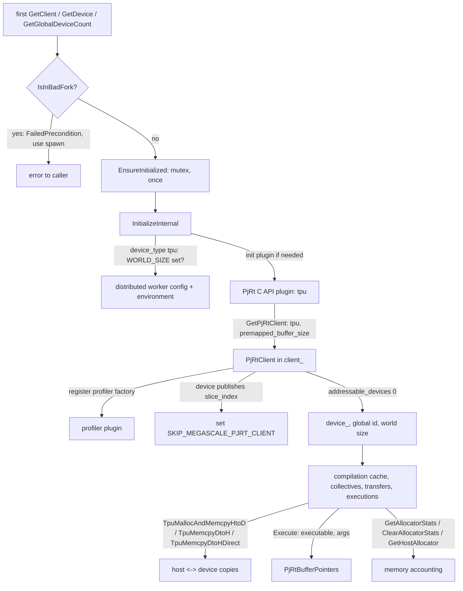

# PjRt backend, client and device state

## Overview
[`PjrtBackend`](https://github.com/google-pytorch/torch_tpu/blob/6d2a45754bdb52743883f75fbf753408345f6d1b/csrc/pjrt/pjrt_state.h#L66 "csrc/pjrt/pjrt_state.h#PjrtBackend") is the process singleton
that "manages the lifecycle and state of the PjRt runtime" with lazy, thread-safe initialization:
nothing touches the TPU until the first call to [`GetClient`](https://github.com/google-pytorch/torch_tpu/blob/6d2a45754bdb52743883f75fbf753408345f6d1b/csrc/pjrt/pjrt_state.cc#L337 "csrc/pjrt/pjrt_state.cc#PjrtBackend.GetClient"),
[`GetDevice`](https://github.com/google-pytorch/torch_tpu/blob/6d2a45754bdb52743883f75fbf753408345f6d1b/csrc/pjrt/pjrt_state.cc#L354 "csrc/pjrt/pjrt_state.cc#PjrtBackend.GetDevice") or
[`GetGlobalDeviceCount`](https://github.com/google-pytorch/torch_tpu/blob/6d2a45754bdb52743883f75fbf753408345f6d1b/csrc/pjrt/pjrt_state.cc#L364 "csrc/pjrt/pjrt_state.cc#PjrtBackend.GetGlobalDeviceCount"),
which run [`EnsureInitialized`](https://github.com/google-pytorch/torch_tpu/blob/6d2a45754bdb52743883f75fbf753408345f6d1b/csrc/pjrt/pjrt_state.cc#L202 "csrc/pjrt/pjrt_state.cc#PjrtBackend.EnsureInitialized")
and [`InitializeInternal`](https://github.com/google-pytorch/torch_tpu/blob/6d2a45754bdb52743883f75fbf753408345f6d1b/csrc/pjrt/pjrt_state.cc#L235 "csrc/pjrt/pjrt_state.cc#PjrtBackend.InitializeInternal").
Initialization loads the TPU PjRt plugin (at this pin `tpu` is the only supported device type),
initializes the distributed environment when `WORLD_SIZE` is set, creates the client with
[`GetPjRtClient`](https://github.com/google-pytorch/torch_tpu/blob/6d2a45754bdb52743883f75fbf753408345f6d1b/csrc/pjrt/pjrt_client.cc#L32 "csrc/pjrt/pjrt_client.cc#GetPjRtClient"), and pins the process to exactly one addressable
device. Failures are no longer swallowed: the accessors return `absl::StatusOr`, so the original
initialization error (a VFIO device collision, a bad fork, a distributed-setup failure) reaches
the caller. Everything else in TorchTPU consumes this state: the compilation cache asks for the
device count, the collectives for device ids, transfers for the client and host allocator, and
executions for [`Execute`](https://github.com/google-pytorch/torch_tpu/blob/6d2a45754bdb52743883f75fbf753408345f6d1b/csrc/pjrt/pjrt_execute.cc#L206 "csrc/pjrt/pjrt_execute.cc#Execute").

## Diagram

Legend:
- `ANY` - (concept) the first caller that needs the runtime
- `FORK` - [`IsInBadFork`](https://github.com/google-pytorch/torch_tpu/blob/6d2a45754bdb52743883f75fbf753408345f6d1b/csrc/pjrt/pjrt_state.cc#L332 "csrc/pjrt/pjrt_state.cc#PjrtBackend.IsInBadFork")
- `ERR` - (concept) the status returned to the caller
- `EI` - [`EnsureInitialized`](https://github.com/google-pytorch/torch_tpu/blob/6d2a45754bdb52743883f75fbf753408345f6d1b/csrc/pjrt/pjrt_state.cc#L202 "csrc/pjrt/pjrt_state.cc#PjrtBackend.EnsureInitialized")
- `II` - [`InitializeInternal`](https://github.com/google-pytorch/torch_tpu/blob/6d2a45754bdb52743883f75fbf753408345f6d1b/csrc/pjrt/pjrt_state.cc#L235 "csrc/pjrt/pjrt_state.cc#PjrtBackend.InitializeInternal")
- `DIST` - (concept) the discovery helpers of [process-group-and-collectives](process-group-and-collectives.md)
- `PLUG` - (concept) the libtpu PjRt C API plugin
- `CL` - [`GetPjRtClient`](https://github.com/google-pytorch/torch_tpu/blob/6d2a45754bdb52743883f75fbf753408345f6d1b/csrc/pjrt/pjrt_client.cc#L32 "csrc/pjrt/pjrt_client.cc#GetPjRtClient"), stored in [`client_`](https://github.com/google-pytorch/torch_tpu/blob/6d2a45754bdb52743883f75fbf753408345f6d1b/csrc/pjrt/pjrt_state.h#L150 "csrc/pjrt/pjrt_state.h#PjrtBackend.client_")
- `PROF` - (concept) the PjRt profiler extension, see [profiler](profiler.md)
- `MS` - (concept) the MegaScale guard inside [`InitializeInternal`](https://github.com/google-pytorch/torch_tpu/blob/6d2a45754bdb52743883f75fbf753408345f6d1b/csrc/pjrt/pjrt_state.cc#L235 "csrc/pjrt/pjrt_state.cc#PjrtBackend.InitializeInternal")
- `DEV` - [`device_`](https://github.com/google-pytorch/torch_tpu/blob/6d2a45754bdb52743883f75fbf753408345f6d1b/csrc/pjrt/pjrt_state.h#L152 "csrc/pjrt/pjrt_state.h#PjrtBackend.device_"), see also [`GetGlobalDeviceId`](https://github.com/google-pytorch/torch_tpu/blob/6d2a45754bdb52743883f75fbf753408345f6d1b/csrc/pjrt/pjrt_state.cc#L373 "csrc/pjrt/pjrt_state.cc#PjrtBackend.GetGlobalDeviceId")
- `USERS` - (concept) the rest of TorchTPU
- `MEM` - [`TpuMallocAndMemcpyHtoD`](https://github.com/google-pytorch/torch_tpu/blob/6d2a45754bdb52743883f75fbf753408345f6d1b/csrc/pjrt/pjrt_transfer.cc#L175 "csrc/pjrt/pjrt_transfer.cc#TpuMallocAndMemcpyHtoD"), [`TpuMemcpyDtoH`](https://github.com/google-pytorch/torch_tpu/blob/6d2a45754bdb52743883f75fbf753408345f6d1b/csrc/pjrt/pjrt_transfer.cc#L311 "csrc/pjrt/pjrt_transfer.cc#TpuMemcpyDtoH"), [`TpuMemcpyDtoHDirect`](https://github.com/google-pytorch/torch_tpu/blob/6d2a45754bdb52743883f75fbf753408345f6d1b/csrc/pjrt/pjrt_transfer.cc#L399 "csrc/pjrt/pjrt_transfer.cc#TpuMemcpyDtoHDirect")
- `EXE` - [`Execute`](https://github.com/google-pytorch/torch_tpu/blob/6d2a45754bdb52743883f75fbf753408345f6d1b/csrc/pjrt/pjrt_execute.cc#L206 "csrc/pjrt/pjrt_execute.cc#Execute") returning [`PjRtBufferPointers`](https://github.com/google-pytorch/torch_tpu/blob/6d2a45754bdb52743883f75fbf753408345f6d1b/csrc/pjrt/pjrt_execute.h#L35 "csrc/pjrt/pjrt_execute.h#PjRtBufferPointers")
- `STATS` - [`GetAllocatorStats`](https://github.com/google-pytorch/torch_tpu/blob/6d2a45754bdb52743883f75fbf753408345f6d1b/csrc/pjrt/pjrt_state.cc#L406 "csrc/pjrt/pjrt_state.cc#PjrtBackend.GetAllocatorStats"), [`ClearAllocatorStats`](https://github.com/google-pytorch/torch_tpu/blob/6d2a45754bdb52743883f75fbf753408345f6d1b/csrc/pjrt/pjrt_state.cc#L411 "csrc/pjrt/pjrt_state.cc#PjrtBackend.ClearAllocatorStats"), [`GetHostAllocator`](https://github.com/google-pytorch/torch_tpu/blob/6d2a45754bdb52743883f75fbf753408345f6d1b/csrc/pjrt/pjrt_state.cc#L416 "csrc/pjrt/pjrt_state.cc#PjrtBackend.GetHostAllocator")

## Design rationale (why it's built this way)
- **Lazy so that import is cheap and failures are attributable.** The loader creates
  `torch.device("tpu")` without initializing PjRt (see [device-backend-registration](device-backend-registration.md));
  the first real use triggers [`EnsureInitialized`](https://github.com/google-pytorch/torch_tpu/blob/6d2a45754bdb52743883f75fbf753408345f6d1b/csrc/pjrt/pjrt_state.cc#L202 "csrc/pjrt/pjrt_state.cc#PjrtBackend.EnsureInitialized"),
  which records [`init_attempted_`](https://github.com/google-pytorch/torch_tpu/blob/6d2a45754bdb52743883f75fbf753408345f6d1b/csrc/pjrt/pjrt_state.h#L158 "csrc/pjrt/pjrt_state.h#PjrtBackend.init_attempted_")
  and [`init_status_`](https://github.com/google-pytorch/torch_tpu/blob/6d2a45754bdb52743883f75fbf753408345f6d1b/csrc/pjrt/pjrt_state.h#L159 "csrc/pjrt/pjrt_state.h#PjrtBackend.init_status_") so a
  failed initialization is reported consistently on every later call rather than retried. Since the
  accessors return `absl::StatusOr`, that stored status is what every caller sees, instead of a
  null pointer and a generic "not initialized" message.
  [`SetPjRtInitializationOptions`](https://github.com/google-pytorch/torch_tpu/blob/6d2a45754bdb52743883f75fbf753408345f6d1b/csrc/pjrt/pjrt_state.cc#L193 "csrc/pjrt/pjrt_state.cc#PjrtBackend.SetPjRtInitializationOptions")
  must therefore run before first use; the options carry the device type (default `tpu`), an
  optional premapped host buffer size for faster transfers (the device module reads it from
  `TPU_PREMAPPED_BUFFER_SIZE`), and two hooks: a bad-fork checker and an on-initialized callback.
- **Fail fast in forked children.** Forking after the TPU runtime is up leaves the child with a
  runtime it cannot use. [`IsInBadFork`](https://github.com/google-pytorch/torch_tpu/blob/6d2a45754bdb52743883f75fbf753408345f6d1b/csrc/pjrt/pjrt_state.cc#L332 "csrc/pjrt/pjrt_state.cc#PjrtBackend.IsInBadFork")
  asks the checker installed through the options; when it reports a bad fork,
  [`EnsureInitialized`](https://github.com/google-pytorch/torch_tpu/blob/6d2a45754bdb52743883f75fbf753408345f6d1b/csrc/pjrt/pjrt_state.cc#L202 "csrc/pjrt/pjrt_state.cc#PjrtBackend.EnsureInitialized") returns a
  `FailedPrecondition` error telling the user to use the `spawn` start method,
  [`IsInitialized`](https://github.com/google-pytorch/torch_tpu/blob/6d2a45754bdb52743883f75fbf753408345f6d1b/csrc/pjrt/pjrt_state.cc#L324 "csrc/pjrt/pjrt_state.cc#PjrtBackend.IsInitialized") reports false and
  [`Shutdown`](https://github.com/google-pytorch/torch_tpu/blob/6d2a45754bdb52743883f75fbf753408345f6d1b/csrc/pjrt/pjrt_state.cc#L426 "csrc/pjrt/pjrt_state.cc#PjrtBackend.Shutdown") becomes a no-op. The
  hooks are plain function pointers held in atomics, which keeps this C++ layer independent of
  PyTorch's fork-handler machinery that the device module plugs in.
- **One device per process, world size from the environment.** [`InitializeInternal`](https://github.com/google-pytorch/torch_tpu/blob/6d2a45754bdb52743883f75fbf753408345f6d1b/csrc/pjrt/pjrt_state.cc#L235 "csrc/pjrt/pjrt_state.cc#PjrtBackend.InitializeInternal")
  takes the first addressable device, and requires `WORLD_SIZE` to be either 1 or exactly the
  client's device count ("Please check your environment variables"); with several addressable
  devices and no world size it warns that only one device is used. The resulting world size is
  what the [compilation pipeline](compilation-pipeline.md) uses for the number of partitions
  (via [`GetGlobalDeviceCount`](https://github.com/google-pytorch/torch_tpu/blob/6d2a45754bdb52743883f75fbf753408345f6d1b/csrc/pjrt/pjrt_state.cc#L364 "csrc/pjrt/pjrt_state.cc#PjrtBackend.GetGlobalDeviceCount")),
  which is why SPMD programs and the process-per-chip model line up.
- **One owner of the MegaScale client.** In multi-slice jobs libtpu wraps each new TPU PjRt client
  in a MegaScale client; a second one (for example JAX's, created for Pallas kernels or the JAX
  profiler) would redo slice discovery, which the coordinator rejects. So
  [`InitializeInternal`](https://github.com/google-pytorch/torch_tpu/blob/6d2a45754bdb52743883f75fbf753408345f6d1b/csrc/pjrt/pjrt_state.cc#L235 "csrc/pjrt/pjrt_state.cc#PjrtBackend.InitializeInternal"), right after
  creating its own client, sets `SKIP_MEGASCALE_PJRT_CLIENT=true` when the first device publishes a
  `slice_index` attribute, and never unsets it.
- **TPU only.** [`GetPjRtClient`](https://github.com/google-pytorch/torch_tpu/blob/6d2a45754bdb52743883f75fbf753408345f6d1b/csrc/pjrt/pjrt_client.cc#L32 "csrc/pjrt/pjrt_client.cc#GetPjRtClient")
  requests the C-API client for `tpu` with the premapped buffer option and rejects anything else
  as an unsupported device type; [`GetDeviceType`](https://github.com/google-pytorch/torch_tpu/blob/6d2a45754bdb52743883f75fbf753408345f6d1b/csrc/pjrt/pjrt_state.cc#L382 "csrc/pjrt/pjrt_state.cc#PjrtBackend.GetDeviceType")
  reports the active type to callers.
- **The profiler is a PjRt plugin extension.** On TPU, initialization looks up the plugin's
  profiler extension and registers a profiler factory exactly once per process, so the
  [profiler](profiler.md) can collect device traces from the same plugin.
- **Memcpy helpers encode the transfer contract.** [`TpuMallocAndMemcpyHtoD`](https://github.com/google-pytorch/torch_tpu/blob/6d2a45754bdb52743883f75fbf753408345f6d1b/csrc/pjrt/pjrt_transfer.cc#L175 "csrc/pjrt/pjrt_transfer.cc#TpuMallocAndMemcpyHtoD")
  "If backing tensor is present we keep it alive until the transfer completes, otherwise we block
  on the transfer to complete"; it now also accepts an owned byte vector as backing data, so
  internally generated host data (zeros, a scalar, unpacked FP4) can be transferred
  asynchronously without wrapping it in a tensor. [`TpuMemcpyDtoH`](https://github.com/google-pytorch/torch_tpu/blob/6d2a45754bdb52743883f75fbf753408345f6d1b/csrc/pjrt/pjrt_transfer.cc#L311 "csrc/pjrt/pjrt_transfer.cc#TpuMemcpyDtoH")
  allocates a host tensor while [`TpuMemcpyDtoHDirect`](https://github.com/google-pytorch/torch_tpu/blob/6d2a45754bdb52743883f75fbf753408345f6d1b/csrc/pjrt/pjrt_transfer.cc#L399 "csrc/pjrt/pjrt_transfer.cc#TpuMemcpyDtoHDirect")
  writes into caller memory; FP4 has its own path ([`TpuMemcpyDtoHFP4`](https://github.com/google-pytorch/torch_tpu/blob/6d2a45754bdb52743883f75fbf753408345f6d1b/csrc/pjrt/pjrt_transfer.cc#L130 "csrc/pjrt/pjrt_transfer.cc#TpuMemcpyDtoHFP4"))
  because device and host packings differ. [`Execute`](https://github.com/google-pytorch/torch_tpu/blob/6d2a45754bdb52743883f75fbf753408345f6d1b/csrc/pjrt/pjrt_execute.cc#L206 "csrc/pjrt/pjrt_execute.cc#Execute")
  "will block until the execution is fully enqueued (but not completed)", the property the
  execute thread of [deferred-execution-and-materialization](deferred-execution-and-materialization.md)
  relies on.
- **Raw DMA for zero-copy paths.** [`TpuAsyncDmaCopyDtoH`](https://github.com/google-pytorch/torch_tpu/blob/6d2a45754bdb52743883f75fbf753408345f6d1b/csrc/pjrt/pjrt_transfer.cc#L587 "csrc/pjrt/pjrt_transfer.cc#TpuAsyncDmaCopyDtoH")
  and [`TpuAsyncDmaCopyHtoD`](https://github.com/google-pytorch/torch_tpu/blob/6d2a45754bdb52743883f75fbf753408345f6d1b/csrc/pjrt/pjrt_transfer.cc#L615 "csrc/pjrt/pjrt_transfer.cc#TpuAsyncDmaCopyHtoD") bypass
  literal conversion: [`PrepareRawBuffer`](https://github.com/google-pytorch/torch_tpu/blob/6d2a45754bdb52743883f75fbf753408345f6d1b/csrc/pjrt/pjrt_transfer.cc#L529 "csrc/pjrt/pjrt_transfer.cc#PrepareRawBuffer")
  waits for the buffer, creates a raw alias through the PjRt RawBuffer C API extension and wraps it
  in a holder that keeps the device buffer alive until the returned future completes.
- **Shared ownership for shutdown.** [`GetSharedClient`](https://github.com/google-pytorch/torch_tpu/blob/6d2a45754bdb52743883f75fbf753408345f6d1b/csrc/pjrt/pjrt_state.cc#L348 "csrc/pjrt/pjrt_state.cc#PjrtBackend.GetSharedClient")
  hands out a shared pointer so long-lived users survive [`Shutdown`](https://github.com/google-pytorch/torch_tpu/blob/6d2a45754bdb52743883f75fbf753408345f6d1b/csrc/pjrt/pjrt_state.cc#L426 "csrc/pjrt/pjrt_state.cc#PjrtBackend.Shutdown"),
  which resets the singleton state; the singleton itself is never destroyed (it is a no-destructor
  static and is neither copyable nor movable, see [`operator=`](https://github.com/google-pytorch/torch_tpu/blob/6d2a45754bdb52743883f75fbf753408345f6d1b/csrc/pjrt/pjrt_state.h#L72 "csrc/pjrt/pjrt_state.h#PjrtBackend.operator")).

> [!inferred]
> For a user, the observable knobs are `WORLD_SIZE` for multi-chip runs, the `spawn`
> multiprocessing start method (forking after first TPU use now fails fast), and the allocator
> statistics exposed through the device module for memory debugging; `TPU_PREMAPPED_BUFFER_SIZE`
> is an advanced transfer optimization. Initialization also expands a literal `${RANK}` in
> `XLA_FLAGS` and `LIBTPU_INIT_ARGS` so per-rank debug dumps land in separate places.

## Entry points
- [`GetInstance`](https://github.com/google-pytorch/torch_tpu/blob/6d2a45754bdb52743883f75fbf753408345f6d1b/csrc/pjrt/pjrt_state.cc#L188 "csrc/pjrt/pjrt_state.cc#PjrtBackend.GetInstance") then
  [`GetClient`](https://github.com/google-pytorch/torch_tpu/blob/6d2a45754bdb52743883f75fbf753408345f6d1b/csrc/pjrt/pjrt_state.cc#L337 "csrc/pjrt/pjrt_state.cc#PjrtBackend.GetClient"),
  [`GetDevice`](https://github.com/google-pytorch/torch_tpu/blob/6d2a45754bdb52743883f75fbf753408345f6d1b/csrc/pjrt/pjrt_state.cc#L354 "csrc/pjrt/pjrt_state.cc#PjrtBackend.GetDevice"),
  [`GetGlobalDeviceCount`](https://github.com/google-pytorch/torch_tpu/blob/6d2a45754bdb52743883f75fbf753408345f6d1b/csrc/pjrt/pjrt_state.cc#L364 "csrc/pjrt/pjrt_state.cc#PjrtBackend.GetGlobalDeviceCount"),
  [`GetGlobalDeviceId`](https://github.com/google-pytorch/torch_tpu/blob/6d2a45754bdb52743883f75fbf753408345f6d1b/csrc/pjrt/pjrt_state.cc#L373 "csrc/pjrt/pjrt_state.cc#PjrtBackend.GetGlobalDeviceId"),
  [`GetDeviceType`](https://github.com/google-pytorch/torch_tpu/blob/6d2a45754bdb52743883f75fbf753408345f6d1b/csrc/pjrt/pjrt_state.cc#L382 "csrc/pjrt/pjrt_state.cc#PjrtBackend.GetDeviceType"),
  [`GetDeviceAttributes`](https://github.com/google-pytorch/torch_tpu/blob/6d2a45754bdb52743883f75fbf753408345f6d1b/csrc/pjrt/pjrt_state.cc#L387 "csrc/pjrt/pjrt_state.cc#PjrtBackend.GetDeviceAttributes"),
  [`IsInitialized`](https://github.com/google-pytorch/torch_tpu/blob/6d2a45754bdb52743883f75fbf753408345f6d1b/csrc/pjrt/pjrt_state.cc#L324 "csrc/pjrt/pjrt_state.cc#PjrtBackend.IsInitialized").
  Inside `csrc/pjrt` the short forms [`GetPjRtClient`](https://github.com/google-pytorch/torch_tpu/blob/6d2a45754bdb52743883f75fbf753408345f6d1b/csrc/pjrt/pjrt_utils.cc#L38 "csrc/pjrt/pjrt_utils.cc#GetPjRtClient")
  and [`GetPjRtDevice`](https://github.com/google-pytorch/torch_tpu/blob/6d2a45754bdb52743883f75fbf753408345f6d1b/csrc/pjrt/pjrt_utils.cc#L42 "csrc/pjrt/pjrt_utils.cc#GetPjRtDevice") forward to the singleton.
- [`SetPjRtInitializationOptions`](https://github.com/google-pytorch/torch_tpu/blob/6d2a45754bdb52743883f75fbf753408345f6d1b/csrc/pjrt/pjrt_state.cc#L193 "csrc/pjrt/pjrt_state.cc#PjrtBackend.SetPjRtInitializationOptions")
  from the device module's runtime-options initializer; [`Shutdown`](https://github.com/google-pytorch/torch_tpu/blob/6d2a45754bdb52743883f75fbf753408345f6d1b/csrc/pjrt/pjrt_state.cc#L426 "csrc/pjrt/pjrt_state.cc#PjrtBackend.Shutdown")
  from the device module's shutdown.
- The utilities: [`Execute`](https://github.com/google-pytorch/torch_tpu/blob/6d2a45754bdb52743883f75fbf753408345f6d1b/csrc/pjrt/pjrt_execute.cc#L206 "csrc/pjrt/pjrt_execute.cc#Execute"),
  [`TpuMallocAndMemcpyHtoD`](https://github.com/google-pytorch/torch_tpu/blob/6d2a45754bdb52743883f75fbf753408345f6d1b/csrc/pjrt/pjrt_transfer.cc#L175 "csrc/pjrt/pjrt_transfer.cc#TpuMallocAndMemcpyHtoD"),
  [`TpuMemcpyDtoH`](https://github.com/google-pytorch/torch_tpu/blob/6d2a45754bdb52743883f75fbf753408345f6d1b/csrc/pjrt/pjrt_transfer.cc#L311 "csrc/pjrt/pjrt_transfer.cc#TpuMemcpyDtoH"),
  [`TpuMemcpyDtoHDirect`](https://github.com/google-pytorch/torch_tpu/blob/6d2a45754bdb52743883f75fbf753408345f6d1b/csrc/pjrt/pjrt_transfer.cc#L399 "csrc/pjrt/pjrt_transfer.cc#TpuMemcpyDtoHDirect"),
  [`TpuAsyncDmaCopyDtoH`](https://github.com/google-pytorch/torch_tpu/blob/6d2a45754bdb52743883f75fbf753408345f6d1b/csrc/pjrt/pjrt_transfer.cc#L587 "csrc/pjrt/pjrt_transfer.cc#TpuAsyncDmaCopyDtoH"),
  [`TpuAsyncDmaCopyHtoD`](https://github.com/google-pytorch/torch_tpu/blob/6d2a45754bdb52743883f75fbf753408345f6d1b/csrc/pjrt/pjrt_transfer.cc#L615 "csrc/pjrt/pjrt_transfer.cc#TpuAsyncDmaCopyHtoD"),
  [`GetDefaultMemorySpace`](https://github.com/google-pytorch/torch_tpu/blob/6d2a45754bdb52743883f75fbf753408345f6d1b/csrc/pjrt/pjrt_utils.cc#L46 "csrc/pjrt/pjrt_utils.cc#GetDefaultMemorySpace"),
  [`TpuDeviceSupportsSparseCore`](https://github.com/google-pytorch/torch_tpu/blob/6d2a45754bdb52743883f75fbf753408345f6d1b/csrc/pjrt/pjrt_utils.cc#L63 "csrc/pjrt/pjrt_utils.cc#TpuDeviceSupportsSparseCore").

## Mechanism (step-by-step)
1. **Fork check, then lock and check.** [`EnsureInitialized`](https://github.com/google-pytorch/torch_tpu/blob/6d2a45754bdb52743883f75fbf753408345f6d1b/csrc/pjrt/pjrt_state.cc#L202 "csrc/pjrt/pjrt_state.cc#PjrtBackend.EnsureInitialized")
   first rejects use in a bad fork via [`IsInBadFork`](https://github.com/google-pytorch/torch_tpu/blob/6d2a45754bdb52743883f75fbf753408345f6d1b/csrc/pjrt/pjrt_state.cc#L332 "csrc/pjrt/pjrt_state.cc#PjrtBackend.IsInBadFork").
   It then reads [`init_attempted_`](https://github.com/google-pytorch/torch_tpu/blob/6d2a45754bdb52743883f75fbf753408345f6d1b/csrc/pjrt/pjrt_state.h#L158 "csrc/pjrt/pjrt_state.h#PjrtBackend.init_attempted_") under a
   reader lock on [`mutex_`](https://github.com/google-pytorch/torch_tpu/blob/6d2a45754bdb52743883f75fbf753408345f6d1b/csrc/pjrt/pjrt_state.h#L147 "csrc/pjrt/pjrt_state.h#PjrtBackend.mutex_"); if an attempt was made
   it returns the stored status. Otherwise it takes the writer lock, runs
   [`InitializeInternal`](https://github.com/google-pytorch/torch_tpu/blob/6d2a45754bdb52743883f75fbf753408345f6d1b/csrc/pjrt/pjrt_state.cc#L235 "csrc/pjrt/pjrt_state.cc#PjrtBackend.InitializeInternal")
   (adapting a VFIO device collision into an actionable error), records the outcome, and on success
   calls the on-initialized hook.
2. **Resolve the plugin.** The device type from [`options_`](https://github.com/google-pytorch/torch_tpu/blob/6d2a45754bdb52743883f75fbf753408345f6d1b/csrc/pjrt/pjrt_state.h#L157 "csrc/pjrt/pjrt_state.h#PjrtBackend.options_")
   must be `tpu`; anything else is an invalid-argument error. With `WORLD_SIZE` set, the distributed
   worker configuration is read and the distributed environment (slice builder) initialized first.
   `${RANK}` is expanded in `XLA_FLAGS` and `LIBTPU_INIT_ARGS` before the plugin starts.
3. **Create the client.** The plugin is initialized if needed and
   [`GetPjRtClient`](https://github.com/google-pytorch/torch_tpu/blob/6d2a45754bdb52743883f75fbf753408345f6d1b/csrc/pjrt/pjrt_client.cc#L32 "csrc/pjrt/pjrt_client.cc#GetPjRtClient") builds the client into
   [`client_`](https://github.com/google-pytorch/torch_tpu/blob/6d2a45754bdb52743883f75fbf753408345f6d1b/csrc/pjrt/pjrt_state.h#L150 "csrc/pjrt/pjrt_state.h#PjrtBackend.client_"); memory measurement wraps the step
   because XLA spawns background threads here. The profiler factory is registered, and the MegaScale
   guard sets `SKIP_MEGASCALE_PJRT_CLIENT` before anything else in the process can create a client.
4. **Pin the device.** The first addressable device becomes [`device_`](https://github.com/google-pytorch/torch_tpu/blob/6d2a45754bdb52743883f75fbf753408345f6d1b/csrc/pjrt/pjrt_state.h#L152 "csrc/pjrt/pjrt_state.h#PjrtBackend.device_"),
   with its global id and the world size (1 or the device count) recorded alongside; later
   [`GetDeviceAttributes`](https://github.com/google-pytorch/torch_tpu/blob/6d2a45754bdb52743883f75fbf753408345f6d1b/csrc/pjrt/pjrt_state.cc#L387 "csrc/pjrt/pjrt_state.cc#PjrtBackend.GetDeviceAttributes") reads id,
   process index, device kind and the optional `coords`, `core_on_chip` and `slice_index`
   attributes into [`PjRtDeviceAttributes`](https://github.com/google-pytorch/torch_tpu/blob/6d2a45754bdb52743883f75fbf753408345f6d1b/csrc/pjrt/pjrt_state.h#L53 "csrc/pjrt/pjrt_state.h#PjRtDeviceAttributes").
5. **Serve.** Transfers call the memcpy helpers with the client's host allocator
   ([`GetHostAllocator`](https://github.com/google-pytorch/torch_tpu/blob/6d2a45754bdb52743883f75fbf753408345f6d1b/csrc/pjrt/pjrt_state.cc#L416 "csrc/pjrt/pjrt_state.cc#PjrtBackend.GetHostAllocator"));
   executions call [`Execute`](https://github.com/google-pytorch/torch_tpu/blob/6d2a45754bdb52743883f75fbf753408345f6d1b/csrc/pjrt/pjrt_execute.cc#L206 "csrc/pjrt/pjrt_execute.cc#Execute"), which for
   unbounded-dynamic executables first runs [`PrepareDynamicExecutionArguments`](https://github.com/google-pytorch/torch_tpu/blob/6d2a45754bdb52743883f75fbf753408345f6d1b/csrc/pjrt/pjrt_execute.cc#L117 "csrc/pjrt/pjrt_execute.cc#PrepareDynamicExecutionArguments")
   to route logical arguments, pre-allocated donated outputs and S32 runtime-shape buffers
   ([`CreateRuntimeShapeMetadataBuffer`](https://github.com/google-pytorch/torch_tpu/blob/6d2a45754bdb52743883f75fbf753408345f6d1b/csrc/pjrt/pjrt_execute.cc#L78 "csrc/pjrt/pjrt_execute.cc#CreateRuntimeShapeMetadataBuffer"))
   into [`full_args`](https://github.com/google-pytorch/torch_tpu/blob/6d2a45754bdb52743883f75fbf753408345f6d1b/csrc/pjrt/pjrt_execute.cc#L107 "csrc/pjrt/pjrt_execute.cc#DynamicExecutionArguments.full_args"); memory
   debugging reads [`GetAllocatorStats`](https://github.com/google-pytorch/torch_tpu/blob/6d2a45754bdb52743883f75fbf753408345f6d1b/csrc/pjrt/pjrt_state.cc#L406 "csrc/pjrt/pjrt_state.cc#PjrtBackend.GetAllocatorStats").

## Key data structures
- [`PjrtBackend`](https://github.com/google-pytorch/torch_tpu/blob/6d2a45754bdb52743883f75fbf753408345f6d1b/csrc/pjrt/pjrt_state.h#L66 "csrc/pjrt/pjrt_state.h#PjrtBackend"): client (shared),
  device, device type, global count and id, options, attempt flag and status, all guarded by one
  mutex; the bad-fork checker and on-initialized hook live outside the mutex in atomics.
- `PjRtInitializationOptions`: device type, `premapped_buffer_size_bytes`, `bad_fork_checker`,
  `on_initialized_hook`.
- [`PjRtDeviceAttributes`](https://github.com/google-pytorch/torch_tpu/blob/6d2a45754bdb52743883f75fbf753408345f6d1b/csrc/pjrt/pjrt_state.h#L53 "csrc/pjrt/pjrt_state.h#PjRtDeviceAttributes"): "PJRT device
  attributes populated from the PJRT runtime" - [`id`](https://github.com/google-pytorch/torch_tpu/blob/6d2a45754bdb52743883f75fbf753408345f6d1b/csrc/pjrt/pjrt_state.h#L54 "csrc/pjrt/pjrt_state.h#PjRtDeviceAttributes.id"),
  process index, device kind, and the optional topology fields.
- [`PjRtBufferPointers`](https://github.com/google-pytorch/torch_tpu/blob/6d2a45754bdb52743883f75fbf753408345f6d1b/csrc/pjrt/pjrt_execute.h#L35 "csrc/pjrt/pjrt_execute.h#PjRtBufferPointers"): the
  possibly multi-output result of an execution.

## Dynamics (design intent)
- Initialization is single-flight under the mutex; concurrent first users block until it
  completes, and later callers take only a reader lock to read the stored status.
- The client outlives the singleton's reset through shared ownership, so in-flight executions
  during shutdown do not dereference a freed client.
- [`Execute`](https://github.com/google-pytorch/torch_tpu/blob/6d2a45754bdb52743883f75fbf753408345f6d1b/csrc/pjrt/pjrt_execute.cc#L206 "csrc/pjrt/pjrt_execute.cc#Execute") keeps the ephemeral
  dynamic-execution buffers alive by attaching them to the execution's completion future, not to
  the call's stack frame, because the call returns once the work is enqueued.

## Edge cases
- `WORLD_SIZE` neither 1 nor the device count is an invalid-argument error, though the comment
  notes this status is not fully propagated today.
- Any device type other than `tpu` fails in both [`InitializeInternal`](https://github.com/google-pytorch/torch_tpu/blob/6d2a45754bdb52743883f75fbf753408345f6d1b/csrc/pjrt/pjrt_state.cc#L235 "csrc/pjrt/pjrt_state.cc#PjrtBackend.InitializeInternal")
  and [`GetPjRtClient`](https://github.com/google-pytorch/torch_tpu/blob/6d2a45754bdb52743883f75fbf753408345f6d1b/csrc/pjrt/pjrt_client.cc#L32 "csrc/pjrt/pjrt_client.cc#GetPjRtClient").
- After a failed initialization, [`Shutdown`](https://github.com/google-pytorch/torch_tpu/blob/6d2a45754bdb52743883f75fbf753408345f6d1b/csrc/pjrt/pjrt_state.cc#L426 "csrc/pjrt/pjrt_state.cc#PjrtBackend.Shutdown")
  clears the attempt flag, so a later call can retry; without a shutdown the failure is sticky.
- [`TpuMemcpyDtoHDirect`](https://github.com/google-pytorch/torch_tpu/blob/6d2a45754bdb52743883f75fbf753408345f6d1b/csrc/pjrt/pjrt_transfer.cc#L399 "csrc/pjrt/pjrt_transfer.cc#TpuMemcpyDtoHDirect") refuses
  FP4 buffers; non-blocking direct copies of a not-yet-materialized buffer are chained onto its
  materialization future instead of blocking.
- [`TpuDeviceSupportsSparseCore`](https://github.com/google-pytorch/torch_tpu/blob/6d2a45754bdb52743883f75fbf753408345f6d1b/csrc/pjrt/pjrt_utils.cc#L63 "csrc/pjrt/pjrt_utils.cc#TpuDeviceSupportsSparseCore")
  returns false (with a one-time warning) when the backend cannot initialize, and for older TPU
  generations by device kind.

## Open questions
- How premapped host buffers interact with the batch-transfer API and pinned memory is not
  documented in this unit.
- Whether the raw-DMA helpers are meant to replace the literal-based copies on hot paths is not
  stated in the source.

## See also
- [device-backend-registration](device-backend-registration.md): who sets the options and triggers initialization.
- [compilation-pipeline](compilation-pipeline.md): device assignment from the global device count.
- [process-group-and-collectives](process-group-and-collectives.md): device ids and the distributed environment.
- [host-device-transfer](host-device-transfer.md): the memcpy helpers in use.
- [profiler](profiler.md): the registered profiler plugin.
- [error-handling](error-handling.md): how the returned statuses become Python exceptions.

## Recent changes
- `90deb04a3` makes `PjrtBackend::GetClient()` and `GetDevice()` return `StatusOr`: they "previously logged initialization failures and returned nullptr", replacing actionable errors such as a VFIO device collision or a bad fork with a generic message.
- `8dd503745` adds fail-fast `RuntimeError`s for TPU use in forked subprocesses through the `bad_fork_checker` / `on_initialized_hook` options and PyTorch's native fork handler; `2ee33b3b0` reverts the earlier PID-tracking approach it supersedes.
- `73f736ddb` prevents duplicate MegaScale client setup in multi-slice jobs, where a second client (e.g. JAX's) redid slice discovery and made the rank abort or hang.
- `8c78d25ec` adds a tensor-free `backing_data` option to the host-to-device copy for internally generated host data; `ddf6629e7` adds input and output transform callbacks used by `Execute`; `1314f787f` deduplicates helpers in `csrc/pjrt`.
- [all changes in 6d2a45754b](../changes/6d2a45754b.md)
