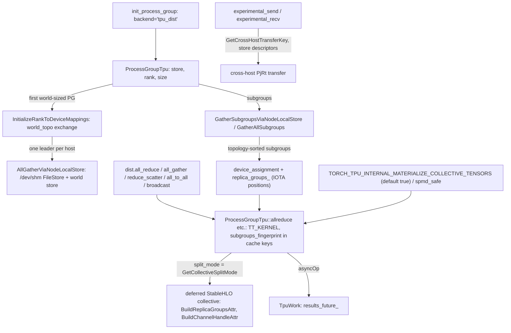

# Process group and collectives (tpu_dist backend)

## Overview
`torch.distributed.init_process_group(backend="tpu_dist")` creates a
[`ProcessGroupTpu`](https://github.com/google-pytorch/torch_tpu/blob/6d2a45754bdb52743883f75fbf753408345f6d1b/csrc/distributed/process_group_tpu.h#L134 "csrc/distributed/process_group_tpu.h#ProcessGroupTpu"), a
`c10d::Backend` whose model is one PyTorch process per TPU device: the constructor asserts
"exactly one TPU device per PyTorch process", and the first (world-sized) group exchanges every
rank's device attributes through the `c10d::Store` so all ranks agree on the same rank-to-device
mapping and on a physical-topology order of the world. Every group then holds a world-sized
[`device_assignment`](https://github.com/google-pytorch/torch_tpu/blob/6d2a45754bdb52743883f75fbf753408345f6d1b/csrc/distributed/process_group_tpu.h#L164 "csrc/distributed/process_group_tpu.h#ProcessGroupTpu.device_assignment")
permuted into flattened-subgroup order, plus
[`replica_groups_`](https://github.com/google-pytorch/torch_tpu/blob/6d2a45754bdb52743883f75fbf753408345f6d1b/csrc/distributed/process_group_tpu.h#L437 "csrc/distributed/process_group_tpu.h#ProcessGroupTpu.replica_groups_")
that are contiguous IOTA positions into it ("These are NOT world ranks"). A collective is then just
another deferred op: [`allreduce`](https://github.com/google-pytorch/torch_tpu/blob/6d2a45754bdb52743883f75fbf753408345f6d1b/csrc/distributed/process_group_tpu.cc#L1785 "csrc/distributed/process_group_tpu.cc#ProcessGroupTpu.allreduce"),
[`_allgather_base`](https://github.com/google-pytorch/torch_tpu/blob/6d2a45754bdb52743883f75fbf753408345f6d1b/csrc/distributed/process_group_tpu.cc#L2053 "csrc/distributed/process_group_tpu.cc#ProcessGroupTpu._allgather_base"),
[`_reduce_scatter_base`](https://github.com/google-pytorch/torch_tpu/blob/6d2a45754bdb52743883f75fbf753408345f6d1b/csrc/distributed/process_group_tpu.cc#L2385 "csrc/distributed/process_group_tpu.cc#ProcessGroupTpu._reduce_scatter_base"),
[`alltoall_base`](https://github.com/google-pytorch/torch_tpu/blob/6d2a45754bdb52743883f75fbf753408345f6d1b/csrc/distributed/process_group_tpu.cc#L2478 "csrc/distributed/process_group_tpu.cc#ProcessGroupTpu.alltoall_base"),
[`broadcast`](https://github.com/google-pytorch/torch_tpu/blob/6d2a45754bdb52743883f75fbf753408345f6d1b/csrc/distributed/process_group_tpu.cc#L1834 "csrc/distributed/process_group_tpu.cc#ProcessGroupTpu.broadcast")
and friends dispatch a builder that emits the StableHLO collective (the all-reduce builder in
`allreduce.cc`,
[`BuildDistributedAllGatherShlo`](https://github.com/google-pytorch/torch_tpu/blob/6d2a45754bdb52743883f75fbf753408345f6d1b/csrc/distributed/allgather.cc#L35 "csrc/distributed/allgather.cc#BuildDistributedAllGatherShlo"),
[`BuildDistributedReduceScatterShlo`](https://github.com/google-pytorch/torch_tpu/blob/6d2a45754bdb52743883f75fbf753408345f6d1b/csrc/distributed/reduce_scatter.cc#L37 "csrc/distributed/reduce_scatter.cc#BuildDistributedReduceScatterShlo"),
[`BuildDistributedAllToAllShlo`](https://github.com/google-pytorch/torch_tpu/blob/6d2a45754bdb52743883f75fbf753408345f6d1b/csrc/distributed/alltoall.cc#L108 "csrc/distributed/alltoall.cc#BuildDistributedAllToAllShlo"))
with `replica_groups` built by [`BuildReplicaGroupsAttr`](https://github.com/google-pytorch/torch_tpu/blob/6d2a45754bdb52743883f75fbf753408345f6d1b/csrc/distributed/utils.cc#L40 "csrc/distributed/utils.cc#BuildReplicaGroupsAttr")
and `use_global_device_ids` set, and passes the group's device assignment along with the op.
Because every device compiles the identical program with explicit collectives (the SPMD setup
described in [compilation-pipeline](compilation-pipeline.md)), the collective becomes part of the
fused XLA program rather than a separate runtime call, and by default the tensors around it are
materialized at a graph boundary so every rank runs the same program shape.

## Diagram

Legend:
- `INIT` - (concept) PyTorch entry point
- `DDP` - (concept) PyTorch collective entry points
- `ENV` - (concept) environment variable and the Python `spmd_safe` region; both are read by [`GetCollectiveSplitMode`](https://github.com/google-pytorch/torch_tpu/blob/6d2a45754bdb52743883f75fbf753408345f6d1b/csrc/distributed/process_group_tpu.cc#L530 "csrc/distributed/process_group_tpu.cc#GetCollectiveSplitMode")
- `XH` - (concept) PjRt cross-host transfer
- `PG` - [`ProcessGroupTpu`](https://github.com/google-pytorch/torch_tpu/blob/6d2a45754bdb52743883f75fbf753408345f6d1b/csrc/distributed/process_group_tpu.cc#L1675 "csrc/distributed/process_group_tpu.cc#ProcessGroupTpu.ProcessGroupTpu") constructor
- `TOPO` - [`InitializeRankToDeviceMappings`](https://github.com/google-pytorch/torch_tpu/blob/6d2a45754bdb52743883f75fbf753408345f6d1b/csrc/distributed/process_group_tpu.cc#L1448 "csrc/distributed/process_group_tpu.cc#ProcessGroupTpu.InitializeRankToDeviceMappings")
- `NLS` - [`AllGatherViaNodeLocalStore`](https://github.com/google-pytorch/torch_tpu/blob/6d2a45754bdb52743883f75fbf753408345f6d1b/csrc/distributed/process_group_tpu.cc#L1054 "csrc/distributed/process_group_tpu.cc#AllGatherViaNodeLocalStore")
- `SUB` - [`GatherSubgroupsViaNodeLocalStore`](https://github.com/google-pytorch/torch_tpu/blob/6d2a45754bdb52743883f75fbf753408345f6d1b/csrc/distributed/process_group_tpu.cc#L1340 "csrc/distributed/process_group_tpu.cc#GatherSubgroupsViaNodeLocalStore"), [`GatherAllSubgroups`](https://github.com/google-pytorch/torch_tpu/blob/6d2a45754bdb52743883f75fbf753408345f6d1b/csrc/distributed/process_group_tpu.cc#L1567 "csrc/distributed/process_group_tpu.cc#ProcessGroupTpu.GatherAllSubgroups")
- `DA` - [`device_assignment`](https://github.com/google-pytorch/torch_tpu/blob/6d2a45754bdb52743883f75fbf753408345f6d1b/csrc/distributed/process_group_tpu.h#L164 "csrc/distributed/process_group_tpu.h#ProcessGroupTpu.device_assignment"), [`replica_groups_`](https://github.com/google-pytorch/torch_tpu/blob/6d2a45754bdb52743883f75fbf753408345f6d1b/csrc/distributed/process_group_tpu.h#L437 "csrc/distributed/process_group_tpu.h#ProcessGroupTpu.replica_groups_")
- `OP` - [`allreduce`](https://github.com/google-pytorch/torch_tpu/blob/6d2a45754bdb52743883f75fbf753408345f6d1b/csrc/distributed/process_group_tpu.cc#L1785 "csrc/distributed/process_group_tpu.cc#ProcessGroupTpu.allreduce"), [`allgather`](https://github.com/google-pytorch/torch_tpu/blob/6d2a45754bdb52743883f75fbf753408345f6d1b/csrc/distributed/process_group_tpu.cc#L1959 "csrc/distributed/process_group_tpu.cc#ProcessGroupTpu.allgather"), [`reduce_scatter`](https://github.com/google-pytorch/torch_tpu/blob/6d2a45754bdb52743883f75fbf753408345f6d1b/csrc/distributed/process_group_tpu.cc#L2336 "csrc/distributed/process_group_tpu.cc#ProcessGroupTpu.reduce_scatter"), [`alltoall`](https://github.com/google-pytorch/torch_tpu/blob/6d2a45754bdb52743883f75fbf753408345f6d1b/csrc/distributed/process_group_tpu.cc#L2652 "csrc/distributed/process_group_tpu.cc#ProcessGroupTpu.alltoall"), [`broadcast`](https://github.com/google-pytorch/torch_tpu/blob/6d2a45754bdb52743883f75fbf753408345f6d1b/csrc/distributed/process_group_tpu.cc#L1834 "csrc/distributed/process_group_tpu.cc#ProcessGroupTpu.broadcast"), [`barrier`](https://github.com/google-pytorch/torch_tpu/blob/6d2a45754bdb52743883f75fbf753408345f6d1b/csrc/distributed/process_group_tpu.cc#L2820 "csrc/distributed/process_group_tpu.cc#ProcessGroupTpu.barrier")
- `DO` - [`BuildReplicaGroupsAttr`](https://github.com/google-pytorch/torch_tpu/blob/6d2a45754bdb52743883f75fbf753408345f6d1b/csrc/distributed/utils.cc#L40 "csrc/distributed/utils.cc#BuildReplicaGroupsAttr"), [`BuildChannelHandleAttr`](https://github.com/google-pytorch/torch_tpu/blob/6d2a45754bdb52743883f75fbf753408345f6d1b/csrc/distributed/utils.cc#L60 "csrc/distributed/utils.cc#BuildChannelHandleAttr"), used by [`BuildDistributedAllGatherShlo`](https://github.com/google-pytorch/torch_tpu/blob/6d2a45754bdb52743883f75fbf753408345f6d1b/csrc/distributed/allgather.cc#L35 "csrc/distributed/allgather.cc#BuildDistributedAllGatherShlo") and siblings
- `W` - [`TpuWork`](https://github.com/google-pytorch/torch_tpu/blob/6d2a45754bdb52743883f75fbf753408345f6d1b/csrc/distributed/process_group_tpu.cc#L119 "csrc/distributed/process_group_tpu.cc#TpuWork") with [`results_future_`](https://github.com/google-pytorch/torch_tpu/blob/6d2a45754bdb52743883f75fbf753408345f6d1b/csrc/distributed/process_group_tpu.cc#L176 "csrc/distributed/process_group_tpu.cc#TpuWork.results_future_")
- `SEND` - [`experimental_send`](https://github.com/google-pytorch/torch_tpu/blob/6d2a45754bdb52743883f75fbf753408345f6d1b/csrc/distributed/process_group_tpu.cc#L1886 "csrc/distributed/process_group_tpu.cc#ProcessGroupTpu.experimental_send"), [`experimental_recv`](https://github.com/google-pytorch/torch_tpu/blob/6d2a45754bdb52743883f75fbf753408345f6d1b/csrc/distributed/process_group_tpu.cc#L1920 "csrc/distributed/process_group_tpu.cc#ProcessGroupTpu.experimental_recv"), [`GetCrossHostTransferKey`](https://github.com/google-pytorch/torch_tpu/blob/6d2a45754bdb52743883f75fbf753408345f6d1b/csrc/distributed/process_group_tpu.cc#L542 "csrc/distributed/process_group_tpu.cc#GetCrossHostTransferKey")

## Design rationale (why it's built this way)
- **PyTorch rank is not the TPU device id, and world rank is not topology order.** The constructor
  doc says so explicitly ("PyTorch rank is not necessarily the same as TPU global device id"). The
  first world-sized group runs
  [`InitializeRankToDeviceMappings`](https://github.com/google-pytorch/torch_tpu/blob/6d2a45754bdb52743883f75fbf753408345f6d1b/csrc/distributed/process_group_tpu.cc#L1448 "csrc/distributed/process_group_tpu.cc#ProcessGroupTpu.InitializeRankToDeviceMappings"),
  which "exchanges device attributes across all world ranks and populates the process-wide world
  topology": each rank's global device id plus its position when ranks are sorted by
  `(slice_index, x, y, z, core_on_chip, id)`, the same flattened order the Python
  `topology_aware_mesh` builds. Subgroups are then ordered by their leader's topology position,
  "never order by world rank: world ranks come from launcher order and would make the per-slice
  device_assignment order ... depend on pod launch order". Group size must divide the slice size,
  which supports both flat groups and "2D+ mesh" subgroups.
- **Replica groups are IOTA positions into a permuted device assignment.** Instead of emitting
  world ranks or device ids as `replica_groups`, each group permutes the world device list into
  flattened-subgroup order
  ([`device_assignment`](https://github.com/google-pytorch/torch_tpu/blob/6d2a45754bdb52743883f75fbf753408345f6d1b/csrc/distributed/process_group_tpu.h#L164 "csrc/distributed/process_group_tpu.h#ProcessGroupTpu.device_assignment"))
  and emits `{{0..K-1}, {K..2K-1}, ...}` as
  [`replica_groups_`](https://github.com/google-pytorch/torch_tpu/blob/6d2a45754bdb52743883f75fbf753408345f6d1b/csrc/distributed/process_group_tpu.h#L437 "csrc/distributed/process_group_tpu.h#ProcessGroupTpu.replica_groups_").
  Every collective passes that device assignment to the dispatcher. The commit that introduced
  this explains that raw world-rank replica groups gave "inconsistent per-slice partition offsets,
  breaking multi-slice collective symmetry and Pallas mesh remapping". Because the groups no longer
  need sorting, [`DeviceGroupList`](https://github.com/google-pytorch/torch_tpu/blob/6d2a45754bdb52743883f75fbf753408345f6d1b/csrc/distributed/types.h#L49 "csrc/distributed/types.h#DeviceGroupList")
  gained a `normalize = false` mode that keeps caller order (the default still sorts and
  deduplicates so equivalent configurations fingerprint equally).
- **Every process must know every subgroup.** XLA needs complete replica groups, so subgroup
  construction gathers the membership of *all* subgroups, including ones this rank is not in, and
  rejects overlapping or non-covering partitions ("Overlapping subgroups are not supported in
  SPMD").
- **Store traffic is O(nodes), not O(world).**
  [`AllGatherViaNodeLocalStore`](https://github.com/google-pytorch/torch_tpu/blob/6d2a45754bdb52743883f75fbf753408345f6d1b/csrc/distributed/process_group_tpu.cc#L1054 "csrc/distributed/process_group_tpu.cc#AllGatherViaNodeLocalStore")
  backs both the topology and the subgroup exchange: ranks on a host share a `/dev/shm` `FileStore`,
  one leader per node claims a slot with `world_store->add()` and publishes its node's entries as
  one blob, and a collector assembles the full table. A failing leader forwards an `ERR` table "so
  that they fail promptly instead of timing out", and
  [`CallStore`](https://github.com/google-pytorch/torch_tpu/blob/6d2a45754bdb52743883f75fbf753408345f6d1b/csrc/distributed/process_group_tpu.cc#L873 "csrc/distributed/process_group_tpu.cc#CallStore")
  is "the only place in this file that catches store exceptions", mapping store timeouts to
  `DeadlineExceeded`.
- **Collectives are ops, so they fuse and cache.** Each method runs inside a `TT_KERNEL` frame
  ([aten-kernel-authoring](aten-kernel-authoring.md)) that records a `subgroups_fingerprint` of
  the replica groups in the cache keys, validates the reduce op for the dtype
  ([`ValidateReductionOp`](https://github.com/google-pytorch/torch_tpu/blob/6d2a45754bdb52743883f75fbf753408345f6d1b/csrc/distributed/utils.cc#L66 "csrc/distributed/utils.cc#ValidateReductionOp")), and
  dispatches a builder capturing the replica groups; the result buffer is assigned back to the
  input, so `all_reduce` is in place as PyTorch expects. `AVG` is lowered as `SUM` followed by a
  division by the group size inside the builder.
- **Split around collectives unless proven safe.**
  [`GetCollectiveSplitMode`](https://github.com/google-pytorch/torch_tpu/blob/6d2a45754bdb52743883f75fbf753408345f6d1b/csrc/distributed/process_group_tpu.cc#L530 "csrc/distributed/process_group_tpu.cc#GetCollectiveSplitMode")
  returns `kNone` inside an SPMD-safe region and otherwise `kSplitBoth` when
  `TORCH_TPU_INTERNAL_MATERIALIZE_COLLECTIVE_TENSORS` is true (the default). Splitting materializes
  before and after the collective, which guarantees every rank executes the same program at the
  collective boundary even if their surrounding deferred graphs diverged; entering an SPMD-safe
  region (which also resets the repeated-op heuristic) lets the collective fuse with its
  neighbors. The Python `spmd_safe` decorator and its custom ops are described in
  [distributed-launchers-and-spmd](distributed-launchers-and-spmd.md).
- **Async work is a completion handle.** When `asyncOp` is set the methods return a
  [`TpuWork`](https://github.com/google-pytorch/torch_tpu/blob/6d2a45754bdb52743883f75fbf753408345f6d1b/csrc/distributed/process_group_tpu.cc#L119 "csrc/distributed/process_group_tpu.cc#TpuWork")
  whose `wait` blocks on
  [`results_future_`](https://github.com/google-pytorch/torch_tpu/blob/6d2a45754bdb52743883f75fbf753408345f6d1b/csrc/distributed/process_group_tpu.cc#L176 "csrc/distributed/process_group_tpu.cc#TpuWork.results_future_")
  and rethrows its error; for collectives that future is already completed at construction (only
  send passes a real transfer future). Otherwise `nullptr` is returned, matching NCCL's convention
  noted in the source, and the source still carries "TODO: respect async".
- **Shape checks mirror PyTorch's API variants.** Reduce-scatter accepts both the concatenated
  (`dim 0` times group size) and stacked (new leading dim) forms, `_allgather_base` likewise picks
  concat or stack ([`AllGatherOutputMode`](https://github.com/google-pytorch/torch_tpu/blob/6d2a45754bdb52743883f75fbf753408345f6d1b/csrc/distributed/allgather.h#L29 "csrc/distributed/allgather.h#AllGatherOutputMode")),
  and [`ValidateTensorsUniformShape`](https://github.com/google-pytorch/torch_tpu/blob/6d2a45754bdb52743883f75fbf753408345f6d1b/csrc/distributed/process_group_tpu.cc#L189 "csrc/distributed/process_group_tpu.cc#ValidateTensorsUniformShape")
  guards list variants.
- **Uneven all-to-all is now a ragged collective.**
  [`AllToAllBaseUnevenSplits`](https://github.com/google-pytorch/torch_tpu/blob/6d2a45754bdb52743883f75fbf753408345f6d1b/csrc/distributed/process_group_tpu.cc#L2555 "csrc/distributed/process_group_tpu.cc#ProcessGroupTpu.AllToAllBaseUnevenSplits")
  "computes input/output slice offsets, synchronizes remote destination offsets across ranks via
  store_, and dispatches the StableHLO ragged_all_to_all custom call"; equal splits stay on
  [`AllToAllBaseEqualSplits`](https://github.com/google-pytorch/torch_tpu/blob/6d2a45754bdb52743883f75fbf753408345f6d1b/csrc/distributed/process_group_tpu.cc#L2528 "csrc/distributed/process_group_tpu.cc#ProcessGroupTpu.AllToAllBaseEqualSplits").
  [`alltoall`](https://github.com/google-pytorch/torch_tpu/blob/6d2a45754bdb52743883f75fbf753408345f6d1b/csrc/distributed/process_group_tpu.cc#L2652 "csrc/distributed/process_group_tpu.cc#ProcessGroupTpu.alltoall")
  supports "non-uniform shapes across ranks (e.g. for MoE routing)" by concatenating, running the
  ragged collective, and slicing. Before the ragged call both input and output are materialized
  explicitly: on SparseCore-equipped TPUs an inlined constant fill of the output could race with
  incoming peer RDMAs.
- **Cross-host point-to-point uses the store as a rendezvous.** `send`/`recv` now forward to
  [`experimental_send`](https://github.com/google-pytorch/torch_tpu/blob/6d2a45754bdb52743883f75fbf753408345f6d1b/csrc/distributed/process_group_tpu.cc#L1886 "csrc/distributed/process_group_tpu.cc#ProcessGroupTpu.experimental_send")
  and [`experimental_recv`](https://github.com/google-pytorch/torch_tpu/blob/6d2a45754bdb52743883f75fbf753408345f6d1b/csrc/distributed/process_group_tpu.cc#L1920 "csrc/distributed/process_group_tpu.cc#ProcessGroupTpu.experimental_recv"),
  which implement two-sided P2P over PjRt cross-host transfers: the receiver creates placeholder
  buffers and posts their network descriptors under a key from
  [`GetCrossHostTransferKey`](https://github.com/google-pytorch/torch_tpu/blob/6d2a45754bdb52743883f75fbf753408345f6d1b/csrc/distributed/process_group_tpu.cc#L542 "csrc/distributed/process_group_tpu.cc#GetCrossHostTransferKey")
  (a fingerprint of source device, destination device, tag and tensor index), the sender blocks
  until those descriptors appear and then starts the asynchronous transfer, and the received PjRt
  buffers are bound back to the tensors.
- **Worker discovery is environment driven.**
  [`DistributedWorkerConfiguration`](https://github.com/google-pytorch/torch_tpu/blob/6d2a45754bdb52743883f75fbf753408345f6d1b/csrc/distributed/slicebuilder/discovery.h#L29 "csrc/distributed/slicebuilder/discovery.h#DistributedWorkerConfiguration")
  carries rank, local rank, world size, the slice-builder addresses and port, and the topology;
  discovery fails early with the list of missing variables (`RANK`, `LOCAL_RANK`, `WORLD_SIZE`,
  `MASTER_ADDR`, `MASTER_PORT`, the slice-builder addresses and the topology).

> [!inferred]
> For onboarding DDP or FSDP code: keep `init_process_group(backend="tpu_dist")` with one process
> per chip launched by torchrun, expect collectives to appear inside XLA programs (visible in
> profiles as fused collective ops, not separate NCCL kernels), and expect a graph boundary at every
> collective unless the region is marked SPMD-safe. Set `LOCAL_RANK` and
> `TORCH_TPU_DEVICES_PER_HOST` and keep `/dev/shm` writable so process-group setup uses the
> node-local store; multi-tensor `all_reduce` lists remain the notable gap flagged in the source.

## Entry points
- [`ProcessGroupTpu`](https://github.com/google-pytorch/torch_tpu/blob/6d2a45754bdb52743883f75fbf753408345f6d1b/csrc/distributed/process_group_tpu.cc#L1675 "csrc/distributed/process_group_tpu.cc#ProcessGroupTpu.ProcessGroupTpu"):
  created by the registered backend factory when `init_process_group` (or `new_group`) runs;
  reports the backend name `tpu_dist`.
- The collective overrides: [`allreduce`](https://github.com/google-pytorch/torch_tpu/blob/6d2a45754bdb52743883f75fbf753408345f6d1b/csrc/distributed/process_group_tpu.cc#L1785 "csrc/distributed/process_group_tpu.cc#ProcessGroupTpu.allreduce"),
  [`broadcast`](https://github.com/google-pytorch/torch_tpu/blob/6d2a45754bdb52743883f75fbf753408345f6d1b/csrc/distributed/process_group_tpu.cc#L1834 "csrc/distributed/process_group_tpu.cc#ProcessGroupTpu.broadcast"),
  [`allgather`](https://github.com/google-pytorch/torch_tpu/blob/6d2a45754bdb52743883f75fbf753408345f6d1b/csrc/distributed/process_group_tpu.cc#L1959 "csrc/distributed/process_group_tpu.cc#ProcessGroupTpu.allgather"),
  [`_allgather_base`](https://github.com/google-pytorch/torch_tpu/blob/6d2a45754bdb52743883f75fbf753408345f6d1b/csrc/distributed/process_group_tpu.cc#L2053 "csrc/distributed/process_group_tpu.cc#ProcessGroupTpu._allgather_base"),
  [`allgather_into_tensor_coalesced`](https://github.com/google-pytorch/torch_tpu/blob/6d2a45754bdb52743883f75fbf753408345f6d1b/csrc/distributed/process_group_tpu.cc#L2161 "csrc/distributed/process_group_tpu.cc#ProcessGroupTpu.allgather_into_tensor_coalesced"),
  [`gather`](https://github.com/google-pytorch/torch_tpu/blob/6d2a45754bdb52743883f75fbf753408345f6d1b/csrc/distributed/process_group_tpu.cc#L2187 "csrc/distributed/process_group_tpu.cc#ProcessGroupTpu.gather"),
  [`scatter`](https://github.com/google-pytorch/torch_tpu/blob/6d2a45754bdb52743883f75fbf753408345f6d1b/csrc/distributed/process_group_tpu.cc#L2265 "csrc/distributed/process_group_tpu.cc#ProcessGroupTpu.scatter"),
  [`reduce_scatter`](https://github.com/google-pytorch/torch_tpu/blob/6d2a45754bdb52743883f75fbf753408345f6d1b/csrc/distributed/process_group_tpu.cc#L2336 "csrc/distributed/process_group_tpu.cc#ProcessGroupTpu.reduce_scatter"),
  [`_reduce_scatter_base`](https://github.com/google-pytorch/torch_tpu/blob/6d2a45754bdb52743883f75fbf753408345f6d1b/csrc/distributed/process_group_tpu.cc#L2385 "csrc/distributed/process_group_tpu.cc#ProcessGroupTpu._reduce_scatter_base"),
  [`reduce_scatter_tensor_coalesced`](https://github.com/google-pytorch/torch_tpu/blob/6d2a45754bdb52743883f75fbf753408345f6d1b/csrc/distributed/process_group_tpu.cc#L2450 "csrc/distributed/process_group_tpu.cc#ProcessGroupTpu.reduce_scatter_tensor_coalesced"),
  [`alltoall_base`](https://github.com/google-pytorch/torch_tpu/blob/6d2a45754bdb52743883f75fbf753408345f6d1b/csrc/distributed/process_group_tpu.cc#L2478 "csrc/distributed/process_group_tpu.cc#ProcessGroupTpu.alltoall_base"),
  [`alltoall`](https://github.com/google-pytorch/torch_tpu/blob/6d2a45754bdb52743883f75fbf753408345f6d1b/csrc/distributed/process_group_tpu.cc#L2652 "csrc/distributed/process_group_tpu.cc#ProcessGroupTpu.alltoall"),
  [`barrier`](https://github.com/google-pytorch/torch_tpu/blob/6d2a45754bdb52743883f75fbf753408345f6d1b/csrc/distributed/process_group_tpu.cc#L2820 "csrc/distributed/process_group_tpu.cc#ProcessGroupTpu.barrier"),
  reached from the matching `torch.distributed` call (or from DTensor and functional collectives).
- Point to point: `dist.send`/`dist.recv` land in
  [`experimental_send`](https://github.com/google-pytorch/torch_tpu/blob/6d2a45754bdb52743883f75fbf753408345f6d1b/csrc/distributed/process_group_tpu.cc#L1886 "csrc/distributed/process_group_tpu.cc#ProcessGroupTpu.experimental_send") /
  [`experimental_recv`](https://github.com/google-pytorch/torch_tpu/blob/6d2a45754bdb52743883f75fbf753408345f6d1b/csrc/distributed/process_group_tpu.cc#L1920 "csrc/distributed/process_group_tpu.cc#ProcessGroupTpu.experimental_recv").
- Experimental dim collectives: `torch.tpu.ops.all_gather_dim` and `reduce_scatter_dim` resolve the
  group by name and reuse the same builders with a nonzero gather or scatter dimension ("Only
  kConcat supports a nonzero `gather_dim`", [`BuildDistributedAllGatherShlo`](https://github.com/google-pytorch/torch_tpu/blob/6d2a45754bdb52743883f75fbf753408345f6d1b/csrc/distributed/allgather.cc#L35 "csrc/distributed/allgather.cc#BuildDistributedAllGatherShlo")).
- [`GetCollectiveSplitMode`](https://github.com/google-pytorch/torch_tpu/blob/6d2a45754bdb52743883f75fbf753408345f6d1b/csrc/distributed/process_group_tpu.cc#L530 "csrc/distributed/process_group_tpu.cc#GetCollectiveSplitMode"):
  consulted on every collective dispatch; the context state behind the `spmd_safe` decorator feeds it.

## Mechanism (step-by-step)
1. **Construct the group.** [`ProcessGroupTpu`](https://github.com/google-pytorch/torch_tpu/blob/6d2a45754bdb52743883f75fbf753408345f6d1b/csrc/distributed/process_group_tpu.cc#L1675 "csrc/distributed/process_group_tpu.cc#ProcessGroupTpu.ProcessGroupTpu")
   gets the PjRt client ([pjrt-client](pjrt-client.md)), takes the one addressable device as this
   rank's, and checks that the group size divides the device count. The first group must be
   world-sized and runs
   [`InitializeRankToDeviceMappings`](https://github.com/google-pytorch/torch_tpu/blob/6d2a45754bdb52743883f75fbf753408345f6d1b/csrc/distributed/process_group_tpu.cc#L1448 "csrc/distributed/process_group_tpu.cc#ProcessGroupTpu.InitializeRankToDeviceMappings"),
   which all-gathers serialized device attributes through
   [`AllGatherViaNodeLocalStore`](https://github.com/google-pytorch/torch_tpu/blob/6d2a45754bdb52743883f75fbf753408345f6d1b/csrc/distributed/process_group_tpu.cc#L1054 "csrc/distributed/process_group_tpu.cc#AllGatherViaNodeLocalStore")
   and stores the rank-to-device map and topology order process-wide; the world rank order is "the
   rank order of the first world-sized ProcessGroupTpu".
2. **Resolve subgroup membership.** A world-sized group is one subgroup; a size-1 group yields one
   singleton per rank; a `new_group`-style subgroup (a prefix store or a world-sized group) uses
   [`GatherSubgroupsViaNodeLocalStore`](https://github.com/google-pytorch/torch_tpu/blob/6d2a45754bdb52743883f75fbf753408345f6d1b/csrc/distributed/process_group_tpu.cc#L1340 "csrc/distributed/process_group_tpu.cc#GatherSubgroupsViaNodeLocalStore"),
   which exchanges `(subgroup_prefix, pg_rank, world_rank)` across the world and groups by prefix;
   otherwise [`GatherMemberWorldRanks`](https://github.com/google-pytorch/torch_tpu/blob/6d2a45754bdb52743883f75fbf753408345f6d1b/csrc/distributed/process_group_tpu.cc#L1498 "csrc/distributed/process_group_tpu.cc#ProcessGroupTpu.GatherMemberWorldRanks")
   plus [`GatherAllSubgroups`](https://github.com/google-pytorch/torch_tpu/blob/6d2a45754bdb52743883f75fbf753408345f6d1b/csrc/distributed/process_group_tpu.cc#L1567 "csrc/distributed/process_group_tpu.cc#ProcessGroupTpu.GatherAllSubgroups")
   publish each subgroup through the root store. Either way the subgroups are validated as a
   partition and sorted by their leader's topology position, keeping PG-rank order inside each.
3. **Build the device assignment.** The flattened subgroups are mapped to device ids to form
   [`device_assignment`](https://github.com/google-pytorch/torch_tpu/blob/6d2a45754bdb52743883f75fbf753408345f6d1b/csrc/distributed/process_group_tpu.h#L164 "csrc/distributed/process_group_tpu.h#ProcessGroupTpu.device_assignment"),
   and [`replica_groups_`](https://github.com/google-pytorch/torch_tpu/blob/6d2a45754bdb52743883f75fbf753408345f6d1b/csrc/distributed/process_group_tpu.h#L437 "csrc/distributed/process_group_tpu.h#ProcessGroupTpu.replica_groups_")
   become consecutive position ranges, stored as a non-normalized
   [`DeviceGroupList`](https://github.com/google-pytorch/torch_tpu/blob/6d2a45754bdb52743883f75fbf753408345f6d1b/csrc/distributed/types.h#L49 "csrc/distributed/types.h#DeviceGroupList").
4. **Dispatch a collective.** A method such as [`allreduce`](https://github.com/google-pytorch/torch_tpu/blob/6d2a45754bdb52743883f75fbf753408345f6d1b/csrc/distributed/process_group_tpu.cc#L1785 "csrc/distributed/process_group_tpu.cc#ProcessGroupTpu.allreduce")
   validates (single tensor for now, reduce op versus dtype), sets `subgroups_fingerprint` in the
   keys, and calls `DispatchOp` with a builder that captures the replica groups, the split mode
   from [`GetCollectiveSplitMode`](https://github.com/google-pytorch/torch_tpu/blob/6d2a45754bdb52743883f75fbf753408345f6d1b/csrc/distributed/process_group_tpu.cc#L530 "csrc/distributed/process_group_tpu.cc#GetCollectiveSplitMode"),
   and the group's `device_assignment`. `broadcast` and `barrier` are implemented on top of
   `allreduce` (StableHLO `collective_broadcast` is "not implemented for TPUs"); `gather`,
   `scatter` and the coalesced variants reuse all-gather or reduce-scatter.
5. **Lower.** The builder emits `stablehlo.all_reduce` (or all-gather, reduce-scatter,
   all-to-all) with a reduce region built for the element type, `replica_groups` from
   [`BuildReplicaGroupsAttr`](https://github.com/google-pytorch/torch_tpu/blob/6d2a45754bdb52743883f75fbf753408345f6d1b/csrc/distributed/utils.cc#L40 "csrc/distributed/utils.cc#BuildReplicaGroupsAttr"),
   a channel handle from [`BuildChannelHandleAttr`](https://github.com/google-pytorch/torch_tpu/blob/6d2a45754bdb52743883f75fbf753408345f6d1b/csrc/distributed/utils.cc#L60 "csrc/distributed/utils.cc#BuildChannelHandleAttr"),
   and global device ids; `AVG` adds a division.
6. **Materialize or return a handle.** With the default split mode the collective's inputs are
   materialized before and its outputs after the op, so the program at the boundary is identical
   on all ranks; async callers get a [`TpuWork`](https://github.com/google-pytorch/torch_tpu/blob/6d2a45754bdb52743883f75fbf753408345f6d1b/csrc/distributed/process_group_tpu.cc#L119 "csrc/distributed/process_group_tpu.cc#TpuWork")
   whose [`results_future_`](https://github.com/google-pytorch/torch_tpu/blob/6d2a45754bdb52743883f75fbf753408345f6d1b/csrc/distributed/process_group_tpu.cc#L176 "csrc/distributed/process_group_tpu.cc#TpuWork.results_future_")
   tracks completion. A synchronous `barrier` additionally calls `.item()` on its dummy tensor to
   block the host.
7. **Point to point.** [`experimental_send`](https://github.com/google-pytorch/torch_tpu/blob/6d2a45754bdb52743883f75fbf753408345f6d1b/csrc/distributed/process_group_tpu.cc#L1886 "csrc/distributed/process_group_tpu.cc#ProcessGroupTpu.experimental_send")
   materializes the tensors, builds one key per tensor with
   [`GetCrossHostTransferKey`](https://github.com/google-pytorch/torch_tpu/blob/6d2a45754bdb52743883f75fbf753408345f6d1b/csrc/distributed/process_group_tpu.cc#L542 "csrc/distributed/process_group_tpu.cc#GetCrossHostTransferKey"),
   and returns a `TpuWork` tied to the send future;
   [`experimental_recv`](https://github.com/google-pytorch/torch_tpu/blob/6d2a45754bdb52743883f75fbf753408345f6d1b/csrc/distributed/process_group_tpu.cc#L1920 "csrc/distributed/process_group_tpu.cc#ProcessGroupTpu.experimental_recv")
   posts descriptors to the store and binds the incoming buffers to the tensors as materialized
   device buffers.

## Key data structures
- [`DeviceGroup`](https://github.com/google-pytorch/torch_tpu/blob/6d2a45754bdb52743883f75fbf753408345f6d1b/csrc/distributed/types.h#L31 "csrc/distributed/types.h#DeviceGroup")
  (a vector of ids) and [`DeviceGroupList`](https://github.com/google-pytorch/torch_tpu/blob/6d2a45754bdb52743883f75fbf753408345f6d1b/csrc/distributed/types.h#L49 "csrc/distributed/types.h#DeviceGroupList"):
  an immutable list of groups with a precomputed fingerprint (used directly as the cache-key
  encoding), indexable through [`operator[]`](https://github.com/google-pytorch/torch_tpu/blob/6d2a45754bdb52743883f75fbf753408345f6d1b/csrc/distributed/types.h#L66 "csrc/distributed/types.h#DeviceGroupList.operator")
  and printable via [`operator<<`](https://github.com/google-pytorch/torch_tpu/blob/6d2a45754bdb52743883f75fbf753408345f6d1b/csrc/distributed/types.cc#L54 "csrc/distributed/types.cc#operator").
- Per group: `member_world_ranks_` (world rank of each member, PG-rank order, "never re-sorted"),
  `member_device_ids_`, [`device_assignment`](https://github.com/google-pytorch/torch_tpu/blob/6d2a45754bdb52743883f75fbf753408345f6d1b/csrc/distributed/process_group_tpu.h#L164 "csrc/distributed/process_group_tpu.h#ProcessGroupTpu.device_assignment"),
  [`replica_groups_`](https://github.com/google-pytorch/torch_tpu/blob/6d2a45754bdb52743883f75fbf753408345f6d1b/csrc/distributed/process_group_tpu.h#L437 "csrc/distributed/process_group_tpu.h#ProcessGroupTpu.replica_groups_"),
  `addressable_device_id_`, and a monotonic `alltoall_seq_` for ragged offset coordination.
- Process-wide world topology: world rank, per-rank device attributes, rank-to-device id and
  rank-to-topology order, filled once by the first world-sized group.
- [`DistributedWorkerConfiguration`](https://github.com/google-pytorch/torch_tpu/blob/6d2a45754bdb52743883f75fbf753408345f6d1b/csrc/distributed/slicebuilder/discovery.h#L29 "csrc/distributed/slicebuilder/discovery.h#DistributedWorkerConfiguration"):
  rank, local rank, world size, slice-builder addresses and port, topology.
- [`ByteVector`](https://github.com/google-pytorch/torch_tpu/blob/6d2a45754bdb52743883f75fbf753408345f6d1b/csrc/distributed/process_group_tpu.cc#L901 "csrc/distributed/process_group_tpu.cc#ByteVector")
  payloads in the node-local all-gather, the reduce-scatter shape mode (concat versus stack), and
  the cross-host transfer key.

## Dynamics (design intent)
- Collectives are asynchronous like every deferred op; a `wait` or a later `.cpu()` is what
  blocks. In default mode the split forces materialization but not host synchronization.
- Every rank must dispatch the same sequence of collectives with the same shapes and the same
  replica groups; divergence deadlocks at the XLA level, which is the reason for the conservative
  split default. `broadcast` deliberately pushes the same op sequence on root and non-root ranks
  "to keep the thread-local `detect_repeated_ops` heuristic synchronized across all ranks".
- Group construction is itself collective: the node-local all-gather has one leader per host and
  one collector, and the process-group tests drive it with concurrent ranks
  (`RunAllGather`, `MakeNodeLocalStore` in `process_group_tpu_test.cc`).

## Edge cases
- Multiple tensors in one `all_reduce` call raise `NotImplementedError`; coalesced all-gather and
  reduce-scatter variants exist for lists and loop one collective per tensor.
- Reduce ops unsupported for a dtype fail in [`ValidateReductionOp`](https://github.com/google-pytorch/torch_tpu/blob/6d2a45754bdb52743883f75fbf753408345f6d1b/csrc/distributed/utils.cc#L66 "csrc/distributed/utils.cc#ValidateReductionOp")
  before dispatch; bitwise ops require integer dtypes.
- A group size that does not divide the slice size is rejected at construction, and the first
  group must be world-sized.
- `barrier` accepts `device_ids=[0]` (the only device a process owns) so device-agnostic calls
  such as `barrier(device_ids=[torch.accelerator.current_device_index()])` work; other ids,
  timeouts and `device` raise `NotImplementedError`.
- Without `LOCAL_RANK` and `TORCH_TPU_DEVICES_PER_HOST`, or with a non-writable `/dev/shm`, every
  rank acts as its own node and a warning notes it "is slower at scale".
- Missing distributed environment variables are reported by name.

## Open questions
- Multi-tensor all-reduce and truly asynchronous collectives are still TODOs in the source.
- Whether functional collectives (`torch.distributed._functional_collectives`) get specialized
  implementations, as the header contemplates.
- The one-sided RMA window (`window_tpu.cc`, PyTorch 2.14 and later) and the SPMD handshake stage
  (`handshake.cc`, `TORCH_TPU_SPMD_HANDSHAKE_STAGE`) are part of this subsystem but have no symbols
  in this page's packet.

## See also
- [distributed-launchers-and-spmd](distributed-launchers-and-spmd.md): environment setup, `spmd_safe`, DTensor rules.
- [deferred-execution-and-materialization](deferred-execution-and-materialization.md): split modes and materialization reasons.
- [compilation-pipeline](compilation-pipeline.md): SPMD partitioning defaults.
- [torch-compile-backend](torch-compile-backend.md): graph splitting at collectives.
- [pjrt-client](pjrt-client.md): devices, addressable device, cross-host transfers.

## Recent changes
- `844d85e3e` "Use IOTA replica groups over a topology-ordered device assignment; aggregate
  ProcessGroupTpu metadata exchange per node": replica groups are now positions into a
  topology-ordered device assignment because raw world ranks broke multi-slice collective symmetry,
  and setup traffic goes through a per-node leader.
- `2e0c3677a` "Support world-sized Pallas meshes and restore SPMD GatherAllSubgroups": subgroup
  ranks are gathered and tiled across SPMD partitions "while respecting unsorted rank orderings".
- `d37fa5526` "Add experimental all_gather_dim / reduce_scatter_dim collectives".
- `90deb04a3` "Return StatusOr from PjrtBackend::GetClient() and GetDevice()", so client
  initialization errors surface from the constructor instead of a generic "not initialized".
- `5f3f8d368` defaulted comparison operators for `DeviceGroupList`; `7d05f1b57` moved device-index
  examples to `torch.accelerator.current_device_index`.
- [all changes in 6d2a45754b](../changes/6d2a45754b.md)
