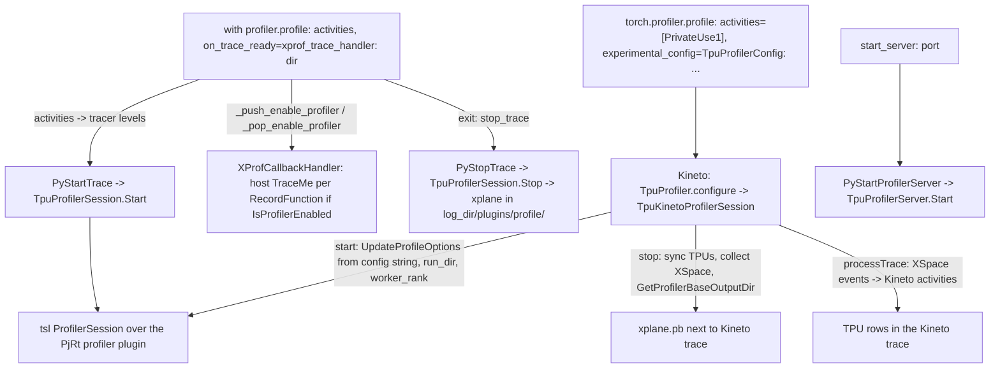

# Profiling with xprof through the Kineto backend

## Overview
TorchTPU offers two doors into the XLA profiler (xprof), both implemented in the C++ unit
`csrc/internal/profiler` with a thin Python layer in `torch_tpu._internal.profiler`. The direct one
is [`profile`](https://github.com/google-pytorch/torch_tpu/blob/6d2a45754bdb52743883f75fbf753408345f6d1b/src/torch_tpu/_internal/profiler/_api.py#L119 "src/torch_tpu/_internal/profiler/_api#profile"), called as `profile(activities, on_trace_ready)`, a "context manager to take a profiler trace, compatible
with torch.profiler" that resolves the output directory from the handler
(the stock [`xprof_trace_handler`](https://github.com/google-pytorch/torch_tpu/blob/6d2a45754bdb52743883f75fbf753408345f6d1b/src/torch_tpu/_internal/profiler/_api.py#L42 "src/torch_tpu/_internal/profiler/_api#xprof_trace_handler") takes `dir_name` and an optional `worker_rank`), converts the requested activities into tracer
levels, starts a trace through the `_profiler_backend` extension
([`PyStartTrace`](https://github.com/google-pytorch/torch_tpu/blob/6d2a45754bdb52743883f75fbf753408345f6d1b/csrc/internal/profiler/profiler_api.cc#L224 "csrc/internal/profiler/profiler_api.cc#PyStartTrace") driving the process-wide [`TpuProfilerSession`](https://github.com/google-pytorch/torch_tpu/blob/6d2a45754bdb52743883f75fbf753408345f6d1b/csrc/internal/profiler/profiler_api.cc#L79 "csrc/internal/profiler/profiler_api.cc#TpuProfilerSession")), enables the profiler context
state for the duration, and stops and writes the trace on exit ([`PyStopTrace`](https://github.com/google-pytorch/torch_tpu/blob/6d2a45754bdb52743883f75fbf753408345f6d1b/csrc/internal/profiler/profiler_api.cc#L229 "csrc/internal/profiler/profiler_api.cc#PyStopTrace")). The second door is
PyTorch's own `torch.profiler`: a Kineto plugin ([`TpuKinetoProfilerSession`](https://github.com/google-pytorch/torch_tpu/blob/6d2a45754bdb52743883f75fbf753408345f6d1b/csrc/internal/profiler/tpu_profiler_plugin.h#L42 "csrc/internal/profiler/tpu_profiler_plugin.h#TpuKinetoProfilerSession"), created by
[`configure`](https://github.com/google-pytorch/torch_tpu/blob/6d2a45754bdb52743883f75fbf753408345f6d1b/csrc/internal/profiler/tpu_profiler_plugin.h#L104 "csrc/internal/profiler/tpu_profiler_plugin.h#TpuProfiler.configure") and registered as the PrivateUse1 activity profiler at library load)
starts an XLA profiler session when Kineto starts, collects the `XSpace` on stop, writes it as an
xplane file next to the CPU trace, and also converts its events into Kineto activities so they
appear in the Kineto trace itself. It is configured through [`TpuProfilerConfig`](https://github.com/google-pytorch/torch_tpu/blob/6d2a45754bdb52743883f75fbf753408345f6d1b/src/torch_tpu/_internal/profiler/profiler_config.py#L89 "src/torch_tpu/_internal/profiler/profiler_config#TpuProfilerConfig") (public as
`torch.tpu.profiler.TpuProfilerConfig`), a subclass of `torch.profiler._ExperimentalConfig` whose
defaults match JAX and TensorFlow (host tracer level 2, device tracer level 1, Python tracer off).
A profiler server ([`TpuProfilerServer`](https://github.com/google-pytorch/torch_tpu/blob/6d2a45754bdb52743883f75fbf753408345f6d1b/csrc/internal/profiler/profiler_api.cc#L47 "csrc/internal/profiler/profiler_api.cc#TpuProfilerServer"), [`PyStartProfilerServer`](https://github.com/google-pytorch/torch_tpu/blob/6d2a45754bdb52743883f75fbf753408345f6d1b/csrc/internal/profiler/profiler_api.cc#L216 "csrc/internal/profiler/profiler_api.cc#PyStartProfilerServer")) supports on-demand captures
from TensorBoard.

## Diagram

Legend:
- `A` - [`profile`](https://github.com/google-pytorch/torch_tpu/blob/6d2a45754bdb52743883f75fbf753408345f6d1b/src/torch_tpu/_internal/profiler/_api.py#L119 "src/torch_tpu/_internal/profiler/_api#profile") with [`xprof_trace_handler`](https://github.com/google-pytorch/torch_tpu/blob/6d2a45754bdb52743883f75fbf753408345f6d1b/src/torch_tpu/_internal/profiler/_api.py#L42 "src/torch_tpu/_internal/profiler/_api#xprof_trace_handler")
- `B` - (concept) PyTorch's `torch.profiler.profile` with the TPU config, a [`TpuProfilerConfig`](https://github.com/google-pytorch/torch_tpu/blob/6d2a45754bdb52743883f75fbf753408345f6d1b/src/torch_tpu/_internal/profiler/profiler_config.py#L89 "src/torch_tpu/_internal/profiler/profiler_config#TpuProfilerConfig")
- `SESS` - (concept) the TSL/XLA profiler session
- `SRV` - (concept) the Python `start_server` wrapper
- `ST` - [`PyStartTrace`](https://github.com/google-pytorch/torch_tpu/blob/6d2a45754bdb52743883f75fbf753408345f6d1b/csrc/internal/profiler/profiler_api.cc#L224 "csrc/internal/profiler/profiler_api.cc#PyStartTrace") driving [`TpuProfilerSession`](https://github.com/google-pytorch/torch_tpu/blob/6d2a45754bdb52743883f75fbf753408345f6d1b/csrc/internal/profiler/profiler_api.cc#L79 "csrc/internal/profiler/profiler_api.cc#TpuProfilerSession") ([`Start`](https://github.com/google-pytorch/torch_tpu/blob/6d2a45754bdb52743883f75fbf753408345f6d1b/csrc/internal/profiler/profiler_api.cc#L130 "csrc/internal/profiler/profiler_api.cc#TpuProfilerSession.Start"))
- `SP` - [`PyStopTrace`](https://github.com/google-pytorch/torch_tpu/blob/6d2a45754bdb52743883f75fbf753408345f6d1b/csrc/internal/profiler/profiler_api.cc#L229 "csrc/internal/profiler/profiler_api.cc#PyStopTrace") driving [`TpuProfilerSession`](https://github.com/google-pytorch/torch_tpu/blob/6d2a45754bdb52743883f75fbf753408345f6d1b/csrc/internal/profiler/profiler_api.cc#L79 "csrc/internal/profiler/profiler_api.cc#TpuProfilerSession") ([`Stop`](https://github.com/google-pytorch/torch_tpu/blob/6d2a45754bdb52743883f75fbf753408345f6d1b/csrc/internal/profiler/profiler_api.cc#L166 "csrc/internal/profiler/profiler_api.cc#TpuProfilerSession.Stop"))
- `CTX` - [`XProfCallbackHandler`](https://github.com/google-pytorch/torch_tpu/blob/6d2a45754bdb52743883f75fbf753408345f6d1b/csrc/internal/profiler/xprof_callback_handler.h#L33 "csrc/internal/profiler/xprof_callback_handler.h#XProfCallbackHandler") with [`Register`](https://github.com/google-pytorch/torch_tpu/blob/6d2a45754bdb52743883f75fbf753408345f6d1b/csrc/internal/profiler/xprof_callback_handler.cc#L111 "csrc/internal/profiler/xprof_callback_handler.cc#XProfCallbackHandler.Register") and [`IsProfilerEnabled`](https://github.com/google-pytorch/torch_tpu/blob/6d2a45754bdb52743883f75fbf753408345f6d1b/csrc/internal/profiler/xprof_callback_handler.cc#L59 "csrc/internal/profiler/xprof_callback_handler.cc#IsProfilerEnabled")
- `K` - [`TpuKinetoProfilerSession`](https://github.com/google-pytorch/torch_tpu/blob/6d2a45754bdb52743883f75fbf753408345f6d1b/csrc/internal/profiler/tpu_profiler_plugin.h#L42 "csrc/internal/profiler/tpu_profiler_plugin.h#TpuKinetoProfilerSession") ([`start`](https://github.com/google-pytorch/torch_tpu/blob/6d2a45754bdb52743883f75fbf753408345f6d1b/csrc/internal/profiler/tpu_profiler_plugin.cc#L409 "csrc/internal/profiler/tpu_profiler_plugin.cc#TpuKinetoProfilerSession.start"), [`stop`](https://github.com/google-pytorch/torch_tpu/blob/6d2a45754bdb52743883f75fbf753408345f6d1b/csrc/internal/profiler/tpu_profiler_plugin.cc#L485 "csrc/internal/profiler/tpu_profiler_plugin.cc#TpuKinetoProfilerSession.stop")) created by [`configure`](https://github.com/google-pytorch/torch_tpu/blob/6d2a45754bdb52743883f75fbf753408345f6d1b/csrc/internal/profiler/tpu_profiler_plugin.h#L104 "csrc/internal/profiler/tpu_profiler_plugin.h#TpuProfiler.configure"); options via [`UpdateProfileOptions`](https://github.com/google-pytorch/torch_tpu/blob/6d2a45754bdb52743883f75fbf753408345f6d1b/csrc/internal/profiler/tpu_profiler_plugin.cc#L280 "csrc/internal/profiler/tpu_profiler_plugin.cc#UpdateProfileOptions")
- `OUT` - [`GetProfilerBaseOutputDir`](https://github.com/google-pytorch/torch_tpu/blob/6d2a45754bdb52743883f75fbf753408345f6d1b/csrc/internal/profiler/tpu_profiler_plugin.cc#L332 "csrc/internal/profiler/tpu_profiler_plugin.cc#GetProfilerBaseOutputDir")
- `KT` - [`AddActivityStringMetadata`](https://github.com/google-pytorch/torch_tpu/blob/6d2a45754bdb52743883f75fbf753408345f6d1b/csrc/internal/profiler/tpu_profiler_plugin.cc#L589 "csrc/internal/profiler/tpu_profiler_plugin.cc#AddActivityStringMetadata") (the metadata step of the event conversion)
- `PS` - [`PyStartProfilerServer`](https://github.com/google-pytorch/torch_tpu/blob/6d2a45754bdb52743883f75fbf753408345f6d1b/csrc/internal/profiler/profiler_api.cc#L216 "csrc/internal/profiler/profiler_api.cc#PyStartProfilerServer") / [`PyStopProfilerServer`](https://github.com/google-pytorch/torch_tpu/blob/6d2a45754bdb52743883f75fbf753408345f6d1b/csrc/internal/profiler/profiler_api.cc#L220 "csrc/internal/profiler/profiler_api.cc#PyStopProfilerServer"), [`TpuProfilerServer`](https://github.com/google-pytorch/torch_tpu/blob/6d2a45754bdb52743883f75fbf753408345f6d1b/csrc/internal/profiler/profiler_api.cc#L47 "csrc/internal/profiler/profiler_api.cc#TpuProfilerServer") ([`Start`](https://github.com/google-pytorch/torch_tpu/blob/6d2a45754bdb52743883f75fbf753408345f6d1b/csrc/internal/profiler/profiler_api.cc#L111 "csrc/internal/profiler/profiler_api.cc#TpuProfilerServer.Start"), [`Stop`](https://github.com/google-pytorch/torch_tpu/blob/6d2a45754bdb52743883f75fbf753408345f6d1b/csrc/internal/profiler/profiler_api.cc#L121 "csrc/internal/profiler/profiler_api.cc#TpuProfilerServer.Stop"))

## Design rationale (why it's built this way)
- **Compatibility with `torch.profiler` without giving up xprof.** The Kineto plugin implements
  `libkineto::IActivityProfiler` (exposing the `PRIVATEUSE1_RUNTIME` activity) and a session that
  "manages a single profiling session, interacting with tensorflow::profiler", reporting a `TPU`
  device. The registration uses weakly linked PrivateUse1 profiler symbols so one binary "allows
  compilation against Torch 2.10 (where these don't exist) and safe dynamic loading on Torch 2.10
  runtimes", a workaround the source plans to drop once 2.12 is the minimum. Device traces
  therefore land alongside Kineto's CPU trace: as an xplane file for xprof/TensorBoard, and as
  converted activities inside the Kineto trace (device planes become kernel rows keyed by plane
  id; host planes are folded into the PyTorch process so they merge with the CPU span).
- **Options are a string contract.** [`TpuProfilerConfig`](https://github.com/google-pytorch/torch_tpu/blob/6d2a45754bdb52743883f75fbf753408345f6d1b/src/torch_tpu/_internal/profiler/profiler_config.py#L89 "src/torch_tpu/_internal/profiler/profiler_config#TpuProfilerConfig") serializes stable keys
  (`host_tracer_level`, `device_tracer_level`, `python_tracer_level`, `run_dir`, `worker_rank`)
  plus experimental key-value options (strings quoted and escaped in Python) into the
  experimental-config string PyTorch passes to Kineto, handing it to the base class as
  `custom_profiler_config`;
  the plugin parses it in [`UpdateProfileOptions`](https://github.com/google-pytorch/torch_tpu/blob/6d2a45754bdb52743883f75fbf753408345f6d1b/csrc/internal/profiler/tpu_profiler_plugin.cc#L280 "csrc/internal/profiler/tpu_profiler_plugin.cc#UpdateProfileOptions") ("a comma-separated list of key-value pairs")
  with [`SplitConfig`](https://github.com/google-pytorch/torch_tpu/blob/6d2a45754bdb52743883f75fbf753408345f6d1b/csrc/internal/profiler/tpu_profiler_plugin.cc#L243 "csrc/internal/profiler/tpu_profiler_plugin.cc#SplitConfig") ("an escape-aware separator, ignoring delimiters that reside inside quotes"),
  [`SplitConfigItem`](https://github.com/google-pytorch/torch_tpu/blob/6d2a45754bdb52743883f75fbf753408345f6d1b/csrc/internal/profiler/tpu_profiler_plugin.cc#L262 "csrc/internal/profiler/tpu_profiler_plugin.cc#SplitConfigItem"), [`UnescapeString`](https://github.com/google-pytorch/torch_tpu/blob/6d2a45754bdb52743883f75fbf753408345f6d1b/csrc/internal/profiler/tpu_profiler_plugin.cc#L140 "csrc/internal/profiler/tpu_profiler_plugin.cc#UnescapeString") (only `\"` and `\\` are accepted escapes),
  [`ParseAndSetUint`](https://github.com/google-pytorch/torch_tpu/blob/6d2a45754bdb52743883f75fbf753408345f6d1b/csrc/internal/profiler/tpu_profiler_plugin.cc#L102 "csrc/internal/profiler/tpu_profiler_plugin.cc#ParseAndSetUint") for numeric levels via [`UpdateProfileOption`](https://github.com/google-pytorch/torch_tpu/blob/6d2a45754bdb52743883f75fbf753408345f6d1b/csrc/internal/profiler/tpu_profiler_plugin.cc#L202 "csrc/internal/profiler/tpu_profiler_plugin.cc#UpdateProfileOption"), and
  [`SetAdvancedConfigValue`](https://github.com/google-pytorch/torch_tpu/blob/6d2a45754bdb52743883f75fbf753408345f6d1b/csrc/internal/profiler/tpu_profiler_plugin.cc#L168 "csrc/internal/profiler/tpu_profiler_plugin.cc#SetAdvancedConfigValue") for experimental XLA profiler options ("Strings must be enclosed in
  double quotes. Unquoted values are parsed as booleans or integers."), which the profiler backend
  validates against its known keys by default (Python only rejects keys that clash with stable
  keys or contain `:` or `,`, and forwards `check_experimental_options` in the string). The documented
  levels: host 0 to 3 (user TraceMe events, then XLA annotations, then low-level XLA), device 0
  or 1, Python 0 or 1. Requesting stacks in `torch.profiler` (`with_stack`) turns the Python tracer
  on.
- **One trace at a time, deterministic output paths.** Both C++ wrappers are "thread-safe" singletons
  guarded by a mutex ([`mutex_`](https://github.com/google-pytorch/torch_tpu/blob/6d2a45754bdb52743883f75fbf753408345f6d1b/csrc/internal/profiler/profiler_api.cc#L106 "csrc/internal/profiler/profiler_api.cc#TpuProfilerSession.mutex_"), [`mutex_`](https://github.com/google-pytorch/torch_tpu/blob/6d2a45754bdb52743883f75fbf753408345f6d1b/csrc/internal/profiler/profiler_api.cc#L73 "csrc/internal/profiler/profiler_api.cc#TpuProfilerServer.mutex_")) and refuse a
  second start; the Python [`start_trace`](https://github.com/google-pytorch/torch_tpu/blob/6d2a45754bdb52743883f75fbf753408345f6d1b/src/torch_tpu/_internal/profiler/_impl.py#L107 "src/torch_tpu/_internal/profiler/_impl#start_trace") additionally rejects `worker_rank` values containing path
  separators. Output follows the TensorBoard layout `<dir>/plugins/profile/<timestamp>/<hostname>[_<rank>].xplane.pb`.
  For the Kineto path, [`GetProfilerBaseOutputDir`](https://github.com/google-pytorch/torch_tpu/blob/6d2a45754bdb52743883f75fbf753408345f6d1b/csrc/internal/profiler/tpu_profiler_plugin.cc#L332 "csrc/internal/profiler/tpu_profiler_plugin.cc#GetProfilerBaseOutputDir") resolves the base directory "in order of
  priority from TORCH_TPU_PROFILER_OUTPUT_DIR, the provided `run_dir`, TMPDIR, or defaulting to
  /tmp", where `run_dir` falls back to Kineto's log-file directory, which per the
  `TpuProfilerConfig` docstring "ensures TPU and CPU traces are co-located in the same directory".
- **Correlate host code with device time.** [`XProfCallbackHandler`](https://github.com/google-pytorch/torch_tpu/blob/6d2a45754bdb52743883f75fbf753408345f6d1b/csrc/internal/profiler/xprof_callback_handler.h#L33 "csrc/internal/profiler/xprof_callback_handler.h#XProfCallbackHandler") is an "RAII class to manage
  the lifetime of PyTorch RecordFunction callbacks": each ATen `RecordFunction` opens a TraceMe
  tagged with a `pt_correlation_id` while profiling is enabled ([`IsProfilerEnabled`](https://github.com/google-pytorch/torch_tpu/blob/6d2a45754bdb52743883f75fbf753408345f6d1b/csrc/internal/profiler/xprof_callback_handler.cc#L59 "csrc/internal/profiler/xprof_callback_handler.cc#IsProfilerEnabled") accepts an
  active TSL session, the native PyTorch profiler, or the TorchTPU context manager, then lets the
  thread-local context state override). The Kineto conversion skips host events carrying that id
  because Kineto already captured them, avoiding duplicates. Device-side op attribution to Python
  lines comes from the MLIR locations described in
  [python-context-and-op-names](python-context-and-op-names.md).
- **Complete traces by construction.** Before collecting, the Kineto session stops the host
  callbacks and synchronizes every TPU through the device guard, "the same behavior as using the
  Python `torch.accelerator.synchronize()` API", so asynchronous work lands in the trace.
- **Session ids group multi-process captures.** Launch wrappers set `TORCH_TPU_XPROF_SESSION_ID`
  ([distributed-launchers-and-spmd](distributed-launchers-and-spmd.md)) so per-rank traces of one
  run are recognized as a set.

> [!inferred]
> Recipes: for a quick device trace use `profiler.profile(activities=[ProfilerActivity.TPU],
> on_trace_ready=xprof_trace_handler("/tmp/logdir"))` and open the directory in TensorBoard's
> profile plugin; for a combined CPU and TPU view use `torch.profiler.profile` with the
> PrivateUse1 activity and `experimental_config=torch.tpu.profiler.TpuProfilerConfig(run_dir=...)`,
> passing `worker_rank` per rank in multi-process runs so files do not collide. The direct
> context manager does not synchronize for you; bracket the region with a device synchronize
> ([synchronization](synchronization.md)) so the trace contains complete device work.

## Entry points
- Python: [`profile`](https://github.com/google-pytorch/torch_tpu/blob/6d2a45754bdb52743883f75fbf753408345f6d1b/src/torch_tpu/_internal/profiler/_api.py#L119 "src/torch_tpu/_internal/profiler/_api#profile"), [`xprof_trace_handler`](https://github.com/google-pytorch/torch_tpu/blob/6d2a45754bdb52743883f75fbf753408345f6d1b/src/torch_tpu/_internal/profiler/_api.py#L42 "src/torch_tpu/_internal/profiler/_api#xprof_trace_handler"), [`ProfilerActivity`](https://github.com/google-pytorch/torch_tpu/blob/6d2a45754bdb52743883f75fbf753408345f6d1b/src/torch_tpu/_internal/profiler/_api.py#L28 "src/torch_tpu/_internal/profiler/_api#ProfilerActivity") (CPU, TPU; GPU raises),
  [`TpuProfilerConfig`](https://github.com/google-pytorch/torch_tpu/blob/6d2a45754bdb52743883f75fbf753408345f6d1b/src/torch_tpu/_internal/profiler/profiler_config.py#L89 "src/torch_tpu/_internal/profiler/profiler_config#TpuProfilerConfig"), [`register_kineto_backend`](https://github.com/google-pytorch/torch_tpu/blob/6d2a45754bdb52743883f75fbf753408345f6d1b/src/torch_tpu/_internal/profiler/_api.py#L171 "src/torch_tpu/_internal/profiler/_api#register_kineto_backend") (explicit no-op entry point called by the loader;
  registration is a static initializer), and the lower-level [`start_trace`](https://github.com/google-pytorch/torch_tpu/blob/6d2a45754bdb52743883f75fbf753408345f6d1b/src/torch_tpu/_internal/profiler/_impl.py#L107 "src/torch_tpu/_internal/profiler/_impl#start_trace") / [`stop_trace`](https://github.com/google-pytorch/torch_tpu/blob/6d2a45754bdb52743883f75fbf753408345f6d1b/src/torch_tpu/_internal/profiler/_impl.py#L161 "src/torch_tpu/_internal/profiler/_impl#stop_trace") /
  `start_server` / `stop_server`, Python wrappers over backend functions bound through [`pybind11_init__profiler_backend`](https://github.com/google-pytorch/torch_tpu/blob/6d2a45754bdb52743883f75fbf753408345f6d1b/csrc/internal/profiler/profiler_api.cc#L233 "csrc/internal/profiler/profiler_api.cc#pybind11_init__profiler_backend").
  The package re-exports all of these except `start_trace` / `stop_trace`, which stay in its
  `_impl` module.
- C++ bindings: [`PyStartTrace`](https://github.com/google-pytorch/torch_tpu/blob/6d2a45754bdb52743883f75fbf753408345f6d1b/csrc/internal/profiler/profiler_api.cc#L224 "csrc/internal/profiler/profiler_api.cc#PyStartTrace"), [`PyStopTrace`](https://github.com/google-pytorch/torch_tpu/blob/6d2a45754bdb52743883f75fbf753408345f6d1b/csrc/internal/profiler/profiler_api.cc#L229 "csrc/internal/profiler/profiler_api.cc#PyStopTrace"), [`PyStartProfilerServer`](https://github.com/google-pytorch/torch_tpu/blob/6d2a45754bdb52743883f75fbf753408345f6d1b/csrc/internal/profiler/profiler_api.cc#L216 "csrc/internal/profiler/profiler_api.cc#PyStartProfilerServer"),
  [`PyStopProfilerServer`](https://github.com/google-pytorch/torch_tpu/blob/6d2a45754bdb52743883f75fbf753408345f6d1b/csrc/internal/profiler/profiler_api.cc#L220 "csrc/internal/profiler/profiler_api.cc#PyStopProfilerServer"), plus the `_push_enable_profiler` / `_pop_enable_profiler` context-state
  helpers defined in the same module ([`TorchTpuPyBindInitModule__profiler_backend`](https://github.com/google-pytorch/torch_tpu/blob/6d2a45754bdb52743883f75fbf753408345f6d1b/csrc/internal/profiler/profiler_api.cc#L233 "csrc/internal/profiler/profiler_api.cc#TorchTpuPyBindInitModule__profiler_backend")).
- Kineto: [`configure`](https://github.com/google-pytorch/torch_tpu/blob/6d2a45754bdb52743883f75fbf753408345f6d1b/csrc/internal/profiler/tpu_profiler_plugin.h#L104 "csrc/internal/profiler/tpu_profiler_plugin.h#TpuProfiler.configure") returns a [`TpuKinetoProfilerSession`](https://github.com/google-pytorch/torch_tpu/blob/6d2a45754bdb52743883f75fbf753408345f6d1b/csrc/internal/profiler/tpu_profiler_plugin.h#L42 "csrc/internal/profiler/tpu_profiler_plugin.h#TpuKinetoProfilerSession") whose
  [`start`](https://github.com/google-pytorch/torch_tpu/blob/6d2a45754bdb52743883f75fbf753408345f6d1b/csrc/internal/profiler/tpu_profiler_plugin.cc#L409 "csrc/internal/profiler/tpu_profiler_plugin.cc#TpuKinetoProfilerSession.start") / [`stop`](https://github.com/google-pytorch/torch_tpu/blob/6d2a45754bdb52743883f75fbf753408345f6d1b/csrc/internal/profiler/tpu_profiler_plugin.cc#L485 "csrc/internal/profiler/tpu_profiler_plugin.cc#TpuKinetoProfilerSession.stop") Kineto calls around the
  profiled region.

## Mechanism (step-by-step)
1. **Configure.** The context manager [`profile`](https://github.com/google-pytorch/torch_tpu/blob/6d2a45754bdb52743883f75fbf753408345f6d1b/src/torch_tpu/_internal/profiler/_api.py#L119 "src/torch_tpu/_internal/profiler/_api#profile") maps activities to tracer levels in a
   [`ProfileOptions`](https://github.com/google-pytorch/torch_tpu/blob/6d2a45754bdb52743883f75fbf753408345f6d1b/src/torch_tpu/_internal/profiler/_impl.py#L34 "src/torch_tpu/_internal/profiler/_impl#ProfileOptions") (all off, then device 1 for TPU and host 2 plus Python 1 for CPU; default
   activities are CPU and TPU), asks the handler for the log directory (calling it with `None`) and
   reads the `worker_rank` that [`xprof_trace_handler`](https://github.com/google-pytorch/torch_tpu/blob/6d2a45754bdb52743883f75fbf753408345f6d1b/src/torch_tpu/_internal/profiler/_api.py#L42 "src/torch_tpu/_internal/profiler/_api#xprof_trace_handler") attached to it as an attribute, and calls
   [`start_trace`](https://github.com/google-pytorch/torch_tpu/blob/6d2a45754bdb52743883f75fbf753408345f6d1b/src/torch_tpu/_internal/profiler/_impl.py#L107 "src/torch_tpu/_internal/profiler/_impl#start_trace"), which drops `None` options and invokes
   [`PyStartTrace`](https://github.com/google-pytorch/torch_tpu/blob/6d2a45754bdb52743883f75fbf753408345f6d1b/csrc/internal/profiler/profiler_api.cc#L224 "csrc/internal/profiler/profiler_api.cc#PyStartTrace"). In the Kineto path, [`start`](https://github.com/google-pytorch/torch_tpu/blob/6d2a45754bdb52743883f75fbf753408345f6d1b/csrc/internal/profiler/tpu_profiler_plugin.cc#L409 "csrc/internal/profiler/tpu_profiler_plugin.cc#TpuKinetoProfilerSession.start") begins from the default
   options with device type TPU and "raise error on start failure", then applies the config string
   through [`UpdateProfileOptions`](https://github.com/google-pytorch/torch_tpu/blob/6d2a45754bdb52743883f75fbf753408345f6d1b/csrc/internal/profiler/tpu_profiler_plugin.cc#L280 "csrc/internal/profiler/tpu_profiler_plugin.cc#UpdateProfileOptions"), capturing [`run_dir_`](https://github.com/google-pytorch/torch_tpu/blob/6d2a45754bdb52743883f75fbf753408345f6d1b/csrc/internal/profiler/tpu_profiler_plugin.h#L77 "csrc/internal/profiler/tpu_profiler_plugin.h#TpuKinetoProfilerSession.run_dir_") and
   [`worker_rank_`](https://github.com/google-pytorch/torch_tpu/blob/6d2a45754bdb52743883f75fbf753408345f6d1b/csrc/internal/profiler/tpu_profiler_plugin.h#L78 "csrc/internal/profiler/tpu_profiler_plugin.h#TpuKinetoProfilerSession.worker_rank_").
2. **Start the session.** [`Start`](https://github.com/google-pytorch/torch_tpu/blob/6d2a45754bdb52743883f75fbf753408345f6d1b/csrc/internal/profiler/profiler_api.cc#L130 "csrc/internal/profiler/profiler_api.cc#TpuProfilerSession.Start") copies the host, device and Python levels
   from the options dict, sets the repository path to the log directory, and creates a TSL
   profiler session over the plugin profiler registered by [pjrt-client](pjrt-client.md); the new
   session is only kept if its status is OK, so a failed start can be retried. The Python side then
   pushes the profile context state so host callbacks fire. The Kineto session stores its own
   session in [`session_`](https://github.com/google-pytorch/torch_tpu/blob/6d2a45754bdb52743883f75fbf753408345f6d1b/csrc/internal/profiler/tpu_profiler_plugin.h#L71 "csrc/internal/profiler/tpu_profiler_plugin.h#TpuKinetoProfilerSession.session_") and, on success, registers the
   [`XProfCallbackHandler`](https://github.com/google-pytorch/torch_tpu/blob/6d2a45754bdb52743883f75fbf753408345f6d1b/csrc/internal/profiler/xprof_callback_handler.h#L33 "csrc/internal/profiler/xprof_callback_handler.h#XProfCallbackHandler") into [`callback_handler_`](https://github.com/google-pytorch/torch_tpu/blob/6d2a45754bdb52743883f75fbf753408345f6d1b/csrc/internal/profiler/tpu_profiler_plugin.h#L76 "csrc/internal/profiler/tpu_profiler_plugin.h#TpuKinetoProfilerSession.callback_handler_").
3. **Record.** Device activity is collected by the plugin; host events come from the
   `RecordFunction` callbacks installed by the [`XProfCallbackHandler`](https://github.com/google-pytorch/torch_tpu/blob/6d2a45754bdb52743883f75fbf753408345f6d1b/csrc/internal/profiler/xprof_callback_handler.cc#L102 "csrc/internal/profiler/xprof_callback_handler.cc#XProfCallbackHandler.XProfCallbackHandler")
   constructor (and made global once by [`Register`](https://github.com/google-pytorch/torch_tpu/blob/6d2a45754bdb52743883f75fbf753408345f6d1b/csrc/internal/profiler/xprof_callback_handler.cc#L111 "csrc/internal/profiler/xprof_callback_handler.cc#XProfCallbackHandler.Register"), "explicitly to avoid
   SIOF"), gated per thread by [`IsProfilerEnabled`](https://github.com/google-pytorch/torch_tpu/blob/6d2a45754bdb52743883f75fbf753408345f6d1b/csrc/internal/profiler/xprof_callback_handler.cc#L59 "csrc/internal/profiler/xprof_callback_handler.cc#IsProfilerEnabled").
4. **Stop and write.** [`PyStopTrace`](https://github.com/google-pytorch/torch_tpu/blob/6d2a45754bdb52743883f75fbf753408345f6d1b/csrc/internal/profiler/profiler_api.cc#L229 "csrc/internal/profiler/profiler_api.cc#PyStopTrace") calls [`Stop`](https://github.com/google-pytorch/torch_tpu/blob/6d2a45754bdb52743883f75fbf753408345f6d1b/csrc/internal/profiler/profiler_api.cc#L166 "csrc/internal/profiler/profiler_api.cc#TpuProfilerSession.Stop"), which collects the
   `XSpace`, creates the parent directory and writes the serialized proto to the timestamped
   filename computed in Python by [`stop_trace`](https://github.com/google-pytorch/torch_tpu/blob/6d2a45754bdb52743883f75fbf753408345f6d1b/src/torch_tpu/_internal/profiler/_impl.py#L161 "src/torch_tpu/_internal/profiler/_impl#stop_trace"); the session is reset even on error, and the
   Python state is cleared in a `finally` block as well. In the Kineto path,
   [`stop`](https://github.com/google-pytorch/torch_tpu/blob/6d2a45754bdb52743883f75fbf753408345f6d1b/csrc/internal/profiler/tpu_profiler_plugin.cc#L485 "csrc/internal/profiler/tpu_profiler_plugin.cc#TpuKinetoProfilerSession.stop") drops the callback handler, synchronizes all TPUs, collects
   into [`xspace_`](https://github.com/google-pytorch/torch_tpu/blob/6d2a45754bdb52743883f75fbf753408345f6d1b/csrc/internal/profiler/tpu_profiler_plugin.h#L72 "csrc/internal/profiler/tpu_profiler_plugin.h#TpuKinetoProfilerSession.xspace_"), appends the worker rank to hostnames, and writes the
   xplane under [`GetProfilerBaseOutputDir`](https://github.com/google-pytorch/torch_tpu/blob/6d2a45754bdb52743883f75fbf753408345f6d1b/csrc/internal/profiler/tpu_profiler_plugin.cc#L332 "csrc/internal/profiler/tpu_profiler_plugin.cc#GetProfilerBaseOutputDir"); failures are appended to
   [`errors_`](https://github.com/google-pytorch/torch_tpu/blob/6d2a45754bdb52743883f75fbf753408345f6d1b/csrc/internal/profiler/tpu_profiler_plugin.h#L73 "csrc/internal/profiler/tpu_profiler_plugin.h#TpuKinetoProfilerSession.errors_") for Kineto to report instead of throwing.
5. **Merge into Kineto.** When Kineto processes the trace, the session rebases line timestamps to
   the xprof session start, emits device info per device plane and resource info per line, and
   turns each timed event into a generic activity whose stats become metadata through
   [`AddActivityStringMetadata`](https://github.com/google-pytorch/torch_tpu/blob/6d2a45754bdb52743883f75fbf753408345f6d1b/csrc/internal/profiler/tpu_profiler_plugin.cc#L589 "csrc/internal/profiler/tpu_profiler_plugin.cc#AddActivityStringMetadata") (sanitizing quotes and newlines that would corrupt Kineto's JSON);
   binary stats become a placeholder, and conversion stops at one million events to avoid running
   out of memory.

## Key data structures
- The Python [`ProfileOptions`](https://github.com/google-pytorch/torch_tpu/blob/6d2a45754bdb52743883f75fbf753408345f6d1b/src/torch_tpu/_internal/profiler/_impl.py#L34 "src/torch_tpu/_internal/profiler/_impl#ProfileOptions") dataclass and `_ProfileState` singleton (lock, log dir, worker rank),
  and the C++ [`ProfilerOption`](https://github.com/google-pytorch/torch_tpu/blob/6d2a45754bdb52743883f75fbf753408345f6d1b/csrc/internal/profiler/tpu_profiler_plugin.cc#L96 "csrc/internal/profiler/tpu_profiler_plugin.cc#ProfilerOption") ("a parsed custom configuration option", a key/value view).
- [`TpuProfilerSession`](https://github.com/google-pytorch/torch_tpu/blob/6d2a45754bdb52743883f75fbf753408345f6d1b/csrc/internal/profiler/profiler_api.cc#L79 "csrc/internal/profiler/profiler_api.cc#TpuProfilerSession") and [`TpuProfilerServer`](https://github.com/google-pytorch/torch_tpu/blob/6d2a45754bdb52743883f75fbf753408345f6d1b/csrc/internal/profiler/profiler_api.cc#L47 "csrc/internal/profiler/profiler_api.cc#TpuProfilerServer"): process-wide, non-copyable wrappers holding
  [`session_`](https://github.com/google-pytorch/torch_tpu/blob/6d2a45754bdb52743883f75fbf753408345f6d1b/csrc/internal/profiler/profiler_api.cc#L107 "csrc/internal/profiler/profiler_api.cc#TpuProfilerSession.session_") / [`server_`](https://github.com/google-pytorch/torch_tpu/blob/6d2a45754bdb52743883f75fbf753408345f6d1b/csrc/internal/profiler/profiler_api.cc#L74 "csrc/internal/profiler/profiler_api.cc#TpuProfilerServer.server_") under their mutexes; their
  deleted copy and move `operator=` assignments (and constructors) make the singletons
  immovable.
- [`TpuKinetoProfilerSession`](https://github.com/google-pytorch/torch_tpu/blob/6d2a45754bdb52743883f75fbf753408345f6d1b/csrc/internal/profiler/tpu_profiler_plugin.h#L42 "csrc/internal/profiler/tpu_profiler_plugin.h#TpuKinetoProfilerSession") fields: [`session_`](https://github.com/google-pytorch/torch_tpu/blob/6d2a45754bdb52743883f75fbf753408345f6d1b/csrc/internal/profiler/tpu_profiler_plugin.h#L71 "csrc/internal/profiler/tpu_profiler_plugin.h#TpuKinetoProfilerSession.session_"),
  [`xspace_`](https://github.com/google-pytorch/torch_tpu/blob/6d2a45754bdb52743883f75fbf753408345f6d1b/csrc/internal/profiler/tpu_profiler_plugin.h#L72 "csrc/internal/profiler/tpu_profiler_plugin.h#TpuKinetoProfilerSession.xspace_"), [`config_`](https://github.com/google-pytorch/torch_tpu/blob/6d2a45754bdb52743883f75fbf753408345f6d1b/csrc/internal/profiler/tpu_profiler_plugin.h#L74 "csrc/internal/profiler/tpu_profiler_plugin.h#TpuKinetoProfilerSession.config_"),
  [`run_dir_`](https://github.com/google-pytorch/torch_tpu/blob/6d2a45754bdb52743883f75fbf753408345f6d1b/csrc/internal/profiler/tpu_profiler_plugin.h#L77 "csrc/internal/profiler/tpu_profiler_plugin.h#TpuKinetoProfilerSession.run_dir_"), [`worker_rank_`](https://github.com/google-pytorch/torch_tpu/blob/6d2a45754bdb52743883f75fbf753408345f6d1b/csrc/internal/profiler/tpu_profiler_plugin.h#L78 "csrc/internal/profiler/tpu_profiler_plugin.h#TpuKinetoProfilerSession.worker_rank_"),
  [`errors_`](https://github.com/google-pytorch/torch_tpu/blob/6d2a45754bdb52743883f75fbf753408345f6d1b/csrc/internal/profiler/tpu_profiler_plugin.h#L73 "csrc/internal/profiler/tpu_profiler_plugin.h#TpuKinetoProfilerSession.errors_"), [`callback_handler_`](https://github.com/google-pytorch/torch_tpu/blob/6d2a45754bdb52743883f75fbf753408345f6d1b/csrc/internal/profiler/tpu_profiler_plugin.h#L76 "csrc/internal/profiler/tpu_profiler_plugin.h#TpuKinetoProfilerSession.callback_handler_"), guarded by
  [`mutex_`](https://github.com/google-pytorch/torch_tpu/blob/6d2a45754bdb52743883f75fbf753408345f6d1b/csrc/internal/profiler/tpu_profiler_plugin.h#L70 "csrc/internal/profiler/tpu_profiler_plugin.h#TpuKinetoProfilerSession.mutex_").

## Dynamics (design intent)
- A trace is process-local; multi-rank runs produce one file per rank distinguished by
  `worker_rank`, grouped by the session id.
- The profiler server runs in the background and serves capture requests from TensorBoard until
  stopped; starting it also installs the host callback handler so remote captures get ATen events.
- Registering and unregistering the `RecordFunction` callback at runtime is documented as safe in
  practice because PyTorch's global callback manager uses a mutex and snapshots.

## Edge cases
- Starting a second trace while one is active raises `RuntimeError`; stopping without a start
  raises too (both from Python and, as `FailedPrecondition`, from C++). The same holds for the
  server.
- The direct `profile` context manager is forbidden inside `torch.compile` regions: TorchDynamo
  raises instead of silently graph-breaking, because the trace "would not reflect compiled
  execution".
- `on_trace_ready` is required; `ProfilerActivity.GPU` raises "GPU profiling is not supported".
- Experimental option keys must not clash with stable keys and may not contain `:` or `,`;
  `worker_rank` must be a string without `:` or `,`; the config string must be ASCII ("a known
  limitation").
- On PyTorch builds without PrivateUse1 profiler support (before 2.12) the Kineto plugin
  registration resolves to null symbols, logs that native TPU profiling is disabled, and only the
  direct API works.

## Open questions
- `on_trace_ready` is invoked before the trace and without a profiler object today (a source TODO
  to match `torch.profiler` semantics).
- The thread-local profile context state is slated for simplification once the native PyTorch
  profiler API is fully integrated, per the [`IsProfilerEnabled`](https://github.com/google-pytorch/torch_tpu/blob/6d2a45754bdb52743883f75fbf753408345f6d1b/csrc/internal/profiler/xprof_callback_handler.cc#L59 "csrc/internal/profiler/xprof_callback_handler.cc#IsProfilerEnabled") comment.
- `start_server` / `stop_server` and the Kineto registerer are outside this packet's subgraph, so
  they are described from source without citations.

## See also
- [python-context-and-op-names](python-context-and-op-names.md): MLIR locations for op attribution.
- [synchronization](synchronization.md): barriers for accurate timing.
- [pjrt-client](pjrt-client.md): profiler plugin registration.
- [distributed-launchers-and-spmd](distributed-launchers-and-spmd.md): the session id across ranks.
- [device-backend-registration](device-backend-registration.md): Kineto backend registration at import.
- [error-handling](error-handling.md): the status macros behind the C++ error messages.

## Recent changes
- The profiler C++ moved to `csrc/internal/profiler` and the Python side to
  `src/torch_tpu/_internal/profiler` in the repository restructuring.
- `afd0d7bac` bans "unsupported TorchTPU context managers inside `torch.compile` regions", including
  `profile`, because they "used to silently graph-break and run the scoped code eagerly".
- `f14534d89` removes deprecated environment variables, including the `TPU_PROFILER_OUTPUT_DIR`
  fallback; only `TORCH_TPU_PROFILER_OUTPUT_DIR` is read now.
- `7e17e5b47` fixes "error message formatting in TpuProfilerSession::Stop" so context is prepended;
  `9bdb1bde7` removes the redundant default-activities warning from `profile`.
- [all changes in 6d2a45754b](../changes/6d2a45754b.md)
