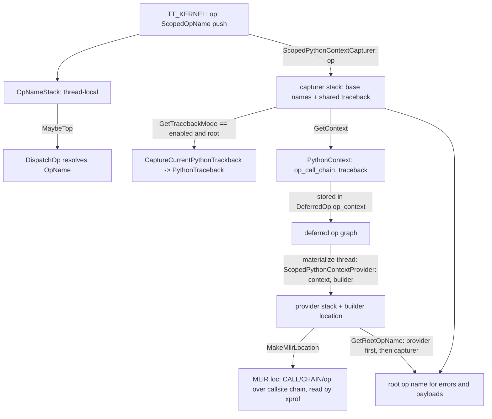

# Op names, the op-name stack and captured Python context

## Overview
Two thread-local stacks give every deferred op its identity. The first is the op-name stack: an
[`OpName`](https://github.com/google-pytorch/torch_tpu/blob/6d2a45754bdb52743883f75fbf753408345f6d1b/csrc/ops/op_names.h#L29 "csrc/ops/op_names.h#OpName") enum value (one per op TorchTPU
implements; its *string* name, not its number, is what enters cache keys) is pushed by
[`ScopedOpName`](https://github.com/google-pytorch/torch_tpu/blob/6d2a45754bdb52743883f75fbf753408345f6d1b/csrc/common/op_name_stack.h#L54 "csrc/common/op_name_stack.h#ScopedOpName") for the duration of a
kernel and read by the dispatcher, so an op never has to pass its own name around. The second is the
Python-context stack: [`ScopedPythonContextCapturer`](https://github.com/google-pytorch/torch_tpu/blob/6d2a45754bdb52743883f75fbf753408345f6d1b/csrc/ops/python_context.h#L165 "csrc/ops/python_context.h#ScopedPythonContextCapturer")
records, while the kernel is still running, the chain of op names that led to the current op and,
when traceback capture is enabled, a pure-C++ snapshot of the Python stack. The resulting
[`PythonContext`](https://github.com/google-pytorch/torch_tpu/blob/6d2a45754bdb52743883f75fbf753408345f6d1b/csrc/ops/python_context.h#L97 "csrc/ops/python_context.h#PythonContext") travels inside the
deferred op and is replayed later, on the materialize thread, by
[`ScopedPythonContextProvider`](https://github.com/google-pytorch/torch_tpu/blob/6d2a45754bdb52743883f75fbf753408345f6d1b/csrc/ops/python_context.h#L248 "csrc/ops/python_context.h#ScopedPythonContextProvider"),
which turns it into an MLIR location that xprof can parse. The design goal stated in the header is
that an op is implemented correctly according to "how an op is used in user code": errors name the
root op, profiles attribute kernels to Python lines, and none of it requires holding the GIL off the
dispatch thread.

## Diagram

Legend:
- `K` - (concept) the kernel macro scope, see [aten-kernel-authoring](aten-kernel-authoring.md)
- `DO` - (concept) the dispatcher, see [eager-op-dispatch](eager-op-dispatch.md)
- `DEF` - (concept) the deferred graph of [deferred-execution-and-materialization](deferred-execution-and-materialization.md)
- `ONS` - [`OpNameStack`](https://github.com/google-pytorch/torch_tpu/blob/6d2a45754bdb52743883f75fbf753408345f6d1b/csrc/common/op_name_stack.h#L29 "csrc/common/op_name_stack.h#OpNameStack") pushed by [`ScopedOpName`](https://github.com/google-pytorch/torch_tpu/blob/6d2a45754bdb52743883f75fbf753408345f6d1b/csrc/common/op_name_stack.h#L54 "csrc/common/op_name_stack.h#ScopedOpName")
- `CAP` - [`ScopedPythonContextCapturer`](https://github.com/google-pytorch/torch_tpu/blob/6d2a45754bdb52743883f75fbf753408345f6d1b/csrc/ops/python_context.h#L165 "csrc/ops/python_context.h#ScopedPythonContextCapturer")
- `TRACE` - [`CaptureCurrentPythonTrackback`](https://github.com/google-pytorch/torch_tpu/blob/6d2a45754bdb52743883f75fbf753408345f6d1b/csrc/ops/python_context.cc#L209 "csrc/ops/python_context.cc#CaptureCurrentPythonTrackback") gated by [`GetTracebackMode`](https://github.com/google-pytorch/torch_tpu/blob/6d2a45754bdb52743883f75fbf753408345f6d1b/csrc/ops/python_context.cc#L61 "csrc/ops/python_context.cc#GetTracebackMode"), producing a [`PythonTraceback`](https://github.com/google-pytorch/torch_tpu/blob/6d2a45754bdb52743883f75fbf753408345f6d1b/csrc/ops/python_context.h#L66 "csrc/ops/python_context.h#PythonTraceback")
- `PC` - [`PythonContext`](https://github.com/google-pytorch/torch_tpu/blob/6d2a45754bdb52743883f75fbf753408345f6d1b/csrc/ops/python_context.h#L97 "csrc/ops/python_context.h#PythonContext")
- `PROV` - [`ScopedPythonContextProvider`](https://github.com/google-pytorch/torch_tpu/blob/6d2a45754bdb52743883f75fbf753408345f6d1b/csrc/ops/python_context.h#L248 "csrc/ops/python_context.h#ScopedPythonContextProvider")
- `LOC` - [`MakeMlirLocation`](https://github.com/google-pytorch/torch_tpu/blob/6d2a45754bdb52743883f75fbf753408345f6d1b/csrc/ops/python_context.cc#L239 "csrc/ops/python_context.cc#MakeMlirLocation")
- `ROOT` - [`GetRootOpName`](https://github.com/google-pytorch/torch_tpu/blob/6d2a45754bdb52743883f75fbf753408345f6d1b/csrc/ops/python_context.cc#L325 "csrc/ops/python_context.cc#GetRootOpName")

## Design rationale (why it's built this way)
- **An enum, not a string, identifies an op; the string identifies it on disk.** The comment on
  [`OpName`](https://github.com/google-pytorch/torch_tpu/blob/6d2a45754bdb52743883f75fbf753408345f6d1b/csrc/ops/op_names.h#L29 "csrc/ops/op_names.h#OpName") says its numerical values "are unstable and not meaningful, so do not persist
  them". What is fingerprinted into the graph key (see
  [compilation-cache-key](compilation-cache-key.md)) is the op's string name from
  [`ToString`](https://github.com/google-pytorch/torch_tpu/blob/6d2a45754bdb52743883f75fbf753408345f6d1b/csrc/ops/op_names.h#L889 "csrc/ops/op_names.h#ToString"), whose switch carries the warning that the names "must be stable"
  because changing them can collide keys in the persistent cache. `ToString` is `constexpr` and lives
  in the header so op names can be checked at compile time (internal ops must start with `_`).
  [`ToBaseName`](https://github.com/google-pytorch/torch_tpu/blob/6d2a45754bdb52743883f75fbf753408345f6d1b/csrc/ops/op_names.cc#L25 "csrc/ops/op_names.cc#ToBaseName") strips the internal `_` prefix and the overload suffix for grouping (`add.out`
  reads as `add`; distributed ops and dunder methods keep their names), and [`IsMetadataOnly`](https://github.com/google-pytorch/torch_tpu/blob/6d2a45754bdb52743883f75fbf753408345f6d1b/csrc/ops/op_names.h#L2678 "csrc/ops/op_names.h#IsMetadataOnly")
  marks ops that "would be metadata-only on CUDA" (views, `detach`, `empty`), which defer-never
  dispatch does not materialize on their own.
- **Name from context, so helpers cannot lie.** Because `DispatchOp`
  reads [`OpNameStack`](https://github.com/google-pytorch/torch_tpu/blob/6d2a45754bdb52743883f75fbf753408345f6d1b/csrc/common/op_name_stack.h#L29 "csrc/common/op_name_stack.h#OpNameStack") rather than a
  parameter, a shared helper called from `gelu` dispatches under `gelu`'s name and cache identity
  unless it deliberately overrides, and calling it outside any kernel aborts. The stack is thread
  local and lives only on the dispatching thread.
- **Two stacks because capture and use happen on different threads at different times.** The
  header separates *capturing* (define a [`ScopedPythonContextCapturer`](https://github.com/google-pytorch/torch_tpu/blob/6d2a45754bdb52743883f75fbf753408345f6d1b/csrc/ops/python_context.h#L165 "csrc/ops/python_context.h#ScopedPythonContextCapturer")
  while the ATen kernel is running) from *providing* (define a
  [`ScopedPythonContextProvider`](https://github.com/google-pytorch/torch_tpu/blob/6d2a45754bdb52743883f75fbf753408345f6d1b/csrc/ops/python_context.h#L248 "csrc/ops/python_context.h#ScopedPythonContextProvider")
  before building the MLIR op) and warns that defining a capturer inside the op build function is
  wrong, since a deferred op's builder runs after the kernel returned, on another thread, when the
  Python frames are gone.
- **The traceback is C++ data, captured and symbolized once per thread stack.**
  [`PythonTraceback`](https://github.com/google-pytorch/torch_tpu/blob/6d2a45754bdb52743883f75fbf753408345f6d1b/csrc/ops/python_context.h#L66 "csrc/ops/python_context.h#PythonTraceback") is a vector of [`PythonStackFrame`](https://github.com/google-pytorch/torch_tpu/blob/6d2a45754bdb52743883f75fbf753408345f6d1b/csrc/ops/python_context.h#L59 "csrc/ops/python_context.h#PythonStackFrame")
  (file, function, 1-based line) rather than PyTorch's symbolized tracebacks, explicitly to avoid
  GIL contention and to be safe across threads. Symbolization happens at capture time on purpose:
  "symbolization requires the GIL, and the PyTorch dispatcher is already holding the GIL". All
  capturers alive on a thread share one traceback pointer, the optimization the class comment calls
  out, because nested ops in one kernel have the same Python frames.
- **Tracebacks are off in eager, on in compiled mode.** [`GetTracebackMode`](https://github.com/google-pytorch/torch_tpu/blob/6d2a45754bdb52743883f75fbf753408345f6d1b/csrc/ops/python_context.cc#L61 "csrc/ops/python_context.cc#GetTracebackMode")
  honors the `enable_tracebacks` context manager first, then the
  `--torch_tpu_internal_mlir_tracebacks` flag (read once), and otherwise enables capture only in
  the internal compile-FX-graph eager mode used by `torch.compile`, where MLIR locations are
  needed. Capturing C++ frames as well is a separate, costlier option because it requires DWARF
  symbolization.
- **The location format is a contract with xprof.** [`MakeMlirLocation`](https://github.com/google-pytorch/torch_tpu/blob/6d2a45754bdb52743883f75fbf753408345f6d1b/csrc/ops/python_context.cc#L239 "csrc/ops/python_context.cc#MakeMlirLocation")
  wraps a `loc(callsite(func at callsite))` chain of user frames in a root name location
  `CALL/CHAIN/op` built from the op call chain, in the specific shape the header says xprof
  requires ("the root frame with named scopes, the callstack, the funcname, and the
  file-line-col"). Frames from PyTorch's op and FX interpreter plumbing and from test harnesses are
  filtered out.

> [!inferred]
> The user-visible consequences: in eager mode an error names the root op (`linear(): ...`) but
> carries no Python traceback beyond what PyTorch adds, while under `torch.compile` or with
> `enable_tracebacks`, profiles show the originating Python line at some dispatch cost per op.

## Entry points
- [`ScopedOpName`](https://github.com/google-pytorch/torch_tpu/blob/6d2a45754bdb52743883f75fbf753408345f6d1b/csrc/common/op_name_stack.h#L54 "csrc/common/op_name_stack.h#ScopedOpName"): pushed by the
  kernel macro at kernel entry; [`OpNameStack`](https://github.com/google-pytorch/torch_tpu/blob/6d2a45754bdb52743883f75fbf753408345f6d1b/csrc/common/op_name_stack.h#L29 "csrc/common/op_name_stack.h#OpNameStack")
  exposes `Push`, `Pop`, `Top` (crashes when empty) and `MaybeTop`.
- [`ScopedPythonContextCapturer`](https://github.com/google-pytorch/torch_tpu/blob/6d2a45754bdb52743883f75fbf753408345f6d1b/csrc/ops/python_context.cc#L274 "csrc/ops/python_context.cc#ScopedPythonContextCapturer.ScopedPythonContextCapturer"):
  constructed with the op name by the kernel macro for every op, and again by kernels that call
  other ops so the chain grows; `GetContext` (must be non-empty) and
  [`MaybeGetContext`](https://github.com/google-pytorch/torch_tpu/blob/6d2a45754bdb52743883f75fbf753408345f6d1b/csrc/ops/python_context.cc#L296 "csrc/ops/python_context.cc#ScopedPythonContextCapturer.MaybeGetContext")
  read the top. A second constructor, [`ScopedPythonContextCapturer`](https://github.com/google-pytorch/torch_tpu/blob/6d2a45754bdb52743883f75fbf753408345f6d1b/csrc/ops/python_context.cc#L274 "csrc/ops/python_context.cc#ScopedPythonContextCapturer.ScopedPythonContextCapturer"), takes a
  Python API name instead of an `OpName`; the pybind error-handling wrapper uses it so that errors
  raised by `torch.tpu` Python APIs are attributed to the API name.
- [`ScopedPythonContextProvider`](https://github.com/google-pytorch/torch_tpu/blob/6d2a45754bdb52743883f75fbf753408345f6d1b/csrc/ops/python_context.h#L248 "csrc/ops/python_context.h#ScopedPythonContextProvider"):
  constructed by the few places that invoke MLIR op builders (traversal module building, the
  `torch.compile` and compiled-mode paths, synchronization helpers), with an optional builder whose
  location attribute it sets and restores.
- [`GetRootOpName`](https://github.com/google-pytorch/torch_tpu/blob/6d2a45754bdb52743883f75fbf753408345f6d1b/csrc/ops/python_context.cc#L325 "csrc/ops/python_context.cc#GetRootOpName"): the first op in
  the current chain, or the given op when no context is alive; used for error payloads and messages.

## Mechanism (step-by-step)
1. **Kernel entry pushes identity.** The kernel macro constructs a
   [`ScopedOpName`](https://github.com/google-pytorch/torch_tpu/blob/6d2a45754bdb52743883f75fbf753408345f6d1b/csrc/common/op_name_stack.h#L54 "csrc/common/op_name_stack.h#ScopedOpName") and a
   [`ScopedPythonContextCapturer`](https://github.com/google-pytorch/torch_tpu/blob/6d2a45754bdb52743883f75fbf753408345f6d1b/csrc/ops/python_context.cc#L274 "csrc/ops/python_context.cc#ScopedPythonContextCapturer.ScopedPythonContextCapturer")
   for the op. The capturer pushes the op's base name ([`ToBaseName`](https://github.com/google-pytorch/torch_tpu/blob/6d2a45754bdb52743883f75fbf753408345f6d1b/csrc/ops/op_names.cc#L25 "csrc/ops/op_names.cc#ToBaseName")) onto the per-thread
   `op_names_` vector; if it is the root capturer on this thread and [`GetTracebackMode`](https://github.com/google-pytorch/torch_tpu/blob/6d2a45754bdb52743883f75fbf753408345f6d1b/csrc/ops/python_context.cc#L61 "csrc/ops/python_context.cc#GetTracebackMode")
   is enabled, it calls [`CaptureCurrentPythonTrackback`](https://github.com/google-pytorch/torch_tpu/blob/6d2a45754bdb52743883f75fbf753408345f6d1b/csrc/ops/python_context.cc#L209 "csrc/ops/python_context.cc#CaptureCurrentPythonTrackback")
   once and stores the shared pointer for all nested capturers.
2. **Dispatch reads both stacks.** `DispatchOp`
   takes the [`OpName`](https://github.com/google-pytorch/torch_tpu/blob/6d2a45754bdb52743883f75fbf753408345f6d1b/csrc/ops/op_names.h#L29 "csrc/ops/op_names.h#OpName") from
   [`OpNameStack`](https://github.com/google-pytorch/torch_tpu/blob/6d2a45754bdb52743883f75fbf753408345f6d1b/csrc/common/op_name_stack.h#L29 "csrc/common/op_name_stack.h#OpNameStack"), and the deferred op
   constructor calls `GetContext` to copy the current [`PythonContext`](https://github.com/google-pytorch/torch_tpu/blob/6d2a45754bdb52743883f75fbf753408345f6d1b/csrc/ops/python_context.h#L97 "csrc/ops/python_context.h#PythonContext")
   (the op call chain from bottom to top plus the traceback pointer) into the op. Nested helper ops
   see a longer chain whose first element is still the user's op.
3. **Errors use the root.** When a status is created or thrown,
   [`GetRootOpName`](https://github.com/google-pytorch/torch_tpu/blob/6d2a45754bdb52743883f75fbf753408345f6d1b/csrc/ops/python_context.cc#L325 "csrc/ops/python_context.cc#GetRootOpName") returns the first name of the provider's chain if a provider is alive, else of
   the capturer's chain, else the full display name of the given op. Because the capturer stored
   base names, the root reads as `add` rather than `add.out`; it becomes the `<root op>():` prefix
   described in [error-handling](error-handling.md).
4. **Build time replays the context.** On the materialize thread, before calling a deferred op's
   MLIR builder, the traversal wraps the call in a
   [`ScopedPythonContextProvider`](https://github.com/google-pytorch/torch_tpu/blob/6d2a45754bdb52743883f75fbf753408345f6d1b/csrc/ops/python_context.h#L248 "csrc/ops/python_context.h#ScopedPythonContextProvider")
   holding a copy of the op's stored context. The provider sets the builder's location to
   [`MakeMlirLocation`](https://github.com/google-pytorch/torch_tpu/blob/6d2a45754bdb52743883f75fbf753408345f6d1b/csrc/ops/python_context.cc#L239 "csrc/ops/python_context.cc#MakeMlirLocation") of that context, and any code that needs the context during building reads
   it through the provider's [`MaybeGetContext`](https://github.com/google-pytorch/torch_tpu/blob/6d2a45754bdb52743883f75fbf753408345f6d1b/csrc/ops/python_context.h#L273 "csrc/ops/python_context.h#ScopedPythonContextProvider.MaybeGetContext")
   rather than the capturer, which is empty on that thread.
5. **Scopes unwind.** The destructors of [`ScopedOpName`](https://github.com/google-pytorch/torch_tpu/blob/6d2a45754bdb52743883f75fbf753408345f6d1b/csrc/common/op_name_stack.h#L54 "csrc/common/op_name_stack.h#ScopedOpName")
   and [`ScopedPythonContextCapturer`](https://github.com/google-pytorch/torch_tpu/blob/6d2a45754bdb52743883f75fbf753408345f6d1b/csrc/ops/python_context.h#L165 "csrc/ops/python_context.h#ScopedPythonContextCapturer") pop their stacks (the last capturer
   also drops the shared traceback); the provider restores the previous top context and the
   builder's previous location, so nested builders (a custom kernel building sub-ops) get correct
   nesting.

## Key data structures
- [`OpName`](https://github.com/google-pytorch/torch_tpu/blob/6d2a45754bdb52743883f75fbf753408345f6d1b/csrc/ops/op_names.h#L29 "csrc/ops/op_names.h#OpName"): enum of implemented ops; numeric values are not stable, string names are.
  [`ToString`](https://github.com/google-pytorch/torch_tpu/blob/6d2a45754bdb52743883f75fbf753408345f6d1b/csrc/ops/op_names.h#L889 "csrc/ops/op_names.h#ToString") for display and fingerprinting.
- [`PythonContext`](https://github.com/google-pytorch/torch_tpu/blob/6d2a45754bdb52743883f75fbf753408345f6d1b/csrc/ops/python_context.h#L97 "csrc/ops/python_context.h#PythonContext"): move-only; the
  op call chain (non-empty strings) and an optional shared [`PythonTraceback`](https://github.com/google-pytorch/torch_tpu/blob/6d2a45754bdb52743883f75fbf753408345f6d1b/csrc/ops/python_context.h#L66 "csrc/ops/python_context.h#PythonTraceback");
  `Copy()` for the deferred op.
- [`PythonStackFrame`](https://github.com/google-pytorch/torch_tpu/blob/6d2a45754bdb52743883f75fbf753408345f6d1b/csrc/ops/python_context.h#L59 "csrc/ops/python_context.h#PythonStackFrame"): file name,
  function name, 1-based line.
- The per-thread statics: `op_names_` and `traceback_` in the capturer, `top_context_` in the
  provider; all explicitly marked as needed only on the dispatching thread.

## Dynamics (design intent)
- Capture cost (gathering and symbolizing the stack) is paid once per root kernel per thread, and
  only when tracebacks are enabled; nested ops reuse the pointer. Providing is a context copy plus
  location construction from already-symbolized frames.
- Worker threads never touch the capturer stack; everything they need was copied into the deferred
  op on the dispatch thread.

## Edge cases
- `GetContext` on an empty capturer stack is a precondition violation; use
  [`MaybeGetContext`](https://github.com/google-pytorch/torch_tpu/blob/6d2a45754bdb52743883f75fbf753408345f6d1b/csrc/ops/python_context.cc#L296 "csrc/ops/python_context.cc#ScopedPythonContextCapturer.MaybeGetContext")
  in code that may run outside a kernel.
- Overriding the op name in dispatch options only changes the dispatched name; the Python context
  chain still records the enclosing kernel.
- With tracebacks disabled, [`MakeMlirLocation`](https://github.com/google-pytorch/torch_tpu/blob/6d2a45754bdb52743883f75fbf753408345f6d1b/csrc/ops/python_context.cc#L239 "csrc/ops/python_context.cc#MakeMlirLocation") still emits the `CALL/CHAIN/op` name scope, but
  over an unknown location, so xprof can group by op chain but not by Python line. A frame whose
  symbol could not be resolved (`??`) is likewise turned into an unknown location.
- A testing hook can override the traceback of all live contexts on a thread.

## Open questions
- The exact set of ops flagged by [`IsMetadataOnly`](https://github.com/google-pytorch/torch_tpu/blob/6d2a45754bdb52743883f75fbf753408345f6d1b/csrc/ops/op_names.h#L2678 "csrc/ops/op_names.h#IsMetadataOnly")
  is defined in `op_names.h`; this page does not enumerate it.

## See also
- [eager-op-dispatch](eager-op-dispatch.md): the consumer of the op-name stack.
- [aten-kernel-authoring](aten-kernel-authoring.md): the macro that creates both scopes.
- [error-handling](error-handling.md): root op names in messages and payloads.
- [compilation-cache-key](compilation-cache-key.md): op names inside the graph signature.
- [profiler](profiler.md): where MLIR locations become xprof attribution.

## Recent changes
- `08caf3a4e` exposes a testing hook to set the MLIR tracebacks flag programmatically, so the
  precedence between the flag and the `enable_tracebacks` context can be tested in the open-source
  build; `c531ad857` marks the provider constructor `explicit`.
- `6c76a52b8` makes the dynamism custom ops internal (`_` prefix) and adds `ImplInternal`; to let
  it `static_assert` on internal op names, `ToString` moved into the header as `constexpr`.
  `1b8e91d5d`, `cb2635779`, `eff2ed1cd` and `6ba94701b` move custom ops to `torch.tpu.ops`.
- Many commits add new `OpName` members for native lowerings (`3bedaa917` stack, `5d0907a8e`
  linear, `94954963f` cross-entropy and NLL loss, `4124b3780` tensor factories, among others).
- [all changes in 6d2a45754b](../changes/6d2a45754b.md)
