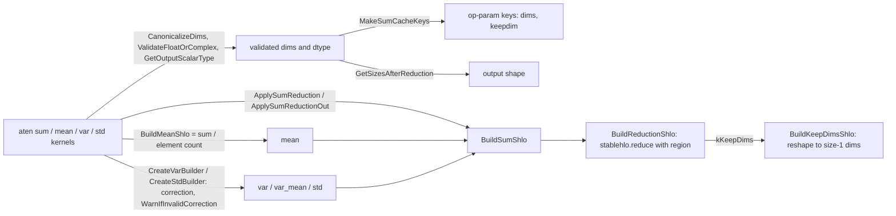

# Reductions, sum, mean and variance

## Overview
The reductions on this page (sum, mean, var, std) share one lowering: [`BuildReductionShlo`](https://github.com/google-pytorch/torch_tpu/blob/6d2a45754bdb52743883f75fbf753408345f6d1b/csrc/ops/reductions/reductions.cc#L37 "csrc/ops/reductions/reductions.cc#BuildReductionShlo")
takes an input, the dims to reduce, the result type, an init value and a region builder for the
combining function, emits `stablehlo.reduce`, and, when the caller asks for
[`ReductionMode`](https://github.com/google-pytorch/torch_tpu/blob/6d2a45754bdb52743883f75fbf753408345f6d1b/csrc/ops/reductions/reductions.h#L29 "csrc/ops/reductions/reductions.h#ReductionMode")
[`kKeepDims`](https://github.com/google-pytorch/torch_tpu/blob/6d2a45754bdb52743883f75fbf753408345f6d1b/csrc/ops/reductions/reductions.h#L29 "csrc/ops/reductions/reductions.h#ReductionMode.kKeepDims"),
re-inserts the reduced dims as size 1 with [`BuildKeepDimsShlo`](https://github.com/google-pytorch/torch_tpu/blob/6d2a45754bdb52743883f75fbf753408345f6d1b/csrc/ops/reductions/reductions.cc#L73 "csrc/ops/reductions/reductions.cc#BuildKeepDimsShlo").
The ATen-facing layer around it handles what PyTorch users actually depend on: negative and
duplicate `dim` arguments ([`CanonicalizeDims`](https://github.com/google-pytorch/torch_tpu/blob/6d2a45754bdb52743883f75fbf753408345f6d1b/csrc/ops/reductions/reduction_utils.cc#L119 "csrc/ops/reductions/reduction_utils.cc#CanonicalizeDims")),
output shape computation ([`OutputSizesArrayKeepDim`](https://github.com/google-pytorch/torch_tpu/blob/6d2a45754bdb52743883f75fbf753408345f6d1b/csrc/ops/reductions/reduction_utils.cc#L69 "csrc/ops/reductions/reduction_utils.cc#OutputSizesArrayKeepDim"),
[`OutputSizesArrayDiscardDim`](https://github.com/google-pytorch/torch_tpu/blob/6d2a45754bdb52743883f75fbf753408345f6d1b/csrc/ops/reductions/reduction_utils.cc#L79 "csrc/ops/reductions/reduction_utils.cc#OutputSizesArrayDiscardDim")),
the reduction dtype rules of `sum` and `mean`, and derived statistics: `mean` is a sum divided by
the element count of the reduced dims, `var`, `var_mean` and `std` apply a Bessel correction and
warn when degrees of freedom are not positive, mirroring CPU PyTorch. The sum builder
[`BuildSumShlo`](https://github.com/google-pytorch/torch_tpu/blob/6d2a45754bdb52743883f75fbf753408345f6d1b/csrc/ops/reductions/sum.cc#L35 "csrc/ops/reductions/sum.cc#BuildSumShlo") is the reusable piece: other lowerings call it directly, and
[`ApplySumReduction`](https://github.com/google-pytorch/torch_tpu/blob/6d2a45754bdb52743883f75fbf753408345f6d1b/csrc/ops/reductions/reduction_utils.cc#L191 "csrc/ops/reductions/reduction_utils.cc#ApplySumReduction") wraps it as a complete deferred op for kernels that just need "sum this
tensor".

## Diagram

Legend:
- `A` - (concept) kernels such as [`AtenSumIntListOut`](https://github.com/google-pytorch/torch_tpu/blob/6d2a45754bdb52743883f75fbf753408345f6d1b/csrc/ops/reductions/sum_aten_kernels.cc#L36 "csrc/ops/reductions/sum_aten_kernels.cc#AtenSumIntListOut"), [`AtenMeanOut`](https://github.com/google-pytorch/torch_tpu/blob/6d2a45754bdb52743883f75fbf753408345f6d1b/csrc/ops/reductions/mean_aten_kernels.cc#L71 "csrc/ops/reductions/mean_aten_kernels.cc#AtenMeanOut"), [`AtenVar`](https://github.com/google-pytorch/torch_tpu/blob/6d2a45754bdb52743883f75fbf753408345f6d1b/csrc/ops/reductions/var_aten_kernels.cc#L151 "csrc/ops/reductions/var_aten_kernels.cc#AtenVar"), [`AtenStd`](https://github.com/google-pytorch/torch_tpu/blob/6d2a45754bdb52743883f75fbf753408345f6d1b/csrc/ops/reductions/std_aten_kernels.cc#L136 "csrc/ops/reductions/std_aten_kernels.cc#AtenStd") and their intermediate values
- `P` - [`CanonicalizeDims`](https://github.com/google-pytorch/torch_tpu/blob/6d2a45754bdb52743883f75fbf753408345f6d1b/csrc/ops/reductions/reduction_utils.cc#L119 "csrc/ops/reductions/reduction_utils.cc#CanonicalizeDims"), [`ValidateFloatOrComplex`](https://github.com/google-pytorch/torch_tpu/blob/6d2a45754bdb52743883f75fbf753408345f6d1b/csrc/ops/reductions/reduction_utils.cc#L109 "csrc/ops/reductions/reduction_utils.cc#ValidateFloatOrComplex"), [`GetOutputScalarType`](https://github.com/google-pytorch/torch_tpu/blob/6d2a45754bdb52743883f75fbf753408345f6d1b/csrc/ops/reductions/mean_aten_kernels.cc#L50 "csrc/ops/reductions/mean_aten_kernels.cc#GetOutputScalarType"), [`GetSizesAfterReduction`](https://github.com/google-pytorch/torch_tpu/blob/6d2a45754bdb52743883f75fbf753408345f6d1b/csrc/ops/reductions/reduction_utils.cc#L101 "csrc/ops/reductions/reduction_utils.cc#GetSizesAfterReduction"), [`MakeSumCacheKeys`](https://github.com/google-pytorch/torch_tpu/blob/6d2a45754bdb52743883f75fbf753408345f6d1b/csrc/ops/reductions/reduction_utils.cc#L93 "csrc/ops/reductions/reduction_utils.cc#MakeSumCacheKeys")
- `K` - [`MakeSumCacheKeys`](https://github.com/google-pytorch/torch_tpu/blob/6d2a45754bdb52743883f75fbf753408345f6d1b/csrc/ops/reductions/reduction_utils.cc#L93 "csrc/ops/reductions/reduction_utils.cc#MakeSumCacheKeys")
- `S` - [`GetSizesAfterReduction`](https://github.com/google-pytorch/torch_tpu/blob/6d2a45754bdb52743883f75fbf753408345f6d1b/csrc/ops/reductions/reduction_utils.cc#L101 "csrc/ops/reductions/reduction_utils.cc#GetSizesAfterReduction")
- `SUM` - [`BuildSumShlo`](https://github.com/google-pytorch/torch_tpu/blob/6d2a45754bdb52743883f75fbf753408345f6d1b/csrc/ops/reductions/sum.cc#L35 "csrc/ops/reductions/sum.cc#BuildSumShlo") via [`ApplySumReduction`](https://github.com/google-pytorch/torch_tpu/blob/6d2a45754bdb52743883f75fbf753408345f6d1b/csrc/ops/reductions/reduction_utils.cc#L191 "csrc/ops/reductions/reduction_utils.cc#ApplySumReduction") / [`ApplySumReductionOut`](https://github.com/google-pytorch/torch_tpu/blob/6d2a45754bdb52743883f75fbf753408345f6d1b/csrc/ops/reductions/reduction_utils.cc#L214 "csrc/ops/reductions/reduction_utils.cc#ApplySumReductionOut")
- `MEAN` - [`BuildMeanShlo`](https://github.com/google-pytorch/torch_tpu/blob/6d2a45754bdb52743883f75fbf753408345f6d1b/csrc/ops/reductions/mean_aten_kernels.cc#L59 "csrc/ops/reductions/mean_aten_kernels.cc#BuildMeanShlo")
- `VAR` - [`CreateVarBuilder`](https://github.com/google-pytorch/torch_tpu/blob/6d2a45754bdb52743883f75fbf753408345f6d1b/csrc/ops/reductions/var_aten_kernels.cc#L66 "csrc/ops/reductions/var_aten_kernels.cc#CreateVarBuilder"), [`CreateStdBuilder`](https://github.com/google-pytorch/torch_tpu/blob/6d2a45754bdb52743883f75fbf753408345f6d1b/csrc/ops/reductions/std_aten_kernels.cc#L60 "csrc/ops/reductions/std_aten_kernels.cc#CreateStdBuilder") and the `var_mean` builder inside [`AtenVarMeanCorrection`](https://github.com/google-pytorch/torch_tpu/blob/6d2a45754bdb52743883f75fbf753408345f6d1b/csrc/ops/reductions/var_aten_kernels.cc#L246 "csrc/ops/reductions/var_aten_kernels.cc#AtenVarMeanCorrection")
- `R` - [`BuildReductionShlo`](https://github.com/google-pytorch/torch_tpu/blob/6d2a45754bdb52743883f75fbf753408345f6d1b/csrc/ops/reductions/reductions.cc#L37 "csrc/ops/reductions/reductions.cc#BuildReductionShlo")
- `KD` - [`BuildKeepDimsShlo`](https://github.com/google-pytorch/torch_tpu/blob/6d2a45754bdb52743883f75fbf753408345f6d1b/csrc/ops/reductions/reductions.cc#L73 "csrc/ops/reductions/reductions.cc#BuildKeepDimsShlo")

## Design rationale (why it's built this way)
- **One reduce builder, many ops.** `stablehlo.reduce` is fully general (any init value, any
  region), so [`BuildReductionShlo`](https://github.com/google-pytorch/torch_tpu/blob/6d2a45754bdb52743883f75fbf753408345f6d1b/csrc/ops/reductions/reductions.cc#L37 "csrc/ops/reductions/reductions.cc#BuildReductionShlo")
  is the shared builder for single-operand reductions such as sum, the logical reductions and
  norms, which differ only in the init value and region. It is not the only constructor: amax/amin,
  min/max with indices, RMS and group norm and the attention lowering call `stablehlo::Reduce`
  directly. It also converts the input to the requested element type before
  reducing, which is how a bf16 sum accumulates in f32. Keep-dim behavior is a separate reshape
  step because StableHLO reduce always drops dimensions; [`BuildKeepDimsShlo`](https://github.com/google-pytorch/torch_tpu/blob/6d2a45754bdb52743883f75fbf753408345f6d1b/csrc/ops/reductions/reductions.cc#L73 "csrc/ops/reductions/reductions.cc#BuildKeepDimsShlo")
  computes the unsqueezed shape from the original input and the reduced dims (and is a no-op on a
  0-d input).
- **PyTorch's dim semantics are enforced before lowering.** [`CanonicalizeDims`](https://github.com/google-pytorch/torch_tpu/blob/6d2a45754bdb52743883f75fbf753408345f6d1b/csrc/ops/reductions/reduction_utils.cc#L119 "csrc/ops/reductions/reduction_utils.cc#CanonicalizeDims")
  wraps negative dims, rejects out-of-range dims with a Python `IndexError` and repeated dims with
  PyTorch-style errors, and interprets a missing or empty dim list as "all dims"; the resulting
  list (in the caller's order, not sorted) is what the shape helpers use. Cache keys differ by
  kernel: `mean` and the internal `ApplySumReduction` key the canonical list, but the `sum`, `var`
  and `std` kernels key the raw `dim` argument through `TT_KERNEL`, so `sum(dim=-1)` and
  `sum(dim=2)` on a 3-d tensor get different keys.
- **Reduction dtype follows PyTorch, accumulation follows CUDA.** `sum` takes the `dtype=` argument
  or the dtype of the `out` tensor PyTorch allocated (which already reflects `sum`'s
  integer-to-int64 rule); [`GetOutputScalarType`](https://github.com/google-pytorch/torch_tpu/blob/6d2a45754bdb52743883f75fbf753408345f6d1b/csrc/ops/reductions/mean_aten_kernels.cc#L50 "csrc/ops/reductions/mean_aten_kernels.cc#GetOutputScalarType") in the `mean` kernel resolves `dtype=` and,
  through [`ValidateFloatOrComplex`](https://github.com/google-pytorch/torch_tpu/blob/6d2a45754bdb52743883f75fbf753408345f6d1b/csrc/ops/reductions/reduction_utils.cc#L109 "csrc/ops/reductions/reduction_utils.cc#ValidateFloatOrComplex"),
  rejects `mean`, `var` and `std` on integer inputs the way CPU does; `mean` computes in the
  accumulate type of its output dtype (f32 for half types) per the rule described in
  [dtype-and-precision](dtype-and-precision.md).
- **Mean and variance are algebra over sum.** [`BuildMeanShlo`](https://github.com/google-pytorch/torch_tpu/blob/6d2a45754bdb52743883f75fbf753408345f6d1b/csrc/ops/reductions/mean_aten_kernels.cc#L59 "csrc/ops/reductions/mean_aten_kernels.cc#BuildMeanShlo")
  divides the sum by the element count of the reduced dims, computed in the graph. The host-side
  reduction size from [`GetReductionFactor`](https://github.com/google-pytorch/torch_tpu/blob/6d2a45754bdb52743883f75fbf753408345f6d1b/csrc/ops/reductions/reduction_utils.cc#L172 "csrc/ops/reductions/reduction_utils.cc#GetReductionFactor")
  (the product of reduced sizes) feeds [`CreateVarBuilder`](https://github.com/google-pytorch/torch_tpu/blob/6d2a45754bdb52743883f75fbf753408345f6d1b/csrc/ops/reductions/var_aten_kernels.cc#L66 "csrc/ops/reductions/var_aten_kernels.cc#CreateVarBuilder"), which
  centers, squares, sums and divides by `max(N - correction, 0)`, with the correction passed as a
  promoted scalar tensor so changing `correction` does not recompile (see
  [eager-op-dispatch](eager-op-dispatch.md)). [`CreateStdBuilder`](https://github.com/google-pytorch/torch_tpu/blob/6d2a45754bdb52743883f75fbf753408345f6d1b/csrc/ops/reductions/std_aten_kernels.cc#L60 "csrc/ops/reductions/std_aten_kernels.cc#CreateStdBuilder") is the same pipeline followed
  by a square root.
  [`WarnIfInvalidCorrection`](https://github.com/google-pytorch/torch_tpu/blob/6d2a45754bdb52743883f75fbf753408345f6d1b/csrc/ops/reductions/var_aten_kernels.cc#L137 "csrc/ops/reductions/var_aten_kernels.cc#WarnIfInvalidCorrection")
  reproduces PyTorch's "degrees of freedom ... should be positive" warning, prefixed with the root
  op name, instead of erroring.
- **Cache keys name exactly what changes the program.** [`MakeSumCacheKeys`](https://github.com/google-pytorch/torch_tpu/blob/6d2a45754bdb52743883f75fbf753408345f6d1b/csrc/ops/reductions/reduction_utils.cc#L93 "csrc/ops/reductions/reduction_utils.cc#MakeSumCacheKeys")
  records canonical dims and keepdim; the output dtype travels as the op's `out_dtype` and input
  shapes are already in the graph key ([compilation-cache-key](compilation-cache-key.md)).

> [!inferred]
> Numerically, TPU reductions accumulate bfloat16 and float16 sums in float32 and reduce in
> XLA's tree order, so results differ from CPU in the last bits but match CUDA's behavior in
> spirit. `var` with `correction >= N` yields the same warning-plus-NaN/inf outcome as CPU,
> because the denominator is clamped to 0 rather than rejected.

## Entry points
- [`AtenSumIntListOut`](https://github.com/google-pytorch/torch_tpu/blob/6d2a45754bdb52743883f75fbf753408345f6d1b/csrc/ops/reductions/sum_aten_kernels.cc#L36 "csrc/ops/reductions/sum_aten_kernels.cc#AtenSumIntListOut")
  (and the other `sum` overloads routed through [`ApplySumReductionOut`](https://github.com/google-pytorch/torch_tpu/blob/6d2a45754bdb52743883f75fbf753408345f6d1b/csrc/ops/reductions/reduction_utils.cc#L214 "csrc/ops/reductions/reduction_utils.cc#ApplySumReductionOut")),
  [`AtenMeanOut`](https://github.com/google-pytorch/torch_tpu/blob/6d2a45754bdb52743883f75fbf753408345f6d1b/csrc/ops/reductions/mean_aten_kernels.cc#L71 "csrc/ops/reductions/mean_aten_kernels.cc#AtenMeanOut"),
  [`AtenVar`](https://github.com/google-pytorch/torch_tpu/blob/6d2a45754bdb52743883f75fbf753408345f6d1b/csrc/ops/reductions/var_aten_kernels.cc#L151 "csrc/ops/reductions/var_aten_kernels.cc#AtenVar"),
  [`AtenVarOut`](https://github.com/google-pytorch/torch_tpu/blob/6d2a45754bdb52743883f75fbf753408345f6d1b/csrc/ops/reductions/var_aten_kernels.cc#L196 "csrc/ops/reductions/var_aten_kernels.cc#AtenVarOut"),
  [`AtenVarMeanCorrection`](https://github.com/google-pytorch/torch_tpu/blob/6d2a45754bdb52743883f75fbf753408345f6d1b/csrc/ops/reductions/var_aten_kernels.cc#L246 "csrc/ops/reductions/var_aten_kernels.cc#AtenVarMeanCorrection"),
  [`AtenStd`](https://github.com/google-pytorch/torch_tpu/blob/6d2a45754bdb52743883f75fbf753408345f6d1b/csrc/ops/reductions/std_aten_kernels.cc#L136 "csrc/ops/reductions/std_aten_kernels.cc#AtenStd") and
  [`AtenStdOut`](https://github.com/google-pytorch/torch_tpu/blob/6d2a45754bdb52743883f75fbf753408345f6d1b/csrc/ops/reductions/std_aten_kernels.cc#L189 "csrc/ops/reductions/std_aten_kernels.cc#AtenStdOut"):
  the registered kernels.
- [`BuildSumShlo`](https://github.com/google-pytorch/torch_tpu/blob/6d2a45754bdb52743883f75fbf753408345f6d1b/csrc/ops/reductions/sum.cc#L35 "csrc/ops/reductions/sum.cc#BuildSumShlo") and [`ApplySumReduction`](https://github.com/google-pytorch/torch_tpu/blob/6d2a45754bdb52743883f75fbf753408345f6d1b/csrc/ops/reductions/reduction_utils.cc#L191 "csrc/ops/reductions/reduction_utils.cc#ApplySumReduction"): the reusable sum for other lowerings (as an MLIR
  builder) and other kernels (as a complete deferred op; the fused LSTM and GRU cell backward
  kernels use it to reduce gate gradients over the batch).
- [`BuildReductionShlo`](https://github.com/google-pytorch/torch_tpu/blob/6d2a45754bdb52743883f75fbf753408345f6d1b/csrc/ops/reductions/reductions.cc#L37 "csrc/ops/reductions/reductions.cc#BuildReductionShlo")
  and [`BuildKeepDimsShlo`](https://github.com/google-pytorch/torch_tpu/blob/6d2a45754bdb52743883f75fbf753408345f6d1b/csrc/ops/reductions/reductions.cc#L73 "csrc/ops/reductions/reductions.cc#BuildKeepDimsShlo"):
  the primitives for any new reduction.

## Mechanism (step-by-step)
1. **Validate and normalize.** The kernel canonicalizes dims with [`CanonicalizeDims`](https://github.com/google-pytorch/torch_tpu/blob/6d2a45754bdb52743883f75fbf753408345f6d1b/csrc/ops/reductions/reduction_utils.cc#L119 "csrc/ops/reductions/reduction_utils.cc#CanonicalizeDims"),
   checks the dtype class with [`ValidateFloatOrComplex`](https://github.com/google-pytorch/torch_tpu/blob/6d2a45754bdb52743883f75fbf753408345f6d1b/csrc/ops/reductions/reduction_utils.cc#L109 "csrc/ops/reductions/reduction_utils.cc#ValidateFloatOrComplex")
   where PyTorch requires it, resolves the output dtype (for `mean`, with [`GetOutputScalarType`](https://github.com/google-pytorch/torch_tpu/blob/6d2a45754bdb52743883f75fbf753408345f6d1b/csrc/ops/reductions/mean_aten_kernels.cc#L50 "csrc/ops/reductions/mean_aten_kernels.cc#GetOutputScalarType")),
   and computes the result shape with [`GetSizesAfterReduction`](https://github.com/google-pytorch/torch_tpu/blob/6d2a45754bdb52743883f75fbf753408345f6d1b/csrc/ops/reductions/reduction_utils.cc#L101 "csrc/ops/reductions/reduction_utils.cc#GetSizesAfterReduction")
   (keep or discard via the two `OutputSizesArray*` helpers).
2. **Key and dispatch.** For sum, [`MakeSumCacheKeys`](https://github.com/google-pytorch/torch_tpu/blob/6d2a45754bdb52743883f75fbf753408345f6d1b/csrc/ops/reductions/reduction_utils.cc#L93 "csrc/ops/reductions/reduction_utils.cc#MakeSumCacheKeys")
   builds the parameter keys; [`ApplySumReduction`](https://github.com/google-pytorch/torch_tpu/blob/6d2a45754bdb52743883f75fbf753408345f6d1b/csrc/ops/reductions/reduction_utils.cc#L191 "csrc/ops/reductions/reduction_utils.cc#ApplySumReduction")
   dispatches a unary deferred op whose builder, from [`GetSumFunctional`](https://github.com/google-pytorch/torch_tpu/blob/6d2a45754bdb52743883f75fbf753408345f6d1b/csrc/ops/reductions/reduction_utils.cc#L57 "csrc/ops/reductions/reduction_utils.cc#GetSumFunctional"), captures the canonical
   dims and calls [`BuildSumShlo`](https://github.com/google-pytorch/torch_tpu/blob/6d2a45754bdb52743883f75fbf753408345f6d1b/csrc/ops/reductions/sum.cc#L35 "csrc/ops/reductions/sum.cc#BuildSumShlo")
   (or [`ApplySumReductionOut`](https://github.com/google-pytorch/torch_tpu/blob/6d2a45754bdb52743883f75fbf753408345f6d1b/csrc/ops/reductions/reduction_utils.cc#L214 "csrc/ops/reductions/reduction_utils.cc#ApplySumReductionOut") assigns into `out`, reusing the calling kernel's keys).
3. **Lower.** At build time [`BuildSumShlo`](https://github.com/google-pytorch/torch_tpu/blob/6d2a45754bdb52743883f75fbf753408345f6d1b/csrc/ops/reductions/sum.cc#L35 "csrc/ops/reductions/sum.cc#BuildSumShlo")
   picks the requested accumulation element type (default: the input's) and calls
   [`BuildReductionShlo`](https://github.com/google-pytorch/torch_tpu/blob/6d2a45754bdb52743883f75fbf753408345f6d1b/csrc/ops/reductions/reductions.cc#L37 "csrc/ops/reductions/reductions.cc#BuildReductionShlo")
   with a zero init and an `add` region; for keep-dims the result passes through
   [`BuildKeepDimsShlo`](https://github.com/google-pytorch/torch_tpu/blob/6d2a45754bdb52743883f75fbf753408345f6d1b/csrc/ops/reductions/reductions.cc#L73 "csrc/ops/reductions/reductions.cc#BuildKeepDimsShlo").
4. **Derive.** [`BuildMeanShlo`](https://github.com/google-pytorch/torch_tpu/blob/6d2a45754bdb52743883f75fbf753408345f6d1b/csrc/ops/reductions/mean_aten_kernels.cc#L59 "csrc/ops/reductions/mean_aten_kernels.cc#BuildMeanShlo")
   divides by the element count; [`CreateVarBuilder`](https://github.com/google-pytorch/torch_tpu/blob/6d2a45754bdb52743883f75fbf753408345f6d1b/csrc/ops/reductions/var_aten_kernels.cc#L66 "csrc/ops/reductions/var_aten_kernels.cc#CreateVarBuilder")
   builds mean, centered squares, sum and the corrected divisor as a two-input op (input and the
   promoted correction). For complex inputs it squares real and imaginary parts separately, and it
   casts the input and correction to a computation dtype first, casting the result back to the
   output dtype. [`AtenVarMeanCorrection`](https://github.com/google-pytorch/torch_tpu/blob/6d2a45754bdb52743883f75fbf753408345f6d1b/csrc/ops/reductions/var_aten_kernels.cc#L246 "csrc/ops/reductions/var_aten_kernels.cc#AtenVarMeanCorrection") builds a two-output variant that returns variance and
   the mean (squeezed when `keepdim=False`), and [`AtenStd`](https://github.com/google-pytorch/torch_tpu/blob/6d2a45754bdb52743883f75fbf753408345f6d1b/csrc/ops/reductions/std_aten_kernels.cc#L136 "csrc/ops/reductions/std_aten_kernels.cc#AtenStd") / [`AtenStdOut`](https://github.com/google-pytorch/torch_tpu/blob/6d2a45754bdb52743883f75fbf753408345f6d1b/csrc/ops/reductions/std_aten_kernels.cc#L189 "csrc/ops/reductions/std_aten_kernels.cc#AtenStdOut") use
   [`CreateStdBuilder`](https://github.com/google-pytorch/torch_tpu/blob/6d2a45754bdb52743883f75fbf753408345f6d1b/csrc/ops/reductions/std_aten_kernels.cc#L60 "csrc/ops/reductions/std_aten_kernels.cc#CreateStdBuilder"), which ends in a square root. `var_mean` and `std` request an f32
   computation dtype from the dispatcher for bf16/f16 inputs.

## Key data structures
- [`ReductionMode`](https://github.com/google-pytorch/torch_tpu/blob/6d2a45754bdb52743883f75fbf753408345f6d1b/csrc/ops/reductions/reductions.h#L29 "csrc/ops/reductions/reductions.h#ReductionMode"):
  [`kKeepDims`](https://github.com/google-pytorch/torch_tpu/blob/6d2a45754bdb52743883f75fbf753408345f6d1b/csrc/ops/reductions/reductions.h#L29 "csrc/ops/reductions/reductions.h#ReductionMode.kKeepDims") /
  [`kDropDims`](https://github.com/google-pytorch/torch_tpu/blob/6d2a45754bdb52743883f75fbf753408345f6d1b/csrc/ops/reductions/reductions.h#L29 "csrc/ops/reductions/reductions.h#ReductionMode.kDropDims").
- The canonical `Dimensions` list of reduced axes shared by shape helpers and keys.
- The correction as a promoted scalar tensor in the op-math type of the result dtype, the second
  input of every var/std op.

## Dynamics (design intent)
- Reductions are ordinary deferred ops and fuse with producers and consumers; a `loss.mean()` at
  the end of a step is typically part of the same executable as the last layers.

## Edge cases
- A missing or empty `dim` list reduces over everything; a repeated dim is an error, matching CPU.
  On a 0-d tensor only `dim` values `0` and `-1` are accepted.
- Reducing an empty tensor produces the init value (0 for sum) and NaN for mean, as in PyTorch.
- `correction` larger than the reduction size warns and produces inf/NaN rather than raising. The
  warning is a `UserWarning` whose message starts with the correctness category prefix, so it can
  be filtered by prefix.
- `var.correction_out` and `std.correction_out` validate that the input is floating or complex
  and that `out` has the real dtype of the input (a cast to a different `out` dtype is allowed).
- [`GetReductionFactor`](https://github.com/google-pytorch/torch_tpu/blob/6d2a45754bdb52743883f75fbf753408345f6d1b/csrc/ops/reductions/reduction_utils.cc#L172 "csrc/ops/reductions/reduction_utils.cc#GetReductionFactor") reports an overflow error instead of wrapping when the product of the
  reduced sizes overflows `int64`.

## Open questions
- [`GetOutputScalarType`](https://github.com/google-pytorch/torch_tpu/blob/6d2a45754bdb52743883f75fbf753408345f6d1b/csrc/ops/reductions/mean_aten_kernels.cc#L50 "csrc/ops/reductions/mean_aten_kernels.cc#GetOutputScalarType")'s comment says it throws "if it is float or complex", while the code
  throws when the dtype is NOT float or complex; the code is authoritative.
- The variance path casts to the computation dtype inside [`CreateVarBuilder`](https://github.com/google-pytorch/torch_tpu/blob/6d2a45754bdb52743883f75fbf753408345f6d1b/csrc/ops/reductions/var_aten_kernels.cc#L66 "csrc/ops/reductions/var_aten_kernels.cc#CreateVarBuilder"), whereas
  `var_mean` and `std` request it from the dispatcher; whether the two strategies produce
  bit-identical results is not covered by a test visible here.

## See also
- [aten-kernel-authoring](aten-kernel-authoring.md): the unary helpers the reduction kernels use.
- [stablehlo-op-builder](stablehlo-op-builder.md): constants and type helpers used by the region builders.
- [dtype-and-precision](dtype-and-precision.md): accumulation types.
- [compilation-cache-key](compilation-cache-key.md): why dims and keepdim are keyed.
- [error-handling](error-handling.md): warning categories and error translation.

## Recent changes
- `a1fa6bf12` validates input and output dtypes in `var.correction_out`: the input must be floating
  or complex (via `ValidateFloatOrComplex`, the renamed `CheckFloatOrComplex`) and `out` is checked
  with `ValidateOutDtype`.
- `2d706f904` introduced `TT_WARN` so C++ warnings such as the degrees-of-freedom warning carry a
  category; `680ac5a06` then replaced the typed warning classes with prefixed built-in warnings,
  "This aligns with how PyTorch uses warnings."
- [all changes in 6d2a45754b](../changes/6d2a45754b.md)
