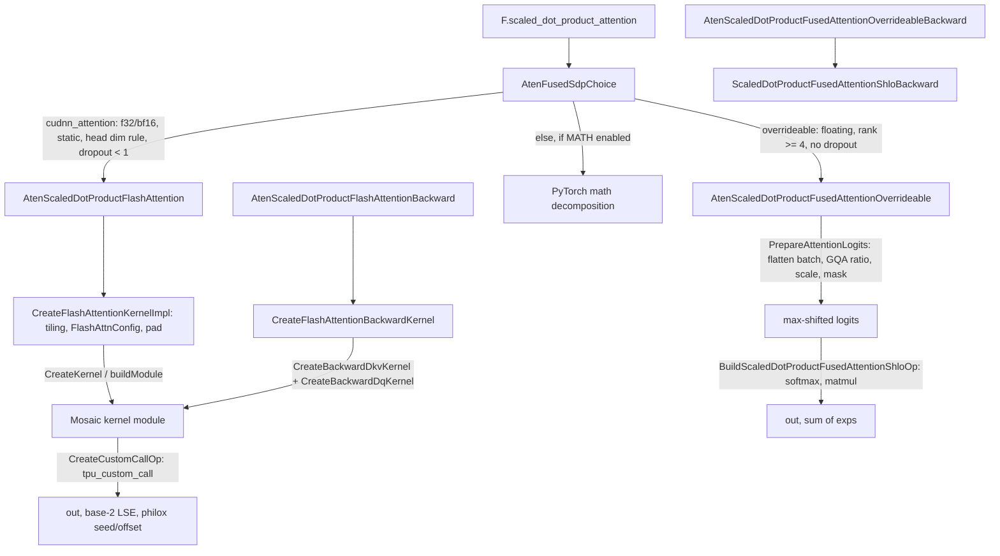

# Scaled dot-product attention, flash and splash kernels

## Overview
`F.scaled_dot_product_attention` reaches TorchTPU through PyTorch's backend-selection stub,
which TorchTPU overrides with [`AtenFusedSdpChoice`](https://github.com/google-pytorch/torch_tpu/blob/6d2a45754bdb52743883f75fbf753408345f6d1b/csrc/ops/scaled_dot_product_attention/scaled_dot_product_attention_aten_kernels.cc#L123 "csrc/ops/scaled_dot_product_attention/scaled_dot_product_attention_aten_kernels.cc#AtenFusedSdpChoice").
That function decides among three paths and *warns* rather than errors when a preferred path does
not apply, so onboarding code keeps running. The flash path
([`AtenScaledDotProductFlashAttention`](https://github.com/google-pytorch/torch_tpu/blob/6d2a45754bdb52743883f75fbf753408345f6d1b/csrc/ops/scaled_dot_product_attention/scaled_dot_product_attention_aten_kernels.cc#L319 "csrc/ops/scaled_dot_product_attention/scaled_dot_product_attention_aten_kernels.cc#AtenScaledDotProductFlashAttention") and its backward, registered for PyTorch's cuDNN attention
schema) builds a Mosaic TPU flash-attention kernel in C++ at trace time, sized to the concrete
shapes and the chip's VMEM, and runs it as a custom call; it needs float32 or bfloat16 inputs with
static shapes, equal ranks, rank at least four, a head dimension below 128 or a multiple of it,
dropout in `[0, 1)` and a mask that does not require grad. Masks, dropout, GQA and unaligned
sequence lengths are handled inside the kernel path. The overrideable path
([`AtenScaledDotProductFusedAttentionOverrideable`](https://github.com/google-pytorch/torch_tpu/blob/6d2a45754bdb52743883f75fbf753408345f6d1b/csrc/ops/scaled_dot_product_attention/scaled_dot_product_attention_aten_kernels.cc#L249 "csrc/ops/scaled_dot_product_attention/scaled_dot_product_attention_aten_kernels.cc#AtenScaledDotProductFusedAttentionOverrideable")) builds attention directly in StableHLO via
[`ScaledDotProductFusedAttentionShlo`](https://github.com/google-pytorch/torch_tpu/blob/6d2a45754bdb52743883f75fbf753408345f6d1b/csrc/ops/scaled_dot_product_attention/scaled_dot_product_attention_shlo.cc#L885 "csrc/ops/scaled_dot_product_attention/scaled_dot_product_attention_shlo.cc#ScaledDotProductFusedAttentionShlo"), supports masks, GQA and bounded dynamic shapes, and for
half-precision inputs promotes only the softmax to float32. Everything else falls back to
PyTorch's decomposed math. Splash attention (the sparse, block-masked variant) is no longer part of
this subsystem's dispatch; it is reached only by calling the experimental
[`splash_sdpa`](https://github.com/google-pytorch/torch_tpu/blob/6d2a45754bdb52743883f75fbf753408345f6d1b/src/torch_tpu/_internal/ops/splash_attention.py#L442 "src/torch_tpu/_internal/ops/splash_attention#splash_sdpa") (exposed as `torch.tpu.ops.splash_sdpa`) instead of
`F.scaled_dot_product_attention`.

## Diagram

Legend:
- `U` - (concept) the PyTorch entry, fallback and intermediate values
- `MATH` - (concept) the PyTorch entry, fallback and intermediate values
- `LOG` - (concept) the PyTorch entry, fallback and intermediate values
- `OUT` - (concept) the PyTorch entry, fallback and intermediate values
- `CH` - [`AtenFusedSdpChoice`](https://github.com/google-pytorch/torch_tpu/blob/6d2a45754bdb52743883f75fbf753408345f6d1b/csrc/ops/scaled_dot_product_attention/scaled_dot_product_attention_aten_kernels.cc#L123 "csrc/ops/scaled_dot_product_attention/scaled_dot_product_attention_aten_kernels.cc#AtenFusedSdpChoice")
- `FL` - [`AtenScaledDotProductFlashAttention`](https://github.com/google-pytorch/torch_tpu/blob/6d2a45754bdb52743883f75fbf753408345f6d1b/csrc/ops/scaled_dot_product_attention/scaled_dot_product_attention_aten_kernels.cc#L319 "csrc/ops/scaled_dot_product_attention/scaled_dot_product_attention_aten_kernels.cc#AtenScaledDotProductFlashAttention")
- `FLB` - [`AtenScaledDotProductFlashAttentionBackward`](https://github.com/google-pytorch/torch_tpu/blob/6d2a45754bdb52743883f75fbf753408345f6d1b/csrc/ops/scaled_dot_product_attention/scaled_dot_product_attention_aten_kernels.cc#L353 "csrc/ops/scaled_dot_product_attention/scaled_dot_product_attention_aten_kernels.cc#AtenScaledDotProductFlashAttentionBackward")
- `IMPL` - [`CreateFlashAttentionKernelImpl`](https://github.com/google-pytorch/torch_tpu/blob/6d2a45754bdb52743883f75fbf753408345f6d1b/csrc/ops/scaled_dot_product_attention/flash_attention_kernel_builder.cc#L472 "csrc/ops/scaled_dot_product_attention/flash_attention_kernel_builder.cc#CreateFlashAttentionKernelImpl") with [`CreateFlashAttnConfig`](https://github.com/google-pytorch/torch_tpu/blob/6d2a45754bdb52743883f75fbf753408345f6d1b/csrc/ops/scaled_dot_product_attention/flash_attention_kernel_builder.cc#L372 "csrc/ops/scaled_dot_product_attention/flash_attention_kernel_builder.cc#CreateFlashAttnConfig") and [`PadSequenceDim`](https://github.com/google-pytorch/torch_tpu/blob/6d2a45754bdb52743883f75fbf753408345f6d1b/csrc/ops/scaled_dot_product_attention/flash_attention_kernel_builder.cc#L281 "csrc/ops/scaled_dot_product_attention/flash_attention_kernel_builder.cc#PadSequenceDim")
- `MOS` - [`CreateKernel`](https://github.com/google-pytorch/torch_tpu/blob/6d2a45754bdb52743883f75fbf753408345f6d1b/csrc/ops/scaled_dot_product_attention/flash_attention_kernel.cc#L557 "csrc/ops/scaled_dot_product_attention/flash_attention_kernel.cc#CreateKernel") / [`buildModule`](https://github.com/google-pytorch/torch_tpu/blob/6d2a45754bdb52743883f75fbf753408345f6d1b/csrc/ops/scaled_dot_product_attention/flash_attention_kernel.cc#L401 "csrc/ops/scaled_dot_product_attention/flash_attention_kernel.cc#buildModule") (forward), [`CreateBackwardDkvKernel`](https://github.com/google-pytorch/torch_tpu/blob/6d2a45754bdb52743883f75fbf753408345f6d1b/csrc/ops/scaled_dot_product_attention/flash_attention_backward_kernel.cc#L568 "csrc/ops/scaled_dot_product_attention/flash_attention_backward_kernel.cc#CreateBackwardDkvKernel") / [`CreateBackwardDqKernel`](https://github.com/google-pytorch/torch_tpu/blob/6d2a45754bdb52743883f75fbf753408345f6d1b/csrc/ops/scaled_dot_product_attention/flash_attention_backward_kernel.cc#L710 "csrc/ops/scaled_dot_product_attention/flash_attention_backward_kernel.cc#CreateBackwardDqKernel") (backward)
- `BWD` - [`CreateFlashAttentionBackwardKernel`](https://github.com/google-pytorch/torch_tpu/blob/6d2a45754bdb52743883f75fbf753408345f6d1b/csrc/ops/scaled_dot_product_attention/flash_attention_kernel_builder.cc#L702 "csrc/ops/scaled_dot_product_attention/flash_attention_kernel_builder.cc#CreateFlashAttentionBackwardKernel")
- `OV` - [`AtenScaledDotProductFusedAttentionOverrideable`](https://github.com/google-pytorch/torch_tpu/blob/6d2a45754bdb52743883f75fbf753408345f6d1b/csrc/ops/scaled_dot_product_attention/scaled_dot_product_attention_aten_kernels.cc#L249 "csrc/ops/scaled_dot_product_attention/scaled_dot_product_attention_aten_kernels.cc#AtenScaledDotProductFusedAttentionOverrideable")
- `OVB` - [`AtenScaledDotProductFusedAttentionOverrideableBackward`](https://github.com/google-pytorch/torch_tpu/blob/6d2a45754bdb52743883f75fbf753408345f6d1b/csrc/ops/scaled_dot_product_attention/scaled_dot_product_attention_aten_kernels.cc#L276 "csrc/ops/scaled_dot_product_attention/scaled_dot_product_attention_aten_kernels.cc#AtenScaledDotProductFusedAttentionOverrideableBackward")
- `SM` - [`BuildScaledDotProductFusedAttentionShloOp`](https://github.com/google-pytorch/torch_tpu/blob/6d2a45754bdb52743883f75fbf753408345f6d1b/csrc/ops/scaled_dot_product_attention/scaled_dot_product_attention_shlo.cc#L473 "csrc/ops/scaled_dot_product_attention/scaled_dot_product_attention_shlo.cc#BuildScaledDotProductFusedAttentionShloOp") inside [`ScaledDotProductFusedAttentionShlo`](https://github.com/google-pytorch/torch_tpu/blob/6d2a45754bdb52743883f75fbf753408345f6d1b/csrc/ops/scaled_dot_product_attention/scaled_dot_product_attention_shlo.cc#L885 "csrc/ops/scaled_dot_product_attention/scaled_dot_product_attention_shlo.cc#ScaledDotProductFusedAttentionShlo")
- `SMB` - [`ScaledDotProductFusedAttentionShloBackward`](https://github.com/google-pytorch/torch_tpu/blob/6d2a45754bdb52743883f75fbf753408345f6d1b/csrc/ops/scaled_dot_product_attention/scaled_dot_product_attention_shlo.cc#L934 "csrc/ops/scaled_dot_product_attention/scaled_dot_product_attention_shlo.cc#ScaledDotProductFusedAttentionShloBackward") building [`BuildScaledDotProductAttentionBackward`](https://github.com/google-pytorch/torch_tpu/blob/6d2a45754bdb52743883f75fbf753408345f6d1b/csrc/ops/scaled_dot_product_attention/scaled_dot_product_attention_shlo.cc#L742 "csrc/ops/scaled_dot_product_attention/scaled_dot_product_attention_shlo.cc#BuildScaledDotProductAttentionBackward")

## Design rationale (why it's built this way)
- **Inline the backend selection because PyTorch does not expose it.** The long comment above
  [`AtenFusedSdpChoice`](https://github.com/google-pytorch/torch_tpu/blob/6d2a45754bdb52743883f75fbf753408345f6d1b/csrc/ops/scaled_dot_product_attention/scaled_dot_product_attention_aten_kernels.cc#L123 "csrc/ops/scaled_dot_product_attention/scaled_dot_product_attention_aten_kernels.cc#AtenFusedSdpChoice")
  explains that PyTorch's `select_sdp_backend` is not overrideable and hard-codes CPU and CUDA
  backends, so TorchTPU re-implements the logic against the global context flags
  (`userEnabledFlashSDP`, `userEnabledMathSDP`, `userEnabledOverrideableSDP`) and returns
  `cudnn_attention`, `overrideable` or `math`. It "only warn[s] on an unsupported backend instead of
  erroring", failing only when every backend including math is disabled. The StableHLO path is
  treated "as an optimized version of MATH", so it is tried whenever math *or* overrideable is
  enabled.
- **Flash goes through the cuDNN schema.** The flash kernels implement the interface of
  `_scaled_dot_product_cudnn_attention` (and its backward), whose meta function "just inherits the
  strides from the inputs", unlike the CPU flash schema, and which matches what a CUDA user
  expects. The nine-tuple PyTorch's signature demands (output, logsumexp, cumulative sequence
  lengths, max lengths, philox seed and offset, debug mask) is padded out with placeholders.
- **Kernels are generated, not embedded.** At this pin the flash kernel is a Mosaic TPU module
  emitted by C++ ([`buildModule`](https://github.com/google-pytorch/torch_tpu/blob/6d2a45754bdb52743883f75fbf753408345f6d1b/csrc/ops/scaled_dot_product_attention/flash_attention_kernel.cc#L401 "csrc/ops/scaled_dot_product_attention/flash_attention_kernel.cc#buildModule") for the forward, [`buildBackwardDkvModule`](https://github.com/google-pytorch/torch_tpu/blob/6d2a45754bdb52743883f75fbf753408345f6d1b/csrc/ops/scaled_dot_product_attention/flash_attention_backward_kernel.cc#L218 "csrc/ops/scaled_dot_product_attention/flash_attention_backward_kernel.cc#buildBackwardDkvModule") and
  [`buildBackwardDqModule`](https://github.com/google-pytorch/torch_tpu/blob/6d2a45754bdb52743883f75fbf753408345f6d1b/csrc/ops/scaled_dot_product_attention/flash_attention_backward_kernel.cc#L600 "csrc/ops/scaled_dot_product_attention/flash_attention_backward_kernel.cc#buildBackwardDqModule") for the backward) from a [`FlashAttnConfig`](https://github.com/google-pytorch/torch_tpu/blob/6d2a45754bdb52743883f75fbf753408345f6d1b/csrc/ops/scaled_dot_product_attention/flash_attention_config.h#L31 "csrc/ops/scaled_dot_product_attention/flash_attention_config.h#FlashAttnConfig") and a [`Tiling`](https://github.com/google-pytorch/torch_tpu/blob/6d2a45754bdb52743883f75fbf753408345f6d1b/csrc/ops/scaled_dot_product_attention/flash_attention_config.h#L53 "csrc/ops/scaled_dot_product_attention/flash_attention_config.h#Tiling"), then
  serialized into a `tpu_custom_call` by [`CreateCustomCallOp`](https://github.com/google-pytorch/torch_tpu/blob/6d2a45754bdb52743883f75fbf753408345f6d1b/csrc/ops/scaled_dot_product_attention/flash_attention_kernel_builder.cc#L207 "csrc/ops/scaled_dot_product_attention/flash_attention_kernel_builder.cc#CreateCustomCallOp") with a scoped-VMEM reservation.
  Because the module is built inside the deferred op's builder, every shape, causality, dropout
  rate and precision gets its own specialized kernel, cached with the surrounding program. (The
  previous design exported JAX Pallas kernels to StableHLO at build time and embedded them per
  dtype and causality.)
- **Tiling is a VMEM budget problem.** The query and KV block sizes ([`qt`](https://github.com/google-pytorch/torch_tpu/blob/6d2a45754bdb52743883f75fbf753408345f6d1b/csrc/ops/scaled_dot_product_attention/flash_attention_config.h#L55 "csrc/ops/scaled_dot_product_attention/flash_attention_config.h#Tiling.qt"), [`kt`](https://github.com/google-pytorch/torch_tpu/blob/6d2a45754bdb52743883f75fbf753408345f6d1b/csrc/ops/scaled_dot_product_attention/flash_attention_config.h#L56 "csrc/ops/scaled_dot_product_attention/flash_attention_config.h#Tiling.kt")) start from
  the sequence lengths (128, 256, or the length rounded up to 256) and are halved until an
  estimate of the double-buffered inputs plus the `[qt, kt]` float32 logits, mask and dropout
  intermediates fits in half of the device's VMEM (looked up per TPU generation, 16 MiB fallback),
  "to avoid spilling". A separate KV compute sub-block (`kc`, at most 1024) "decouples the (large)
  DMA block, which amortizes the per grid step overhead, from the (smaller) compute block, which
  bounds the size of the [qt, kc] softmax intermediates". Sequences are padded up to a tile
  multiple ([`padded_q_sequence_length`](https://github.com/google-pytorch/torch_tpu/blob/6d2a45754bdb52743883f75fbf753408345f6d1b/csrc/ops/scaled_dot_product_attention/flash_attention_config.h#L40 "csrc/ops/scaled_dot_product_attention/flash_attention_config.h#FlashAttnConfig.padded_q_sequence_length"), [`padded_kv_sequence_length`](https://github.com/google-pytorch/torch_tpu/blob/6d2a45754bdb52743883f75fbf753408345f6d1b/csrc/ops/scaled_dot_product_attention/flash_attention_config.h#L41 "csrc/ops/scaled_dot_product_attention/flash_attention_config.h#FlashAttnConfig.padded_kv_sequence_length")) with [`PadSequenceDim`](https://github.com/google-pytorch/torch_tpu/blob/6d2a45754bdb52743883f75fbf753408345f6d1b/csrc/ops/scaled_dot_product_attention/flash_attention_kernel_builder.cc#L281 "csrc/ops/scaled_dot_product_attention/flash_attention_kernel_builder.cc#PadSequenceDim")
  and the kernel masks the padding, so no sequence-length alignment is required from the user.
- **The flash softmax runs in base 2.** The config header explains that both kernels evaluate the
  softmax as `exp2(x * log2(e))` to "use the cheaper exp2 / log2 EUP ops"; as a consequence the
  LSE the forward returns and the backward consumes "is log2-sum-exp2, i.e. the natural LSE
  multiplied by log2(e)". The StableHLO path, by contrast, returns the sum of max-shifted
  exponentials in the same output slot. Each backend's backward consumes only its own forward's
  statistic.
- **Promotion is half-precision softmax only.** On the StableHLO path, bf16/f16 inputs promote
  only the softmax (and the dP gradient scaling) to float32, "matching CUDA FlashAttention
  contract", while "keeping all matrix multiplications in native half precision on TPU MXUs";
  with `allowFP16BF16ReductionMathSDP` nothing is promoted. For large, tile-aligned problems the
  softmax is emitted either as a canonical `exp / sum` that XLA's online-softmax rewriter can match
  (sequences at most 8192, head dim at least 128) or as a multiply by a precomputed reciprocal.
  Matmul precision follows the float32 matmul precision setting and is part of the cache key; on
  the flash path `highest` maps to f32 contractions and `high` to bf16x3 on recent libtpu.
- **GQA and batching are normalized once.** [`PrepareAttentionLogits`](https://github.com/google-pytorch/torch_tpu/blob/6d2a45754bdb52743883f75fbf753408345f6d1b/csrc/ops/scaled_dot_product_attention/scaled_dot_product_attention_shlo.cc#L203 "csrc/ops/scaled_dot_product_attention/scaled_dot_product_attention_shlo.cc#PrepareAttentionLogits")
  flattens leading batch dims ([`flatten_batch_dims`](https://github.com/google-pytorch/torch_tpu/blob/6d2a45754bdb52743883f75fbf753408345f6d1b/csrc/ops/scaled_dot_product_attention/helpers.cc#L59 "csrc/ops/scaled_dot_product_attention/helpers.cc#flatten_batch_dims"), [`get_batch_size`](https://github.com/google-pytorch/torch_tpu/blob/6d2a45754bdb52743883f75fbf753408345f6d1b/csrc/ops/scaled_dot_product_attention/helpers.cc#L83 "csrc/ops/scaled_dot_product_attention/helpers.cc#get_batch_size")) into a 4-d problem,
  derives the query-to-KV head ratio for grouped-query attention, applies the default or explicit
  scale to `q` before the dot product, and builds the causal or explicit mask; results are
  restored with [`unflatten_batch_dims`](https://github.com/google-pytorch/torch_tpu/blob/6d2a45754bdb52743883f75fbf753408345f6d1b/csrc/ops/scaled_dot_product_attention/helpers.cc#L77 "csrc/ops/scaled_dot_product_attention/helpers.cc#unflatten_batch_dims"). Under bounded dynamic shapes, GQA replicates K/V across
  query heads instead of the grouped reshape, because "stablehlo.reshape supports at most one
  bounded dimension". The flash kernel handles GQA natively by mapping KV windows per head group.
- **Outputs keep PyTorch's expected layout.** Outputs are returned through `ContiguousToView` with
  the strides PyTorch's meta functions allocate (the forward mirrors `alloc_with_matching_layout`;
  gradients use [`EmptyLikeStrides`](https://github.com/google-pytorch/torch_tpu/blob/6d2a45754bdb52743883f75fbf753408345f6d1b/csrc/ops/scaled_dot_product_attention/helpers.cc#L104 "csrc/ops/scaled_dot_product_attention/helpers.cc#EmptyLikeStrides"), mirroring `torch.empty_like`), "so that views traced by
  torch.compile (e.g. merging heads) are also valid in eager mode".

> [!inferred]
> For a customer, the checklist the warning prints is the checklist to satisfy for the fast path:
> bfloat16 or float32, static shapes (no `mark_dynamic` on the attention inputs),
> four-dimensional `(batch, heads, seq, head_dim)` inputs, head dim below 128 or a multiple of 128,
> and an `attn_mask` that is not a trainable parameter. Padding masks and dropout no longer force
> the StableHLO path. Dynamic-shape models land on the StableHLO path, which is still fused by XLA
> but is not the Mosaic kernel; the `torch.backends` SDP toggles work the same way as on CUDA.

## Entry points
- [`AtenFusedSdpChoice`](https://github.com/google-pytorch/torch_tpu/blob/6d2a45754bdb52743883f75fbf753408345f6d1b/csrc/ops/scaled_dot_product_attention/scaled_dot_product_attention_aten_kernels.cc#L123 "csrc/ops/scaled_dot_product_attention/scaled_dot_product_attention_aten_kernels.cc#AtenFusedSdpChoice"):
  registered as the PrivateUse1 `_fused_sdp_choice`; keys only the tensors (mask, dropout, causal,
  scale and GQA flags are marked ignored in the cache key because they do not change the StableHLO
  of the choice itself).
- [`AtenScaledDotProductFlashAttention`](https://github.com/google-pytorch/torch_tpu/blob/6d2a45754bdb52743883f75fbf753408345f6d1b/csrc/ops/scaled_dot_product_attention/scaled_dot_product_attention_aten_kernels.cc#L319 "csrc/ops/scaled_dot_product_attention/scaled_dot_product_attention_aten_kernels.cc#AtenScaledDotProductFlashAttention")
  / [`AtenScaledDotProductFlashAttentionBackward`](https://github.com/google-pytorch/torch_tpu/blob/6d2a45754bdb52743883f75fbf753408345f6d1b/csrc/ops/scaled_dot_product_attention/scaled_dot_product_attention_aten_kernels.cc#L353 "csrc/ops/scaled_dot_product_attention/scaled_dot_product_attention_aten_kernels.cc#AtenScaledDotProductFlashAttentionBackward"):
  the custom-kernel path, implemented by [`CreateFlashAttentionKernelImpl`](https://github.com/google-pytorch/torch_tpu/blob/6d2a45754bdb52743883f75fbf753408345f6d1b/csrc/ops/scaled_dot_product_attention/flash_attention_kernel_builder.cc#L472 "csrc/ops/scaled_dot_product_attention/flash_attention_kernel_builder.cc#CreateFlashAttentionKernelImpl") and
  [`CreateFlashAttentionBackwardKernel`](https://github.com/google-pytorch/torch_tpu/blob/6d2a45754bdb52743883f75fbf753408345f6d1b/csrc/ops/scaled_dot_product_attention/flash_attention_kernel_builder.cc#L702 "csrc/ops/scaled_dot_product_attention/flash_attention_kernel_builder.cc#CreateFlashAttentionBackwardKernel").
- [`AtenScaledDotProductFusedAttentionOverrideable`](https://github.com/google-pytorch/torch_tpu/blob/6d2a45754bdb52743883f75fbf753408345f6d1b/csrc/ops/scaled_dot_product_attention/scaled_dot_product_attention_aten_kernels.cc#L249 "csrc/ops/scaled_dot_product_attention/scaled_dot_product_attention_aten_kernels.cc#AtenScaledDotProductFusedAttentionOverrideable")
  and [`AtenScaledDotProductFusedAttentionOverrideableBackward`](https://github.com/google-pytorch/torch_tpu/blob/6d2a45754bdb52743883f75fbf753408345f6d1b/csrc/ops/scaled_dot_product_attention/scaled_dot_product_attention_aten_kernels.cc#L276 "csrc/ops/scaled_dot_product_attention/scaled_dot_product_attention_aten_kernels.cc#AtenScaledDotProductFusedAttentionOverrideableBackward"): the StableHLO path, which records
  `allow_fp16_bf16_reduction` in the cache key before calling
  [`ScaledDotProductFusedAttentionShlo`](https://github.com/google-pytorch/torch_tpu/blob/6d2a45754bdb52743883f75fbf753408345f6d1b/csrc/ops/scaled_dot_product_attention/scaled_dot_product_attention_shlo.cc#L885 "csrc/ops/scaled_dot_product_attention/scaled_dot_product_attention_shlo.cc#ScaledDotProductFusedAttentionShlo") / [`ScaledDotProductFusedAttentionShloBackward`](https://github.com/google-pytorch/torch_tpu/blob/6d2a45754bdb52743883f75fbf753408345f6d1b/csrc/ops/scaled_dot_product_attention/scaled_dot_product_attention_shlo.cc#L934 "csrc/ops/scaled_dot_product_attention/scaled_dot_product_attention_shlo.cc#ScaledDotProductFusedAttentionShloBackward").

- [`splash_sdpa`](https://github.com/google-pytorch/torch_tpu/blob/6d2a45754bdb52743883f75fbf753408345f6d1b/src/torch_tpu/_internal/ops/splash_attention.py#L442 "src/torch_tpu/_internal/ops/splash_attention#splash_sdpa"): the opt-in splash-attention path, documented as a "Replacement for
  F.scaled_dot_product_attention using splash attention" and marked experimental. Nothing in
  the SDPA choice above routes to it; callers invoke it directly. It takes `(batch, heads, seq,
  head_dim)` tensors, squeezes the single KV head for MQA and `repeat_interleave`s KV heads for
  GQA (so GQA costs a K/V expansion here, unlike the flash kernel), and casts the result back to
  the input dtype. Note `is_causal` defaults to `True`, and the mask is built as
  `(seq_len, seq_len)` from the query length, optionally as a sliding window
  (`local_window_size`).
  [`_make_splash_attention_fn`](https://github.com/google-pytorch/torch_tpu/blob/6d2a45754bdb52743883f75fbf753408345f6d1b/src/torch_tpu/_internal/ops/splash_attention.py#L48 "src/torch_tpu/_internal/ops/splash_attention#_make_splash_attention_fn") builds JAX's splash MHA or MQA kernel with the block sizes clamped to the sequence
  length and returns two jitted functions: a forward that scales `q` and returns
  `(out, logsumexp)`, and a backward that calls the splash backward kernel directly from those
  saved residuals, batched by `vmap` or, to bound program size, `lax.scan`. Both are wrapped by
  the Pallas custom-JAX-kernel bridge ([pallas-custom-kernels](pallas-custom-kernels.md)) and
  registered once per configuration as `torch.library` custom ops in the `pallas` namespace;
  [`_SplashAttentionFn`](https://github.com/google-pytorch/torch_tpu/blob/6d2a45754bdb52743883f75fbf753408345f6d1b/src/torch_tpu/_internal/ops/splash_attention.py#L310 "src/torch_tpu/_internal/ops/splash_attention#_SplashAttentionFn") is the `autograd.Function` that saves `q, k, v, out, logsumexp` in the forward and
  calls the backward op, so no forward is re-run at backward time.

## Mechanism (step-by-step)
1. **Choose.** [`AtenFusedSdpChoice`](https://github.com/google-pytorch/torch_tpu/blob/6d2a45754bdb52743883f75fbf753408345f6d1b/csrc/ops/scaled_dot_product_attention/scaled_dot_product_attention_aten_kernels.cc#L123 "csrc/ops/scaled_dot_product_attention/scaled_dot_product_attention_aten_kernels.cc#AtenFusedSdpChoice")
   checks the flash conditions (dtype, static shapes, supported head dim and batch, equal ranks,
   valid dropout, mask not requiring grad) when flash is enabled, then the StableHLO conditions
   (floating, equal ranks, rank at least 4, no dropout, mask not requiring grad) when math or
   overrideable is enabled, emitting a one-time performance warning listing the failed condition
   values, and finally returns `math` or throws if math is disabled.
2. **Flash forward.** [`CreateFlashAttentionKernelImpl`](https://github.com/google-pytorch/torch_tpu/blob/6d2a45754bdb52743883f75fbf753408345f6d1b/csrc/ops/scaled_dot_product_attention/flash_attention_kernel_builder.cc#L472 "csrc/ops/scaled_dot_product_attention/flash_attention_kernel_builder.cc#CreateFlashAttentionKernelImpl") validates the dtype ([`ValidateDtype`](https://github.com/google-pytorch/torch_tpu/blob/6d2a45754bdb52743883f75fbf753408345f6d1b/csrc/ops/scaled_dot_product_attention/flash_attention_kernel_builder.cc#L273 "csrc/ops/scaled_dot_product_attention/flash_attention_kernel_builder.cc#ValidateDtype")),
   keys causality, scale, dropout, mask and whether to return the LSE (only when gradients are
   needed), and dispatches a dynamic-arity deferred op. Its builder chooses the [`Tiling`](https://github.com/google-pytorch/torch_tpu/blob/6d2a45754bdb52743883f75fbf753408345f6d1b/csrc/ops/scaled_dot_product_attention/flash_attention_config.h#L53 "csrc/ops/scaled_dot_product_attention/flash_attention_config.h#Tiling"), fills a
   [`FlashAttnConfig`](https://github.com/google-pytorch/torch_tpu/blob/6d2a45754bdb52743883f75fbf753408345f6d1b/csrc/ops/scaled_dot_product_attention/flash_attention_config.h#L31 "csrc/ops/scaled_dot_product_attention/flash_attention_config.h#FlashAttnConfig") via [`CreateFlashAttnConfig`](https://github.com/google-pytorch/torch_tpu/blob/6d2a45754bdb52743883f75fbf753408345f6d1b/csrc/ops/scaled_dot_product_attention/flash_attention_kernel_builder.cc#L372 "csrc/ops/scaled_dot_product_attention/flash_attention_kernel_builder.cc#CreateFlashAttnConfig") (flattened [`batch_size`](https://github.com/google-pytorch/torch_tpu/blob/6d2a45754bdb52743883f75fbf753408345f6d1b/csrc/ops/scaled_dot_product_attention/flash_attention_config.h#L33 "csrc/ops/scaled_dot_product_attention/flash_attention_config.h#FlashAttnConfig.batch_size"), [`num_heads`](https://github.com/google-pytorch/torch_tpu/blob/6d2a45754bdb52743883f75fbf753408345f6d1b/csrc/ops/scaled_dot_product_attention/flash_attention_config.h#L34 "csrc/ops/scaled_dot_product_attention/flash_attention_config.h#FlashAttnConfig.num_heads") and
   KV heads, [`vo_head_dim`](https://github.com/google-pytorch/torch_tpu/blob/6d2a45754bdb52743883f75fbf753408345f6d1b/csrc/ops/scaled_dot_product_attention/flash_attention_config.h#L37 "csrc/ops/scaled_dot_product_attention/flash_attention_config.h#FlashAttnConfig.vo_head_dim"), padded lengths, scale, [`dropout_rate`](https://github.com/google-pytorch/torch_tpu/blob/6d2a45754bdb52743883f75fbf753408345f6d1b/csrc/ops/scaled_dot_product_attention/flash_attention_config.h#L49 "csrc/ops/scaled_dot_product_attention/flash_attention_config.h#FlashAttnConfig.dropout_rate"), mask broadcast dims,
   contraction precision), flattens and pads q, k, v and the mask, builds the kernel with
   [`CreateKernel`](https://github.com/google-pytorch/torch_tpu/blob/6d2a45754bdb52743883f75fbf753408345f6d1b/csrc/ops/scaled_dot_product_attention/flash_attention_kernel.cc#L557 "csrc/ops/scaled_dot_product_attention/flash_attention_kernel.cc#CreateKernel") and wraps it with [`CreateCustomCallOp`](https://github.com/google-pytorch/torch_tpu/blob/6d2a45754bdb52743883f75fbf753408345f6d1b/csrc/ops/scaled_dot_product_attention/flash_attention_kernel_builder.cc#L207 "csrc/ops/scaled_dot_product_attention/flash_attention_kernel_builder.cc#CreateCustomCallOp"). The padded output is sliced back,
   the LSE is transposed to PyTorch's `[B, N, S, 1]` layout, and with dropout the op runs under the
   RNG dispatcher so the philox seed and offset are returned for the backward.
3. **Inside the kernel.** The kernel grid is (batch, head, q block, kv block) with the first three
   axes parallel and the kv axis "arbitrary", since it carries the online-softmax reduction. [`buildModule`](https://github.com/google-pytorch/torch_tpu/blob/6d2a45754bdb52743883f75fbf753408345f6d1b/csrc/ops/scaled_dot_product_attention/flash_attention_kernel.cc#L401 "csrc/ops/scaled_dot_product_attention/flash_attention_kernel.cc#buildModule") binds Q, the mask, the output and
   the LSE to affine window maps, and K/V to a `kv_transform_indices` function (head divided by the GQA group
   size) referenced through [`CreateSymbolTransformIndicesAttr`](https://github.com/google-pytorch/torch_tpu/blob/6d2a45754bdb52743883f75fbf753408345f6d1b/csrc/ops/scaled_dot_product_attention/util.cc#L417 "csrc/ops/scaled_dot_product_attention/util.cc#CreateSymbolTransformIndicesAttr")
   by `CreateKVWindowMaps`; tiles move through
   [`LoadTile`](https://github.com/google-pytorch/torch_tpu/blob/6d2a45754bdb52743883f75fbf753408345f6d1b/csrc/ops/scaled_dot_product_attention/util.cc#L153 "csrc/ops/scaled_dot_product_attention/util.cc#LoadTile") / [`LoadTileSlice`](https://github.com/google-pytorch/torch_tpu/blob/6d2a45754bdb52743883f75fbf753408345f6d1b/csrc/ops/scaled_dot_product_attention/util.cc#L133 "csrc/ops/scaled_dot_product_attention/util.cc#LoadTileSlice") and [`StoreTile`](https://github.com/google-pytorch/torch_tpu/blob/6d2a45754bdb52743883f75fbf753408345f6d1b/csrc/ops/scaled_dot_product_attention/util.cc#L182 "csrc/ops/scaled_dot_product_attention/util.cc#StoreTile"), scratch is cleared with [`ZeroTile`](https://github.com/google-pytorch/torch_tpu/blob/6d2a45754bdb52743883f75fbf753408345f6d1b/csrc/ops/scaled_dot_product_attention/util.cc#L186 "csrc/ops/scaled_dot_product_attention/util.cc#ZeroTile"), logits
   are scaled with [`ScaleValue`](https://github.com/google-pytorch/torch_tpu/blob/6d2a45754bdb52743883f75fbf753408345f6d1b/csrc/ops/scaled_dot_product_attention/util.cc#L367 "csrc/ops/scaled_dot_product_attention/util.cc#ScaleValue") and cast with [`ConvertElementType`](https://github.com/google-pytorch/torch_tpu/blob/6d2a45754bdb52743883f75fbf753408345f6d1b/csrc/ops/scaled_dot_product_attention/util.cc#L372 "csrc/ops/scaled_dot_product_attention/util.cc#ConvertElementType"). The online-softmax state is
   folded per KV sub-block; causal tiles strictly above the diagonal are skipped and only diagonal
   sub-blocks are masked. With a mask, the running max is clamped to a finite value so a fully
   masked row yields exp2(-inf) = 0 "without any vector compare or select". With dropout, the seed
   arrives as a scalar-prefetch operand ([`AppendScalarPrefetchTypes`](https://github.com/google-pytorch/torch_tpu/blob/6d2a45754bdb52743883f75fbf753408345f6d1b/csrc/ops/scaled_dot_product_attention/util.cc#L429 "csrc/ops/scaled_dot_product_attention/util.cc#AppendScalarPrefetchTypes")) and only the probabilities
   fed to `P @ V` are dropped, so the LSE stays undropped for the backward.
4. **Flash backward.** [`CreateFlashAttentionBackwardKernel`](https://github.com/google-pytorch/torch_tpu/blob/6d2a45754bdb52743883f75fbf753408345f6d1b/csrc/ops/scaled_dot_product_attention/flash_attention_kernel_builder.cc#L702 "csrc/ops/scaled_dot_product_attention/flash_attention_kernel_builder.cc#CreateFlashAttentionBackwardKernel") computes `di = sum(out * grad_out)`
   in StableHLO, pads everything to the tile grid, and runs two Mosaic kernels: dK/dV from
   [`CreateBackwardDkvKernel`](https://github.com/google-pytorch/torch_tpu/blob/6d2a45754bdb52743883f75fbf753408345f6d1b/csrc/ops/scaled_dot_product_attention/flash_attention_backward_kernel.cc#L568 "csrc/ops/scaled_dot_product_attention/flash_attention_backward_kernel.cc#CreateBackwardDkvKernel") and dQ from [`CreateBackwardDqKernel`](https://github.com/google-pytorch/torch_tpu/blob/6d2a45754bdb52743883f75fbf753408345f6d1b/csrc/ops/scaled_dot_product_attention/flash_attention_backward_kernel.cc#L710 "csrc/ops/scaled_dot_product_attention/flash_attention_backward_kernel.cc#CreateBackwardDqKernel"), both recomputing the
   probabilities from the saved base-2 LSE and the same philox state.
5. **StableHLO forward.** [`ScaledDotProductFusedAttentionShlo`](https://github.com/google-pytorch/torch_tpu/blob/6d2a45754bdb52743883f75fbf753408345f6d1b/csrc/ops/scaled_dot_product_attention/scaled_dot_product_attention_shlo.cc#L885 "csrc/ops/scaled_dot_product_attention/scaled_dot_product_attention_shlo.cc#ScaledDotProductFusedAttentionShlo") dispatches
   [`BuildScaledDotProductFusedAttentionShloOp`](https://github.com/google-pytorch/torch_tpu/blob/6d2a45754bdb52743883f75fbf753408345f6d1b/csrc/ops/scaled_dot_product_attention/scaled_dot_product_attention_shlo.cc#L473 "csrc/ops/scaled_dot_product_attention/scaled_dot_product_attention_shlo.cc#BuildScaledDotProductFusedAttentionShloOp"), which calls [`PrepareAttentionLogits`](https://github.com/google-pytorch/torch_tpu/blob/6d2a45754bdb52743883f75fbf753408345f6d1b/csrc/ops/scaled_dot_product_attention/scaled_dot_product_attention_shlo.cc#L203 "csrc/ops/scaled_dot_product_attention/scaled_dot_product_attention_shlo.cc#PrepareAttentionLogits")
   (validate static head count and head dim, flatten, GQA head ratio, scaled `q k^T`, mask or
   causal compare, max-shift with a finite clamp for fully masked rows), computes the softmax in
   the promoted type, zeroes fully masked rows, multiplies by `v` (5-d grouped dot for GQA), and
   returns the output and the float32 sum of exponentials.
6. **StableHLO backward.** [`ScaledDotProductFusedAttentionShloBackward`](https://github.com/google-pytorch/torch_tpu/blob/6d2a45754bdb52743883f75fbf753408345f6d1b/csrc/ops/scaled_dot_product_attention/scaled_dot_product_attention_shlo.cc#L934 "csrc/ops/scaled_dot_product_attention/scaled_dot_product_attention_shlo.cc#ScaledDotProductFusedAttentionShloBackward") dispatches
   [`BuildScaledDotProductAttentionBackward`](https://github.com/google-pytorch/torch_tpu/blob/6d2a45754bdb52743883f75fbf753408345f6d1b/csrc/ops/scaled_dot_product_attention/scaled_dot_product_attention_shlo.cc#L742 "csrc/ops/scaled_dot_product_attention/scaled_dot_product_attention_shlo.cc#BuildScaledDotProductAttentionBackward"), which recomputes the probabilities from the saved
   sum and produces dQ, dK, dV with the same flatten and GQA reduction conventions; gradients are
   returned with [`EmptyLikeStrides`](https://github.com/google-pytorch/torch_tpu/blob/6d2a45754bdb52743883f75fbf753408345f6d1b/csrc/ops/scaled_dot_product_attention/helpers.cc#L104 "csrc/ops/scaled_dot_product_attention/helpers.cc#EmptyLikeStrides").

## Key data structures
- [`FlashAttnConfig`](https://github.com/google-pytorch/torch_tpu/blob/6d2a45754bdb52743883f75fbf753408345f6d1b/csrc/ops/scaled_dot_product_attention/flash_attention_config.h#L31 "csrc/ops/scaled_dot_product_attention/flash_attention_config.h#FlashAttnConfig"): everything that specializes a kernel (element type, batch, heads, KV heads,
  QK and VO head dims, real and padded sequence lengths, causality, scale, mask broadcast dims,
  whether to return the LSE, dropout rate, optional contraction precision).
- [`Tiling`](https://github.com/google-pytorch/torch_tpu/blob/6d2a45754bdb52743883f75fbf753408345f6d1b/csrc/ops/scaled_dot_product_attention/flash_attention_config.h#L53 "csrc/ops/scaled_dot_product_attention/flash_attention_config.h#Tiling"): DMA block sizes [`qt`](https://github.com/google-pytorch/torch_tpu/blob/6d2a45754bdb52743883f75fbf753408345f6d1b/csrc/ops/scaled_dot_product_attention/flash_attention_config.h#L55 "csrc/ops/scaled_dot_product_attention/flash_attention_config.h#Tiling.qt") and [`kt`](https://github.com/google-pytorch/torch_tpu/blob/6d2a45754bdb52743883f75fbf753408345f6d1b/csrc/ops/scaled_dot_product_attention/flash_attention_config.h#L56 "csrc/ops/scaled_dot_product_attention/flash_attention_config.h#Tiling.kt") plus the KV compute sub-block `kc`, chosen per
  call by the VMEM heuristic above.
- The flash custom call's backend config: the serialized Mosaic module (printed by
  [`GetOpString`](https://github.com/google-pytorch/torch_tpu/blob/6d2a45754bdb52743883f75fbf753408345f6d1b/csrc/ops/scaled_dot_product_attention/util.cc#L105 "csrc/ops/scaled_dot_product_attention/util.cc#GetOpString")), `needs_layout_passes`, and a scoped memory reservation equal to the VMEM
  budget.
- The `allow_fp16_bf16_reduction` cache-key parameter and the matmul precision recorded in the
  key on both paths.

## Dynamics (design intent)
- The flash kernel executes as a custom call inside the surrounding XLA program, so it still
  participates in the deferred graph; its backward saves the LSE rather than the probability
  matrix, the standard flash memory trade.
- The forward returns the LSE only when q, k or v requires grad, so inference compiles a kernel
  variant without the extra output; training and inference are keyed separately.
- When either forward or the StableHLO backward returns multiple tensors through
  `ContiguousToView`, the extra outputs are wrapped first so a materialization triggered by the
  relayout cannot drop them.

## Edge cases
- `dropout_p >= 1` or dynamic shapes disable flash; dropout other than 0 disables the StableHLO
  path, so dropout with dynamic shapes falls to math.
- An `attn_mask` that requires grad under autograd routes to math, because neither fused backend
  computes a gradient for the bias.
- Fully masked rows return zeros on both fused paths.
- An explicit mask together with `is_causal` is rejected by the flash config as mutually
  exclusive; query heads must be a multiple of KV heads on both paths.
- Disabling all three PyTorch SDP backends raises a failed-precondition error naming the fix.

## Open questions
- Splash attention does not use the VMEM-budget tiling above: its block sizes are
  caller-supplied (default 512, clamped to the sequence length), and when a user should prefer it
  over the flash path is not stated in the source.
- The flash path's handling of masks with more than four dims beyond batch flattening, and of
  `is_causal` with unequal query and KV lengths, is defined by the kernel's structured masking
  helpers and is not summarized here.

## See also
- [scan-and-custom-kernels](scan-and-custom-kernels.md): custom calls inside deferred programs.
- [pallas-custom-kernels](pallas-custom-kernels.md): the user-facing Pallas kernel API (where splash lives).
- [dtype-and-precision](dtype-and-precision.md): autocast policy for SDPA and matmul precision.
- [view-decomposition](view-decomposition.md): `ContiguousToView` and the strided output layout.
- [eager-op-dispatch](eager-op-dispatch.md): the kernel frame these ops run in.
- [eager-dynamic-shapes](eager-dynamic-shapes.md): bounded dynamism on the StableHLO path.

## Recent changes
- `0d5aa74c7` routes flash attention "through the cuDNN attention operator schema" because the CPU
  flash schema "has unexpected striding"; `6a8a79bb0` then makes outputs and gradients match
  "exactly the strides that PyTorch's meta functions allocate", fixing compiled-mode views such as
  merging heads.
- `392c02eba` enables "running sdpa with non zero dropout rate using the mosaic kernel";
  `e6c1177f0` fixes fully masked rows, which previously did "not correctly return 0".
- `6006a6c7d` adds bounded dynamic shapes to the StableHLO path ("Static shapes keep the existing
  lowering") and skips the flash kernel for them; `b00771d90` routes masks that require grad to
  math; `2fc5ace94` fixes the GQA reshape when the value head dim differs.
- `47217581d` makes both paths respect float32 matmul precision, recording it in the cache key.
- `2d706f904` / `680ac5a06` move the backend warnings to categorized, prefixed built-in warnings.
- [all changes in 6d2a45754b](../changes/6d2a45754b.md)
