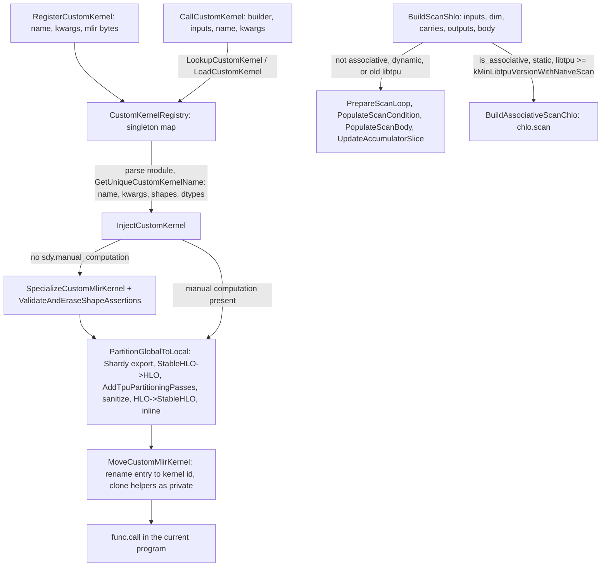

# Custom MLIR kernels and the scan builder

## Overview
Two facilities in `csrc/ops` let a lowering reach beyond hand-written StableHLO. The
custom-kernel path takes *any* serialized MLIR module with a `@main` function, possibly with
dynamic shapes (`tensor<?xf32>`), and turns it into a static function inside the program being
built: [`RegisterCustomKernel`](https://github.com/google-pytorch/torch_tpu/blob/6d2a45754bdb52743883f75fbf753408345f6d1b/csrc/ops/custom_kernels.cc#L598 "csrc/ops/custom_kernels.cc#RegisterCustomKernel")
stores the bytes under a name and a kwargs string, and [`CallCustomKernel`](https://github.com/google-pytorch/torch_tpu/blob/6d2a45754bdb52743883f75fbf753408345f6d1b/csrc/ops/custom_kernels.cc#L608 "csrc/ops/custom_kernels.cc#CallCustomKernel")
deserializes, refines the shapes to the concrete inputs ([`SpecializeCustomMlirKernel`](https://github.com/google-pytorch/torch_tpu/blob/6d2a45754bdb52743883f75fbf753408345f6d1b/csrc/ops/custom_kernels.cc#L207 "csrc/ops/custom_kernels.cc#SpecializeCustomMlirKernel")),
partitions a global-view sharded kernel into the per-chip view the rest of TorchTPU runs in
([`PartitionGlobalToLocal`](https://github.com/google-pytorch/torch_tpu/blob/6d2a45754bdb52743883f75fbf753408345f6d1b/csrc/ops/custom_kernels.cc#L297 "csrc/ops/custom_kernels.cc#PartitionGlobalToLocal")),
and moves the functions into the current module ([`MoveCustomMlirKernel`](https://github.com/google-pytorch/torch_tpu/blob/6d2a45754bdb52743883f75fbf753408345f6d1b/csrc/ops/custom_kernels.cc#L122 "csrc/ops/custom_kernels.cc#MoveCustomMlirKernel"))
so the call is an ordinary `func.call` that XLA compiles with everything around it. This is what
the Pallas API ([pallas-custom-kernels](pallas-custom-kernels.md)) uses; at this pin the attention
kernels ([scaled-dot-product-attention](scaled-dot-product-attention.md)) are generated directly
and do not go through it. The scan builder is
the other facility: [`BuildScanShlo`](https://github.com/google-pytorch/torch_tpu/blob/6d2a45754bdb52743883f75fbf753408345f6d1b/csrc/ops/scan_builder.cc#L549 "csrc/ops/scan_builder.cc#BuildScanShlo")
lowers a prefix scan along one dimension with arbitrary carries and outputs, as a StableHLO while
loop by default or, when the body is declared associative, the shapes are static and the
installed libtpu is new enough, as a `chlo.scan` that the TPU compiler's native scan emitter
handles directly.

## Diagram

Legend:
- `REG` - [`RegisterCustomKernel`](https://github.com/google-pytorch/torch_tpu/blob/6d2a45754bdb52743883f75fbf753408345f6d1b/csrc/ops/custom_kernels.cc#L598 "csrc/ops/custom_kernels.cc#RegisterCustomKernel")
- `R` - [`CustomKernelRegistry`](https://github.com/google-pytorch/torch_tpu/blob/6d2a45754bdb52743883f75fbf753408345f6d1b/csrc/ops/custom_kernels.cc#L484 "csrc/ops/custom_kernels.cc#CustomKernelRegistry") with [`LookupCustomKernel`](https://github.com/google-pytorch/torch_tpu/blob/6d2a45754bdb52743883f75fbf753408345f6d1b/csrc/ops/custom_kernels.cc#L530 "csrc/ops/custom_kernels.cc#CustomKernelRegistry.LookupCustomKernel") and [`LoadCustomKernel`](https://github.com/google-pytorch/torch_tpu/blob/6d2a45754bdb52743883f75fbf753408345f6d1b/csrc/ops/custom_kernels.cc#L540 "csrc/ops/custom_kernels.cc#CustomKernelRegistry.LoadCustomKernel")
- `CALL` - [`CallCustomKernel`](https://github.com/google-pytorch/torch_tpu/blob/6d2a45754bdb52743883f75fbf753408345f6d1b/csrc/ops/custom_kernels.cc#L608 "csrc/ops/custom_kernels.cc#CallCustomKernel"); naming via [`GetUniqueCustomKernelName`](https://github.com/google-pytorch/torch_tpu/blob/6d2a45754bdb52743883f75fbf753408345f6d1b/csrc/ops/custom_kernels.cc#L94 "csrc/ops/custom_kernels.cc#GetUniqueCustomKernelName")
- `INJ` - [`InjectCustomKernel`](https://github.com/google-pytorch/torch_tpu/blob/6d2a45754bdb52743883f75fbf753408345f6d1b/csrc/ops/custom_kernels.cc#L412 "csrc/ops/custom_kernels.cc#InjectCustomKernel")
- `SPEC` - [`SpecializeCustomMlirKernel`](https://github.com/google-pytorch/torch_tpu/blob/6d2a45754bdb52743883f75fbf753408345f6d1b/csrc/ops/custom_kernels.cc#L207 "csrc/ops/custom_kernels.cc#SpecializeCustomMlirKernel"), [`ValidateAndEraseShapeAssertions`](https://github.com/google-pytorch/torch_tpu/blob/6d2a45754bdb52743883f75fbf753408345f6d1b/csrc/ops/custom_kernels.cc#L102 "csrc/ops/custom_kernels.cc#ValidateAndEraseShapeAssertions")
- `PART` - [`PartitionGlobalToLocal`](https://github.com/google-pytorch/torch_tpu/blob/6d2a45754bdb52743883f75fbf753408345f6d1b/csrc/ops/custom_kernels.cc#L297 "csrc/ops/custom_kernels.cc#PartitionGlobalToLocal") using [`AddTpuPartitioningPasses`](https://github.com/google-pytorch/torch_tpu/blob/6d2a45754bdb52743883f75fbf753408345f6d1b/csrc/ops/custom_kernels.cc#L231 "csrc/ops/custom_kernels.cc#AddTpuPartitioningPasses")
- `MOVE` - [`MoveCustomMlirKernel`](https://github.com/google-pytorch/torch_tpu/blob/6d2a45754bdb52743883f75fbf753408345f6d1b/csrc/ops/custom_kernels.cc#L122 "csrc/ops/custom_kernels.cc#MoveCustomMlirKernel")
- `FC` - (concept) the resulting call
- `SCAN` - [`BuildScanShlo`](https://github.com/google-pytorch/torch_tpu/blob/6d2a45754bdb52743883f75fbf753408345f6d1b/csrc/ops/scan_builder.cc#L549 "csrc/ops/scan_builder.cc#BuildScanShlo") with [`ScanOptions`](https://github.com/google-pytorch/torch_tpu/blob/6d2a45754bdb52743883f75fbf753408345f6d1b/csrc/ops/scan_builder.h#L44 "csrc/ops/scan_builder.h#ScanOptions")
- `WL` - [`PrepareScanLoop`](https://github.com/google-pytorch/torch_tpu/blob/6d2a45754bdb52743883f75fbf753408345f6d1b/csrc/ops/scan_builder.cc#L94 "csrc/ops/scan_builder.cc#PrepareScanLoop"), [`PopulateScanCondition`](https://github.com/google-pytorch/torch_tpu/blob/6d2a45754bdb52743883f75fbf753408345f6d1b/csrc/ops/scan_builder.cc#L182 "csrc/ops/scan_builder.cc#PopulateScanCondition"), [`PopulateScanBody`](https://github.com/google-pytorch/torch_tpu/blob/6d2a45754bdb52743883f75fbf753408345f6d1b/csrc/ops/scan_builder.cc#L201 "csrc/ops/scan_builder.cc#PopulateScanBody"), [`UpdateAccumulatorSlice`](https://github.com/google-pytorch/torch_tpu/blob/6d2a45754bdb52743883f75fbf753408345f6d1b/csrc/ops/scan_builder.cc#L165 "csrc/ops/scan_builder.cc#UpdateAccumulatorSlice")
- `AS` - [`BuildAssociativeScanChlo`](https://github.com/google-pytorch/torch_tpu/blob/6d2a45754bdb52743883f75fbf753408345f6d1b/csrc/ops/scan_builder.cc#L364 "csrc/ops/scan_builder.cc#BuildAssociativeScanChlo"), gated by [`kMinLibtpuVersionWithNativeScan`](https://github.com/google-pytorch/torch_tpu/blob/6d2a45754bdb52743883f75fbf753408345f6d1b/csrc/ops/scan_builder.cc#L51 "csrc/ops/scan_builder.cc#kMinLibtpuVersionWithNativeScan")

## Design rationale (why it's built this way)
- **Kernels are data, identity is name plus kwargs plus shapes.** The header for
  [`RegisterCustomKernel`](https://github.com/google-pytorch/torch_tpu/blob/6d2a45754bdb52743883f75fbf753408345f6d1b/csrc/ops/custom_kernels.cc#L598 "csrc/ops/custom_kernels.cc#RegisterCustomKernel")
  describes the two sources: "a pre-exported kernel library" or "a user-generated kernel authoring
  framework (e.g. Pallas) in the same process". The kwargs string exists "to differentiate between
  otherwise-identical custom kernels; for example, if the same kernel is imported with different
  tiling behavior". The registry key ([`CustomKernelId`](https://github.com/google-pytorch/torch_tpu/blob/6d2a45754bdb52743883f75fbf753408345f6d1b/csrc/ops/custom_kernels.cc#L449 "csrc/ops/custom_kernels.cc#CustomKernelId"), "the identifier for a custom kernel,
  without the specialized shapes") omits shapes, so one dynamic-shape export serves many call
  sites; [`GetUniqueCustomKernelName`](https://github.com/google-pytorch/torch_tpu/blob/6d2a45754bdb52743883f75fbf753408345f6d1b/csrc/ops/custom_kernels.cc#L94 "csrc/ops/custom_kernels.cc#GetUniqueCustomKernelName")
  then fingerprints kwargs and input shapes and dtypes into the function name (`foo_0x1234...`),
  which lets [`CallCustomKernel`](https://github.com/google-pytorch/torch_tpu/blob/6d2a45754bdb52743883f75fbf753408345f6d1b/csrc/ops/custom_kernels.cc#L608 "csrc/ops/custom_kernels.cc#CallCustomKernel") reuse
  an already injected specialization within the same builder by exact name.
- **Refine, do not retrace.** [`BuildSpecializedMlirKernel`](https://github.com/google-pytorch/torch_tpu/blob/6d2a45754bdb52743883f75fbf753408345f6d1b/csrc/ops/custom_kernels.cc#L641 "csrc/ops/custom_kernels.cc#BuildSpecializedMlirKernel")
  and the registry path rely on StableHLO shape refinement: the dynamic module is first inlined,
  then its argument types are replaced by static ones and the shape computations fold away (the
  header points to the StableHLO dynamism docs). [`ValidateAndEraseShapeAssertions`](https://github.com/google-pytorch/torch_tpu/blob/6d2a45754bdb52743883f75fbf753408345f6d1b/csrc/ops/custom_kernels.cc#L102 "csrc/ops/custom_kernels.cc#ValidateAndEraseShapeAssertions")
  then checks the exporter's `shape_assertion` custom calls against the concrete shapes and removes
  them, turning "would this kernel accept these shapes" into a compile-time answer.
- **Global view in, local view out.** Pallas kernels are traced against the *global* array with
  sharding annotations, while every TorchTPU program is per-chip SPMD with explicit collectives
  ([compilation-pipeline](compilation-pipeline.md)). [`PartitionGlobalToLocal`](https://github.com/google-pytorch/torch_tpu/blob/6d2a45754bdb52743883f75fbf753408345f6d1b/csrc/ops/custom_kernels.cc#L297 "csrc/ops/custom_kernels.cc#PartitionGlobalToLocal")
  therefore round-trips the kernel through HLO: Shardy export, StableHLO to HLO, a pipeline
  ([`AddTpuPartitioningPasses`](https://github.com/google-pytorch/torch_tpu/blob/6d2a45754bdb52743883f75fbf753408345f6d1b/csrc/ops/custom_kernels.cc#L231 "csrc/ops/custom_kernels.cc#AddTpuPartitioningPasses"):
  DCE, ShardyXLA propagation with explicit collectives, the SPMD partitioner, call-graph
  flattening and inlining), HLO back to StableHLO, and an MLIR inliner so the result is one
  function again. The partition count comes from the largest `sdy.mesh` in the kernel when it
  declares one, otherwise from the topology's chip count. A source TODO notes the intent to move
  this into StableHLO prologue passes.
- **The HLO round trip must leave no partitioning residue.** Before converting back, the
  partitioned HLO is sanitized in place: instruction shardings and `xla.sdy.*` frontend
  attributes are cleared (otherwise the converter emits leftover `mhlo.sharding`/`sdy.sharding`
  attributes into a program that is already per-chip), `copy` instructions the SPMD partitioner
  introduced are replaced by their operands, collective device lists are normalized to the
  list-of-lists form. After the conversion back and the inliner, the module-level SPMD parameter
  and output shardings are stripped from the resulting MLIR module.
- **Manual computations are passed through.** A kernel that already contains
  `sdy.manual_computation` (a distributed kernel with explicit per-device bodies) skips
  specialization because, per the source TODO, symbolic-shape export is unsupported for
  distributed kernels; it still goes through partitioning.
- **Moving functions keeps symbolic references valid.** [`MoveCustomMlirKernel`](https://github.com/google-pytorch/torch_tpu/blob/6d2a45754bdb52743883f75fbf753408345f6d1b/csrc/ops/custom_kernels.cc#L122 "csrc/ops/custom_kernels.cc#MoveCustomMlirKernel")
  picks the entry function (the only function, or the one named `main`), renames through symbol
  tables so `called_computations` references stay in sync (StableHLO serialization encodes
  region-carrying ops such as `mhlo.scan` as custom calls whose bodies are separate functions),
  renames helpers to unique names, keeps the entry name exact when a kernel id was given, and
  marks everything private because the kernel entry is no longer a module entry.
- **Two scan lowerings, chosen by a promise and by capability.** [`is_associative`](https://github.com/google-pytorch/torch_tpu/blob/6d2a45754bdb52743883f75fbf753408345f6d1b/csrc/ops/scan_builder.h#L55 "csrc/ops/scan_builder.h#ScanOptions.is_associative")
  warns that it must be set "only for genuinely associative reductions (e.g.
  cumsum/cumprod/cummax/cummin); a non-associative body under is_associative=true would be
  miscompiled by the associative emitter". Even with the promise, [`BuildScanShlo`](https://github.com/google-pytorch/torch_tpu/blob/6d2a45754bdb52743883f75fbf753408345f6d1b/csrc/ops/scan_builder.cc#L549 "csrc/ops/scan_builder.cc#BuildScanShlo")
  only takes the native path when every scanned input has a static shape and the installed
  libtpu is at least [`kMinLibtpuVersionWithNativeScan`](https://github.com/google-pytorch/torch_tpu/blob/6d2a45754bdb52743883f75fbf753408345f6d1b/csrc/ops/scan_builder.cc#L51 "csrc/ops/scan_builder.cc#kMinLibtpuVersionWithNativeScan")
  (0.0.44); the source comment says older compilers cannot compile the native scan emitter and the
  TPU compiler "does not yet support dynamic scans". Everything else falls back to the general
  while-loop lowering (reverse direction, squeezing of the scanned slice, separate carries and
  per-step outputs).
- **The loop counter is s32 on purpose.** [`PrepareScanLoop`](https://github.com/google-pytorch/torch_tpu/blob/6d2a45754bdb52743883f75fbf753408345f6d1b/csrc/ops/scan_builder.cc#L94 "csrc/ops/scan_builder.cc#PrepareScanLoop")
  types the induction variable as `i32`, "as in jax.lax.scan: TPU splits s64 into two u32, which
  hides the trip count from XLA's loop passes". Slice indices follow suit.

> [!inferred]
> For a customer with a Pallas kernel, the pipeline above explains three things: shape changes
> do not require re-exporting (refinement happens per call), the kernel must be written against
> global shapes with a sharding spec if it is to run under multi-chip SPMD, and a failing
> `shape_assertion` at call time means the exported kernel's own constraints (tile divisibility,
> for example) rejected the concrete shapes. For cumulative ops, upgrading libtpu or keeping the
> scanned tensor statically shaped is what moves them from a sequential while loop onto the native
> scan emitter.

## Entry points
- [`RegisterCustomKernel`](https://github.com/google-pytorch/torch_tpu/blob/6d2a45754bdb52743883f75fbf753408345f6d1b/csrc/ops/custom_kernels.cc#L598 "csrc/ops/custom_kernels.cc#RegisterCustomKernel"),
  [`LookupCustomKernel`](https://github.com/google-pytorch/torch_tpu/blob/6d2a45754bdb52743883f75fbf753408345f6d1b/csrc/ops/custom_kernels.cc#L604 "csrc/ops/custom_kernels.cc#LookupCustomKernel") and
  [`CallCustomKernel`](https://github.com/google-pytorch/torch_tpu/blob/6d2a45754bdb52743883f75fbf753408345f6d1b/csrc/ops/custom_kernels.cc#L608 "csrc/ops/custom_kernels.cc#CallCustomKernel"): the C++
  surface behind the Python `register_custom_kernel` path; a call to an unregistered kernel returns
  a not-found status whose message tells the user to call
  `torch_tpu._internal.pallas.tpu_torch_pallas.register_custom_kernel()` first.
- [`BuildSpecializedMlirKernel`](https://github.com/google-pytorch/torch_tpu/blob/6d2a45754bdb52743883f75fbf753408345f6d1b/csrc/ops/custom_kernels.cc#L641 "csrc/ops/custom_kernels.cc#BuildSpecializedMlirKernel"):
  the in-process variant for a module the caller already holds; at this pin nothing in the
  repository outside its own definition calls it. It injects without a kernel id, so the entry function keeps a
  representative name and is not reused across calls by name.
- [`BuildScanShlo`](https://github.com/google-pytorch/torch_tpu/blob/6d2a45754bdb52743883f75fbf753408345f6d1b/csrc/ops/scan_builder.cc#L549 "csrc/ops/scan_builder.cc#BuildScanShlo") (single input) and the
  generalized [`BuildScanShlo`](https://github.com/google-pytorch/torch_tpu/blob/6d2a45754bdb52743883f75fbf753408345f6d1b/csrc/ops/scan_builder.cc#L549 "csrc/ops/scan_builder.cc#BuildScanShlo") (multiple scanned inputs plus pass-through inputs, reverse
  direction, squeezing), taking a [`ScanBodyBuilder`](https://github.com/google-pytorch/torch_tpu/blob/6d2a45754bdb52743883f75fbf753408345f6d1b/csrc/ops/scan_builder.h#L58 "csrc/ops/scan_builder.h#ScanBodyBuilder")
  or [`MultiInputScanBodyBuilder`](https://github.com/google-pytorch/torch_tpu/blob/6d2a45754bdb52743883f75fbf753408345f6d1b/csrc/ops/scan_builder.h#L79 "csrc/ops/scan_builder.h#MultiInputScanBodyBuilder")
  respectively. The cumulative ATen ops (cumsum, cumprod, cummax, cummin, logcumsumexp) call it
  with `should_squeeze` and `is_associative` set; the `torch.compile` higher-order `scan` and
  `associative_scan` lowering in `csrc/internal/compile` uses the generalized overload and decides
  `is_associative` from the body ([torch-compile-backend](torch-compile-backend.md)).
- [`CreateRankReducedConstantLike`](https://github.com/google-pytorch/torch_tpu/blob/6d2a45754bdb52743883f75fbf753408345f6d1b/csrc/ops/scan_builder.cc#L616 "csrc/ops/scan_builder.cc#CreateRankReducedConstantLike"):
  a helper for body builders and init values, it "creates a constant tensor filled with 'value'
  matching the shape and bounds of 'input' with dimension 'scan_dim' rank-reduced", slicing a
  bounded dynamic input at index 0 so the constant inherits its dynamic dimensions and bounds.

## Mechanism (step-by-step)
1. **Register.** [`RegisterCustomKernel`](https://github.com/google-pytorch/torch_tpu/blob/6d2a45754bdb52743883f75fbf753408345f6d1b/csrc/ops/custom_kernels.cc#L517 "csrc/ops/custom_kernels.cc#CustomKernelRegistry.RegisterCustomKernel")
   inserts the serialized module under `(name, kwargs)` in the mutex-guarded registry and reports
   whether it was new; the Python side calls [`LookupCustomKernel`](https://github.com/google-pytorch/torch_tpu/blob/6d2a45754bdb52743883f75fbf753408345f6d1b/csrc/ops/custom_kernels.cc#L604 "csrc/ops/custom_kernels.cc#LookupCustomKernel")
   first to skip re-tracing.
2. **Reuse or load.** [`CallCustomKernel`](https://github.com/google-pytorch/torch_tpu/blob/6d2a45754bdb52743883f75fbf753408345f6d1b/csrc/ops/custom_kernels.cc#L608 "csrc/ops/custom_kernels.cc#CallCustomKernel")
   computes the unique name from the input types and, if a function with that name already exists
   in the builder's module, emits a call to it directly. Otherwise
   [`LoadCustomKernel`](https://github.com/google-pytorch/torch_tpu/blob/6d2a45754bdb52743883f75fbf753408345f6d1b/csrc/ops/custom_kernels.cc#L540 "csrc/ops/custom_kernels.cc#CustomKernelRegistry.LoadCustomKernel")
   copies the bytes out under the lock, parses them into the builder's context, builds tensor types
   from the concrete input dims and dtypes, computes the kernel id with
   [`GetUniqueCustomKernelName`](https://github.com/google-pytorch/torch_tpu/blob/6d2a45754bdb52743883f75fbf753408345f6d1b/csrc/ops/custom_kernels.cc#L94 "csrc/ops/custom_kernels.cc#GetUniqueCustomKernelName"),
   and calls [`InjectCustomKernel`](https://github.com/google-pytorch/torch_tpu/blob/6d2a45754bdb52743883f75fbf753408345f6d1b/csrc/ops/custom_kernels.cc#L412 "csrc/ops/custom_kernels.cc#InjectCustomKernel").
3. **Specialize.** Unless the module contains a manual computation,
   [`SpecializeCustomMlirKernel`](https://github.com/google-pytorch/torch_tpu/blob/6d2a45754bdb52743883f75fbf753408345f6d1b/csrc/ops/custom_kernels.cc#L207 "csrc/ops/custom_kernels.cc#SpecializeCustomMlirKernel")
   runs the inliner and the StableHLO remove-dynamism pipeline for the input types, and
   [`ValidateAndEraseShapeAssertions`](https://github.com/google-pytorch/torch_tpu/blob/6d2a45754bdb52743883f75fbf753408345f6d1b/csrc/ops/custom_kernels.cc#L102 "csrc/ops/custom_kernels.cc#ValidateAndEraseShapeAssertions")
   enforces and drops the exporter's assertions.
4. **Partition.** [`PartitionGlobalToLocal`](https://github.com/google-pytorch/torch_tpu/blob/6d2a45754bdb52743883f75fbf753408345f6d1b/csrc/ops/custom_kernels.cc#L297 "csrc/ops/custom_kernels.cc#PartitionGlobalToLocal")
   takes the partition count from the kernel's mesh or the PjRt topology's chip count, runs the
   Shardy and SPMD pipeline via [`AddTpuPartitioningPasses`](https://github.com/google-pytorch/torch_tpu/blob/6d2a45754bdb52743883f75fbf753408345f6d1b/csrc/ops/custom_kernels.cc#L231 "csrc/ops/custom_kernels.cc#AddTpuPartitioningPasses"),
   sanitizes shardings, Shardy attributes and copies, converts back to StableHLO and inlines into a
   single function.
5. **Inject and call.** [`MoveCustomMlirKernel`](https://github.com/google-pytorch/torch_tpu/blob/6d2a45754bdb52743883f75fbf753408345f6d1b/csrc/ops/custom_kernels.cc#L122 "csrc/ops/custom_kernels.cc#MoveCustomMlirKernel")
   clones the functions into the program with the entry renamed to the kernel id;
   [`CallCustomKernel`](https://github.com/google-pytorch/torch_tpu/blob/6d2a45754bdb52743883f75fbf753408345f6d1b/csrc/ops/custom_kernels.cc#L608 "csrc/ops/custom_kernels.cc#CallCustomKernel") emits a
   `func.call` to it and returns the results as dynamic MLIR op results for the surrounding
   deferred op.
6. **Choose a scan lowering.** [`BuildScanShlo`](https://github.com/google-pytorch/torch_tpu/blob/6d2a45754bdb52743883f75fbf753408345f6d1b/csrc/ops/scan_builder.cc#L549 "csrc/ops/scan_builder.cc#BuildScanShlo")
   checks that scanned inputs agree on the scan-dimension size ([`VerifyScanDimSizes`](https://github.com/google-pytorch/torch_tpu/blob/6d2a45754bdb52743883f75fbf753408345f6d1b/csrc/ops/scan_builder.cc#L264 "csrc/ops/scan_builder.cc#VerifyScanDimSizes")),
   returns the inits unchanged for a zero-length scan dimension, and routes to the associative
   path only when [`is_associative`](https://github.com/google-pytorch/torch_tpu/blob/6d2a45754bdb52743883f75fbf753408345f6d1b/csrc/ops/scan_builder.h#L55 "csrc/ops/scan_builder.h#ScanOptions.is_associative") is set, all scanned inputs are static and libtpu meets
   [`kMinLibtpuVersionWithNativeScan`](https://github.com/google-pytorch/torch_tpu/blob/6d2a45754bdb52743883f75fbf753408345f6d1b/csrc/ops/scan_builder.cc#L51 "csrc/ops/scan_builder.cc#kMinLibtpuVersionWithNativeScan").
   The single-input [`BuildScanShlo`](https://github.com/google-pytorch/torch_tpu/blob/6d2a45754bdb52743883f75fbf753408345f6d1b/csrc/ops/scan_builder.cc#L549 "csrc/ops/scan_builder.cc#BuildScanShlo") wraps its body so that each step's output is the
   running carry, which is why it requires as many output inits as carry inits.
7. **Scan as a loop.** For the while-loop path, [`PrepareScanLoop`](https://github.com/google-pytorch/torch_tpu/blob/6d2a45754bdb52743883f75fbf753408345f6d1b/csrc/ops/scan_builder.cc#L94 "csrc/ops/scan_builder.cc#PrepareScanLoop")
   builds the loop state (an s32 index, then carries, then accumulators) and
   [`PopulateScanCondition`](https://github.com/google-pytorch/torch_tpu/blob/6d2a45754bdb52743883f75fbf753408345f6d1b/csrc/ops/scan_builder.cc#L182 "csrc/ops/scan_builder.cc#PopulateScanCondition")
   writes the `index < size` bound check, reading the size dynamically when the scan dimension is
   dynamic. [`PopulateScanBody`](https://github.com/google-pytorch/torch_tpu/blob/6d2a45754bdb52743883f75fbf753408345f6d1b/csrc/ops/scan_builder.cc#L201 "csrc/ops/scan_builder.cc#PopulateScanBody")
   maps the index to a sequence position (flipped for reverse scans), slices each scanned input at
   that position ([`SliceInput`](https://github.com/google-pytorch/torch_tpu/blob/6d2a45754bdb52743883f75fbf753408345f6d1b/csrc/ops/scan_builder.cc#L141 "csrc/ops/scan_builder.cc#SliceInput"),
   which re-applies dynamic sizes on the other dimensions and optionally squeezes the scan
   dimension), invokes the body builder, checks the carry and output counts, and writes step
   outputs into the accumulators with [`UpdateAccumulatorSlice`](https://github.com/google-pytorch/torch_tpu/blob/6d2a45754bdb52743883f75fbf753408345f6d1b/csrc/ops/scan_builder.cc#L165 "csrc/ops/scan_builder.cc#UpdateAccumulatorSlice").
   The results skip the loop counter and come back as `[carries..., outputs...]`.
8. **Scan natively.** [`BuildAssociativeScanChlo`](https://github.com/google-pytorch/torch_tpu/blob/6d2a45754bdb52743883f75fbf753408345f6d1b/csrc/ops/scan_builder.cc#L364 "csrc/ops/scan_builder.cc#BuildAssociativeScanChlo")
   emits a `chlo.scan` with `is_associative=true` and an `is_reverse` attribute, whose body
   receives rank-reduced slices. [`BuildScanBodyInputs`](https://github.com/google-pytorch/torch_tpu/blob/6d2a45754bdb52743883f75fbf753408345f6d1b/csrc/ops/scan_builder.cc#L309 "csrc/ops/scan_builder.cc#BuildScanBodyInputs")
   unsqueezes them back to size-1 slices when the caller did not ask for squeezing and appends the
   pass-through inputs; [`SqueezeScanOutputs`](https://github.com/google-pytorch/torch_tpu/blob/6d2a45754bdb52743883f75fbf753408345f6d1b/csrc/ops/scan_builder.cc#L336 "csrc/ops/scan_builder.cc#SqueezeScanOutputs")
   reverses that on the body's outputs so the op can stack them. The body's index argument is null
   because an associative scan has no loop counter; the results are reordered to the same
   `[carries..., outputs...]` contract as the loop.

## Key data structures
- [`CustomKernelRegistry`](https://github.com/google-pytorch/torch_tpu/blob/6d2a45754bdb52743883f75fbf753408345f6d1b/csrc/ops/custom_kernels.cc#L484 "csrc/ops/custom_kernels.cc#CustomKernelRegistry"):
  singleton (obtained by [`GetInstance`](https://github.com/google-pytorch/torch_tpu/blob/6d2a45754bdb52743883f75fbf753408345f6d1b/csrc/ops/custom_kernels.cc#L494 "csrc/ops/custom_kernels.cc#CustomKernelRegistry.GetInstance")) whose
  [`registry_`](https://github.com/google-pytorch/torch_tpu/blob/6d2a45754bdb52743883f75fbf753408345f6d1b/csrc/ops/custom_kernels.cc#L592 "csrc/ops/custom_kernels.cc#CustomKernelRegistry.registry_") is a `flat_hash_map` from [`CustomKernelId`](https://github.com/google-pytorch/torch_tpu/blob/6d2a45754bdb52743883f75fbf753408345f6d1b/csrc/ops/custom_kernels.cc#L449 "csrc/ops/custom_kernels.cc#CustomKernelId") (name, kwargs;
  transparent hashing so lookups take string views) to the serialized module.
- [`ScanOptions`](https://github.com/google-pytorch/torch_tpu/blob/6d2a45754bdb52743883f75fbf753408345f6d1b/csrc/ops/scan_builder.h#L44 "csrc/ops/scan_builder.h#ScanOptions"):
  [`direction`](https://github.com/google-pytorch/torch_tpu/blob/6d2a45754bdb52743883f75fbf753408345f6d1b/csrc/ops/scan_builder.h#L45 "csrc/ops/scan_builder.h#ScanOptions.direction")
  ([`ScanDirection`](https://github.com/google-pytorch/torch_tpu/blob/6d2a45754bdb52743883f75fbf753408345f6d1b/csrc/ops/scan_builder.h#L37 "csrc/ops/scan_builder.h#ScanDirection") [`kForward`](https://github.com/google-pytorch/torch_tpu/blob/6d2a45754bdb52743883f75fbf753408345f6d1b/csrc/ops/scan_builder.h#L37 "csrc/ops/scan_builder.h#ScanDirection.kForward") or reverse,
  itself an encodable cache-key parameter), `should_squeeze`, [`is_associative`](https://github.com/google-pytorch/torch_tpu/blob/6d2a45754bdb52743883f75fbf753408345f6d1b/csrc/ops/scan_builder.h#L55 "csrc/ops/scan_builder.h#ScanOptions.is_associative").
- [`ScanBodyResults`](https://github.com/google-pytorch/torch_tpu/blob/6d2a45754bdb52743883f75fbf753408345f6d1b/csrc/ops/scan_builder.h#L72 "csrc/ops/scan_builder.h#ScanBodyResults"):
  [`new_carries`](https://github.com/google-pytorch/torch_tpu/blob/6d2a45754bdb52743883f75fbf753408345f6d1b/csrc/ops/scan_builder.h#L73 "csrc/ops/scan_builder.h#ScanBodyResults.new_carries") and
  [`new_outputs`](https://github.com/google-pytorch/torch_tpu/blob/6d2a45754bdb52743883f75fbf753408345f6d1b/csrc/ops/scan_builder.h#L74 "csrc/ops/scan_builder.h#ScanBodyResults.new_outputs"); the loop state [`ScanLoopState`](https://github.com/google-pytorch/torch_tpu/blob/6d2a45754bdb52743883f75fbf753408345f6d1b/csrc/ops/scan_builder.cc#L87 "csrc/ops/scan_builder.cc#ScanLoopState") records the location, loop
  types and the scan dimension
  ([`loc`](https://github.com/google-pytorch/torch_tpu/blob/6d2a45754bdb52743883f75fbf753408345f6d1b/csrc/ops/scan_builder.cc#L91 "csrc/ops/scan_builder.cc#ScanLoopState.loc"),
  [`loop_types`](https://github.com/google-pytorch/torch_tpu/blob/6d2a45754bdb52743883f75fbf753408345f6d1b/csrc/ops/scan_builder.cc#L89 "csrc/ops/scan_builder.cc#ScanLoopState.loop_types"),
  [`scan_dim`](https://github.com/google-pytorch/torch_tpu/blob/6d2a45754bdb52743883f75fbf753408345f6d1b/csrc/ops/scan_builder.cc#L88 "csrc/ops/scan_builder.cc#ScanLoopState.scan_dim")).

## Dynamics (design intent)
- Registration happens once per process per kernel and kwargs; specialization and partitioning
  happen once per builder per concrete shape set, and the resulting function is cached by name
  within that module only, so each new program (traversal) pays the injection again while the
  compiled executable is cached by the [compilation cache](compilation-cache.md).
- The registry lock is held only while copying the bytes out; parsing and partitioning run without
  it.
- Partitioning asks the PjRt backend for its client, so the first custom-kernel call surfaces any
  backend initialization error as a status rather than a null-client failure.

## Edge cases
- A dynamic-shape kernel whose shape assertions fail for the given inputs is rejected at
  specialization, before compilation.
- Kernels containing manual computations are not specialized; they must already be static.
- Re-registering an existing `(name, kwargs)` is a no-op returning false; changing tiling requires
  a distinct kwargs string.
- A scan declared associative with a non-associative body is silently miscompiled when it reaches
  the native emitter; the header puts the burden on the caller. The same body runs correctly on
  the while-loop fallback, so the bug can appear only after a libtpu upgrade or a switch to static
  shapes.
- A body used on the associative path receives a null index; bodies that need the position must
  pass an iota as an extra scanned input, per the source comment.
- Scanned inputs with mismatched static sizes along the scan dimension are rejected; a dynamic
  size on either side skips the check.

## Open questions
- The exact set of MLIR patterns that survive the HLO round trip (custom calls, layouts) is bounded
  by XLA's converters and is not enumerated in this unit.
- Whether the single-input overload will gain reverse scans: it always passes forward direction to
  the loop body, even though `ScanOptions.direction` is honored on the associative path.

## See also
- [pallas-custom-kernels](pallas-custom-kernels.md): the Python decorator that registers and calls kernels.
- [scaled-dot-product-attention](scaled-dot-product-attention.md): embedded kernels using the same path.
- [stablehlo-op-builder](stablehlo-op-builder.md): serialization helpers and builder closures.
- [compilation-pipeline](compilation-pipeline.md): why programs are per-chip SPMD.
- [torch-compile-backend](torch-compile-backend.md): the higher-order scan op.
- [mlir-optimization-passes](mlir-optimization-passes.md): MLIR passes run over the built program.

## Recent changes
- `485994c28` uses s32 for the scan loop counter: an s64 counter is split into two u32 halves on
  TPU, which XLA's while-loop trip-count analysis cannot parse, so the collective pipeliner skipped
  scan loops and host-offload reloads were not overlapped with the previous iteration.
- `6ac8f32c5` sanitizes the partitioned `HloModule` in `PartitionGlobalToLocal` (clears shardings
  and `xla.sdy.*` attributes, replaces partitioner-introduced copies) so the converted StableHLO
  carries no residual sharding or copy ops.
- `4513d14a5` replaces the string-based libtpu version check with a `Version` class; the native
  scan gate now compares `GetLibtpuVersion()` against a `Version` constant.
- `90deb04a3` makes `PjrtBackend::GetClient()` return a status, so kernel partitioning propagates
  the real initialization error; `4d48d5bbe` registers the func-dialect inliner extension that
  `mlir::createInlinerPass()` requires.
- [all changes in 6d2a45754b](../changes/6d2a45754b.md)
