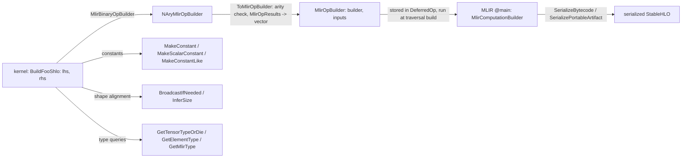

# StableHLO op builders and the op-builder utilities

## Overview
TorchTPU never lowers an op at dispatch time. A kernel captures its lowering as a *builder
closure* that receives already-built StableHLO values (`mlir::MlirOp`) and returns new ones, and
that closure is invoked later, on the materialize thread, inside the MLIR function of whatever
traversal the op ended up in. The closure types form a small ladder: `MlirNullaryOpBuilder`
(no inputs, e.g. `ones`), `MlirUnaryOpBuilder`, `MlirBinaryOpBuilder`, `MlirTernaryOpBuilder`,
the general `NAryMlirOpBuilder<kArity, kNumOutputs>` whose result type
[`MlirOpResults`](https://github.com/google-pytorch/torch_tpu/blob/6d2a45754bdb52743883f75fbf753408345f6d1b/csrc/ops/op_builder_utils.h#L155 "csrc/ops/op_builder_utils.h#MlirOpResults") is a single op, a
fixed array or a dynamic vector, and the fully generic `MlirOpBuilder` that takes a builder and a
span of inputs. The dispatcher lifts any arity into the generic form with a runtime arity check,
and the compilation layer wraps the traversal's whole function into a `MlirComputationBuilder`
that produces a module with a `@main`. Around the closures sits `op_builder_utils.h`: constant
construction that works under bounded dynamism, broadcasting that follows PyTorch (NumPy)
semantics, element-type queries, size inference with PyTorch's error text, and StableHLO module
serialization used by the export path. At this pin the utility layer is increasingly
about bounded dynamic shapes: dimensions are read together with their bounds, and several
helpers emit a static-upper-bound computation plus masking or slicing so that XLA, which rejects
some dynamic forms outright, still accepts the program.

## Diagram

Legend:
- `K` - (concept) the closure ladder; result shapes are [`MlirOpResults`](https://github.com/google-pytorch/torch_tpu/blob/6d2a45754bdb52743883f75fbf753408345f6d1b/csrc/ops/op_builder_utils.h#L155 "csrc/ops/op_builder_utils.h#MlirOpResults") via [`MlirOpResultsTraits`](https://github.com/google-pytorch/torch_tpu/blob/6d2a45754bdb52743883f75fbf753408345f6d1b/csrc/ops/op_builder_utils.h#L131 "csrc/ops/op_builder_utils.h#MlirOpResultsTraits")
- `N` - (concept) the closure ladder; result shapes are [`MlirOpResults`](https://github.com/google-pytorch/torch_tpu/blob/6d2a45754bdb52743883f75fbf753408345f6d1b/csrc/ops/op_builder_utils.h#L155 "csrc/ops/op_builder_utils.h#MlirOpResults") via [`MlirOpResultsTraits`](https://github.com/google-pytorch/torch_tpu/blob/6d2a45754bdb52743883f75fbf753408345f6d1b/csrc/ops/op_builder_utils.h#L131 "csrc/ops/op_builder_utils.h#MlirOpResultsTraits")
- `G` - (concept) the closure ladder; result shapes are [`MlirOpResults`](https://github.com/google-pytorch/torch_tpu/blob/6d2a45754bdb52743883f75fbf753408345f6d1b/csrc/ops/op_builder_utils.h#L155 "csrc/ops/op_builder_utils.h#MlirOpResults") via [`MlirOpResultsTraits`](https://github.com/google-pytorch/torch_tpu/blob/6d2a45754bdb52743883f75fbf753408345f6d1b/csrc/ops/op_builder_utils.h#L131 "csrc/ops/op_builder_utils.h#MlirOpResultsTraits")
- `MOD` - (concept) the closure ladder; result shapes are [`MlirOpResults`](https://github.com/google-pytorch/torch_tpu/blob/6d2a45754bdb52743883f75fbf753408345f6d1b/csrc/ops/op_builder_utils.h#L155 "csrc/ops/op_builder_utils.h#MlirOpResults") via [`MlirOpResultsTraits`](https://github.com/google-pytorch/torch_tpu/blob/6d2a45754bdb52743883f75fbf753408345f6d1b/csrc/ops/op_builder_utils.h#L131 "csrc/ops/op_builder_utils.h#MlirOpResultsTraits")
- `C` - [`MakeConstant`](https://github.com/google-pytorch/torch_tpu/blob/6d2a45754bdb52743883f75fbf753408345f6d1b/csrc/ops/op_builder_utils.h#L310 "csrc/ops/op_builder_utils.h#MakeConstant"), [`MakeScalarConstant`](https://github.com/google-pytorch/torch_tpu/blob/6d2a45754bdb52743883f75fbf753408345f6d1b/csrc/ops/op_builder_utils.h#L338 "csrc/ops/op_builder_utils.h#MakeScalarConstant"), [`MakeConstantLike`](https://github.com/google-pytorch/torch_tpu/blob/6d2a45754bdb52743883f75fbf753408345f6d1b/csrc/ops/op_builder_utils.cc#L726 "csrc/ops/op_builder_utils.cc#MakeConstantLike")
- `B` - [`BroadcastIfNeeded`](https://github.com/google-pytorch/torch_tpu/blob/6d2a45754bdb52743883f75fbf753408345f6d1b/csrc/ops/op_builder_utils.cc#L946 "csrc/ops/op_builder_utils.cc#BroadcastIfNeeded"), [`InferSize`](https://github.com/google-pytorch/torch_tpu/blob/6d2a45754bdb52743883f75fbf753408345f6d1b/csrc/ops/op_builder_utils.h#L108 "csrc/ops/op_builder_utils.h#InferSize")
- `T` - [`GetTensorTypeOrDie`](https://github.com/google-pytorch/torch_tpu/blob/6d2a45754bdb52743883f75fbf753408345f6d1b/csrc/ops/op_builder_utils.cc#L475 "csrc/ops/op_builder_utils.cc#GetTensorTypeOrDie"), [`GetElementType`](https://github.com/google-pytorch/torch_tpu/blob/6d2a45754bdb52743883f75fbf753408345f6d1b/csrc/ops/op_builder_utils.cc#L495 "csrc/ops/op_builder_utils.cc#GetElementType"), [`GetMlirType`](https://github.com/google-pytorch/torch_tpu/blob/6d2a45754bdb52743883f75fbf753408345f6d1b/csrc/ops/op_builder_utils.cc#L509 "csrc/ops/op_builder_utils.cc#GetMlirType")
- `SER` - [`SerializeBytecode`](https://github.com/google-pytorch/torch_tpu/blob/6d2a45754bdb52743883f75fbf753408345f6d1b/csrc/ops/op_builder_utils.cc#L447 "csrc/ops/op_builder_utils.cc#SerializeBytecode"), [`SerializePortableArtifact`](https://github.com/google-pytorch/torch_tpu/blob/6d2a45754bdb52743883f75fbf753408345f6d1b/csrc/ops/op_builder_utils.cc#L456 "csrc/ops/op_builder_utils.cc#SerializePortableArtifact")

## Design rationale (why it's built this way)
- **Closures, so lowering is deferred and fusable.** Because the builder runs inside the
  traversal's function rather than at dispatch, XLA sees one program for a chain of ops (see
  [deferred-execution-and-materialization](deferred-execution-and-materialization.md)). The
  closure must therefore be self-contained: everything it needs is captured by value, and anything
  captured that changes the program must also be in the cache keys
  ([compilation-cache-key](compilation-cache-key.md)).
- **Arity in the type, checked once at the seam.** The N-ary traits give the natural signature for
  each arity (a bare input for one, a fixed-size span for many, a builder parameter only when there
  may be no inputs to borrow a builder from); `ToMlirOpBuilder` converts to the generic signature and
  is the single place the input count is verified at runtime, with the output count asserted as an
  internal invariant. [`MlirOpResultsTraits`](https://github.com/google-pytorch/torch_tpu/blob/6d2a45754bdb52743883f75fbf753408345f6d1b/csrc/ops/op_builder_utils.h#L131 "csrc/ops/op_builder_utils.h#MlirOpResultsTraits")
  keeps the one-output case free of `std::array` overhead.
- **Constants that survive bounded dynamism.** The header steers authors to
  [`MakeScalarConstant`](https://github.com/google-pytorch/torch_tpu/blob/6d2a45754bdb52743883f75fbf753408345f6d1b/csrc/ops/op_builder_utils.h#L338 "csrc/ops/op_builder_utils.h#MakeScalarConstant") and
  [`MakeConstantLike`](https://github.com/google-pytorch/torch_tpu/blob/6d2a45754bdb52743883f75fbf753408345f6d1b/csrc/ops/op_builder_utils.cc#L726 "csrc/ops/op_builder_utils.cc#MakeConstantLike") over the
  shaped [`MakeConstant`](https://github.com/google-pytorch/torch_tpu/blob/6d2a45754bdb52743883f75fbf753408345f6d1b/csrc/ops/op_builder_utils.h#L310 "csrc/ops/op_builder_utils.h#MakeConstant") overloads
  (one is deprecated) because they "fully support static and bounded programs": `MakeConstantLike`
  emits a plain constant for a static input shape but a scalar constant plus `chlo.constant_like`
  when the input has dynamic dimensions. The `at::Scalar` overload warns that a scalar reports its
  type "in the highest precision necessary to hold their value category", so callers pass the
  element type explicitly.
- **Broadcasting follows PyTorch, not XLA.** [`BroadcastIfNeeded`](https://github.com/google-pytorch/torch_tpu/blob/6d2a45754bdb52743883f75fbf753408345f6d1b/csrc/ops/op_builder_utils.cc#L946 "csrc/ops/op_builder_utils.cc#BroadcastIfNeeded")
  has three overloads: to an explicit static shape (rank-aligned from the right, size-1 dims expand,
  a `CHECK` rejects dynamic inputs pending a refactor), to a StableHLO dimensions value (NumPy
  broadcasting through the StableHLO builder API, with diagnostics turned into an invalid-argument
  status), and to another op's shape and encoding. The last two now also take explicit
  `broadcast_dimensions`, which map input dims onto the target instead of applying the NumPy
  right-alignment rule. Binary lowerings such as
  [`BuildAddShlo`](https://github.com/google-pytorch/torch_tpu/blob/6d2a45754bdb52743883f75fbf753408345f6d1b/csrc/ops/binary.cc#L31 "csrc/ops/binary.cc#BuildAddShlo") apply pairwise broadcasting
  first and only then emit the StableHLO op.
- **Size inference reuses PyTorch's rules and messages.** [`InferSize`](https://github.com/google-pytorch/torch_tpu/blob/6d2a45754bdb52743883f75fbf753408345f6d1b/csrc/ops/op_builder_utils.h#L108 "csrc/ops/op_builder_utils.h#InferSize")
  calls `at::infer_size` on tensors, scalars or dimension lists ([`GetDims`](https://github.com/google-pytorch/torch_tpu/blob/6d2a45754bdb52743883f75fbf753408345f6d1b/csrc/ops/op_builder_utils.h#L73 "csrc/ops/op_builder_utils.h#GetDims")),
  catches the `c10::Error` and re-raises it as an invalid-argument status using the message without
  PyTorch's backtrace, since TorchTPU adds its own trace policy (see [error-handling](error-handling.md)).
- **Type queries in two flavors.** [`GetElementType`](https://github.com/google-pytorch/torch_tpu/blob/6d2a45754bdb52743883f75fbf753408345f6d1b/csrc/ops/op_builder_utils.cc#L495 "csrc/ops/op_builder_utils.cc#GetElementType")
  returns a status only for an element type TorchTPU cannot map (a non-tensor input still crashes
  inside it); [`GetElementTypeOrDie`](https://github.com/google-pytorch/torch_tpu/blob/6d2a45754bdb52743883f75fbf753408345f6d1b/csrc/ops/op_builder_utils.cc#L500 "csrc/ops/op_builder_utils.cc#GetElementTypeOrDie")
  and [`GetTensorTypeOrDie`](https://github.com/google-pytorch/torch_tpu/blob/6d2a45754bdb52743883f75fbf753408345f6d1b/csrc/ops/op_builder_utils.cc#L475 "csrc/ops/op_builder_utils.cc#GetTensorTypeOrDie")
  crash, and are used where a non-tensor would be a TorchTPU bug rather than a user error.
  [`GetElementTypeOrSelf`](https://github.com/google-pytorch/torch_tpu/blob/6d2a45754bdb52743883f75fbf753408345f6d1b/csrc/ops/op_builder_utils.cc#L491 "csrc/ops/op_builder_utils.cc#GetElementTypeOrSelf")
  unwraps a tensor type to its element type and leaves scalars alone; the `IsBooleanType`,
  `IsUnsignedType`, [`IsFloatType`](https://github.com/google-pytorch/torch_tpu/blob/6d2a45754bdb52743883f75fbf753408345f6d1b/csrc/ops/op_builder_utils.h#L217 "csrc/ops/op_builder_utils.h#IsFloatType") and
  `IsComplexType` predicates encode the dtype-specific branches lowerings need.

> [!inferred]
> The recurring shape of a `Build*Shlo` function is: get tensor types, broadcast operands to a
> common shape, branch on element-type class (booleans become `or`/`and`, integers may be converted
> to float first), then emit one StableHLO op. The boolean special case in
> [`BuildAddShlo`](https://github.com/google-pytorch/torch_tpu/blob/6d2a45754bdb52743883f75fbf753408345f6d1b/csrc/ops/binary.cc#L31 "csrc/ops/binary.cc#BuildAddShlo") carries a TODO explaining it
> exists for a now-deleted XLA pipeline, which shows how these helpers accumulate compatibility
> knowledge that would otherwise be duplicated across hundreds of kernels.

## Entry points
- The closure aliases in `op_builder_utils.h`: `MlirNullaryOpBuilder`, `MlirUnaryOpBuilder`,
  `MlirBinaryOpBuilder`, `MlirTernaryOpBuilder`, `NAryMlirOpBuilder<kArity, kNumOutputs>`,
  `MlirOpBuilder` and `MlirComputationBuilder`; all but the last (which returns a whole module) return [`MlirOpResults`](https://github.com/google-pytorch/torch_tpu/blob/6d2a45754bdb52743883f75fbf753408345f6d1b/csrc/ops/op_builder_utils.h#L155 "csrc/ops/op_builder_utils.h#MlirOpResults")
  shaped by [`MlirOpResultsTraits`](https://github.com/google-pytorch/torch_tpu/blob/6d2a45754bdb52743883f75fbf753408345f6d1b/csrc/ops/op_builder_utils.h#L131 "csrc/ops/op_builder_utils.h#MlirOpResultsTraits"); kernels pass one of the first five to the helpers in
  [aten-kernel-authoring](aten-kernel-authoring.md) or to `DispatchOp` directly.
- [`MakeConstant`](https://github.com/google-pytorch/torch_tpu/blob/6d2a45754bdb52743883f75fbf753408345f6d1b/csrc/ops/op_builder_utils.cc#L716 "csrc/ops/op_builder_utils.cc#MakeConstant") (from an
  `at::Scalar`, optional element type and shape), [`MakeScalarConstant`](https://github.com/google-pytorch/torch_tpu/blob/6d2a45754bdb52743883f75fbf753408345f6d1b/csrc/ops/op_builder_utils.h#L338 "csrc/ops/op_builder_utils.h#MakeScalarConstant"),
  [`MakeConstantLike`](https://github.com/google-pytorch/torch_tpu/blob/6d2a45754bdb52743883f75fbf753408345f6d1b/csrc/ops/op_builder_utils.cc#L726 "csrc/ops/op_builder_utils.cc#MakeConstantLike"), and
  [`GetVerifiedMinFiniteValue`](https://github.com/google-pytorch/torch_tpu/blob/6d2a45754bdb52743883f75fbf753408345f6d1b/csrc/ops/op_builder_utils.cc#L519 "csrc/ops/op_builder_utils.cc#GetVerifiedMinFiniteValue")
  for reduction identities such as argmax initial values.
- [`BroadcastIfNeeded`](https://github.com/google-pytorch/torch_tpu/blob/6d2a45754bdb52743883f75fbf753408345f6d1b/csrc/ops/op_builder_utils.cc#L946 "csrc/ops/op_builder_utils.cc#BroadcastIfNeeded") and
  [`GetDimensions`](https://github.com/google-pytorch/torch_tpu/blob/6d2a45754bdb52743883f75fbf753408345f6d1b/csrc/ops/op_builder_utils.cc#L420 "csrc/ops/op_builder_utils.cc#GetDimensions") for shape work;
  [`GetMlirType`](https://github.com/google-pytorch/torch_tpu/blob/6d2a45754bdb52743883f75fbf753408345f6d1b/csrc/ops/op_builder_utils.cc#L509 "csrc/ops/op_builder_utils.cc#GetMlirType") to construct an MLIR
  type from a context and element type.
- [`SerializeBytecode`](https://github.com/google-pytorch/torch_tpu/blob/6d2a45754bdb52743883f75fbf753408345f6d1b/csrc/ops/op_builder_utils.cc#L447 "csrc/ops/op_builder_utils.cc#SerializeBytecode") and
  [`SerializePortableArtifact`](https://github.com/google-pytorch/torch_tpu/blob/6d2a45754bdb52743883f75fbf753408345f6d1b/csrc/ops/op_builder_utils.cc#L456 "csrc/ops/op_builder_utils.cc#SerializePortableArtifact"):
  module to bytes; their callers are the `serialize_mlir_*` Python bindings used by the export path.

## Mechanism (step-by-step)
1. **A kernel writes its lowering against typed inputs.** A binary kernel supplies a
   `MlirBinaryOpBuilder` such as [`BuildAddShlo`](https://github.com/google-pytorch/torch_tpu/blob/6d2a45754bdb52743883f75fbf753408345f6d1b/csrc/ops/binary.cc#L31 "csrc/ops/binary.cc#BuildAddShlo"),
   which receives two `MlirOp`s already placed in the same function. It aligns them with
   [`BroadcastIfNeeded`](https://github.com/google-pytorch/torch_tpu/blob/6d2a45754bdb52743883f75fbf753408345f6d1b/csrc/ops/op_builder_utils.cc#L946 "csrc/ops/op_builder_utils.cc#BroadcastIfNeeded")-based
   pairwise broadcasting, inspects the type via [`GetTensorTypeOrDie`](https://github.com/google-pytorch/torch_tpu/blob/6d2a45754bdb52743883f75fbf753408345f6d1b/csrc/ops/op_builder_utils.cc#L475 "csrc/ops/op_builder_utils.cc#GetTensorTypeOrDie"),
   and emits the StableHLO op; constants it needs come from
   [`MakeScalarConstant`](https://github.com/google-pytorch/torch_tpu/blob/6d2a45754bdb52743883f75fbf753408345f6d1b/csrc/ops/op_builder_utils.h#L338 "csrc/ops/op_builder_utils.h#MakeScalarConstant") or
   [`MakeConstantLike`](https://github.com/google-pytorch/torch_tpu/blob/6d2a45754bdb52743883f75fbf753408345f6d1b/csrc/ops/op_builder_utils.cc#L726 "csrc/ops/op_builder_utils.cc#MakeConstantLike") so they
   remain valid when the operand has bounded dynamic dimensions.
2. **Dispatch lifts the closure.** `DispatchOp` converts the N-ary closure with `ToMlirOpBuilder`
   into the generic signature and may wrap it again to apply a computation dtype
   ([dtype-and-precision](dtype-and-precision.md)); the result is stored in the deferred op with the
   output shapes the kernel promised, expressed as [`MlirOpResults`](https://github.com/google-pytorch/torch_tpu/blob/6d2a45754bdb52743883f75fbf753408345f6d1b/csrc/ops/op_builder_utils.h#L155 "csrc/ops/op_builder_utils.h#MlirOpResults").
3. **The traversal calls it.** When a traversal builds its MLIR function, each deferred op's generic
   builder is invoked with the function's values for its inputs under the op's captured Python
   context (see [python-context-and-op-names](python-context-and-op-names.md)); the runtime check
   that the returned [`MlirOpResults`](https://github.com/google-pytorch/torch_tpu/blob/6d2a45754bdb52743883f75fbf753408345f6d1b/csrc/ops/op_builder_utils.h#L155 "csrc/ops/op_builder_utils.h#MlirOpResults") match the promised
   output count is the last line of defense against a mismatched closure.
4. **The module is compiled or serialized.** The completed `@main` goes to the
   [compilation pipeline](compilation-pipeline.md) via a `MlirComputationBuilder`; for export,
   [`SerializePortableArtifact`](https://github.com/google-pytorch/torch_tpu/blob/6d2a45754bdb52743883f75fbf753408345f6d1b/csrc/ops/op_builder_utils.cc#L456 "csrc/ops/op_builder_utils.cc#SerializePortableArtifact")
   produces a version-stable StableHLO artifact (serialized against the 12-week VHLO
   compatibility window, with mixed serialization allowed) and [`SerializeBytecode`](https://github.com/google-pytorch/torch_tpu/blob/6d2a45754bdb52743883f75fbf753408345f6d1b/csrc/ops/op_builder_utils.cc#L447 "csrc/ops/op_builder_utils.cc#SerializeBytecode")
   raw bytecode.

## Key data structures
- `mlir::MlirOp`: a value plus the builder that created it, which is why unary and binary closures
  need no separate builder parameter.
- [`MlirOpResults`](https://github.com/google-pytorch/torch_tpu/blob/6d2a45754bdb52743883f75fbf753408345f6d1b/csrc/ops/op_builder_utils.h#L155 "csrc/ops/op_builder_utils.h#MlirOpResults"):
  `MlirOp` / `std::array<MlirOp, N>` / `SmallVector<MlirOp>` selected by `kNumOutputs`, with
  `kDynamicSize` as the sentinel shared with the dispatcher.
- `mlir::stablehlo::Dimensions` from
  [`GetDimensions`](https://github.com/google-pytorch/torch_tpu/blob/6d2a45754bdb52743883f75fbf753408345f6d1b/csrc/ops/op_builder_utils.cc#L420 "csrc/ops/op_builder_utils.cc#GetDimensions"):
  per-dimension size plus bound information, the currency of every helper that must work under
  bounded dynamism.
- Constant attribute helpers backing [`MakeConstant`](https://github.com/google-pytorch/torch_tpu/blob/6d2a45754bdb52743883f75fbf753408345f6d1b/csrc/ops/op_builder_utils.cc#L716 "csrc/ops/op_builder_utils.cc#MakeConstant"):
  a dense attribute is built once and either wrapped in `stablehlo.constant` or, for dynamic inputs,
  `chlo.constant_like`.

## Dynamics (design intent)
- Builders run on the materialize thread and must not read thread-local context state; anything
  mode-dependent (precision, computation dtype) is resolved at dispatch and captured.
- Broadcasting errors surface as invalid-argument statuses with the shapes in the message, so a
  shape mismatch is reported at materialization with the root op name, not as an XLA verifier
  failure.

## Edge cases
- The static-shape [`BroadcastIfNeeded`](https://github.com/google-pytorch/torch_tpu/blob/6d2a45754bdb52743883f75fbf753408345f6d1b/csrc/ops/op_builder_utils.cc#L946 "csrc/ops/op_builder_utils.cc#BroadcastIfNeeded")
  overload aborts on dynamic inputs (a TODO tracks dynamic-shape support); the StableHLO-dimensions
  overload is the one to use under bounded dynamism.
- Boolean addition lowers to `or`, a legacy of XLA's `i1` add-to-xor conversion.
- `MakeConstant` from an `at::Scalar` without an explicit element type may pick a wider type than
  the surrounding computation.

## Open questions
- Which of the shaped `MakeConstant` overloads remain in use after the deprecation is still being
  worked out in the source.
- The bounded-dynamism helpers added since the previous pin (a convolution wrapper that zeroes
  past-the-runtime-size elements, a shape-preserving iota, an RNG-bits wrapper that slices to the
  runtime size, and static-upper-bound shape queries) are not in this page's symbol set; read
  `op_builder_utils.h` for their contracts.

## See also
- [aten-kernel-authoring](aten-kernel-authoring.md): the helpers that consume these closures.
- [eager-op-dispatch](eager-op-dispatch.md): `ToMlirOpBuilder` at the dispatch seam.
- [deferred-execution-and-materialization](deferred-execution-and-materialization.md): when the closure runs.
- [view-decomposition](view-decomposition.md): a large client of the reshape/transpose/slice/pad builders.
- [scan-and-custom-kernels](scan-and-custom-kernels.md): custom calls built on MLIR modules (the serializers here feed the export path, not custom kernels).

## Recent changes
- `6ac8f32c5` passes the `WEEK_12` target version explicitly when serializing, "so PortableArtifact
  serialization matches" what the XLA PJRT runtime expects (see `SerializePortableArtifact`).
- `0aa34088d` and `70c7fb1b7` add bounded dynamic spatial and batch dims for convolutions and
  `convolution_backward`, because "XLA rejects convolutions with dynamic spatial dimensions"; the
  shared helper lives in `op_builder_utils`.
- `6006a6c7d` adds bounded dynamic shapes to scaled dot product attention, extending the same
  utility layer; "Static shapes keep the existing lowering."
- [all changes in 6d2a45754b](../changes/6d2a45754b.md)
