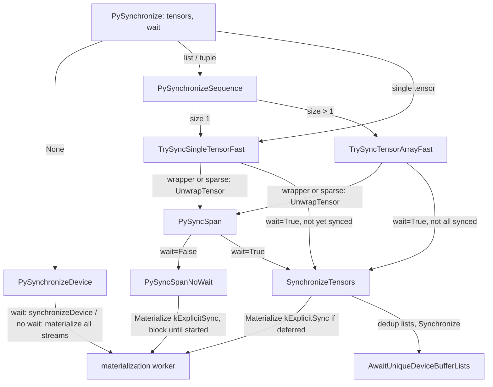
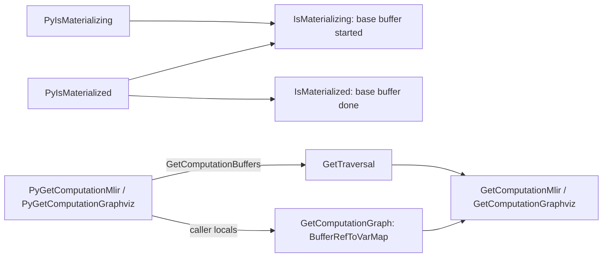

# Synchronization and graph inspection APIs

## Overview
Because eager ops are deferred, a program needs a way to say "run what is pending" without
copying data to the host. `synchronize(tensors=None, wait=False)` does that, and at this pin it is
implemented entirely in C++: the pybind module ([`TorchTpuPyBindInitModule__tpu_torch_sync`](https://github.com/google-pytorch/torch_tpu/blob/6d2a45754bdb52743883f75fbf753408345f6d1b/csrc/internal/sync/sync_py.cc#L467 "csrc/internal/sync/sync_py.cc#TorchTpuPyBindInitModule__tpu_torch_sync")) binds the name `synchronize` straight to
[`PySynchronize`](https://github.com/google-pytorch/torch_tpu/blob/6d2a45754bdb52743883f75fbf753408345f6d1b/csrc/internal/sync/sync_py.cc#L367 "csrc/internal/sync/sync_py.cc#PySynchronize"), the "Unified C++ entry point for `torch_tpu.sync.synchronize(tensors, wait)`". With no
tensors it synchronizes the whole active device ([`PySynchronizeDevice`](https://github.com/google-pytorch/torch_tpu/blob/6d2a45754bdb52743883f75fbf753408345f6d1b/csrc/internal/sync/sync_py.cc#L305 "csrc/internal/sync/sync_py.cc#PySynchronizeDevice")); with a tensor, list or tuple it
materializes only those, through allocation-free fast paths ([`TrySyncSingleTensorFast`](https://github.com/google-pytorch/torch_tpu/blob/6d2a45754bdb52743883f75fbf753408345f6d1b/csrc/internal/sync/sync_py.cc#L180 "csrc/internal/sync/sync_py.cc#TrySyncSingleTensorFast"), [`TrySyncTensorArrayFast`](https://github.com/google-pytorch/torch_tpu/blob/6d2a45754bdb52743883f75fbf753408345f6d1b/csrc/internal/sync/sync_py.cc#L235 "csrc/internal/sync/sync_py.cc#TrySyncTensorArrayFast")) or the general
[`PySyncSpan`](https://github.com/google-pytorch/torch_tpu/blob/6d2a45754bdb52743883f75fbf753408345f6d1b/csrc/internal/sync/sync_py.cc#L123 "csrc/internal/sync/sync_py.cc#PySyncSpan") path; and `wait=True` additionally blocks until the device has finished
([`SynchronizeTensors`](https://github.com/google-pytorch/torch_tpu/blob/6d2a45754bdb52743883f75fbf753408345f6d1b/csrc/internal/sync/sync.cc#L130 "csrc/internal/sync/sync.cc#SynchronizeTensors")). The header positions the tensor form precisely: materialization "forces a graph break and
execution, but doesn't wait for the PjRtBuffers to be ready"; synchronizing tensors "forces a graph
break and waits for the PjRtBuffers to be ready, but doesn't copy the data to the CPU"; a `.cpu()`
does all three. That middle option "is primarily useful for profiling; forcing a synchronization
barrier allows for measuring the compile and execution time, without also including the data
transfer time". The same module exposes two state probes, [`PyIsMaterializing`](https://github.com/google-pytorch/torch_tpu/blob/6d2a45754bdb52743883f75fbf753408345f6d1b/csrc/internal/sync/sync_py.cc#L393 "csrc/internal/sync/sync_py.cc#PyIsMaterializing") ("has started materializing to a
PjRtBuffer") and [`PyIsMaterialized`](https://github.com/google-pytorch/torch_tpu/blob/6d2a45754bdb52743883f75fbf753408345f6d1b/csrc/internal/sync/sync_py.cc#L402 "csrc/internal/sync/sync_py.cc#PyIsMaterialized") ("has completed execution and is ready to be copied to CPU"), and the
inspection bindings [`PyGetComputationMlir`](https://github.com/google-pytorch/torch_tpu/blob/6d2a45754bdb52743883f75fbf753408345f6d1b/csrc/internal/sync/sync_py.cc#L456 "csrc/internal/sync/sync_py.cc#PyGetComputationMlir") and [`PyGetComputationGraphviz`](https://github.com/google-pytorch/torch_tpu/blob/6d2a45754bdb52743883f75fbf753408345f6d1b/csrc/internal/sync/sync_py.cc#L443 "csrc/internal/sync/sync_py.cc#PyGetComputationGraphviz"), which render the pending traversal of given tensors without
executing it. On the Python side, the `torch_tpu._internal.sync` package (imported by the loader at
startup) is a thin layer: its [`synchronize`](https://github.com/google-pytorch/torch_tpu/blob/6d2a45754bdb52743883f75fbf753408345f6d1b/src/torch_tpu/_internal/sync/__init__.py#L49 "src/torch_tpu/_internal/sync/__init__#synchronize") is the submodule's [`synchronize`](https://github.com/google-pytorch/torch_tpu/blob/6d2a45754bdb52743883f75fbf753408345f6d1b/src/torch_tpu/_internal/sync/sync.py#L26 "src/torch_tpu/_internal/sync/sync#synchronize"), which
is the bare pybind function (no Python wrapper), and `is_materializing` / `is_materialized` are
aliased the same way; only the inspection helpers [`computation_graphviz`](https://github.com/google-pytorch/torch_tpu/blob/6d2a45754bdb52743883f75fbf753408345f6d1b/src/torch_tpu/_internal/sync/sync.py#L54 "src/torch_tpu/_internal/sync/sync#computation_graphviz"), [`computation_mlir`](https://github.com/google-pytorch/torch_tpu/blob/6d2a45754bdb52743883f75fbf753408345f6d1b/src/torch_tpu/_internal/sync/sync.py#L64 "src/torch_tpu/_internal/sync/sync#computation_mlir") and the file-dump wrappers ([`dump_computation_graphviz`](https://github.com/google-pytorch/torch_tpu/blob/6d2a45754bdb52743883f75fbf753408345f6d1b/src/torch_tpu/_internal/sync/sync.py#L44 "src/torch_tpu/_internal/sync/sync#dump_computation_graphviz"),
[`dump_computation_mlir`](https://github.com/google-pytorch/torch_tpu/blob/6d2a45754bdb52743883f75fbf753408345f6d1b/src/torch_tpu/_internal/sync/sync.py#L49 "src/torch_tpu/_internal/sync/sync#dump_computation_mlir")) contain Python code.

## Diagram

Legend:
- `PY` - [`PySynchronize`](https://github.com/google-pytorch/torch_tpu/blob/6d2a45754bdb52743883f75fbf753408345f6d1b/csrc/internal/sync/sync_py.cc#L367 "csrc/internal/sync/sync_py.cc#PySynchronize")
- `DEV` - [`PySynchronizeDevice`](https://github.com/google-pytorch/torch_tpu/blob/6d2a45754bdb52743883f75fbf753408345f6d1b/csrc/internal/sync/sync_py.cc#L305 "csrc/internal/sync/sync_py.cc#PySynchronizeDevice")
- `SEQ` - [`PySynchronizeSequence`](https://github.com/google-pytorch/torch_tpu/blob/6d2a45754bdb52743883f75fbf753408345f6d1b/csrc/internal/sync/sync_py.cc#L330 "csrc/internal/sync/sync_py.cc#PySynchronizeSequence")
- `F1` - [`TrySyncSingleTensorFast`](https://github.com/google-pytorch/torch_tpu/blob/6d2a45754bdb52743883f75fbf753408345f6d1b/csrc/internal/sync/sync_py.cc#L180 "csrc/internal/sync/sync_py.cc#TrySyncSingleTensorFast")
- `FN` - [`TrySyncTensorArrayFast`](https://github.com/google-pytorch/torch_tpu/blob/6d2a45754bdb52743883f75fbf753408345f6d1b/csrc/internal/sync/sync_py.cc#L235 "csrc/internal/sync/sync_py.cc#TrySyncTensorArrayFast")
- `SPAN` - [`PySyncSpan`](https://github.com/google-pytorch/torch_tpu/blob/6d2a45754bdb52743883f75fbf753408345f6d1b/csrc/internal/sync/sync_py.cc#L123 "csrc/internal/sync/sync_py.cc#PySyncSpan"), reached after [`UnwrapTensor`](https://github.com/google-pytorch/torch_tpu/blob/6d2a45754bdb52743883f75fbf753408345f6d1b/csrc/internal/sync/sync_py.cc#L51 "csrc/internal/sync/sync_py.cc#UnwrapTensor")
- `NW` - [`PySyncSpanNoWait`](https://github.com/google-pytorch/torch_tpu/blob/6d2a45754bdb52743883f75fbf753408345f6d1b/csrc/internal/sync/sync_py.cc#L77 "csrc/internal/sync/sync_py.cc#PySyncSpanNoWait")
- `ST` - [`SynchronizeTensors`](https://github.com/google-pytorch/torch_tpu/blob/6d2a45754bdb52743883f75fbf753408345f6d1b/csrc/internal/sync/sync.cc#L130 "csrc/internal/sync/sync.cc#SynchronizeTensors") / [`SynchronizeTensorsImpl`](https://github.com/google-pytorch/torch_tpu/blob/6d2a45754bdb52743883f75fbf753408345f6d1b/csrc/internal/sync/sync.cc#L89 "csrc/internal/sync/sync.cc#SynchronizeTensorsImpl")
- `AW` - [`AwaitUniqueDeviceBufferLists`](https://github.com/google-pytorch/torch_tpu/blob/6d2a45754bdb52743883f75fbf753408345f6d1b/csrc/internal/sync/sync.cc#L63 "csrc/internal/sync/sync.cc#AwaitUniqueDeviceBufferLists")
- `MAT` - (concept) the materialization worker of [deferred-execution-and-materialization](deferred-execution-and-materialization.md)

Legend:
- `Q1` - [`PyIsMaterializing`](https://github.com/google-pytorch/torch_tpu/blob/6d2a45754bdb52743883f75fbf753408345f6d1b/csrc/internal/sync/sync_py.cc#L393 "csrc/internal/sync/sync_py.cc#PyIsMaterializing")
- `Q2` - [`PyIsMaterialized`](https://github.com/google-pytorch/torch_tpu/blob/6d2a45754bdb52743883f75fbf753408345f6d1b/csrc/internal/sync/sync_py.cc#L402 "csrc/internal/sync/sync_py.cc#PyIsMaterialized")
- `M1` - [`IsMaterializing`](https://github.com/google-pytorch/torch_tpu/blob/6d2a45754bdb52743883f75fbf753408345f6d1b/csrc/internal/sync/sync.cc#L138 "csrc/internal/sync/sync.cc#IsMaterializing")
- `M2` - [`IsMaterialized`](https://github.com/google-pytorch/torch_tpu/blob/6d2a45754bdb52743883f75fbf753408345f6d1b/csrc/internal/sync/sync.cc#L146 "csrc/internal/sync/sync.cc#IsMaterialized")
- `G` - [`PyGetComputationMlir`](https://github.com/google-pytorch/torch_tpu/blob/6d2a45754bdb52743883f75fbf753408345f6d1b/csrc/internal/sync/sync_py.cc#L456 "csrc/internal/sync/sync_py.cc#PyGetComputationMlir"), [`PyGetComputationGraphviz`](https://github.com/google-pytorch/torch_tpu/blob/6d2a45754bdb52743883f75fbf753408345f6d1b/csrc/internal/sync/sync_py.cc#L443 "csrc/internal/sync/sync_py.cc#PyGetComputationGraphviz"), with [`GetComputationBuffers`](https://github.com/google-pytorch/torch_tpu/blob/6d2a45754bdb52743883f75fbf753408345f6d1b/csrc/internal/sync/sync_py.cc#L415 "csrc/internal/sync/sync_py.cc#GetComputationBuffers")
- `VARS` - [`GetComputationGraph`](https://github.com/google-pytorch/torch_tpu/blob/6d2a45754bdb52743883f75fbf753408345f6d1b/csrc/internal/sync/sync_py.cc#L426 "csrc/internal/sync/sync_py.cc#GetComputationGraph") producing a [`BufferRefToVarMap`](https://github.com/google-pytorch/torch_tpu/blob/6d2a45754bdb52743883f75fbf753408345f6d1b/csrc/internal/sync/sync.cc#L45 "csrc/internal/sync/sync.cc#BufferRefToVarMap")
- `TR` - [`GetTraversal`](https://github.com/google-pytorch/torch_tpu/blob/6d2a45754bdb52743883f75fbf753408345f6d1b/csrc/internal/sync/sync.cc#L156 "csrc/internal/sync/sync.cc#GetTraversal")
- `TXT` - [`GetComputationMlir`](https://github.com/google-pytorch/torch_tpu/blob/6d2a45754bdb52743883f75fbf753408345f6d1b/csrc/internal/sync/sync.cc#L188 "csrc/internal/sync/sync.cc#GetComputationMlir"), [`GetComputationGraphviz`](https://github.com/google-pytorch/torch_tpu/blob/6d2a45754bdb52743883f75fbf753408345f6d1b/csrc/internal/sync/sync.cc#L179 "csrc/internal/sync/sync.cc#GetComputationGraphviz")

## Design rationale (why it's built this way)
- **Two levels of "done".** Every entry point takes a `wait` flag that separates scheduling from
  completion. Without it, the call still blocks until execution has *started* ("Even though this
  is 'no wait', we still wait until the execution has started, so that is_materializing() is true
  for all buffers", [`PySyncSpanNoWait`](https://github.com/google-pytorch/torch_tpu/blob/6d2a45754bdb52743883f75fbf753408345f6d1b/csrc/internal/sync/sync_py.cc#L77 "csrc/internal/sync/sync_py.cc#PySyncSpanNoWait")); with it, [`SynchronizeTensors`](https://github.com/google-pytorch/torch_tpu/blob/6d2a45754bdb52743883f75fbf753408345f6d1b/csrc/internal/sync/sync.cc#L130 "csrc/internal/sync/sync.cc#SynchronizeTensors") awaits the PjRt buffers. The header's [`WaitOnExecution`](https://github.com/google-pytorch/torch_tpu/blob/6d2a45754bdb52743883f75fbf753408345f6d1b/csrc/internal/sync/sync.h#L53 "csrc/internal/sync/sync.h#WaitOnExecution") enum still
  documents the same split ([`kNo`](https://github.com/google-pytorch/torch_tpu/blob/6d2a45754bdb52743883f75fbf753408345f6d1b/csrc/internal/sync/sync.h#L56 "csrc/internal/sync/sync.h#WaitOnExecution.kNo") "only ensures that all deferred operations have been scheduled
  for execution on the device", [`kYes`](https://github.com/google-pytorch/torch_tpu/blob/6d2a45754bdb52743883f75fbf753408345f6d1b/csrc/internal/sync/sync.h#L59 "csrc/internal/sync/sync.h#WaitOnExecution.kYes") "blocks the calling thread until all deferred operations have
  completed"). The `spmd_safe` decorator uses the non-waiting form to cut the graph without
  stalling ([distributed-launchers-and-spmd](distributed-launchers-and-spmd.md)); benchmarks use
  the waiting form as a barrier.
- **"All" now means the device.** `synchronize(None, ...)` no longer walks a live-tensor set: it
  delegates to the PrivateUse1 device guard ([`PySynchronizeDevice`](https://github.com/google-pytorch/torch_tpu/blob/6d2a45754bdb52743883f75fbf753408345f6d1b/csrc/internal/sync/sync_py.cc#L305 "csrc/internal/sync/sync_py.cc#PySynchronizeDevice")). With `wait=True` it calls the guard's
  device synchronize; without it, it materializes every stream on the active device and awaits only
  the per-stream futures, which "ensures that all live nodes reach the is_materializing() state but
  does not wait for them to complete". The comment calls this equivalent to recording an event on
  every stream and discarding it, so the global form shares semantics with stream and event
  synchronization ([device-backend-registration](device-backend-registration.md)).
- **Overhead matters because it is called in loops.** [`PySynchronize`](https://github.com/google-pytorch/torch_tpu/blob/6d2a45754bdb52743883f75fbf753408345f6d1b/csrc/internal/sync/sync_py.cc#L367 "csrc/internal/sync/sync_py.cc#PySynchronize") dispatches on the exact Python type in
  C++. [`TrySyncSingleTensorFast`](https://github.com/google-pytorch/torch_tpu/blob/6d2a45754bdb52743883f75fbf753408345f6d1b/csrc/internal/sync/sync_py.cc#L180 "csrc/internal/sync/sync_py.cc#TrySyncSingleTensorFast") unpacks a plain `torch.Tensor` "without constructing a temporary `pybind11::object` or
  incrementing C++ shared pointer reference counts", and returns early, still holding the GIL, if the
  buffer list is already synchronized. [`TrySyncTensorArrayFast`](https://github.com/google-pytorch/torch_tpu/blob/6d2a45754bdb52743883f75fbf753408345f6d1b/csrc/internal/sync/sync_py.cc#L235 "csrc/internal/sync/sync_py.cc#TrySyncTensorArrayFast") "avoids pybind11 `std::vector<at::Tensor>`
  type-caster conversion" by keeping raw pointers into the Python list or tuple; the templated
  [`SynchronizeTensorsImpl`](https://github.com/google-pytorch/torch_tpu/blob/6d2a45754bdb52743883f75fbf753408345f6d1b/csrc/internal/sync/sync.cc#L89 "csrc/internal/sync/sync.cc#SynchronizeTensorsImpl") accepts either tensors or tensor pointers through [`DerefTensor`](https://github.com/google-pytorch/torch_tpu/blob/6d2a45754bdb52743883f75fbf753408345f6d1b/csrc/internal/sync/sync.cc#L53 "csrc/internal/sync/sync.cc#DerefTensor") so both forms share one body.
- **Release the GIL before blocking.** [`PySyncSpanNoWait`](https://github.com/google-pytorch/torch_tpu/blob/6d2a45754bdb52743883f75fbf753408345f6d1b/csrc/internal/sync/sync_py.cc#L77 "csrc/internal/sync/sync_py.cc#PySyncSpanNoWait") documents why: materialization may contend with
  background host-to-device copy threads, and such a thread may drop the last reference to a
  Python-backed tensor and need the GIL to destroy it; holding the GIL while waiting on it "causes
  an AB-BA deadlock". It is safe because the tensors were already converted to C++ buffer handles
  and any C++ exception re-acquires the GIL during unwinding.
- **Views are not materialized on purpose.** [`SynchronizeTensorsImpl`](https://github.com/google-pytorch/torch_tpu/blob/6d2a45754bdb52743883f75fbf753408345f6d1b/csrc/internal/sync/sync.cc#L89 "csrc/internal/sync/sync.cc#SynchronizeTensorsImpl") resolves every tensor to its base buffer: "Don't
  materialize views--they are ephemeral and re-materialized every time, so there's no point in
  materializing a copy only to discard it". The header adds that "future calls to .cpu() on the
  tensors will re-execute the view logic (using the cached compilation)", and both [`IsMaterializing`](https://github.com/google-pytorch/torch_tpu/blob/6d2a45754bdb52743883f75fbf753408345f6d1b/csrc/internal/sync/sync.cc#L138 "csrc/internal/sync/sync.cc#IsMaterializing") and
  [`IsMaterialized`](https://github.com/google-pytorch/torch_tpu/blob/6d2a45754bdb52743883f75fbf753408345f6d1b/csrc/internal/sync/sync.cc#L146 "csrc/internal/sync/sync.cc#IsMaterialized") likewise report the base buffer only.
- **Materializing is not ready.** A tensor whose buffer exists holds a PjRt buffer that "is itself
  an asynchronous future", so [`IsMaterializing`](https://github.com/google-pytorch/torch_tpu/blob/6d2a45754bdb52743883f75fbf753408345f6d1b/csrc/internal/sync/sync.cc#L138 "csrc/internal/sync/sync.cc#IsMaterializing") answers "has it been scheduled and assigned a buffer". [`IsMaterialized`](https://github.com/google-pytorch/torch_tpu/blob/6d2a45754bdb52743883f75fbf753408345f6d1b/csrc/internal/sync/sync.cc#L146 "csrc/internal/sync/sync.cc#IsMaterialized")
  answers the stronger question, "both has a PjRtBuffer and that PjRtBuffer has completed
  execution"; [`PyIsMaterialized`](https://github.com/google-pytorch/torch_tpu/blob/6d2a45754bdb52743883f75fbf753408345f6d1b/csrc/internal/sync/sync_py.cc#L402 "csrc/internal/sync/sync_py.cc#PyIsMaterialized") checks the weaker state first and only then the stronger one.
- **Wrapper tensors are unwrapped.** [`UnwrapTensor`](https://github.com/google-pytorch/torch_tpu/blob/6d2a45754bdb52743883f75fbf753408345f6d1b/csrc/internal/sync/sync_py.cc#L51 "csrc/internal/sync/sync_py.cc#UnwrapTensor") recurses through `_local_tensor` (DTensor) and `elem`
  (fake-tensor style wrappers) so the same API works inside distributed and traced code. Non-TPU
  tensors are filtered rather than rejected: [`AllTensorsAreDenseOnDevice`](https://github.com/google-pytorch/torch_tpu/blob/6d2a45754bdb52743883f75fbf753408345f6d1b/csrc/internal/sync/sync_py.cc#L67 "csrc/internal/sync/sync_py.cc#AllTensorsAreDenseOnDevice") detects a mixed or sparse list and [`PySyncSpan`](https://github.com/google-pytorch/torch_tpu/blob/6d2a45754bdb52743883f75fbf753408345f6d1b/csrc/internal/sync/sync_py.cc#L123 "csrc/internal/sync/sync_py.cc#PySyncSpan")
  keeps only the TPU tensors, splitting a sparse COO tensor into its indices and values.
- **Inspection reuses the real traversal.** [`GetTraversal`](https://github.com/google-pytorch/torch_tpu/blob/6d2a45754bdb52743883f75fbf753408345f6d1b/csrc/internal/sync/sync.cc#L156 "csrc/internal/sync/sync.cc#GetTraversal") deduplicates the buffer lists and builds the same
  traversal materialization would, so the MLIR from [`GetComputationMlir`](https://github.com/google-pytorch/torch_tpu/blob/6d2a45754bdb52743883f75fbf753408345f6d1b/csrc/internal/sync/sync.cc#L188 "csrc/internal/sync/sync.cc#GetComputationMlir") is exactly what would be compiled; the
  Graphviz form labels nodes with the caller's variable names: [`computation_graphviz`](https://github.com/google-pytorch/torch_tpu/blob/6d2a45754bdb52743883f75fbf753408345f6d1b/src/torch_tpu/_internal/sync/sync.py#L54 "src/torch_tpu/_internal/sync/sync#computation_graphviz") copies the calling
  frame's locals (via `inspect.stack()`) and passes them down, and [`GetComputationGraph`](https://github.com/google-pytorch/torch_tpu/blob/6d2a45754bdb52743883f75fbf753408345f6d1b/csrc/internal/sync/sync_py.cc#L426 "csrc/internal/sync/sync_py.cc#GetComputationGraph") maps from a dict of
  names to tensors into a [`BufferRefToVarMap`](https://github.com/google-pytorch/torch_tpu/blob/6d2a45754bdb52743883f75fbf753408345f6d1b/csrc/internal/sync/sync.cc#L45 "csrc/internal/sync/sync.cc#BufferRefToVarMap"). Both bindings run under an [`OpName`](https://github.com/google-pytorch/torch_tpu/blob/6d2a45754bdb52743883f75fbf753408345f6d1b/csrc/ops/op_names.h#L29 "csrc/ops/op_names.h#OpName") context of `kCompileMlir`, so
  errors are attributed like a compile.

> [!inferred]
> The package docstring says these APIs "are not intended as the primary interface for users"
> and are "currently only used internally for performance evaluation by the torch_tpu developers".
> Practical uses: `synchronize(wait=True)` before and after a timed region to measure device
> time; `synchronize(t)` to force a graph cut when defer-and-fuse would otherwise grow a graph
> too large; `computation_mlir(t)` to see the StableHLO a slow op produced without running it;
> and `is_materializing(t)` / `is_materialized(t)` to check whether a tensor's execution has been
> issued or has finished.

## Entry points
- [`PySynchronize`](https://github.com/google-pytorch/torch_tpu/blob/6d2a45754bdb52743883f75fbf753408345f6d1b/csrc/internal/sync/sync_py.cc#L367 "csrc/internal/sync/sync_py.cc#PySynchronize") - bound as `synchronize(tensors=None, wait=False)` by [`TorchTpuPyBindInitModule__tpu_torch_sync`](https://github.com/google-pytorch/torch_tpu/blob/6d2a45754bdb52743883f75fbf753408345f6d1b/csrc/internal/sync/sync_py.cc#L467 "csrc/internal/sync/sync_py.cc#TorchTpuPyBindInitModule__tpu_torch_sync"); reached whenever Python code
  (including `spmd_safe`) calls `torch_tpu.sync.synchronize`. The module also binds
  `_synchronize_list` ([`PySync`](https://github.com/google-pytorch/torch_tpu/blob/6d2a45754bdb52743883f75fbf753408345f6d1b/csrc/internal/sync/sync_py.cc#L159 "csrc/internal/sync/sync_py.cc#PySync")) and `_synchronize_tensor`, both of which go straight to
  [`PySyncSpan`](https://github.com/google-pytorch/torch_tpu/blob/6d2a45754bdb52743883f75fbf753408345f6d1b/csrc/internal/sync/sync_py.cc#L123 "csrc/internal/sync/sync_py.cc#PySyncSpan").
- [`PyIsMaterializing`](https://github.com/google-pytorch/torch_tpu/blob/6d2a45754bdb52743883f75fbf753408345f6d1b/csrc/internal/sync/sync_py.cc#L393 "csrc/internal/sync/sync_py.cc#PyIsMaterializing") and [`PyIsMaterialized`](https://github.com/google-pytorch/torch_tpu/blob/6d2a45754bdb52743883f75fbf753408345f6d1b/csrc/internal/sync/sync_py.cc#L402 "csrc/internal/sync/sync_py.cc#PyIsMaterialized") - bound as `is_materializing` / `is_materialized` (plus underscored aliases);
  reached from tests and profiling code that want to observe the deferred state.
- [`PyGetComputationMlir`](https://github.com/google-pytorch/torch_tpu/blob/6d2a45754bdb52743883f75fbf753408345f6d1b/csrc/internal/sync/sync_py.cc#L456 "csrc/internal/sync/sync_py.cc#PyGetComputationMlir") and [`PyGetComputationGraphviz`](https://github.com/google-pytorch/torch_tpu/blob/6d2a45754bdb52743883f75fbf753408345f6d1b/csrc/internal/sync/sync_py.cc#L443 "csrc/internal/sync/sync_py.cc#PyGetComputationGraphviz") - bound as `_get_computation_mlir` / `_get_computation_graphviz`; the Python
  [`computation_mlir`](https://github.com/google-pytorch/torch_tpu/blob/6d2a45754bdb52743883f75fbf753408345f6d1b/src/torch_tpu/_internal/sync/sync.py#L64 "src/torch_tpu/_internal/sync/sync#computation_mlir") / [`computation_graphviz`](https://github.com/google-pytorch/torch_tpu/blob/6d2a45754bdb52743883f75fbf753408345f6d1b/src/torch_tpu/_internal/sync/sync.py#L54 "src/torch_tpu/_internal/sync/sync#computation_graphviz") helpers flatten their arguments as a tensor pytree and call them, and
  [`dump_computation_graphviz`](https://github.com/google-pytorch/torch_tpu/blob/6d2a45754bdb52743883f75fbf753408345f6d1b/src/torch_tpu/_internal/sync/sync.py#L44 "src/torch_tpu/_internal/sync/sync#dump_computation_graphviz") / [`dump_computation_mlir`](https://github.com/google-pytorch/torch_tpu/blob/6d2a45754bdb52743883f75fbf753408345f6d1b/src/torch_tpu/_internal/sync/sync.py#L49 "src/torch_tpu/_internal/sync/sync#dump_computation_mlir") write the result to a file, creating the parent directory
  if needed. The package re-exports only the Graphviz dump; the MLIR dump is reachable through the
  `sync` submodule.
- [`SynchronizeTensors`](https://github.com/google-pytorch/torch_tpu/blob/6d2a45754bdb52743883f75fbf753408345f6d1b/csrc/internal/sync/sync.cc#L130 "csrc/internal/sync/sync.cc#SynchronizeTensors") - the C++ API, declared in the header for tensor spans and tensor-pointer spans; inside this
  subsystem it is called by the Python bindings.

## Mechanism (step-by-step)
1. **Dispatch by Python type.** [`PySynchronize`](https://github.com/google-pytorch/torch_tpu/blob/6d2a45754bdb52743883f75fbf753408345f6d1b/csrc/internal/sync/sync_py.cc#L367 "csrc/internal/sync/sync_py.cc#PySynchronize") sends `None` to [`PySynchronizeDevice`](https://github.com/google-pytorch/torch_tpu/blob/6d2a45754bdb52743883f75fbf753408345f6d1b/csrc/internal/sync/sync_py.cc#L305 "csrc/internal/sync/sync_py.cc#PySynchronizeDevice"), exact lists and tuples to [`PySynchronizeSequence`](https://github.com/google-pytorch/torch_tpu/blob/6d2a45754bdb52743883f75fbf753408345f6d1b/csrc/internal/sync/sync_py.cc#L330 "csrc/internal/sync/sync_py.cc#PySynchronizeSequence"),
   other list subclasses to [`UnwrapTensor`](https://github.com/google-pytorch/torch_tpu/blob/6d2a45754bdb52743883f75fbf753408345f6d1b/csrc/internal/sync/sync_py.cc#L51 "csrc/internal/sync/sync_py.cc#UnwrapTensor") then [`PySyncSpan`](https://github.com/google-pytorch/torch_tpu/blob/6d2a45754bdb52743883f75fbf753408345f6d1b/csrc/internal/sync/sync_py.cc#L123 "csrc/internal/sync/sync_py.cc#PySyncSpan"), and anything else to [`TrySyncSingleTensorFast`](https://github.com/google-pytorch/torch_tpu/blob/6d2a45754bdb52743883f75fbf753408345f6d1b/csrc/internal/sync/sync_py.cc#L180 "csrc/internal/sync/sync_py.cc#TrySyncSingleTensorFast"). [`PySynchronizeSequence`](https://github.com/google-pytorch/torch_tpu/blob/6d2a45754bdb52743883f75fbf753408345f6d1b/csrc/internal/sync/sync_py.cc#L330 "csrc/internal/sync/sync_py.cc#PySynchronizeSequence") picks [`TrySyncSingleTensorFast`](https://github.com/google-pytorch/torch_tpu/blob/6d2a45754bdb52743883f75fbf753408345f6d1b/csrc/internal/sync/sync_py.cc#L180 "csrc/internal/sync/sync_py.cc#TrySyncSingleTensorFast")
   for a single element and [`TrySyncTensorArrayFast`](https://github.com/google-pytorch/torch_tpu/blob/6d2a45754bdb52743883f75fbf753408345f6d1b/csrc/internal/sync/sync_py.cc#L235 "csrc/internal/sync/sync_py.cc#TrySyncTensorArrayFast") for more; a fast path returns `false` for a wrapper subclass or a
   sparse tensor, and the caller falls back to [`UnwrapTensor`](https://github.com/google-pytorch/torch_tpu/blob/6d2a45754bdb52743883f75fbf753408345f6d1b/csrc/internal/sync/sync_py.cc#L51 "csrc/internal/sync/sync_py.cc#UnwrapTensor") plus [`PySyncSpan`](https://github.com/google-pytorch/torch_tpu/blob/6d2a45754bdb52743883f75fbf753408345f6d1b/csrc/internal/sync/sync_py.cc#L123 "csrc/internal/sync/sync_py.cc#PySyncSpan").
2. **Fast path, no wait.** [`TrySyncSingleTensorFast`](https://github.com/google-pytorch/torch_tpu/blob/6d2a45754bdb52743883f75fbf753408345f6d1b/csrc/internal/sync/sync_py.cc#L180 "csrc/internal/sync/sync_py.cc#TrySyncSingleTensorFast") and [`TrySyncTensorArrayFast`](https://github.com/google-pytorch/torch_tpu/blob/6d2a45754bdb52743883f75fbf753408345f6d1b/csrc/internal/sync/sync_py.cc#L235 "csrc/internal/sync/sync_py.cc#TrySyncTensorArrayFast") resolve each TPU tensor's base buffer and, only if some
   buffer list is still deferred or a placeholder, release the GIL and materialize with reason
   `kExplicitSync`, split-graph mode, blocking until started. Already-materializing tensors cost
   no GIL release at all; CPU tensors are skipped.
3. **Fast path, wait.** If every buffer list already reports synchronized, [`TrySyncSingleTensorFast`](https://github.com/google-pytorch/torch_tpu/blob/6d2a45754bdb52743883f75fbf753408345f6d1b/csrc/internal/sync/sync_py.cc#L180 "csrc/internal/sync/sync_py.cc#TrySyncSingleTensorFast") / [`TrySyncTensorArrayFast`](https://github.com/google-pytorch/torch_tpu/blob/6d2a45754bdb52743883f75fbf753408345f6d1b/csrc/internal/sync/sync_py.cc#L235 "csrc/internal/sync/sync_py.cc#TrySyncTensorArrayFast") return at
   once. Otherwise they release the GIL and call [`SynchronizeTensors`](https://github.com/google-pytorch/torch_tpu/blob/6d2a45754bdb52743883f75fbf753408345f6d1b/csrc/internal/sync/sync.cc#L130 "csrc/internal/sync/sync.cc#SynchronizeTensors") (the single-tensor path calls the buffer
   list's own synchronize directly when it is already materialized).
4. **General path.** [`PySyncSpan`](https://github.com/google-pytorch/torch_tpu/blob/6d2a45754bdb52743883f75fbf753408345f6d1b/csrc/internal/sync/sync_py.cc#L123 "csrc/internal/sync/sync_py.cc#PySyncSpan") filters to dense TPU tensors (using [`AllTensorsAreDenseOnDevice`](https://github.com/google-pytorch/torch_tpu/blob/6d2a45754bdb52743883f75fbf753408345f6d1b/csrc/internal/sync/sync_py.cc#L67 "csrc/internal/sync/sync_py.cc#AllTensorsAreDenseOnDevice") to skip the copy when
   none needs filtering), then either releases the GIL and calls [`SynchronizeTensors`](https://github.com/google-pytorch/torch_tpu/blob/6d2a45754bdb52743883f75fbf753408345f6d1b/csrc/internal/sync/sync.cc#L130 "csrc/internal/sync/sync.cc#SynchronizeTensors") (`wait=True`) or calls [`PySyncSpanNoWait`](https://github.com/google-pytorch/torch_tpu/blob/6d2a45754bdb52743883f75fbf753408345f6d1b/csrc/internal/sync/sync_py.cc#L77 "csrc/internal/sync/sync_py.cc#PySyncSpanNoWait"),
   which materializes deferred or placeholder buffers and returns once execution has started.
5. **Synchronize tensors.** [`SynchronizeTensorsImpl`](https://github.com/google-pytorch/torch_tpu/blob/6d2a45754bdb52743883f75fbf753408345f6d1b/csrc/internal/sync/sync.cc#L89 "csrc/internal/sync/sync.cc#SynchronizeTensorsImpl") handles one tensor directly (materialize if [`NeedsExplicitSyncMaterialization`](https://github.com/google-pytorch/torch_tpu/blob/6d2a45754bdb52743883f75fbf753408345f6d1b/csrc/internal/sync/sync.cc#L57 "csrc/internal/sync/sync.cc#NeedsExplicitSyncMaterialization"), then
   synchronize its buffer); for many it collects base buffers, materializes them in one split-graph
   call if any needs it, then [`AwaitUniqueDeviceBufferLists`](https://github.com/google-pytorch/torch_tpu/blob/6d2a45754bdb52743883f75fbf753408345f6d1b/csrc/internal/sync/sync.cc#L63 "csrc/internal/sync/sync.cc#AwaitUniqueDeviceBufferLists") awaits each *distinct* buffer list once, because "multiple
   output tensors from a single compiled execution or fused eager graph share the same
   DeviceBufferList" and deduplication "prevents redundant O(N^2)" awaits.
6. **Device-wide synchronize.** [`PySynchronizeDevice`](https://github.com/google-pytorch/torch_tpu/blob/6d2a45754bdb52743883f75fbf753408345f6d1b/csrc/internal/sync/sync_py.cc#L305 "csrc/internal/sync/sync_py.cc#PySynchronizeDevice") caches the PrivateUse1 device guard in a function-local
   static, releases the GIL, and either calls the guard's device synchronize or materializes every
   stream and awaits each stream's start future.
7. **Inspect without running.** [`PyGetComputationMlir`](https://github.com/google-pytorch/torch_tpu/blob/6d2a45754bdb52743883f75fbf753408345f6d1b/csrc/internal/sync/sync_py.cc#L456 "csrc/internal/sync/sync_py.cc#PyGetComputationMlir") resolves base buffers with [`GetComputationBuffers`](https://github.com/google-pytorch/torch_tpu/blob/6d2a45754bdb52743883f75fbf753408345f6d1b/csrc/internal/sync/sync_py.cc#L415 "csrc/internal/sync/sync_py.cc#GetComputationBuffers"), [`GetTraversal`](https://github.com/google-pytorch/torch_tpu/blob/6d2a45754bdb52743883f75fbf753408345f6d1b/csrc/internal/sync/sync.cc#L156 "csrc/internal/sync/sync.cc#GetTraversal") builds the traversal,
   and [`GetComputationMlir`](https://github.com/google-pytorch/torch_tpu/blob/6d2a45754bdb52743883f75fbf753408345f6d1b/csrc/internal/sync/sync.cc#L188 "csrc/internal/sync/sync.cc#GetComputationMlir") builds an MLIR module in a fresh context with the HLO-dependent dialects registered and
   prints it; [`PyGetComputationGraphviz`](https://github.com/google-pytorch/torch_tpu/blob/6d2a45754bdb52743883f75fbf753408345f6d1b/csrc/internal/sync/sync_py.cc#L443 "csrc/internal/sync/sync_py.cc#PyGetComputationGraphviz") additionally builds the name map with [`GetComputationGraph`](https://github.com/google-pytorch/torch_tpu/blob/6d2a45754bdb52743883f75fbf753408345f6d1b/csrc/internal/sync/sync_py.cc#L426 "csrc/internal/sync/sync_py.cc#GetComputationGraph") and [`GetComputationGraphviz`](https://github.com/google-pytorch/torch_tpu/blob/6d2a45754bdb52743883f75fbf753408345f6d1b/csrc/internal/sync/sync.cc#L179 "csrc/internal/sync/sync.cc#GetComputationGraphviz") renders DOT.

## Key data structures
- [`WaitOnExecution`](https://github.com/google-pytorch/torch_tpu/blob/6d2a45754bdb52743883f75fbf753408345f6d1b/csrc/internal/sync/sync.h#L53 "csrc/internal/sync/sync.h#WaitOnExecution"): the two-valued wait policy declared in the header. No function in this subsystem takes it
  any more; the entry points take a plain `bool wait`.
- [`BufferRefToVarMap`](https://github.com/google-pytorch/torch_tpu/blob/6d2a45754bdb52743883f75fbf753408345f6d1b/csrc/internal/sync/sync.cc#L45 "csrc/internal/sync/sync.cc#BufferRefToVarMap"): a hash map from buffer reference to the caller's variable name, used only to label
  Graphviz nodes.
- The buffer-list state the probes read: deferred, placeholder, materializing, materialized, and
  the synchronized flag that the fast paths check ("`is_synchronized() == true` implies
  `is_materialized() == true`").

## Dynamics (design intent)
- `synchronize()` without `wait` returns once execution has started on the device, not merely
  scheduled; tests assert that every tensor reports `is_materializing` afterwards, for the single
  tensor, list and device-wide forms.
- Synchronizing one tensor without waiting starts its whole stream: the no-wait test asserts that
  after `synchronize(y, wait=False)` the unrelated `x` and the dependent `z` are also materializing.
- `synchronize(wait=True)` with no tensors leaves every live tensor `is_materialized`.
- All blocking work runs with the GIL released, so background transfer threads and PJRT host
  callbacks can make progress while the main thread waits.
- Inspection helpers build a traversal but do not materialize anything, so they do not change
  program behavior.

## Edge cases
- Synchronizing a tensor that is already synchronized returns immediately without releasing the
  GIL; one that is materialized but not yet synchronized still blocks on its ready future.
- CPU tensors in a list are silently skipped, and a sparse COO tensor is synchronized through its
  indices and values.
- `is_materializing` and `is_materialized` raise an invalid-argument error for a tensor not on the
  TPU device.
- Empty lists or tuples are a no-op for `synchronize`, but the inspection helpers fail with
  "tensors must not be empty"; inspecting a placeholder buffer is an internal error.
- A tuple subclass is neither an exact tuple nor a list, so it reaches the single-tensor path and
  fails to unwrap as a tensor.
- `synchronize(None)` raises if no TPU device guard is registered.
- `torch.tpu.synchronize()` is a different entry point: [`_DeviceModule.synchronize`](https://github.com/google-pytorch/torch_tpu/blob/6d2a45754bdb52743883f75fbf753408345f6d1b/src/torch_tpu/_internal/device/_device_module.py#L762 "src/torch_tpu/_internal/device/_device_module#_DeviceModule.synchronize") calls the stream module's
  [`synchronize`](https://github.com/google-pytorch/torch_tpu/blob/6d2a45754bdb52743883f75fbf753408345f6d1b/src/torch_tpu/_internal/stream/streams.py#L360 "src/torch_tpu/_internal/stream/streams#synchronize"), which goes through the device runtime's own `_synchronize_device` binding with
  `wait=True`, not through this module.
- `computation_graphviz` names nodes from the frame that called it directly, so calling it through
  a wrapper sees the wrapper's locals instead. Only locals that are tensors are mapped, so through
  `dump_computation_graphviz` (whose locals are a list and a file name) no variable names appear.

## Open questions
- The package loader still imports this package "for monkeypatching
  torch.autograd.Variable._execution_engine", but neither the Python module nor the bindings at
  this pin contain such a patch, and the source does not show where (or whether) the
  `autograd_post_backward` materialization reason is still raised.
- [`WaitOnExecution`](https://github.com/google-pytorch/torch_tpu/blob/6d2a45754bdb52743883f75fbf753408345f6d1b/csrc/internal/sync/sync.h#L53 "csrc/internal/sync/sync.h#WaitOnExecution") is declared but unused by this subsystem; whether it is kept for external callers or is
  vestigial is not settled in the source.

## See also
- [deferred-execution-and-materialization](deferred-execution-and-materialization.md): materialization reasons, modes and the worker.
- [host-device-transfer](host-device-transfer.md): `.cpu()` as the third level of synchronization.
- [distributed-launchers-and-spmd](distributed-launchers-and-spmd.md): `synchronize(wait=False)` at region boundaries.
- [device-backend-registration](device-backend-registration.md): stream, event and device synchronization.
- [profiler](profiler.md): using barriers for timing.
