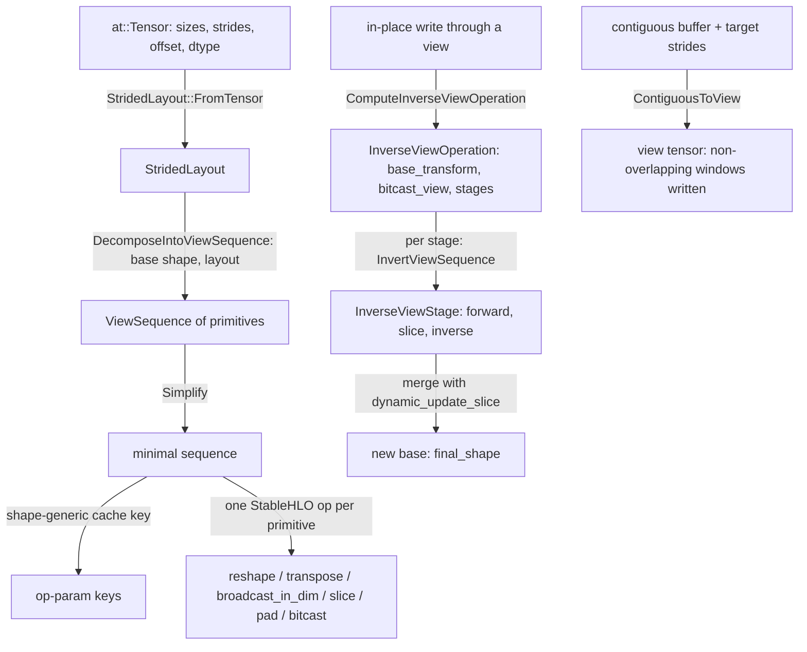

# View decomposition, strided layouts and view inversion

## Overview
On CUDA a view is metadata: sizes, strides, a storage offset and a dtype over one flat byte
buffer. StableHLO has no strides, so TorchTPU keeps every tensor's data as a *contiguous base*
buffer and represents any strided view as a computation over it. The header comment states the
problem precisely: `as_strided` and `view(dtype)` let users set arbitrary metadata, so "it is
necessary to decompose an arbitrary stride pattern into a sequence of supported StableHLO
primitives". A [`StridedLayout`](https://github.com/google-pytorch/torch_tpu/blob/6d2a45754bdb52743883f75fbf753408345f6d1b/csrc/ops/view_decomposition/strided_layout.h#L65 "csrc/ops/view_decomposition/strided_layout.h#StridedLayout")
captures the metadata, [`DecomposeIntoViewSequence`](https://github.com/google-pytorch/torch_tpu/blob/6d2a45754bdb52743883f75fbf753408345f6d1b/csrc/ops/view_decomposition/decomposition.cc#L1244 "csrc/ops/view_decomposition/decomposition.cc#DecomposeIntoViewSequence") turns base shape plus layout into a
[`ViewSequence`](https://github.com/google-pytorch/torch_tpu/blob/6d2a45754bdb52743883f75fbf753408345f6d1b/csrc/ops/view_decomposition/view_sequence.h#L84 "csrc/ops/view_decomposition/view_sequence.h#ViewSequence") of reshape, transpose, broadcast, slice, pad, bitcast, unfold and conj primitives,
and each primitive is emitted as a StableHLO op inside a deferred op. The second half solves
mutation: since XLA buffers are immutable, `x[1] += 1` must be expressed as "invert the view, merge
the updated values into a new base"; [`ComputeInverseViewOperation`](https://github.com/google-pytorch/torch_tpu/blob/6d2a45754bdb52743883f75fbf753408345f6d1b/csrc/ops/view_decomposition/inversion.cc#L903 "csrc/ops/view_decomposition/inversion.cc#ComputeInverseViewOperation") plans that as an
[`InverseViewOperation`](https://github.com/google-pytorch/torch_tpu/blob/6d2a45754bdb52743883f75fbf753408345f6d1b/csrc/ops/view_decomposition/inversion.h#L168 "csrc/ops/view_decomposition/inversion.h#InverseViewOperation") (a base transform plus one stage per slice), and the merge is done with
`dynamic_update_slice`. Overlapping (broadcast, unfold) views are refused for writes because
writing through them is undefined on every backend.

## Diagram

Legend:
- `T` - (concept) tensors, writes and emitted StableHLO
- `W` - (concept) tensors, writes and emitted StableHLO
- `C` - (concept) tensors, writes and emitted StableHLO
- `T2` - (concept) tensors, writes and emitted StableHLO
- `SHLO` - (concept) tensors, writes and emitted StableHLO
- `KEY` - (concept) op-param cache keys of the view's deferred op
- `L` - [`StridedLayout`](https://github.com/google-pytorch/torch_tpu/blob/6d2a45754bdb52743883f75fbf753408345f6d1b/csrc/ops/view_decomposition/strided_layout.h#L65 "csrc/ops/view_decomposition/strided_layout.h#StridedLayout") with [`strided_dims`](https://github.com/google-pytorch/torch_tpu/blob/6d2a45754bdb52743883f75fbf753408345f6d1b/csrc/ops/view_decomposition/strided_layout.h#L70 "csrc/ops/view_decomposition/strided_layout.h#StridedLayout.strided_dims")
- `VS` - [`ViewSequence`](https://github.com/google-pytorch/torch_tpu/blob/6d2a45754bdb52743883f75fbf753408345f6d1b/csrc/ops/view_decomposition/view_sequence.h#L84 "csrc/ops/view_decomposition/view_sequence.h#ViewSequence") built by [`DecomposeIntoViewSequence`](https://github.com/google-pytorch/torch_tpu/blob/6d2a45754bdb52743883f75fbf753408345f6d1b/csrc/ops/view_decomposition/decomposition.cc#L1244 "csrc/ops/view_decomposition/decomposition.cc#DecomposeIntoViewSequence")
- `VS2` - [`ViewSequence`](https://github.com/google-pytorch/torch_tpu/blob/6d2a45754bdb52743883f75fbf753408345f6d1b/csrc/ops/view_decomposition/view_sequence.h#L84 "csrc/ops/view_decomposition/view_sequence.h#ViewSequence") after [`Simplify`](https://github.com/google-pytorch/torch_tpu/blob/6d2a45754bdb52743883f75fbf753408345f6d1b/csrc/ops/view_decomposition/view_sequence.cc#L320 "csrc/ops/view_decomposition/view_sequence.cc#Simplify")
- `INV` - [`InverseViewOperation`](https://github.com/google-pytorch/torch_tpu/blob/6d2a45754bdb52743883f75fbf753408345f6d1b/csrc/ops/view_decomposition/inversion.h#L168 "csrc/ops/view_decomposition/inversion.h#InverseViewOperation") from [`ComputeInverseViewOperation`](https://github.com/google-pytorch/torch_tpu/blob/6d2a45754bdb52743883f75fbf753408345f6d1b/csrc/ops/view_decomposition/inversion.cc#L903 "csrc/ops/view_decomposition/inversion.cc#ComputeInverseViewOperation")
- `ST` - [`InverseViewStage`](https://github.com/google-pytorch/torch_tpu/blob/6d2a45754bdb52743883f75fbf753408345f6d1b/csrc/ops/view_decomposition/inversion.h#L155 "csrc/ops/view_decomposition/inversion.h#InverseViewStage") with its inverse from [`InvertViewSequence`](https://github.com/google-pytorch/torch_tpu/blob/6d2a45754bdb52743883f75fbf753408345f6d1b/csrc/ops/view_decomposition/inversion.cc#L470 "csrc/ops/view_decomposition/inversion.cc#InvertViewSequence")
- `NB` - [`final_shape`](https://github.com/google-pytorch/torch_tpu/blob/6d2a45754bdb52743883f75fbf753408345f6d1b/csrc/ops/view_decomposition/inversion.h#L182 "csrc/ops/view_decomposition/inversion.h#InverseViewOperation.final_shape") of the [`InverseViewOperation`](https://github.com/google-pytorch/torch_tpu/blob/6d2a45754bdb52743883f75fbf753408345f6d1b/csrc/ops/view_decomposition/inversion.h#L168 "csrc/ops/view_decomposition/inversion.h#InverseViewOperation")
- `C` - [`ContiguousToView`](https://github.com/google-pytorch/torch_tpu/blob/6d2a45754bdb52743883f75fbf753408345f6d1b/csrc/ops/view_decomposition/contiguous_to_view.cc#L261 "csrc/ops/view_decomposition/contiguous_to_view.cc#ContiguousToView")

## Design rationale (why it's built this way)
- **Views are ops, and ops are cacheable.** Every view materializes as a deferred op whose
  program is the primitive sequence, so views fuse with the ops around them and cost nothing until
  something is read. The view-sequence cache key deliberately encodes a [`ViewSequence`](https://github.com/google-pytorch/torch_tpu/blob/6d2a45754bdb52743883f75fbf753408345f6d1b/csrc/ops/view_decomposition/view_sequence.h#L84 "csrc/ops/view_decomposition/view_sequence.h#ViewSequence")
  generically ("Basic reshape of [5] -> [5,1] will be stored as [A] -> [A, 1]") and relies on the
  input shapes already in the graph key, so the same view pattern on different tensors shares one
  executable (see [compilation-cache-key](compilation-cache-key.md)).
- **A contiguous base is the invariant.** The decomposition requires the base to be
  non-overlapping, row-major, dense, offset-zero and non-empty (exactly what
  [`MakeContiguousBaseLayout`](https://github.com/google-pytorch/torch_tpu/blob/6d2a45754bdb52743883f75fbf753408345f6d1b/csrc/ops/view_decomposition/strided_layout.cc#L35 "csrc/ops/view_decomposition/strided_layout.cc#MakeContiguousBaseLayout") produces), and the view to fit within the base's bytes. Under those
  conditions the algorithm is total; anything else is rejected before MLIR is built. In eager mode
  the base is the tensor's storage buffer; in compiled mode, where FX tracing only has fake
  tensors, [`GetContiguousBaseShape`](https://github.com/google-pytorch/torch_tpu/blob/6d2a45754bdb52743883f75fbf753408345f6d1b/csrc/ops/view_decomposition/decomposition.cc#L1346 "csrc/ops/view_decomposition/decomposition.cc#GetContiguousBaseShape") chooses the base "which will require the smallest amount of
  steps to decompose" and the compiled function enforces that shape at execution.
- **Meet in the middle.** [`DecomposeIntoViewSequence`](https://github.com/google-pytorch/torch_tpu/blob/6d2a45754bdb52743883f75fbf753408345f6d1b/csrc/ops/view_decomposition/decomposition.cc#L1244 "csrc/ops/view_decomposition/decomposition.cc#DecomposeIntoViewSequence")'s implementation notes say solving for the
  inner slices "is tricky. It's easiest to work both forward and backwards and meet in the
  middle": backwards from the view it peels off the transposes, unsqueezes and expands that make
  the view "well-behaved", forwards from the base it flattens, bitcasts and pads to a 1-D storage
  array covering the view window, and only the remaining middle needs reshape-and-slice steps.
  Pure unsqueeze/transpose/expand views short-circuit after the first phase.
- **Overlapping views are read-only by definition.** The inversion header explains that broadcast
  and unfold are "one-to-many" and therefore not invertible, and that writing through overlapping
  indices "has undefined behavior (on CPU, CUDA, and TPU alike)". TorchTPU raises instead of
  guessing; the buffer-assignment path checks for overlap before [`ComputeInverseViewOperation`](https://github.com/google-pytorch/torch_tpu/blob/6d2a45754bdb52743883f75fbf753408345f6d1b/csrc/ops/view_decomposition/inversion.cc#L903 "csrc/ops/view_decomposition/inversion.cc#ComputeInverseViewOperation") is
  ever called, and [`InvertViewSequence`](https://github.com/google-pytorch/torch_tpu/blob/6d2a45754bdb52743883f75fbf753408345f6d1b/csrc/ops/view_decomposition/inversion.cc#L470 "csrc/ops/view_decomposition/inversion.cc#InvertViewSequence") treats a lossy or overlapping primitive as an internal
  bug.
- **Mutation is merge, not write.** The invertible subset ([`InverseViewPrimitive`](https://github.com/google-pytorch/torch_tpu/blob/6d2a45754bdb52743883f75fbf753408345f6d1b/csrc/ops/view_decomposition/inversion.h#L127 "csrc/ops/view_decomposition/inversion.h#InverseViewPrimitive")) is reshape,
  transpose, slice, conj and the dtype views; everything else is either lossy or one-to-many. Each
  slice in the forward sequence ends one [`InverseViewStage`](https://github.com/google-pytorch/torch_tpu/blob/6d2a45754bdb52743883f75fbf753408345f6d1b/csrc/ops/view_decomposition/inversion.h#L155 "csrc/ops/view_decomposition/inversion.h#InverseViewStage"): the stage's other primitives are
  inverted, and the updated values are merged into the value the base had just before that slice
  with `stablehlo.dynamic_update_slice`. The source explains the choice: `dynamic_update_slice` has
  a single read operand that "XLA buffer assignment aliases in-place with the output buffer",
  while a slice-plus-concatenate merge reads the base twice, "preventing XLA from aliasing" and
  "doubling memory consumption" in loops such as `output[:, t, :] = h_t`; the concatenate form is
  kept only for dimensions larger than `INT32_MAX`. Strided slices (stride > 1) are first rewritten
  into pad, reshape and dense slices because inverting them directly "would require a
  stablehlo.select operation with a boolean mask", which is slow to compile.
- **Dtype-changing views are bit-exact.** `view(dtype)` and complex views are primitives
  ([`RealToRealBitcast`](https://github.com/google-pytorch/torch_tpu/blob/6d2a45754bdb52743883f75fbf753408345f6d1b/csrc/ops/view_decomposition/bitcast_primitive.h#L83 "csrc/ops/view_decomposition/bitcast_primitive.h#RealToRealBitcast"), [`ComplexToRealBitcast`](https://github.com/google-pytorch/torch_tpu/blob/6d2a45754bdb52743883f75fbf753408345f6d1b/csrc/ops/view_decomposition/bitcast_primitive.h#L142 "csrc/ops/view_decomposition/bitcast_primitive.h#ComplexToRealBitcast"), [`ViewAsComplex`](https://github.com/google-pytorch/torch_tpu/blob/6d2a45754bdb52743883f75fbf753408345f6d1b/csrc/ops/view_decomposition/bitcast_primitive.h#L164 "csrc/ops/view_decomposition/bitcast_primitive.h#ViewAsComplex")). Inverting a write through a
  narrower dtype casts both sides to the smaller bitwidth so partial updates of wider base elements
  "preserve unmodified bits", and a boolean base is widened to `uint8` so assigned bytes are not
  collapsed to 0 or 1.
- **The written-back base may change shape unless it is donated.** With `preserve_base=false`,
  [`ComputeInverseViewOperation`](https://github.com/google-pytorch/torch_tpu/blob/6d2a45754bdb52743883f75fbf753408345f6d1b/csrc/ops/view_decomposition/inversion.cc#L903 "csrc/ops/view_decomposition/inversion.cc#ComputeInverseViewOperation") may fold invertible bitcasts and a leading reshape into the
  [`base_transform`](https://github.com/google-pytorch/torch_tpu/blob/6d2a45754bdb52743883f75fbf753408345f6d1b/csrc/ops/view_decomposition/inversion.h#L173 "csrc/ops/view_decomposition/inversion.h#InverseViewOperation.base_transform"), so the new base has a different [`final_shape`](https://github.com/google-pytorch/torch_tpu/blob/6d2a45754bdb52743883f75fbf753408345f6d1b/csrc/ops/view_decomposition/inversion.h#L182 "csrc/ops/view_decomposition/inversion.h#InverseViewOperation.final_shape") and dtype that "will make
  this view more efficient to compute in the future". When the old base buffer is donated to the
  update, its shape and dtype must stay the same, so the caller passes `preserve_base=true`.
- **`ContiguousToView` is the inverse of `.contiguous()`.** Given a dense buffer and target
  strides, [`ContiguousToView`](https://github.com/google-pytorch/torch_tpu/blob/6d2a45754bdb52743883f75fbf753408345f6d1b/csrc/ops/view_decomposition/contiguous_to_view.cc#L261 "csrc/ops/view_decomposition/contiguous_to_view.cc#ContiguousToView") writes non-overlapping windows into fresh storage so the requested
  view reads correctly, with "last write wins" for duplicated data and gaps filled following
  PyTorch's uninitialized-memory policy; the header warns that a later out-of-bounds `as_strided`
  can observe this "zombie data".

> [!inferred]
> For a user onboarding code, the practical rules are: reads through any view are fine and fuse;
> in-place writes through slices, transposes, reshapes and dtype views work by rebuilding the base;
> in-place writes through `expand`/broadcast or `unfold` views raise; and `as_strided` with
> out-of-bounds or overlapping patterns is where the emulation is least like CUDA.

## Entry points
- [`DecomposeIntoViewSequence`](https://github.com/google-pytorch/torch_tpu/blob/6d2a45754bdb52743883f75fbf753408345f6d1b/csrc/ops/view_decomposition/decomposition.cc#L1244 "csrc/ops/view_decomposition/decomposition.cc#DecomposeIntoViewSequence") and [`GetContiguousBaseShape`](https://github.com/google-pytorch/torch_tpu/blob/6d2a45754bdb52743883f75fbf753408345f6d1b/csrc/ops/view_decomposition/decomposition.cc#L1346 "csrc/ops/view_decomposition/decomposition.cc#GetContiguousBaseShape"): decompose a base shape plus a
  [`StridedLayout`](https://github.com/google-pytorch/torch_tpu/blob/6d2a45754bdb52743883f75fbf753408345f6d1b/csrc/ops/view_decomposition/strided_layout.h#L65 "csrc/ops/view_decomposition/strided_layout.h#StridedLayout") into a sequence, or pick a base shape for compiled mode. The decomposition is called from
  the buffer extraction path that turns an `at::Tensor` into a deferred view op
  ([eager-op-dispatch](eager-op-dispatch.md), step 2); the base-shape choice is called by the
  compiled-mode argument handling and by [`ContiguousToView`](https://github.com/google-pytorch/torch_tpu/blob/6d2a45754bdb52743883f75fbf753408345f6d1b/csrc/ops/view_decomposition/contiguous_to_view.cc#L261 "csrc/ops/view_decomposition/contiguous_to_view.cc#ContiguousToView").
- [`ComputeInverseViewOperation`](https://github.com/google-pytorch/torch_tpu/blob/6d2a45754bdb52743883f75fbf753408345f6d1b/csrc/ops/view_decomposition/inversion.cc#L903 "csrc/ops/view_decomposition/inversion.cc#ComputeInverseViewOperation"): called when a kernel writes into a tensor whose storage is a
  view (the inverse-view ref creation in
  [deferred-execution-and-materialization](deferred-execution-and-materialization.md)); the plan it
  returns is emitted as an `as_strided` inverse deferred op.
- [`ContiguousToView`](https://github.com/google-pytorch/torch_tpu/blob/6d2a45754bdb52743883f75fbf753408345f6d1b/csrc/ops/view_decomposition/contiguous_to_view.cc#L261 "csrc/ops/view_decomposition/contiguous_to_view.cc#ContiguousToView"): used when a kernel must produce a tensor with prescribed strides, for
  example attention outputs that later view ops expect in a particular permutation, and by the
  compiled-mode output path and the optimization barrier.
- [`UpdateLayout`](https://github.com/google-pytorch/torch_tpu/blob/6d2a45754bdb52743883f75fbf753408345f6d1b/csrc/ops/view_decomposition/view_sequence.cc#L287 "csrc/ops/view_decomposition/view_sequence.cc#UpdateLayout"): the layout-tracking visitor every primitive implements,
  alongside a per-primitive StableHLO emitter.

## Mechanism (step-by-step)
1. **Capture the layout.** [`StridedLayout`](https://github.com/google-pytorch/torch_tpu/blob/6d2a45754bdb52743883f75fbf753408345f6d1b/csrc/ops/view_decomposition/strided_layout.h#L65 "csrc/ops/view_decomposition/strided_layout.h#StridedLayout") is built from the tensor: one
   [`size`](https://github.com/google-pytorch/torch_tpu/blob/6d2a45754bdb52743883f75fbf753408345f6d1b/csrc/ops/view_decomposition/strided_layout.h#L51 "csrc/ops/view_decomposition/strided_layout.h#StridedDimension.size")/[`stride`](https://github.com/google-pytorch/torch_tpu/blob/6d2a45754bdb52743883f75fbf753408345f6d1b/csrc/ops/view_decomposition/strided_layout.h#L53 "csrc/ops/view_decomposition/strided_layout.h#StridedDimension.stride") pair per axis plus the [`storage_offset`](https://github.com/google-pytorch/torch_tpu/blob/6d2a45754bdb52743883f75fbf753408345f6d1b/csrc/ops/view_decomposition/strided_layout.h#L72 "csrc/ops/view_decomposition/strided_layout.h#StridedLayout.storage_offset"), sized to one cache line
   (64 bytes, asserted). Stride 0 means broadcast, size 1 makes the stride irrelevant.
2. **Peel the tail, build the head.** [`DecomposeIntoViewSequence`](https://github.com/google-pytorch/torch_tpu/blob/6d2a45754bdb52743883f75fbf753408345f6d1b/csrc/ops/view_decomposition/decomposition.cc#L1244 "csrc/ops/view_decomposition/decomposition.cc#DecomposeIntoViewSequence") first works backwards from the
   view to a well-behaved row-major layout, recording the trailing [`TransposePrimitive`](https://github.com/google-pytorch/torch_tpu/blob/6d2a45754bdb52743883f75fbf753408345f6d1b/csrc/ops/view_decomposition/transpose_primitive.h#L50 "csrc/ops/view_decomposition/transpose_primitive.h#TransposePrimitive"),
   [`ReshapePrimitive`](https://github.com/google-pytorch/torch_tpu/blob/6d2a45754bdb52743883f75fbf753408345f6d1b/csrc/ops/view_decomposition/reshape_primitive.h#L55 "csrc/ops/view_decomposition/reshape_primitive.h#ReshapePrimitive") and broadcast steps; then it works forwards, reshaping and bitcasting the
   base into a 1-D storage array and adding a [`PadPrimitive`](https://github.com/google-pytorch/torch_tpu/blob/6d2a45754bdb52743883f75fbf753408345f6d1b/csrc/ops/view_decomposition/pad_primitive.h#L85 "csrc/ops/view_decomposition/pad_primitive.h#PadPrimitive") (high padding up to the required
   storage capacity) followed by a [`SlicePrimitive`](https://github.com/google-pytorch/torch_tpu/blob/6d2a45754bdb52743883f75fbf753408345f6d1b/csrc/ops/view_decomposition/slice_primitive.h#L67 "csrc/ops/view_decomposition/slice_primitive.h#SlicePrimitive") that cuts out the view window
   starting at its storage offset.
3. **Rebuild each dimension.** While the head has fewer dims than the tail, a body step appends
   reshapes and [`SlicePrimitive`](https://github.com/google-pytorch/torch_tpu/blob/6d2a45754bdb52743883f75fbf753408345f6d1b/csrc/ops/view_decomposition/slice_primitive.h#L67 "csrc/ops/view_decomposition/slice_primitive.h#SlicePrimitive")s (one [`SliceDimension`](https://github.com/google-pytorch/torch_tpu/blob/6d2a45754bdb52743883f75fbf753408345f6d1b/csrc/ops/view_decomposition/slice_primitive.h#L41 "csrc/ops/view_decomposition/slice_primitive.h#SliceDimension") of start, limit and stride per axis),
   handling separately axes whose strides partition the data and axes that revisit elements
   (unfold-style windows); a final-dimension step closes the innermost axis and a size-1 extra dim
   is squeezed out if one was introduced. Each primitive appended is also applied to a working
   layout via [`UpdateLayout`](https://github.com/google-pytorch/torch_tpu/blob/6d2a45754bdb52743883f75fbf753408345f6d1b/csrc/ops/view_decomposition/view_sequence.cc#L287 "csrc/ops/view_decomposition/view_sequence.cc#UpdateLayout") so the algorithm can verify it converged on the
   requested layout.
4. **Simplify and key.** [`Simplify`](https://github.com/google-pytorch/torch_tpu/blob/6d2a45754bdb52743883f75fbf753408345f6d1b/csrc/ops/view_decomposition/view_sequence.cc#L320 "csrc/ops/view_decomposition/view_sequence.cc#Simplify") repeatedly removes no-ops and merges sequential primitives
   until nothing changes; the simplified [`ViewSequence`](https://github.com/google-pytorch/torch_tpu/blob/6d2a45754bdb52743883f75fbf753408345f6d1b/csrc/ops/view_decomposition/view_sequence.h#L84 "csrc/ops/view_decomposition/view_sequence.h#ViewSequence") then produces shape-generic op-param keys
   for the deferred op.
5. **Emit at build time.** Inside the traversal, each [`ViewPrimitive`](https://github.com/google-pytorch/torch_tpu/blob/6d2a45754bdb52743883f75fbf753408345f6d1b/csrc/ops/view_decomposition/view_sequence.h#L48 "csrc/ops/view_decomposition/view_sequence.h#ViewPrimitive") maps to `reshape`,
   `transpose`, `broadcast_in_dim`, `slice` (with [`slice_dims`](https://github.com/google-pytorch/torch_tpu/blob/6d2a45754bdb52743883f75fbf753408345f6d1b/csrc/ops/view_decomposition/slice_primitive.h#L68 "csrc/ops/view_decomposition/slice_primitive.h#SlicePrimitive.slice_dims")), `pad` (with [`pad_dims`](https://github.com/google-pytorch/torch_tpu/blob/6d2a45754bdb52743883f75fbf753408345f6d1b/csrc/ops/view_decomposition/pad_primitive.h#L86 "csrc/ops/view_decomposition/pad_primitive.h#PadPrimitive.pad_dims")),
   bitcast, physical conj or the unfold lowering.
6. **Plan the inversion.** For an in-place update, [`ComputeInverseViewOperation`](https://github.com/google-pytorch/torch_tpu/blob/6d2a45754bdb52743883f75fbf753408345f6d1b/csrc/ops/view_decomposition/inversion.cc#L903 "csrc/ops/view_decomposition/inversion.cc#ComputeInverseViewOperation") computes the
   bitcasts that align base and view dtypes ([`base_transform`](https://github.com/google-pytorch/torch_tpu/blob/6d2a45754bdb52743883f75fbf753408345f6d1b/csrc/ops/view_decomposition/inversion.h#L173 "csrc/ops/view_decomposition/inversion.h#InverseViewOperation.base_transform") for the base, [`bitcast_view`](https://github.com/google-pytorch/torch_tpu/blob/6d2a45754bdb52743883f75fbf753408345f6d1b/csrc/ops/view_decomposition/inversion.h#L176 "csrc/ops/view_decomposition/inversion.h#InverseViewOperation.bitcast_view") for
   the mutated view), rewrites strided slices, and partitions the base-to-view sequence into
   [`stages`](https://github.com/google-pytorch/torch_tpu/blob/6d2a45754bdb52743883f75fbf753408345f6d1b/csrc/ops/view_decomposition/inversion.h#L180 "csrc/ops/view_decomposition/inversion.h#InverseViewOperation.stages"): every slice ends a stage, and [`InvertViewSequence`](https://github.com/google-pytorch/torch_tpu/blob/6d2a45754bdb52743883f75fbf753408345f6d1b/csrc/ops/view_decomposition/inversion.cc#L470 "csrc/ops/view_decomposition/inversion.cc#InvertViewSequence") inverts the primitives of each
   stage (adding a restoring reshape around complex bitcasts, since view-as-real and
   view-as-complex are "not 1:1 inverses").
7. **Emit the merge.** The emitter applies the base transform, replays the forward stages to
   capture the base value before each slice, bitcasts the mutated view, then walks the stages
   backwards: apply the stage's inverse, then merge into the pre-slice value with
   `dynamic_update_slice`. A view with no slices is a full overwrite and needs no merge. The result
   has the operation's [`final_shape`](https://github.com/google-pytorch/torch_tpu/blob/6d2a45754bdb52743883f75fbf753408345f6d1b/csrc/ops/view_decomposition/inversion.h#L182 "csrc/ops/view_decomposition/inversion.h#InverseViewOperation.final_shape").

## Key data structures
- [`StridedLayout`](https://github.com/google-pytorch/torch_tpu/blob/6d2a45754bdb52743883f75fbf753408345f6d1b/csrc/ops/view_decomposition/strided_layout.h#L65 "csrc/ops/view_decomposition/strided_layout.h#StridedLayout"): inlined vector of `(size, stride)` ([`strided_dims`](https://github.com/google-pytorch/torch_tpu/blob/6d2a45754bdb52743883f75fbf753408345f6d1b/csrc/ops/view_decomposition/strided_layout.h#L70 "csrc/ops/view_decomposition/strided_layout.h#StridedLayout.strided_dims")) plus
  [`storage_offset`](https://github.com/google-pytorch/torch_tpu/blob/6d2a45754bdb52743883f75fbf753408345f6d1b/csrc/ops/view_decomposition/strided_layout.h#L72 "csrc/ops/view_decomposition/strided_layout.h#StridedLayout.storage_offset"); [`GetSizes`](https://github.com/google-pytorch/torch_tpu/blob/6d2a45754bdb52743883f75fbf753408345f6d1b/csrc/ops/view_decomposition/strided_layout.cc#L104 "csrc/ops/view_decomposition/strided_layout.cc#GetSizes") and [`GetStrides`](https://github.com/google-pytorch/torch_tpu/blob/6d2a45754bdb52743883f75fbf753408345f6d1b/csrc/ops/view_decomposition/strided_layout.cc#L111 "csrc/ops/view_decomposition/strided_layout.cc#GetStrides") gather the columns; equality and printing
  ([`operator<<`](https://github.com/google-pytorch/torch_tpu/blob/6d2a45754bdb52743883f75fbf753408345f6d1b/csrc/ops/view_decomposition/strided_layout.cc#L70 "csrc/ops/view_decomposition/strided_layout.cc#operator")) for tests.
- [`ViewPrimitive`](https://github.com/google-pytorch/torch_tpu/blob/6d2a45754bdb52743883f75fbf753408345f6d1b/csrc/ops/view_decomposition/view_sequence.h#L48 "csrc/ops/view_decomposition/view_sequence.h#ViewPrimitive"): a variant of reshape, transpose, broadcast, slice, pad, real-to-real bitcast,
  complex-to-real bitcast, view-as-complex, unfold and conj (176 bytes, asserted). A
  [`ReshapePrimitive`](https://github.com/google-pytorch/torch_tpu/blob/6d2a45754bdb52743883f75fbf753408345f6d1b/csrc/ops/view_decomposition/reshape_primitive.h#L55 "csrc/ops/view_decomposition/reshape_primitive.h#ReshapePrimitive") records [`base_sizes`](https://github.com/google-pytorch/torch_tpu/blob/6d2a45754bdb52743883f75fbf753408345f6d1b/csrc/ops/view_decomposition/reshape_primitive.h#L56 "csrc/ops/view_decomposition/reshape_primitive.h#ReshapePrimitive.base_sizes") and [`new_sizes`](https://github.com/google-pytorch/torch_tpu/blob/6d2a45754bdb52743883f75fbf753408345f6d1b/csrc/ops/view_decomposition/reshape_primitive.h#L57 "csrc/ops/view_decomposition/reshape_primitive.h#ReshapePrimitive.new_sizes"); a [`TransposePrimitive`](https://github.com/google-pytorch/torch_tpu/blob/6d2a45754bdb52743883f75fbf753408345f6d1b/csrc/ops/view_decomposition/transpose_primitive.h#L50 "csrc/ops/view_decomposition/transpose_primitive.h#TransposePrimitive") its
  [`permutation`](https://github.com/google-pytorch/torch_tpu/blob/6d2a45754bdb52743883f75fbf753408345f6d1b/csrc/ops/view_decomposition/transpose_primitive.h#L51 "csrc/ops/view_decomposition/transpose_primitive.h#TransposePrimitive.permutation"); [`ConjPrimitive`](https://github.com/google-pytorch/torch_tpu/blob/6d2a45754bdb52743883f75fbf753408345f6d1b/csrc/ops/view_decomposition/conj_primitive.h#L25 "csrc/ops/view_decomposition/conj_primitive.h#ConjPrimitive") carries whether conj is set.
- [`InverseViewPrimitive`](https://github.com/google-pytorch/torch_tpu/blob/6d2a45754bdb52743883f75fbf753408345f6d1b/csrc/ops/view_decomposition/inversion.h#L127 "csrc/ops/view_decomposition/inversion.h#InverseViewPrimitive"): reshape, transpose, slice, conj, real-to-real bitcast,
  complex-to-real bitcast and view-as-complex; the invertible subset.
- [`InverseViewOperation`](https://github.com/google-pytorch/torch_tpu/blob/6d2a45754bdb52743883f75fbf753408345f6d1b/csrc/ops/view_decomposition/inversion.h#L168 "csrc/ops/view_decomposition/inversion.h#InverseViewOperation"): [`base_transform`](https://github.com/google-pytorch/torch_tpu/blob/6d2a45754bdb52743883f75fbf753408345f6d1b/csrc/ops/view_decomposition/inversion.h#L173 "csrc/ops/view_decomposition/inversion.h#InverseViewOperation.base_transform"), [`bitcast_view`](https://github.com/google-pytorch/torch_tpu/blob/6d2a45754bdb52743883f75fbf753408345f6d1b/csrc/ops/view_decomposition/inversion.h#L176 "csrc/ops/view_decomposition/inversion.h#InverseViewOperation.bitcast_view"), [`stages`](https://github.com/google-pytorch/torch_tpu/blob/6d2a45754bdb52743883f75fbf753408345f6d1b/csrc/ops/view_decomposition/inversion.h#L180 "csrc/ops/view_decomposition/inversion.h#InverseViewOperation.stages") (one more than the
  number of slices; each an [`InverseViewStage`](https://github.com/google-pytorch/torch_tpu/blob/6d2a45754bdb52743883f75fbf753408345f6d1b/csrc/ops/view_decomposition/inversion.h#L155 "csrc/ops/view_decomposition/inversion.h#InverseViewStage") of forward sequence, optional boundary slice and
  inverse) and [`final_shape`](https://github.com/google-pytorch/torch_tpu/blob/6d2a45754bdb52743883f75fbf753408345f6d1b/csrc/ops/view_decomposition/inversion.h#L182 "csrc/ops/view_decomposition/inversion.h#InverseViewOperation.final_shape").
- [`ViewSequence`](https://github.com/google-pytorch/torch_tpu/blob/6d2a45754bdb52743883f75fbf753408345f6d1b/csrc/ops/view_decomposition/view_sequence.h#L84 "csrc/ops/view_decomposition/view_sequence.h#ViewSequence"): a vector of primitives; printable in a compact `reshape[...]`,
  `transpose[...]`, `slice[(start, limit, stride)...]` form used in logs and cache keys, with
  [`operator==`](https://github.com/google-pytorch/torch_tpu/blob/6d2a45754bdb52743883f75fbf753408345f6d1b/csrc/ops/view_decomposition/view_sequence.cc#L186 "csrc/ops/view_decomposition/view_sequence.cc#operator") for tests.

## Dynamics (design intent)
- Decomposition runs on the dispatch thread and is pure; emission runs on the materialize thread
  as part of the surrounding traversal, so a chain of views never launches its own executable.
- Because cache keys are shape-generic, repeated view patterns across a model (per-layer
  transposes, slicing of KV caches) reuse compiled programs even as batch or sequence sizes change
  in the surrounding graph key.
- The `dynamic_update_slice` merge lets XLA update a base in place across a step-by-step loop of
  slice writes instead of materializing a copy per step.

## Edge cases
- Empty views and negative storage offsets are rejected; a view whose maximum byte index exceeds
  the base is rejected rather than reading past the buffer.
- Some bitcasts lose information (real to boolean drops 7 bits per byte, `real()`/`imag()` drop
  half the data) and are not invertible; a boolean base is widened rather than written through.
- [`ContiguousToView`](https://github.com/google-pytorch/torch_tpu/blob/6d2a45754bdb52743883f75fbf753408345f6d1b/csrc/ops/view_decomposition/contiguous_to_view.cc#L261 "csrc/ops/view_decomposition/contiguous_to_view.cc#ContiguousToView") on already-contiguous target strides with zero offset is a no-op that wraps
  the buffer.
- Uninitialized gaps created by [`ContiguousToView`](https://github.com/google-pytorch/torch_tpu/blob/6d2a45754bdb52743883f75fbf753408345f6d1b/csrc/ops/view_decomposition/contiguous_to_view.cc#L261 "csrc/ops/view_decomposition/contiguous_to_view.cc#ContiguousToView") contain NaN or max-int fill, so
  deterministic-fill settings influence what an out-of-bounds `as_strided` observes.
- A non-donated write-back may leave the tensor's base with a different shape or dtype than
  before ([`final_shape`](https://github.com/google-pytorch/torch_tpu/blob/6d2a45754bdb52743883f75fbf753408345f6d1b/csrc/ops/view_decomposition/inversion.h#L182 "csrc/ops/view_decomposition/inversion.h#InverseViewOperation.final_shape")); code that inspects base buffer shapes must not assume they are stable.

## Open questions
- The long comment at the top of `inversion.h` still describes the merge as pad plus mask plus
  `select`; the code at this pin merges per stage with `dynamic_update_slice` and only rewrites
  strided slices to avoid the select. The comment appears to predate the staged design.
- The per-primitive emitters, the view-sequence cache-key builder and the strided-slice rewrite
  are not in this page's symbol set; read `view_sequence.cc` and `inversion.cc` for them.

## See also
- [eager-op-dispatch](eager-op-dispatch.md): where tensors are turned into buffer refs.
- [deferred-execution-and-materialization](deferred-execution-and-materialization.md): view and inverse-view refs.
- [stablehlo-op-builder](stablehlo-op-builder.md): the StableHLO builders the primitives emit through.
- [compilation-cache-key](compilation-cache-key.md): shape-generic keys.
- [host-device-transfer](host-device-transfer.md): copies into strided destinations.

## Recent changes
- `58c282d9d` adds a base-donating option to buffer assignment: a partial in-place write builds
  the new base with a `dynamic_update_slice`, and without donation that update "will be performed
  out-of-place. For small writes to a large base buffer, this can be very memory-intensive."
  Donation is skipped for full overwrites, for a boolean base receiving non-boolean data (the
  storage must widen), and when other shallow copies exist (copy-on-write).
  To keep a donated base's shape and dtype intact, [`ComputeInverseViewOperation`](https://github.com/google-pytorch/torch_tpu/blob/6d2a45754bdb52743883f75fbf753408345f6d1b/csrc/ops/view_decomposition/inversion.cc#L903 "csrc/ops/view_decomposition/inversion.cc#ComputeInverseViewOperation") gained the
  `preserve_base` flag.
- [all changes in 6d2a45754b](../changes/6d2a45754b.md)
