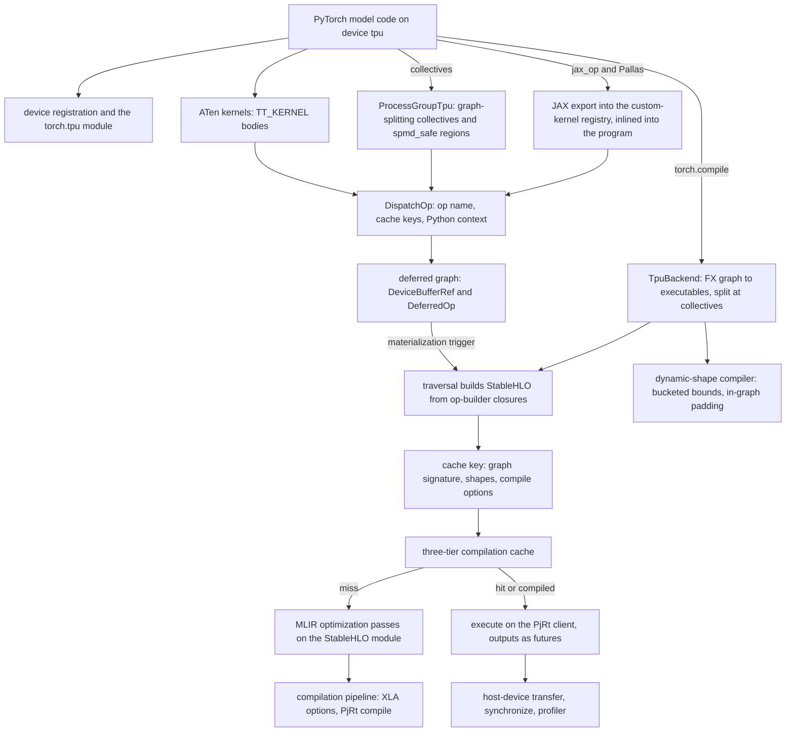

# torch_tpu - what it is and how it fits together

## In one paragraph
TorchTPU (`torch_tpu`) is the PyTorch backend for Google Cloud TPUs: a C++ core under `csrc/`
and a Python package under `src/torch_tpu/`. Importing it renames PyTorch's PrivateUse1 slot to
a `tpu` device (the only device; there is no CPU or GPU fallback) and registers a `torch.tpu`
module, a `tpu_dist` process-group backend and an xprof-based profiler. Every ATen kernel is written against one
dispatcher: instead of running, a kernel records a deferred op that carries a StableHLO builder
closure, its cache keys and the Python call context, so a TPU tensor is a graph of pending ops
until something needs real bytes. Materialization walks that graph into a StableHLO module,
derives a cache key from the graph signature, shapes and compiler options, and looks it up in a
three-tier compilation cache; on a miss the module runs through TorchTPU's own MLIR pass
pipeline before XLA compiles it through PjRt. Executions are enqueued
asynchronously and outputs stay futures. `torch.compile` reuses the same builder and compile
machinery for whole FX graphs, optionally with bounded dynamic shapes; collectives, Pallas or
JAX custom kernels and fused optimizers are all just more deferred ops in the same program.
The design goal throughout is to keep XLA programs stable and reusable so that compilation,
not execution, is the exceptional event.

## Core architecture

Legend:
- `USER` - (concept) the user's PyTorch program
- `REGD` - [device-backend-registration](concepts/device-backend-registration.md)
- `KERN` - [aten-kernel-authoring](concepts/aten-kernel-authoring.md)
- `DISP` - [eager-op-dispatch](concepts/eager-op-dispatch.md)
- `DEF` - [deferred-execution-and-materialization](concepts/deferred-execution-and-materialization.md)
- `TRAV` - [stablehlo-op-builder](concepts/stablehlo-op-builder.md)
- `KEY` - [compilation-cache-key](concepts/compilation-cache-key.md)
- `CACHE` - [compilation-cache](concepts/compilation-cache.md)
- `OPT` - [mlir-optimization-passes](concepts/mlir-optimization-passes.md)
- `PIPE` - [compilation-pipeline](concepts/compilation-pipeline.md)
- `EXEC` - [pjrt-client](concepts/pjrt-client.md)
- `TCB` - [torch-compile-backend](concepts/torch-compile-backend.md)
- `DYN` - [dynamic-shapes-compiler](concepts/dynamic-shapes-compiler.md)
- `PG` - [process-group-and-collectives](concepts/process-group-and-collectives.md)
- `PAL` - [pallas-custom-kernels](concepts/pallas-custom-kernels.md)
- `XFER` - [host-device-transfer](concepts/host-device-transfer.md)

One eager op, end to end:

```mermaid
flowchart LR
  A["y = x.matmul w"] --> B["kernel: TT_KERNEL frame, parameter cache keys"]
  B --> C["DispatchOp records a DeferredOp with its StableHLO builder"]
  C --> D["y holds a deferred DeviceBufferRef"]
  D -->|"y.cpu, synchronize, repeated-op heuristic, or the defer-never default"| E["materialize: worker traversal"]
  E --> F["GraphSignature to ShapelessKey plus dimensions"]
  F -->|"tier 1, tier 2, tier 3 lookup"| G["compiled executable or a compile job"]
  G --> H["execute thread enqueues on PjRt"]
  H --> I["transfer to host, or the next op consumes the buffer"]
```

Legend:
- `A` - (concept) the user's op
- `B` - [aten-kernel-authoring](concepts/aten-kernel-authoring.md)
- `C` - [eager-op-dispatch](concepts/eager-op-dispatch.md)
- `D` - [deferred-execution-and-materialization](concepts/deferred-execution-and-materialization.md)
- `E` - [deferred-execution-and-materialization](concepts/deferred-execution-and-materialization.md)
- `F` - [compilation-cache-key](concepts/compilation-cache-key.md)
- `G` - [compilation-cache](concepts/compilation-cache.md)
- `H` - [pjrt-client](concepts/pjrt-client.md)
- `I` - [host-device-transfer](concepts/host-device-transfer.md)

## Main concepts

### Tensors are graphs until materialized
A TPU tensor's storage is a `DeviceBufferRef` into a list whose state moves from deferred to
materializing to materialized. A trigger (a `.cpu()`, an `item()`, an explicit `synchronize`, a
collective, or the repeated-op heuristic) hands the pending graph to the materialization worker,
whose materialize and execute threads keep compilation and execution off the Python thread. The
default eager mode still materializes right after each dispatch, for CUDA-like ordering;
`TORCH_TPU_DEFER_AND_FUSE=1` is the opt-in performance mode that lets graphs grow and fuse, and
`TORCH_TPU_LAUNCH_BLOCKING=1` runs each op synchronously for debugging. See
[deferred-execution-and-materialization](concepts/deferred-execution-and-materialization.md)
and [synchronization](concepts/synchronization.md).

### One dispatcher, one builder contract
Every kernel is a `TT_KERNEL` body that computes parameter cache keys, captures the Python
context and calls `DispatchOp` with a StableHLO builder closure (nullary to N-ary, or dynamic).
Scalars are promoted to device tensors so that executables do not bake in constants. The
builder is only run later, by the traversal, which is what lets the same kernel serve eager
mode and `torch.compile`. See [eager-op-dispatch](concepts/eager-op-dispatch.md),
[aten-kernel-authoring](concepts/aten-kernel-authoring.md) and
[stablehlo-op-builder](concepts/stablehlo-op-builder.md); [view-decomposition](concepts/view-decomposition.md),
[reductions](concepts/reductions.md) and [fused-optimizers](concepts/fused-optimizers.md) are
worked examples of the contract.

### Cache keys and the three-tier compilation cache
Two programs are the same when their graph signature (op names, edges, dtypes, donated inputs,
per-op parameter keys) and their shapes match; the shapeless key also lets bounded-dynamic
programs reuse a padded executable. Executables live in memory (tier 1), in a host-local file
cache shared across processes (tier 2, `TORCH_TPU_TIER2_COMPILATION_CACHE`) and in a
persistent root across jobs (tier 3, `TORCH_TPU_TIER3_COMPILATION_CACHE_ROOT`).
Compiler options are fingerprinted into the key, so `XLA_FLAGS`,
`TORCH_TPU_INTERNAL_XLA_OPTIONS` and the `custom_compiler_options` context change the key
rather than silently changing a cached program. On a miss, every module (eager, fused or
`torch.compile`) first passes through one fixed MLIR pipeline (CSE, canonicalization, a
norm-weight reassociation rewrite, StableHLO target-independent optimization, symbol DCE), so a
graph-level rewrite added there serves every execution mode. See
[compilation-cache-key](concepts/compilation-cache-key.md),
[compilation-cache](concepts/compilation-cache.md),
[mlir-optimization-passes](concepts/mlir-optimization-passes.md) and
[compilation-pipeline](concepts/compilation-pipeline.md).

### Precision is a policy
Dtypes map one-to-one to StableHLO types, float32 matmul precision is chosen by
`torch.set_float32_matmul_precision` (DEFAULT, HIGH, HIGHEST) and `torch_tpu.precision`, excess
precision is a switchable policy, and `computation_dtype` decides what a kernel computes in
versus what it stores. All of these are part of the cache key. See
[dtype-and-precision](concepts/dtype-and-precision.md).

### Three compile paths, all shape-bounded
Eager mode compiles traversals of the deferred graph; `torch.compile` with the default `tpu`
backend traces an FX graph through the same eager machinery on placeholder tensors and compiles
it (`TpuBackend`: a static or dynamic base compiler wrapped in a split compiler that cuts the
graph at collectives, optionally compiling asynchronously). Dynamic shapes are handled by bounds
in both paths: `mark_dynamic` on a tensor dimension in eager mode, or, under `torch.compile`,
`SymInt` ranges split into buckets aligned to `bucket_size` (default 128), each compiled to
one static executable, with inputs padded inside the executable (`pad_real_to_static`, or
`set_dimension_logical_size` where that cannot be used). A third path skips Dynamo: an FX
graph traced ahead of time with `make_fx` (for example the whole training step, forward + loss +
backward + optimizer, that TorchTitan's graph trainer captures in its `aot_fx_trace` mode; see the
[torchtitan overview](../torchtitan/overview.md)) is handed straight to [`StaticCompiler`](https://github.com/google-pytorch/torch_tpu/blob/6d2a45754bdb52743883f75fbf753408345f6d1b/src/torch_tpu/_internal/compile/compiler.py#L312 "src/torch_tpu/_internal/compile/compiler#StaticCompiler")
(`StaticCompiler()(graph_module, example_inputs, ...)`, its [`__call__`](https://github.com/google-pytorch/torch_tpu/blob/6d2a45754bdb52743883f75fbf753408345f6d1b/src/torch_tpu/_internal/compile/compiler.py#L463 "src/torch_tpu/_internal/compile/compiler#StaticCompiler.__call__")), the same
compiler `torch.compile` uses underneath: it applies the pre-compile graph passes, lowers to
StableHLO on placeholder tensors and compiles one PjRt executable, optionally asynchronously
(`async_compile=True`). It refuses dynamic shapes. See
[torch-compile-backend](concepts/torch-compile-backend.md),
[dynamic-shapes-compiler](concepts/dynamic-shapes-compiler.md) and
[eager-dynamic-shapes](concepts/eager-dynamic-shapes.md).

### Per-chip SPMD with explicit collective fusion
Each process owns one device; `WORLD_SIZE` must be 1 or the global device count.
`ProcessGroupTpu` implements the `tpu_dist` backend; by default a collective is isolated in its
own graph so that ranks stay in lockstep, and either `spmd_safe` (the user asserts the program is
identical across ranks) or the runtime SPMD handshake lets collectives fuse with their
neighbors. `set_tpu_launch_env` derives `TORCH_TPU_SLICEBUILDER_ADDRESSES` and
`TORCH_TPU_TOPOLOGY` in the parent process for torchrun or any other launcher, and
`topology_aware_mesh` lays a `DeviceMesh` onto the physical ICI layout. See
[process-group-and-collectives](concepts/process-group-and-collectives.md) and
[distributed-launchers-and-spmd](concepts/distributed-launchers-and-spmd.md).

### Custom kernels are inlined StableHLO
A JAX or Pallas function decorated with the experimental `jax_op` (which supersedes the
deprecated `custom_jax_kernel`) becomes a `torch.library` custom op; it is exported once,
lowered to StableHLO per input signature, registered in the custom-kernel registry and, at
build time, specialized to concrete shapes, partitioned from global to per-chip view and
inlined as a `func.call`, so it fuses with the surrounding XLA program. SDPA's flash attention
no longer embeds an exported kernel: it generates a Mosaic kernel in C++ per shape and runs it
as a custom call, and splash attention is reached through a separate Python API rather than
SDPA dispatch. See [pallas-custom-kernels](concepts/pallas-custom-kernels.md),
[scan-and-custom-kernels](concepts/scan-and-custom-kernels.md) and
[scaled-dot-product-attention](concepts/scaled-dot-product-attention.md).

### Runtime plumbing is lazy and per process
Import registers the device without touching hardware; the PjRt client initializes on first
use, pins the process to one addressable device, refuses to run in a child forked after
initialization, and returns the original initialization error instead of swallowing it.
Hardware is detected over PCI so topology and device counts are known before the runtime
starts. Transfers, synchronization and the profiler all sit on the same client. The C++ side of
this plumbing (PjRt state, collectives, MLIR passes) is mapped unit by unit on the
[csrc area page](areas/csrc.md). See
[device-backend-registration](concepts/device-backend-registration.md),
[pjrt-client](concepts/pjrt-client.md), [hardware-introspection](concepts/hardware-introspection.md),
[host-device-transfer](concepts/host-device-transfer.md) and [profiler](concepts/profiler.md).

### Errors and profiles carry the op's origin
Every op knows its `OpName` and the Python call chain that produced it; errors are
`absl::Status` values enriched with the root op name (and, with
`TORCH_SHOW_CPP_STACKTRACES=1`, a C++ error trace) and translated into the right `c10::Error`
subclass, and MLIR locations carry the same context into xprof. See
[error-handling](concepts/error-handling.md) and
[python-context-and-op-names](concepts/python-context-and-op-names.md).

## How a request flows
A model line such as `y = x @ w` dispatches into a `TT_KERNEL` body that builds parameter cache
keys and calls `DispatchOp` with a builder closure; `y` becomes a deferred buffer. When `y.cpu()`
(or a synchronize, a collective, the repeated-op heuristic, or, in the default defer-never mode,
the dispatch itself) fires, the materialization worker traverses the graph, computes the graph
key, and asks the compilation cache for an executable; on a miss it runs the builders into a
StableHLO module, applies the MLIR optimization passes and compiles through the pipeline. The
execute thread enqueues the executable on the PjRt client; the output buffer's future is what
the transfer, the next op, or a collective waits on.

## Onboarding and optimization surfaces
The lens of this silo is a customer moving PyTorch code to TPU or making it fast there. These
are the knobs and APIs the concept pages document, with the page that explains each.

| Surface | What it controls | Page |
|---|---|---|
| `TORCH_TPU_DEFER_AND_FUSE`, `TORCH_TPU_LAUNCH_BLOCKING`, `TORCH_TPU_INTERNAL_DETECT_REPEATED_OPS` | eager fusion width and synchronous debugging | [deferred-execution-and-materialization](concepts/deferred-execution-and-materialization.md) |
| `torch_tpu.synchronize`, `computation_mlir`, `computation_graphviz` | barriers for timing and graph cuts; inspecting pending StableHLO | [synchronization](concepts/synchronization.md) |
| `TORCH_TPU_TIER2_COMPILATION_CACHE`, `TORCH_TPU_TIER3_COMPILATION_CACHE_ROOT`, cache-only and allow-cache modes | where compiled executables persist and whether misses are allowed | [compilation-cache](concepts/compilation-cache.md) |
| graph signature, `IgnoreInCacheKey`, promoted scalars | what causes a recompile | [compilation-cache-key](concepts/compilation-cache-key.md) |
| `XLA_FLAGS`, `TORCH_TPU_INTERNAL_XLA_OPTIONS`, `custom_compiler_options`, compile modes | XLA compiler options and fast-compile versus fast-runtime | [compilation-pipeline](concepts/compilation-pipeline.md) |
| `TORCH_TPU_INTERNAL_ENABLE_REASSOCIATE_NORM_WEIGHTS`, `TORCH_TPU_INTERNAL_DUMP_MLIR_PASSES_TO` | the StableHLO rewrites applied before XLA, per-pass IR and timing dumps | [mlir-optimization-passes](concepts/mlir-optimization-passes.md) |
| `torch.set_float32_matmul_precision`, `torch_tpu.precision`, `torch.tpu.allow_excess_precision`, autocast dtypes | numerics of matmuls and mixed precision | [dtype-and-precision](concepts/dtype-and-precision.md) |
| `torch.compile` (default backend `tpu`, `async_compile`, `serializable`, split at collectives) | graph compilation and its cache entries | [torch-compile-backend](concepts/torch-compile-backend.md) |
| `mark_dynamic`, `get_dynamism_info` (in `torch_tpu._internal.dynamism`) | bounded dynamic shapes in eager mode | [eager-dynamic-shapes](concepts/eager-dynamic-shapes.md) |
| `SymInt` bounds, `torch._check`, `num_dynamic_buckets`, `bucket_size`, `pad_real_to_static` | bucketed bounded dynamic shapes under `torch.compile` | [dynamic-shapes-compiler](concepts/dynamic-shapes-compiler.md) |
| `spmd_safe`, `TORCH_TPU_SPMD_HANDSHAKE_STAGE`, `TORCH_TPU_INTERNAL_MATERIALIZE_COLLECTIVE_TENSORS`, split mode | whether collectives split or fuse the graph | [process-group-and-collectives](concepts/process-group-and-collectives.md), [distributed-launchers-and-spmd](concepts/distributed-launchers-and-spmd.md) |
| `set_tpu_launch_env`, `TORCH_TPU_SLICEBUILDER_ADDRESSES`, `TORCH_TPU_TOPOLOGY`, `TPU_WORKER_HOSTNAMES`, `TORCH_TPU_XPROF_SESSION_ID`, `topology_aware_mesh` | multi-chip and multi-host launch, topology-aware meshes | [distributed-launchers-and-spmd](concepts/distributed-launchers-and-spmd.md), [distributed-launch-environment](doc-concepts/distributed-launch-environment.md) |
| `jax_op` (experimental), `custom_jax_kernel` (deprecated), donation and mesh sharding | bringing Pallas or JAX kernels into a model | [pallas-custom-kernels](concepts/pallas-custom-kernels.md), [jax-and-pallas-custom-ops](doc-concepts/jax-and-pallas-custom-ops.md) |
| SDPA backend choice: C++-generated Mosaic flash kernel, StableHLO overrideable path, math | attention performance and mask support | [scaled-dot-product-attention](concepts/scaled-dot-product-attention.md) |
| `torch.tpu.*`, `torch.accelerator`, `TORCH_TPU_ALLOW_LEGACY_DEVICE_APIS` | CUDA-style device API (`tpu` is the only device; the CPU and GPU fallbacks are gone) | [device-backend-registration](concepts/device-backend-registration.md) |
| batch transfer, pinned host tensors, `.cpu()` and `.item()` costs | host-device data movement | [host-device-transfer](concepts/host-device-transfer.md) |
| `profiler.profile`, `TpuProfilerConfig`, Kineto integration | capturing xprof traces | [profiler](concepts/profiler.md) |
| `get_bf16_flops_per_device`, `get_hbm_bytes_per_device`, `OpTracer`, `ActivationTracer`, API stage annotations | MFU denominators, model tracing, experimental and deprecated API warnings | [hardware-introspection](concepts/hardware-introspection.md) |
| `torch_tpu.cpp_error_trace`, `TORCH_SHOW_CPP_STACKTRACES`, `TORCH_TPU_ENABLE_DEBUG_CHECKS`, root op name | reading and enriching TPU errors | [error-handling](concepts/error-handling.md) |
| HLO and LLO dumps via `XLA_FLAGS` and `LIBTPU_INIT_ARGS` | seeing what XLA fused | [aten-to-llo-lowering-path](doc-concepts/aten-to-llo-lowering-path.md) |

## Map of the wiki
- *Where does code live?* The C++ core is under `csrc/` (eager runtime, ops, common compilation
  code, PjRt, distributed, MLIR passes) and the Python package under `src/torch_tpu/` (mostly
  `src/torch_tpu/_internal/`). Start from the [csrc area page](areas/csrc.md) for the PjRt
  runtime state, the `tpu_dist` collectives and the MLIR pass pipeline; the rest of `csrc/` and
  the Python package are covered directly by the topic-named concept pages below.
- *How does mechanism X work, and why?* One page per subsystem under [`concepts/`](index.md):
  the runtime spine is dispatch, deferred execution, cache key, cache, MLIR passes, pipeline,
  PjRt client; the paths on top are torch.compile, dynamic shapes, collectives, custom kernels,
  attention, transfers, profiler.
- *What did the maintainers say about it?* The pages under `doc-concepts/`, distilled from the
  READMEs and the `docs/markdown/` user guide:
  - Getting started, install and porting: [feature-overview](doc-concepts/feature-overview.md), [building-and-installing](doc-concepts/building-and-installing.md), [docker-multistage-images](doc-concepts/docker-multistage-images.md), [user-guide-notebooks](doc-concepts/user-guide-notebooks.md), [tpu-device-onboarding](doc-concepts/tpu-device-onboarding.md), [examples-and-accelerator-api](doc-concepts/examples-and-accelerator-api.md), [cuda-to-tpu-api-mapping](doc-concepts/cuda-to-tpu-api-mapping.md), [porting-vit-walkthrough](doc-concepts/porting-vit-walkthrough.md).
  - Execution model and lowering: [torchtpu-lowering-stack](doc-concepts/torchtpu-lowering-stack.md), [tpu-hardware-model](doc-concepts/tpu-hardware-model.md), [eager-execution-modes](doc-concepts/eager-execution-modes.md), [aten-to-llo-lowering-path](doc-concepts/aten-to-llo-lowering-path.md).
  - Compilation and cache: [multi-tier-compilation-cache](doc-concepts/multi-tier-compilation-cache.md), [xla-compilation-dumps](doc-concepts/xla-compilation-dumps.md).
  - torch.compile: [torch-compile-tpu-backend](doc-concepts/torch-compile-tpu-backend.md), [torch-compile-graph-breaks](doc-concepts/torch-compile-graph-breaks.md), [single-trace-trainer](doc-concepts/single-trace-trainer.md).
  - Precision and numerics: [mxu-precision-modes](doc-concepts/mxu-precision-modes.md), [excess-precision-and-out-dtype](doc-concepts/excess-precision-and-out-dtype.md), [numerical-parity-checking](doc-concepts/numerical-parity-checking.md).
  - Custom ops and Pallas: [extending-pytorch-on-tpu](doc-concepts/extending-pytorch-on-tpu.md), [jax-and-pallas-custom-ops](doc-concepts/jax-and-pallas-custom-ops.md), [pallas-kernel-autograd](doc-concepts/pallas-kernel-autograd.md), [pallas-ops-under-torch-compile](doc-concepts/pallas-ops-under-torch-compile.md), [one-bit-quantization-example](doc-concepts/one-bit-quantization-example.md).
  - Distributed and launch: [tpu-dist-process-group](doc-concepts/tpu-dist-process-group.md), [distributed-launch-environment](doc-concepts/distributed-launch-environment.md), [gke-xpk-workloads](doc-concepts/gke-xpk-workloads.md), [simple-fsdp](doc-concepts/simple-fsdp.md).
  - Profiling and debugging: [torch-profiler-on-tpu](doc-concepts/torch-profiler-on-tpu.md), [tpu-profiler-config](doc-concepts/tpu-profiler-config.md), [reading-tpu-profiles](doc-concepts/reading-tpu-profiles.md), [step-scheduled-profiling-and-benchmarking](doc-concepts/step-scheduled-profiling-and-benchmarking.md), [debugging-ladder](doc-concepts/debugging-ladder.md), [error-anatomy-and-cpp-stacktraces](doc-concepts/error-anatomy-and-cpp-stacktraces.md), [common-onboarding-pitfalls](doc-concepts/common-onboarding-pitfalls.md), [launch-blocking-debug-eager](doc-concepts/launch-blocking-debug-eager.md), [tpu-debug-checks](doc-concepts/tpu-debug-checks.md).
  - Performance recipes: [zero-copy-views-vs-layout-copies](doc-concepts/zero-copy-views-vs-layout-copies.md), [fused-algebraic-rope](doc-concepts/fused-algebraic-rope.md), [whole-block-compile-fusion](doc-concepts/whole-block-compile-fusion.md), [async-micro-batching-and-deferred-loss](doc-concepts/async-micro-batching-and-deferred-loss.md), [tpu-training-loop-hygiene](doc-concepts/tpu-training-loop-hygiene.md).
  - API policy and reference: [api-stability-policy](doc-concepts/api-stability-policy.md), [environment-variables](doc-concepts/environment-variables.md).
- *What is symbol S: signature, docstring, source line, who uses it?* The symbol index:
  `grep -P '^<path>#<Symbol>\t' catalog/symbols.tsv` returns its row (path, line, kind, rank,
  hash, caller count, citing pages, signature, doc line); `catalog/edges.tsv` holds
  `callee<TAB>caller`; [catalog/index.md](catalog/index.md) is the module map. Hubs have hundreds of callers and a search tool shows about 50
  lines: `grep -c` first, narrow by caller directory, then `| head -20` (recipes in the file headers).
- *Which pages exist, grouped by source area?* [index.md](index.md).
- Topics the README leads with that this wiki does not cover yet: the `docs/markdown/` user
  guide (the numbered chapters and the unnumbered background pages) and the `examples/tutorials/`
  READMEs (LLM, FLUX optimization) are now distilled into the doc-concept pages above. Still not
  covered: `CONTRIBUTING.md` (CLA and review process); the Marimo/Jupyter notebook content under
  `docs/notebooks/` and the tutorial notebooks, including the distributed hello world in
  `examples/tutorials/distributed/`, which has no README; and these user-guide chapters, which
  are title-only stubs with no body at this pin: `1_basics_4_run_upstream_pytorch_examples.md`,
  `2_in_depth_1_how_torchtpu_works.md`, `2_in_depth_2_known_limitations.md`,
  `2_in_depth_3_torchtpu_and_tpu_memory_model.md`, `2_in_depth_4_torchtpu_execution_modes.md`,
  `3_practical_examples_1_llm_inference_end_to_end.md`,
  `3_practical_examples_2_llm_training_end_to_end.md`, `3_practical_examples_3_fsdp_best_practices.md`,
  `3_practical_examples_5_distributed_pallas_kernels.md`, `3_practical_examples_6_bounded_dynamism.md`,
  `4_debugging_and_performance_analysis_1_numerical_precision.md`,
  `5_case_studies_1_flux_optimization.md`, `6_reference_1_supported_feature_set.md` and
  `6_reference_3_xprof_for_torchtpu_reference.md`. `6_reference_2_torchtpu_api.md` only points to
  `public_apis.md`, which [api-stability-policy](doc-concepts/api-stability-policy.md) covers.

## Where to go for a given task

| Task | Start here | Then |
|---|---|---|
| Install TorchTPU or build the wheel and set up clangd | [building-and-installing](doc-concepts/building-and-installing.md) | [tpu-device-onboarding](doc-concepts/tpu-device-onboarding.md), [docker-multistage-images](doc-concepts/docker-multistage-images.md), [user-guide-notebooks](doc-concepts/user-guide-notebooks.md) |
| Port a CUDA training or inference script | [device-backend-registration](concepts/device-backend-registration.md) | [tpu-device-onboarding](doc-concepts/tpu-device-onboarding.md), [cuda-to-tpu-api-mapping](doc-concepts/cuda-to-tpu-api-mapping.md), [porting-vit-walkthrough](doc-concepts/porting-vit-walkthrough.md), [host-device-transfer](concepts/host-device-transfer.md), [synchronization](concepts/synchronization.md), [dtype-and-precision](concepts/dtype-and-precision.md) |
| Launch a multi-chip or multi-host job, on a VM or on GKE | [distributed-launch-environment](doc-concepts/distributed-launch-environment.md) | [distributed-launchers-and-spmd](concepts/distributed-launchers-and-spmd.md), [process-group-and-collectives](concepts/process-group-and-collectives.md), [tpu-dist-process-group](doc-concepts/tpu-dist-process-group.md), [gke-xpk-workloads](doc-concepts/gke-xpk-workloads.md) |
| Debug recompilation, slow first steps or cache misses | [compilation-cache-key](concepts/compilation-cache-key.md) | [compilation-cache](concepts/compilation-cache.md), [multi-tier-compilation-cache](doc-concepts/multi-tier-compilation-cache.md), [compilation-pipeline](concepts/compilation-pipeline.md), [eager-dynamic-shapes](concepts/eager-dynamic-shapes.md), [deferred-execution-and-materialization](concepts/deferred-execution-and-materialization.md) |
| Run under torch.compile, with or without dynamic shapes | [torch-compile-backend](concepts/torch-compile-backend.md) | [dynamic-shapes-compiler](concepts/dynamic-shapes-compiler.md), [torch-compile-tpu-backend](doc-concepts/torch-compile-tpu-backend.md), [torch-compile-graph-breaks](doc-concepts/torch-compile-graph-breaks.md), [single-trace-trainer](doc-concepts/single-trace-trainer.md) |
| Add a custom op, JAX op or Pallas kernel | [extending-pytorch-on-tpu](doc-concepts/extending-pytorch-on-tpu.md) | [jax-and-pallas-custom-ops](doc-concepts/jax-and-pallas-custom-ops.md), [pallas-kernel-autograd](doc-concepts/pallas-kernel-autograd.md), [pallas-ops-under-torch-compile](doc-concepts/pallas-ops-under-torch-compile.md), [pallas-custom-kernels](concepts/pallas-custom-kernels.md), [scan-and-custom-kernels](concepts/scan-and-custom-kernels.md) |
| Add or fix an ATen kernel in C++ | [aten-kernel-authoring](concepts/aten-kernel-authoring.md) | [stablehlo-op-builder](concepts/stablehlo-op-builder.md), [eager-op-dispatch](concepts/eager-op-dispatch.md), [reductions](concepts/reductions.md), [view-decomposition](concepts/view-decomposition.md), [fused-optimizers](concepts/fused-optimizers.md) |
| Add or debug a StableHLO graph rewrite, or find where the PjRt runtime and collectives live in C++ | [csrc area page](areas/csrc.md) | [mlir-optimization-passes](concepts/mlir-optimization-passes.md), [pjrt-client](concepts/pjrt-client.md), [process-group-and-collectives](concepts/process-group-and-collectives.md) |
| Profile a step and read the HLO or LLO that XLA produced | [profiler](concepts/profiler.md) | [torch-profiler-on-tpu](doc-concepts/torch-profiler-on-tpu.md), [reading-tpu-profiles](doc-concepts/reading-tpu-profiles.md), [xla-compilation-dumps](doc-concepts/xla-compilation-dumps.md), [aten-to-llo-lowering-path](doc-concepts/aten-to-llo-lowering-path.md), [synchronization](concepts/synchronization.md), [python-context-and-op-names](concepts/python-context-and-op-names.md) |
| Bring up a model and validate its numerics | [numerical-parity-checking](doc-concepts/numerical-parity-checking.md) | [mxu-precision-modes](doc-concepts/mxu-precision-modes.md), [excess-precision-and-out-dtype](doc-concepts/excess-precision-and-out-dtype.md), [dtype-and-precision](concepts/dtype-and-precision.md), [hardware-introspection](concepts/hardware-introspection.md) |
| Tune attention, optimizers or collectives for throughput | [scaled-dot-product-attention](concepts/scaled-dot-product-attention.md) | [fused-optimizers](concepts/fused-optimizers.md), [distributed-launchers-and-spmd](concepts/distributed-launchers-and-spmd.md), [whole-block-compile-fusion](doc-concepts/whole-block-compile-fusion.md), [async-micro-batching-and-deferred-loss](doc-concepts/async-micro-batching-and-deferred-loss.md), [simple-fsdp](doc-concepts/simple-fsdp.md) |
| Interpret a TPU error message or an initialization failure | [error-handling](concepts/error-handling.md) | [error-anatomy-and-cpp-stacktraces](doc-concepts/error-anatomy-and-cpp-stacktraces.md), [debugging-ladder](doc-concepts/debugging-ladder.md), [common-onboarding-pitfalls](doc-concepts/common-onboarding-pitfalls.md), [python-context-and-op-names](concepts/python-context-and-op-names.md), [pjrt-client](concepts/pjrt-client.md) |
| Look up an environment variable | [environment-variables](doc-concepts/environment-variables.md) | [tpu-debug-checks](doc-concepts/tpu-debug-checks.md), [eager-execution-modes](doc-concepts/eager-execution-modes.md), [multi-tier-compilation-cache](doc-concepts/multi-tier-compilation-cache.md) |
| What changed since the previous version | [changes/6d2a45754b](changes/6d2a45754b.md) | [log](log.md) |
