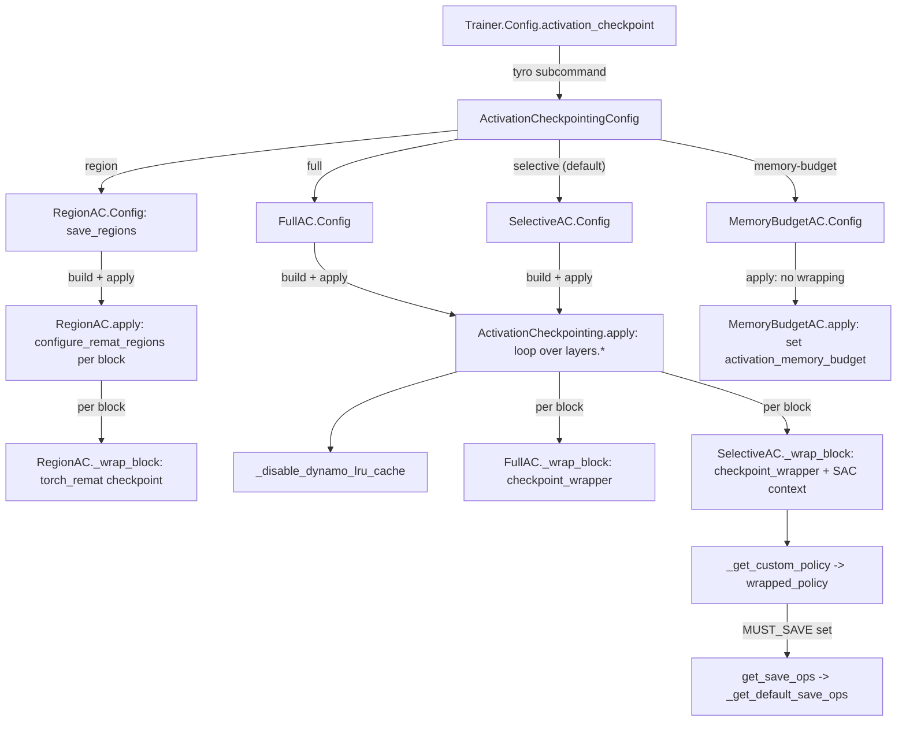

# Activation checkpointing (AC): full, selective and memory-budget recompute policies

## Overview
Activation checkpointing trades extra forward compute during backward for lower peak
activation memory. In TorchTitan it is a small policy hierarchy under
[`ActivationCheckpointing`](https://github.com/google-pytorch/torchtitan/blob/033f131322a8b5b026ac53d734c689d664442bf8/torchtitan/distributed/activation_checkpoint.py#L114 "torchtitan/distributed/activation_checkpoint#ActivationCheckpointing"):
a policy is chosen in the trainer config through the tagged union
[`ActivationCheckpointingConfig`](https://github.com/google-pytorch/torchtitan/blob/033f131322a8b5b026ac53d734c689d664442bf8/torchtitan/distributed/activation_checkpoint.py#L418 "torchtitan/distributed/activation_checkpoint#ActivationCheckpointingConfig")
(`selective`, `region`, `full`, `memory-budget`, or `none`), built, and applied **per transformer
block** by walking the model's `layers` container and replacing each block with a
checkpoint-wrapped version. The unit of checkpointing is therefore always one decoder block.
[`FullAC`](https://github.com/google-pytorch/torchtitan/blob/033f131322a8b5b026ac53d734c689d664442bf8/torchtitan/distributed/activation_checkpoint.py#L168 "torchtitan/distributed/activation_checkpoint#FullAC")
saves only block inputs and recomputes everything;
[`SelectiveAC`](https://github.com/google-pytorch/torchtitan/blob/033f131322a8b5b026ac53d734c689d664442bf8/torchtitan/distributed/activation_checkpoint.py#L187 "torchtitan/distributed/activation_checkpoint#SelectiveAC")
(the default) decides op by op, saving expensive compute and communication outputs and
recomputing cheap elementwise work plus every second matmul;
[`RegionAC`](https://github.com/google-pytorch/torchtitan/blob/033f131322a8b5b026ac53d734c689d664442bf8/torchtitan/distributed/activation_checkpoint.py#L298 "torchtitan/distributed/activation_checkpoint#RegionAC")
keeps only the regions the model code has named (for example `attention.qkv`) and recomputes
the rest of each block through `torch_remat`;
[`MemoryBudgetAC`](https://github.com/google-pytorch/torchtitan/blob/033f131322a8b5b026ac53d734c689d664442bf8/torchtitan/distributed/activation_checkpoint.py#L372 "torchtitan/distributed/activation_checkpoint#MemoryBudgetAC")
wraps nothing and instead hands a budget to the `torch.compile` partitioner.

## Diagram

Legend:
- `CFG` - [`Trainer`](https://github.com/google-pytorch/torchtitan/blob/033f131322a8b5b026ac53d734c689d664442bf8/torchtitan/trainer.py#L74 "torchtitan/trainer#Trainer")
- `U` - [`ActivationCheckpointingConfig`](https://github.com/google-pytorch/torchtitan/blob/033f131322a8b5b026ac53d734c689d664442bf8/torchtitan/distributed/activation_checkpoint.py#L418 "torchtitan/distributed/activation_checkpoint#ActivationCheckpointingConfig")
- `FC` - [`Config`](https://github.com/google-pytorch/torchtitan/blob/033f131322a8b5b026ac53d734c689d664442bf8/torchtitan/distributed/activation_checkpoint.py#L172 "torchtitan/distributed/activation_checkpoint#FullAC.Config")
- `SC` - [`Config`](https://github.com/google-pytorch/torchtitan/blob/033f131322a8b5b026ac53d734c689d664442bf8/torchtitan/distributed/activation_checkpoint.py#L197 "torchtitan/distributed/activation_checkpoint#SelectiveAC.Config")
- `MC` - [`Config`](https://github.com/google-pytorch/torchtitan/blob/033f131322a8b5b026ac53d734c689d664442bf8/torchtitan/distributed/activation_checkpoint.py#L379 "torchtitan/distributed/activation_checkpoint#MemoryBudgetAC.Config")
- `RC` - [`Config`](https://github.com/google-pytorch/torchtitan/blob/033f131322a8b5b026ac53d734c689d664442bf8/torchtitan/distributed/activation_checkpoint.py#L307 "torchtitan/distributed/activation_checkpoint#RegionAC.Config") with [`save_regions`](https://github.com/google-pytorch/torchtitan/blob/033f131322a8b5b026ac53d734c689d664442bf8/torchtitan/distributed/activation_checkpoint.py#L308 "torchtitan/distributed/activation_checkpoint#RegionAC.Config.save_regions")
- `RA` - [`apply`](https://github.com/google-pytorch/torchtitan/blob/033f131322a8b5b026ac53d734c689d664442bf8/torchtitan/distributed/activation_checkpoint.py#L351 "torchtitan/distributed/activation_checkpoint#RegionAC.apply")
- `RW` - [`_wrap_block`](https://github.com/google-pytorch/torchtitan/blob/033f131322a8b5b026ac53d734c689d664442bf8/torchtitan/distributed/activation_checkpoint.py#L338 "torchtitan/distributed/activation_checkpoint#RegionAC._wrap_block")
- `AP` - [`apply`](https://github.com/google-pytorch/torchtitan/blob/033f131322a8b5b026ac53d734c689d664442bf8/torchtitan/distributed/activation_checkpoint.py#L154 "torchtitan/distributed/activation_checkpoint#ActivationCheckpointing.apply")
- `LRU` - [`_disable_dynamo_lru_cache`](https://github.com/google-pytorch/torchtitan/blob/033f131322a8b5b026ac53d734c689d664442bf8/torchtitan/distributed/activation_checkpoint.py#L99 "torchtitan/distributed/activation_checkpoint#_disable_dynamo_lru_cache")
- `FW` - [`_wrap_block`](https://github.com/google-pytorch/torchtitan/blob/033f131322a8b5b026ac53d734c689d664442bf8/torchtitan/distributed/activation_checkpoint.py#L175 "torchtitan/distributed/activation_checkpoint#FullAC._wrap_block")
- `SW` - [`_wrap_block`](https://github.com/google-pytorch/torchtitan/blob/033f131322a8b5b026ac53d734c689d664442bf8/torchtitan/distributed/activation_checkpoint.py#L216 "torchtitan/distributed/activation_checkpoint#SelectiveAC._wrap_block")
- `POL` - [`_get_custom_policy`](https://github.com/google-pytorch/torchtitan/blob/033f131322a8b5b026ac53d734c689d664442bf8/torchtitan/distributed/activation_checkpoint.py#L249 "torchtitan/distributed/activation_checkpoint#SelectiveAC._get_custom_policy") returning [`wrapped_policy`](https://github.com/google-pytorch/torchtitan/blob/033f131322a8b5b026ac53d734c689d664442bf8/torchtitan/distributed/activation_checkpoint.py#L252 "torchtitan/distributed/activation_checkpoint#SelectiveAC.wrapped_policy")
- `GSO` - [`get_save_ops`](https://github.com/google-pytorch/torchtitan/blob/033f131322a8b5b026ac53d734c689d664442bf8/torchtitan/distributed/activation_checkpoint.py#L211 "torchtitan/distributed/activation_checkpoint#SelectiveAC.get_save_ops") -> [`_get_default_save_ops`](https://github.com/google-pytorch/torchtitan/blob/033f131322a8b5b026ac53d734c689d664442bf8/torchtitan/distributed/activation_checkpoint.py#L32 "torchtitan/distributed/activation_checkpoint#_get_default_save_ops")
- `MB` - [`apply`](https://github.com/google-pytorch/torchtitan/blob/033f131322a8b5b026ac53d734c689d664442bf8/torchtitan/distributed/activation_checkpoint.py#L401 "torchtitan/distributed/activation_checkpoint#MemoryBudgetAC.apply")

## Design rationale (why it's built this way)
- **Save what is expensive to recompute or to re-communicate.** The docstring of
  [`_get_default_save_ops`](https://github.com/google-pytorch/torchtitan/blob/033f131322a8b5b026ac53d734c689d664442bf8/torchtitan/distributed/activation_checkpoint.py#L32 "torchtitan/distributed/activation_checkpoint#_get_default_save_ops")
  names the two categories: "compute + comm". The compute list is the functorch
  partitioner's compute-intensive ops plus SDPA variants (including the
  `_scaled_dot_product_fused_attention_overrideable` entry used by out-of-tree backends),
  FlexAttention, `aten.linear`, the dtype-carrying `aten.mm.dtype` overload, `aten.max`
  ("for low precision training, always save the
  absolute maximum used to compute the scaling factor"), and `aten.topk` ("topk can be
  non-deterministic; save to keep MoE expert assignments stable between forward and
  recompute"). The comm list is `reduce_scatter_tensor`, `all_to_all_single` and the
  DeepEP/HybridEP dispatch/combine ops: recomputing those would repeat network traffic,
  not just FLOPs.
- **Every other matmul is recomputed.** Saving every matmul output would keep most of the
  block's memory; saving none makes backward redo the most expensive work.
  [`SelectiveAC`](https://github.com/google-pytorch/torchtitan/blob/033f131322a8b5b026ac53d734c689d664442bf8/torchtitan/distributed/activation_checkpoint.py#L187 "torchtitan/distributed/activation_checkpoint#SelectiveAC")
  "recomputes every second matmul to balance memory and compute", a fixed 50/50 split
  implemented by counting matmuls separately in the forward and the recompute pass so both
  passes make identical decisions.
- **Force-recompute tiny matmuls by shape.** `force_recompute_mm_shapes_by_fqns`
  (default `["moe.router.gate"]`) marks a matmul for recompute by its weight *shape*, and
  the field docstring warns that this applies to "ANY mm with shape matching (*, in) x
  (in, out)", not only the named module. The MoE router gate is cheap to recompute and
  would otherwise consume one of the "saved" matmul slots.
- **Optional ops are resolved defensively.** [`_resolve_ops`](https://github.com/google-pytorch/torchtitan/blob/033f131322a8b5b026ac53d734c689d664442bf8/torchtitan/distributed/activation_checkpoint.py#L74 "torchtitan/distributed/activation_checkpoint#_get_default_save_ops._resolve_ops")
  looks up conditionally registered ops (Inductor compiled-code HOP, varlen attention,
  DeepEP, HybridEP) by dotted path and "silently skipped if not registered", so one policy
  works across installs.
- **Customize by subclassing, not by flags.** The base-class docstring directs users to
  "subclass `SelectiveAC` and override `get_save_ops`" to tune the save set;
  [`get_save_ops`](https://github.com/google-pytorch/torchtitan/blob/033f131322a8b5b026ac53d734c689d664442bf8/torchtitan/distributed/activation_checkpoint.py#L211 "torchtitan/distributed/activation_checkpoint#SelectiveAC.get_save_ops")
  is the single hook.
- **Memory budget belongs to the compiler.** [`MemoryBudgetAC`](https://github.com/google-pytorch/torchtitan/blob/033f131322a8b5b026ac53d734c689d664442bf8/torchtitan/distributed/activation_checkpoint.py#L372 "torchtitan/distributed/activation_checkpoint#MemoryBudgetAC")
  "Requires the model to be compiled (validated in `Trainer.Config`)": the
  [`memory_budget`](https://github.com/google-pytorch/torchtitan/blob/033f131322a8b5b026ac53d734c689d664442bf8/torchtitan/distributed/activation_checkpoint.py#L380 "torchtitan/distributed/activation_checkpoint#MemoryBudgetAC.Config.memory_budget")
  knob (0.0 = checkpoint the whole compiled region, 1.0 = default runtime-optimized
  partition) is only meaningful to the min-cut partitioner that splits compiled forward and
  backward; its config's
  [`__post_init__`](https://github.com/google-pytorch/torchtitan/blob/033f131322a8b5b026ac53d734c689d664442bf8/torchtitan/distributed/activation_checkpoint.py#L397 "torchtitan/distributed/activation_checkpoint#MemoryBudgetAC.Config.__post_init__")
  now rejects values outside `[0, 1]`.
- **Regions declared by the model, not ops guessed by the policy.**
  [`RegionAC`](https://github.com/google-pytorch/torchtitan/blob/033f131322a8b5b026ac53d734c689d664442bf8/torchtitan/distributed/activation_checkpoint.py#L298 "torchtitan/distributed/activation_checkpoint#RegionAC") is "Retain model-declared regions and recompute the rest of
  each block": model code wraps sub-computations in `torch_remat` regions (the attention
  module names `qkv`, `inner_attention` and `wo`; the MoE router keeps its
  `routing_decision` region with `recompute=False` because "Routing choices must remain
  identical between forward and replay"), and
  [`save_regions`](https://github.com/google-pytorch/torchtitan/blob/033f131322a8b5b026ac53d734c689d664442bf8/torchtitan/distributed/activation_checkpoint.py#L308 "torchtitan/distributed/activation_checkpoint#RegionAC.Config.save_regions") picks which to retain by glob patterns
  relative to a transformer block ("Per-block remat policies are not currently supported").
  A TODO above the class says the plan is to "Migrate the existing AC implementations to
  RegionAC and keep RegionAC as the single activation-checkpointing implementation." 
- **A PP x SAC x Flex workaround is applied regardless of PP or Flex.**
  [`_disable_dynamo_lru_cache`](https://github.com/google-pytorch/torchtitan/blob/033f131322a8b5b026ac53d734c689d664442bf8/torchtitan/distributed/activation_checkpoint.py#L99 "torchtitan/distributed/activation_checkpoint#_disable_dynamo_lru_cache")
  runs at the start of the base `apply` (full and selective AC) and of
  `MemoryBudgetAC.apply`; the overriding `RegionAC.apply` does not call it. Its comment explains that a second PP microbatch triggers a
  dynamic-shape recompile, dynamo then picks the newest graph, and SAC's cached Inductor
  output from the static graph misses a symint; selecting graphs in insertion order avoids
  the assertion.

## Entry points
- [`ActivationCheckpointingConfig`](https://github.com/google-pytorch/torchtitan/blob/033f131322a8b5b026ac53d734c689d664442bf8/torchtitan/distributed/activation_checkpoint.py#L418 "torchtitan/distributed/activation_checkpoint#ActivationCheckpointingConfig")
  is the type of the [`Trainer`](https://github.com/google-pytorch/torchtitan/blob/033f131322a8b5b026ac53d734c689d664442bf8/torchtitan/trainer.py#L74 "torchtitan/trainer#Trainer")
  config field `activation_checkpoint`, defaulting to a `SelectiveAC.Config()`. Explicit
  tyro subcommand names are needed because "every nested Config class is named `Config`".
  The CLI form is `activation-checkpoint:full`, `:selective`, `:region`, `:memory-budget`,
  `:none`.
- [`apply`](https://github.com/google-pytorch/torchtitan/blob/033f131322a8b5b026ac53d734c689d664442bf8/torchtitan/distributed/activation_checkpoint.py#L154 "torchtitan/distributed/activation_checkpoint#ActivationCheckpointing.apply")
  is called from each model's `parallelize_fn` as `ac_config.build(dump_folder=...).apply(model)`,
  after the model's own `parallelize` (TP/EP sharding; CP is already in the model config)
  and before per-block `torch.compile` and FSDP. With pipeline parallelism it runs once per
  stage chunk.
- Recipes pick a policy per model size. The TPU recipes
  [`llama3_70b`](https://github.com/google-pytorch/torchtitan/blob/033f131322a8b5b026ac53d734c689d664442bf8/torchtitan/experiments/tpu/llama3/config_registry.py#L244 "torchtitan/experiments/tpu/llama3/config_registry#llama3_70b") and
  [`sft_llama3_8b_metamath`](https://github.com/google-pytorch/torchtitan/blob/033f131322a8b5b026ac53d734c689d664442bf8/torchtitan/experiments/tpu/llama3/config_registry.py#L376 "torchtitan/experiments/tpu/llama3/config_registry#sft_llama3_8b_metamath")
  (`max_context_length` 8192) and
  [`reg_trainer_qwen3_8b`](https://github.com/google-pytorch/torchtitan/blob/033f131322a8b5b026ac53d734c689d664442bf8/torchtitan/experiments/tpu/qwen3/config_registry.py#L289 "torchtitan/experiments/tpu/qwen3/config_registry#reg_trainer_qwen3_8b")
  (2048) use full AC, as does the upstream
  [`llama3_405b`](https://github.com/google-pytorch/torchtitan/blob/033f131322a8b5b026ac53d734c689d664442bf8/torchtitan/models/llama3/config_registry.py#L370 "torchtitan/models/llama3/config_registry#llama3_405b"); the upstream
  [`llama3_debugmodel`](https://github.com/google-pytorch/torchtitan/blob/033f131322a8b5b026ac53d734c689d664442bf8/torchtitan/models/llama3/config_registry.py#L63 "torchtitan/models/llama3/config_registry#llama3_debugmodel") and
  [`deepseek_v3_debugmodel`](https://github.com/google-pytorch/torchtitan/blob/033f131322a8b5b026ac53d734c689d664442bf8/torchtitan/models/deepseek_v3/config_registry.py#L66 "torchtitan/models/deepseek_v3/config_registry#deepseek_v3_debugmodel")
  use selective. Region AC is opt-in per recipe (a test recipe retains
  `attention.qkv`, `attention.inner_attention` and `attention.wo`).

## Mechanism (step-by-step)
1. **Build the policy.** The chosen config's `build(dump_folder=...)` constructs the policy
   object; [`__init__`](https://github.com/google-pytorch/torchtitan/blob/033f131322a8b5b026ac53d734c689d664442bf8/torchtitan/distributed/activation_checkpoint.py#L144 "torchtitan/distributed/activation_checkpoint#ActivationCheckpointing.__init__")
   only stores the [`config`](https://github.com/google-pytorch/torchtitan/blob/033f131322a8b5b026ac53d734c689d664442bf8/torchtitan/distributed/activation_checkpoint.py#L145 "torchtitan/distributed/activation_checkpoint#ActivationCheckpointing.config")
   and [`dump_folder`](https://github.com/google-pytorch/torchtitan/blob/033f131322a8b5b026ac53d734c689d664442bf8/torchtitan/distributed/activation_checkpoint.py#L146 "torchtitan/distributed/activation_checkpoint#ActivationCheckpointing.dump_folder")
   (used only by the memory-budget Pareto dump). The common knobs on
   [`Config`](https://github.com/google-pytorch/torchtitan/blob/033f131322a8b5b026ac53d734c689d664442bf8/torchtitan/distributed/activation_checkpoint.py#L123 "torchtitan/distributed/activation_checkpoint#ActivationCheckpointing.Config")
   are [`preserve_rng_state`](https://github.com/google-pytorch/torchtitan/blob/033f131322a8b5b026ac53d734c689d664442bf8/torchtitan/distributed/activation_checkpoint.py#L124 "torchtitan/distributed/activation_checkpoint#ActivationCheckpointing.Config.preserve_rng_state")
   (default true: stash and restore RNG so dropout-like ops recompute identically),
   [`determinism_check`](https://github.com/google-pytorch/torchtitan/blob/033f131322a8b5b026ac53d734c689d664442bf8/torchtitan/distributed/activation_checkpoint.py#L132 "torchtitan/distributed/activation_checkpoint#ActivationCheckpointing.Config.determinism_check")
   and [`debug`](https://github.com/google-pytorch/torchtitan/blob/033f131322a8b5b026ac53d734c689d664442bf8/torchtitan/distributed/activation_checkpoint.py#L138 "torchtitan/distributed/activation_checkpoint#ActivationCheckpointing.Config.debug"),
   all forwarded to `torch.utils.checkpoint`.
2. **Walk the blocks.** [`apply`](https://github.com/google-pytorch/torchtitan/blob/033f131322a8b5b026ac53d734c689d664442bf8/torchtitan/distributed/activation_checkpoint.py#L154 "torchtitan/distributed/activation_checkpoint#ActivationCheckpointing.apply")
   disables the dynamo LRU cache, fetches the `layers` submodule, and for each child calls
   [`_wrap_block`](https://github.com/google-pytorch/torchtitan/blob/033f131322a8b5b026ac53d734c689d664442bf8/torchtitan/distributed/activation_checkpoint.py#L148 "torchtitan/distributed/activation_checkpoint#ActivationCheckpointing._wrap_block")
   with `base_fqn = "layers.<id>"`, then re-registers the wrapped module under the same
   name. Embedding, final norm and LM head are never checkpointed.
3. **Full AC.** [`_wrap_block`](https://github.com/google-pytorch/torchtitan/blob/033f131322a8b5b026ac53d734c689d664442bf8/torchtitan/distributed/activation_checkpoint.py#L175 "torchtitan/distributed/activation_checkpoint#FullAC._wrap_block")
   wraps the block in PyTorch's (non-reentrant) checkpoint wrapper. Only the block's inputs
   survive forward; the whole block is re-run in backward, costing roughly one extra
   forward per step.
4. **Selective AC: compute the force-recompute shapes.** [`_wrap_block`](https://github.com/google-pytorch/torchtitan/blob/033f131322a8b5b026ac53d734c689d664442bf8/torchtitan/distributed/activation_checkpoint.py#L216 "torchtitan/distributed/activation_checkpoint#SelectiveAC._wrap_block")
   builds the save set from [`get_save_ops`](https://github.com/google-pytorch/torchtitan/blob/033f131322a8b5b026ac53d734c689d664442bf8/torchtitan/distributed/activation_checkpoint.py#L211 "torchtitan/distributed/activation_checkpoint#SelectiveAC.get_save_ops"),
   then scans the block's submodules whose FQN contains any entry of
   [`force_recompute_mm_shapes_by_fqns`](https://github.com/google-pytorch/torchtitan/blob/033f131322a8b5b026ac53d734c689d664442bf8/torchtitan/distributed/activation_checkpoint.py#L198 "torchtitan/distributed/activation_checkpoint#SelectiveAC.Config.force_recompute_mm_shapes_by_fqns"),
   requiring each to be an `nn.Linear`, and records `(in, out)` weight shapes. `aten.mm`
   (both the default and the `dtype` overload) and `aten.linear` are treated as matmuls
   because "some backends (e.g. PrivateUse1)
   register aten.linear as a leaf op instead of decomposing it into aten.mm".
5. **Selective AC: decide per op.** The block is wrapped with a checkpoint wrapper whose
   `context_fn` creates selective-checkpoint contexts from
   [`_get_custom_policy`](https://github.com/google-pytorch/torchtitan/blob/033f131322a8b5b026ac53d734c689d664442bf8/torchtitan/distributed/activation_checkpoint.py#L249 "torchtitan/distributed/activation_checkpoint#SelectiveAC._get_custom_policy").
   Each context has fresh forward/recompute matmul counters, and
   [`wrapped_policy`](https://github.com/google-pytorch/torchtitan/blob/033f131322a8b5b026ac53d734c689d664442bf8/torchtitan/distributed/activation_checkpoint.py#L252 "torchtitan/distributed/activation_checkpoint#SelectiveAC.wrapped_policy")
   answers for every dispatched op: a CUDA-to-CPU copy is `MUST_SAVE` (avoids repeating
   MoE host syncs); a matmul whose (normalized) weight shape is in the force-recompute set is
   `PREFER_RECOMPUTE`; any other op in the save set is `MUST_SAVE`, except matmuls on an
   even count, which are `PREFER_RECOMPUTE`; everything else (norms, activations, RoPE,
   elementwise) is recomputed.
6. **Region AC.** [`apply`](https://github.com/google-pytorch/torchtitan/blob/033f131322a8b5b026ac53d734c689d664442bf8/torchtitan/distributed/activation_checkpoint.py#L351 "torchtitan/distributed/activation_checkpoint#RegionAC.apply")
   takes the children of `layers`, calls the block's `configure_remat_regions` with
   `save_regions` (which stamps each submodule's qualified name and the save patterns so
   the model's region calls know whether to retain or recompute), then
   [`_wrap_block`](https://github.com/google-pytorch/torchtitan/blob/033f131322a8b5b026ac53d734c689d664442bf8/torchtitan/distributed/activation_checkpoint.py#L338 "torchtitan/distributed/activation_checkpoint#RegionAC._wrap_block") replaces the block's `forward`
   with a `torch_remat` checkpoint named `layers.<id>` (in place, not a wrapper module).
   Its config's [`__post_init__`](https://github.com/google-pytorch/torchtitan/blob/033f131322a8b5b026ac53d734c689d664442bf8/torchtitan/distributed/activation_checkpoint.py#L326 "torchtitan/distributed/activation_checkpoint#RegionAC.Config.__post_init__")
   rejects `preserve_rng_state=True` ("Register a torch_remat RecomputeStateHook for random
   state used in retained regions") and the `debug` option.
7. **Memory-budget AC.** [`apply`](https://github.com/google-pytorch/torchtitan/blob/033f131322a8b5b026ac53d734c689d664442bf8/torchtitan/distributed/activation_checkpoint.py#L401 "torchtitan/distributed/activation_checkpoint#MemoryBudgetAC.apply")
   overrides the base walk entirely: it sets functorch's `activation_memory_budget` to
   [`memory_budget`](https://github.com/google-pytorch/torchtitan/blob/033f131322a8b5b026ac53d734c689d664442bf8/torchtitan/distributed/activation_checkpoint.py#L380 "torchtitan/distributed/activation_checkpoint#MemoryBudgetAC.Config.memory_budget")
   (default 0.5) and, with [`visualize_memory_budget_pareto`](https://github.com/google-pytorch/torchtitan/blob/033f131322a8b5b026ac53d734c689d664442bf8/torchtitan/distributed/activation_checkpoint.py#L389 "torchtitan/distributed/activation_checkpoint#MemoryBudgetAC.Config.visualize_memory_budget_pareto"),
   dumps SVGs of the runtime-vs-memory Pareto curve to `<dump_folder>/memory_budget_pareto`.
   The setting is process-global and takes effect when the compiled model is partitioned.

## Key data structures
- [`ActivationCheckpointingConfig`](https://github.com/google-pytorch/torchtitan/blob/033f131322a8b5b026ac53d734c689d664442bf8/torchtitan/distributed/activation_checkpoint.py#L418 "torchtitan/distributed/activation_checkpoint#ActivationCheckpointingConfig"):
  `Annotated` union of the four policy configs plus `None`.
- [`Config`](https://github.com/google-pytorch/torchtitan/blob/033f131322a8b5b026ac53d734c689d664442bf8/torchtitan/distributed/activation_checkpoint.py#L197 "torchtitan/distributed/activation_checkpoint#SelectiveAC.Config")
  (selective): adds `force_recompute_mm_shapes_by_fqns`.
  [`Config`](https://github.com/google-pytorch/torchtitan/blob/033f131322a8b5b026ac53d734c689d664442bf8/torchtitan/distributed/activation_checkpoint.py#L379 "torchtitan/distributed/activation_checkpoint#MemoryBudgetAC.Config")
  (memory budget): `memory_budget`, `visualize_memory_budget_pareto`.
  [`Config`](https://github.com/google-pytorch/torchtitan/blob/033f131322a8b5b026ac53d734c689d664442bf8/torchtitan/distributed/activation_checkpoint.py#L307 "torchtitan/distributed/activation_checkpoint#RegionAC.Config")
  (region): `save_regions` plus a
  [`preserve_rng_state`](https://github.com/google-pytorch/torchtitan/blob/033f131322a8b5b026ac53d734c689d664442bf8/torchtitan/distributed/activation_checkpoint.py#L320 "torchtitan/distributed/activation_checkpoint#RegionAC.Config.preserve_rng_state") that "Must
  remain false".
  [`Config`](https://github.com/google-pytorch/torchtitan/blob/033f131322a8b5b026ac53d734c689d664442bf8/torchtitan/distributed/activation_checkpoint.py#L172 "torchtitan/distributed/activation_checkpoint#FullAC.Config")
  (full): only the common fields.
- The save set: a dict/set mapping op overloads to `CheckpointPolicy.MUST_SAVE`, rebuilt on
  every block wrap from [`_get_default_save_ops`](https://github.com/google-pytorch/torchtitan/blob/033f131322a8b5b026ac53d734c689d664442bf8/torchtitan/distributed/activation_checkpoint.py#L32 "torchtitan/distributed/activation_checkpoint#_get_default_save_ops").
- Per-context `meta` counters `forward_mm_count` / `recompute_mm_count` inside the policy
  closure; they reset per checkpointed region because a new context is created per call.

## Dynamics (design intent)
- **Memory vs recompute ladder.** `none` (all activations), `selective` (compute/comm
  outputs and half the matmuls kept), `region` (exactly the named regions kept), `full`
  (block inputs only), with `memory-budget` as a continuous dial for compiled models. Full AC re-runs each block's forward once in
  backward; SAC re-runs the cheap ops plus half the matmuls.
- **Wrap order.** In the model parallelizers AC wraps blocks after the model's TP/EP
  sharding has been applied (CP attention is already part of the model config) and before
  per-block compile and FSDP, so compile traces the checkpointed block and FSDP
  wraps the checkpoint wrapper rather than the raw block.
- **Eager and graph parity.** The graph-trainer tests assert that the traced
  "eager-compatible SAC policy (alternating mm save/recompute)" has a peak memory within a
  ratio of eager `SelectiveAC`, and that graph full recompute is bitwise identical in loss
  and gradients to eager `FullAC`, which is how the eager policy serves as the reference
  semantics for graph rematerialization.

> [!inferred]
> TPU-specific behavior at this pin:
> - The module imports its checkpoint wrapper from the TPU experiment
>   (`ptd_checkpoint_wrapper_with_early_stop`, with the upstream import commented out) and
>   always passes `early_stop=False`, so the non-reentrant recompute replays the entire
>   block instead of stopping once the needed tensors are regenerated. The wrapper raises if
>   `early_stop=True`, noting early stopping is not currently supported in the fork's build.
> - The D2H `MUST_SAVE` rule tests for `"cuda"` in the device string, so it never fires on
>   TPU; host syncs inside a block would be replayed on recompute.
> - The `aten.linear` leaf-op branch exists for PrivateUse1 backends such as TorchTPU,
>   where linear is not decomposed into `mm`.
> - The TPU graph trainer ignores this eager config: the comment in
>   [`qwen3_8b`](https://github.com/google-pytorch/torchtitan/blob/033f131322a8b5b026ac53d734c689d664442bf8/torchtitan/experiments/tpu/qwen3/config_registry.py#L375 "torchtitan/experiments/tpu/qwen3/config_registry#qwen3_8b")
>   says "GraphTrainer does not apply this eager AC config; its graph rematerialization
>   policy is selected in TPUConfig", via `graph_trainer_memory_policy` (the graph
>   trainer's `default`/`full`/`eager`/`sac_and_offload` plus TPU `full_and_offload` and
>   `full_and_scan_offload`). The eager TPU lanes (the Llama3 70B, SFT Llama3 8B and
>   regression Qwen3 8B recipes) use full AC.

## Edge cases
- `apply` requires a `layers` submodule whose children are the blocks; a model without
  one fails in `get_submodule`.
- `force_recompute_mm_shapes_by_fqns` raises if a matching FQN is not an `nn.Linear`, and
  its shape match can silently capture unrelated matmuls of the same shape (a gate of
  `(dim, num_experts)` shares a shape with any other `dim x num_experts` projection).
- `MemoryBudgetAC` with a budget outside `[0, 1]`, or without `--compile.enable` and
  `model` in `--compile.components`, is rejected; SAC with FlexAttention is rejected when `spmd_types`
  typechecking is on.
- Region AC does nothing useful for a model that declares no `torch_remat` regions, and
  unmatched `save_regions` patterns are not validated yet (a TODO defers it until it "can
  account for save regions across all pipeline stages").
- Retained `torch_remat` regions only take effect under Region AC. The MoE aux-loss
  metric, accumulated in such a region, is replayed by `FullAC`/`SelectiveAC` and its
  logged value over-counts ("2x under `FullAC`"); the gradient is unaffected.
- Some features require a specific policy: the MinimalAsyncEP MoE backend demands full AC
  (see [expert-parallel](expert-parallel.md)).
- `preserve_rng_state=True` is the default; the field docstring says it stashes and
  restores RNG state per checkpoint and "may be slower", and is needed for output identical
  to a non-checkpointed pass.

## Open questions
- Why `early_stop` must be disabled for the TPU build is not explained beyond "not
  currently supported".
- The graph-trainer memory policies that replace this module on the TPU graph lane are
  defined outside this packet; how each maps onto the eager policies here (beyond the
  `eager` and `full` parity tests) is not covered.
- No test in the evidence measures the recompute-time overhead of SAC versus full AC on
  TPU.

## See also
- [Torch compile integration](torch-compile-integration.md) - compile order and the memory-budget partitioner.
- [FSDP sharding](fsdp-sharding.md) - applied after AC; reshard policy interacts with recompute.
- [Pipeline parallel](pipeline-parallel.md) - AC applied per stage chunk; the LRU-cache workaround.
- [Expert parallel](expert-parallel.md) - MoE comm ops in the save list; full-AC requirement.
- [Job configuration](job-configuration.md) - the `activation_checkpoint` field and CLI subcommands.
- [TorchTPU backend](torchtpu-backend.md) - TPU recipes and the graph trainer's remat policy.

## Recent changes
- `fa627bf2` updates TorchTitan from upstream `d771abb0`: it adds `RegionAC`
  (`activation-checkpoint:region`, `torch_remat` regions declared in attention, MoE routing
  and the aux-loss metric), adds `aten.mm.dtype` to the SAC save list and matmul counter,
  and validates `memory_budget` to `[0, 1]`.
- The TPU recipe commits that touch the cited config registries (`56cf9dde`, `2bb8630c`,
  `bf4af2be`, `033f1313` XLA scheduling and ICI pipelining flags for scan recipes;
  `58c3e9b6` and `3d57bb2c` float8 training for Llama3 70B with a lazy torchao import; `801355af` LR schedule; `ed34fbce`
  topology-aware mesh; the Qwen3 FLOP-convention and Tokamax commits) leave each recipe's
  AC policy unchanged.
- [all changes in 033f131322](../changes/033f131322.md)
